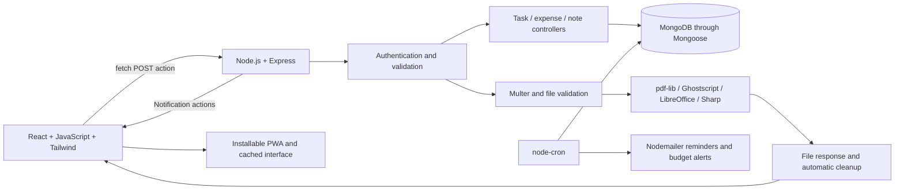

# UtilityHub — College Report Starter

Adapt this to your college's format and add your own screenshots and observations.

## Abstract

UtilityHub is a web application that brings six daily utilities into one interface: PDF tools, document conversion, task management with reminders, monthly expense tracking, sticky notes, and image compression. React, JavaScript, and Tailwind CSS provide the responsive interface. Node.js and Express process named POST actions, while MongoDB stores accounts and private workspace records. Authentication uses hashed passwords and signed tokens. PDF and document processing use JavaScript libraries, Ghostscript, and LibreOffice; image processing uses Sharp. Input validation, isolated temporary folders, automatic cleanup, and request limits protect file operations. Scheduled jobs provide reminders and budget-alert email delivery. Expense charts and CSV/PDF exports support monthly review. Shared dark mode and installable PWA support complete the application. The project demonstrates a modular full-stack system with a deliberately limited feature scope.

## Architecture

Describe the browser, server, and database as three parts. Trace one PDF request from React through the action handler, file validation, processing, download, and cleanup. Trace a task from MongoDB storage through cron scheduling, bell notification, and optional email. Explain expense storage in integer paise, month-based summaries, budgets, and charts. Explain ownership checks for notes and all private records.

## Modules

| Module                | Main responsibility                                     |
| --------------------- | ------------------------------------------------------- |
| Account and dashboard | Register/login and private workspace summary            |
| PDF tools             | Compress, merge/reorder, split, create from text/images |
| Document converter    | DOCX/PDF/TXT/image conversion within documented limits  |
| Tasks and reminders   | CRUD, deadlines, completion, filters, reminders         |
| Expense tracker       | Expense CRUD, monthly budgets/alerts, charts, export    |
| Sticky notes          | Colored private notes, pins, search and editing         |
| Image compressor      | Quality/format controls and bounded resizing            |

## Validation and results

Document the test counts and screenshots from your own run. Include a valid file, an invalid file, an upload over 80 MB, a private-record ownership check, a due reminder, a budget warning, a pinned note, and an image resize. Distinguish server temporary-file cleanup from the browser's download UI. A normal website cannot reliably know when saving completes; this application clears its form when the download starts.

## Future scope

Possible improvements include OCR, more faithful PDF-to-Word layouts, password recovery, recurring tasks/expenses, closed-app Web Push reminders, optional encrypted notes, and controlled offline synchronization. These are future ideas, not included features.

## Viva preparation

Be ready to explain React state and components, the Express action handler, MongoDB models, bcrypt/JWT, file validation, temporary cleanup, cron jobs, ownership checks, integer paise, Recharts, and PWA caching. Study [PROJECT_EXPLANATION.md](PROJECT_EXPLANATION.md) and the short function comments. Explain the work in your own words and follow your college's rules for acknowledging assistance.
