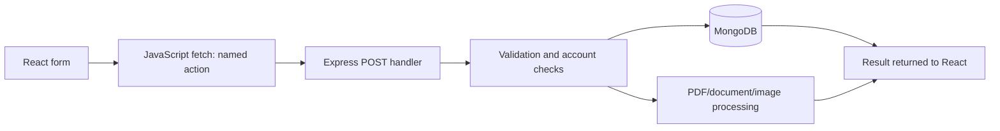

# UtilityHub: short project explanation

## Introduction

“UtilityHub combines six daily tools: PDF tools, document conversion, tasks and reminders, expenses, sticky notes, and image compression. I used React and JavaScript for the screens, Tailwind CSS and CSS for styling, Node.js with Express for processing, and MongoDB for saved records.”

Public file tools work without login. Tasks, expenses, notes, and the dashboard require an account. Dark mode and PWA installation are shared app support.

## How it works



React runs in the browser. Node runs JavaScript on the server. Express receives **POST `/server?action=NAME`** and selects a function from a fixed list. This is still HTTP communication; the project uses named actions instead of resource-based REST routers.

For example:

```javascript
const { data } = await sendAction("createTask", {
  title: "Submit mini project",
  priority: "high",
});
```

`TaskForm.jsx` collects the fields. `services/server.js` sends them and adds the login token. `serverActions.js` selects `createTask` and checks the account. `taskController.js` validates the values and saves the task with its owner's ID. MongoDB returns the saved task so React can refresh the list.

## Six feature flows

1. **PDF tools:** upload PDFs/images or type text; validate input; merge, split, compress, or create the PDF; return a downloadable file. pdf-lib creates/copies pages, while Ghostscript handles compression.
2. **Document converter:** choose a format and upload a file. LibreOffice handles Word conversion; selectable PDF text can be extracted for an editable Word result. Original PDF layout/images and OCR are not supported.
3. **Tasks and reminders:** save a title, priority, category, and optional due time. A Node cron job checks due tasks every minute. It creates a bell reminder and sends an email when configured. Browser reminders need permission and an open app/tab.
4. **Expenses:** save amounts as whole paise to avoid rounding errors. Group records by month/category/date, compare them to budgets, draw Recharts charts, and export CSV/PDF reports.
5. **Sticky notes:** save private text, a color, and an optional pin. List pinned notes first and allow search/edit/delete.
6. **Image compressor:** upload JPG/PNG, select output format/quality/dimensions, and use Sharp to compress or resize without enlarging the image.

## Files and cleanup

The upload limit is 80 MB per file and 80 MB combined for multiple files. Each request gets separate temporary input/output folders. Multer receives the upload; Express checks size, format, contents, and dimensions before processing. Server job files are removed after sending the result. A periodic sweep removes abandoned folders within ten minutes.

React receives binary data as a Blob and displays a Download button. Clicking Download starts the browser download, clears the uploaded files/text and result panel, and prepares the form for another use. The browser's own Save dialog cannot be closed by the website, and saving completion cannot be detected reliably. Cleanup therefore happens when downloading starts. Original local files and saved database records are retained.

## Main terms

| Term      | Meaning                                         |
| --------- | ----------------------------------------------- |
| Component | A reusable part of a React screen               |
| State     | Values remembered by a React component          |
| Action    | The name of work React asks Express to perform  |
| Model     | The fields and rules for one MongoDB collection |
| bcrypt    | Hashes account passwords before saving          |
| JWT       | A signed token checked for private actions      |
| Multer    | Receives uploaded files                         |
| Blob      | Binary data held by the browser                 |
| Cron job  | A function that runs on a schedule              |
| PWA       | An installed website with a cached interface    |

## Code organization and optimization

`frontend/src/pages` contains screens; `components` contains reusable forms/controls; `hooks` handles shared React behavior; `services/server.js` handles communication. On the backend, controllers handle actions, models define records, services perform processing and scheduled work, and middleware handles authentication, uploads, and errors.

The catalogue and routes contain only six tools. Unused components, packages, styles, and the external currency service were removed. Larger pages load when opened. App functions have short purpose comments immediately inside their bodies or beside short arrow-function expressions.

## Demonstration order

Show the six-card home page, create/download a PDF, and show the cleared form. Sign in, add/complete a task, add an expense and budget, save/pin a note, then compress an image. Show the installed PWA and explain that only its interface is cached; every tool still needs the server. Use the comments and source guide to explain the implementation in your own words.
