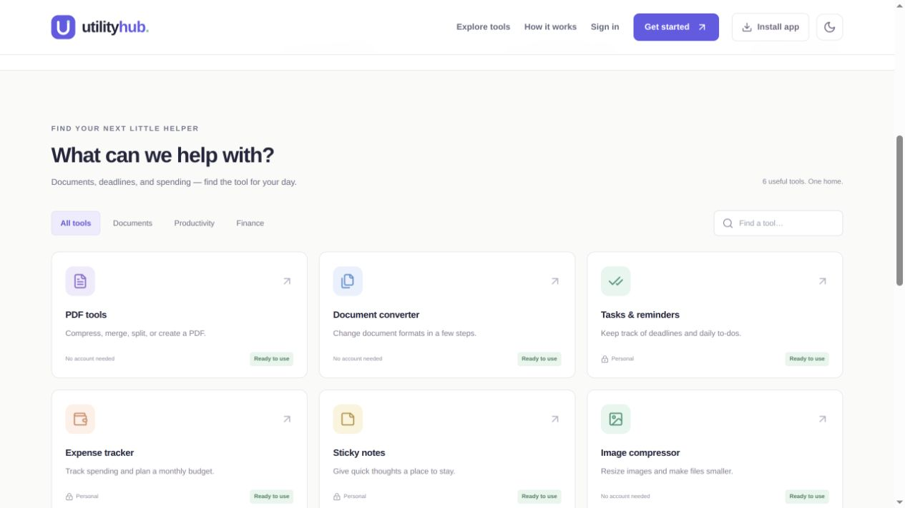
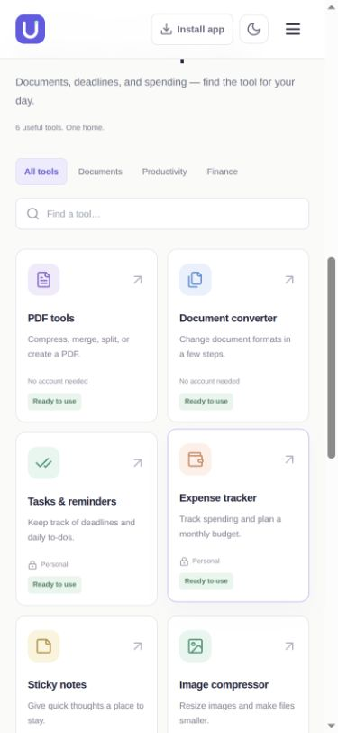
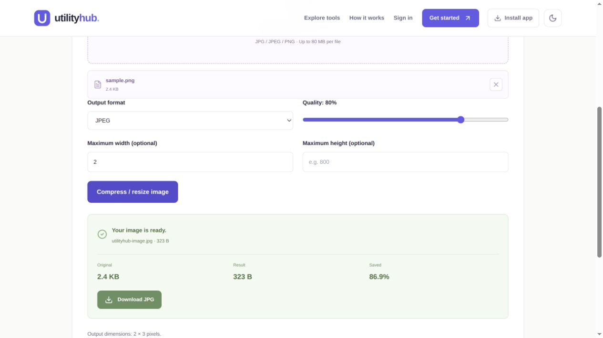
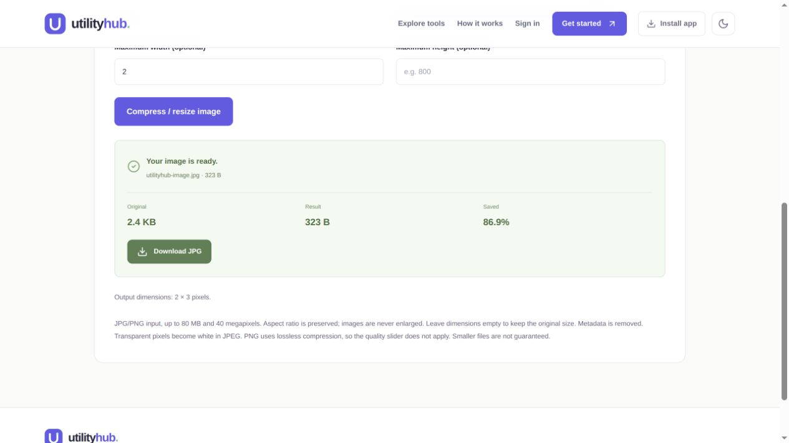

# UtilityHub

A college mini project with six tools: **PDF tools, document converter, tasks and reminders, expense tracker, sticky notes, and image compressor**.

**Live website:** [utilityhub-phi.vercel.app](https://utilityhub-phi.vercel.app/) · **Backend health:** [utilityhub-api-rnnc.onrender.com/health](https://utilityhub-api-rnnc.onrender.com/health)

Built with React, JavaScript, Tailwind CSS, Node.js, and Express. MongoDB stores private records. A single Express POST handler runs named actions; the frontend uses the browser's built-in `fetch` function. There are no resource-based REST routers or Axios dependency.

Start with [PROJECT_EXPLANATION.md](PROJECT_EXPLANATION.md) for a short presentation guide. The `frontend` and `backend` folders contain the current code. [SOURCE_CODE.md](SOURCE_CODE.md) and [SOURCE_FILES.txt](SOURCE_FILES.txt) are an earlier project snapshot and do not include the newer offline changes. Report material is in [COLLEGE_REPORT.md](COLLEGE_REPORT.md).

For cloud hosting, see [DEPLOYMENT.md](DEPLOYMENT.md): Vercel Hobby frontend, Render Free Docker backend, and MongoDB Atlas Free, including the free-plan reminder and email limitations.

## Features

| Tool                | What it does                                                                                                                        | Login |
| ------------------- | ----------------------------------------------------------------------------------------------------------------------------------- | ----- |
| PDF tools           | Compress, merge/reorder, split selected pages, create PDFs from images or text                                                      | No    |
| Document converter  | DOCX→PDF, selectable-text PDF→DOCX, UTF-8 TXT→PDF, JPG/PNG→PDF | No |
| Tasks and reminders | Create/edit/delete, priorities, categories, due times, completion, search and filters; in-app, browser and optional email reminders | Yes   |
| Expense tracker     | Monthly expenses, overall/category budgets, 80%/exceeded alerts, charts, CSV/PDF export                                             | Yes   |
| Sticky notes        | Private colored notes, pinning, search, pagination                                                                                  | Yes   |
| Image compressor    | JPG/PNG input; JPEG/PNG/WebP output; quality and bounded resizing                                                                   | No    |

Login, the dashboard, dark/light mode, responsive navigation, and installable PWA support remain shared app features. After the PWA is cached and a user has signed in while connected, its file tools and account workspace work offline. Offline edits are stored in this browser and sync when the app reconnects. PDF-to-DOCX reconstructs detected table grids as editable Word tables; offline DOCX-to-PDF preserves tables and supported embedded images; PDF compression uses structural optimization rather than Ghostscript. Sign-in, registration, email, and guaranteed closed-app reminders require connectivity. See [PWA_GUIDE.md](PWA_GUIDE.md) for details.

## Technology

| Part              | Libraries                                                             |
| ----------------- | --------------------------------------------------------------------- |
| Frontend          | React, Vite, JavaScript, Tailwind CSS, React Router, Lucide, Recharts |
| Server            | Node.js, Express, Mongoose, JWT, bcryptjs, multer                     |
| Files             | pdf-lib, fontkit, PDF.js, pdf-parse, docx, canvas, Sharp, image-size, yauzl                 |
| Native conversion | Ghostscript and LibreOffice through `execFile`                        |
| Reminders         | node-cron, Nodemailer                                                 |
| PWA               | Web app manifest, Workbox, vite-plugin-pwa                            |

Only the six feature modules are included. Larger document, image, expense, and note pages load when opened. Both application folders must be present when building the frontend because the PDF converter shares `backend/src/utils/documentLayout.js` and `backend/src/utils/pdfStructure.js`.

## Requirements

Install Node.js **22.16 or newer**, MongoDB Community Server, Ghostscript, and LibreOffice. Keep Node/npm and native executables on PATH, or configure the executable paths below.

Official downloads: [Node.js](https://nodejs.org/en/download), [MongoDB Community](https://www.mongodb.com/try/download/community), [Ghostscript](https://www.ghostscript.com/releases/), [LibreOffice](https://www.libreoffice.org/download/download-libreoffice/).

### Ubuntu

Install Node.js and MongoDB using their official Linux installation instructions. MongoDB Compass is a database viewer; the MongoDB server itself must also run. For the native document tools:

```bash
sudo apt update
sudo apt install ghostscript libreoffice
node --version
npm --version
gs --version
soffice --headless --version
```

If MongoDB was installed as a service, start it with `sudo systemctl start mongod`. Otherwise start your configured local `mongod` with its existing data directory. The connection used by this project is `mongodb://127.0.0.1:27017/utilityhub`.

### Windows

1. Install Node using its `.msi` installer with npm/Add to PATH enabled; reopen the terminal.
2. Install MongoDB Community with **Install MongoDB as a Service** selected. Start MongoDB in Windows Services, or run `net start MongoDB` in an Administrator terminal.
3. Install 64-bit Ghostscript. Locate its `bin/gswin64c.exe` and set `GHOSTSCRIPT_BIN` if it is not on PATH.
4. Install LibreOffice. For headless Windows conversion, set `SOFFICE_BIN=C:/Program Files/LibreOffice/program/soffice.com`.
5. Check `node --version` and `npm --version`. If PowerShell blocks `npm.ps1`, use `npm.cmd` or Command Prompt.

Use forward slashes in environment paths. Example: `GHOSTSCRIPT_BIN=C:/Program Files/gs/gsYOUR_VERSION/bin/gswin64c.exe`; replace the version folder with the one actually installed.

## Run the project

Clone this repository into a folder named `utilityhub`:

```bash
git clone https://github.com/Nishant-095/miniproject.git utilityhub
```

There are two separate application folders and no root npm package. Run installation commands inside the correct folder.

### Backend

```bash
cd utilityhub/backend
npm install
cp .env.example .env
```

On Windows, use `copy .env.example .env` instead of `cp`. Edit `.env`:

```dotenv
PORT=5000
MONGO_URI=mongodb://127.0.0.1:27017/utilityhub
JWT_SECRET=your-own-random-secret-of-at-least-32-characters
CLIENT_URL=http://localhost:5173
EMAIL_USER=
EMAIL_PASS=
```

Generate a secret using `node -e "console.log(require('crypto').randomBytes(32).toString('hex'))"` and paste its output into `.env`. Keep the real file private. Configure optional `GHOSTSCRIPT_BIN` and `SOFFICE_BIN` if required.

Start MongoDB, then:

```bash
npm start
```

The terminal should show `MongoDB connected.` and `UtilityHub server: http://localhost:5000/server`.

### Frontend

Open another terminal:

```bash
cd utilityhub/frontend
npm install
cp .env.example .env
npm run dev
```

The frontend example uses `VITE_SERVER_URL=http://localhost:5000`. Open **[http://localhost:5173](http://localhost:5173)**. Both frontend and backend terminals must stay open. Register an account to use tasks, expenses, and notes.

For the installed PWA, stop the dev server and use:

```bash
npm run build
npm run preview -- --host 127.0.0.1 --port 5173 --strictPort
```

Use localhost consistently. A different host/port requires the matching `CLIENT_URL` and frontend environment setting. The development server does not register the production worker. When upgrading an installed app, choose **Update now** to load the current six-tool build. Read [PWA_GUIDE.md](PWA_GUIDE.md) for installation and cache details.

Check the Express server with a POST action:

```bash
node -e "fetch('http://localhost:5000/server?action=serverHealth',{method:'POST'}).then(r=>r.json()).then(console.log)"
```

A normal address-bar visit is GET and does not execute actions.

## File handling and automatic cleanup

- **80 MB per file and 80 MB combined per request**, up to 10 files. 80 MB means 80 × 1,024 × 1,024 bytes.
- PDFs support at most 1,000 pages, including the combined result of merging files. The same page limit applies to the offline PWA. Password-protected PDFs are rejected. Split ranges use one-based page numbers, such as `1-3,5`.
- PDF-to-Word conversion supports up to 10 million extracted text characters online and offline. The separate TXT/typed-text PDF maker limit remains 100,000 input characters. Large document conversion requests allow up to five minutes.
- Images are limited to 40 megapixels each, 60 megapixels combined, and 12,000 pixels on either input side. Resize output dimensions must be 1–6,000 pixels. Images are never enlarged; metadata is removed. Transparent pixels become white in JPEG. PNG compression is lossless, so quality does not apply.
- TXT/text input supports 100,000 characters. TXT must be UTF-8. Unsupported font characters return a readable error.
- DOCX validation checks archive contents and expansion size. LibreOffice runs with an isolated profile for each job.
- Three heavy jobs may run at once. Native commands use fixed argument arrays and timeouts, without a shell.
- Each job gets separate UUID upload/output folders. Filenames, MIME types, file signatures, dimensions, and size are checked.
- Server files are deleted after sending the result, including cleanup on processing failures or disconnected clients. A minute-based sweep removes abandoned jobs within ten minutes.
- React holds the result in memory. Clicking **Download** starts saving and clears the selected files, applicable text/page ranges, and result/download panel. The temporary browser download URL is released after 60 seconds. Original local files and saved expenses/notes/tasks are retained.

The browser owns its Save dialog and download tray. A normal web page cannot reliably detect save completion or close those browser controls. Form cleanup happens on **download start**. If you cancel Save, run the tool again.

PDF-to-DOCX analyzes native text coordinates, font styles, page sizes, columns and ruled table grids. It places editable text boxes and real Word tables at source positions and copies raster images and vector graphs as movable images. Blank cells, simple merges and rectangular image crops are retained. Scans stay images; no OCR runs. Fonts may substitute; rotated text can vary between Word editors. Borderless tables, complex clipping, reading order and arbitrary layouts may vary. Unsupported graphical effects use a cropped image of that region. Offline Word-to-PDF preserves these positioned outputs as well as ordinary tables and supported embedded images. Compression keeps the original when the processed file would be larger. Report PDFs support the bundled font; CSV preserves Unicode when a report contains unsupported glyphs.

## Reminders and budget alerts

Task reminders are checked every minute and on server startup. The bell works without email settings. Browser notifications require permission and an open app/tab; installing the PWA does not add closed-app push notifications.

For Gmail, use your address as `EMAIL_USER` and an app password as `EMAIL_PASS`. An ordinary account password is not an app password. Other providers can use `SMTP_HOST`, `SMTP_PORT`, `SMTP_SECURE`, and `EMAIL_FROM`. Restart the backend after changing `.env`. Keep credentials out of source control.

Expense amounts are stored as whole paise. Dates remain calendar dates. Budgets show a warning at 80% and an exceeded alert strictly above 100%, overall and per category. Email outboxes retry failures and prevent duplicate sends. Reports cover the selected month across all list pages, with a 5,000-row export limit.

## Express action handler

Every row below uses **POST `/server?action=NAME`**. Normal fields are JSON; files use `FormData`. A signed-in action requires `Authorization: Bearer TOKEN`, added by `frontend/src/services/server.js`.

| Action name                   | Login | Purpose / main fields                                      |
| ----------------------------- | ----- | ---------------------------------------------------------- |
| `serverHealth`                | No    | Check Express and the MongoDB connection                   |
| `register`, `login`           | No    | Name/email/password registration; email/password login     |
| `getAccount`                  | Yes   | Current account, without its password hash                 |
| `offlineSnapshot`             | Yes   | Account records used to prepare the offline workspace      |
| `programStatus`               | No    | Check Ghostscript and LibreOffice                          |
| `compressPdf`                 | No    | PDF `file`, `level`: low/medium/high                       |
| `mergePdfs`                   | No    | Ordered repeated `files` fields, 2–10 PDFs                 |
| `splitPdf`                    | No    | PDF `file`, `ranges`: for example 1-3,5                    |
| `imagesToPdf`                 | No    | Ordered repeated JPG/PNG `files` fields                    |
| `textToPdf`                   | No    | JSON `text`, up to 100,000 characters                      |
| `convertDocument` | No | `file`, output `format`: pdf/docx |
| `processImage`                | No    | JPG/PNG `file`, `format`, `quality`, optional width/height |
| `listTasks`                   | Yes   | Optional status, q, page, limit                            |
| `getTask`, `deleteTask`       | Yes   | Owned task `id`                                            |
| `createTask`                  | Yes   | Title, description, priority, category, dueAt, timeZone    |
| `updateTask`                  | Yes   | `id` plus changed fields; completed toggles completion     |
| `todayTasks`                  | Yes   | Optional start/end ISO bounds for the user's local day     |
| `recentActivity`              | Yes   | Ten recent owned actions; optional tasksOnly=true          |
| `listNotifications`           | Yes   | Latest reminders and total unread count                    |
| `reminderSettings`            | Yes   | Email/scheduler availability, without credentials          |
| `readNotification`            | Yes   | Owned reminder `id`                                        |
| `readAllNotifications`        | Yes   | Mark all owned reminders read                              |
| `listExpenses`                | Yes   | month (YYYY-MM), optional page/limit                       |
| `getExpense`, `deleteExpense` | Yes   | Owned expense `id`                                         |
| `createExpense`               | Yes   | amount, category, date, note, paymentMethod                |
| `updateExpense`               | Yes   | `id` plus changed expense fields                           |
| `expenseSummary`              | Yes   | month; totals, charts, budget progress and alerts          |
| `getBudget`                   | Yes   | month; overall and category limits                         |
| `saveBudget`                  | Yes   | month, overall, categories                                 |
| `exportExpenses`              | Yes   | month, format=csv/pdf; returns a file                      |
| `listNotes`                   | Yes   | Optional q/page; pinned first, 24 per page                 |
| `createNote`                  | Yes   | title, content, color, pinned                              |
| `updateNote`                  | Yes   | `id` plus changed note fields                              |
| `deleteNote`                  | Yes   | Owned note `id`                                            |

For example, this React call saves a task:

```javascript
import sendAction from "./services/server.js";
const { data } = await sendAction("createTask", {
  title: "Submit report",
  priority: "high",
});
```

An update includes the record ID: `sendAction('updateTask', { id: task._id, completed: true })`. Express validates the fields and checks record ownership before changing MongoDB. Read actions send their filter fields in the same JSON body.

Register/login return `{ token, user }`. Successful creation returns 201; ordinary success returns 200. Invalid fields/unknown actions return 400, authentication failures 401, blocked origins 403, missing owned records/unknown paths 404, conflicts 409, excessive input 413, unsupported types 415, rate limits 429, unavailable native converters 503, and conversion timeouts 504. Errors contain `{ "message": "..." }`. The browser helper turns these into readable JavaScript errors. Old `/api/...` routes are not mounted.

## MongoDB schema — User

The implementation is in `backend/src/models/User.js`. Mongoose stores documents in the `users` collection.

| Field       | Type     | Rules                                                                                                                                          |
| ----------- | -------- | ---------------------------------------------------------------------------------------------------------------------------------------------- |
| `_id`       | ObjectId | Generated by MongoDB                                                                                                                           |
| `name`      | String   | Required; trimmed; 2–60 characters                                                                                                             |
| `email`     | String   | Required; unique index; trimmed; lowercase; valid email pattern; max 254 characters                                                            |
| `password`  | String   | Required; raw password at least 8 characters, at most 72 UTF-8 bytes; hashed with bcrypt cost 12 before save; excluded from queries by default |
| `createdAt` | Date     | Added automatically by Mongoose timestamps                                                                                                     |
| `updatedAt` | Date     | Updated automatically by Mongoose timestamps                                                                                                   |
| `__v`       | Number   | Mongoose internal version field                                                                                                                |

Example stored document (hash shortened for illustration):

```json
{
  "_id": "generated-object-id",
  "name": "Test Student",
  "email": "student@example.com",
  "password": "$2b$12$...",
  "createdAt": "2026-10-25T00:00:00.000Z",
  "updatedAt": "2026-10-25T00:00:00.000Z",
  "__v": 0
}
```

## MongoDB schema — Task

Implemented in `backend/src/models/Task.js`; collection `tasks`. Every task query includes the signed-in user ID.

| Field                                  | Type                         | Rules/default                                                   |
| -------------------------------------- | ---------------------------- | --------------------------------------------------------------- |
| `user`                                 | ObjectId → User              | Required, indexed; assigned by the server                       |
| `title`                                | String                       | Required, trimmed, 1–120 characters; one line                   |
| `description`                          | String                       | Trimmed, up to 2,000 characters; empty string                   |
| `priority`                             | String enum                  | low / medium / high; medium                                     |
| `category`                             | String                       | Trimmed, up to 40 characters; General                           |
| `dueAt`                                | Date or null                 | UTC instant; server requires ISO time with Z or an offset       |
| `timeZone`                             | String                       | Valid IANA timezone; Asia/Kolkata; used in email formatting     |
| `completed`                            | Boolean                      | false                                                           |
| `completedAt`                          | Date or null                 | Set on completion, cleared on reopening; used for today’s count |
| `reminderVersion`                      | Number                       | Internal; starts at zero, increments when rearmed/rescheduled   |
| `reminderQueued`                       | Boolean                      | Internal; false until a notification is queued                  |
| `_id`, `createdAt`, `updatedAt`, `__v` | ObjectId, Date, Date, Number | Mongoose defaults; optimistic concurrency for edits             |

Indexes: `{user, completed, dueAt}` and `{completed, reminderQueued, dueAt}`, plus user. Internal reminder fields and `__v` are removed from task responses. The backend validates types, rejects unknown fields, and rejects impossible calendar dates. It returns 404 for a missing or another user’s task.

## MongoDB schema — Notification

Implemented in `backend/src/models/Notification.js`; collection `notifications`. This collection is both the persistent bell history and a small email outbox.

| Field                                  | Type                     | Rules/default                                           |
| -------------------------------------- | ------------------------ | ------------------------------------------------------- |
| `user`, `task`                         | ObjectId → User, Task    | Required; user owns the reminder                        |
| `reminderVersion`                      | Number                   | Required; the task revision this reminder belongs to    |
| `title`, `dueAt`                       | String, Date             | Required snapshot of title/deadline                     |
| `readAt`                               | Date or null             | null means unread                                       |
| `emailStatus`                          | String enum              | pending / sending / sent / cancelled; pending           |
| `emailAttempts`                        | Number                   | Starts at zero; increments on claimed attempts          |
| `nextAttemptAt`                        | Date                     | Earliest retry time; now                                |
| `emailLockUntil`, `emailClaimToken`    | Date or null, String     | Internal expiring lease and worker token                |
| `sentAt`                               | Date or null             | SMTP acceptance time                                    |
| `lastError`                            | String                   | Internal generic delivery error, maximum 300 characters |
| `_id`, `createdAt`, `updatedAt`, `__v` | Standard Mongoose fields | Automatically maintained                                |

Indexes: unique `{task, reminderVersion}`, `{user, createdAt:-1}`, and `{emailStatus, nextAttemptAt}`. The public reminder response contains only `_id`, task, title, dueAt, readAt, emailStatus, sentAt, and createdAt. Cancelled reminders are hidden from the bell. No SMTP credentials are stored here.

## MongoDB schema — Activity

Implemented in `backend/src/models/Activity.js`; collection `activities`.

| Field                                  | Type                     | Rules/default                                                                                                                                                                  |
| -------------------------------------- | ------------------------ | ------------------------------------------------------------------------------------------------------------------------------------------------------------------------------ |
| `user`                                 | ObjectId → User          | Required; used in every activity query                                                                                                                                         |
| `task`                                 | ObjectId → Task or null  | Optional reference; the title remains after deletion                                                                                                                           |
| `action`                               | String enum              | task_created / task_updated / task_completed / task_reopened / task_deleted / expense_created / expense_updated / expense_deleted / note_created / note_updated / note_deleted |
| `title`                                | String                   | Required activity title snapshot; maximum 120 characters                                                                                                                       |
| `_id`, `createdAt`, `updatedAt`, `__v` | Standard Mongoose fields | Automatically maintained                                                                                                                                                       |

Index: `{user, createdAt:-1}`. The dashboard reads ten recent records. Activity logging is best effort; a logging failure does not undo a successful task update. Transactions/replica-set setup are not required for this project. Expense, Budget, BudgetAlert, and Note are implemented below. File processing adds no collections.

## MongoDB schema — Expense

Implemented in `backend/src/models/Expense.js`; collection `expenses`.

| Field                                  | Type                     | Rules/default                                                                                               |
| -------------------------------------- | ------------------------ | ----------------------------------------------------------------------------------------------------------- |
| `user`                                 | ObjectId → User          | Required; assigned by the server                                                                            |
| `amountPaise`                          | Number                   | Required safe integer, 1–1,000,000,000; INR 0.01–1,00,00,000                                                |
| `category`                             | String enum              | Food, Transport, Shopping, Bills, Education, Health, Entertainment, Other                                   |
| `date`                                 | String                   | Required calendar date YYYY-MM-DD; server validates real dates in 2000–2099                                 |
| `note`                                 | String                   | Trimmed, maximum 300 characters and eight lines; empty by default; server rejects binary control characters |
| `paymentMethod`                        | String enum              | cash / card / upi / bank transfer / other; upi                                                              |
| `_id`, `createdAt`, `updatedAt`, `__v` | Standard Mongoose fields | Automatically maintained                                                                                    |

Indexes: user and `{user, date:-1, _id:-1}`. Responses omit `__v` and add `amount`, an exact decimal string such as `"123.45"`. Dates are calendar strings so changing timezone cannot move an expense to another month. List, summary, detail, mutation, and export queries always include the JWT owner. Private financial responses use Cache-Control: no-store.

## MongoDB schema — Budget

Implemented in `backend/src/models/Budget.js`; collection `budgets`.

| Field                                  | Type                     | Rules/default                                                                                                        |
| -------------------------------------- | ------------------------ | -------------------------------------------------------------------------------------------------------------------- |
| `user`                                 | ObjectId → User          | Required                                                                                                             |
| `month`                                | String                   | Required YYYY-MM in 2000–2099                                                                                        |
| `overallPaise`                         | Number or null           | Safe integer 0–1,000,000,000; null means unset                                                                       |
| `categories`                           | Array                    | At most eight `{category, limitPaise}` entries, without subdocument IDs; server rejects duplicate/unknown categories |
| `categories[].limitPaise`              | Number                   | Required safe integer 0–1,000,000,000                                                                                |
| `revision`                             | Number                   | Starts at zero; increments when a saved configuration changes                                                        |
| `_id`, `createdAt`, `updatedAt`, `__v` | Standard Mongoose fields | Automatically maintained; optimistic concurrency for saves                                                           |

Unique index: `{user, month}`. Overall and category limits are checked independently; their sum need not equal the overall budget. Zero means a real zero-spend limit; null or an omitted category means no limit. Public budget responses contain month, overallPaise, and categories, without revision or other queue metadata.

## MongoDB schema — BudgetAlert

Implemented in `backend/src/models/BudgetAlert.js`; collection `budgetalerts`. This is the email outbox; live UI alerts are calculated from current expenses and limits.

| Field                                  | Type                     | Rules/default                                   |
| -------------------------------------- | ------------------------ | ----------------------------------------------- |
| `user`, `budget`                       | ObjectId → User, Budget  | Required owners/references                      |
| `month`, `revision`                    | String, Number           | Budget month and configuration revision         |
| `scope`                                | String enum              | overall or an expense category                  |
| `level`                                | String enum              | warning / exceeded                              |
| `spentPaise`, `limitPaise`             | Number                   | Required amount snapshots                       |
| `emailStatus`                          | String enum              | pending / sending / sent / cancelled; pending   |
| `emailAttempts`, `nextAttemptAt`       | Number, Date             | Zero attempts initially; earliest retry time    |
| `emailLockUntil`, `emailClaimToken`    | Date or null, String     | Internal five-minute lease and worker token     |
| `sentAt`, `lastError`                  | Date or null, String     | SMTP acceptance time and internal generic error |
| `_id`, `createdAt`, `updatedAt`, `__v` | Standard Mongoose fields | Automatically maintained                        |

Indexes: unique `{budget, revision, scope, level}`, `{user, month}`, and `{emailStatus, nextAttemptAt}`. The summary action returns only the email status of a current alert, alongside its scope/amounts; it never exposes leases, errors, or credentials.

## MongoDB schema — Note

Implemented in `backend/src/models/Note.js`; collection `notes`. Every query includes the authenticated user ID.

| Field                    | Type            | Rules                                                    |
| ------------------------ | --------------- | -------------------------------------------------------- |
| `_id`                    | ObjectId        | Generated by MongoDB                                     |
| `user`                   | ObjectId → User | Required, indexed; always assigned by the server         |
| `title`                  | String          | Trimmed, optional, default empty, maximum 100 characters |
| `content`                | String          | Trimmed, required, 1–5,000 characters                    |
| `color`                  | String enum     | yellow/pink/blue/green/purple; yellow by default         |
| `pinned`                 | Boolean         | False by default                                         |
| `createdAt`, `updatedAt` | Date            | Automatic timestamps                                     |
| `__v`                    | Number          | Mongoose version; omitted from lists                     |

Index: `{user:1, pinned:-1, updatedAt:-1}`. List results sort pinned first, then newest update and ID. Search escapes regex metacharacters and accepts at most 100 characters. Updates reject unknown fields and non-string text rather than coercing objects. Note activity stores a title/content snapshot; deleting a note does not erase its activity history.

Note create body:

```json
{
  "title": "Project idea",
  "content": "Make the daily tools easy to use.",
  "color": "yellow",
  "pinned": true
}
```

## Verification

Verification covers file APIs, cleanup, authentication, reminders, expenses and offline rules. Document regression checks cover positioned columns and styles, pixel-preserving image copies, graphs, clipped/rotated images, blank table cells, LibreOffice roundtrips, the 1,000-page limit and large PDFs above the former 500,000-character text limit.

Run `npm test` inside each folder, then `npm run build` inside `frontend`. Backend tests need MongoDB, Ghostscript, and LibreOffice. They use unique temporary databases and file folders; they do not erase the main UtilityHub database. Local SMTP tests verify email delivery without sending to external recipients.

Individual backend groups: `npm run test:auth`, `test:files`, `test:tasks`, `test:expenses`, and `test:workspace` (notes and images). Frontend tests cover retained utilities, tool catalogue, file limits, named actions, downloads, task dates, reminders, PWA scope/shortcuts, and install/update handling.

## Troubleshooting

| Problem                                       | Check                                                                                 |
| --------------------------------------------- | ------------------------------------------------------------------------------------- |
| Cannot sign in or load saved records          | Start MongoDB and Express; check `serverHealth` and `VITE_SERVER_URL`                 |
| CORS error                                    | Allow the exact frontend origin in `CLIENT_URL`; restart Express                      |
| PDF compression is unavailable                | Check Ghostscript/PATH or `GHOSTSCRIPT_BIN`                                           |
| Word conversion is unavailable                | Check LibreOffice/PATH or `SOFFICE_BIN`                                               |
| Tools fail in an installed older app          | Choose **Update now** so the frontend matches the server                              |
| No email                                      | Configure email settings, restart Express, and check inbox/spam and provider settings |
| No desktop notification                       | Allow browser notifications and keep the app open; the in-app bell remains usable     |
| Port is occupied                              | Stop the conflicting server or change both port and frontend environment setting      |
| Download was cancelled after the form cleared | Run the tool again; browser Save cancellation is not exposed reliably to the page     |

## Screenshots






## Project report

Use [COLLEGE_REPORT.md](COLLEGE_REPORT.md) for the abstract, architecture, and future scope. Use [PROJECT_EXPLANATION.md](PROJECT_EXPLANATION.md) to study the main flows and demonstrate them in your own words.
