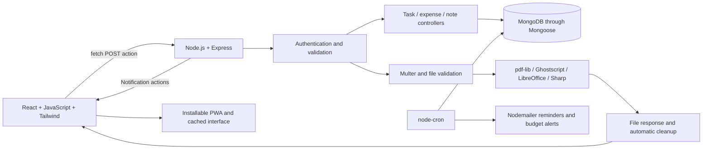
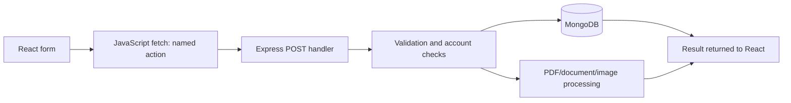
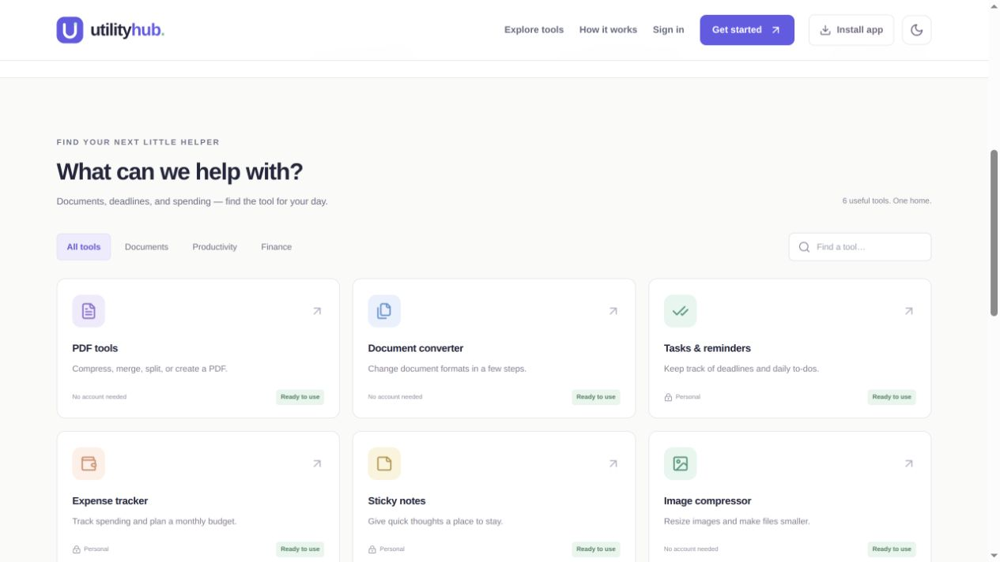
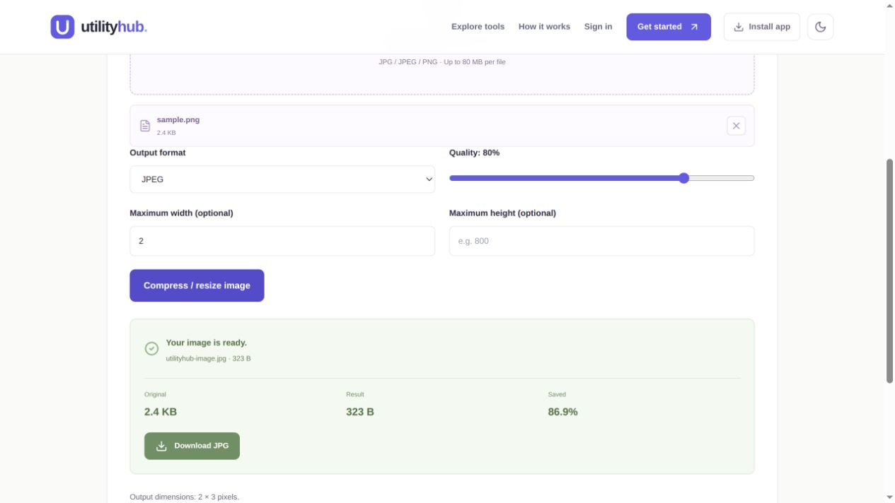
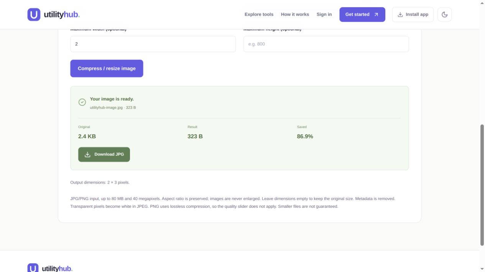

# UtilityHub — Complete Source

Six tools: PDF tools, document converter, tasks and reminders, expense tracker, sticky notes, and image compressor. React and Express use named POST actions. Application functions have short purpose comments.

This is an earlier source snapshot. The current offline implementation is in the `frontend` and `backend` folders. Setup and all eight MongoDB schemas are in README.md; the short presentation guide is PROJECT_EXPLANATION.md.

## Complete folder structure

```text
utilityhub/
├── frontend/
│   ├── .env.example
│   ├── index.html
│   ├── package-lock.json
│   ├── package.json
│   ├── postcss.config.js
│   ├── public/
│   │   ├── favicon.svg
│   │   ├── icons/
│   │   │   ├── apple-touch-icon.png
│   │   │   ├── icon-192.png
│   │   │   ├── icon-512.png
│   │   │   ├── icon.svg
│   │   │   └── maskable-512.png
│   │   ├── manifest.webmanifest
│   │   ├── notification-sw.js
│   │   └── theme.js
│   ├── src/
│   │   ├── App.jsx
│   │   ├── components/
│   │   │   ├── Brand.jsx
│   │   │   ├── ExpenseCharts.jsx
│   │   │   ├── ExpenseDialogs.jsx
│   │   │   ├── FilePicker.jsx
│   │   │   ├── FileResult.jsx
│   │   │   ├── Footer.jsx
│   │   │   ├── InstallAppButton.jsx
│   │   │   ├── Layout.jsx
│   │   │   ├── Loading.jsx
│   │   │   ├── Navbar.jsx
│   │   │   ├── NotificationBell.jsx
│   │   │   ├── ProtectedRoute.jsx
│   │   │   ├── PwaStatus.jsx
│   │   │   ├── ReminderSettings.jsx
│   │   │   ├── TaskForm.jsx
│   │   │   ├── ToolCard.jsx
│   │   │   └── tools/
│   │   │       └── ImageTools.jsx
│   │   ├── context/
│   │   │   ├── AuthContext.jsx
│   │   │   ├── NotificationContext.jsx
│   │   │   ├── ThemeContext.jsx
│   │   │   └── ToastContext.jsx
│   │   ├── hooks/
│   │   │   ├── useFileTool.js
│   │   │   ├── usePageTitle.js
│   │   │   └── useProgramStatus.js
│   │   ├── main.jsx
│   │   ├── pages/
│   │   │   ├── AuthPage.jsx
│   │   │   ├── Dashboard.jsx
│   │   │   ├── DocumentConverter.jsx
│   │   │   ├── Expenses.jsx
│   │   │   ├── Home.jsx
│   │   │   ├── ImageCompressor.jsx
│   │   │   ├── NotFound.jsx
│   │   │   ├── Notes.jsx
│   │   │   ├── PdfTools.jsx
│   │   │   └── Tasks.jsx
│   │   ├── pwa.css
│   │   ├── services/
│   │   │   ├── browserNotifications.js
│   │   │   ├── notificationWorker.js
│   │   │   ├── pwa.js
│   │   │   └── server.js
│   │   ├── styles.css
│   │   ├── sw.js
│   │   ├── tests/
│   │   │   ├── browserNotifications.test.js
│   │   │   ├── expenses.test.js
│   │   │   ├── fileLimits.test.js
│   │   │   ├── pwa.test.js
│   │   │   ├── server.test.js
│   │   │   ├── taskDates.test.js
│   │   │   └── tools.test.js
│   │   ├── utilities.css
│   │   └── utils/
│   │       ├── download.js
│   │       ├── expenses.js
│   │       ├── files.js
│   │       ├── pwaPolicy.js
│   │       ├── taskDates.js
│   │       └── tools.js
│   ├── tailwind.config.js
│   └── vite.config.js
├── backend/
│   ├── .env.example
│   ├── outputs/
│   │   └── .gitkeep
│   ├── package-lock.json
│   ├── package.json
│   ├── server.js
│   ├── src/
│   │   ├── app.js
│   │   ├── assets/
│   │   │   └── fonts/
│   │   │       ├── DejaVuSans.ttf
│   │   │       └── LICENSE.txt
│   │   ├── config/
│   │   │   ├── db.js
│   │   │   ├── expenseConfig.js
│   │   │   └── fileConfig.js
│   │   ├── controllers/
│   │   │   ├── authController.js
│   │   │   ├── expenseController.js
│   │   │   ├── fileController.js
│   │   │   ├── noteController.js
│   │   │   ├── notificationController.js
│   │   │   ├── serverActions.js
│   │   │   └── taskController.js
│   │   ├── middleware/
│   │   │   ├── authMiddleware.js
│   │   │   ├── errorMiddleware.js
│   │   │   └── uploadMiddleware.js
│   │   ├── models/
│   │   │   ├── Activity.js
│   │   │   ├── Budget.js
│   │   │   ├── BudgetAlert.js
│   │   │   ├── Expense.js
│   │   │   ├── Note.js
│   │   │   ├── Notification.js
│   │   │   ├── Task.js
│   │   │   └── User.js
│   │   ├── services/
│   │   │   ├── budgetAlertService.js
│   │   │   ├── emailService.js
│   │   │   ├── expenseExportService.js
│   │   │   ├── expenseService.js
│   │   │   ├── fileService.js
│   │   │   ├── imageService.js
│   │   │   ├── programService.js
│   │   │   ├── reminderService.js
│   │   │   └── tempFileService.js
│   │   ├── tests/
│   │   │   ├── auth.test.js
│   │   │   ├── expenses.test.js
│   │   │   ├── files.test.js
│   │   │   ├── fixtures/
│   │   │   │   ├── sample.docx
│   │   │   │   ├── sample.jpg
│   │   │   │   └── sample.png
│   │   │   ├── helpers/
│   │   │   │   └── actionRequest.js
│   │   │   ├── tasks.test.js
│   │   │   └── workspace.test.js
│   │   └── utils/
│   │       ├── asyncHandler.js
│   │       ├── expenseValidation.js
│   │       ├── fileValidation.js
│   │       ├── httpError.js
│   │       ├── taskValidation.js
│   │       └── token.js
│   └── uploads/
│       └── .gitkeep
├── .gitignore
├── COLLEGE_REPORT.md
├── PROJECT_EXPLANATION.md
├── PWA_GUIDE.md
├── README.md
├── SOURCE_CODE.md
├── SOURCE_FILES.txt
├── download-cleared.jpg
├── image-compressor-preview.jpg
├── six-tools-home.jpg
└── six-tools-mobile.jpg
```

## frontend/.env.example

````text
VITE_SERVER_URL=http://localhost:5000
````

## frontend/index.html

````html
<!doctype html>
<html lang="en">
  <head>
    <meta charset="UTF-8" />
    <meta name="viewport" content="width=device-width, initial-scale=1.0" />
    <meta name="theme-color" content="#635bdf" />
    <meta
      name="description"
      content="UtilityHub brings documents, tasks, expenses, and everyday tools into one place."
    />
    <link rel="icon" type="image/svg+xml" href="/favicon.svg" />
    <link rel="manifest" href="/manifest.webmanifest" />
    <link rel="apple-touch-icon" href="/icons/apple-touch-icon.png" />
    <meta name="apple-mobile-web-app-capable" content="yes" />
    <meta name="apple-mobile-web-app-title" content="UtilityHub" />
    <script src="/theme.js"></script>
    <title>UtilityHub | Your everyday toolkit</title>
  </head>
  <body>
    <div id="root"></div>
    <script type="module" src="/src/main.jsx"></script>
  </body>
</html>
````

## frontend/package-lock.json

````json
{
  "name": "utilityhub-frontend",
  "version": "1.5.0",
  "lockfileVersion": 3,
  "requires": true,
  "packages": {
    "": {
      "name": "utilityhub-frontend",
      "version": "1.5.0",
      "dependencies": {
        "lucide-react": "^0.468.0",
        "react": "^18.3.1",
        "react-dom": "^18.3.1",
        "react-router-dom": "^7.18.4",
        "recharts": "^3.10.1"
      },
      "devDependencies": {
        "@vitejs/plugin-react": "^4.7.0",
        "autoprefixer": "^10.4.20",
        "postcss": "^8.5.6",
        "tailwindcss": "^3.4.17",
        "vite": "^6.4.1",
        "vite-plugin-pwa": "^2.0.0",
        "workbox-core": "^7.4.1",
        "workbox-precaching": "^7.4.1",
        "workbox-routing": "^7.4.1",
        "workbox-window": "^7.4.1"
      },
      "engines": {
        "node": ">=22.16.0"
      }
    },
    "node_modules/@alloc/quick-lru": {
      "version": "5.3.0",
      "resolved": "https://registry.npmjs.org/@alloc/quick-lru/-/quick-lru-5.3.0.tgz",
      "integrity": "sha512-U4+70Pc5ZS9osnCBCE5Jha/ciHM+Yp+CNMNC/7HvYbNRk1Ldd+f7qO65W5qfhu/TCv+/ozljlXXe9Nj8419DMA==",
      "dev": true,
      "license": "MIT",
      "engines": {
        "node": ">=10"
      },
      "funding": {
        "url": "https://github.com/sponsors/sindresorhus"
      }
    },
    "node_modules/@apideck/better-ajv-errors": {
      "version": "0.3.7",
      "resolved": "https://registry.npmjs.org/@apideck/better-ajv-errors/-/better-ajv-errors-0.3.7.tgz",
      "integrity": "sha512-TajUJwGWbDwkCx/CZi7tRE8PVB7simCvKJfHUsSdvps+aTM/PDPP4gkLmKnc+x3CE//y9i/nj74GqdL/hwk7Iw==",
      "dev": true,
      "license": "MIT",
      "dependencies": {
        "jsonpointer": "^5.0.1",
        "leven": "^3.1.0"
      },
      "engines": {
        "node": ">=10"
      },
      "peerDependencies": {
        "ajv": ">=8"
      }
    },
    "node_modules/@babel/code-frame": {
      "version": "7.29.7",
      "resolved": "https://registry.npmjs.org/@babel/code-frame/-/code-frame-7.29.7.tgz",
      "integrity": "sha512-Aup7aUOfpbAUg2ROOJN6Iw5f9DMBlzu0mIkm/malLQFN/YQgO48wCj0Kxa3sEHJvPVFg7siR+qRInwXd2qhQKw==",
      "dev": true,
      "license": "MIT",
      "dependencies": {
        "@babel/helper-validator-identifier": "^7.29.7",
        "js-tokens": "^4.0.0",
        "picocolors": "^1.1.1"
      },
      "engines": {
        "node": ">=6.9.0"
      }
    },
    "node_modules/@babel/compat-data": {
      "version": "7.29.7",
      "resolved": "https://registry.npmjs.org/@babel/compat-data/-/compat-data-7.29.7.tgz",
      "integrity": "sha512-locTkQyKvwIEgBzVrn8693ebc97F2U8ZHjbXwDXJ5Fn2TCpNwTlKcaKLkdHop5c/icOFE7qt7Q9JC5hnKNa6Gg==",
      "dev": true,
      "license": "MIT",
      "engines": {
        "node": ">=6.9.0"
      }
    },
    "node_modules/@babel/core": {
      "version": "7.29.7",
      "resolved": "https://registry.npmjs.org/@babel/core/-/core-7.29.7.tgz",
      "integrity": "sha512-RgHBCvtjbOK2gXSNBNIkNoEc9qoVEtau3hj8gEqKQuL3HZAibKarWFEI3Lfm6EYKkLalOh8eSrj9b+ch9H/VBA==",
      "dev": true,
      "license": "MIT",
      "dependencies": {
        "@babel/code-frame": "^7.29.7",
        "@babel/generator": "^7.29.7",
        "@babel/helper-compilation-targets": "^7.29.7",
        "@babel/helper-module-transforms": "^7.29.7",
        "@babel/helpers": "^7.29.7",
        "@babel/parser": "^7.29.7",
        "@babel/template": "^7.29.7",
        "@babel/traverse": "^7.29.7",
        "@babel/types": "^7.29.7",
        "@jridgewell/remapping": "^2.3.5",
        "convert-source-map": "^2.0.0",
        "debug": "^4.1.0",
        "gensync": "^1.0.0-beta.2",
        "json5": "^2.2.3",
        "semver": "^6.3.1"
      },
      "engines": {
        "node": ">=6.9.0"
      },
      "funding": {
        "type": "opencollective",
        "url": "https://opencollective.com/babel"
      }
    },
    "node_modules/@babel/generator": {
      "version": "7.29.8",
      "resolved": "https://registry.npmjs.org/@babel/generator/-/generator-7.29.8.tgz",
      "integrity": "sha512-gZbepsdh3WDtgZKWL+vTPh71LSBrm/Y4/QDZBVCcYfmeTEEuoOYwlSy+G1StfJg+/Zy550u/3TATbm7qDbbMtg==",
      "dev": true,
      "license": "MIT",
      "dependencies": {
        "@babel/parser": "^7.29.8",
        "@babel/types": "^7.29.8",
        "@jridgewell/gen-mapping": "^0.3.12",
        "@jridgewell/trace-mapping": "^0.3.28",
        "jsesc": "^3.0.2"
      },
      "engines": {
        "node": ">=6.9.0"
      }
    },
    "node_modules/@babel/helper-annotate-as-pure": {
      "version": "7.29.7",
      "resolved": "https://registry.npmjs.org/@babel/helper-annotate-as-pure/-/helper-annotate-as-pure-7.29.7.tgz",
      "integrity": "sha512-OoK6239jHPuSQOoS0kfTVKn0b/rVTk0seKq4Gd2UMLtmOVLjDC0ki3e+c90Trqv2gMfvJFqkiljrr568+qddiw==",
      "dev": true,
      "license": "MIT",
      "dependencies": {
        "@babel/types": "^7.29.7"
      },
      "engines": {
        "node": ">=6.9.0"
      }
    },
    "node_modules/@babel/helper-compilation-targets": {
      "version": "7.29.7",
      "resolved": "https://registry.npmjs.org/@babel/helper-compilation-targets/-/helper-compilation-targets-7.29.7.tgz",
      "integrity": "sha512-wem6WaBj4NaVYVdNhLPPVacES6ZJ+KBBfSkTMD3YZxbP3rm3Di85tJU5ljaUNhaOynt+Aj0xruhYuzQBt8n71g==",
      "dev": true,
      "license": "MIT",
      "dependencies": {
        "@babel/compat-data": "^7.29.7",
        "@babel/helper-validator-option": "^7.29.7",
        "browserslist": "^4.24.0",
        "lru-cache": "^5.1.1",
        "semver": "^6.3.1"
      },
      "engines": {
        "node": ">=6.9.0"
      }
    },
    "node_modules/@babel/helper-create-class-features-plugin": {
      "version": "7.29.7",
      "resolved": "https://registry.npmjs.org/@babel/helper-create-class-features-plugin/-/helper-create-class-features-plugin-7.29.7.tgz",
      "integrity": "sha512-IY3ZD9Tmooqr3TUhc3DUWxiuo8xx1DWLhd5M7hQ+ZWJamqM2BbalrBJb2MisSLoYorOj75U03qULCxQTY9r3hg==",
      "dev": true,
      "license": "MIT",
      "dependencies": {
        "@babel/helper-annotate-as-pure": "^7.29.7",
        "@babel/helper-member-expression-to-functions": "^7.29.7",
        "@babel/helper-optimise-call-expression": "^7.29.7",
        "@babel/helper-replace-supers": "^7.29.7",
        "@babel/helper-skip-transparent-expression-wrappers": "^7.29.7",
        "@babel/traverse": "^7.29.7",
        "semver": "^6.3.1"
      },
      "engines": {
        "node": ">=6.9.0"
      },
      "peerDependencies": {
        "@babel/core": "^7.0.0"
      }
    },
    "node_modules/@babel/helper-create-regexp-features-plugin": {
      "version": "7.29.10",
      "resolved": "https://registry.npmjs.org/@babel/helper-create-regexp-features-plugin/-/helper-create-regexp-features-plugin-7.29.10.tgz",
      "integrity": "sha512-/YY9soQuWa8TURtHXHT+GbklpbAA+dZErxFGHIr6qgDg96xuGWrTAs1+MfjgVJPF0YLQsOVsOYs8lhgsPbOinQ==",
      "dev": true,
      "license": "MIT",
      "dependencies": {
        "@babel/helper-annotate-as-pure": "^7.29.7",
        "regexpu-core": "^6.5.3",
        "semver": "^6.3.1"
      },
      "engines": {
        "node": ">=6.9.0"
      },
      "peerDependencies": {
        "@babel/core": "^7.0.0"
      }
    },
    "node_modules/@babel/helper-define-polyfill-provider": {
      "version": "0.6.8",
      "resolved": "https://registry.npmjs.org/@babel/helper-define-polyfill-provider/-/helper-define-polyfill-provider-0.6.8.tgz",
      "integrity": "sha512-47UwBLPpQi1NoWzLuHNjRoHlYXMwIJoBf7MFou6viC/sIHWYygpvr0B6IAyh5sBdA2nr2LPIRww8lfaUVQINBA==",
      "dev": true,
      "license": "MIT",
      "dependencies": {
        "@babel/helper-compilation-targets": "^7.28.6",
        "@babel/helper-plugin-utils": "^7.28.6",
        "debug": "^4.4.3",
        "lodash.debounce": "^4.0.8",
        "resolve": "^1.22.11"
      },
      "peerDependencies": {
        "@babel/core": "^7.4.0 || ^8.0.0-0 <8.0.0"
      }
    },
    "node_modules/@babel/helper-globals": {
      "version": "7.29.7",
      "resolved": "https://registry.npmjs.org/@babel/helper-globals/-/helper-globals-7.29.7.tgz",
      "integrity": "sha512-3nQVUAtvkKH9zahfWgw96Jc/uFOmjACE1kQz82E2lqWmHBgjzbNlsC22nuQTfahmWeQtTq5nQ/4Nnd2A1wj4zA==",
      "dev": true,
      "license": "MIT",
      "engines": {
        "node": ">=6.9.0"
      }
    },
    "node_modules/@babel/helper-member-expression-to-functions": {
      "version": "7.29.7",
      "resolved": "https://registry.npmjs.org/@babel/helper-member-expression-to-functions/-/helper-member-expression-to-functions-7.29.7.tgz",
      "integrity": "sha512-j+7JYmk1JYDtACIGj0QJqqWZjoUpMoEikQGADMaHgCMCSDqd2+P32rfcibUNrGOMWrlzK1WJBdxrB3JJQZwWtg==",
      "dev": true,
      "license": "MIT",
      "dependencies": {
        "@babel/traverse": "^7.29.7",
        "@babel/types": "^7.29.7"
      },
      "engines": {
        "node": ">=6.9.0"
      }
    },
    "node_modules/@babel/helper-module-imports": {
      "version": "7.29.7",
      "resolved": "https://registry.npmjs.org/@babel/helper-module-imports/-/helper-module-imports-7.29.7.tgz",
      "integrity": "sha512-ejHwrQQYcm9xnTivShn2IDOlIzInN34AXskvq9QicvCtEzq1Vzclu/tKF8Jq1Cg8JG2GL6/EmjgsCT7lXepE3g==",
      "dev": true,
      "license": "MIT",
      "dependencies": {
        "@babel/traverse": "^7.29.7",
        "@babel/types": "^7.29.7"
      },
      "engines": {
        "node": ">=6.9.0"
      }
    },
    "node_modules/@babel/helper-module-transforms": {
      "version": "7.29.7",
      "resolved": "https://registry.npmjs.org/@babel/helper-module-transforms/-/helper-module-transforms-7.29.7.tgz",
      "integrity": "sha512-UPUVSyXbOh627KiCIGQSgwWzGeBKLkaJ9PJEdrngIwMSzxLR4jS4+f1f1jb7VzBbg8nFLaYotvVPFCTqdrmTAg==",
      "dev": true,
      "license": "MIT",
      "dependencies": {
        "@babel/helper-module-imports": "^7.29.7",
        "@babel/helper-validator-identifier": "^7.29.7",
        "@babel/traverse": "^7.29.7"
      },
      "engines": {
        "node": ">=6.9.0"
      },
      "peerDependencies": {
        "@babel/core": "^7.0.0"
      }
    },
    "node_modules/@babel/helper-optimise-call-expression": {
      "version": "7.29.7",
      "resolved": "https://registry.npmjs.org/@babel/helper-optimise-call-expression/-/helper-optimise-call-expression-7.29.7.tgz",
      "integrity": "sha512-+kmGVjcT9RGYzoDwdwEqEvGgKe3BYq+O1iGzjFubaNgZHwYHP6lsF2Yghf4kEuv9BV7tYDZ913aBW9am6YKong==",
      "dev": true,
      "license": "MIT",
      "dependencies": {
        "@babel/types": "^7.29.7"
      },
      "engines": {
        "node": ">=6.9.0"
      }
    },
    "node_modules/@babel/helper-plugin-utils": {
      "version": "7.29.7",
      "resolved": "https://registry.npmjs.org/@babel/helper-plugin-utils/-/helper-plugin-utils-7.29.7.tgz",
      "integrity": "sha512-G7sHYigPY17oO5SYWnfD/0MTBwVR781S/JI643e/JhUYgVgWE/61SoW3NH9KWUKyKq5LVh3npif99Wkt6j86Jw==",
      "dev": true,
      "license": "MIT",
      "engines": {
        "node": ">=6.9.0"
      }
    },
    "node_modules/@babel/helper-remap-async-to-generator": {
      "version": "7.29.7",
      "resolved": "https://registry.npmjs.org/@babel/helper-remap-async-to-generator/-/helper-remap-async-to-generator-7.29.7.tgz",
      "integrity": "sha512-16AMiW26DbXWBbr3B8wNozKM0ydMLB892vaOaJW/fPJdnT8vJk5sdkQcU/isqUxyCE0cEoa8wZOcbgDuC4b6Og==",
      "dev": true,
      "license": "MIT",
      "dependencies": {
        "@babel/helper-annotate-as-pure": "^7.29.7",
        "@babel/helper-wrap-function": "^7.29.7",
        "@babel/traverse": "^7.29.7"
      },
      "engines": {
        "node": ">=6.9.0"
      },
      "peerDependencies": {
        "@babel/core": "^7.0.0"
      }
    },
    "node_modules/@babel/helper-replace-supers": {
      "version": "7.29.7",
      "resolved": "https://registry.npmjs.org/@babel/helper-replace-supers/-/helper-replace-supers-7.29.7.tgz",
      "integrity": "sha512-atfGXWSeCiF4DnKZIfmJfQRkSw9b9gNNXR1kqKjbhG4pGYCOnkp8OcTB8E3NXjBu8NpheSnOeNKz8KT7UNFTmQ==",
      "dev": true,
      "license": "MIT",
      "dependencies": {
        "@babel/helper-member-expression-to-functions": "^7.29.7",
        "@babel/helper-optimise-call-expression": "^7.29.7",
        "@babel/traverse": "^7.29.7"
      },
      "engines": {
        "node": ">=6.9.0"
      },
      "peerDependencies": {
        "@babel/core": "^7.0.0"
      }
    },
    "node_modules/@babel/helper-skip-transparent-expression-wrappers": {
      "version": "7.29.7",
      "resolved": "https://registry.npmjs.org/@babel/helper-skip-transparent-expression-wrappers/-/helper-skip-transparent-expression-wrappers-7.29.7.tgz",
      "integrity": "sha512-brcMGQaVzIeUb+6/bs1Av0f8YuNNjKY2JyvfRCsFuFsdKccEQ5Ges2y74D74NZ1Rz8lKJ9ksJkfqwQFJ/iNEyQ==",
      "dev": true,
      "license": "MIT",
      "dependencies": {
        "@babel/traverse": "^7.29.7",
        "@babel/types": "^7.29.7"
      },
      "engines": {
        "node": ">=6.9.0"
      }
    },
    "node_modules/@babel/helper-string-parser": {
      "version": "7.29.11",
      "resolved": "https://registry.npmjs.org/@babel/helper-string-parser/-/helper-string-parser-7.29.11.tgz",
      "integrity": "sha512-snZbO7MEDOof+hvNa97EjEY7qD7h2kwvQr5AJC3ZhQudKW5dnej6k3kP9NQV88hJwaS8vDqRLFo9rivLEhle2g==",
      "dev": true,
      "license": "MIT",
      "engines": {
        "node": ">=6.9.0"
      }
    },
    "node_modules/@babel/helper-validator-identifier": {
      "version": "7.29.7",
      "resolved": "https://registry.npmjs.org/@babel/helper-validator-identifier/-/helper-validator-identifier-7.29.7.tgz",
      "integrity": "sha512-qehxGkRj55h/ff8EMaJ+cYhyaKlHIxqYDn682wQD7RNp9UujOQsHog2uS0r2vzr4pW+sXf90NeeayjcNaX3fFg==",
      "dev": true,
      "license": "MIT",
      "engines": {
        "node": ">=6.9.0"
      }
    },
    "node_modules/@babel/helper-validator-option": {
      "version": "7.29.7",
      "resolved": "https://registry.npmjs.org/@babel/helper-validator-option/-/helper-validator-option-7.29.7.tgz",
      "integrity": "sha512-N9ZErrD+yW5geCDtBqnOoxmR8+tNKiGuxKlDpuJxfsqpa2dFcexaziGAE/qoHLiDDreVNMupxGmSoNlyvsA3gw==",
      "dev": true,
      "license": "MIT",
      "engines": {
        "node": ">=6.9.0"
      }
    },
    "node_modules/@babel/helper-wrap-function": {
      "version": "7.29.7",
      "resolved": "https://registry.npmjs.org/@babel/helper-wrap-function/-/helper-wrap-function-7.29.7.tgz",
      "integrity": "sha512-iES0Skag9ERIF68aXadpO6dbXa03mNWK3sEqJaMnLNs/eC3l0lkImdfoy6Y09/SfkpawdAB4RjQ7PVA7TcVGdw==",
      "dev": true,
      "license": "MIT",
      "dependencies": {
        "@babel/template": "^7.29.7",
        "@babel/traverse": "^7.29.7",
        "@babel/types": "^7.29.7"
      },
      "engines": {
        "node": ">=6.9.0"
      }
    },
    "node_modules/@babel/helpers": {
      "version": "7.29.10",
      "resolved": "https://registry.npmjs.org/@babel/helpers/-/helpers-7.29.10.tgz",
      "integrity": "sha512-EMCx3AGZ3WfAl6ht7AyQoPm2Lh+BGYEMdc4Q6Hf7uSCDOZFuLq44qNwL+iaim8VlyYhRAo4X43+weadK8ZB4Yg==",
      "dev": true,
      "license": "MIT",
      "dependencies": {
        "@babel/template": "^7.29.7",
        "@babel/types": "^7.29.8"
      },
      "engines": {
        "node": ">=6.9.0"
      }
    },
    "node_modules/@babel/parser": {
      "version": "7.29.11",
      "resolved": "https://registry.npmjs.org/@babel/parser/-/parser-7.29.11.tgz",
      "integrity": "sha512-OZ6+oaK7GMyg3IfCpj8JOmn8n+w2rJbDT0LLfVDTLb1ZFeKDh3AiNELgCMUw175IJHSkLl74hG0M0VLsvx+gag==",
      "dev": true,
      "license": "MIT",
      "dependencies": {
        "@babel/types": "^7.29.11"
      },
      "bin": {
        "parser": "bin/babel-parser.js"
      },
      "engines": {
        "node": ">=6.0.0"
      }
    },
    "node_modules/@babel/plugin-bugfix-firefox-class-in-computed-class-key": {
      "version": "7.29.7",
      "resolved": "https://registry.npmjs.org/@babel/plugin-bugfix-firefox-class-in-computed-class-key/-/plugin-bugfix-firefox-class-in-computed-class-key-7.29.7.tgz",
      "integrity": "sha512-j8SrR0zLZrRsC09DlszEx8FpMiwukKffYXMK0d5LmOglO7vGG6sz/BR/20yHqWH+Lnn31JTt2PE3hIWNgM2J6w==",
      "dev": true,
      "license": "MIT",
      "dependencies": {
        "@babel/helper-plugin-utils": "^7.29.7",
        "@babel/traverse": "^7.29.7"
      },
      "engines": {
        "node": ">=6.9.0"
      },
      "peerDependencies": {
        "@babel/core": "^7.0.0"
      }
    },
    "node_modules/@babel/plugin-bugfix-safari-class-field-initializer-scope": {
      "version": "7.29.7",
      "resolved": "https://registry.npmjs.org/@babel/plugin-bugfix-safari-class-field-initializer-scope/-/plugin-bugfix-safari-class-field-initializer-scope-7.29.7.tgz",
      "integrity": "sha512-r8j8escF+U2FUHo0KOhPUdMzUO+jp9fInva6+ACVAF3Y97Ev+5iNZwiqTghmzNeWwDkOPlYuTcfb1vDaoZKmAQ==",
      "dev": true,
      "license": "MIT",
      "dependencies": {
        "@babel/helper-plugin-utils": "^7.29.7"
      },
      "engines": {
        "node": ">=6.9.0"
      },
      "peerDependencies": {
        "@babel/core": "^7.0.0"
      }
    },
    "node_modules/@babel/plugin-bugfix-safari-id-destructuring-collision-in-function-expression": {
      "version": "7.29.7",
      "resolved": "https://registry.npmjs.org/@babel/plugin-bugfix-safari-id-destructuring-collision-in-function-expression/-/plugin-bugfix-safari-id-destructuring-collision-in-function-expression-7.29.7.tgz",
      "integrity": "sha512-GE1TFSiuFeGsCxmYXZl8HwoPrVlwe4rHPFE8weieGKZqnDORK+Ar3vgWMgW+AOxQ6/2TgLSKx9p6W7O4rC6qgQ==",
      "dev": true,
      "license": "MIT",
      "dependencies": {
        "@babel/helper-plugin-utils": "^7.29.7"
      },
      "engines": {
        "node": ">=6.9.0"
      },
      "peerDependencies": {
        "@babel/core": "^7.0.0"
      }
    },
    "node_modules/@babel/plugin-bugfix-safari-rest-destructuring-rhs-array": {
      "version": "7.29.7",
      "resolved": "https://registry.npmjs.org/@babel/plugin-bugfix-safari-rest-destructuring-rhs-array/-/plugin-bugfix-safari-rest-destructuring-rhs-array-7.29.7.tgz",
      "integrity": "sha512-oBNVCvnO5tND+xSopWvV8WNGfpTfgP4Zr/YXXSj8zfmcPktp5Ku/aZlsIowgSD4fjmgHn6sGmB9APVsU5zOdhA==",
      "dev": true,
      "license": "MIT",
      "dependencies": {
        "@babel/helper-plugin-utils": "^7.29.7",
        "@babel/helper-skip-transparent-expression-wrappers": "^7.29.7"
      },
      "engines": {
        "node": ">=6.9.0"
      },
      "peerDependencies": {
        "@babel/core": "^7.0.0"
      }
    },
    "node_modules/@babel/plugin-bugfix-v8-spread-parameters-in-optional-chaining": {
      "version": "7.29.7",
      "resolved": "https://registry.npmjs.org/@babel/plugin-bugfix-v8-spread-parameters-in-optional-chaining/-/plugin-bugfix-v8-spread-parameters-in-optional-chaining-7.29.7.tgz",
      "integrity": "sha512-QQt9qKHZ2sg/kivaLr7lnQr8HVrQDdBNSfCsTjiDxRuX/K5ORyKq+Bu8Xr0cDE3Dfkv0cw28Ve0EKyKMvulkOw==",
      "dev": true,
      "license": "MIT",
      "dependencies": {
        "@babel/helper-plugin-utils": "^7.29.7",
        "@babel/helper-skip-transparent-expression-wrappers": "^7.29.7",
        "@babel/plugin-transform-optional-chaining": "^7.29.7"
      },
      "engines": {
        "node": ">=6.9.0"
      },
      "peerDependencies": {
        "@babel/core": "^7.13.0"
      }
    },
    "node_modules/@babel/plugin-bugfix-v8-static-class-fields-redefine-readonly": {
      "version": "7.29.7",
      "resolved": "https://registry.npmjs.org/@babel/plugin-bugfix-v8-static-class-fields-redefine-readonly/-/plugin-bugfix-v8-static-class-fields-redefine-readonly-7.29.7.tgz",
      "integrity": "sha512-pn6QacGLgvCcwc+syUhKE/qSjV2D1IHDB84RNxWYSt1mW3K/SCtjinZ2p0cETJxAWBjPy3K/1lHwG5BjjPxNlw==",
      "dev": true,
      "license": "MIT",
      "dependencies": {
        "@babel/helper-plugin-utils": "^7.29.7",
        "@babel/traverse": "^7.29.7"
      },
      "engines": {
        "node": ">=6.9.0"
      },
      "peerDependencies": {
        "@babel/core": "^7.0.0"
      }
    },
    "node_modules/@babel/plugin-proposal-private-property-in-object": {
      "version": "7.21.0-placeholder-for-preset-env.2",
      "resolved": "https://registry.npmjs.org/@babel/plugin-proposal-private-property-in-object/-/plugin-proposal-private-property-in-object-7.21.0-placeholder-for-preset-env.2.tgz",
      "integrity": "sha512-SOSkfJDddaM7mak6cPEpswyTRnuRltl429hMraQEglW+OkovnCzsiszTmsrlY//qLFjCpQDFRvjdm2wA5pPm9w==",
      "dev": true,
      "license": "MIT",
      "engines": {
        "node": ">=6.9.0"
      },
      "peerDependencies": {
        "@babel/core": "^7.0.0-0"
      }
    },
    "node_modules/@babel/plugin-syntax-import-assertions": {
      "version": "7.29.7",
      "resolved": "https://registry.npmjs.org/@babel/plugin-syntax-import-assertions/-/plugin-syntax-import-assertions-7.29.7.tgz",
      "integrity": "sha512-/An1OCBN93thpBAGyfsK2pcf0jvju1SAtKkL2Ny++B5Sy6sqgzXDQH1cZxWbF96Wuk+bn41MDA9bLd4VVAw6rw==",
      "dev": true,
      "license": "MIT",
      "dependencies": {
        "@babel/helper-plugin-utils": "^7.29.7"
      },
      "engines": {
        "node": ">=6.9.0"
      },
      "peerDependencies": {
        "@babel/core": "^7.0.0-0"
      }
    },
    "node_modules/@babel/plugin-syntax-import-attributes": {
      "version": "7.29.7",
      "resolved": "https://registry.npmjs.org/@babel/plugin-syntax-import-attributes/-/plugin-syntax-import-attributes-7.29.7.tgz",
      "integrity": "sha512-zGYcYfq/WmZ4V+kBIXQon9dSSc8ircGZqw9ZaNhhGj9nZkeBu1jHLBDQqYYi5WA9uawvA2sIMbry2nCFhf5Djg==",
      "dev": true,
      "license": "MIT",
      "dependencies": {
        "@babel/helper-plugin-utils": "^7.29.7"
      },
      "engines": {
        "node": ">=6.9.0"
      },
      "peerDependencies": {
        "@babel/core": "^7.0.0-0"
      }
    },
    "node_modules/@babel/plugin-syntax-unicode-sets-regex": {
      "version": "7.18.6",
      "resolved": "https://registry.npmjs.org/@babel/plugin-syntax-unicode-sets-regex/-/plugin-syntax-unicode-sets-regex-7.18.6.tgz",
      "integrity": "sha512-727YkEAPwSIQTv5im8QHz3upqp92JTWhidIC81Tdx4VJYIte/VndKf1qKrfnnhPLiPghStWfvC/iFaMCQu7Nqg==",
      "dev": true,
      "license": "MIT",
      "dependencies": {
        "@babel/helper-create-regexp-features-plugin": "^7.18.6",
        "@babel/helper-plugin-utils": "^7.18.6"
      },
      "engines": {
        "node": ">=6.9.0"
      },
      "peerDependencies": {
        "@babel/core": "^7.0.0"
      }
    },
    "node_modules/@babel/plugin-transform-arrow-functions": {
      "version": "7.29.7",
      "resolved": "https://registry.npmjs.org/@babel/plugin-transform-arrow-functions/-/plugin-transform-arrow-functions-7.29.7.tgz",
      "integrity": "sha512-N7zArUXWzAMzm+/N0uPBeVB3Fam5lMxtUwMmDK5f/IBBS7a7p1qeUoxd/6CckXoxUdgsntq1Dh8xNW06maZbDQ==",
      "dev": true,
      "license": "MIT",
      "dependencies": {
        "@babel/helper-plugin-utils": "^7.29.7"
      },
      "engines": {
        "node": ">=6.9.0"
      },
      "peerDependencies": {
        "@babel/core": "^7.0.0-0"
      }
    },
    "node_modules/@babel/plugin-transform-async-generator-functions": {
      "version": "7.29.7",
      "resolved": "https://registry.npmjs.org/@babel/plugin-transform-async-generator-functions/-/plugin-transform-async-generator-functions-7.29.7.tgz",
      "integrity": "sha512-d98gXZkgswvkyohMBABkhm3GeXhYj8psWfwQ2C7gtfrKGTykQa/iOIi+JJhwMjPlZ6Vm2XN+DCf3Es1EoG4ZLA==",
      "dev": true,
      "license": "MIT",
      "dependencies": {
        "@babel/helper-plugin-utils": "^7.29.7",
        "@babel/helper-remap-async-to-generator": "^7.29.7",
        "@babel/traverse": "^7.29.7"
      },
      "engines": {
        "node": ">=6.9.0"
      },
      "peerDependencies": {
        "@babel/core": "^7.0.0-0"
      }
    },
    "node_modules/@babel/plugin-transform-async-to-generator": {
      "version": "7.29.7",
      "resolved": "https://registry.npmjs.org/@babel/plugin-transform-async-to-generator/-/plugin-transform-async-to-generator-7.29.7.tgz",
      "integrity": "sha512-pcUb2SS+RMo9TWVBwKGI5ShtoG7R+zBsFmCKDa6fe8c+hPr3XJlZgoE5j6i8W7gDjhyvy+85vmYexanvXh3d1w==",
      "dev": true,
      "license": "MIT",
      "dependencies": {
        "@babel/helper-module-imports": "^7.29.7",
        "@babel/helper-plugin-utils": "^7.29.7",
        "@babel/helper-remap-async-to-generator": "^7.29.7"
      },
      "engines": {
        "node": ">=6.9.0"
      },
      "peerDependencies": {
        "@babel/core": "^7.0.0-0"
      }
    },
    "node_modules/@babel/plugin-transform-block-scoped-functions": {
      "version": "7.29.7",
      "resolved": "https://registry.npmjs.org/@babel/plugin-transform-block-scoped-functions/-/plugin-transform-block-scoped-functions-7.29.7.tgz",
      "integrity": "sha512-cUSmjh72N+rN4PrkFlN1dJwNCwjVp5d38/CQrEsFggkD10UiFlBFgdH3tv5dNsLuHY+3S8db2xCHjhZcv5WgvA==",
      "dev": true,
      "license": "MIT",
      "dependencies": {
        "@babel/helper-plugin-utils": "^7.29.7"
      },
      "engines": {
        "node": ">=6.9.0"
      },
      "peerDependencies": {
        "@babel/core": "^7.0.0-0"
      }
    },
    "node_modules/@babel/plugin-transform-block-scoping": {
      "version": "7.29.11",
      "resolved": "https://registry.npmjs.org/@babel/plugin-transform-block-scoping/-/plugin-transform-block-scoping-7.29.11.tgz",
      "integrity": "sha512-iARF4jjHSM0v8DImCACPXrwEltBP3DgqDpXTvjAMBAVpyEY0LiGss78wvI+KtmW+IJNEvZ5sOhPDCsOsXsIybA==",
      "dev": true,
      "license": "MIT",
      "dependencies": {
        "@babel/helper-plugin-utils": "^7.29.7"
      },
      "engines": {
        "node": ">=6.9.0"
      },
      "peerDependencies": {
        "@babel/core": "^7.0.0-0"
      }
    },
    "node_modules/@babel/plugin-transform-class-properties": {
      "version": "7.29.7",
      "resolved": "https://registry.npmjs.org/@babel/plugin-transform-class-properties/-/plugin-transform-class-properties-7.29.7.tgz",
      "integrity": "sha512-GtcpjFvanPfzNQi3eTitsCqtRRmmqzpy/A+yhTR1HaZo1Ly3EA8ZXxlPyHdR8/IuRMYc3E4wdGBewB2QKQjAaA==",
      "dev": true,
      "license": "MIT",
      "dependencies": {
        "@babel/helper-create-class-features-plugin": "^7.29.7",
        "@babel/helper-plugin-utils": "^7.29.7"
      },
      "engines": {
        "node": ">=6.9.0"
      },
      "peerDependencies": {
        "@babel/core": "^7.0.0-0"
      }
    },
    "node_modules/@babel/plugin-transform-class-static-block": {
      "version": "7.29.7",
      "resolved": "https://registry.npmjs.org/@babel/plugin-transform-class-static-block/-/plugin-transform-class-static-block-7.29.7.tgz",
      "integrity": "sha512-kibJgmEdX2iMwsHY2tSZNDgj8PwIlCQz7FK9KuGKO8zsuoUwSEhoNnNVp/emKWrbY4HeO6kkXfdMqRKKKXBm2A==",
      "dev": true,
      "license": "MIT",
      "dependencies": {
        "@babel/helper-create-class-features-plugin": "^7.29.7",
        "@babel/helper-plugin-utils": "^7.29.7"
      },
      "engines": {
        "node": ">=6.9.0"
      },
      "peerDependencies": {
        "@babel/core": "^7.12.0"
      }
    },
    "node_modules/@babel/plugin-transform-classes": {
      "version": "7.29.11",
      "resolved": "https://registry.npmjs.org/@babel/plugin-transform-classes/-/plugin-transform-classes-7.29.11.tgz",
      "integrity": "sha512-f8kTDM/nTvpLeafb+TJ4jboFr/Y3BbC+QzgPpPGzSKJqWLnj9LW0WLqv4XKA11LX5sr+EgvLE6Ix3YsCEusodw==",
      "dev": true,
      "license": "MIT",
      "dependencies": {
        "@babel/helper-annotate-as-pure": "^7.29.7",
        "@babel/helper-compilation-targets": "^7.29.7",
        "@babel/helper-globals": "^7.29.7",
        "@babel/helper-plugin-utils": "^7.29.7",
        "@babel/helper-replace-supers": "^7.29.7",
        "@babel/traverse": "^7.29.10"
      },
      "engines": {
        "node": ">=6.9.0"
      },
      "peerDependencies": {
        "@babel/core": "^7.0.0-0"
      }
    },
    "node_modules/@babel/plugin-transform-computed-properties": {
      "version": "7.29.7",
      "resolved": "https://registry.npmjs.org/@babel/plugin-transform-computed-properties/-/plugin-transform-computed-properties-7.29.7.tgz",
      "integrity": "sha512-RK7/IyU5phpuCdBAuig5VkzG/EnbDaui5SQGdU9BFrHdV+mV4cUjLMQ9lJDjLNtWHsqtiefpGZUXQP2BiTYMsA==",
      "dev": true,
      "license": "MIT",
      "dependencies": {
        "@babel/helper-plugin-utils": "^7.29.7",
        "@babel/template": "^7.29.7"
      },
      "engines": {
        "node": ">=6.9.0"
      },
      "peerDependencies": {
        "@babel/core": "^7.0.0-0"
      }
    },
    "node_modules/@babel/plugin-transform-destructuring": {
      "version": "7.29.7",
      "resolved": "https://registry.npmjs.org/@babel/plugin-transform-destructuring/-/plugin-transform-destructuring-7.29.7.tgz",
      "integrity": "sha512-iPX8aD6H9zV5s7ZsqTdNocPN/MGQ5sSMnElKrktxjJRMnB2jN/1p2+R7GkfD6CAYoVFqy5A4XnSIUeGgJzIWpg==",
      "dev": true,
      "license": "MIT",
      "dependencies": {
        "@babel/helper-plugin-utils": "^7.29.7",
        "@babel/traverse": "^7.29.7"
      },
      "engines": {
        "node": ">=6.9.0"
      },
      "peerDependencies": {
        "@babel/core": "^7.0.0-0"
      }
    },
    "node_modules/@babel/plugin-transform-dotall-regex": {
      "version": "7.29.7",
      "resolved": "https://registry.npmjs.org/@babel/plugin-transform-dotall-regex/-/plugin-transform-dotall-regex-7.29.7.tgz",
      "integrity": "sha512-3qc18hsD2RdZiyJNDNc7HQpv6xbncwh8FYtxNFFzclSyh/trPD9KkVR9BDECUjDLvb7yJVF15GfYUuC+LMkkiQ==",
      "dev": true,
      "license": "MIT",
      "dependencies": {
        "@babel/helper-create-regexp-features-plugin": "^7.29.7",
        "@babel/helper-plugin-utils": "^7.29.7"
      },
      "engines": {
        "node": ">=6.9.0"
      },
      "peerDependencies": {
        "@babel/core": "^7.0.0-0"
      }
    },
    "node_modules/@babel/plugin-transform-duplicate-keys": {
      "version": "7.29.7",
      "resolved": "https://registry.npmjs.org/@babel/plugin-transform-duplicate-keys/-/plugin-transform-duplicate-keys-7.29.7.tgz",
      "integrity": "sha512-6IvRRriEMqnBwD6chtxdLpMYCHWEzN+oL5cyQtjykya19UgzbmKhxmhZgKC/LHxS2nYr9Q/qYPZ5Lr6jOL9+yQ==",
      "dev": true,
      "license": "MIT",
      "dependencies": {
        "@babel/helper-plugin-utils": "^7.29.7"
      },
      "engines": {
        "node": ">=6.9.0"
      },
      "peerDependencies": {
        "@babel/core": "^7.0.0-0"
      }
    },
    "node_modules/@babel/plugin-transform-duplicate-named-capturing-groups-regex": {
      "version": "7.29.7",
      "resolved": "https://registry.npmjs.org/@babel/plugin-transform-duplicate-named-capturing-groups-regex/-/plugin-transform-duplicate-named-capturing-groups-regex-7.29.7.tgz",
      "integrity": "sha512-2wiIyo2BjtgU7HufSeDnL9L2O7zr8jmhFKuSr65VpRkUiRKRNpb0mdlk56+XPPKoIrfHqzbMuglDvZun0RISsA==",
      "dev": true,
      "license": "MIT",
      "dependencies": {
        "@babel/helper-create-regexp-features-plugin": "^7.29.7",
        "@babel/helper-plugin-utils": "^7.29.7"
      },
      "engines": {
        "node": ">=6.9.0"
      },
      "peerDependencies": {
        "@babel/core": "^7.0.0"
      }
    },
    "node_modules/@babel/plugin-transform-dynamic-import": {
      "version": "7.29.7",
      "resolved": "https://registry.npmjs.org/@babel/plugin-transform-dynamic-import/-/plugin-transform-dynamic-import-7.29.7.tgz",
      "integrity": "sha512-giOlEm/EFjfjr+te9NsdjkUo2v4f8rS/SXPumRVHAtbNcyNlvtREkU1dZzaIDclNpnaVhlCqRdFKhJBjBikzLg==",
      "dev": true,
      "license": "MIT",
      "dependencies": {
        "@babel/helper-plugin-utils": "^7.29.7"
      },
      "engines": {
        "node": ">=6.9.0"
      },
      "peerDependencies": {
        "@babel/core": "^7.0.0-0"
      }
    },
    "node_modules/@babel/plugin-transform-explicit-resource-management": {
      "version": "7.29.7",
      "resolved": "https://registry.npmjs.org/@babel/plugin-transform-explicit-resource-management/-/plugin-transform-explicit-resource-management-7.29.7.tgz",
      "integrity": "sha512-Rstj7coNz8sE+7Ju7ihpHLI564lsK5pUpNNlvptCIC/16E/S5hbl6n3kESPKdNRmqEWlpn5xpS5Q2dvXBsySLw==",
      "dev": true,
      "license": "MIT",
      "dependencies": {
        "@babel/helper-plugin-utils": "^7.29.7",
        "@babel/plugin-transform-destructuring": "^7.29.7"
      },
      "engines": {
        "node": ">=6.9.0"
      },
      "peerDependencies": {
        "@babel/core": "^7.0.0-0"
      }
    },
    "node_modules/@babel/plugin-transform-exponentiation-operator": {
      "version": "7.29.7",
      "resolved": "https://registry.npmjs.org/@babel/plugin-transform-exponentiation-operator/-/plugin-transform-exponentiation-operator-7.29.7.tgz",
      "integrity": "sha512-zFpMOTLZBdW5LfObqcSbL6kefg4R4eLdmvS0wbN9M6D5Mym/sKm9toOoWyVOa+xDjvCnuWcHls2YonXwHvH3CQ==",
      "dev": true,
      "license": "MIT",
      "dependencies": {
        "@babel/helper-plugin-utils": "^7.29.7"
      },
      "engines": {
        "node": ">=6.9.0"
      },
      "peerDependencies": {
        "@babel/core": "^7.0.0-0"
      }
    },
    "node_modules/@babel/plugin-transform-export-namespace-from": {
      "version": "7.29.7",
      "resolved": "https://registry.npmjs.org/@babel/plugin-transform-export-namespace-from/-/plugin-transform-export-namespace-from-7.29.7.tgz",
      "integrity": "sha512-24B2nOy2TeJSMheqwPD4DDQOV/elLSIlKxjZt4i05H5AgdPdWR3n18HnNrcJ+j76WJd9gbwb9jPjNYUy6RautA==",
      "dev": true,
      "license": "MIT",
      "dependencies": {
        "@babel/helper-plugin-utils": "^7.29.7"
      },
      "engines": {
        "node": ">=6.9.0"
      },
      "peerDependencies": {
        "@babel/core": "^7.0.0-0"
      }
    },
    "node_modules/@babel/plugin-transform-for-of": {
      "version": "7.29.7",
      "resolved": "https://registry.npmjs.org/@babel/plugin-transform-for-of/-/plugin-transform-for-of-7.29.7.tgz",
      "integrity": "sha512-zeSIHh0+E1Um1WJRXCFlHQYu2ieJNdivLLjlBEp+dIBu3S51n+SZZmIXjxnItw6pz56Cn+KvK68BIBVsxq2JiQ==",
      "dev": true,
      "license": "MIT",
      "dependencies": {
        "@babel/helper-plugin-utils": "^7.29.7",
        "@babel/helper-skip-transparent-expression-wrappers": "^7.29.7"
      },
      "engines": {
        "node": ">=6.9.0"
      },
      "peerDependencies": {
        "@babel/core": "^7.0.0-0"
      }
    },
    "node_modules/@babel/plugin-transform-function-name": {
      "version": "7.29.7",
      "resolved": "https://registry.npmjs.org/@babel/plugin-transform-function-name/-/plugin-transform-function-name-7.29.7.tgz",
      "integrity": "sha512-otRWaHXE6fbAGkePvaj/kvs3HsqXfPhlnzwSOlnFgbqCPMd975dW+4wZ00WFBt+/YlBGcJwNrARQTOJOb4ZrIg==",
      "dev": true,
      "license": "MIT",
      "dependencies": {
        "@babel/helper-compilation-targets": "^7.29.7",
        "@babel/helper-plugin-utils": "^7.29.7",
        "@babel/traverse": "^7.29.7"
      },
      "engines": {
        "node": ">=6.9.0"
      },
      "peerDependencies": {
        "@babel/core": "^7.0.0-0"
      }
    },
    "node_modules/@babel/plugin-transform-json-strings": {
      "version": "7.29.7",
      "resolved": "https://registry.npmjs.org/@babel/plugin-transform-json-strings/-/plugin-transform-json-strings-7.29.7.tgz",
      "integrity": "sha512-RRnE2+eon1rJAq8MnoF1b5kTpY1vU88twHcvcKMrsqP/jxIRqDVs9iJB5fqPuqyeFAW0wJo4MlUIPpQCq/aRsg==",
      "dev": true,
      "license": "MIT",
      "dependencies": {
        "@babel/helper-plugin-utils": "^7.29.7"
      },
      "engines": {
        "node": ">=6.9.0"
      },
      "peerDependencies": {
        "@babel/core": "^7.0.0-0"
      }
    },
    "node_modules/@babel/plugin-transform-literals": {
      "version": "7.29.7",
      "resolved": "https://registry.npmjs.org/@babel/plugin-transform-literals/-/plugin-transform-literals-7.29.7.tgz",
      "integrity": "sha512-DZ/oLP21ZuWx1vKqnoNv6/tvEK48AQOBRai40CX9dTjGluvT/YZCyY3rryDtyUqCEoyNroy5KKPwX2iQCiRvyw==",
      "dev": true,
      "license": "MIT",
      "dependencies": {
        "@babel/helper-plugin-utils": "^7.29.7"
      },
      "engines": {
        "node": ">=6.9.0"
      },
      "peerDependencies": {
        "@babel/core": "^7.0.0-0"
      }
    },
    "node_modules/@babel/plugin-transform-logical-assignment-operators": {
      "version": "7.29.7",
      "resolved": "https://registry.npmjs.org/@babel/plugin-transform-logical-assignment-operators/-/plugin-transform-logical-assignment-operators-7.29.7.tgz",
      "integrity": "sha512-A0H91hh6W8MFRkp5TqJmMr39jzGD1A1E1Ysiv2O06Sfbhkapm+XyIzxWCEh5kqwOZ1/8QZ0dY3SeQ7XBqfJd5Q==",
      "dev": true,
      "license": "MIT",
      "dependencies": {
        "@babel/helper-plugin-utils": "^7.29.7"
      },
      "engines": {
        "node": ">=6.9.0"
      },
      "peerDependencies": {
        "@babel/core": "^7.0.0-0"
      }
    },
    "node_modules/@babel/plugin-transform-member-expression-literals": {
      "version": "7.29.7",
      "resolved": "https://registry.npmjs.org/@babel/plugin-transform-member-expression-literals/-/plugin-transform-member-expression-literals-7.29.7.tgz",
      "integrity": "sha512-hl1kwFZCCiDyfH25Xmco9jTrkPgnS9pmOzSG7W5I4SaGbLeqKv417hcU2RKmaxoPEgsoJh7ZPOrnPGq99bHoUg==",
      "dev": true,
      "license": "MIT",
      "dependencies": {
        "@babel/helper-plugin-utils": "^7.29.7"
      },
      "engines": {
        "node": ">=6.9.0"
      },
      "peerDependencies": {
        "@babel/core": "^7.0.0-0"
      }
    },
    "node_modules/@babel/plugin-transform-modules-amd": {
      "version": "7.29.7",
      "resolved": "https://registry.npmjs.org/@babel/plugin-transform-modules-amd/-/plugin-transform-modules-amd-7.29.7.tgz",
      "integrity": "sha512-fxtQoH3m5ywUSIfaH0FGCzWu4McsYon5bD3K4XnskC7f+OyQMj7rsOMi4NvvmJ83WwBAg4UCe+ov4VZlqEvyew==",
      "dev": true,
      "license": "MIT",
      "dependencies": {
        "@babel/helper-module-transforms": "^7.29.7",
        "@babel/helper-plugin-utils": "^7.29.7"
      },
      "engines": {
        "node": ">=6.9.0"
      },
      "peerDependencies": {
        "@babel/core": "^7.0.0-0"
      }
    },
    "node_modules/@babel/plugin-transform-modules-commonjs": {
      "version": "7.29.7",
      "resolved": "https://registry.npmjs.org/@babel/plugin-transform-modules-commonjs/-/plugin-transform-modules-commonjs-7.29.7.tgz",
      "integrity": "sha512-j0vCldybPC5b5dwCQOJ21uKtHzt7hxLygJTg9eF1ScfaikEDNfzn94XoW5Fi+seBR0nCyL23xaBFFkq7dTM8XQ==",
      "dev": true,
      "license": "MIT",
      "dependencies": {
        "@babel/helper-module-transforms": "^7.29.7",
        "@babel/helper-plugin-utils": "^7.29.7"
      },
      "engines": {
        "node": ">=6.9.0"
      },
      "peerDependencies": {
        "@babel/core": "^7.0.0-0"
      }
    },
    "node_modules/@babel/plugin-transform-modules-systemjs": {
      "version": "7.29.8",
      "resolved": "https://registry.npmjs.org/@babel/plugin-transform-modules-systemjs/-/plugin-transform-modules-systemjs-7.29.8.tgz",
      "integrity": "sha512-6iSnEK0zlkLKU4heofK/AdmRD4e2SHVpJMtrwnTCzhnaM98ria4rTrOXBBi45BTTYnJtO8txnPsX4fChYXkmeA==",
      "dev": true,
      "license": "MIT",
      "dependencies": {
        "@babel/helper-module-transforms": "^7.29.7",
        "@babel/helper-plugin-utils": "^7.29.7",
        "@babel/helper-validator-identifier": "^7.29.7",
        "@babel/traverse": "^7.29.8"
      },
      "engines": {
        "node": ">=6.9.0"
      },
      "peerDependencies": {
        "@babel/core": "^7.0.0-0"
      }
    },
    "node_modules/@babel/plugin-transform-modules-umd": {
      "version": "7.29.7",
      "resolved": "https://registry.npmjs.org/@babel/plugin-transform-modules-umd/-/plugin-transform-modules-umd-7.29.7.tgz",
      "integrity": "sha512-B4UkaTK3QpgCwJnrxKfMPKdo92CN7OKXAlpAAnM3UPu0Q0lCCk57ylA9AJbRy2v8dDKOPAAWcoR6CMyeoHwRCA==",
      "dev": true,
      "license": "MIT",
      "dependencies": {
        "@babel/helper-module-transforms": "^7.29.7",
        "@babel/helper-plugin-utils": "^7.29.7"
      },
      "engines": {
        "node": ">=6.9.0"
      },
      "peerDependencies": {
        "@babel/core": "^7.0.0-0"
      }
    },
    "node_modules/@babel/plugin-transform-named-capturing-groups-regex": {
      "version": "7.29.7",
      "resolved": "https://registry.npmjs.org/@babel/plugin-transform-named-capturing-groups-regex/-/plugin-transform-named-capturing-groups-regex-7.29.7.tgz",
      "integrity": "sha512-vuFoLwr4qnv2xbZ16SQd6uPcH5FNrLHhk/Jzo++0XJFcaDsr4gjJVg6j398oMHiC+83k/GiBzviwF5KBJkPUtQ==",
      "dev": true,
      "license": "MIT",
      "dependencies": {
        "@babel/helper-create-regexp-features-plugin": "^7.29.7",
        "@babel/helper-plugin-utils": "^7.29.7"
      },
      "engines": {
        "node": ">=6.9.0"
      },
      "peerDependencies": {
        "@babel/core": "^7.0.0"
      }
    },
    "node_modules/@babel/plugin-transform-new-target": {
      "version": "7.29.7",
      "resolved": "https://registry.npmjs.org/@babel/plugin-transform-new-target/-/plugin-transform-new-target-7.29.7.tgz",
      "integrity": "sha512-fEo41GmsOUhOBlw8ioo6zvjX5Xc2Lqkzlyfqbpsk3eB6TReV18uhxZ0esfEokVbY2+PVJAQHNKxER6lGrzNd3A==",
      "dev": true,
      "license": "MIT",
      "dependencies": {
        "@babel/helper-plugin-utils": "^7.29.7"
      },
      "engines": {
        "node": ">=6.9.0"
      },
      "peerDependencies": {
        "@babel/core": "^7.0.0-0"
      }
    },
    "node_modules/@babel/plugin-transform-nullish-coalescing-operator": {
      "version": "7.29.7",
      "resolved": "https://registry.npmjs.org/@babel/plugin-transform-nullish-coalescing-operator/-/plugin-transform-nullish-coalescing-operator-7.29.7.tgz",
      "integrity": "sha512-idmp1dFaekP9GbcMvG24Kvw2BfhFZjHnNJCkV4WuIY4PskJzwI3f1N5OdgYke38T7rftO6ERulFRn2cFeZwRkg==",
      "dev": true,
      "license": "MIT",
      "dependencies": {
        "@babel/helper-plugin-utils": "^7.29.7"
      },
      "engines": {
        "node": ">=6.9.0"
      },
      "peerDependencies": {
        "@babel/core": "^7.0.0-0"
      }
    },
    "node_modules/@babel/plugin-transform-numeric-separator": {
      "version": "7.29.7",
      "resolved": "https://registry.npmjs.org/@babel/plugin-transform-numeric-separator/-/plugin-transform-numeric-separator-7.29.7.tgz",
      "integrity": "sha512-zR7fv/z14OjgHl4AgRtkDBvBMhIzCxqV/qN/2BCRC7LjFwvuzjYe7gDWxC4Wl/SNsLM6SE1IWvRPYMgSJaUvNw==",
      "dev": true,
      "license": "MIT",
      "dependencies": {
        "@babel/helper-plugin-utils": "^7.29.7"
      },
      "engines": {
        "node": ">=6.9.0"
      },
      "peerDependencies": {
        "@babel/core": "^7.0.0-0"
      }
    },
    "node_modules/@babel/plugin-transform-object-rest-spread": {
      "version": "7.29.7",
      "resolved": "https://registry.npmjs.org/@babel/plugin-transform-object-rest-spread/-/plugin-transform-object-rest-spread-7.29.7.tgz",
      "integrity": "sha512-Ld98jn4c0smUywL57m7SgsHq3OpThOa6LqZJif3G6jYOovPleoFhVrBJ1WegRApSFB2wu4+RelAj9AC9G08Z4A==",
      "dev": true,
      "license": "MIT",
      "dependencies": {
        "@babel/helper-compilation-targets": "^7.29.7",
        "@babel/helper-plugin-utils": "^7.29.7",
        "@babel/plugin-transform-destructuring": "^7.29.7",
        "@babel/plugin-transform-parameters": "^7.29.7",
        "@babel/traverse": "^7.29.7"
      },
      "engines": {
        "node": ">=6.9.0"
      },
      "peerDependencies": {
        "@babel/core": "^7.0.0-0"
      }
    },
    "node_modules/@babel/plugin-transform-object-super": {
      "version": "7.29.7",
      "resolved": "https://registry.npmjs.org/@babel/plugin-transform-object-super/-/plugin-transform-object-super-7.29.7.tgz",
      "integrity": "sha512-Ea/diGcw0twB5IlZPO5sgET6fJsLJqPABqTuFWIR+iMPGPZJkATEIWx0wa+aEQ5UY1CBQyP/gkAiLEqn1vBiQA==",
      "dev": true,
      "license": "MIT",
      "dependencies": {
        "@babel/helper-plugin-utils": "^7.29.7",
        "@babel/helper-replace-supers": "^7.29.7"
      },
      "engines": {
        "node": ">=6.9.0"
      },
      "peerDependencies": {
        "@babel/core": "^7.0.0-0"
      }
    },
    "node_modules/@babel/plugin-transform-optional-catch-binding": {
      "version": "7.29.7",
      "resolved": "https://registry.npmjs.org/@babel/plugin-transform-optional-catch-binding/-/plugin-transform-optional-catch-binding-7.29.7.tgz",
      "integrity": "sha512-sLsyndxK2VwX6yNUOakMb7Sh553ZTe/vVM1XJ+9Z5aW1ytsc8xOIwmyk05NNjN60vkc5/KqoTH6hB4V41LJhng==",
      "dev": true,
      "license": "MIT",
      "dependencies": {
        "@babel/helper-plugin-utils": "^7.29.7"
      },
      "engines": {
        "node": ">=6.9.0"
      },
      "peerDependencies": {
        "@babel/core": "^7.0.0-0"
      }
    },
    "node_modules/@babel/plugin-transform-optional-chaining": {
      "version": "7.29.7",
      "resolved": "https://registry.npmjs.org/@babel/plugin-transform-optional-chaining/-/plugin-transform-optional-chaining-7.29.7.tgz",
      "integrity": "sha512-6GM1dhvK3gNODkXcEcMCOLEDCLSoZ/sBbro2Ax8HURyasQ4NshagQixkRFdh5niI6E4gmA/jYI/4aT7rRos3ZQ==",
      "dev": true,
      "license": "MIT",
      "dependencies": {
        "@babel/helper-plugin-utils": "^7.29.7",
        "@babel/helper-skip-transparent-expression-wrappers": "^7.29.7"
      },
      "engines": {
        "node": ">=6.9.0"
      },
      "peerDependencies": {
        "@babel/core": "^7.0.0-0"
      }
    },
    "node_modules/@babel/plugin-transform-parameters": {
      "version": "7.29.7",
      "resolved": "https://registry.npmjs.org/@babel/plugin-transform-parameters/-/plugin-transform-parameters-7.29.7.tgz",
      "integrity": "sha512-ZDOBqV/qLYJI0YElr8DcENEyARsFQeESqWXH6gZlghYXuPPjvweuDhP4VyEi4BlUBlLRFZVjxoZDMjxhLW766g==",
      "dev": true,
      "license": "MIT",
      "dependencies": {
        "@babel/helper-plugin-utils": "^7.29.7"
      },
      "engines": {
        "node": ">=6.9.0"
      },
      "peerDependencies": {
        "@babel/core": "^7.0.0-0"
      }
    },
    "node_modules/@babel/plugin-transform-private-methods": {
      "version": "7.29.7",
      "resolved": "https://registry.npmjs.org/@babel/plugin-transform-private-methods/-/plugin-transform-private-methods-7.29.7.tgz",
      "integrity": "sha512-/6Rz4DK1ETDEM/bWHsPHcaEe7ZaT1EqSXjtSP/L0DijOYuaUhiRiOKcwpZ8P7zR4xXEHc2ITdiCgBm9Tpyv9ug==",
      "dev": true,
      "license": "MIT",
      "dependencies": {
        "@babel/helper-create-class-features-plugin": "^7.29.7",
        "@babel/helper-plugin-utils": "^7.29.7"
      },
      "engines": {
        "node": ">=6.9.0"
      },
      "peerDependencies": {
        "@babel/core": "^7.0.0-0"
      }
    },
    "node_modules/@babel/plugin-transform-private-property-in-object": {
      "version": "7.29.7",
      "resolved": "https://registry.npmjs.org/@babel/plugin-transform-private-property-in-object/-/plugin-transform-private-property-in-object-7.29.7.tgz",
      "integrity": "sha512-+BNo06dnrzdNNqCm1X6YUaVv0DKk8Q+JYcoZfOkLhYWNCXzlwTSRq8zGWayT1csjcpNXV9CQTBRRbmTLZac5cA==",
      "dev": true,
      "license": "MIT",
      "dependencies": {
        "@babel/helper-annotate-as-pure": "^7.29.7",
        "@babel/helper-create-class-features-plugin": "^7.29.7",
        "@babel/helper-plugin-utils": "^7.29.7"
      },
      "engines": {
        "node": ">=6.9.0"
      },
      "peerDependencies": {
        "@babel/core": "^7.0.0-0"
      }
    },
    "node_modules/@babel/plugin-transform-property-literals": {
      "version": "7.29.7",
      "resolved": "https://registry.npmjs.org/@babel/plugin-transform-property-literals/-/plugin-transform-property-literals-7.29.7.tgz",
      "integrity": "sha512-bOMRLQuI0A5ZqHq3OWJ89/rXpJ/NJrbVhXiP4zwPGMs6kpcVsuTUNjwoE30K0Qm3mf48a/TnRYYD6vPNqcg6jA==",
      "dev": true,
      "license": "MIT",
      "dependencies": {
        "@babel/helper-plugin-utils": "^7.29.7"
      },
      "engines": {
        "node": ">=6.9.0"
      },
      "peerDependencies": {
        "@babel/core": "^7.0.0-0"
      }
    },
    "node_modules/@babel/plugin-transform-react-jsx-self": {
      "version": "7.29.7",
      "resolved": "https://registry.npmjs.org/@babel/plugin-transform-react-jsx-self/-/plugin-transform-react-jsx-self-7.29.7.tgz",
      "integrity": "sha512-TL0hMc9xzy86VD31nUiwzd5otRAcyEPcsegCxolO0PvcXuH1v0kECe/UIznYFihpkvU5wg/jk4v0TTEFfm53fw==",
      "dev": true,
      "license": "MIT",
      "dependencies": {
        "@babel/helper-plugin-utils": "^7.29.7"
      },
      "engines": {
        "node": ">=6.9.0"
      },
      "peerDependencies": {
        "@babel/core": "^7.0.0-0"
      }
    },
    "node_modules/@babel/plugin-transform-react-jsx-source": {
      "version": "7.29.7",
      "resolved": "https://registry.npmjs.org/@babel/plugin-transform-react-jsx-source/-/plugin-transform-react-jsx-source-7.29.7.tgz",
      "integrity": "sha512-06IyK09H3wi4cGbhDBwp5gUGo0IKtnYa8tyTiephirPCK6fbobVGiXMMI5zLQ4aKEYP3wZ3ArU44o+8KMrSG/Q==",
      "dev": true,
      "license": "MIT",
      "dependencies": {
        "@babel/helper-plugin-utils": "^7.29.7"
      },
      "engines": {
        "node": ">=6.9.0"
      },
      "peerDependencies": {
        "@babel/core": "^7.0.0-0"
      }
    },
    "node_modules/@babel/plugin-transform-regenerator": {
      "version": "7.29.8",
      "resolved": "https://registry.npmjs.org/@babel/plugin-transform-regenerator/-/plugin-transform-regenerator-7.29.8.tgz",
      "integrity": "sha512-0UpIXPtdDtMXfnV2OJAVMLpj3H/92vmkA6lpSRakmycJvj3VUy6Xs1dM8tXRugupykr5WB+LpiVl0J8LMVg2mg==",
      "dev": true,
      "license": "MIT",
      "dependencies": {
        "@babel/helper-plugin-utils": "^7.29.7"
      },
      "engines": {
        "node": ">=6.9.0"
      },
      "peerDependencies": {
        "@babel/core": "^7.0.0-0"
      }
    },
    "node_modules/@babel/plugin-transform-regexp-modifiers": {
      "version": "7.29.7",
      "resolved": "https://registry.npmjs.org/@babel/plugin-transform-regexp-modifiers/-/plugin-transform-regexp-modifiers-7.29.7.tgz",
      "integrity": "sha512-mB5Fs0VWrJ42ZCmc8114v60qetdaUVNkj9PmSZRmanCZM3S9hm0CFRLjRmYIsuXav14l2jvZ+4T8iiCGnhj3nQ==",
      "dev": true,
      "license": "MIT",
      "dependencies": {
        "@babel/helper-create-regexp-features-plugin": "^7.29.7",
        "@babel/helper-plugin-utils": "^7.29.7"
      },
      "engines": {
        "node": ">=6.9.0"
      },
      "peerDependencies": {
        "@babel/core": "^7.0.0"
      }
    },
    "node_modules/@babel/plugin-transform-reserved-words": {
      "version": "7.29.7",
      "resolved": "https://registry.npmjs.org/@babel/plugin-transform-reserved-words/-/plugin-transform-reserved-words-7.29.7.tgz",
      "integrity": "sha512-5+YhdpVgmfSmwZyLMftfaiffLRMHjzIRHFHHLdibcSyJm2pasMrKHrO3Ptrt2DRshjvpgjEJJ1zVW14WPq/6QA==",
      "dev": true,
      "license": "MIT",
      "dependencies": {
        "@babel/helper-plugin-utils": "^7.29.7"
      },
      "engines": {
        "node": ">=6.9.0"
      },
      "peerDependencies": {
        "@babel/core": "^7.0.0-0"
      }
    },
    "node_modules/@babel/plugin-transform-shorthand-properties": {
      "version": "7.29.7",
      "resolved": "https://registry.npmjs.org/@babel/plugin-transform-shorthand-properties/-/plugin-transform-shorthand-properties-7.29.7.tgz",
      "integrity": "sha512-I+WYbGBAiCn7nA6xBrlgPH+MB7HWb4u8pv5S0Pv7OtwNvIFvCCb24YlttKEeUFVurfBCEaOTnuhlqsb7f0Z5Dg==",
      "dev": true,
      "license": "MIT",
      "dependencies": {
        "@babel/helper-plugin-utils": "^7.29.7"
      },
      "engines": {
        "node": ">=6.9.0"
      },
      "peerDependencies": {
        "@babel/core": "^7.0.0-0"
      }
    },
    "node_modules/@babel/plugin-transform-spread": {
      "version": "7.29.11",
      "resolved": "https://registry.npmjs.org/@babel/plugin-transform-spread/-/plugin-transform-spread-7.29.11.tgz",
      "integrity": "sha512-5xWGhfuMgbOfIjsk/I2c4uMnoqRwQdKYi4QjvybQrcEVE0G9/p3qmIkp2Sxe8YF8DGNNVs5whfwNqIM5684XoQ==",
      "dev": true,
      "license": "MIT",
      "dependencies": {
        "@babel/helper-plugin-utils": "^7.29.7",
        "@babel/helper-skip-transparent-expression-wrappers": "^7.29.7"
      },
      "engines": {
        "node": ">=6.9.0"
      },
      "peerDependencies": {
        "@babel/core": "^7.0.0-0"
      }
    },
    "node_modules/@babel/plugin-transform-sticky-regex": {
      "version": "7.29.7",
      "resolved": "https://registry.npmjs.org/@babel/plugin-transform-sticky-regex/-/plugin-transform-sticky-regex-7.29.7.tgz",
      "integrity": "sha512-BCHzNYJGe9l7EpwwDBN/ztlL2NYFFq8hp9ddjtUEM9f2O7S7kKV/lL6Fwo7IF7NSkYhPK2vO+86nIGltA90MsA==",
      "dev": true,
      "license": "MIT",
      "dependencies": {
        "@babel/helper-plugin-utils": "^7.29.7"
      },
      "engines": {
        "node": ">=6.9.0"
      },
      "peerDependencies": {
        "@babel/core": "^7.0.0-0"
      }
    },
    "node_modules/@babel/plugin-transform-template-literals": {
      "version": "7.29.7",
      "resolved": "https://registry.npmjs.org/@babel/plugin-transform-template-literals/-/plugin-transform-template-literals-7.29.7.tgz",
      "integrity": "sha512-NCSEJ4sLFU2gqAub45HYh4fus2yQ36rr6ei6vpU7NdoJqCpxvEG8E6eJpscGyXP3VHD2Ny+fSXr04k1hoUrFqA==",
      "dev": true,
      "license": "MIT",
      "dependencies": {
        "@babel/helper-plugin-utils": "^7.29.7"
      },
      "engines": {
        "node": ">=6.9.0"
      },
      "peerDependencies": {
        "@babel/core": "^7.0.0-0"
      }
    },
    "node_modules/@babel/plugin-transform-typeof-symbol": {
      "version": "7.29.7",
      "resolved": "https://registry.npmjs.org/@babel/plugin-transform-typeof-symbol/-/plugin-transform-typeof-symbol-7.29.7.tgz",
      "integrity": "sha512-223mNGoTkBiTEWFoK+Q6Go3tueMRclO8vxxxxquNCYuNI4jWOofFKJRRDu6SDrB8Sgo1UEGW9T4GAQ8ZyRso1A==",
      "dev": true,
      "license": "MIT",
      "dependencies": {
        "@babel/helper-plugin-utils": "^7.29.7"
      },
      "engines": {
        "node": ">=6.9.0"
      },
      "peerDependencies": {
        "@babel/core": "^7.0.0-0"
      }
    },
    "node_modules/@babel/plugin-transform-unicode-escapes": {
      "version": "7.29.7",
      "resolved": "https://registry.npmjs.org/@babel/plugin-transform-unicode-escapes/-/plugin-transform-unicode-escapes-7.29.7.tgz",
      "integrity": "sha512-jCfXxSjf94lf4E0hKE0AByxF6F3/pVFqRdUUNkDJhsY0m1ZKjnN6ZYyMeHNpzflxb/0q5b7t3p+BE+SLF1WOtA==",
      "dev": true,
      "license": "MIT",
      "dependencies": {
        "@babel/helper-plugin-utils": "^7.29.7"
      },
      "engines": {
        "node": ">=6.9.0"
      },
      "peerDependencies": {
        "@babel/core": "^7.0.0-0"
      }
    },
    "node_modules/@babel/plugin-transform-unicode-property-regex": {
      "version": "7.29.7",
      "resolved": "https://registry.npmjs.org/@babel/plugin-transform-unicode-property-regex/-/plugin-transform-unicode-property-regex-7.29.7.tgz",
      "integrity": "sha512-OgZ+zoAJgZLUCunsTRQ5LAjOywDv5zzZ2/hQ5aMw1pGXyY2rtE8/chXYUmu3AlVHKpm10KEdG9aMwbI/K76ZGw==",
      "dev": true,
      "license": "MIT",
      "dependencies": {
        "@babel/helper-create-regexp-features-plugin": "^7.29.7",
        "@babel/helper-plugin-utils": "^7.29.7"
      },
      "engines": {
        "node": ">=6.9.0"
      },
      "peerDependencies": {
        "@babel/core": "^7.0.0-0"
      }
    },
    "node_modules/@babel/plugin-transform-unicode-regex": {
      "version": "7.29.7",
      "resolved": "https://registry.npmjs.org/@babel/plugin-transform-unicode-regex/-/plugin-transform-unicode-regex-7.29.7.tgz",
      "integrity": "sha512-7D/x/23/d/3VqZ0QA+LGbZMlGwZjztBygSWWWsfTPoQ1oQ6Q1P6Mr3d0kk42XabyUVw+fha3LqdRsFqeKqvCyA==",
      "dev": true,
      "license": "MIT",
      "dependencies": {
        "@babel/helper-create-regexp-features-plugin": "^7.29.7",
        "@babel/helper-plugin-utils": "^7.29.7"
      },
      "engines": {
        "node": ">=6.9.0"
      },
      "peerDependencies": {
        "@babel/core": "^7.0.0-0"
      }
    },
    "node_modules/@babel/plugin-transform-unicode-sets-regex": {
      "version": "7.29.7",
      "resolved": "https://registry.npmjs.org/@babel/plugin-transform-unicode-sets-regex/-/plugin-transform-unicode-sets-regex-7.29.7.tgz",
      "integrity": "sha512-BLOhLht9DOJwIxlmp91wHvkXv1lguuHS3/FwUO8HL1H0u8s4hR1gASVFyilu9iGtcTRYqjTZmlsFFeQletntEg==",
      "dev": true,
      "license": "MIT",
      "dependencies": {
        "@babel/helper-create-regexp-features-plugin": "^7.29.7",
        "@babel/helper-plugin-utils": "^7.29.7"
      },
      "engines": {
        "node": ">=6.9.0"
      },
      "peerDependencies": {
        "@babel/core": "^7.0.0"
      }
    },
    "node_modules/@babel/preset-env": {
      "version": "7.29.7",
      "resolved": "https://registry.npmjs.org/@babel/preset-env/-/preset-env-7.29.7.tgz",
      "integrity": "sha512-GYzX36n1nsciIb0uyH0GHwxwtNwPQIcpxSeiVLDtG/B7jB5xXgchnmL1f/jCX5o+pwnaDBtO60ONSJhEBJfxYA==",
      "dev": true,
      "license": "MIT",
      "dependencies": {
        "@babel/compat-data": "^7.29.7",
        "@babel/helper-compilation-targets": "^7.29.7",
        "@babel/helper-plugin-utils": "^7.29.7",
        "@babel/helper-validator-option": "^7.29.7",
        "@babel/plugin-bugfix-firefox-class-in-computed-class-key": "^7.29.7",
        "@babel/plugin-bugfix-safari-class-field-initializer-scope": "^7.29.7",
        "@babel/plugin-bugfix-safari-id-destructuring-collision-in-function-expression": "^7.29.7",
        "@babel/plugin-bugfix-safari-rest-destructuring-rhs-array": "^7.29.7",
        "@babel/plugin-bugfix-v8-spread-parameters-in-optional-chaining": "^7.29.7",
        "@babel/plugin-bugfix-v8-static-class-fields-redefine-readonly": "^7.29.7",
        "@babel/plugin-proposal-private-property-in-object": "7.21.0-placeholder-for-preset-env.2",
        "@babel/plugin-syntax-import-assertions": "^7.29.7",
        "@babel/plugin-syntax-import-attributes": "^7.29.7",
        "@babel/plugin-syntax-unicode-sets-regex": "^7.18.6",
        "@babel/plugin-transform-arrow-functions": "^7.29.7",
        "@babel/plugin-transform-async-generator-functions": "^7.29.7",
        "@babel/plugin-transform-async-to-generator": "^7.29.7",
        "@babel/plugin-transform-block-scoped-functions": "^7.29.7",
        "@babel/plugin-transform-block-scoping": "^7.29.7",
        "@babel/plugin-transform-class-properties": "^7.29.7",
        "@babel/plugin-transform-class-static-block": "^7.29.7",
        "@babel/plugin-transform-classes": "^7.29.7",
        "@babel/plugin-transform-computed-properties": "^7.29.7",
        "@babel/plugin-transform-destructuring": "^7.29.7",
        "@babel/plugin-transform-dotall-regex": "^7.29.7",
        "@babel/plugin-transform-duplicate-keys": "^7.29.7",
        "@babel/plugin-transform-duplicate-named-capturing-groups-regex": "^7.29.7",
        "@babel/plugin-transform-dynamic-import": "^7.29.7",
        "@babel/plugin-transform-explicit-resource-management": "^7.29.7",
        "@babel/plugin-transform-exponentiation-operator": "^7.29.7",
        "@babel/plugin-transform-export-namespace-from": "^7.29.7",
        "@babel/plugin-transform-for-of": "^7.29.7",
        "@babel/plugin-transform-function-name": "^7.29.7",
        "@babel/plugin-transform-json-strings": "^7.29.7",
        "@babel/plugin-transform-literals": "^7.29.7",
        "@babel/plugin-transform-logical-assignment-operators": "^7.29.7",
        "@babel/plugin-transform-member-expression-literals": "^7.29.7",
        "@babel/plugin-transform-modules-amd": "^7.29.7",
        "@babel/plugin-transform-modules-commonjs": "^7.29.7",
        "@babel/plugin-transform-modules-systemjs": "^7.29.7",
        "@babel/plugin-transform-modules-umd": "^7.29.7",
        "@babel/plugin-transform-named-capturing-groups-regex": "^7.29.7",
        "@babel/plugin-transform-new-target": "^7.29.7",
        "@babel/plugin-transform-nullish-coalescing-operator": "^7.29.7",
        "@babel/plugin-transform-numeric-separator": "^7.29.7",
        "@babel/plugin-transform-object-rest-spread": "^7.29.7",
        "@babel/plugin-transform-object-super": "^7.29.7",
        "@babel/plugin-transform-optional-catch-binding": "^7.29.7",
        "@babel/plugin-transform-optional-chaining": "^7.29.7",
        "@babel/plugin-transform-parameters": "^7.29.7",
        "@babel/plugin-transform-private-methods": "^7.29.7",
        "@babel/plugin-transform-private-property-in-object": "^7.29.7",
        "@babel/plugin-transform-property-literals": "^7.29.7",
        "@babel/plugin-transform-regenerator": "^7.29.7",
        "@babel/plugin-transform-regexp-modifiers": "^7.29.7",
        "@babel/plugin-transform-reserved-words": "^7.29.7",
        "@babel/plugin-transform-shorthand-properties": "^7.29.7",
        "@babel/plugin-transform-spread": "^7.29.7",
        "@babel/plugin-transform-sticky-regex": "^7.29.7",
        "@babel/plugin-transform-template-literals": "^7.29.7",
        "@babel/plugin-transform-typeof-symbol": "^7.29.7",
        "@babel/plugin-transform-unicode-escapes": "^7.29.7",
        "@babel/plugin-transform-unicode-property-regex": "^7.29.7",
        "@babel/plugin-transform-unicode-regex": "^7.29.7",
        "@babel/plugin-transform-unicode-sets-regex": "^7.29.7",
        "@babel/preset-modules": "0.1.6-no-external-plugins",
        "babel-plugin-polyfill-corejs2": "^0.4.15",
        "babel-plugin-polyfill-corejs3": "^0.14.0",
        "babel-plugin-polyfill-regenerator": "^0.6.6",
        "core-js-compat": "^3.48.0",
        "semver": "^6.3.1"
      },
      "engines": {
        "node": ">=6.9.0"
      },
      "peerDependencies": {
        "@babel/core": "^7.0.0-0"
      }
    },
    "node_modules/@babel/preset-modules": {
      "version": "0.1.6-no-external-plugins",
      "resolved": "https://registry.npmjs.org/@babel/preset-modules/-/preset-modules-0.1.6-no-external-plugins.tgz",
      "integrity": "sha512-HrcgcIESLm9aIR842yhJ5RWan/gebQUJ6E/E5+rf0y9o6oj7w0Br+sWuL6kEQ/o/AdfvR1Je9jG18/gnpwjEyA==",
      "dev": true,
      "license": "MIT",
      "dependencies": {
        "@babel/helper-plugin-utils": "^7.0.0",
        "@babel/types": "^7.4.4",
        "esutils": "^2.0.2"
      },
      "peerDependencies": {
        "@babel/core": "^7.0.0-0 || ^8.0.0-0 <8.0.0"
      }
    },
    "node_modules/@babel/runtime": {
      "version": "7.29.10",
      "resolved": "https://registry.npmjs.org/@babel/runtime/-/runtime-7.29.10.tgz",
      "integrity": "sha512-NpugTzbKgGrNe45Ui32cN8vCFFMxVtP/9rtfwv0nP5FRDAjvYBxJcLVpYA9mr1jxP6cnIT7x9LUzuDTbWYYNRA==",
      "dev": true,
      "license": "MIT",
      "engines": {
        "node": ">=6.9.0"
      }
    },
    "node_modules/@babel/template": {
      "version": "7.29.7",
      "resolved": "https://registry.npmjs.org/@babel/template/-/template-7.29.7.tgz",
      "integrity": "sha512-puq+Gf35oI24FeN11LkoUQFqv9uwNeWpxXZi/Ji3rRIoKAzKnxRaZ+Gkj0vKS9ZCiTESfng1N9LyOyXvo+m+Gg==",
      "dev": true,
      "license": "MIT",
      "dependencies": {
        "@babel/code-frame": "^7.29.7",
        "@babel/parser": "^7.29.7",
        "@babel/types": "^7.29.7"
      },
      "engines": {
        "node": ">=6.9.0"
      }
    },
    "node_modules/@babel/traverse": {
      "version": "7.29.10",
      "resolved": "https://registry.npmjs.org/@babel/traverse/-/traverse-7.29.10.tgz",
      "integrity": "sha512-B3lYAs2nkKskbgQ1nfy8Ma9ao9Q1rntTAQHrzzyDuj+TSO+X3le6PfWwqDvodsb+OumE10eMFfuMCTQSQ5iuIQ==",
      "dev": true,
      "license": "MIT",
      "dependencies": {
        "@babel/code-frame": "^7.29.7",
        "@babel/generator": "^7.29.8",
        "@babel/helper-globals": "^7.29.7",
        "@babel/parser": "^7.29.9",
        "@babel/template": "^7.29.7",
        "@babel/types": "^7.29.8",
        "debug": "^4.3.1"
      },
      "engines": {
        "node": ">=6.9.0"
      }
    },
    "node_modules/@babel/types": {
      "version": "7.29.11",
      "resolved": "https://registry.npmjs.org/@babel/types/-/types-7.29.11.tgz",
      "integrity": "sha512-WCsemW40Cpc6gouC1SrY6PBaZ+oLRlEVY9XBvZBI7il/HyUrb2nJ505wE1MHEFyDZNnrWDEuy4jL50WVHfTTSQ==",
      "dev": true,
      "license": "MIT",
      "dependencies": {
        "@babel/helper-string-parser": "^7.29.11",
        "@babel/helper-validator-identifier": "^7.29.7"
      },
      "engines": {
        "node": ">=6.9.0"
      }
    },
    "node_modules/@esbuild/aix-ppc64": {
      "version": "0.25.12",
      "resolved": "https://registry.npmjs.org/@esbuild/aix-ppc64/-/aix-ppc64-0.25.12.tgz",
      "integrity": "sha512-Hhmwd6CInZ3dwpuGTF8fJG6yoWmsToE+vYgD4nytZVxcu1ulHpUQRAB1UJ8+N1Am3Mz4+xOByoQoSZf4D+CpkA==",
      "cpu": [
        "ppc64"
      ],
      "dev": true,
      "license": "MIT",
      "optional": true,
      "os": [
        "aix"
      ],
      "engines": {
        "node": ">=18"
      }
    },
    "node_modules/@esbuild/android-arm": {
      "version": "0.25.12",
      "resolved": "https://registry.npmjs.org/@esbuild/android-arm/-/android-arm-0.25.12.tgz",
      "integrity": "sha512-VJ+sKvNA/GE7Ccacc9Cha7bpS8nyzVv0jdVgwNDaR4gDMC/2TTRc33Ip8qrNYUcpkOHUT5OZ0bUcNNVZQ9RLlg==",
      "cpu": [
        "arm"
      ],
      "dev": true,
      "license": "MIT",
      "optional": true,
      "os": [
        "android"
      ],
      "engines": {
        "node": ">=18"
      }
    },
    "node_modules/@esbuild/android-arm64": {
      "version": "0.25.12",
      "resolved": "https://registry.npmjs.org/@esbuild/android-arm64/-/android-arm64-0.25.12.tgz",
      "integrity": "sha512-6AAmLG7zwD1Z159jCKPvAxZd4y/VTO0VkprYy+3N2FtJ8+BQWFXU+OxARIwA46c5tdD9SsKGZ/1ocqBS/gAKHg==",
      "cpu": [
        "arm64"
      ],
      "dev": true,
      "license": "MIT",
      "optional": true,
      "os": [
        "android"
      ],
      "engines": {
        "node": ">=18"
      }
    },
    "node_modules/@esbuild/android-x64": {
      "version": "0.25.12",
      "resolved": "https://registry.npmjs.org/@esbuild/android-x64/-/android-x64-0.25.12.tgz",
      "integrity": "sha512-5jbb+2hhDHx5phYR2By8GTWEzn6I9UqR11Kwf22iKbNpYrsmRB18aX/9ivc5cabcUiAT/wM+YIZ6SG9QO6a8kg==",
      "cpu": [
        "x64"
      ],
      "dev": true,
      "license": "MIT",
      "optional": true,
      "os": [
        "android"
      ],
      "engines": {
        "node": ">=18"
      }
    },
    "node_modules/@esbuild/darwin-arm64": {
      "version": "0.25.12",
      "resolved": "https://registry.npmjs.org/@esbuild/darwin-arm64/-/darwin-arm64-0.25.12.tgz",
      "integrity": "sha512-N3zl+lxHCifgIlcMUP5016ESkeQjLj/959RxxNYIthIg+CQHInujFuXeWbWMgnTo4cp5XVHqFPmpyu9J65C1Yg==",
      "cpu": [
        "arm64"
      ],
      "dev": true,
      "license": "MIT",
      "optional": true,
      "os": [
        "darwin"
      ],
      "engines": {
        "node": ">=18"
      }
    },
    "node_modules/@esbuild/darwin-x64": {
      "version": "0.25.12",
      "resolved": "https://registry.npmjs.org/@esbuild/darwin-x64/-/darwin-x64-0.25.12.tgz",
      "integrity": "sha512-HQ9ka4Kx21qHXwtlTUVbKJOAnmG1ipXhdWTmNXiPzPfWKpXqASVcWdnf2bnL73wgjNrFXAa3yYvBSd9pzfEIpA==",
      "cpu": [
        "x64"
      ],
      "dev": true,
      "license": "MIT",
      "optional": true,
      "os": [
        "darwin"
      ],
      "engines": {
        "node": ">=18"
      }
    },
    "node_modules/@esbuild/freebsd-arm64": {
      "version": "0.25.12",
      "resolved": "https://registry.npmjs.org/@esbuild/freebsd-arm64/-/freebsd-arm64-0.25.12.tgz",
      "integrity": "sha512-gA0Bx759+7Jve03K1S0vkOu5Lg/85dou3EseOGUes8flVOGxbhDDh/iZaoek11Y8mtyKPGF3vP8XhnkDEAmzeg==",
      "cpu": [
        "arm64"
      ],
      "dev": true,
      "license": "MIT",
      "optional": true,
      "os": [
        "freebsd"
      ],
      "engines": {
        "node": ">=18"
      }
    },
    "node_modules/@esbuild/freebsd-x64": {
      "version": "0.25.12",
      "resolved": "https://registry.npmjs.org/@esbuild/freebsd-x64/-/freebsd-x64-0.25.12.tgz",
      "integrity": "sha512-TGbO26Yw2xsHzxtbVFGEXBFH0FRAP7gtcPE7P5yP7wGy7cXK2oO7RyOhL5NLiqTlBh47XhmIUXuGciXEqYFfBQ==",
      "cpu": [
        "x64"
      ],
      "dev": true,
      "license": "MIT",
      "optional": true,
      "os": [
        "freebsd"
      ],
      "engines": {
        "node": ">=18"
      }
    },
    "node_modules/@esbuild/linux-arm": {
      "version": "0.25.12",
      "resolved": "https://registry.npmjs.org/@esbuild/linux-arm/-/linux-arm-0.25.12.tgz",
      "integrity": "sha512-lPDGyC1JPDou8kGcywY0YILzWlhhnRjdof3UlcoqYmS9El818LLfJJc3PXXgZHrHCAKs/Z2SeZtDJr5MrkxtOw==",
      "cpu": [
        "arm"
      ],
      "dev": true,
      "license": "MIT",
      "optional": true,
      "os": [
        "linux"
      ],
      "engines": {
        "node": ">=18"
      }
    },
    "node_modules/@esbuild/linux-arm64": {
      "version": "0.25.12",
      "resolved": "https://registry.npmjs.org/@esbuild/linux-arm64/-/linux-arm64-0.25.12.tgz",
      "integrity": "sha512-8bwX7a8FghIgrupcxb4aUmYDLp8pX06rGh5HqDT7bB+8Rdells6mHvrFHHW2JAOPZUbnjUpKTLg6ECyzvas2AQ==",
      "cpu": [
        "arm64"
      ],
      "dev": true,
      "license": "MIT",
      "optional": true,
      "os": [
        "linux"
      ],
      "engines": {
        "node": ">=18"
      }
    },
    "node_modules/@esbuild/linux-ia32": {
      "version": "0.25.12",
      "resolved": "https://registry.npmjs.org/@esbuild/linux-ia32/-/linux-ia32-0.25.12.tgz",
      "integrity": "sha512-0y9KrdVnbMM2/vG8KfU0byhUN+EFCny9+8g202gYqSSVMonbsCfLjUO+rCci7pM0WBEtz+oK/PIwHkzxkyharA==",
      "cpu": [
        "ia32"
      ],
      "dev": true,
      "license": "MIT",
      "optional": true,
      "os": [
        "linux"
      ],
      "engines": {
        "node": ">=18"
      }
    },
    "node_modules/@esbuild/linux-loong64": {
      "version": "0.25.12",
      "resolved": "https://registry.npmjs.org/@esbuild/linux-loong64/-/linux-loong64-0.25.12.tgz",
      "integrity": "sha512-h///Lr5a9rib/v1GGqXVGzjL4TMvVTv+s1DPoxQdz7l/AYv6LDSxdIwzxkrPW438oUXiDtwM10o9PmwS/6Z0Ng==",
      "cpu": [
        "loong64"
      ],
      "dev": true,
      "license": "MIT",
      "optional": true,
      "os": [
        "linux"
      ],
      "engines": {
        "node": ">=18"
      }
    },
    "node_modules/@esbuild/linux-mips64el": {
      "version": "0.25.12",
      "resolved": "https://registry.npmjs.org/@esbuild/linux-mips64el/-/linux-mips64el-0.25.12.tgz",
      "integrity": "sha512-iyRrM1Pzy9GFMDLsXn1iHUm18nhKnNMWscjmp4+hpafcZjrr2WbT//d20xaGljXDBYHqRcl8HnxbX6uaA/eGVw==",
      "cpu": [
        "mips64el"
      ],
      "dev": true,
      "license": "MIT",
      "optional": true,
      "os": [
        "linux"
      ],
      "engines": {
        "node": ">=18"
      }
    },
    "node_modules/@esbuild/linux-ppc64": {
      "version": "0.25.12",
      "resolved": "https://registry.npmjs.org/@esbuild/linux-ppc64/-/linux-ppc64-0.25.12.tgz",
      "integrity": "sha512-9meM/lRXxMi5PSUqEXRCtVjEZBGwB7P/D4yT8UG/mwIdze2aV4Vo6U5gD3+RsoHXKkHCfSxZKzmDssVlRj1QQA==",
      "cpu": [
        "ppc64"
      ],
      "dev": true,
      "license": "MIT",
      "optional": true,
      "os": [
        "linux"
      ],
      "engines": {
        "node": ">=18"
      }
    },
    "node_modules/@esbuild/linux-riscv64": {
      "version": "0.25.12",
      "resolved": "https://registry.npmjs.org/@esbuild/linux-riscv64/-/linux-riscv64-0.25.12.tgz",
      "integrity": "sha512-Zr7KR4hgKUpWAwb1f3o5ygT04MzqVrGEGXGLnj15YQDJErYu/BGg+wmFlIDOdJp0PmB0lLvxFIOXZgFRrdjR0w==",
      "cpu": [
        "riscv64"
      ],
      "dev": true,
      "license": "MIT",
      "optional": true,
      "os": [
        "linux"
      ],
      "engines": {
        "node": ">=18"
      }
    },
    "node_modules/@esbuild/linux-s390x": {
      "version": "0.25.12",
      "resolved": "https://registry.npmjs.org/@esbuild/linux-s390x/-/linux-s390x-0.25.12.tgz",
      "integrity": "sha512-MsKncOcgTNvdtiISc/jZs/Zf8d0cl/t3gYWX8J9ubBnVOwlk65UIEEvgBORTiljloIWnBzLs4qhzPkJcitIzIg==",
      "cpu": [
        "s390x"
      ],
      "dev": true,
      "license": "MIT",
      "optional": true,
      "os": [
        "linux"
      ],
      "engines": {
        "node": ">=18"
      }
    },
    "node_modules/@esbuild/linux-x64": {
      "version": "0.25.12",
      "resolved": "https://registry.npmjs.org/@esbuild/linux-x64/-/linux-x64-0.25.12.tgz",
      "integrity": "sha512-uqZMTLr/zR/ed4jIGnwSLkaHmPjOjJvnm6TVVitAa08SLS9Z0VM8wIRx7gWbJB5/J54YuIMInDquWyYvQLZkgw==",
      "cpu": [
        "x64"
      ],
      "dev": true,
      "license": "MIT",
      "optional": true,
      "os": [
        "linux"
      ],
      "engines": {
        "node": ">=18"
      }
    },
    "node_modules/@esbuild/netbsd-arm64": {
      "version": "0.25.12",
      "resolved": "https://registry.npmjs.org/@esbuild/netbsd-arm64/-/netbsd-arm64-0.25.12.tgz",
      "integrity": "sha512-xXwcTq4GhRM7J9A8Gv5boanHhRa/Q9KLVmcyXHCTaM4wKfIpWkdXiMog/KsnxzJ0A1+nD+zoecuzqPmCRyBGjg==",
      "cpu": [
        "arm64"
      ],
      "dev": true,
      "license": "MIT",
      "optional": true,
      "os": [
        "netbsd"
      ],
      "engines": {
        "node": ">=18"
      }
    },
    "node_modules/@esbuild/netbsd-x64": {
      "version": "0.25.12",
      "resolved": "https://registry.npmjs.org/@esbuild/netbsd-x64/-/netbsd-x64-0.25.12.tgz",
      "integrity": "sha512-Ld5pTlzPy3YwGec4OuHh1aCVCRvOXdH8DgRjfDy/oumVovmuSzWfnSJg+VtakB9Cm0gxNO9BzWkj6mtO1FMXkQ==",
      "cpu": [
        "x64"
      ],
      "dev": true,
      "license": "MIT",
      "optional": true,
      "os": [
        "netbsd"
      ],
      "engines": {
        "node": ">=18"
      }
    },
    "node_modules/@esbuild/openbsd-arm64": {
      "version": "0.25.12",
      "resolved": "https://registry.npmjs.org/@esbuild/openbsd-arm64/-/openbsd-arm64-0.25.12.tgz",
      "integrity": "sha512-fF96T6KsBo/pkQI950FARU9apGNTSlZGsv1jZBAlcLL1MLjLNIWPBkj5NlSz8aAzYKg+eNqknrUJ24QBybeR5A==",
      "cpu": [
        "arm64"
      ],
      "dev": true,
      "license": "MIT",
      "optional": true,
      "os": [
        "openbsd"
      ],
      "engines": {
        "node": ">=18"
      }
    },
    "node_modules/@esbuild/openbsd-x64": {
      "version": "0.25.12",
      "resolved": "https://registry.npmjs.org/@esbuild/openbsd-x64/-/openbsd-x64-0.25.12.tgz",
      "integrity": "sha512-MZyXUkZHjQxUvzK7rN8DJ3SRmrVrke8ZyRusHlP+kuwqTcfWLyqMOE3sScPPyeIXN/mDJIfGXvcMqCgYKekoQw==",
      "cpu": [
        "x64"
      ],
      "dev": true,
      "license": "MIT",
      "optional": true,
      "os": [
        "openbsd"
      ],
      "engines": {
        "node": ">=18"
      }
    },
    "node_modules/@esbuild/openharmony-arm64": {
      "version": "0.25.12",
      "resolved": "https://registry.npmjs.org/@esbuild/openharmony-arm64/-/openharmony-arm64-0.25.12.tgz",
      "integrity": "sha512-rm0YWsqUSRrjncSXGA7Zv78Nbnw4XL6/dzr20cyrQf7ZmRcsovpcRBdhD43Nuk3y7XIoW2OxMVvwuRvk9XdASg==",
      "cpu": [
        "arm64"
      ],
      "dev": true,
      "license": "MIT",
      "optional": true,
      "os": [
        "openharmony"
      ],
      "engines": {
        "node": ">=18"
      }
    },
    "node_modules/@esbuild/sunos-x64": {
      "version": "0.25.12",
      "resolved": "https://registry.npmjs.org/@esbuild/sunos-x64/-/sunos-x64-0.25.12.tgz",
      "integrity": "sha512-3wGSCDyuTHQUzt0nV7bocDy72r2lI33QL3gkDNGkod22EsYl04sMf0qLb8luNKTOmgF/eDEDP5BFNwoBKH441w==",
      "cpu": [
        "x64"
      ],
      "dev": true,
      "license": "MIT",
      "optional": true,
      "os": [
        "sunos"
      ],
      "engines": {
        "node": ">=18"
      }
    },
    "node_modules/@esbuild/win32-arm64": {
      "version": "0.25.12",
      "resolved": "https://registry.npmjs.org/@esbuild/win32-arm64/-/win32-arm64-0.25.12.tgz",
      "integrity": "sha512-rMmLrur64A7+DKlnSuwqUdRKyd3UE7oPJZmnljqEptesKM8wx9J8gx5u0+9Pq0fQQW8vqeKebwNXdfOyP+8Bsg==",
      "cpu": [
        "arm64"
      ],
      "dev": true,
      "license": "MIT",
      "optional": true,
      "os": [
        "win32"
      ],
      "engines": {
        "node": ">=18"
      }
    },
    "node_modules/@esbuild/win32-ia32": {
      "version": "0.25.12",
      "resolved": "https://registry.npmjs.org/@esbuild/win32-ia32/-/win32-ia32-0.25.12.tgz",
      "integrity": "sha512-HkqnmmBoCbCwxUKKNPBixiWDGCpQGVsrQfJoVGYLPT41XWF8lHuE5N6WhVia2n4o5QK5M4tYr21827fNhi4byQ==",
      "cpu": [
        "ia32"
      ],
      "dev": true,
      "license": "MIT",
      "optional": true,
      "os": [
        "win32"
      ],
      "engines": {
        "node": ">=18"
      }
    },
    "node_modules/@esbuild/win32-x64": {
      "version": "0.25.12",
      "resolved": "https://registry.npmjs.org/@esbuild/win32-x64/-/win32-x64-0.25.12.tgz",
      "integrity": "sha512-alJC0uCZpTFrSL0CCDjcgleBXPnCrEAhTBILpeAp7M/OFgoqtAetfBzX0xM00MUsVVPpVjlPuMbREqnZCXaTnA==",
      "cpu": [
        "x64"
      ],
      "dev": true,
      "license": "MIT",
      "optional": true,
      "os": [
        "win32"
      ],
      "engines": {
        "node": ">=18"
      }
    },
    "node_modules/@isaacs/cliui": {
      "version": "9.0.0",
      "resolved": "https://registry.npmjs.org/@isaacs/cliui/-/cliui-9.0.0.tgz",
      "integrity": "sha512-AokJm4tuBHillT+FpMtxQ60n8ObyXBatq7jD2/JA9dxbDDokKQm8KMht5ibGzLVU9IJDIKK4TPKgMHEYMn3lMg==",
      "dev": true,
      "license": "BlueOak-1.0.0",
      "engines": {
        "node": ">=18"
      }
    },
    "node_modules/@jridgewell/gen-mapping": {
      "version": "0.3.13",
      "resolved": "https://registry.npmjs.org/@jridgewell/gen-mapping/-/gen-mapping-0.3.13.tgz",
      "integrity": "sha512-2kkt/7niJ6MgEPxF0bYdQ6etZaA+fQvDcLKckhy1yIQOzaoKjBBjSj63/aLVjYE3qhRt5dvM+uUyfCg6UKCBbA==",
      "dev": true,
      "license": "MIT",
      "dependencies": {
        "@jridgewell/sourcemap-codec": "^1.5.0",
        "@jridgewell/trace-mapping": "^0.3.24"
      }
    },
    "node_modules/@jridgewell/remapping": {
      "version": "2.3.5",
      "resolved": "https://registry.npmjs.org/@jridgewell/remapping/-/remapping-2.3.5.tgz",
      "integrity": "sha512-LI9u/+laYG4Ds1TDKSJW2YPrIlcVYOwi2fUC6xB43lueCjgxV4lffOCZCtYFiH6TNOX+tQKXx97T4IKHbhyHEQ==",
      "dev": true,
      "license": "MIT",
      "dependencies": {
        "@jridgewell/gen-mapping": "^0.3.5",
        "@jridgewell/trace-mapping": "^0.3.24"
      }
    },
    "node_modules/@jridgewell/resolve-uri": {
      "version": "3.1.2",
      "resolved": "https://registry.npmjs.org/@jridgewell/resolve-uri/-/resolve-uri-3.1.2.tgz",
      "integrity": "sha512-bRISgCIjP20/tbWSPWMEi54QVPRZExkuD9lJL+UIxUKtwVJA8wW1Trb1jMs1RFXo1CBTNZ/5hpC9QvmKWdopKw==",
      "dev": true,
      "license": "MIT",
      "engines": {
        "node": ">=6.0.0"
      }
    },
    "node_modules/@jridgewell/source-map": {
      "version": "0.3.11",
      "resolved": "https://registry.npmjs.org/@jridgewell/source-map/-/source-map-0.3.11.tgz",
      "integrity": "sha512-ZMp1V8ZFcPG5dIWnQLr3NSI1MiCU7UETdS/A0G8V/XWHvJv3ZsFqutJn1Y5RPmAPX6F3BiE397OqveU/9NCuIA==",
      "dev": true,
      "license": "MIT",
      "dependencies": {
        "@jridgewell/gen-mapping": "^0.3.5",
        "@jridgewell/trace-mapping": "^0.3.25"
      }
    },
    "node_modules/@jridgewell/sourcemap-codec": {
      "version": "1.6.0",
      "resolved": "https://registry.npmjs.org/@jridgewell/sourcemap-codec/-/sourcemap-codec-1.6.0.tgz",
      "integrity": "sha512-T7jf+5zgsZHwNJ4lvQ7/aezbyk0nNX+zJVWpmHA7VYsEx7a7qr5Rg5IbtJFqkgze5Y2sruq1RUY8Q837Od7iFw==",
      "dev": true,
      "license": "MIT"
    },
    "node_modules/@jridgewell/trace-mapping": {
      "version": "0.3.31",
      "resolved": "https://registry.npmjs.org/@jridgewell/trace-mapping/-/trace-mapping-0.3.31.tgz",
      "integrity": "sha512-zzNR+SdQSDJzc8joaeP8QQoCQr8NuYx2dIIytl1QeBEZHJ9uW6hebsrYgbz8hJwUQao3TWCMtmfV8Nu1twOLAw==",
      "dev": true,
      "license": "MIT",
      "dependencies": {
        "@jridgewell/resolve-uri": "^3.1.0",
        "@jridgewell/sourcemap-codec": "^1.4.14"
      }
    },
    "node_modules/@napi-rs/lzma-linux-x64-gnu": {
      "version": "1.5.1",
      "resolved": "https://registry.npmjs.org/@napi-rs/lzma-linux-x64-gnu/-/lzma-linux-x64-gnu-1.5.1.tgz",
      "integrity": "sha512-oTXEIha4SsuXdTA4Iyskj0kpdx2yVXdhd75c2v3xGrHFfVMsbhTPZU/nMPL4sWKo4pBHm3aucLaqGlF696dTyQ==",
      "cpu": [
        "x64"
      ],
      "dev": true,
      "libc": [
        "glibc"
      ],
      "license": "MIT",
      "optional": true,
      "os": [
        "linux"
      ],
      "engines": {
        "node": "^22.20 || ^24.12 || >=25"
      }
    },
    "node_modules/@nodelib/fs.scandir": {
      "version": "2.1.5",
      "resolved": "https://registry.npmjs.org/@nodelib/fs.scandir/-/fs.scandir-2.1.5.tgz",
      "integrity": "sha512-vq24Bq3ym5HEQm2NKCr3yXDwjc7vTsEThRDnkp2DK9p1uqLR+DHurm/NOTo0KG7HYHU7eppKZj3MyqYuMBf62g==",
      "dev": true,
      "license": "MIT",
      "dependencies": {
        "@nodelib/fs.stat": "2.0.5",
        "run-parallel": "^1.1.9"
      },
      "engines": {
        "node": ">= 8"
      }
    },
    "node_modules/@nodelib/fs.stat": {
      "version": "2.0.5",
      "resolved": "https://registry.npmjs.org/@nodelib/fs.stat/-/fs.stat-2.0.5.tgz",
      "integrity": "sha512-RkhPPp2zrqDAQA/2jNhnztcPAlv64XdhIp7a7454A5ovI7Bukxgt7MX7udwAu3zg1DcpPU0rz3VV1SeaqvY4+A==",
      "dev": true,
      "license": "MIT",
      "engines": {
        "node": ">= 8"
      }
    },
    "node_modules/@nodelib/fs.walk": {
      "version": "1.2.8",
      "resolved": "https://registry.npmjs.org/@nodelib/fs.walk/-/fs.walk-1.2.8.tgz",
      "integrity": "sha512-oGB+UxlgWcgQkgwo8GcEGwemoTFt3FIO9ababBmaGwXIoBKZ+GTy0pP185beGg7Llih/NSHSV2XAs1lnznocSg==",
      "dev": true,
      "license": "MIT",
      "dependencies": {
        "@nodelib/fs.scandir": "2.1.5",
        "fastq": "^1.6.0"
      },
      "engines": {
        "node": ">= 8"
      }
    },
    "node_modules/@reduxjs/toolkit": {
      "version": "2.13.0",
      "resolved": "https://registry.npmjs.org/@reduxjs/toolkit/-/toolkit-2.13.0.tgz",
      "integrity": "sha512-f6jwVRfwW30+tnllz4YcsHHpPYYOE7abcHkyUCovD+P7DyhdAI5prz2Fh/8TLhakjpN+7aIEion1s5L/tvlYlA==",
      "license": "MIT",
      "dependencies": {
        "@standard-schema/spec": "^1.0.0",
        "@standard-schema/utils": "^0.3.0",
        "immer": "^11.0.0",
        "redux": "^5.0.1",
        "redux-thunk": "^3.1.0",
        "reselect": "^5.1.0"
      },
      "peerDependencies": {
        "react": "^16.9.0 || ^17.0.0 || ^18 || ^19",
        "react-redux": "^7.2.1 || ^8.1.3 || ^9.0.0"
      },
      "peerDependenciesMeta": {
        "react": {
          "optional": true
        },
        "react-redux": {
          "optional": true
        }
      }
    },
    "node_modules/@rolldown/pluginutils": {
      "version": "1.0.0-beta.27",
      "resolved": "https://registry.npmjs.org/@rolldown/pluginutils/-/pluginutils-1.0.0-beta.27.tgz",
      "integrity": "sha512-+d0F4MKMCbeVUJwG96uQ4SgAznZNSq93I3V+9NHA4OpvqG8mRCpGdKmK8l/dl02h2CCDHwW2FqilnTyDcAnqjA==",
      "dev": true,
      "license": "MIT"
    },
    "node_modules/@rollup/plugin-babel": {
      "version": "6.1.0",
      "resolved": "https://registry.npmjs.org/@rollup/plugin-babel/-/plugin-babel-6.1.0.tgz",
      "integrity": "sha512-dFZNuFD2YRcoomP4oYf+DvQNSUA9ih+A3vUqopQx5EdtPGo3WBnQcI/S8pwpz91UsGfL0HsMSOlaMld8HrbubA==",
      "dev": true,
      "license": "MIT",
      "dependencies": {
        "@babel/helper-module-imports": "^7.18.6",
        "@rollup/pluginutils": "^5.0.1"
      },
      "engines": {
        "node": ">=14.0.0"
      },
      "peerDependencies": {
        "@babel/core": "^7.0.0",
        "@types/babel__core": "^7.1.9",
        "rollup": "^1.20.0||^2.0.0||^3.0.0||^4.0.0"
      },
      "peerDependenciesMeta": {
        "@types/babel__core": {
          "optional": true
        },
        "rollup": {
          "optional": true
        }
      }
    },
    "node_modules/@rollup/plugin-node-resolve": {
      "version": "16.0.3",
      "resolved": "https://registry.npmjs.org/@rollup/plugin-node-resolve/-/plugin-node-resolve-16.0.3.tgz",
      "integrity": "sha512-lUYM3UBGuM93CnMPG1YocWu7X802BrNF3jW2zny5gQyLQgRFJhV1Sq0Zi74+dh/6NBx1DxFC4b4GXg9wUCG5Qg==",
      "dev": true,
      "license": "MIT",
      "dependencies": {
        "@rollup/pluginutils": "^5.0.1",
        "@types/resolve": "1.20.2",
        "deepmerge": "^4.2.2",
        "is-module": "^1.0.0",
        "resolve": "^1.22.1"
      },
      "engines": {
        "node": ">=14.0.0"
      },
      "peerDependencies": {
        "rollup": "^2.78.0||^3.0.0||^4.0.0"
      },
      "peerDependenciesMeta": {
        "rollup": {
          "optional": true
        }
      }
    },
    "node_modules/@rollup/plugin-replace": {
      "version": "6.0.3",
      "resolved": "https://registry.npmjs.org/@rollup/plugin-replace/-/plugin-replace-6.0.3.tgz",
      "integrity": "sha512-J4RZarRvQAm5IF0/LwUUg+obsm+xZhYnbMXmXROyoSE1ATJe3oXSb9L5MMppdxP2ylNSjv6zFBwKYjcKMucVfA==",
      "dev": true,
      "license": "MIT",
      "dependencies": {
        "@rollup/pluginutils": "^5.0.1",
        "magic-string": "^0.30.3"
      },
      "engines": {
        "node": ">=14.0.0"
      },
      "peerDependencies": {
        "rollup": "^1.20.0||^2.0.0||^3.0.0||^4.0.0"
      },
      "peerDependenciesMeta": {
        "rollup": {
          "optional": true
        }
      }
    },
    "node_modules/@rollup/plugin-terser": {
      "version": "1.0.2",
      "resolved": "https://registry.npmjs.org/@rollup/plugin-terser/-/plugin-terser-1.0.2.tgz",
      "integrity": "sha512-+UihHnuLnQDQ/9wog7ym+7oawCXkjTIo0WwkK7s//0mkktTN0VhYk6fGVxH+NtGzW064w5RCGgreMDxRVhHCzw==",
      "dev": true,
      "license": "MIT",
      "dependencies": {
        "serialize-javascript": "^7.0.3",
        "smob": "^1.0.0",
        "terser": "^5.49.2"
      },
      "engines": {
        "node": ">=20.0.0"
      },
      "peerDependencies": {
        "rollup": "^2.0.0||^3.0.0||^4.0.0"
      },
      "peerDependenciesMeta": {
        "rollup": {
          "optional": true
        }
      }
    },
    "node_modules/@rollup/pluginutils": {
      "version": "5.5.1",
      "resolved": "https://registry.npmjs.org/@rollup/pluginutils/-/pluginutils-5.5.1.tgz",
      "integrity": "sha512-P9ZvnfouRu4MSC+ilERaw6FmZs8zqKhpHxEs4aGDGWQAMzQGXnhvCSvoNwokfNvdt7t3Y5Y4p6gStQgezeIqug==",
      "dev": true,
      "license": "MIT",
      "dependencies": {
        "@types/estree": "^1.0.0",
        "estree-walker": "^2.0.2",
        "picomatch": "^4.0.2"
      },
      "engines": {
        "node": ">=14.0.0"
      },
      "peerDependencies": {
        "rollup": "^1.20.0||^2.0.0||^3.0.0||^4.0.0"
      },
      "peerDependenciesMeta": {
        "rollup": {
          "optional": true
        }
      }
    },
    "node_modules/@rollup/pluginutils/node_modules/picomatch": {
      "version": "4.0.7",
      "resolved": "https://registry.npmjs.org/picomatch/-/picomatch-4.0.7.tgz",
      "integrity": "sha512-qcJu88Q2IWqJsDD529JKMdwGm/dvInW4HvQnRwiH9JtihJvzGOscDtHE3x1pBKeUOTysQ8kVmLnJ2kJu7yhcGA==",
      "dev": true,
      "license": "MIT",
      "engines": {
        "node": ">=12"
      },
      "funding": {
        "url": "https://github.com/sponsors/jonschlinkert"
      }
    },
    "node_modules/@rollup/rollup-android-arm-eabi": {
      "version": "4.65.0",
      "resolved": "https://registry.npmjs.org/@rollup/rollup-android-arm-eabi/-/rollup-android-arm-eabi-4.65.0.tgz",
      "integrity": "sha512-t2AnVba25baFdq7gczzS13JyVcdubLVbFX1X04mxrggDrTQPUXNv3XM0k9H1hr5tqvg7AVvtQ720QHAj0iYqhg==",
      "cpu": [
        "arm"
      ],
      "dev": true,
      "license": "MIT",
      "optional": true,
      "os": [
        "android"
      ]
    },
    "node_modules/@rollup/rollup-android-arm64": {
      "version": "4.65.0",
      "resolved": "https://registry.npmjs.org/@rollup/rollup-android-arm64/-/rollup-android-arm64-4.65.0.tgz",
      "integrity": "sha512-dNONUaEwPGhl/nuO2KV8VABWlcjYyU6KtZGN8dQv5OS5JU7JSCxPijVNKXbRJd0iuTzTiJ4TjPt/4bbvDRNiMQ==",
      "cpu": [
        "arm64"
      ],
      "dev": true,
      "license": "MIT",
      "optional": true,
      "os": [
        "android"
      ]
    },
    "node_modules/@rollup/rollup-darwin-arm64": {
      "version": "4.65.0",
      "resolved": "https://registry.npmjs.org/@rollup/rollup-darwin-arm64/-/rollup-darwin-arm64-4.65.0.tgz",
      "integrity": "sha512-zWQqUH+9zavr2Bxuzfpuv2SIF3X31cr58TvSQC9o1GhpOvkqRwr60GkZdQcudyT/BEgdpdSafjgd2I13MbTL7g==",
      "cpu": [
        "arm64"
      ],
      "dev": true,
      "license": "MIT",
      "optional": true,
      "os": [
        "darwin"
      ]
    },
    "node_modules/@rollup/rollup-darwin-x64": {
      "version": "4.65.0",
      "resolved": "https://registry.npmjs.org/@rollup/rollup-darwin-x64/-/rollup-darwin-x64-4.65.0.tgz",
      "integrity": "sha512-RQYreBFWtO4//hIuOaZkYUnF/lPU4lz35dveDimDshWCJvVisVtJ/shmT9bkXK8wFJY+FJF89X6F3Cq1qI3LCw==",
      "cpu": [
        "x64"
      ],
      "dev": true,
      "license": "MIT",
      "optional": true,
      "os": [
        "darwin"
      ]
    },
    "node_modules/@rollup/rollup-freebsd-arm64": {
      "version": "4.65.0",
      "resolved": "https://registry.npmjs.org/@rollup/rollup-freebsd-arm64/-/rollup-freebsd-arm64-4.65.0.tgz",
      "integrity": "sha512-A0NfMj6Cuh/9BE5k3awJKv6HoxFVXIcLAb6SZqAMoxUHPA1ZNNK4RsGuUPD/vL7nEAm9LG+ZzXWWTrnC0XtkpA==",
      "cpu": [
        "arm64"
      ],
      "dev": true,
      "license": "MIT",
      "optional": true,
      "os": [
        "freebsd"
      ]
    },
    "node_modules/@rollup/rollup-freebsd-x64": {
      "version": "4.65.0",
      "resolved": "https://registry.npmjs.org/@rollup/rollup-freebsd-x64/-/rollup-freebsd-x64-4.65.0.tgz",
      "integrity": "sha512-BI6/H7q3aP0I7S7GOrjyxTjgEJlSnovXE38+bdxBpuKN6z+d//uF+T+VQ3Q7ltJL/71p17ufartARX9Ja5gOGQ==",
      "cpu": [
        "x64"
      ],
      "dev": true,
      "license": "MIT",
      "optional": true,
      "os": [
        "freebsd"
      ]
    },
    "node_modules/@rollup/rollup-linux-arm-gnueabihf": {
      "version": "4.65.0",
      "resolved": "https://registry.npmjs.org/@rollup/rollup-linux-arm-gnueabihf/-/rollup-linux-arm-gnueabihf-4.65.0.tgz",
      "integrity": "sha512-W1vUprf09RWaVWnsFP1vlUkEWJzTZlpObOEAYZXt9Fq0UVAOYEkeGr7wBX7McKqqIQskXdBnpiOMgwPujordgA==",
      "cpu": [
        "arm"
      ],
      "dev": true,
      "libc": [
        "glibc"
      ],
      "license": "MIT",
      "optional": true,
      "os": [
        "linux"
      ]
    },
    "node_modules/@rollup/rollup-linux-arm-musleabihf": {
      "version": "4.65.0",
      "resolved": "https://registry.npmjs.org/@rollup/rollup-linux-arm-musleabihf/-/rollup-linux-arm-musleabihf-4.65.0.tgz",
      "integrity": "sha512-s8QTcZWgrl9haFzEGIqyE5BWyo89pFDGLMBFZ752WYxk8DJwNU/O1X6pZgPw829d9/sm6CCHyrMP3aurt76p1Q==",
      "cpu": [
        "arm"
      ],
      "dev": true,
      "libc": [
        "musl"
      ],
      "license": "MIT",
      "optional": true,
      "os": [
        "linux"
      ]
    },
    "node_modules/@rollup/rollup-linux-arm64-gnu": {
      "version": "4.65.0",
      "resolved": "https://registry.npmjs.org/@rollup/rollup-linux-arm64-gnu/-/rollup-linux-arm64-gnu-4.65.0.tgz",
      "integrity": "sha512-ke1f6dLRzkqveyjjF2fkEwQYZvxHtNNwjegY8nJrwcO0Bdqr8CzFO/pKE0Bns13cx0qz2Ba2Y0Hs3dSwMdnHxA==",
      "cpu": [
        "arm64"
      ],
      "dev": true,
      "libc": [
        "glibc"
      ],
      "license": "MIT",
      "optional": true,
      "os": [
        "linux"
      ]
    },
    "node_modules/@rollup/rollup-linux-arm64-musl": {
      "version": "4.65.0",
      "resolved": "https://registry.npmjs.org/@rollup/rollup-linux-arm64-musl/-/rollup-linux-arm64-musl-4.65.0.tgz",
      "integrity": "sha512-926SMeUcy4y18Rz/w2aJiUKOnyAnm6czg72bXkQEaeemsll+Wr0hnsjb2BGRpHvWgwAMYy5ACJCotbvfLCfj0A==",
      "cpu": [
        "arm64"
      ],
      "dev": true,
      "libc": [
        "musl"
      ],
      "license": "MIT",
      "optional": true,
      "os": [
        "linux"
      ]
    },
    "node_modules/@rollup/rollup-linux-loong64-gnu": {
      "version": "4.65.0",
      "resolved": "https://registry.npmjs.org/@rollup/rollup-linux-loong64-gnu/-/rollup-linux-loong64-gnu-4.65.0.tgz",
      "integrity": "sha512-6T7JNRP1hc4hqF2dUsEoVLOt9K8tmODoCLldtQRYnrddGGQY8Gqe2pM/qMMUo7EMowpP7oa2N95k0/8sYK/ipw==",
      "cpu": [
        "loong64"
      ],
      "dev": true,
      "libc": [
        "glibc"
      ],
      "license": "MIT",
      "optional": true,
      "os": [
        "linux"
      ]
    },
    "node_modules/@rollup/rollup-linux-loong64-musl": {
      "version": "4.65.0",
      "resolved": "https://registry.npmjs.org/@rollup/rollup-linux-loong64-musl/-/rollup-linux-loong64-musl-4.65.0.tgz",
      "integrity": "sha512-SImGFl1Je5kpyAgOCPONVT7h6ASV8mAUwGRjY7eZvVjPg//PfHOXgI+P241RF/+HqsA4PP3qD527ysWFKNQyhQ==",
      "cpu": [
        "loong64"
      ],
      "dev": true,
      "libc": [
        "musl"
      ],
      "license": "MIT",
      "optional": true,
      "os": [
        "linux"
      ]
    },
    "node_modules/@rollup/rollup-linux-ppc64-gnu": {
      "version": "4.65.0",
      "resolved": "https://registry.npmjs.org/@rollup/rollup-linux-ppc64-gnu/-/rollup-linux-ppc64-gnu-4.65.0.tgz",
      "integrity": "sha512-XeDTbmPF1Yu5asfXGPrMkWoxTDhgryQbmw5Q1+R582O51VNCk23J6f2pDrsAp5YkneBVBwtExx6ZGOb9D2aQ6A==",
      "cpu": [
        "ppc64"
      ],
      "dev": true,
      "libc": [
        "glibc"
      ],
      "license": "MIT",
      "optional": true,
      "os": [
        "linux"
      ]
    },
    "node_modules/@rollup/rollup-linux-ppc64-musl": {
      "version": "4.65.0",
      "resolved": "https://registry.npmjs.org/@rollup/rollup-linux-ppc64-musl/-/rollup-linux-ppc64-musl-4.65.0.tgz",
      "integrity": "sha512-VS55JUI/1nsljmV/jfqNkLZXFw8uMO8nNlfoHmSevNf6fO3neuhyDvx9dv3c/Ytt8r/431SL8Qax1dpYvOMZTg==",
      "cpu": [
        "ppc64"
      ],
      "dev": true,
      "libc": [
        "musl"
      ],
      "license": "MIT",
      "optional": true,
      "os": [
        "linux"
      ]
    },
    "node_modules/@rollup/rollup-linux-riscv64-gnu": {
      "version": "4.65.0",
      "resolved": "https://registry.npmjs.org/@rollup/rollup-linux-riscv64-gnu/-/rollup-linux-riscv64-gnu-4.65.0.tgz",
      "integrity": "sha512-Vblw84TbX7RS4la1Y4+yQ7aore/oSyaNtFbppuBr5Vs/4LfBeXKq9dIfoExw6zOvRERqd2rRAjnZRaMhH/0x5w==",
      "cpu": [
        "riscv64"
      ],
      "dev": true,
      "libc": [
        "glibc"
      ],
      "license": "MIT",
      "optional": true,
      "os": [
        "linux"
      ]
    },
    "node_modules/@rollup/rollup-linux-riscv64-musl": {
      "version": "4.65.0",
      "resolved": "https://registry.npmjs.org/@rollup/rollup-linux-riscv64-musl/-/rollup-linux-riscv64-musl-4.65.0.tgz",
      "integrity": "sha512-7+gHjtONvKgwR9InTKFaLq53f6YzBJkgeMRBENdWTsQr+spahGqQm8HF5aXpq8i4JaRrOqYyv6Zn1WltDTxaZQ==",
      "cpu": [
        "riscv64"
      ],
      "dev": true,
      "libc": [
        "musl"
      ],
      "license": "MIT",
      "optional": true,
      "os": [
        "linux"
      ]
    },
    "node_modules/@rollup/rollup-linux-s390x-gnu": {
      "version": "4.65.0",
      "resolved": "https://registry.npmjs.org/@rollup/rollup-linux-s390x-gnu/-/rollup-linux-s390x-gnu-4.65.0.tgz",
      "integrity": "sha512-KvNDC0J6s4vVHhtJ6KrDXU0Er0au/hmRIBq/+1maCV8TseGupeKizq0bWcrbp2HE1T8xoknvN0Q/KZ/YF0qX3w==",
      "cpu": [
        "s390x"
      ],
      "dev": true,
      "libc": [
        "glibc"
      ],
      "license": "MIT",
      "optional": true,
      "os": [
        "linux"
      ]
    },
    "node_modules/@rollup/rollup-linux-x64-gnu": {
      "version": "4.65.0",
      "resolved": "https://registry.npmjs.org/@rollup/rollup-linux-x64-gnu/-/rollup-linux-x64-gnu-4.65.0.tgz",
      "integrity": "sha512-GExdD15WPvu/x/drELjVam7vX8EsPgvTMOa/iJL/p/4m/oOqzbb7JXZg8fXR4hlXtg/sF2zyTZ3bR0AEtEMlhQ==",
      "cpu": [
        "x64"
      ],
      "dev": true,
      "libc": [
        "glibc"
      ],
      "license": "MIT",
      "optional": true,
      "os": [
        "linux"
      ]
    },
    "node_modules/@rollup/rollup-linux-x64-musl": {
      "version": "4.65.0",
      "resolved": "https://registry.npmjs.org/@rollup/rollup-linux-x64-musl/-/rollup-linux-x64-musl-4.65.0.tgz",
      "integrity": "sha512-8sT9PemIZfIMED4Vd4KGoOXVDj5CMSWNcGdbheRUx9TYS03yOWdT2Q0lXPyEyNBB9YTilwewIQKNIBk6Nxi0Kg==",
      "cpu": [
        "x64"
      ],
      "dev": true,
      "libc": [
        "musl"
      ],
      "license": "MIT",
      "optional": true,
      "os": [
        "linux"
      ]
    },
    "node_modules/@rollup/rollup-openbsd-x64": {
      "version": "4.65.0",
      "resolved": "https://registry.npmjs.org/@rollup/rollup-openbsd-x64/-/rollup-openbsd-x64-4.65.0.tgz",
      "integrity": "sha512-pO6Ehi0jo5yE0R6PltKhJhv9mlIiyzBJk5N5NUF2OF6xtVKI+1bdXxj/rb0jGXy3hck1ELVT0QPY3tzkAm360w==",
      "cpu": [
        "x64"
      ],
      "dev": true,
      "license": "MIT",
      "optional": true,
      "os": [
        "openbsd"
      ]
    },
    "node_modules/@rollup/rollup-openharmony-arm64": {
      "version": "4.65.0",
      "resolved": "https://registry.npmjs.org/@rollup/rollup-openharmony-arm64/-/rollup-openharmony-arm64-4.65.0.tgz",
      "integrity": "sha512-vo7N3/+cjjPDYr8vtxC+qSNgWa9sDvJ7g8N8R5SWqFY4WiNH1ULcAU70SKVyHeiIZOYYwNP9pTipmhN5sl1NPw==",
      "cpu": [
        "arm64"
      ],
      "dev": true,
      "license": "MIT",
      "optional": true,
      "os": [
        "openharmony"
      ]
    },
    "node_modules/@rollup/rollup-win32-arm64-msvc": {
      "version": "4.65.0",
      "resolved": "https://registry.npmjs.org/@rollup/rollup-win32-arm64-msvc/-/rollup-win32-arm64-msvc-4.65.0.tgz",
      "integrity": "sha512-ArwvgFAbjKcDM7qqotZ4OVYf+UMT9xH2YzkCzK4+AuZSDihMlz1Ekoe4INwBVXzn2mnJzuIYOcSx07iTBijGRQ==",
      "cpu": [
        "arm64"
      ],
      "dev": true,
      "license": "MIT",
      "optional": true,
      "os": [
        "win32"
      ]
    },
    "node_modules/@rollup/rollup-win32-ia32-msvc": {
      "version": "4.65.0",
      "resolved": "https://registry.npmjs.org/@rollup/rollup-win32-ia32-msvc/-/rollup-win32-ia32-msvc-4.65.0.tgz",
      "integrity": "sha512-QGMmK4/cxKE/36FoLMSHQBCyymv/eFTnsCvvsBF0rgmOvVbvX78VWZRerL3dHa77f4pM6Xcc2iGDhJ10w/svKQ==",
      "cpu": [
        "ia32"
      ],
      "dev": true,
      "license": "MIT",
      "optional": true,
      "os": [
        "win32"
      ]
    },
    "node_modules/@rollup/rollup-win32-x64-gnu": {
      "version": "4.65.0",
      "resolved": "https://registry.npmjs.org/@rollup/rollup-win32-x64-gnu/-/rollup-win32-x64-gnu-4.65.0.tgz",
      "integrity": "sha512-XfKYFWHIPs4HPODIMsGF1IKlS3H1e3WokUZIgpmn4+uNnZBlnRDDHEylNyazbQXwhMKZre68OjtRYbKqb5+j8w==",
      "cpu": [
        "x64"
      ],
      "dev": true,
      "license": "MIT",
      "optional": true,
      "os": [
        "win32"
      ]
    },
    "node_modules/@rollup/rollup-win32-x64-msvc": {
      "version": "4.65.0",
      "resolved": "https://registry.npmjs.org/@rollup/rollup-win32-x64-msvc/-/rollup-win32-x64-msvc-4.65.0.tgz",
      "integrity": "sha512-wPWi++K4Bs1VR4XihOhfGi4IGX6Cub7FlerTf8X2v+2BtDHddgSqWCXwGD+h2yAe4/niIhNDwAltioOC+wEogQ==",
      "cpu": [
        "x64"
      ],
      "dev": true,
      "license": "MIT",
      "optional": true,
      "os": [
        "win32"
      ]
    },
    "node_modules/@standard-schema/spec": {
      "version": "1.1.0",
      "resolved": "https://registry.npmjs.org/@standard-schema/spec/-/spec-1.1.0.tgz",
      "integrity": "sha512-l2aFy5jALhniG5HgqrD6jXLi/rUWrKvqN/qJx6yoJsgKhblVd+iqqU4RCXavm/jPityDo5TCvKMnpjKnOriy0w==",
      "license": "MIT"
    },
    "node_modules/@standard-schema/utils": {
      "version": "0.3.0",
      "resolved": "https://registry.npmjs.org/@standard-schema/utils/-/utils-0.3.0.tgz",
      "integrity": "sha512-e7Mew686owMaPJVNNLs55PUvgz371nKgwsc4vxE49zsODpJEnxgxRo2y/OKrqueavXgZNMDVj3DdHFlaSAeU8g==",
      "license": "MIT"
    },
    "node_modules/@trickfilm400/rollup-plugin-off-main-thread": {
      "version": "3.0.0-pre1",
      "resolved": "https://registry.npmjs.org/@trickfilm400/rollup-plugin-off-main-thread/-/rollup-plugin-off-main-thread-3.0.0-pre1.tgz",
      "integrity": "sha512-/67zpWDBLV+oYAEL682s1ktXL0HgqX76f6gaVGkGnVZlBbm1zd0v4Bz8MFF2GGhoX9rvfq3KSQHubFHwa6w6/Q==",
      "dev": true,
      "license": "Apache-2.0",
      "dependencies": {
        "ejs": "^3.1.10",
        "json5": "^2.2.3",
        "magic-string": "^0.30.21",
        "string.prototype.matchall": "^4.0.12"
      },
      "engines": {
        "node": ">=12"
      }
    },
    "node_modules/@types/babel__core": {
      "version": "7.20.5",
      "resolved": "https://registry.npmjs.org/@types/babel__core/-/babel__core-7.20.5.tgz",
      "integrity": "sha512-qoQprZvz5wQFJwMDqeseRXWv3rqMvhgpbXFfVyWhbx9X47POIA6i/+dXefEmZKoAgOaTdaIgNSMqMIU61yRyzA==",
      "dev": true,
      "license": "MIT",
      "dependencies": {
        "@babel/parser": "^7.20.7",
        "@babel/types": "^7.20.7",
        "@types/babel__generator": "*",
        "@types/babel__template": "*",
        "@types/babel__traverse": "*"
      }
    },
    "node_modules/@types/babel__generator": {
      "version": "7.27.0",
      "resolved": "https://registry.npmjs.org/@types/babel__generator/-/babel__generator-7.27.0.tgz",
      "integrity": "sha512-ufFd2Xi92OAVPYsy+P4n7/U7e68fex0+Ee8gSG9KX7eo084CWiQ4sdxktvdl0bOPupXtVJPY19zk6EwWqUQ8lg==",
      "dev": true,
      "license": "MIT",
      "dependencies": {
        "@babel/types": "^7.0.0"
      }
    },
    "node_modules/@types/babel__template": {
      "version": "7.4.4",
      "resolved": "https://registry.npmjs.org/@types/babel__template/-/babel__template-7.4.4.tgz",
      "integrity": "sha512-h/NUaSyG5EyxBIp8YRxo4RMe2/qQgvyowRwVMzhYhBCONbW8PUsg4lkFMrhgZhUe5z3L3MiLDuvyJ/CaPa2A8A==",
      "dev": true,
      "license": "MIT",
      "dependencies": {
        "@babel/parser": "^7.1.0",
        "@babel/types": "^7.0.0"
      }
    },
    "node_modules/@types/babel__traverse": {
      "version": "7.28.0",
      "resolved": "https://registry.npmjs.org/@types/babel__traverse/-/babel__traverse-7.28.0.tgz",
      "integrity": "sha512-8PvcXf70gTDZBgt9ptxJ8elBeBjcLOAcOtoO/mPJjtji1+CdGbHgm77om1GrsPxsiE+uXIpNSK64UYaIwQXd4Q==",
      "dev": true,
      "license": "MIT",
      "dependencies": {
        "@babel/types": "^7.28.2"
      }
    },
    "node_modules/@types/d3-array": {
      "version": "3.2.2",
      "resolved": "https://registry.npmjs.org/@types/d3-array/-/d3-array-3.2.2.tgz",
      "integrity": "sha512-hOLWVbm7uRza0BYXpIIW5pxfrKe0W+D5lrFiAEYR+pb6w3N2SwSMaJbXdUfSEv+dT4MfHBLtn5js0LAWaO6otw==",
      "license": "MIT"
    },
    "node_modules/@types/d3-color": {
      "version": "3.1.3",
      "resolved": "https://registry.npmjs.org/@types/d3-color/-/d3-color-3.1.3.tgz",
      "integrity": "sha512-iO90scth9WAbmgv7ogoq57O9YpKmFBbmoEoCHDB2xMBY0+/KVrqAaCDyCE16dUspeOvIxFFRI+0sEtqDqy2b4A==",
      "license": "MIT"
    },
    "node_modules/@types/d3-ease": {
      "version": "3.0.2",
      "resolved": "https://registry.npmjs.org/@types/d3-ease/-/d3-ease-3.0.2.tgz",
      "integrity": "sha512-NcV1JjO5oDzoK26oMzbILE6HW7uVXOHLQvHshBUW4UMdZGfiY6v5BeQwh9a9tCzv+CeefZQHJt5SRgK154RtiA==",
      "license": "MIT"
    },
    "node_modules/@types/d3-interpolate": {
      "version": "3.0.4",
      "resolved": "https://registry.npmjs.org/@types/d3-interpolate/-/d3-interpolate-3.0.4.tgz",
      "integrity": "sha512-mgLPETlrpVV1YRJIglr4Ez47g7Yxjl1lj7YKsiMCb27VJH9W8NVM6Bb9d8kkpG/uAQS5AmbA48q2IAolKKo1MA==",
      "license": "MIT",
      "dependencies": {
        "@types/d3-color": "*"
      }
    },
    "node_modules/@types/d3-path": {
      "version": "3.1.1",
      "resolved": "https://registry.npmjs.org/@types/d3-path/-/d3-path-3.1.1.tgz",
      "integrity": "sha512-VMZBYyQvbGmWyWVea0EHs/BwLgxc+MKi1zLDCONksozI4YJMcTt8ZEuIR4Sb1MMTE8MMW49v0IwI5+b7RmfWlg==",
      "license": "MIT"
    },
    "node_modules/@types/d3-scale": {
      "version": "4.0.9",
      "resolved": "https://registry.npmjs.org/@types/d3-scale/-/d3-scale-4.0.9.tgz",
      "integrity": "sha512-dLmtwB8zkAeO/juAMfnV+sItKjlsw2lKdZVVy6LRr0cBmegxSABiLEpGVmSJJ8O08i4+sGR6qQtb6WtuwJdvVw==",
      "license": "MIT",
      "dependencies": {
        "@types/d3-time": "*"
      }
    },
    "node_modules/@types/d3-shape": {
      "version": "3.2.0",
      "resolved": "https://registry.npmjs.org/@types/d3-shape/-/d3-shape-3.2.0.tgz",
      "integrity": "sha512-kVd74ta9eof3eJOvbNd1vGKS/XERRyQbT26Og63hIsvDO84cjD5gEOhsXf26w3FSoNlPVz84DOFcKv/oou+fMw==",
      "license": "MIT",
      "dependencies": {
        "@types/d3-path": "*"
      }
    },
    "node_modules/@types/d3-time": {
      "version": "3.0.4",
      "resolved": "https://registry.npmjs.org/@types/d3-time/-/d3-time-3.0.4.tgz",
      "integrity": "sha512-yuzZug1nkAAaBlBBikKZTgzCeA+k1uy4ZFwWANOfKw5z5LRhV0gNA7gNkKm7HoK+HRN0wX3EkxGk0fpbWhmB7g==",
      "license": "MIT"
    },
    "node_modules/@types/d3-timer": {
      "version": "3.0.2",
      "resolved": "https://registry.npmjs.org/@types/d3-timer/-/d3-timer-3.0.2.tgz",
      "integrity": "sha512-Ps3T8E8dZDam6fUyNiMkekK3XUsaUEik+idO9/YjPtfj2qruF8tFBXS7XhtE4iIXBLxhmLjP3SXpLhVf21I9Lw==",
      "license": "MIT"
    },
    "node_modules/@types/estree": {
      "version": "1.0.9",
      "resolved": "https://registry.npmjs.org/@types/estree/-/estree-1.0.9.tgz",
      "integrity": "sha512-GhdPgy1el4/ImP05X05Uw4cw2/M93BCUmnEvWZNStlCzEKME4Fkk+YpoA5OiHNQmoS7Cafb8Xa3Pya8m1Qrzeg==",
      "dev": true,
      "license": "MIT"
    },
    "node_modules/@types/resolve": {
      "version": "1.20.2",
      "resolved": "https://registry.npmjs.org/@types/resolve/-/resolve-1.20.2.tgz",
      "integrity": "sha512-60BCwRFOZCQhDncwQdxxeOEEkbc5dIMccYLwbxsS4TUNeVECQ/pBJ0j09mrHOl/JJvpRPGwO9SvE4nR2Nb/a4Q==",
      "dev": true,
      "license": "MIT"
    },
    "node_modules/@types/trusted-types": {
      "version": "2.0.7",
      "resolved": "https://registry.npmjs.org/@types/trusted-types/-/trusted-types-2.0.7.tgz",
      "integrity": "sha512-ScaPdn1dQczgbl0QFTeTOmVHFULt394XJgOQNoyVhZ6r2vLnMLJfBPd53SB52T/3G36VI1/g2MZaX0cwDuXsfw==",
      "dev": true,
      "license": "MIT"
    },
    "node_modules/@types/use-sync-external-store": {
      "version": "0.0.6",
      "resolved": "https://registry.npmjs.org/@types/use-sync-external-store/-/use-sync-external-store-0.0.6.tgz",
      "integrity": "sha512-zFDAD+tlpf2r4asuHEj0XH6pY6i0g5NeAHPn+15wk3BV6JA69eERFXC1gyGThDkVa1zCyKr5jox1+2LbV/AMLg==",
      "license": "MIT"
    },
    "node_modules/@vitejs/plugin-react": {
      "version": "4.7.0",
      "resolved": "https://registry.npmjs.org/@vitejs/plugin-react/-/plugin-react-4.7.0.tgz",
      "integrity": "sha512-gUu9hwfWvvEDBBmgtAowQCojwZmJ5mcLn3aufeCsitijs3+f2NsrPtlAWIR6OPiqljl96GVCUbLe0HyqIpVaoA==",
      "dev": true,
      "license": "MIT",
      "dependencies": {
        "@babel/core": "^7.28.0",
        "@babel/plugin-transform-react-jsx-self": "^7.27.1",
        "@babel/plugin-transform-react-jsx-source": "^7.27.1",
        "@rolldown/pluginutils": "1.0.0-beta.27",
        "@types/babel__core": "^7.20.5",
        "react-refresh": "^0.17.0"
      },
      "engines": {
        "node": "^14.18.0 || >=16.0.0"
      },
      "peerDependencies": {
        "vite": "^4.2.0 || ^5.0.0 || ^6.0.0 || ^7.0.0"
      }
    },
    "node_modules/acorn": {
      "version": "8.19.0",
      "resolved": "https://registry.npmjs.org/acorn/-/acorn-8.19.0.tgz",
      "integrity": "sha512-oJlA3XiRm7Cyk6qFD2Jn8ak9B7jSy0qy00ADO3+8dpT0LSjFihQYv4C02LFCSYJV3Q37xYwwRy5m+IpIiUzqWw==",
      "dev": true,
      "license": "MIT",
      "bin": {
        "acorn": "bin/acorn"
      },
      "engines": {
        "node": ">=0.4.0"
      }
    },
    "node_modules/ajv": {
      "version": "8.20.0",
      "resolved": "https://registry.npmjs.org/ajv/-/ajv-8.20.0.tgz",
      "integrity": "sha512-Thbli+OlOj+iMPYFBVBfJ3OmCAnaSyNn4M1vz9T6Gka5Jt9ba/HIR56joy65tY6kx/FCF5VXNB819Y7/GUrBGA==",
      "dev": true,
      "license": "MIT",
      "dependencies": {
        "fast-deep-equal": "^3.1.3",
        "fast-uri": "^3.0.1",
        "json-schema-traverse": "^1.0.0",
        "require-from-string": "^2.0.2"
      },
      "funding": {
        "type": "github",
        "url": "https://github.com/sponsors/epoberezkin"
      }
    },
    "node_modules/any-promise": {
      "version": "1.3.0",
      "resolved": "https://registry.npmjs.org/any-promise/-/any-promise-1.3.0.tgz",
      "integrity": "sha512-7UvmKalWRt1wgjL1RrGxoSJW/0QZFIegpeGvZG9kjp8vrRu55XTHbwnqq2GpXm9uLbcuhxm3IqX9OB4MZR1b2A==",
      "dev": true,
      "license": "MIT"
    },
    "node_modules/anymatch": {
      "version": "3.1.3",
      "resolved": "https://registry.npmjs.org/anymatch/-/anymatch-3.1.3.tgz",
      "integrity": "sha512-KMReFUr0B4t+D+OBkjR3KYqvocp2XaSzO55UcB6mgQMd3KbcE+mWTyvVV7D/zsdEbNnV6acZUutkiHQXvTr1Rw==",
      "dev": true,
      "license": "ISC",
      "dependencies": {
        "normalize-path": "^3.0.0",
        "picomatch": "^2.0.4"
      },
      "engines": {
        "node": ">= 8"
      }
    },
    "node_modules/arg": {
      "version": "5.0.2",
      "resolved": "https://registry.npmjs.org/arg/-/arg-5.0.2.tgz",
      "integrity": "sha512-PYjyFOLKQ9y57JvQ6QLo8dAgNqswh8M1RMJYdQduT6xbWSgK36P/Z/v+p888pM69jMMfS8Xd8F6I1kQ/I9HUGg==",
      "dev": true,
      "license": "MIT"
    },
    "node_modules/array-buffer-byte-length": {
      "version": "1.0.2",
      "resolved": "https://registry.npmjs.org/array-buffer-byte-length/-/array-buffer-byte-length-1.0.2.tgz",
      "integrity": "sha512-LHE+8BuR7RYGDKvnrmcuSq3tDcKv9OFEXQt/HpbZhY7V6h0zlUXutnAD82GiFx9rdieCMjkvtcsPqBwgUl1Iiw==",
      "dev": true,
      "license": "MIT",
      "dependencies": {
        "call-bound": "^1.0.3",
        "is-array-buffer": "^3.0.5"
      },
      "engines": {
        "node": ">= 0.4"
      },
      "funding": {
        "url": "https://github.com/sponsors/ljharb"
      }
    },
    "node_modules/arraybuffer.prototype.slice": {
      "version": "1.0.4",
      "resolved": "https://registry.npmjs.org/arraybuffer.prototype.slice/-/arraybuffer.prototype.slice-1.0.4.tgz",
      "integrity": "sha512-BNoCY6SXXPQ7gF2opIP4GBE+Xw7U+pHMYKuzjgCN3GwiaIR09UUeKfheyIry77QtrCBlC0KK0q5/TER/tYh3PQ==",
      "dev": true,
      "license": "MIT",
      "dependencies": {
        "array-buffer-byte-length": "^1.0.1",
        "call-bind": "^1.0.8",
        "define-properties": "^1.2.1",
        "es-abstract": "^1.23.5",
        "es-errors": "^1.3.0",
        "get-intrinsic": "^1.2.6",
        "is-array-buffer": "^3.0.4"
      },
      "engines": {
        "node": ">= 0.4"
      },
      "funding": {
        "url": "https://github.com/sponsors/ljharb"
      }
    },
    "node_modules/async": {
      "version": "3.2.6",
      "resolved": "https://registry.npmjs.org/async/-/async-3.2.6.tgz",
      "integrity": "sha512-htCUDlxyyCLMgaM3xXg0C0LW2xqfuQ6p05pCEIsXuyQ+a1koYKTuBMzRNwmybfLgvJDMd0r1LTn4+E0Ti6C2AA==",
      "dev": true,
      "license": "MIT"
    },
    "node_modules/async-function": {
      "version": "1.0.0",
      "resolved": "https://registry.npmjs.org/async-function/-/async-function-1.0.0.tgz",
      "integrity": "sha512-hsU18Ae8CDTR6Kgu9DYf0EbCr/a5iGL0rytQDobUcdpYOKokk8LEjVphnXkDkgpi0wYVsqrXuP0bZxJaTqdgoA==",
      "dev": true,
      "license": "MIT",
      "engines": {
        "node": ">= 0.4"
      }
    },
    "node_modules/at-least-node": {
      "version": "1.0.0",
      "resolved": "https://registry.npmjs.org/at-least-node/-/at-least-node-1.0.0.tgz",
      "integrity": "sha512-+q/t7Ekv1EDY2l6Gda6LLiX14rU9TV20Wa3ofeQmwPFZbOMo9DXrLbOjFaaclkXKWidIaopwAObQDqwWtGUjqg==",
      "dev": true,
      "license": "ISC",
      "engines": {
        "node": ">= 4.0.0"
      }
    },
    "node_modules/autoprefixer": {
      "version": "10.6.1",
      "resolved": "https://registry.npmjs.org/autoprefixer/-/autoprefixer-10.6.1.tgz",
      "integrity": "sha512-cL1Qz6ADZhcEbny/8HPfe99J6HhNoYtpX2LFLIbhgGE7Q1hlQVkYFdetDN7Id3KiQxhDrHwzlHr/YQCnZ8+xSA==",
      "dev": true,
      "funding": [
        {
          "type": "opencollective",
          "url": "https://opencollective.com/postcss/"
        },
        {
          "type": "tidelift",
          "url": "https://tidelift.com/funding/github/npm/autoprefixer"
        },
        {
          "type": "github",
          "url": "https://github.com/sponsors/ai"
        }
      ],
      "license": "MIT",
      "dependencies": {
        "browserslist": "^4.28.9",
        "caniuse-lite": "^1.0.30001810",
        "fraction.js": "^5.3.4",
        "picocolors": "^1.1.1",
        "postcss-value-parser": "^4.2.0"
      },
      "bin": {
        "autoprefixer": "bin/autoprefixer"
      },
      "engines": {
        "node": "^10 || ^12 || >=14"
      },
      "peerDependencies": {
        "postcss": "^8.1.0"
      }
    },
    "node_modules/available-typed-arrays": {
      "version": "1.0.7",
      "resolved": "https://registry.npmjs.org/available-typed-arrays/-/available-typed-arrays-1.0.7.tgz",
      "integrity": "sha512-wvUjBtSGN7+7SjNpq/9M2Tg350UZD3q62IFZLbRAR1bSMlCo1ZaeW+BJ+D090e4hIIZLBcTDWe4Mh4jvUDajzQ==",
      "dev": true,
      "license": "MIT",
      "dependencies": {
        "possible-typed-array-names": "^1.0.0"
      },
      "engines": {
        "node": ">= 0.4"
      },
      "funding": {
        "url": "https://github.com/sponsors/ljharb"
      }
    },
    "node_modules/babel-plugin-polyfill-corejs2": {
      "version": "0.4.17",
      "resolved": "https://registry.npmjs.org/babel-plugin-polyfill-corejs2/-/babel-plugin-polyfill-corejs2-0.4.17.tgz",
      "integrity": "sha512-aTyf30K/rqAsNwN76zYrdtx8obu0E4KoUME29B1xj+B3WxgvWkp943vYQ+z8Mv3lw9xHXMHpvSPOBxzAkIa94w==",
      "dev": true,
      "license": "MIT",
      "dependencies": {
        "@babel/compat-data": "^7.28.6",
        "@babel/helper-define-polyfill-provider": "^0.6.8",
        "semver": "^6.3.1"
      },
      "peerDependencies": {
        "@babel/core": "^7.4.0 || ^8.0.0-0 <8.0.0"
      }
    },
    "node_modules/babel-plugin-polyfill-corejs3": {
      "version": "0.14.2",
      "resolved": "https://registry.npmjs.org/babel-plugin-polyfill-corejs3/-/babel-plugin-polyfill-corejs3-0.14.2.tgz",
      "integrity": "sha512-coWpDLJ410R781Npmn/SIBZEsAetR4xVi0SxLMXPaMO4lSf1MwnkGYMtkFxew0Dn8B3/CpbpYxN0JCgg8mn67g==",
      "dev": true,
      "license": "MIT",
      "dependencies": {
        "@babel/helper-define-polyfill-provider": "^0.6.8",
        "core-js-compat": "^3.48.0"
      },
      "peerDependencies": {
        "@babel/core": "^7.4.0 || ^8.0.0-0 <8.0.0"
      }
    },
    "node_modules/babel-plugin-polyfill-regenerator": {
      "version": "0.6.8",
      "resolved": "https://registry.npmjs.org/babel-plugin-polyfill-regenerator/-/babel-plugin-polyfill-regenerator-0.6.8.tgz",
      "integrity": "sha512-M762rNHfSF1EV3SLtnCJXFoQbbIIz0OyRwnCmV0KPC7qosSfCO0QLTSuJX3ayAebubhE6oYBAYPrBA5ljowaZg==",
      "dev": true,
      "license": "MIT",
      "dependencies": {
        "@babel/helper-define-polyfill-provider": "^0.6.8"
      },
      "peerDependencies": {
        "@babel/core": "^7.4.0 || ^8.0.0-0 <8.0.0"
      }
    },
    "node_modules/balanced-match": {
      "version": "4.0.4",
      "resolved": "https://registry.npmjs.org/balanced-match/-/balanced-match-4.0.4.tgz",
      "integrity": "sha512-BLrgEcRTwX2o6gGxGOCNyMvGSp35YofuYzw9h1IMTRmKqttAZZVU67bdb9Pr2vUHA8+j3i2tJfjO6C6+4myGTA==",
      "dev": true,
      "license": "MIT",
      "engines": {
        "node": "18 || 20 || >=22"
      }
    },
    "node_modules/baseline-browser-mapping": {
      "version": "2.11.32",
      "resolved": "https://registry.npmjs.org/baseline-browser-mapping/-/baseline-browser-mapping-2.11.32.tgz",
      "integrity": "sha512-UvuxFU9P3hM29LrQdwu0cD6w6/+SFr+UlB9s/knI7+O2rK9xFxKUwSDWxGdbbqQ9/V7BJ5s0NI5nQAE4uJp3gQ==",
      "dev": true,
      "license": "Apache-2.0",
      "bin": {
        "baseline-browser-mapping": "dist/cli.cjs"
      },
      "engines": {
        "node": ">=6.0.0"
      }
    },
    "node_modules/binary-extensions": {
      "version": "2.3.0",
      "resolved": "https://registry.npmjs.org/binary-extensions/-/binary-extensions-2.3.0.tgz",
      "integrity": "sha512-Ceh+7ox5qe7LJuLHoY0feh3pHuUDHAcRUeyL2VYghZwfpkNIy/+8Ocg0a3UuSoYzavmylwuLWQOf3hl0jjMMIw==",
      "dev": true,
      "license": "MIT",
      "engines": {
        "node": ">=8"
      },
      "funding": {
        "url": "https://github.com/sponsors/sindresorhus"
      }
    },
    "node_modules/brace-expansion": {
      "version": "5.0.12",
      "resolved": "https://registry.npmjs.org/brace-expansion/-/brace-expansion-5.0.12.tgz",
      "integrity": "sha512-YovQ3rzhaLMIrDjNDMkNS01tea93qhEhG5xy8f6+R0l+dw3Ki+5sCoIoI942iuLZTHWogWktgwVDhU09iNEimQ==",
      "dev": true,
      "license": "MIT",
      "dependencies": {
        "balanced-match": "^4.0.2"
      },
      "engines": {
        "node": "20 || >=22"
      }
    },
    "node_modules/braces": {
      "version": "3.0.3",
      "resolved": "https://registry.npmjs.org/braces/-/braces-3.0.3.tgz",
      "integrity": "sha512-yQbXgO/OSZVD2IsiLlro+7Hf6Q18EJrKSEsdoMzKePKXct3gvD8oLcOQdIzGupr5Fj+EDe8gO/lxc1BzfMpxvA==",
      "dev": true,
      "license": "MIT",
      "dependencies": {
        "fill-range": "^7.1.1"
      },
      "engines": {
        "node": ">=8"
      }
    },
    "node_modules/browserslist": {
      "version": "4.29.4",
      "resolved": "https://registry.npmjs.org/browserslist/-/browserslist-4.29.4.tgz",
      "integrity": "sha512-2TcbbiwXEq+N0kD36tykpCfyyQigUXmuwNQbnPp4Xk4PX9JOqVIKjJlIDjpH7uY6tmRGoAd+apeT1p60T8wsdA==",
      "dev": true,
      "funding": [
        {
          "type": "opencollective",
          "url": "https://opencollective.com/browserslist"
        },
        {
          "type": "tidelift",
          "url": "https://tidelift.com/funding/github/npm/browserslist"
        },
        {
          "type": "github",
          "url": "https://github.com/sponsors/ai"
        }
      ],
      "license": "MIT",
      "dependencies": {
        "baseline-browser-mapping": "^2.11.29",
        "caniuse-lite": "^1.0.30001816",
        "electron-to-chromium": "^1.5.459",
        "node-releases": "^2.0.59",
        "update-browserslist-db": "^1.3.4"
      },
      "bin": {
        "browserslist": "cli.js"
      },
      "engines": {
        "node": "^6 || ^7 || ^8 || ^9 || ^10 || ^11 || ^12 || >=13.7"
      }
    },
    "node_modules/buffer-from": {
      "version": "1.1.2",
      "resolved": "https://registry.npmjs.org/buffer-from/-/buffer-from-1.1.2.tgz",
      "integrity": "sha512-E+XQCRwSbaaiChtv6k6Dwgc+bx+Bs6vuKJHHl5kox/BaKbhiXzqQOwK4cO22yElGp2OCmjwVhT3HmxgyPGnJfQ==",
      "dev": true,
      "license": "MIT"
    },
    "node_modules/call-bind": {
      "version": "1.0.9",
      "resolved": "https://registry.npmjs.org/call-bind/-/call-bind-1.0.9.tgz",
      "integrity": "sha512-a/hy+pNsFUTR+Iz8TCJvXudKVLAnz/DyeSUo10I5yvFDQJBFU2s9uqQpoSrJlroHUKoKqzg+epxyP9lqFdzfBQ==",
      "dev": true,
      "license": "MIT",
      "dependencies": {
        "call-bind-apply-helpers": "^1.0.2",
        "es-define-property": "^1.0.1",
        "get-intrinsic": "^1.3.0",
        "set-function-length": "^1.2.2"
      },
      "engines": {
        "node": ">= 0.4"
      },
      "funding": {
        "url": "https://github.com/sponsors/ljharb"
      }
    },
    "node_modules/call-bind-apply-helpers": {
      "version": "1.0.2",
      "resolved": "https://registry.npmjs.org/call-bind-apply-helpers/-/call-bind-apply-helpers-1.0.2.tgz",
      "integrity": "sha512-Sp1ablJ0ivDkSzjcaJdxEunN5/XvksFJ2sMBFfq6x0ryhQV/2b/KwFe21cMpmHtPOSij8K99/wSfoEuTObmuMQ==",
      "dev": true,
      "license": "MIT",
      "dependencies": {
        "es-errors": "^1.3.0",
        "function-bind": "^1.1.2"
      },
      "engines": {
        "node": ">= 0.4"
      }
    },
    "node_modules/call-bound": {
      "version": "1.0.4",
      "resolved": "https://registry.npmjs.org/call-bound/-/call-bound-1.0.4.tgz",
      "integrity": "sha512-+ys997U96po4Kx/ABpBCqhA9EuxJaQWDQg7295H4hBphv3IZg0boBKuwYpt4YXp6MZ5AmZQnU/tyMTlRpaSejg==",
      "dev": true,
      "license": "MIT",
      "dependencies": {
        "call-bind-apply-helpers": "^1.0.2",
        "get-intrinsic": "^1.3.0"
      },
      "engines": {
        "node": ">= 0.4"
      },
      "funding": {
        "url": "https://github.com/sponsors/ljharb"
      }
    },
    "node_modules/camelcase-css": {
      "version": "2.0.1",
      "resolved": "https://registry.npmjs.org/camelcase-css/-/camelcase-css-2.0.1.tgz",
      "integrity": "sha512-QOSvevhslijgYwRx6Rv7zKdMF8lbRmx+uQGx2+vDc+KI/eBnsy9kit5aj23AgGu3pa4t9AgwbnXWqS+iOY+2aA==",
      "dev": true,
      "license": "MIT",
      "engines": {
        "node": ">= 6"
      }
    },
    "node_modules/caniuse-lite": {
      "version": "1.0.30001819",
      "resolved": "https://registry.npmjs.org/caniuse-lite/-/caniuse-lite-1.0.30001819.tgz",
      "integrity": "sha512-LFUqIIAwpzsIuevnKnsR9qnStBcgzPShTX61lBwN9uFkkf8o8zLiebEjbW8AYtZiF+1YKDWfdt/pWDtMuG8Xwg==",
      "dev": true,
      "funding": [
        {
          "type": "opencollective",
          "url": "https://opencollective.com/browserslist"
        },
        {
          "type": "tidelift",
          "url": "https://tidelift.com/funding/github/npm/caniuse-lite"
        },
        {
          "type": "github",
          "url": "https://github.com/sponsors/ai"
        }
      ],
      "license": "CC-BY-4.0"
    },
    "node_modules/chokidar": {
      "version": "3.6.0",
      "resolved": "https://registry.npmjs.org/chokidar/-/chokidar-3.6.0.tgz",
      "integrity": "sha512-7VT13fmjotKpGipCW9JEQAusEPE+Ei8nl6/g4FBAmIm0GOOLMua9NDDo/DWp0ZAxCr3cPq5ZpBqmPAQgDda2Pw==",
      "dev": true,
      "license": "MIT",
      "dependencies": {
        "anymatch": "~3.1.2",
        "braces": "~3.0.2",
        "glob-parent": "~5.1.2",
        "is-binary-path": "~2.1.0",
        "is-glob": "~4.0.1",
        "normalize-path": "~3.0.0",
        "readdirp": "~3.6.0"
      },
      "engines": {
        "node": ">= 8.10.0"
      },
      "funding": {
        "url": "https://paulmillr.com/funding/"
      },
      "optionalDependencies": {
        "fsevents": "~2.3.2"
      }
    },
    "node_modules/chokidar/node_modules/glob-parent": {
      "version": "5.1.2",
      "resolved": "https://registry.npmjs.org/glob-parent/-/glob-parent-5.1.2.tgz",
      "integrity": "sha512-AOIgSQCepiJYwP3ARnGx+5VnTu2HBYdzbGP45eLw1vr3zB3vZLeyed1sC9hnbcOc9/SrMyM5RPQrkGz4aS9Zow==",
      "dev": true,
      "license": "ISC",
      "dependencies": {
        "is-glob": "^4.0.1"
      },
      "engines": {
        "node": ">= 6"
      }
    },
    "node_modules/clsx": {
      "version": "2.1.1",
      "resolved": "https://registry.npmjs.org/clsx/-/clsx-2.1.1.tgz",
      "integrity": "sha512-eYm0QWBtUrBWZWG0d386OGAw16Z995PiOVo2B7bjWSbHedGl5e0ZWaq65kOGgUSNesEIDkB9ISbTg/JK9dhCZA==",
      "license": "MIT",
      "engines": {
        "node": ">=6"
      }
    },
    "node_modules/commander": {
      "version": "4.1.1",
      "resolved": "https://registry.npmjs.org/commander/-/commander-4.1.1.tgz",
      "integrity": "sha512-NOKm8xhkzAjzFx8B2v5OAHT+u5pRQc2UCa2Vq9jYL/31o2wi9mxBA7LIFs3sV5VSC49z6pEhfbMULvShKj26WA==",
      "dev": true,
      "license": "MIT",
      "engines": {
        "node": ">= 6"
      }
    },
    "node_modules/common-tags": {
      "version": "1.8.2",
      "resolved": "https://registry.npmjs.org/common-tags/-/common-tags-1.8.2.tgz",
      "integrity": "sha512-gk/Z852D2Wtb//0I+kRFNKKE9dIIVirjoqPoA1wJU+XePVXZfGeBpk45+A1rKO4Q43prqWBNY/MiIeRLbPWUaA==",
      "dev": true,
      "license": "MIT",
      "engines": {
        "node": ">=4.0.0"
      }
    },
    "node_modules/convert-source-map": {
      "version": "2.0.0",
      "resolved": "https://registry.npmjs.org/convert-source-map/-/convert-source-map-2.0.0.tgz",
      "integrity": "sha512-Kvp459HrV2FEJ1CAsi1Ku+MY3kasH19TFykTz2xWmMeq6bk2NU3XXvfJ+Q61m0xktWwt+1HSYf3JZsTms3aRJg==",
      "dev": true,
      "license": "MIT"
    },
    "node_modules/cookie": {
      "version": "1.1.1",
      "resolved": "https://registry.npmjs.org/cookie/-/cookie-1.1.1.tgz",
      "integrity": "sha512-ei8Aos7ja0weRpFzJnEA9UHJ/7XQmqglbRwnf2ATjcB9Wq874VKH9kfjjirM6UhU2/E5fFYadylyhFldcqSidQ==",
      "license": "MIT",
      "engines": {
        "node": ">=18"
      },
      "funding": {
        "type": "opencollective",
        "url": "https://opencollective.com/express"
      }
    },
    "node_modules/core-js-compat": {
      "version": "3.51.0",
      "resolved": "https://registry.npmjs.org/core-js-compat/-/core-js-compat-3.51.0.tgz",
      "integrity": "sha512-52r6fkXgxv4GLMjmFcMWRx7X9bw071xTTdrDcdyPGRqU2oE+9pCG0bAOMifSBdLw0JRBZKEF0q3B55qPlLuE8g==",
      "dev": true,
      "license": "MIT",
      "dependencies": {
        "browserslist": "^4.29.3"
      },
      "engines": {
        "node": ">=6.4.0"
      },
      "funding": {
        "type": "opencollective",
        "url": "https://opencollective.com/core-js"
      }
    },
    "node_modules/cross-spawn": {
      "version": "7.0.6",
      "resolved": "https://registry.npmjs.org/cross-spawn/-/cross-spawn-7.0.6.tgz",
      "integrity": "sha512-uV2QOWP2nWzsy2aMp8aRibhi9dlzF5Hgh5SHaB9OiTGEyDTiJJyx0uy51QXdyWbtAHNua4XJzUKca3OzKUd3vA==",
      "dev": true,
      "license": "MIT",
      "dependencies": {
        "path-key": "^3.1.0",
        "shebang-command": "^2.0.0",
        "which": "^2.0.1"
      },
      "engines": {
        "node": ">= 8"
      }
    },
    "node_modules/crypto-random-string": {
      "version": "2.0.0",
      "resolved": "https://registry.npmjs.org/crypto-random-string/-/crypto-random-string-2.0.0.tgz",
      "integrity": "sha512-v1plID3y9r/lPhviJ1wrXpLeyUIGAZ2SHNYTEapm7/8A9nLPoyvVp3RK/EPFqn5kEznyWgYZNsRtYYIWbuG8KA==",
      "dev": true,
      "license": "MIT",
      "engines": {
        "node": ">=8"
      }
    },
    "node_modules/cssesc": {
      "version": "3.0.0",
      "resolved": "https://registry.npmjs.org/cssesc/-/cssesc-3.0.0.tgz",
      "integrity": "sha512-/Tb/JcjK111nNScGob5MNtsntNM1aCNUDipB/TkwZFhyDrrE47SOx/18wF2bbjgc3ZzCSKW1T5nt5EbFoAz/Vg==",
      "dev": true,
      "license": "MIT",
      "bin": {
        "cssesc": "bin/cssesc"
      },
      "engines": {
        "node": ">=4"
      }
    },
    "node_modules/d3-array": {
      "version": "3.2.4",
      "resolved": "https://registry.npmjs.org/d3-array/-/d3-array-3.2.4.tgz",
      "integrity": "sha512-tdQAmyA18i4J7wprpYq8ClcxZy3SC31QMeByyCFyRt7BVHdREQZ5lpzoe5mFEYZUWe+oq8HBvk9JjpibyEV4Jg==",
      "license": "ISC",
      "dependencies": {
        "internmap": "1 - 2"
      },
      "engines": {
        "node": ">=12"
      }
    },
    "node_modules/d3-color": {
      "version": "3.1.0",
      "resolved": "https://registry.npmjs.org/d3-color/-/d3-color-3.1.0.tgz",
      "integrity": "sha512-zg/chbXyeBtMQ1LbD/WSoW2DpC3I0mpmPdW+ynRTj/x2DAWYrIY7qeZIHidozwV24m4iavr15lNwIwLxRmOxhA==",
      "license": "ISC",
      "engines": {
        "node": ">=12"
      }
    },
    "node_modules/d3-ease": {
      "version": "3.0.1",
      "resolved": "https://registry.npmjs.org/d3-ease/-/d3-ease-3.0.1.tgz",
      "integrity": "sha512-wR/XK3D3XcLIZwpbvQwQ5fK+8Ykds1ip7A2Txe0yxncXSdq1L9skcG7blcedkOX+ZcgxGAmLX1FrRGbADwzi0w==",
      "license": "BSD-3-Clause",
      "engines": {
        "node": ">=12"
      }
    },
    "node_modules/d3-format": {
      "version": "3.1.2",
      "resolved": "https://registry.npmjs.org/d3-format/-/d3-format-3.1.2.tgz",
      "integrity": "sha512-AJDdYOdnyRDV5b6ArilzCPPwc1ejkHcoyFarqlPqT7zRYjhavcT3uSrqcMvsgh2CgoPbK3RCwyHaVyxYcP2Arg==",
      "license": "ISC",
      "engines": {
        "node": ">=12"
      }
    },
    "node_modules/d3-interpolate": {
      "version": "3.0.1",
      "resolved": "https://registry.npmjs.org/d3-interpolate/-/d3-interpolate-3.0.1.tgz",
      "integrity": "sha512-3bYs1rOD33uo8aqJfKP3JWPAibgw8Zm2+L9vBKEHJ2Rg+viTR7o5Mmv5mZcieN+FRYaAOWX5SJATX6k1PWz72g==",
      "license": "ISC",
      "dependencies": {
        "d3-color": "1 - 3"
      },
      "engines": {
        "node": ">=12"
      }
    },
    "node_modules/d3-path": {
      "version": "3.1.0",
      "resolved": "https://registry.npmjs.org/d3-path/-/d3-path-3.1.0.tgz",
      "integrity": "sha512-p3KP5HCf/bvjBSSKuXid6Zqijx7wIfNW+J/maPs+iwR35at5JCbLUT0LzF1cnjbCHWhqzQTIN2Jpe8pRebIEFQ==",
      "license": "ISC",
      "engines": {
        "node": ">=12"
      }
    },
    "node_modules/d3-scale": {
      "version": "4.0.2",
      "resolved": "https://registry.npmjs.org/d3-scale/-/d3-scale-4.0.2.tgz",
      "integrity": "sha512-GZW464g1SH7ag3Y7hXjf8RoUuAFIqklOAq3MRl4OaWabTFJY9PN/E1YklhXLh+OQ3fM9yS2nOkCoS+WLZ6kvxQ==",
      "license": "ISC",
      "dependencies": {
        "d3-array": "2.10.0 - 3",
        "d3-format": "1 - 3",
        "d3-interpolate": "1.2.0 - 3",
        "d3-time": "2.1.1 - 3",
        "d3-time-format": "2 - 4"
      },
      "engines": {
        "node": ">=12"
      }
    },
    "node_modules/d3-shape": {
      "version": "3.2.0",
      "resolved": "https://registry.npmjs.org/d3-shape/-/d3-shape-3.2.0.tgz",
      "integrity": "sha512-SaLBuwGm3MOViRq2ABk3eLoxwZELpH6zhl3FbAoJ7Vm1gofKx6El1Ib5z23NUEhF9AsGl7y+dzLe5Cw2AArGTA==",
      "license": "ISC",
      "dependencies": {
        "d3-path": "^3.1.0"
      },
      "engines": {
        "node": ">=12"
      }
    },
    "node_modules/d3-time": {
      "version": "3.1.0",
      "resolved": "https://registry.npmjs.org/d3-time/-/d3-time-3.1.0.tgz",
      "integrity": "sha512-VqKjzBLejbSMT4IgbmVgDjpkYrNWUYJnbCGo874u7MMKIWsILRX+OpX/gTk8MqjpT1A/c6HY2dCA77ZN0lkQ2Q==",
      "license": "ISC",
      "dependencies": {
        "d3-array": "2 - 3"
      },
      "engines": {
        "node": ">=12"
      }
    },
    "node_modules/d3-time-format": {
      "version": "4.1.0",
      "resolved": "https://registry.npmjs.org/d3-time-format/-/d3-time-format-4.1.0.tgz",
      "integrity": "sha512-dJxPBlzC7NugB2PDLwo9Q8JiTR3M3e4/XANkreKSUxF8vvXKqm1Yfq4Q5dl8budlunRVlUUaDUgFt7eA8D6NLg==",
      "license": "ISC",
      "dependencies": {
        "d3-time": "1 - 3"
      },
      "engines": {
        "node": ">=12"
      }
    },
    "node_modules/d3-timer": {
      "version": "3.0.1",
      "resolved": "https://registry.npmjs.org/d3-timer/-/d3-timer-3.0.1.tgz",
      "integrity": "sha512-ndfJ/JxxMd3nw31uyKoY2naivF+r29V+Lc0svZxe1JvvIRmi8hUsrMvdOwgS1o6uBHmiz91geQ0ylPP0aj1VUA==",
      "license": "ISC",
      "engines": {
        "node": ">=12"
      }
    },
    "node_modules/data-view-buffer": {
      "version": "1.0.2",
      "resolved": "https://registry.npmjs.org/data-view-buffer/-/data-view-buffer-1.0.2.tgz",
      "integrity": "sha512-EmKO5V3OLXh1rtK2wgXRansaK1/mtVdTUEiEI0W8RkvgT05kfxaH29PliLnpLP73yYO6142Q72QNa8Wx/A5CqQ==",
      "dev": true,
      "license": "MIT",
      "dependencies": {
        "call-bound": "^1.0.3",
        "es-errors": "^1.3.0",
        "is-data-view": "^1.0.2"
      },
      "engines": {
        "node": ">= 0.4"
      },
      "funding": {
        "url": "https://github.com/sponsors/ljharb"
      }
    },
    "node_modules/data-view-byte-length": {
      "version": "1.0.2",
      "resolved": "https://registry.npmjs.org/data-view-byte-length/-/data-view-byte-length-1.0.2.tgz",
      "integrity": "sha512-tuhGbE6CfTM9+5ANGf+oQb72Ky/0+s3xKUpHvShfiz2RxMFgFPjsXuRLBVMtvMs15awe45SRb83D6wH4ew6wlQ==",
      "dev": true,
      "license": "MIT",
      "dependencies": {
        "call-bound": "^1.0.3",
        "es-errors": "^1.3.0",
        "is-data-view": "^1.0.2"
      },
      "engines": {
        "node": ">= 0.4"
      },
      "funding": {
        "url": "https://github.com/sponsors/inspect-js"
      }
    },
    "node_modules/data-view-byte-offset": {
      "version": "1.0.1",
      "resolved": "https://registry.npmjs.org/data-view-byte-offset/-/data-view-byte-offset-1.0.1.tgz",
      "integrity": "sha512-BS8PfmtDGnrgYdOonGZQdLZslWIeCGFP9tpan0hi1Co2Zr2NKADsvGYA8XxuG/4UWgJ6Cjtv+YJnB6MM69QGlQ==",
      "dev": true,
      "license": "MIT",
      "dependencies": {
        "call-bound": "^1.0.2",
        "es-errors": "^1.3.0",
        "is-data-view": "^1.0.1"
      },
      "engines": {
        "node": ">= 0.4"
      },
      "funding": {
        "url": "https://github.com/sponsors/ljharb"
      }
    },
    "node_modules/debug": {
      "version": "4.4.3",
      "resolved": "https://registry.npmjs.org/debug/-/debug-4.4.3.tgz",
      "integrity": "sha512-RGwwWnwQvkVfavKVt22FGLw+xYSdzARwm0ru6DhTVA3umU5hZc28V3kO4stgYryrTlLpuvgI9GiijltAjNbcqA==",
      "dev": true,
      "license": "MIT",
      "dependencies": {
        "ms": "^2.1.3"
      },
      "engines": {
        "node": ">=6.0"
      },
      "peerDependenciesMeta": {
        "supports-color": {
          "optional": true
        }
      }
    },
    "node_modules/decimal.js-light": {
      "version": "2.5.1",
      "resolved": "https://registry.npmjs.org/decimal.js-light/-/decimal.js-light-2.5.1.tgz",
      "integrity": "sha512-qIMFpTMZmny+MMIitAB6D7iVPEorVw6YQRWkvarTkT4tBeSLLiHzcwj6q0MmYSFCiVpiqPJTJEYIrpcPzVEIvg==",
      "license": "MIT"
    },
    "node_modules/deepmerge": {
      "version": "4.3.1",
      "resolved": "https://registry.npmjs.org/deepmerge/-/deepmerge-4.3.1.tgz",
      "integrity": "sha512-3sUqbMEc77XqpdNO7FRyRog+eW3ph+GYCbj+rK+uYyRMuwsVy0rMiVtPn+QJlKFvWP/1PYpapqYn0Me2knFn+A==",
      "dev": true,
      "license": "MIT",
      "engines": {
        "node": ">=0.10.0"
      }
    },
    "node_modules/define-data-property": {
      "version": "1.1.4",
      "resolved": "https://registry.npmjs.org/define-data-property/-/define-data-property-1.1.4.tgz",
      "integrity": "sha512-rBMvIzlpA8v6E+SJZoo++HAYqsLrkg7MSfIinMPFhmkorw7X+dOXVJQs+QT69zGkzMyfDnIMN2Wid1+NbL3T+A==",
      "dev": true,
      "license": "MIT",
      "dependencies": {
        "es-define-property": "^1.0.0",
        "es-errors": "^1.3.0",
        "gopd": "^1.0.1"
      },
      "engines": {
        "node": ">= 0.4"
      },
      "funding": {
        "url": "https://github.com/sponsors/ljharb"
      }
    },
    "node_modules/define-properties": {
      "version": "1.2.1",
      "resolved": "https://registry.npmjs.org/define-properties/-/define-properties-1.2.1.tgz",
      "integrity": "sha512-8QmQKqEASLd5nx0U1B1okLElbUuuttJ/AnYmRXbbbGDWh6uS208EjD4Xqq/I9wK7u0v6O08XhTWnt5XtEbR6Dg==",
      "dev": true,
      "license": "MIT",
      "dependencies": {
        "define-data-property": "^1.0.1",
        "has-property-descriptors": "^1.0.0",
        "object-keys": "^1.1.1"
      },
      "engines": {
        "node": ">= 0.4"
      },
      "funding": {
        "url": "https://github.com/sponsors/ljharb"
      }
    },
    "node_modules/didyoumean": {
      "version": "1.2.2",
      "resolved": "https://registry.npmjs.org/didyoumean/-/didyoumean-1.2.2.tgz",
      "integrity": "sha512-gxtyfqMg7GKyhQmb056K7M3xszy/myH8w+B4RT+QXBQsvAOdc3XymqDDPHx1BgPgsdAA5SIifona89YtRATDzw==",
      "dev": true,
      "license": "Apache-2.0"
    },
    "node_modules/dlv": {
      "version": "1.1.3",
      "resolved": "https://registry.npmjs.org/dlv/-/dlv-1.1.3.tgz",
      "integrity": "sha512-+HlytyjlPKnIG8XuRG8WvmBP8xs8P71y+SKKS6ZXWoEgLuePxtDoUEiH7WkdePWrQ5JBpE6aoVqfZfJUQkjXwA==",
      "dev": true,
      "license": "MIT"
    },
    "node_modules/dunder-proto": {
      "version": "1.0.1",
      "resolved": "https://registry.npmjs.org/dunder-proto/-/dunder-proto-1.0.1.tgz",
      "integrity": "sha512-KIN/nDJBQRcXw0MLVhZE9iQHmG68qAVIBg9CqmUYjmQIhgij9U5MFvrqkUL5FbtyyzZuOeOt0zdeRe4UY7ct+A==",
      "dev": true,
      "license": "MIT",
      "dependencies": {
        "call-bind-apply-helpers": "^1.0.1",
        "es-errors": "^1.3.0",
        "gopd": "^1.2.0"
      },
      "engines": {
        "node": ">= 0.4"
      }
    },
    "node_modules/ejs": {
      "version": "3.1.10",
      "resolved": "https://registry.npmjs.org/ejs/-/ejs-3.1.10.tgz",
      "integrity": "sha512-UeJmFfOrAQS8OJWPZ4qtgHyWExa088/MtK5UEyoJGFH67cDEXkZSviOiKRCZ4Xij0zxI3JECgYs3oKx+AizQBA==",
      "dev": true,
      "license": "Apache-2.0",
      "dependencies": {
        "jake": "^10.8.5"
      },
      "bin": {
        "ejs": "bin/cli.js"
      },
      "engines": {
        "node": ">=0.10.0"
      }
    },
    "node_modules/electron-to-chromium": {
      "version": "1.5.464",
      "resolved": "https://registry.npmjs.org/electron-to-chromium/-/electron-to-chromium-1.5.464.tgz",
      "integrity": "sha512-nRa65aFge40viPAKxMKULIY8tcXKwKboJWNn4RoKwyWXJ6SP7BnrDGKUTzc64818jIciH0PK7LSF8QzZes19GA==",
      "dev": true,
      "license": "ISC"
    },
    "node_modules/es-abstract": {
      "version": "1.24.2",
      "resolved": "https://registry.npmjs.org/es-abstract/-/es-abstract-1.24.2.tgz",
      "integrity": "sha512-2FpH9Q5i2RRwyEP1AylXe6nYLR5OhaJTZwmlcP0dL/+JCbgg7yyEo/sEK6HeGZRf3dFpWwThaRHVApXSkW3xeg==",
      "dev": true,
      "license": "MIT",
      "dependencies": {
        "array-buffer-byte-length": "^1.0.2",
        "arraybuffer.prototype.slice": "^1.0.4",
        "available-typed-arrays": "^1.0.7",
        "call-bind": "^1.0.8",
        "call-bound": "^1.0.4",
        "data-view-buffer": "^1.0.2",
        "data-view-byte-length": "^1.0.2",
        "data-view-byte-offset": "^1.0.1",
        "es-define-property": "^1.0.1",
        "es-errors": "^1.3.0",
        "es-object-atoms": "^1.1.1",
        "es-set-tostringtag": "^2.1.0",
        "es-to-primitive": "^1.3.0",
        "function.prototype.name": "^1.1.8",
        "get-intrinsic": "^1.3.0",
        "get-proto": "^1.0.1",
        "get-symbol-description": "^1.1.0",
        "globalthis": "^1.0.4",
        "gopd": "^1.2.0",
        "has-property-descriptors": "^1.0.2",
        "has-proto": "^1.2.0",
        "has-symbols": "^1.1.0",
        "hasown": "^2.0.2",
        "internal-slot": "^1.1.0",
        "is-array-buffer": "^3.0.5",
        "is-callable": "^1.2.7",
        "is-data-view": "^1.0.2",
        "is-negative-zero": "^2.0.3",
        "is-regex": "^1.2.1",
        "is-set": "^2.0.3",
        "is-shared-array-buffer": "^1.0.4",
        "is-string": "^1.1.1",
        "is-typed-array": "^1.1.15",
        "is-weakref": "^1.1.1",
        "math-intrinsics": "^1.1.0",
        "object-inspect": "^1.13.4",
        "object-keys": "^1.1.1",
        "object.assign": "^4.1.7",
        "own-keys": "^1.0.1",
        "regexp.prototype.flags": "^1.5.4",
        "safe-array-concat": "^1.1.3",
        "safe-push-apply": "^1.0.0",
        "safe-regex-test": "^1.1.0",
        "set-proto": "^1.0.0",
        "stop-iteration-iterator": "^1.1.0",
        "string.prototype.trim": "^1.2.10",
        "string.prototype.trimend": "^1.0.9",
        "string.prototype.trimstart": "^1.0.8",
        "typed-array-buffer": "^1.0.3",
        "typed-array-byte-length": "^1.0.3",
        "typed-array-byte-offset": "^1.0.4",
        "typed-array-length": "^1.0.7",
        "unbox-primitive": "^1.1.0",
        "which-typed-array": "^1.1.19"
      },
      "engines": {
        "node": ">= 0.4"
      },
      "funding": {
        "url": "https://github.com/sponsors/ljharb"
      }
    },
    "node_modules/es-abstract-get": {
      "version": "1.0.0",
      "resolved": "https://registry.npmjs.org/es-abstract-get/-/es-abstract-get-1.0.0.tgz",
      "integrity": "sha512-6PMWXpdhshVvFp+FoWYs1EvG1Nj0tvk0dZM+XcK0xMEM1czRVcP6ohqPWHy6qPagSpC8j4+p89WXlT+xXJs/fg==",
      "dev": true,
      "license": "MIT",
      "dependencies": {
        "es-errors": "^1.3.0",
        "es-object-atoms": "^1.1.2",
        "is-callable": "^1.2.7",
        "object-inspect": "^1.13.4"
      },
      "engines": {
        "node": ">= 0.4"
      },
      "funding": {
        "url": "https://github.com/sponsors/ljharb"
      }
    },
    "node_modules/es-define-property": {
      "version": "1.0.1",
      "resolved": "https://registry.npmjs.org/es-define-property/-/es-define-property-1.0.1.tgz",
      "integrity": "sha512-e3nRfgfUZ4rNGL232gUgX06QNyyez04KdjFrF+LTRoOXmrOgFKDg4BCdsjW8EnT69eqdYGmRpJwiPVYNrCaW3g==",
      "dev": true,
      "license": "MIT",
      "engines": {
        "node": ">= 0.4"
      }
    },
    "node_modules/es-errors": {
      "version": "1.3.0",
      "resolved": "https://registry.npmjs.org/es-errors/-/es-errors-1.3.0.tgz",
      "integrity": "sha512-Zf5H2Kxt2xjTvbJvP2ZWLEICxA6j+hAmMzIlypy4xcBg1vKVnx89Wy0GbS+kf5cwCVFFzdCFh2XSCFNULS6csw==",
      "dev": true,
      "license": "MIT",
      "engines": {
        "node": ">= 0.4"
      }
    },
    "node_modules/es-object-atoms": {
      "version": "1.1.2",
      "resolved": "https://registry.npmjs.org/es-object-atoms/-/es-object-atoms-1.1.2.tgz",
      "integrity": "sha512-HWcBoN6NileqtSydK2FqHbS/LoDd2pqrnQHLyJzBj4kOp/ky2MWMN694xOfkK8/SnUsW2DH7EfyVlydKCsm1Zw==",
      "dev": true,
      "license": "MIT",
      "dependencies": {
        "es-errors": "^1.3.0"
      },
      "engines": {
        "node": ">= 0.4"
      }
    },
    "node_modules/es-set-tostringtag": {
      "version": "2.1.0",
      "resolved": "https://registry.npmjs.org/es-set-tostringtag/-/es-set-tostringtag-2.1.0.tgz",
      "integrity": "sha512-j6vWzfrGVfyXxge+O0x5sh6cvxAog0a/4Rdd2K36zCMV5eJ+/+tOAngRO8cODMNWbVRdVlmGZQL2YS3yR8bIUA==",
      "dev": true,
      "license": "MIT",
      "dependencies": {
        "es-errors": "^1.3.0",
        "get-intrinsic": "^1.2.6",
        "has-tostringtag": "^1.0.2",
        "hasown": "^2.0.2"
      },
      "engines": {
        "node": ">= 0.4"
      }
    },
    "node_modules/es-to-primitive": {
      "version": "1.3.4",
      "resolved": "https://registry.npmjs.org/es-to-primitive/-/es-to-primitive-1.3.4.tgz",
      "integrity": "sha512-yPDz7wqpg1/mmHLmS3tcfTfbw5f1eryXvyghYBffGdERwe+mV7ZcWzTR8LR17Kvqt3qfPurjlonmnq3MKXIOXw==",
      "dev": true,
      "license": "MIT",
      "dependencies": {
        "es-abstract-get": "^1.0.0",
        "es-define-property": "^1.0.1",
        "es-errors": "^1.3.0",
        "is-callable": "^1.2.7",
        "is-date-object": "^1.1.0",
        "is-symbol": "^1.1.1"
      },
      "engines": {
        "node": ">= 0.4"
      },
      "funding": {
        "url": "https://github.com/sponsors/ljharb"
      }
    },
    "node_modules/es-toolkit": {
      "version": "1.53.0",
      "resolved": "https://registry.npmjs.org/es-toolkit/-/es-toolkit-1.53.0.tgz",
      "integrity": "sha512-3+AYXp9fmJ/UhHBMYj2/U+RaUouMD90SzoItyDOB2Za7W6dB7fQApFGnZPl2MF6K8/Tv1koh1JyirSx/kju6Pw==",
      "license": "MIT",
      "workspaces": [
        "docs",
        "benchmarks",
        "tests/types",
        "tests/browser-compat"
      ]
    },
    "node_modules/esbuild": {
      "version": "0.25.12",
      "resolved": "https://registry.npmjs.org/esbuild/-/esbuild-0.25.12.tgz",
      "integrity": "sha512-bbPBYYrtZbkt6Os6FiTLCTFxvq4tt3JKall1vRwshA3fdVztsLAatFaZobhkBC8/BrPetoa0oksYoKXoG4ryJg==",
      "dev": true,
      "hasInstallScript": true,
      "license": "MIT",
      "bin": {
        "esbuild": "bin/esbuild"
      },
      "engines": {
        "node": ">=18"
      },
      "optionalDependencies": {
        "@esbuild/aix-ppc64": "0.25.12",
        "@esbuild/android-arm": "0.25.12",
        "@esbuild/android-arm64": "0.25.12",
        "@esbuild/android-x64": "0.25.12",
        "@esbuild/darwin-arm64": "0.25.12",
        "@esbuild/darwin-x64": "0.25.12",
        "@esbuild/freebsd-arm64": "0.25.12",
        "@esbuild/freebsd-x64": "0.25.12",
        "@esbuild/linux-arm": "0.25.12",
        "@esbuild/linux-arm64": "0.25.12",
        "@esbuild/linux-ia32": "0.25.12",
        "@esbuild/linux-loong64": "0.25.12",
        "@esbuild/linux-mips64el": "0.25.12",
        "@esbuild/linux-ppc64": "0.25.12",
        "@esbuild/linux-riscv64": "0.25.12",
        "@esbuild/linux-s390x": "0.25.12",
        "@esbuild/linux-x64": "0.25.12",
        "@esbuild/netbsd-arm64": "0.25.12",
        "@esbuild/netbsd-x64": "0.25.12",
        "@esbuild/openbsd-arm64": "0.25.12",
        "@esbuild/openbsd-x64": "0.25.12",
        "@esbuild/openharmony-arm64": "0.25.12",
        "@esbuild/sunos-x64": "0.25.12",
        "@esbuild/win32-arm64": "0.25.12",
        "@esbuild/win32-ia32": "0.25.12",
        "@esbuild/win32-x64": "0.25.12"
      }
    },
    "node_modules/escalade": {
      "version": "3.2.0",
      "resolved": "https://registry.npmjs.org/escalade/-/escalade-3.2.0.tgz",
      "integrity": "sha512-WUj2qlxaQtO4g6Pq5c29GTcWGDyd8itL8zTlipgECz3JesAiiOKotd8JU6otB3PACgG6xkJUyVhboMS+bje/jA==",
      "dev": true,
      "license": "MIT",
      "engines": {
        "node": ">=6"
      }
    },
    "node_modules/estree-walker": {
      "version": "2.0.2",
      "resolved": "https://registry.npmjs.org/estree-walker/-/estree-walker-2.0.2.tgz",
      "integrity": "sha512-Rfkk/Mp/DL7JVje3u18FxFujQlTNR2q6QfMSMB7AvCBx91NGj/ba3kCfza0f6dVDbw7YlRf/nDrn7pQrCCyQ/w==",
      "dev": true,
      "license": "MIT"
    },
    "node_modules/esutils": {
      "version": "2.0.3",
      "resolved": "https://registry.npmjs.org/esutils/-/esutils-2.0.3.tgz",
      "integrity": "sha512-kVscqXk4OCp68SZ0dkgEKVi6/8ij300KBWTJq32P/dYeWTSwK41WyTxalN1eRmA5Z9UU/LX9D7FWSmV9SAYx6g==",
      "dev": true,
      "license": "BSD-2-Clause",
      "engines": {
        "node": ">=0.10.0"
      }
    },
    "node_modules/eta": {
      "version": "4.6.0",
      "resolved": "https://registry.npmjs.org/eta/-/eta-4.6.0.tgz",
      "integrity": "sha512-lW6is4T1NFOYnmqGZIfvixqj7A7sSvScF+DN8EK6K58xI5MZ5UvYe0GjopxOXQtZvUn4eDdVuZ8XSoYWTMEKwA==",
      "dev": true,
      "license": "MIT",
      "engines": {
        "node": ">=20"
      },
      "funding": {
        "url": "https://github.com/bgub/eta?sponsor=1"
      }
    },
    "node_modules/eventemitter3": {
      "version": "5.0.4",
      "resolved": "https://registry.npmjs.org/eventemitter3/-/eventemitter3-5.0.4.tgz",
      "integrity": "sha512-mlsTRyGaPBjPedk6Bvw+aqbsXDtoAyAzm5MO7JgU+yVRyMQ5O8bD4Kcci7BS85f93veegeCPkL8R4GLClnjLFw==",
      "license": "MIT"
    },
    "node_modules/fast-deep-equal": {
      "version": "3.1.3",
      "resolved": "https://registry.npmjs.org/fast-deep-equal/-/fast-deep-equal-3.1.3.tgz",
      "integrity": "sha512-f3qQ9oQy9j2AhBe/H9VC91wLmKBCCU/gDOnKNAYG5hswO7BLKj09Hc5HYNz9cGI++xlpDCIgDaitVs03ATR84Q==",
      "dev": true,
      "license": "MIT"
    },
    "node_modules/fast-glob": {
      "version": "3.3.3",
      "resolved": "https://registry.npmjs.org/fast-glob/-/fast-glob-3.3.3.tgz",
      "integrity": "sha512-7MptL8U0cqcFdzIzwOTHoilX9x5BrNqye7Z/LuC7kCMRio1EMSyqRK3BEAUD7sXRq4iT4AzTVuZdhgQ2TCvYLg==",
      "dev": true,
      "license": "MIT",
      "dependencies": {
        "@nodelib/fs.stat": "^2.0.2",
        "@nodelib/fs.walk": "^1.2.3",
        "glob-parent": "^5.1.2",
        "merge2": "^1.3.0",
        "micromatch": "^4.0.8"
      },
      "engines": {
        "node": ">=8.6.0"
      }
    },
    "node_modules/fast-glob/node_modules/glob-parent": {
      "version": "5.1.2",
      "resolved": "https://registry.npmjs.org/glob-parent/-/glob-parent-5.1.2.tgz",
      "integrity": "sha512-AOIgSQCepiJYwP3ARnGx+5VnTu2HBYdzbGP45eLw1vr3zB3vZLeyed1sC9hnbcOc9/SrMyM5RPQrkGz4aS9Zow==",
      "dev": true,
      "license": "ISC",
      "dependencies": {
        "is-glob": "^4.0.1"
      },
      "engines": {
        "node": ">= 6"
      }
    },
    "node_modules/fast-json-stable-stringify": {
      "version": "2.1.0",
      "resolved": "https://registry.npmjs.org/fast-json-stable-stringify/-/fast-json-stable-stringify-2.1.0.tgz",
      "integrity": "sha512-lhd/wF+Lk98HZoTCtlVraHtfh5XYijIjalXck7saUtuanSDyLMxnHhSXEDJqHxD7msR8D0uCmqlkwjCV8xvwHw==",
      "dev": true,
      "license": "MIT"
    },
    "node_modules/fast-uri": {
      "version": "3.1.9",
      "resolved": "https://registry.npmjs.org/fast-uri/-/fast-uri-3.1.9.tgz",
      "integrity": "sha512-hS/0Wt3Ya043oKXs0sIxrMpKQITXhMLIrVAKKXi4gozGC9v7YRWVnXIZzjNPTO02M9BdxLCWqK1yRXgNziVyJQ==",
      "dev": true,
      "funding": [
        {
          "type": "github",
          "url": "https://github.com/sponsors/fastify"
        },
        {
          "type": "opencollective",
          "url": "https://opencollective.com/fastify"
        }
      ],
      "license": "BSD-3-Clause"
    },
    "node_modules/fastq": {
      "version": "1.20.3",
      "resolved": "https://registry.npmjs.org/fastq/-/fastq-1.20.3.tgz",
      "integrity": "sha512-XKv5nnLs6nLF71NgiKJLIZFLkPyIEuOselLG7ujZnGrRfQK8HpvY+WqKhAJUAdLomwVHErVS4LfxFlPq0/FTAw==",
      "dev": true,
      "license": "ISC",
      "dependencies": {
        "reusify": "^1.0.4"
      }
    },
    "node_modules/filelist": {
      "version": "1.0.6",
      "resolved": "https://registry.npmjs.org/filelist/-/filelist-1.0.6.tgz",
      "integrity": "sha512-5giy2PkLYY1cP39p17Ech+2xlpTRL9HLspOfEgm0L6CwBXBTgsK5ou0JtzYuepxkaQ/tvhCFIJ5uXo0OrM2DxA==",
      "dev": true,
      "license": "Apache-2.0",
      "dependencies": {
        "minimatch": "^5.0.1"
      }
    },
    "node_modules/filelist/node_modules/balanced-match": {
      "version": "1.0.2",
      "resolved": "https://registry.npmjs.org/balanced-match/-/balanced-match-1.0.2.tgz",
      "integrity": "sha512-3oSeUO0TMV67hN1AmbXsK4yaqU7tjiHlbxRDZOpH0KW9+CeX4bRAaX0Anxt0tx2MrpRpWwQaPwIlISEJhYU5Pw==",
      "dev": true,
      "license": "MIT"
    },
    "node_modules/filelist/node_modules/brace-expansion": {
      "version": "2.1.7",
      "resolved": "https://registry.npmjs.org/brace-expansion/-/brace-expansion-2.1.7.tgz",
      "integrity": "sha512-uZbew1NqdmPDTMJ8ah1y+b+9QEJrfkXFk3RcTQw3X0jW/xRUvFKsg1CfQdSYGdTbXZWExtU3J3ccxtnfw1Fi0g==",
      "dev": true,
      "license": "MIT",
      "dependencies": {
        "balanced-match": "^1.0.0"
      }
    },
    "node_modules/filelist/node_modules/minimatch": {
      "version": "5.1.9",
      "resolved": "https://registry.npmjs.org/minimatch/-/minimatch-5.1.9.tgz",
      "integrity": "sha512-7o1wEA2RyMP7Iu7GNba9vc0RWWGACJOCZBJX2GJWip0ikV+wcOsgVuY9uE8CPiyQhkGFSlhuSkZPavN7u1c2Fw==",
      "dev": true,
      "license": "ISC",
      "dependencies": {
        "brace-expansion": "^2.0.1"
      },
      "engines": {
        "node": ">=10"
      }
    },
    "node_modules/fill-range": {
      "version": "7.1.1",
      "resolved": "https://registry.npmjs.org/fill-range/-/fill-range-7.1.1.tgz",
      "integrity": "sha512-YsGpe3WHLK8ZYi4tWDg2Jy3ebRz2rXowDxnld4bkQB00cc/1Zw9AWnC0i9ztDJitivtQvaI9KaLyKrc+hBW0yg==",
      "dev": true,
      "license": "MIT",
      "dependencies": {
        "to-regex-range": "^5.0.1"
      },
      "engines": {
        "node": ">=8"
      }
    },
    "node_modules/for-each": {
      "version": "0.3.5",
      "resolved": "https://registry.npmjs.org/for-each/-/for-each-0.3.5.tgz",
      "integrity": "sha512-dKx12eRCVIzqCxFGplyFKJMPvLEWgmNtUrpTiJIR5u97zEhRG8ySrtboPHZXx7daLxQVrl643cTzbab2tkQjxg==",
      "dev": true,
      "license": "MIT",
      "dependencies": {
        "is-callable": "^1.2.7"
      },
      "engines": {
        "node": ">= 0.4"
      },
      "funding": {
        "url": "https://github.com/sponsors/ljharb"
      }
    },
    "node_modules/foreground-child": {
      "version": "3.3.1",
      "resolved": "https://registry.npmjs.org/foreground-child/-/foreground-child-3.3.1.tgz",
      "integrity": "sha512-gIXjKqtFuWEgzFRJA9WCQeSJLZDjgJUOMCMzxtvFq/37KojM1BFGufqsCy0r4qSQmYLsZYMeyRqzIWOMup03sw==",
      "dev": true,
      "license": "ISC",
      "dependencies": {
        "cross-spawn": "^7.0.6",
        "signal-exit": "^4.0.1"
      },
      "engines": {
        "node": ">=14"
      },
      "funding": {
        "url": "https://github.com/sponsors/isaacs"
      }
    },
    "node_modules/fraction.js": {
      "version": "5.3.4",
      "resolved": "https://registry.npmjs.org/fraction.js/-/fraction.js-5.3.4.tgz",
      "integrity": "sha512-1X1NTtiJphryn/uLQz3whtY6jK3fTqoE3ohKs0tT+Ujr1W59oopxmoEh7Lu5p6vBaPbgoM0bzveAW4Qi5RyWDQ==",
      "dev": true,
      "license": "MIT",
      "engines": {
        "node": "*"
      },
      "funding": {
        "type": "github",
        "url": "https://github.com/sponsors/rawify"
      }
    },
    "node_modules/fs-extra": {
      "version": "9.1.0",
      "resolved": "https://registry.npmjs.org/fs-extra/-/fs-extra-9.1.0.tgz",
      "integrity": "sha512-hcg3ZmepS30/7BSFqRvoo3DOMQu7IjqxO5nCDt+zM9XWjb33Wg7ziNT+Qvqbuc3+gWpzO02JubVyk2G4Zvo1OQ==",
      "dev": true,
      "license": "MIT",
      "dependencies": {
        "at-least-node": "^1.0.0",
        "graceful-fs": "^4.2.0",
        "jsonfile": "^6.0.1",
        "universalify": "^2.0.0"
      },
      "engines": {
        "node": ">=10"
      }
    },
    "node_modules/fsevents": {
      "version": "2.3.3",
      "resolved": "https://registry.npmjs.org/fsevents/-/fsevents-2.3.3.tgz",
      "integrity": "sha512-5xoDfX+fL7faATnagmWPpbFtwh/R77WmMMqqHGS65C3vvB0YHrgF+B1YmZ3441tMj5n63k0212XNoJwzlhffQw==",
      "dev": true,
      "hasInstallScript": true,
      "license": "MIT",
      "optional": true,
      "os": [
        "darwin"
      ],
      "engines": {
        "node": "^8.16.0 || ^10.6.0 || >=11.0.0"
      }
    },
    "node_modules/function-bind": {
      "version": "1.1.2",
      "resolved": "https://registry.npmjs.org/function-bind/-/function-bind-1.1.2.tgz",
      "integrity": "sha512-7XHNxH7qX9xG5mIwxkhumTox/MIRNcOgDrxWsMt2pAr23WHp6MrRlN7FBSFpCpr+oVO0F744iUgR82nJMfG2SA==",
      "dev": true,
      "license": "MIT",
      "funding": {
        "url": "https://github.com/sponsors/ljharb"
      }
    },
    "node_modules/function.prototype.name": {
      "version": "1.2.0",
      "resolved": "https://registry.npmjs.org/function.prototype.name/-/function.prototype.name-1.2.0.tgz",
      "integrity": "sha512-jObKIik1P2QjPHP5nz5BaOtUlfgS0fWo8IUByNXkM+o+02sJOi94em77GwJKQSJ3gfPHdgzLNrHc1uokV4P/ew==",
      "dev": true,
      "license": "MIT",
      "dependencies": {
        "call-bind": "^1.0.9",
        "call-bound": "^1.0.4",
        "es-define-property": "^1.0.1",
        "es-errors": "^1.3.0",
        "functions-have-names": "^1.2.3",
        "has-property-descriptors": "^1.0.2",
        "hasown": "^2.0.4",
        "is-callable": "^1.2.7",
        "is-document.all": "^1.0.0"
      },
      "engines": {
        "node": ">= 0.4"
      },
      "funding": {
        "url": "https://github.com/sponsors/ljharb"
      }
    },
    "node_modules/functions-have-names": {
      "version": "1.2.3",
      "resolved": "https://registry.npmjs.org/functions-have-names/-/functions-have-names-1.2.3.tgz",
      "integrity": "sha512-xckBUXyTIqT97tq2x2AMb+g163b5JFysYk0x4qxNFwbfQkmNZoiRHb6sPzI9/QV33WeuvVYBUIiD4NzNIyqaRQ==",
      "dev": true,
      "license": "MIT",
      "funding": {
        "url": "https://github.com/sponsors/ljharb"
      }
    },
    "node_modules/generator-function": {
      "version": "2.0.1",
      "resolved": "https://registry.npmjs.org/generator-function/-/generator-function-2.0.1.tgz",
      "integrity": "sha512-SFdFmIJi+ybC0vjlHN0ZGVGHc3lgE0DxPAT0djjVg+kjOnSqclqmj0KQ7ykTOLP6YxoqOvuAODGdcHJn+43q3g==",
      "dev": true,
      "license": "MIT",
      "engines": {
        "node": ">= 0.4"
      }
    },
    "node_modules/gensync": {
      "version": "1.0.0-beta.2",
      "resolved": "https://registry.npmjs.org/gensync/-/gensync-1.0.0-beta.2.tgz",
      "integrity": "sha512-3hN7NaskYvMDLQY55gnW3NQ+mesEAepTqlg+VEbj7zzqEMBVNhzcGYYeqFo/TlYz6eQiFcp1HcsCZO+nGgS8zg==",
      "dev": true,
      "license": "MIT",
      "engines": {
        "node": ">=6.9.0"
      }
    },
    "node_modules/get-intrinsic": {
      "version": "1.3.0",
      "resolved": "https://registry.npmjs.org/get-intrinsic/-/get-intrinsic-1.3.0.tgz",
      "integrity": "sha512-9fSjSaos/fRIVIp+xSJlE6lfwhES7LNtKaCBIamHsjr2na1BiABJPo0mOjjz8GJDURarmCPGqaiVg5mfjb98CQ==",
      "dev": true,
      "license": "MIT",
      "dependencies": {
        "call-bind-apply-helpers": "^1.0.2",
        "es-define-property": "^1.0.1",
        "es-errors": "^1.3.0",
        "es-object-atoms": "^1.1.1",
        "function-bind": "^1.1.2",
        "get-proto": "^1.0.1",
        "gopd": "^1.2.0",
        "has-symbols": "^1.1.0",
        "hasown": "^2.0.2",
        "math-intrinsics": "^1.1.0"
      },
      "engines": {
        "node": ">= 0.4"
      },
      "funding": {
        "url": "https://github.com/sponsors/ljharb"
      }
    },
    "node_modules/get-own-enumerable-property-symbols": {
      "version": "3.0.2",
      "resolved": "https://registry.npmjs.org/get-own-enumerable-property-symbols/-/get-own-enumerable-property-symbols-3.0.2.tgz",
      "integrity": "sha512-I0UBV/XOz1XkIJHEUDMZAbzCThU/H8DxmSfmdGcKPnVhu2VfFqr34jr9777IyaTYvxjedWhqVIilEDsCdP5G6g==",
      "dev": true,
      "license": "ISC"
    },
    "node_modules/get-proto": {
      "version": "1.0.1",
      "resolved": "https://registry.npmjs.org/get-proto/-/get-proto-1.0.1.tgz",
      "integrity": "sha512-sTSfBjoXBp89JvIKIefqw7U2CCebsc74kiY6awiGogKtoSGbgjYE/G/+l9sF3MWFPNc9IcoOC4ODfKHfxFmp0g==",
      "dev": true,
      "license": "MIT",
      "dependencies": {
        "dunder-proto": "^1.0.1",
        "es-object-atoms": "^1.0.0"
      },
      "engines": {
        "node": ">= 0.4"
      }
    },
    "node_modules/get-symbol-description": {
      "version": "1.1.0",
      "resolved": "https://registry.npmjs.org/get-symbol-description/-/get-symbol-description-1.1.0.tgz",
      "integrity": "sha512-w9UMqWwJxHNOvoNzSJ2oPF5wvYcvP7jUvYzhp67yEhTi17ZDBBC1z9pTdGuzjD+EFIqLSYRweZjqfiPzQ06Ebg==",
      "dev": true,
      "license": "MIT",
      "dependencies": {
        "call-bound": "^1.0.3",
        "es-errors": "^1.3.0",
        "get-intrinsic": "^1.2.6"
      },
      "engines": {
        "node": ">= 0.4"
      },
      "funding": {
        "url": "https://github.com/sponsors/ljharb"
      }
    },
    "node_modules/glob": {
      "version": "11.1.0",
      "resolved": "https://registry.npmjs.org/glob/-/glob-11.1.0.tgz",
      "integrity": "sha512-vuNwKSaKiqm7g0THUBu2x7ckSs3XJLXE+2ssL7/MfTGPLLcrJQ/4Uq1CjPTtO5cCIiRxqvN6Twy1qOwhL0Xjcw==",
      "deprecated": "Old versions of glob are not supported, and contain widely publicized security vulnerabilities, which have been fixed in the current version. Please update. Support for old versions may be purchased (at exorbitant rates) by contacting i@izs.me",
      "dev": true,
      "license": "BlueOak-1.0.0",
      "dependencies": {
        "foreground-child": "^3.3.1",
        "jackspeak": "^4.1.1",
        "minimatch": "^10.1.1",
        "minipass": "^7.1.2",
        "package-json-from-dist": "^1.0.0",
        "path-scurry": "^2.0.0"
      },
      "bin": {
        "glob": "dist/esm/bin.mjs"
      },
      "engines": {
        "node": "20 || >=22"
      },
      "funding": {
        "url": "https://github.com/sponsors/isaacs"
      }
    },
    "node_modules/glob-parent": {
      "version": "6.0.2",
      "resolved": "https://registry.npmjs.org/glob-parent/-/glob-parent-6.0.2.tgz",
      "integrity": "sha512-XxwI8EOhVQgWp6iDL+3b0r86f4d6AX6zSU55HfB4ydCEuXLXc5FcYeOu+nnGftS4TEju/11rt4KJPTMgbfmv4A==",
      "dev": true,
      "license": "ISC",
      "dependencies": {
        "is-glob": "^4.0.3"
      },
      "engines": {
        "node": ">=10.13.0"
      }
    },
    "node_modules/globalthis": {
      "version": "1.0.4",
      "resolved": "https://registry.npmjs.org/globalthis/-/globalthis-1.0.4.tgz",
      "integrity": "sha512-DpLKbNU4WylpxJykQujfCcwYWiV/Jhm50Goo0wrVILAv5jOr9d+H+UR3PhSCD2rCCEIg0uc+G+muBTwD54JhDQ==",
      "dev": true,
      "license": "MIT",
      "dependencies": {
        "define-properties": "^1.2.1",
        "gopd": "^1.0.1"
      },
      "engines": {
        "node": ">= 0.4"
      },
      "funding": {
        "url": "https://github.com/sponsors/ljharb"
      }
    },
    "node_modules/gopd": {
      "version": "1.2.0",
      "resolved": "https://registry.npmjs.org/gopd/-/gopd-1.2.0.tgz",
      "integrity": "sha512-ZUKRh6/kUFoAiTAtTYPZJ3hw9wNxx+BIBOijnlG9PnrJsCcSjs1wyyD6vJpaYtgnzDrKYRSqf3OO6Rfa93xsRg==",
      "dev": true,
      "license": "MIT",
      "engines": {
        "node": ">= 0.4"
      },
      "funding": {
        "url": "https://github.com/sponsors/ljharb"
      }
    },
    "node_modules/graceful-fs": {
      "version": "4.2.11",
      "resolved": "https://registry.npmjs.org/graceful-fs/-/graceful-fs-4.2.11.tgz",
      "integrity": "sha512-RbJ5/jmFcNNCcDV5o9eTnBLJ/HszWV0P73bc+Ff4nS/rJj+YaS6IGyiOL0VoBYX+l1Wrl3k63h/KrH+nhJ0XvQ==",
      "dev": true,
      "license": "ISC"
    },
    "node_modules/has-bigints": {
      "version": "1.1.0",
      "resolved": "https://registry.npmjs.org/has-bigints/-/has-bigints-1.1.0.tgz",
      "integrity": "sha512-R3pbpkcIqv2Pm3dUwgjclDRVmWpTJW2DcMzcIhEXEx1oh/CEMObMm3KLmRJOdvhM7o4uQBnwr8pzRK2sJWIqfg==",
      "dev": true,
      "license": "MIT",
      "engines": {
        "node": ">= 0.4"
      },
      "funding": {
        "url": "https://github.com/sponsors/ljharb"
      }
    },
    "node_modules/has-property-descriptors": {
      "version": "1.0.2",
      "resolved": "https://registry.npmjs.org/has-property-descriptors/-/has-property-descriptors-1.0.2.tgz",
      "integrity": "sha512-55JNKuIW+vq4Ke1BjOTjM2YctQIvCT7GFzHwmfZPGo5wnrgkid0YQtnAleFSqumZm4az3n2BS+erby5ipJdgrg==",
      "dev": true,
      "license": "MIT",
      "dependencies": {
        "es-define-property": "^1.0.0"
      },
      "funding": {
        "url": "https://github.com/sponsors/ljharb"
      }
    },
    "node_modules/has-proto": {
      "version": "1.2.0",
      "resolved": "https://registry.npmjs.org/has-proto/-/has-proto-1.2.0.tgz",
      "integrity": "sha512-KIL7eQPfHQRC8+XluaIw7BHUwwqL19bQn4hzNgdr+1wXoU0KKj6rufu47lhY7KbJR2C6T6+PfyN0Ea7wkSS+qQ==",
      "dev": true,
      "license": "MIT",
      "dependencies": {
        "dunder-proto": "^1.0.0"
      },
      "engines": {
        "node": ">= 0.4"
      },
      "funding": {
        "url": "https://github.com/sponsors/ljharb"
      }
    },
    "node_modules/has-symbols": {
      "version": "1.1.0",
      "resolved": "https://registry.npmjs.org/has-symbols/-/has-symbols-1.1.0.tgz",
      "integrity": "sha512-1cDNdwJ2Jaohmb3sg4OmKaMBwuC48sYni5HUw2DvsC8LjGTLK9h+eb1X6RyuOHe4hT0ULCW68iomhjUoKUqlPQ==",
      "dev": true,
      "license": "MIT",
      "engines": {
        "node": ">= 0.4"
      },
      "funding": {
        "url": "https://github.com/sponsors/ljharb"
      }
    },
    "node_modules/has-tostringtag": {
      "version": "1.0.2",
      "resolved": "https://registry.npmjs.org/has-tostringtag/-/has-tostringtag-1.0.2.tgz",
      "integrity": "sha512-NqADB8VjPFLM2V0VvHUewwwsw0ZWBaIdgo+ieHtK3hasLz4qeCRjYcqfB6AQrBggRKppKF8L52/VqdVsO47Dlw==",
      "dev": true,
      "license": "MIT",
      "dependencies": {
        "has-symbols": "^1.0.3"
      },
      "engines": {
        "node": ">= 0.4"
      },
      "funding": {
        "url": "https://github.com/sponsors/ljharb"
      }
    },
    "node_modules/hasown": {
      "version": "2.0.4",
      "resolved": "https://registry.npmjs.org/hasown/-/hasown-2.0.4.tgz",
      "integrity": "sha512-T2UbfbBEF32wiepXIsMlTW9+dDYC6wMh/t/vYA4tuOMKqWz/n3vr1NFSxQiyP+zk2mXsoMA/i/7qV6LKut1t1A==",
      "dev": true,
      "license": "MIT",
      "dependencies": {
        "function-bind": "^1.1.2"
      },
      "engines": {
        "node": ">= 0.4"
      }
    },
    "node_modules/idb": {
      "version": "7.1.1",
      "resolved": "https://registry.npmjs.org/idb/-/idb-7.1.1.tgz",
      "integrity": "sha512-gchesWBzyvGHRO9W8tzUWFDycow5gwjvFKfyV9FF32Y7F50yZMp7mP+T2mJIWFx49zicqyC4uefHM17o6xKIVQ==",
      "dev": true,
      "license": "ISC"
    },
    "node_modules/immer": {
      "version": "11.2.9",
      "resolved": "https://registry.npmjs.org/immer/-/immer-11.2.9.tgz",
      "integrity": "sha512-IQ4UEtXjZjyefyWjtLEDXUSrF6T2hwjKPi6BIJl3bY/2XXW24d6cNGdXJSBOA/+KNnuiXkZY6DR0C3efolhitA==",
      "license": "MIT",
      "funding": {
        "type": "opencollective",
        "url": "https://opencollective.com/immer"
      }
    },
    "node_modules/internal-slot": {
      "version": "1.1.0",
      "resolved": "https://registry.npmjs.org/internal-slot/-/internal-slot-1.1.0.tgz",
      "integrity": "sha512-4gd7VpWNQNB4UKKCFFVcp1AVv+FMOgs9NKzjHKusc8jTMhd5eL1NqQqOpE0KzMds804/yHlglp3uxgluOqAPLw==",
      "dev": true,
      "license": "MIT",
      "dependencies": {
        "es-errors": "^1.3.0",
        "hasown": "^2.0.2",
        "side-channel": "^1.1.0"
      },
      "engines": {
        "node": ">= 0.4"
      }
    },
    "node_modules/internmap": {
      "version": "2.0.3",
      "resolved": "https://registry.npmjs.org/internmap/-/internmap-2.0.3.tgz",
      "integrity": "sha512-5Hh7Y1wQbvY5ooGgPbDaL5iYLAPzMTUrjMulskHLH6wnv/A+1q5rgEaiuqEjB+oxGXIVZs1FF+R/KPN3ZSQYYg==",
      "license": "ISC",
      "engines": {
        "node": ">=12"
      }
    },
    "node_modules/is-array-buffer": {
      "version": "3.0.5",
      "resolved": "https://registry.npmjs.org/is-array-buffer/-/is-array-buffer-3.0.5.tgz",
      "integrity": "sha512-DDfANUiiG2wC1qawP66qlTugJeL5HyzMpfr8lLK+jMQirGzNod0B12cFB/9q838Ru27sBwfw78/rdoU7RERz6A==",
      "dev": true,
      "license": "MIT",
      "dependencies": {
        "call-bind": "^1.0.8",
        "call-bound": "^1.0.3",
        "get-intrinsic": "^1.2.6"
      },
      "engines": {
        "node": ">= 0.4"
      },
      "funding": {
        "url": "https://github.com/sponsors/ljharb"
      }
    },
    "node_modules/is-async-function": {
      "version": "2.1.1",
      "resolved": "https://registry.npmjs.org/is-async-function/-/is-async-function-2.1.1.tgz",
      "integrity": "sha512-9dgM/cZBnNvjzaMYHVoxxfPj2QXt22Ev7SuuPrs+xav0ukGB0S6d4ydZdEiM48kLx5kDV+QBPrpVnFyefL8kkQ==",
      "dev": true,
      "license": "MIT",
      "dependencies": {
        "async-function": "^1.0.0",
        "call-bound": "^1.0.3",
        "get-proto": "^1.0.1",
        "has-tostringtag": "^1.0.2",
        "safe-regex-test": "^1.1.0"
      },
      "engines": {
        "node": ">= 0.4"
      },
      "funding": {
        "url": "https://github.com/sponsors/ljharb"
      }
    },
    "node_modules/is-bigint": {
      "version": "1.1.0",
      "resolved": "https://registry.npmjs.org/is-bigint/-/is-bigint-1.1.0.tgz",
      "integrity": "sha512-n4ZT37wG78iz03xPRKJrHTdZbe3IicyucEtdRsV5yglwc3GyUfbAfpSeD0FJ41NbUNSt5wbhqfp1fS+BgnvDFQ==",
      "dev": true,
      "license": "MIT",
      "dependencies": {
        "has-bigints": "^1.0.2"
      },
      "engines": {
        "node": ">= 0.4"
      },
      "funding": {
        "url": "https://github.com/sponsors/ljharb"
      }
    },
    "node_modules/is-binary-path": {
      "version": "2.1.0",
      "resolved": "https://registry.npmjs.org/is-binary-path/-/is-binary-path-2.1.0.tgz",
      "integrity": "sha512-ZMERYes6pDydyuGidse7OsHxtbI7WVeUEozgR/g7rd0xUimYNlvZRE/K2MgZTjWy725IfelLeVcEM97mmtRGXw==",
      "dev": true,
      "license": "MIT",
      "dependencies": {
        "binary-extensions": "^2.0.0"
      },
      "engines": {
        "node": ">=8"
      }
    },
    "node_modules/is-boolean-object": {
      "version": "1.2.2",
      "resolved": "https://registry.npmjs.org/is-boolean-object/-/is-boolean-object-1.2.2.tgz",
      "integrity": "sha512-wa56o2/ElJMYqjCjGkXri7it5FbebW5usLw/nPmCMs5DeZ7eziSYZhSmPRn0txqeW4LnAmQQU7FgqLpsEFKM4A==",
      "dev": true,
      "license": "MIT",
      "dependencies": {
        "call-bound": "^1.0.3",
        "has-tostringtag": "^1.0.2"
      },
      "engines": {
        "node": ">= 0.4"
      },
      "funding": {
        "url": "https://github.com/sponsors/ljharb"
      }
    },
    "node_modules/is-callable": {
      "version": "1.2.7",
      "resolved": "https://registry.npmjs.org/is-callable/-/is-callable-1.2.7.tgz",
      "integrity": "sha512-1BC0BVFhS/p0qtw6enp8e+8OD0UrK0oFLztSjNzhcKA3WDuJxxAPXzPuPtKkjEY9UUoEWlX/8fgKeu2S8i9JTA==",
      "dev": true,
      "license": "MIT",
      "engines": {
        "node": ">= 0.4"
      },
      "funding": {
        "url": "https://github.com/sponsors/ljharb"
      }
    },
    "node_modules/is-core-module": {
      "version": "2.17.0",
      "resolved": "https://registry.npmjs.org/is-core-module/-/is-core-module-2.17.0.tgz",
      "integrity": "sha512-J/vG0zBCbIKOQFfufSwyXdMrsohyJIUNkrnmo6WZGzoM7tr/lsbfW5b2BvisL6zsyMzK9UxV9L6c7AoFbyXHOA==",
      "dev": true,
      "license": "MIT",
      "dependencies": {
        "hasown": "^2.0.4"
      },
      "engines": {
        "node": ">= 0.4"
      },
      "funding": {
        "url": "https://github.com/sponsors/ljharb"
      }
    },
    "node_modules/is-data-view": {
      "version": "1.0.2",
      "resolved": "https://registry.npmjs.org/is-data-view/-/is-data-view-1.0.2.tgz",
      "integrity": "sha512-RKtWF8pGmS87i2D6gqQu/l7EYRlVdfzemCJN/P3UOs//x1QE7mfhvzHIApBTRf7axvT6DMGwSwBXYCT0nfB9xw==",
      "dev": true,
      "license": "MIT",
      "dependencies": {
        "call-bound": "^1.0.2",
        "get-intrinsic": "^1.2.6",
        "is-typed-array": "^1.1.13"
      },
      "engines": {
        "node": ">= 0.4"
      },
      "funding": {
        "url": "https://github.com/sponsors/ljharb"
      }
    },
    "node_modules/is-date-object": {
      "version": "1.1.0",
      "resolved": "https://registry.npmjs.org/is-date-object/-/is-date-object-1.1.0.tgz",
      "integrity": "sha512-PwwhEakHVKTdRNVOw+/Gyh0+MzlCl4R6qKvkhuvLtPMggI1WAHt9sOwZxQLSGpUaDnrdyDsomoRgNnCfKNSXXg==",
      "dev": true,
      "license": "MIT",
      "dependencies": {
        "call-bound": "^1.0.2",
        "has-tostringtag": "^1.0.2"
      },
      "engines": {
        "node": ">= 0.4"
      },
      "funding": {
        "url": "https://github.com/sponsors/ljharb"
      }
    },
    "node_modules/is-document.all": {
      "version": "1.0.0",
      "resolved": "https://registry.npmjs.org/is-document.all/-/is-document.all-1.0.0.tgz",
      "integrity": "sha512-+XSoyS05OdBbhFuELhgTCpFNHkpBOJqtsZfUFFpe5QTw+9Sjbh8zitxhQkYAo6wV7e1Vb8cAPvpCk9jGam/82g==",
      "dev": true,
      "license": "MIT",
      "dependencies": {
        "call-bound": "^1.0.4"
      },
      "engines": {
        "node": ">= 0.4"
      },
      "funding": {
        "url": "https://github.com/sponsors/ljharb"
      }
    },
    "node_modules/is-extglob": {
      "version": "2.1.1",
      "resolved": "https://registry.npmjs.org/is-extglob/-/is-extglob-2.1.1.tgz",
      "integrity": "sha512-SbKbANkN603Vi4jEZv49LeVJMn4yGwsbzZworEoyEiutsN3nJYdbO36zfhGJ6QEDpOZIFkDtnq5JRxmvl3jsoQ==",
      "dev": true,
      "license": "MIT",
      "engines": {
        "node": ">=0.10.0"
      }
    },
    "node_modules/is-finalizationregistry": {
      "version": "1.1.1",
      "resolved": "https://registry.npmjs.org/is-finalizationregistry/-/is-finalizationregistry-1.1.1.tgz",
      "integrity": "sha512-1pC6N8qWJbWoPtEjgcL2xyhQOP491EQjeUo3qTKcmV8YSDDJrOepfG8pcC7h/QgnQHYSv0mJ3Z/ZWxmatVrysg==",
      "dev": true,
      "license": "MIT",
      "dependencies": {
        "call-bound": "^1.0.3"
      },
      "engines": {
        "node": ">= 0.4"
      },
      "funding": {
        "url": "https://github.com/sponsors/ljharb"
      }
    },
    "node_modules/is-generator-function": {
      "version": "1.1.2",
      "resolved": "https://registry.npmjs.org/is-generator-function/-/is-generator-function-1.1.2.tgz",
      "integrity": "sha512-upqt1SkGkODW9tsGNG5mtXTXtECizwtS2kA161M+gJPc1xdb/Ax629af6YrTwcOeQHbewrPNlE5Dx7kzvXTizA==",
      "dev": true,
      "license": "MIT",
      "dependencies": {
        "call-bound": "^1.0.4",
        "generator-function": "^2.0.0",
        "get-proto": "^1.0.1",
        "has-tostringtag": "^1.0.2",
        "safe-regex-test": "^1.1.0"
      },
      "engines": {
        "node": ">= 0.4"
      },
      "funding": {
        "url": "https://github.com/sponsors/ljharb"
      }
    },
    "node_modules/is-glob": {
      "version": "4.0.3",
      "resolved": "https://registry.npmjs.org/is-glob/-/is-glob-4.0.3.tgz",
      "integrity": "sha512-xelSayHH36ZgE7ZWhli7pW34hNbNl8Ojv5KVmkJD4hBdD3th8Tfk9vYasLM+mXWOZhFkgZfxhLSnrwRr4elSSg==",
      "dev": true,
      "license": "MIT",
      "dependencies": {
        "is-extglob": "^2.1.1"
      },
      "engines": {
        "node": ">=0.10.0"
      }
    },
    "node_modules/is-map": {
      "version": "2.0.3",
      "resolved": "https://registry.npmjs.org/is-map/-/is-map-2.0.3.tgz",
      "integrity": "sha512-1Qed0/Hr2m+YqxnM09CjA2d/i6YZNfF6R2oRAOj36eUdS6qIV/huPJNSEpKbupewFs+ZsJlxsjjPbc0/afW6Lw==",
      "dev": true,
      "license": "MIT",
      "engines": {
        "node": ">= 0.4"
      },
      "funding": {
        "url": "https://github.com/sponsors/ljharb"
      }
    },
    "node_modules/is-module": {
      "version": "1.0.0",
      "resolved": "https://registry.npmjs.org/is-module/-/is-module-1.0.0.tgz",
      "integrity": "sha512-51ypPSPCoTEIN9dy5Oy+h4pShgJmPCygKfyRCISBI+JoWT/2oJvK8QPxmwv7b/p239jXrm9M1mlQbyKJ5A152g==",
      "dev": true,
      "license": "MIT"
    },
    "node_modules/is-negative-zero": {
      "version": "2.0.3",
      "resolved": "https://registry.npmjs.org/is-negative-zero/-/is-negative-zero-2.0.3.tgz",
      "integrity": "sha512-5KoIu2Ngpyek75jXodFvnafB6DJgr3u8uuK0LEZJjrU19DrMD3EVERaR8sjz8CCGgpZvxPl9SuE1GMVPFHx1mw==",
      "dev": true,
      "license": "MIT",
      "engines": {
        "node": ">= 0.4"
      },
      "funding": {
        "url": "https://github.com/sponsors/ljharb"
      }
    },
    "node_modules/is-number": {
      "version": "7.0.0",
      "resolved": "https://registry.npmjs.org/is-number/-/is-number-7.0.0.tgz",
      "integrity": "sha512-41Cifkg6e8TylSpdtTpeLVMqvSBEVzTttHvERD741+pnZ8ANv0004MRL43QKPDlK9cGvNp6NZWZUBlbGXYxxng==",
      "dev": true,
      "license": "MIT",
      "engines": {
        "node": ">=0.12.0"
      }
    },
    "node_modules/is-number-object": {
      "version": "1.1.1",
      "resolved": "https://registry.npmjs.org/is-number-object/-/is-number-object-1.1.1.tgz",
      "integrity": "sha512-lZhclumE1G6VYD8VHe35wFaIif+CTy5SJIi5+3y4psDgWu4wPDoBhF8NxUOinEc7pHgiTsT6MaBb92rKhhD+Xw==",
      "dev": true,
      "license": "MIT",
      "dependencies": {
        "call-bound": "^1.0.3",
        "has-tostringtag": "^1.0.2"
      },
      "engines": {
        "node": ">= 0.4"
      },
      "funding": {
        "url": "https://github.com/sponsors/ljharb"
      }
    },
    "node_modules/is-obj": {
      "version": "1.0.1",
      "resolved": "https://registry.npmjs.org/is-obj/-/is-obj-1.0.1.tgz",
      "integrity": "sha512-l4RyHgRqGN4Y3+9JHVrNqO+tN0rV5My76uW5/nuO4K1b6vw5G8d/cmFjP9tRfEsdhZNt0IFdZuK/c2Vr4Nb+Qg==",
      "dev": true,
      "license": "MIT",
      "engines": {
        "node": ">=0.10.0"
      }
    },
    "node_modules/is-regex": {
      "version": "1.2.1",
      "resolved": "https://registry.npmjs.org/is-regex/-/is-regex-1.2.1.tgz",
      "integrity": "sha512-MjYsKHO5O7mCsmRGxWcLWheFqN9DJ/2TmngvjKXihe6efViPqc274+Fx/4fYj/r03+ESvBdTXK0V6tA3rgez1g==",
      "dev": true,
      "license": "MIT",
      "dependencies": {
        "call-bound": "^1.0.2",
        "gopd": "^1.2.0",
        "has-tostringtag": "^1.0.2",
        "hasown": "^2.0.2"
      },
      "engines": {
        "node": ">= 0.4"
      },
      "funding": {
        "url": "https://github.com/sponsors/ljharb"
      }
    },
    "node_modules/is-regexp": {
      "version": "1.0.0",
      "resolved": "https://registry.npmjs.org/is-regexp/-/is-regexp-1.0.0.tgz",
      "integrity": "sha512-7zjFAPO4/gwyQAAgRRmqeEeyIICSdmCqa3tsVHMdBzaXXRiqopZL4Cyghg/XulGWrtABTpbnYYzzIRffLkP4oA==",
      "dev": true,
      "license": "MIT",
      "engines": {
        "node": ">=0.10.0"
      }
    },
    "node_modules/is-set": {
      "version": "2.0.3",
      "resolved": "https://registry.npmjs.org/is-set/-/is-set-2.0.3.tgz",
      "integrity": "sha512-iPAjerrse27/ygGLxw+EBR9agv9Y6uLeYVJMu+QNCoouJ1/1ri0mGrcWpfCqFZuzzx3WjtwxG098X+n4OuRkPg==",
      "dev": true,
      "license": "MIT",
      "engines": {
        "node": ">= 0.4"
      },
      "funding": {
        "url": "https://github.com/sponsors/ljharb"
      }
    },
    "node_modules/is-shared-array-buffer": {
      "version": "1.0.4",
      "resolved": "https://registry.npmjs.org/is-shared-array-buffer/-/is-shared-array-buffer-1.0.4.tgz",
      "integrity": "sha512-ISWac8drv4ZGfwKl5slpHG9OwPNty4jOWPRIhBpxOoD+hqITiwuipOQ2bNthAzwA3B4fIjO4Nln74N0S9byq8A==",
      "dev": true,
      "license": "MIT",
      "dependencies": {
        "call-bound": "^1.0.3"
      },
      "engines": {
        "node": ">= 0.4"
      },
      "funding": {
        "url": "https://github.com/sponsors/ljharb"
      }
    },
    "node_modules/is-stream": {
      "version": "2.0.1",
      "resolved": "https://registry.npmjs.org/is-stream/-/is-stream-2.0.1.tgz",
      "integrity": "sha512-hFoiJiTl63nn+kstHGBtewWSKnQLpyb155KHheA1l39uvtO9nWIop1p3udqPcUd/xbF1VLMO4n7OI6p7RbngDg==",
      "dev": true,
      "license": "MIT",
      "engines": {
        "node": ">=8"
      },
      "funding": {
        "url": "https://github.com/sponsors/sindresorhus"
      }
    },
    "node_modules/is-string": {
      "version": "1.1.1",
      "resolved": "https://registry.npmjs.org/is-string/-/is-string-1.1.1.tgz",
      "integrity": "sha512-BtEeSsoaQjlSPBemMQIrY1MY0uM6vnS1g5fmufYOtnxLGUZM2178PKbhsk7Ffv58IX+ZtcvoGwccYsh0PglkAA==",
      "dev": true,
      "license": "MIT",
      "dependencies": {
        "call-bound": "^1.0.3",
        "has-tostringtag": "^1.0.2"
      },
      "engines": {
        "node": ">= 0.4"
      },
      "funding": {
        "url": "https://github.com/sponsors/ljharb"
      }
    },
    "node_modules/is-symbol": {
      "version": "1.1.1",
      "resolved": "https://registry.npmjs.org/is-symbol/-/is-symbol-1.1.1.tgz",
      "integrity": "sha512-9gGx6GTtCQM73BgmHQXfDmLtfjjTUDSyoxTCbp5WtoixAhfgsDirWIcVQ/IHpvI5Vgd5i/J5F7B9cN/WlVbC/w==",
      "dev": true,
      "license": "MIT",
      "dependencies": {
        "call-bound": "^1.0.2",
        "has-symbols": "^1.1.0",
        "safe-regex-test": "^1.1.0"
      },
      "engines": {
        "node": ">= 0.4"
      },
      "funding": {
        "url": "https://github.com/sponsors/ljharb"
      }
    },
    "node_modules/is-typed-array": {
      "version": "1.1.15",
      "resolved": "https://registry.npmjs.org/is-typed-array/-/is-typed-array-1.1.15.tgz",
      "integrity": "sha512-p3EcsicXjit7SaskXHs1hA91QxgTw46Fv6EFKKGS5DRFLD8yKnohjF3hxoju94b/OcMZoQukzpPpBE9uLVKzgQ==",
      "dev": true,
      "license": "MIT",
      "dependencies": {
        "which-typed-array": "^1.1.16"
      },
      "engines": {
        "node": ">= 0.4"
      },
      "funding": {
        "url": "https://github.com/sponsors/ljharb"
      }
    },
    "node_modules/is-weakmap": {
      "version": "2.0.2",
      "resolved": "https://registry.npmjs.org/is-weakmap/-/is-weakmap-2.0.2.tgz",
      "integrity": "sha512-K5pXYOm9wqY1RgjpL3YTkF39tni1XajUIkawTLUo9EZEVUFga5gSQJF8nNS7ZwJQ02y+1YCNYcMh+HIf1ZqE+w==",
      "dev": true,
      "license": "MIT",
      "engines": {
        "node": ">= 0.4"
      },
      "funding": {
        "url": "https://github.com/sponsors/ljharb"
      }
    },
    "node_modules/is-weakref": {
      "version": "1.1.1",
      "resolved": "https://registry.npmjs.org/is-weakref/-/is-weakref-1.1.1.tgz",
      "integrity": "sha512-6i9mGWSlqzNMEqpCp93KwRS1uUOodk2OJ6b+sq7ZPDSy2WuI5NFIxp/254TytR8ftefexkWn5xNiHUNpPOfSew==",
      "dev": true,
      "license": "MIT",
      "dependencies": {
        "call-bound": "^1.0.3"
      },
      "engines": {
        "node": ">= 0.4"
      },
      "funding": {
        "url": "https://github.com/sponsors/ljharb"
      }
    },
    "node_modules/is-weakset": {
      "version": "2.0.4",
      "resolved": "https://registry.npmjs.org/is-weakset/-/is-weakset-2.0.4.tgz",
      "integrity": "sha512-mfcwb6IzQyOKTs84CQMrOwW4gQcaTOAWJ0zzJCl2WSPDrWk/OzDaImWFH3djXhb24g4eudZfLRozAvPGw4d9hQ==",
      "dev": true,
      "license": "MIT",
      "dependencies": {
        "call-bound": "^1.0.3",
        "get-intrinsic": "^1.2.6"
      },
      "engines": {
        "node": ">= 0.4"
      },
      "funding": {
        "url": "https://github.com/sponsors/ljharb"
      }
    },
    "node_modules/isarray": {
      "version": "2.0.5",
      "resolved": "https://registry.npmjs.org/isarray/-/isarray-2.0.5.tgz",
      "integrity": "sha512-xHjhDr3cNBK0BzdUJSPXZntQUx/mwMS5Rw4A7lPJ90XGAO6ISP/ePDNuo0vhqOZU+UD5JoodwCAAoZQd3FeAKw==",
      "dev": true,
      "license": "MIT"
    },
    "node_modules/isexe": {
      "version": "2.0.0",
      "resolved": "https://registry.npmjs.org/isexe/-/isexe-2.0.0.tgz",
      "integrity": "sha512-RHxMLp9lnKHGHRng9QFhRCMbYAcVpn69smSGcq3f36xjgVVWThj4qqLbTLlq7Ssj8B+fIQ1EuCEGI2lKsyQeIw==",
      "dev": true,
      "license": "ISC"
    },
    "node_modules/jackspeak": {
      "version": "4.2.3",
      "resolved": "https://registry.npmjs.org/jackspeak/-/jackspeak-4.2.3.tgz",
      "integrity": "sha512-ykkVRwrYvFm1nb2AJfKKYPr0emF6IiXDYUaFx4Zn9ZuIH7MrzEZ3sD5RlqGXNRpHtvUHJyOnCEFxOlNDtGo7wg==",
      "dev": true,
      "license": "BlueOak-1.0.0",
      "dependencies": {
        "@isaacs/cliui": "^9.0.0"
      },
      "engines": {
        "node": "20 || >=22"
      },
      "funding": {
        "url": "https://github.com/sponsors/isaacs"
      }
    },
    "node_modules/jake": {
      "version": "10.9.4",
      "resolved": "https://registry.npmjs.org/jake/-/jake-10.9.4.tgz",
      "integrity": "sha512-wpHYzhxiVQL+IV05BLE2Xn34zW1S223hvjtqk0+gsPrwd/8JNLXJgZZM/iPFsYc1xyphF+6M6EvdE5E9MBGkDA==",
      "dev": true,
      "license": "Apache-2.0",
      "dependencies": {
        "async": "^3.2.6",
        "filelist": "^1.0.4",
        "picocolors": "^1.1.1"
      },
      "bin": {
        "jake": "bin/cli.js"
      },
      "engines": {
        "node": ">=10"
      }
    },
    "node_modules/jiti": {
      "version": "1.21.7",
      "resolved": "https://registry.npmjs.org/jiti/-/jiti-1.21.7.tgz",
      "integrity": "sha512-/imKNG4EbWNrVjoNC/1H5/9GFy+tqjGBHCaSsN+P2RnPqjsLmv6UD3Ej+Kj8nBWaRAwyk7kK5ZUc+OEatnTR3A==",
      "dev": true,
      "license": "MIT",
      "bin": {
        "jiti": "bin/jiti.js"
      }
    },
    "node_modules/js-tokens": {
      "version": "4.0.0",
      "resolved": "https://registry.npmjs.org/js-tokens/-/js-tokens-4.0.0.tgz",
      "integrity": "sha512-RdJUflcE3cUzKiMqQgsCu06FPu9UdIJO0beYbPhHN4k6apgJtifcoCtT9bcxOpYBtpD2kCM6Sbzg4CausW/PKQ==",
      "license": "MIT"
    },
    "node_modules/jsesc": {
      "version": "3.1.0",
      "resolved": "https://registry.npmjs.org/jsesc/-/jsesc-3.1.0.tgz",
      "integrity": "sha512-/sM3dO2FOzXjKQhJuo0Q173wf2KOo8t4I8vHy6lF9poUp7bKT0/NHE8fPX23PwfhnykfqnC2xRxOnVw5XuGIaA==",
      "dev": true,
      "license": "MIT",
      "bin": {
        "jsesc": "bin/jsesc"
      },
      "engines": {
        "node": ">=6"
      }
    },
    "node_modules/json-schema-traverse": {
      "version": "1.0.0",
      "resolved": "https://registry.npmjs.org/json-schema-traverse/-/json-schema-traverse-1.0.0.tgz",
      "integrity": "sha512-NM8/P9n3XjXhIZn1lLhkFaACTOURQXjWhV4BA/RnOv8xvgqtqpAX9IO4mRQxSx1Rlo4tqzeqb0sOlruaOy3dug==",
      "dev": true,
      "license": "MIT"
    },
    "node_modules/json5": {
      "version": "2.2.3",
      "resolved": "https://registry.npmjs.org/json5/-/json5-2.2.3.tgz",
      "integrity": "sha512-XmOWe7eyHYH14cLdVPoyg+GOH3rYX++KpzrylJwSW98t3Nk+U8XOl8FWKOgwtzdb8lXGf6zYwDUzeHMWfxasyg==",
      "dev": true,
      "license": "MIT",
      "bin": {
        "json5": "lib/cli.js"
      },
      "engines": {
        "node": ">=6"
      }
    },
    "node_modules/jsonfile": {
      "version": "6.2.1",
      "resolved": "https://registry.npmjs.org/jsonfile/-/jsonfile-6.2.1.tgz",
      "integrity": "sha512-zwOTdL3rFQ/lRdBnntKVOX6k5cKJwEc1HdilT71BWEu7J41gXIB2MRp+vxduPSwZJPWBxEzv4yH1wYLJGUHX4Q==",
      "dev": true,
      "license": "MIT",
      "dependencies": {
        "universalify": "^2.0.0"
      },
      "optionalDependencies": {
        "graceful-fs": "^4.1.6"
      }
    },
    "node_modules/jsonpointer": {
      "version": "5.0.1",
      "resolved": "https://registry.npmjs.org/jsonpointer/-/jsonpointer-5.0.1.tgz",
      "integrity": "sha512-p/nXbhSEcu3pZRdkW1OfJhpsVtW1gd4Wa1fnQc9YLiTfAjn0312eMKimbdIQzuZl9aa9xUGaRlP9T/CJE/ditQ==",
      "dev": true,
      "license": "MIT",
      "engines": {
        "node": ">=0.10.0"
      }
    },
    "node_modules/leven": {
      "version": "3.1.0",
      "resolved": "https://registry.npmjs.org/leven/-/leven-3.1.0.tgz",
      "integrity": "sha512-qsda+H8jTaUaN/x5vzW2rzc+8Rw4TAQ/4KjB46IwK5VH+IlVeeeje/EoZRpiXvIqjFgK84QffqPztGI3VBLG1A==",
      "dev": true,
      "license": "MIT",
      "engines": {
        "node": ">=6"
      }
    },
    "node_modules/lilconfig": {
      "version": "3.1.4",
      "resolved": "https://registry.npmjs.org/lilconfig/-/lilconfig-3.1.4.tgz",
      "integrity": "sha512-zJZyBmQhArDRefuWTypZxwDpFDIYmrj8ypSBvwGD5P13Y95s6DjzKgu4DVdGbeQa5PDEsAOCAPNk4X+QOR006w==",
      "dev": true,
      "license": "MIT",
      "engines": {
        "node": ">=14"
      },
      "funding": {
        "url": "https://github.com/sponsors/antonk52"
      }
    },
    "node_modules/lines-and-columns": {
      "version": "1.2.4",
      "resolved": "https://registry.npmjs.org/lines-and-columns/-/lines-and-columns-1.2.4.tgz",
      "integrity": "sha512-7ylylesZQ/PV29jhEDl3Ufjo6ZX7gCqJr5F7PKrqc93v7fzSymt1BpwEU8nAUXs8qzzvqhbjhK5QZg6Mt/HkBg==",
      "dev": true,
      "license": "MIT"
    },
    "node_modules/lodash.debounce": {
      "version": "4.0.8",
      "resolved": "https://registry.npmjs.org/lodash.debounce/-/lodash.debounce-4.0.8.tgz",
      "integrity": "sha512-FT1yDzDYEoYWhnSGnpE/4Kj1fLZkDFyqRb7fNt6FdYOSxlUWAtp42Eh6Wb0rGIv/m9Bgo7x4GhQbm5Ys4SG5ow==",
      "dev": true,
      "license": "MIT"
    },
    "node_modules/loose-envify": {
      "version": "1.4.0",
      "resolved": "https://registry.npmjs.org/loose-envify/-/loose-envify-1.4.0.tgz",
      "integrity": "sha512-lyuxPGr/Wfhrlem2CL/UcnUc1zcqKAImBDzukY7Y5F/yQiNdko6+fRLevlw1HgMySw7f611UIY408EtxRSoK3Q==",
      "license": "MIT",
      "dependencies": {
        "js-tokens": "^3.0.0 || ^4.0.0"
      },
      "bin": {
        "loose-envify": "cli.js"
      }
    },
    "node_modules/lru-cache": {
      "version": "5.1.1",
      "resolved": "https://registry.npmjs.org/lru-cache/-/lru-cache-5.1.1.tgz",
      "integrity": "sha512-KpNARQA3Iwv+jTA0utUVVbrh+Jlrr1Fv0e56GGzAFOXN7dk/FviaDW8LHmK52DlcH4WP2n6gI8vN1aesBFgo9w==",
      "dev": true,
      "license": "ISC",
      "dependencies": {
        "yallist": "^3.0.2"
      }
    },
    "node_modules/lucide-react": {
      "version": "0.468.0",
      "resolved": "https://registry.npmjs.org/lucide-react/-/lucide-react-0.468.0.tgz",
      "integrity": "sha512-6koYRhnM2N0GGZIdXzSeiNwguv1gt/FAjZOiPl76roBi3xKEXa4WmfpxgQwTTL4KipXjefrnf3oV4IsYhi4JFA==",
      "license": "ISC",
      "peerDependencies": {
        "react": "^16.5.1 || ^17.0.0 || ^18.0.0 || ^19.0.0-rc"
      }
    },
    "node_modules/magic-string": {
      "version": "0.30.21",
      "resolved": "https://registry.npmjs.org/magic-string/-/magic-string-0.30.21.tgz",
      "integrity": "sha512-vd2F4YUyEXKGcLHoq+TEyCjxueSeHnFxyyjNp80yg0XV4vUhnDer/lvvlqM/arB5bXQN5K2/3oinyCRyx8T2CQ==",
      "dev": true,
      "license": "MIT",
      "dependencies": {
        "@jridgewell/sourcemap-codec": "^1.5.5"
      }
    },
    "node_modules/math-intrinsics": {
      "version": "1.1.0",
      "resolved": "https://registry.npmjs.org/math-intrinsics/-/math-intrinsics-1.1.0.tgz",
      "integrity": "sha512-/IXtbwEk5HTPyEwyKX6hGkYXxM9nbj64B+ilVJnC/R6B0pH5G4V3b0pVbL7DBj4tkhBAppbQUlf6F6Xl9LHu1g==",
      "dev": true,
      "license": "MIT",
      "engines": {
        "node": ">= 0.4"
      }
    },
    "node_modules/merge2": {
      "version": "1.4.1",
      "resolved": "https://registry.npmjs.org/merge2/-/merge2-1.4.1.tgz",
      "integrity": "sha512-8q7VEgMJW4J8tcfVPy8g09NcQwZdbwFEqhe/WZkoIzjn/3TGDwtOCYtXGxA3O8tPzpczCCDgv+P2P5y00ZJOOg==",
      "dev": true,
      "license": "MIT",
      "engines": {
        "node": ">= 8"
      }
    },
    "node_modules/micromatch": {
      "version": "4.0.8",
      "resolved": "https://registry.npmjs.org/micromatch/-/micromatch-4.0.8.tgz",
      "integrity": "sha512-PXwfBhYu0hBCPw8Dn0E+WDYb7af3dSLVWKi3HGv84IdF4TyFoC0ysxFd0Goxw7nSv4T/PzEJQxsYsEiFCKo2BA==",
      "dev": true,
      "license": "MIT",
      "dependencies": {
        "braces": "^3.0.3",
        "picomatch": "^2.3.1"
      },
      "engines": {
        "node": ">=8.6"
      }
    },
    "node_modules/minimatch": {
      "version": "10.2.6",
      "resolved": "https://registry.npmjs.org/minimatch/-/minimatch-10.2.6.tgz",
      "integrity": "sha512-vpLQEs+VLCr1nU0BXS07maYoFwlDAH0gngQuuttxIwutDFEMHq2blX+8vpgxDdK3J1PwjCJiep77OitTZ4Ll1A==",
      "dev": true,
      "license": "BlueOak-1.0.0",
      "dependencies": {
        "brace-expansion": "^5.0.8"
      },
      "engines": {
        "node": "18 || 20 || >=22"
      },
      "funding": {
        "url": "https://github.com/sponsors/isaacs"
      }
    },
    "node_modules/minipass": {
      "version": "7.1.3",
      "resolved": "https://registry.npmjs.org/minipass/-/minipass-7.1.3.tgz",
      "integrity": "sha512-tEBHqDnIoM/1rXME1zgka9g6Q2lcoCkxHLuc7ODJ5BxbP5d4c2Z5cGgtXAku59200Cx7diuHTOYfSBD8n6mm8A==",
      "dev": true,
      "license": "BlueOak-1.0.0",
      "engines": {
        "node": ">=16 || 14 >=14.17"
      }
    },
    "node_modules/ms": {
      "version": "2.1.3",
      "resolved": "https://registry.npmjs.org/ms/-/ms-2.1.3.tgz",
      "integrity": "sha512-6FlzubTLZG3J2a/NVCAleEhjzq5oxgHyaCU9yYXvcLsvoVaHJq/s5xXI6/XXP6tz7R9xAOtHnSO/tXtF3WRTlA==",
      "dev": true,
      "license": "MIT"
    },
    "node_modules/mz": {
      "version": "2.7.0",
      "resolved": "https://registry.npmjs.org/mz/-/mz-2.7.0.tgz",
      "integrity": "sha512-z81GNO7nnYMEhrGh9LeymoE4+Yr0Wn5McHIZMK5cfQCl+NDX08sCZgUc9/6MHni9IWuFLm1Z3HTCXu2z9fN62Q==",
      "dev": true,
      "license": "MIT",
      "dependencies": {
        "any-promise": "^1.0.0",
        "object-assign": "^4.0.1",
        "thenify-all": "^1.0.0"
      }
    },
    "node_modules/nanoid": {
      "version": "3.3.20",
      "resolved": "https://registry.npmjs.org/nanoid/-/nanoid-3.3.20.tgz",
      "integrity": "sha512-uKdg2G3GNCKQn9byYOpxbGqrT2fGO5KRt5J/8b3pok8rT6qxGWF6hxMyJiEYtAf+FVyYuD9hRaDqX5uPFYJ4ZQ==",
      "dev": true,
      "funding": [
        {
          "type": "github",
          "url": "https://github.com/sponsors/ai"
        }
      ],
      "license": "MIT",
      "bin": {
        "nanoid": "bin/nanoid.cjs"
      },
      "engines": {
        "node": "^10 || ^12 || ^13.7 || ^14 || >=15.0.1"
      }
    },
    "node_modules/node-releases": {
      "version": "2.0.60",
      "resolved": "https://registry.npmjs.org/node-releases/-/node-releases-2.0.60.tgz",
      "integrity": "sha512-OmO8+GM1JUZqXET720VrJCwkjUCXmCMQm0Z3UDDRbfNLHS4NEAvY60j5jiFv0tkKw2PNNlqOLhahVmwJIOLDIQ==",
      "dev": true,
      "license": "MIT",
      "engines": {
        "node": ">=18"
      }
    },
    "node_modules/normalize-path": {
      "version": "3.0.0",
      "resolved": "https://registry.npmjs.org/normalize-path/-/normalize-path-3.0.0.tgz",
      "integrity": "sha512-6eZs5Ls3WtCisHWp9S2GUy8dqkpGi4BVSz3GaqiE6ezub0512ESztXUwUB6C6IKbQkY2Pnb/mD4WYojCRwcwLA==",
      "dev": true,
      "license": "MIT",
      "engines": {
        "node": ">=0.10.0"
      }
    },
    "node_modules/object-assign": {
      "version": "4.1.1",
      "resolved": "https://registry.npmjs.org/object-assign/-/object-assign-4.1.1.tgz",
      "integrity": "sha512-rJgTQnkUnH1sFw8yT6VSU3zD3sWmu6sZhIseY8VX+GRu3P6F7Fu+JNDoXfklElbLJSnc3FUQHVe4cU5hj+BcUg==",
      "dev": true,
      "license": "MIT",
      "engines": {
        "node": ">=0.10.0"
      }
    },
    "node_modules/object-hash": {
      "version": "3.0.0",
      "resolved": "https://registry.npmjs.org/object-hash/-/object-hash-3.0.0.tgz",
      "integrity": "sha512-RSn9F68PjH9HqtltsSnqYC1XXoWe9Bju5+213R98cNGttag9q9yAOTzdbsqvIa7aNm5WffBZFpWYr2aWrklWAw==",
      "dev": true,
      "license": "MIT",
      "engines": {
        "node": ">= 6"
      }
    },
    "node_modules/object-inspect": {
      "version": "1.13.4",
      "resolved": "https://registry.npmjs.org/object-inspect/-/object-inspect-1.13.4.tgz",
      "integrity": "sha512-W67iLl4J2EXEGTbfeHCffrjDfitvLANg0UlX3wFUUSTx92KXRFegMHUVgSqE+wvhAbi4WqjGg9czysTV2Epbew==",
      "dev": true,
      "license": "MIT",
      "engines": {
        "node": ">= 0.4"
      },
      "funding": {
        "url": "https://github.com/sponsors/ljharb"
      }
    },
    "node_modules/object-keys": {
      "version": "1.1.1",
      "resolved": "https://registry.npmjs.org/object-keys/-/object-keys-1.1.1.tgz",
      "integrity": "sha512-NuAESUOUMrlIXOfHKzD6bpPu3tYt3xvjNdRIQ+FeT0lNb4K8WR70CaDxhuNguS2XG+GjkyMwOzsN5ZktImfhLA==",
      "dev": true,
      "license": "MIT",
      "engines": {
        "node": ">= 0.4"
      }
    },
    "node_modules/object.assign": {
      "version": "4.1.7",
      "resolved": "https://registry.npmjs.org/object.assign/-/object.assign-4.1.7.tgz",
      "integrity": "sha512-nK28WOo+QIjBkDduTINE4JkF/UJJKyf2EJxvJKfblDpyg0Q+pkOHNTL0Qwy6NP6FhE/EnzV73BxxqcJaXY9anw==",
      "dev": true,
      "license": "MIT",
      "dependencies": {
        "call-bind": "^1.0.8",
        "call-bound": "^1.0.3",
        "define-properties": "^1.2.1",
        "es-object-atoms": "^1.0.0",
        "has-symbols": "^1.1.0",
        "object-keys": "^1.1.1"
      },
      "engines": {
        "node": ">= 0.4"
      },
      "funding": {
        "url": "https://github.com/sponsors/ljharb"
      }
    },
    "node_modules/own-keys": {
      "version": "1.0.2",
      "resolved": "https://registry.npmjs.org/own-keys/-/own-keys-1.0.2.tgz",
      "integrity": "sha512-19YVAg7T+WTrxggPukVq7DjTv6+PJ867TmhCvBsYwmbFCsZd344rq2Ld1p0wo8f8Qrrhgp82c6FJRqdXWtSEhg==",
      "dev": true,
      "license": "MIT",
      "dependencies": {
        "call-bound": "^1.0.4",
        "get-intrinsic": "^1.3.0",
        "object-keys": "^1.1.1",
        "safe-push-apply": "^1.0.0"
      },
      "engines": {
        "node": ">= 0.4"
      },
      "funding": {
        "url": "https://github.com/sponsors/ljharb"
      }
    },
    "node_modules/package-json-from-dist": {
      "version": "1.0.1",
      "resolved": "https://registry.npmjs.org/package-json-from-dist/-/package-json-from-dist-1.0.1.tgz",
      "integrity": "sha512-UEZIS3/by4OC8vL3P2dTXRETpebLI2NiI5vIrjaD/5UtrkFX/tNbwjTSRAGC/+7CAo2pIcBaRgWmcBBHcsaCIw==",
      "dev": true,
      "license": "BlueOak-1.0.0"
    },
    "node_modules/path-key": {
      "version": "3.1.1",
      "resolved": "https://registry.npmjs.org/path-key/-/path-key-3.1.1.tgz",
      "integrity": "sha512-ojmeN0qd+y0jszEtoY48r0Peq5dwMEkIlCOu6Q5f41lfkswXuKtYrhgoTpLnyIcHm24Uhqx+5Tqm2InSwLhE6Q==",
      "dev": true,
      "license": "MIT",
      "engines": {
        "node": ">=8"
      }
    },
    "node_modules/path-parse": {
      "version": "1.0.7",
      "resolved": "https://registry.npmjs.org/path-parse/-/path-parse-1.0.7.tgz",
      "integrity": "sha512-LDJzPVEEEPR+y48z93A0Ed0yXb8pAByGWo/k5YYdYgpY2/2EsOsksJrq7lOHxryrVOn1ejG6oAp8ahvOIQD8sw==",
      "dev": true,
      "license": "MIT"
    },
    "node_modules/path-scurry": {
      "version": "2.0.2",
      "resolved": "https://registry.npmjs.org/path-scurry/-/path-scurry-2.0.2.tgz",
      "integrity": "sha512-3O/iVVsJAPsOnpwWIeD+d6z/7PmqApyQePUtCndjatj/9I5LylHvt5qluFaBT3I5h3r1ejfR056c+FCv+NnNXg==",
      "dev": true,
      "license": "BlueOak-1.0.0",
      "dependencies": {
        "lru-cache": "^11.0.0",
        "minipass": "^7.1.2"
      },
      "engines": {
        "node": "18 || 20 || >=22"
      },
      "funding": {
        "url": "https://github.com/sponsors/isaacs"
      }
    },
    "node_modules/path-scurry/node_modules/lru-cache": {
      "version": "11.5.3",
      "resolved": "https://registry.npmjs.org/lru-cache/-/lru-cache-11.5.3.tgz",
      "integrity": "sha512-U4N8FgzmWxc8k1VH8Kr6lQg18U7Fjvby6wXHVRX/ZZ7IwWbRMgrRbP0Wrb5q5NVinryp4SQampHKdvtecItxUg==",
      "dev": true,
      "license": "BlueOak-1.0.0",
      "engines": {
        "node": "20 || >=22"
      }
    },
    "node_modules/picocolors": {
      "version": "1.1.1",
      "resolved": "https://registry.npmjs.org/picocolors/-/picocolors-1.1.1.tgz",
      "integrity": "sha512-xceH2snhtb5M9liqDsmEw56le376mTZkEX/jEb/RxNFyegNul7eNslCXP9FDj/Lcu0X8KEyMceP2ntpaHrDEVA==",
      "dev": true,
      "license": "ISC"
    },
    "node_modules/picomatch": {
      "version": "2.3.2",
      "resolved": "https://registry.npmjs.org/picomatch/-/picomatch-2.3.2.tgz",
      "integrity": "sha512-V7+vQEJ06Z+c5tSye8S+nHUfI51xoXIXjHQ99cQtKUkQqqO1kO/KCJUfZXuB47h/YBlDhah2H3hdUGXn8ie0oA==",
      "dev": true,
      "license": "MIT",
      "engines": {
        "node": ">=8.6"
      },
      "funding": {
        "url": "https://github.com/sponsors/jonschlinkert"
      }
    },
    "node_modules/pirates": {
      "version": "4.0.7",
      "resolved": "https://registry.npmjs.org/pirates/-/pirates-4.0.7.tgz",
      "integrity": "sha512-TfySrs/5nm8fQJDcBDuUng3VOUKsd7S+zqvbOTiGXHfxX4wK31ard+hoNuvkicM/2YFzlpDgABOevKSsB4G/FA==",
      "dev": true,
      "license": "MIT",
      "engines": {
        "node": ">= 6"
      }
    },
    "node_modules/possible-typed-array-names": {
      "version": "1.1.0",
      "resolved": "https://registry.npmjs.org/possible-typed-array-names/-/possible-typed-array-names-1.1.0.tgz",
      "integrity": "sha512-/+5VFTchJDoVj3bhoqi6UeymcD00DAwb1nJwamzPvHEszJ4FpF6SNNbUbOS8yI56qHzdV8eK0qEfOSiodkTdxg==",
      "dev": true,
      "license": "MIT",
      "engines": {
        "node": ">= 0.4"
      }
    },
    "node_modules/postcss": {
      "version": "8.5.31",
      "resolved": "https://registry.npmjs.org/postcss/-/postcss-8.5.31.tgz",
      "integrity": "sha512-YUbWYCgErwnMAVkjUnYa+KlMBzGpHwiIt/DE7f0G33AuX2LH9UcTk6KgWxd3zRU+pN3u/C+Xl3EnMLM4Hea7Sg==",
      "dev": true,
      "funding": [
        {
          "type": "opencollective",
          "url": "https://opencollective.com/postcss/"
        },
        {
          "type": "tidelift",
          "url": "https://tidelift.com/funding/github/npm/postcss"
        },
        {
          "type": "github",
          "url": "https://github.com/sponsors/ai"
        }
      ],
      "license": "MIT",
      "dependencies": {
        "nanoid": "^3.3.20",
        "picocolors": "^1.1.1",
        "source-map-js": "^1.2.2"
      },
      "engines": {
        "node": "^10 || ^12 || >=14"
      }
    },
    "node_modules/postcss-import": {
      "version": "15.1.0",
      "resolved": "https://registry.npmjs.org/postcss-import/-/postcss-import-15.1.0.tgz",
      "integrity": "sha512-hpr+J05B2FVYUAXHeK1YyI267J/dDDhMU6B6civm8hSY1jYJnBXxzKDKDswzJmtLHryrjhnDjqqp/49t8FALew==",
      "dev": true,
      "license": "MIT",
      "dependencies": {
        "postcss-value-parser": "^4.0.0",
        "read-cache": "^1.0.0",
        "resolve": "^1.1.7"
      },
      "engines": {
        "node": ">=14.0.0"
      },
      "peerDependencies": {
        "postcss": "^8.0.0"
      }
    },
    "node_modules/postcss-js": {
      "version": "4.1.0",
      "resolved": "https://registry.npmjs.org/postcss-js/-/postcss-js-4.1.0.tgz",
      "integrity": "sha512-oIAOTqgIo7q2EOwbhb8UalYePMvYoIeRY2YKntdpFQXNosSu3vLrniGgmH9OKs/qAkfoj5oB3le/7mINW1LCfw==",
      "dev": true,
      "funding": [
        {
          "type": "opencollective",
          "url": "https://opencollective.com/postcss/"
        },
        {
          "type": "github",
          "url": "https://github.com/sponsors/ai"
        }
      ],
      "license": "MIT",
      "dependencies": {
        "camelcase-css": "^2.0.1"
      },
      "engines": {
        "node": "^12 || ^14 || >= 16"
      },
      "peerDependencies": {
        "postcss": "^8.4.21"
      }
    },
    "node_modules/postcss-load-config": {
      "version": "6.0.1",
      "resolved": "https://registry.npmjs.org/postcss-load-config/-/postcss-load-config-6.0.1.tgz",
      "integrity": "sha512-oPtTM4oerL+UXmx+93ytZVN82RrlY/wPUV8IeDxFrzIjXOLF1pN+EmKPLbubvKHT2HC20xXsCAH2Z+CKV6Oz/g==",
      "dev": true,
      "funding": [
        {
          "type": "opencollective",
          "url": "https://opencollective.com/postcss/"
        },
        {
          "type": "github",
          "url": "https://github.com/sponsors/ai"
        }
      ],
      "license": "MIT",
      "dependencies": {
        "lilconfig": "^3.1.1"
      },
      "engines": {
        "node": ">= 18"
      },
      "peerDependencies": {
        "jiti": ">=1.21.0",
        "postcss": ">=8.0.9",
        "tsx": "^4.8.1",
        "yaml": "^2.4.2"
      },
      "peerDependenciesMeta": {
        "jiti": {
          "optional": true
        },
        "postcss": {
          "optional": true
        },
        "tsx": {
          "optional": true
        },
        "yaml": {
          "optional": true
        }
      }
    },
    "node_modules/postcss-nested": {
      "version": "6.2.0",
      "resolved": "https://registry.npmjs.org/postcss-nested/-/postcss-nested-6.2.0.tgz",
      "integrity": "sha512-HQbt28KulC5AJzG+cZtj9kvKB93CFCdLvog1WFLf1D+xmMvPGlBstkpTEZfK5+AN9hfJocyBFCNiqyS48bpgzQ==",
      "dev": true,
      "funding": [
        {
          "type": "opencollective",
          "url": "https://opencollective.com/postcss/"
        },
        {
          "type": "github",
          "url": "https://github.com/sponsors/ai"
        }
      ],
      "license": "MIT",
      "dependencies": {
        "postcss-selector-parser": "^6.1.1"
      },
      "engines": {
        "node": ">=12.0"
      },
      "peerDependencies": {
        "postcss": "^8.2.14"
      }
    },
    "node_modules/postcss-selector-parser": {
      "version": "7.1.7",
      "resolved": "https://registry.npmjs.org/postcss-selector-parser/-/postcss-selector-parser-7.1.7.tgz",
      "integrity": "sha512-wWBro/7hJ40ye6TPiXkUQoXKCw23xSsjriUvqd7Uls9Sso3oLiON1flc18cCdnjgCRXw4fBVqUJJeOdDTh3P3g==",
      "dev": true,
      "license": "MIT",
      "dependencies": {
        "cssesc": "^3.0.0",
        "util-deprecate": "^1.0.2"
      },
      "engines": {
        "node": ">=4"
      }
    },
    "node_modules/postcss-value-parser": {
      "version": "4.2.0",
      "resolved": "https://registry.npmjs.org/postcss-value-parser/-/postcss-value-parser-4.2.0.tgz",
      "integrity": "sha512-1NNCs6uurfkVbeXG4S8JFT9t19m45ICnif8zWLd5oPSZ50QnwMfK+H3jv408d4jw/7Bttv5axS5IiHoLaVNHeQ==",
      "dev": true,
      "license": "MIT"
    },
    "node_modules/pretty-bytes": {
      "version": "6.1.1",
      "resolved": "https://registry.npmjs.org/pretty-bytes/-/pretty-bytes-6.1.1.tgz",
      "integrity": "sha512-mQUvGU6aUFQ+rNvTIAcZuWGRT9a6f6Yrg9bHs4ImKF+HZCEK+plBvnAZYSIQztknZF2qnzNtr6F8s0+IuptdlQ==",
      "dev": true,
      "license": "MIT",
      "engines": {
        "node": "^14.13.1 || >=16.0.0"
      },
      "funding": {
        "url": "https://github.com/sponsors/sindresorhus"
      }
    },
    "node_modules/queue-microtask": {
      "version": "1.2.3",
      "resolved": "https://registry.npmjs.org/queue-microtask/-/queue-microtask-1.2.3.tgz",
      "integrity": "sha512-NuaNSa6flKT5JaSYQzJok04JzTL1CA6aGhv5rfLW3PgqA+M2ChpZQnAC8h8i4ZFkBS8X5RqkDBHA7r4hej3K9A==",
      "dev": true,
      "funding": [
        {
          "type": "github",
          "url": "https://github.com/sponsors/feross"
        },
        {
          "type": "patreon",
          "url": "https://www.patreon.com/feross"
        },
        {
          "type": "consulting",
          "url": "https://feross.org/support"
        }
      ],
      "license": "MIT"
    },
    "node_modules/react": {
      "version": "18.3.1",
      "resolved": "https://registry.npmjs.org/react/-/react-18.3.1.tgz",
      "integrity": "sha512-wS+hAgJShR0KhEvPJArfuPVN1+Hz1t0Y6n5jLrGQbkb4urgPE/0Rve+1kMB1v/oWgHgm4WIcV+i7F2pTVj+2iQ==",
      "license": "MIT",
      "dependencies": {
        "loose-envify": "^1.1.0"
      },
      "engines": {
        "node": ">=0.10.0"
      }
    },
    "node_modules/react-dom": {
      "version": "18.3.1",
      "resolved": "https://registry.npmjs.org/react-dom/-/react-dom-18.3.1.tgz",
      "integrity": "sha512-5m4nQKp+rZRb09LNH59GM4BxTh9251/ylbKIbpe7TpGxfJ+9kv6BLkLBXIjjspbgbnIBNqlI23tRnTWT0snUIw==",
      "license": "MIT",
      "dependencies": {
        "loose-envify": "^1.1.0",
        "scheduler": "^0.23.2"
      },
      "peerDependencies": {
        "react": "^18.3.1"
      }
    },
    "node_modules/react-is": {
      "version": "19.3.1",
      "resolved": "https://registry.npmjs.org/react-is/-/react-is-19.3.1.tgz",
      "integrity": "sha512-RRieF6IyxQBkcK6pP8xOHprLTPW6QjRkbGdImtqNme+/hYVwCZkLQLdlZGOhUqXwkS9IEynaGvPJtv6XB/cz0Q==",
      "license": "MIT",
      "peer": true
    },
    "node_modules/react-redux": {
      "version": "9.3.0",
      "resolved": "https://registry.npmjs.org/react-redux/-/react-redux-9.3.0.tgz",
      "integrity": "sha512-KQopgqFo/p/fgmAs5qz6p5RWaNAzq40WAu7fJIXnQpYxFPbJYtsJPWvGeF2rOBaY/kEuV77AVsX8TsQzKm+A/g==",
      "license": "MIT",
      "dependencies": {
        "@types/use-sync-external-store": "^0.0.6",
        "use-sync-external-store": "^1.4.0"
      },
      "peerDependencies": {
        "@types/react": "^18.2.25 || ^19",
        "react": "^18.0 || ^19",
        "redux": "^5.0.0"
      },
      "peerDependenciesMeta": {
        "@types/react": {
          "optional": true
        },
        "redux": {
          "optional": true
        }
      }
    },
    "node_modules/react-refresh": {
      "version": "0.17.0",
      "resolved": "https://registry.npmjs.org/react-refresh/-/react-refresh-0.17.0.tgz",
      "integrity": "sha512-z6F7K9bV85EfseRCp2bzrpyQ0Gkw1uLoCel9XBVWPg/TjRj94SkJzUTGfOa4bs7iJvBWtQG0Wq7wnI0syw3EBQ==",
      "dev": true,
      "license": "MIT",
      "engines": {
        "node": ">=0.10.0"
      }
    },
    "node_modules/react-router": {
      "version": "7.18.4",
      "resolved": "https://registry.npmjs.org/react-router/-/react-router-7.18.4.tgz",
      "integrity": "sha512-PUPQcMhMGRAslLcvtlPz/kmzBEWPhLdgLFrL7pLNepBL6dX0lWj4WD2cUYVgYCuT3jxvghYFg81cDTj44DhetQ==",
      "license": "MIT",
      "dependencies": {
        "cookie": "^1.0.1",
        "set-cookie-parser": "^2.6.0"
      },
      "engines": {
        "node": ">=20.0.0"
      },
      "peerDependencies": {
        "react": ">=18",
        "react-dom": ">=18"
      },
      "peerDependenciesMeta": {
        "react-dom": {
          "optional": true
        }
      }
    },
    "node_modules/react-router-dom": {
      "version": "7.18.4",
      "resolved": "https://registry.npmjs.org/react-router-dom/-/react-router-dom-7.18.4.tgz",
      "integrity": "sha512-yrfmJHIpDG7taCpqKjT1G5B6q3O2K+RN8/fgNf0lTjCwiPbQ0ei6vXX9ZjQR+7ld8Tr7Z5xmyMnZ8YJrphWQUw==",
      "license": "MIT",
      "dependencies": {
        "react-router": "7.18.4"
      },
      "engines": {
        "node": ">=20.0.0"
      },
      "peerDependencies": {
        "react": ">=18",
        "react-dom": ">=18"
      }
    },
    "node_modules/read-cache": {
      "version": "1.0.2",
      "resolved": "https://registry.npmjs.org/read-cache/-/read-cache-1.0.2.tgz",
      "integrity": "sha512-/peqiBB/n07gQGLsWaHho3WfvUyRscw0gYTsEFMhrIe/nWLkYaf5SbKYjGYqtRV3aPwykJgF2VEMo1ac4bnsGA==",
      "dev": true,
      "license": "MIT"
    },
    "node_modules/readdirp": {
      "version": "3.6.0",
      "resolved": "https://registry.npmjs.org/readdirp/-/readdirp-3.6.0.tgz",
      "integrity": "sha512-hOS089on8RduqdbhvQ5Z37A0ESjsqz6qnRcffsMU3495FuTdqSm+7bhJ29JvIOsBDEEnan5DPu9t3To9VRlMzA==",
      "dev": true,
      "license": "MIT",
      "dependencies": {
        "picomatch": "^2.2.1"
      },
      "engines": {
        "node": ">=8.10.0"
      }
    },
    "node_modules/recharts": {
      "version": "3.10.1",
      "resolved": "https://registry.npmjs.org/recharts/-/recharts-3.10.1.tgz",
      "integrity": "sha512-QXFrvt6IVcw7eeZCoyXTwkIJAX3Dv1nyVhMicXJ47GsGDDpcN8z6o644DibE9XjpBTThtsomLKnTV6lc+cVFUA==",
      "license": "MIT",
      "workspaces": [
        "www"
      ],
      "dependencies": {
        "@reduxjs/toolkit": "^1.9.0 || 2.x.x",
        "clsx": "^2.1.1",
        "decimal.js-light": "^2.5.1",
        "es-toolkit": "^1.39.3",
        "eventemitter3": "^5.0.1",
        "immer": "^11.1.8",
        "react-redux": "8.x.x || 9.x.x",
        "reselect": "5.2.0",
        "tiny-invariant": "^1.3.3",
        "use-sync-external-store": "^1.2.2",
        "victory-vendor": "^37.0.2"
      },
      "engines": {
        "node": ">=18"
      },
      "peerDependencies": {
        "react": "^16.8.0 || ^17.0.0 || ^18.0.0 || ^19.0.0",
        "react-dom": "^16.0.0 || ^17.0.0 || ^18.0.0 || ^19.0.0",
        "react-is": "^16.8.0 || ^17.0.0 || ^18.0.0 || ^19.0.0"
      }
    },
    "node_modules/redux": {
      "version": "5.0.1",
      "resolved": "https://registry.npmjs.org/redux/-/redux-5.0.1.tgz",
      "integrity": "sha512-M9/ELqF6fy8FwmkpnF0S3YKOqMyoWJ4+CS5Efg2ct3oY9daQvd/Pc71FpGZsVsbl3Cpb+IIcjBDUnnyBdQbq4w==",
      "license": "MIT"
    },
    "node_modules/redux-thunk": {
      "version": "3.1.0",
      "resolved": "https://registry.npmjs.org/redux-thunk/-/redux-thunk-3.1.0.tgz",
      "integrity": "sha512-NW2r5T6ksUKXCabzhL9z+h206HQw/NJkcLm1GPImRQ8IzfXwRGqjVhKJGauHirT0DAuyy6hjdnMZaRoAcy0Klw==",
      "license": "MIT",
      "peerDependencies": {
        "redux": "^5.0.0"
      }
    },
    "node_modules/reflect.getprototypeof": {
      "version": "1.0.10",
      "resolved": "https://registry.npmjs.org/reflect.getprototypeof/-/reflect.getprototypeof-1.0.10.tgz",
      "integrity": "sha512-00o4I+DVrefhv+nX0ulyi3biSHCPDe+yLv5o/p6d/UVlirijB8E16FtfwSAi4g3tcqrQ4lRAqQSoFEZJehYEcw==",
      "dev": true,
      "license": "MIT",
      "dependencies": {
        "call-bind": "^1.0.8",
        "define-properties": "^1.2.1",
        "es-abstract": "^1.23.9",
        "es-errors": "^1.3.0",
        "es-object-atoms": "^1.0.0",
        "get-intrinsic": "^1.2.7",
        "get-proto": "^1.0.1",
        "which-builtin-type": "^1.2.1"
      },
      "engines": {
        "node": ">= 0.4"
      },
      "funding": {
        "url": "https://github.com/sponsors/ljharb"
      }
    },
    "node_modules/regenerate": {
      "version": "1.5.0",
      "resolved": "https://registry.npmjs.org/regenerate/-/regenerate-1.5.0.tgz",
      "integrity": "sha512-1s+CxXjJ71i7LNVy8nYwg47XV4y6lAnOEhsMtSKq3WpmPfhl9LuKlTqKIn/3yUpE8lBz+W+TT88Bxyhnr0U4yw==",
      "dev": true,
      "license": "MIT"
    },
    "node_modules/regenerate-unicode-properties": {
      "version": "10.3.0",
      "resolved": "https://registry.npmjs.org/regenerate-unicode-properties/-/regenerate-unicode-properties-10.3.0.tgz",
      "integrity": "sha512-9ns8odR8e9q3otKeHj3DE80jZYKg6zVeZKE+zQmRKXFoVUcuiTGeO6iusDhPRoIQQPVPRvH+SfBhrTud4eczuw==",
      "dev": true,
      "license": "MIT",
      "dependencies": {
        "regenerate": "^1.4.2"
      },
      "engines": {
        "node": ">=4"
      }
    },
    "node_modules/regexp.prototype.flags": {
      "version": "1.5.4",
      "resolved": "https://registry.npmjs.org/regexp.prototype.flags/-/regexp.prototype.flags-1.5.4.tgz",
      "integrity": "sha512-dYqgNSZbDwkaJ2ceRd9ojCGjBq+mOm9LmtXnAnEGyHhN/5R7iDW2TRw3h+o/jCFxus3P2LfWIIiwowAjANm7IA==",
      "dev": true,
      "license": "MIT",
      "dependencies": {
        "call-bind": "^1.0.8",
        "define-properties": "^1.2.1",
        "es-errors": "^1.3.0",
        "get-proto": "^1.0.1",
        "gopd": "^1.2.0",
        "set-function-name": "^2.0.2"
      },
      "engines": {
        "node": ">= 0.4"
      },
      "funding": {
        "url": "https://github.com/sponsors/ljharb"
      }
    },
    "node_modules/regexpu-core": {
      "version": "6.5.3",
      "resolved": "https://registry.npmjs.org/regexpu-core/-/regexpu-core-6.5.3.tgz",
      "integrity": "sha512-E8VgUoSK+LMQrLboDxavm76MTBGrQhx9RiNuomRmYnZ10Uw12HrI8fkxOOncktb2hBpzIZ9SV/347euQHG5z+g==",
      "dev": true,
      "license": "MIT",
      "dependencies": {
        "regenerate": "^1.5.0",
        "regenerate-unicode-properties": "^10.3.0",
        "regjsgen": "^0.8.0",
        "regjsparser": "^0.13.0",
        "unicode-match-property-ecmascript": "^2.0.0",
        "unicode-match-property-value-ecmascript": "^2.2.1"
      },
      "engines": {
        "node": ">=4"
      }
    },
    "node_modules/regjsgen": {
      "version": "0.8.0",
      "resolved": "https://registry.npmjs.org/regjsgen/-/regjsgen-0.8.0.tgz",
      "integrity": "sha512-RvwtGe3d7LvWiDQXeQw8p5asZUmfU1G/l6WbUXeHta7Y2PEIvBTwH6E2EfmYUK8pxcxEdEmaomqyp0vZZ7C+3Q==",
      "dev": true,
      "license": "MIT"
    },
    "node_modules/regjsparser": {
      "version": "0.13.4",
      "resolved": "https://registry.npmjs.org/regjsparser/-/regjsparser-0.13.4.tgz",
      "integrity": "sha512-EWV80YgFaVgFrjGCAsV7oybp4GOxbls5RzBg8OB0nKEVXsBJR1JlV8Di1JhCROg3MzTfe1RI8yitIm1eOs68iA==",
      "dev": true,
      "license": "BSD-2-Clause",
      "dependencies": {
        "jsesc": "~3.1.0"
      },
      "bin": {
        "regjsparser": "bin/parser"
      }
    },
    "node_modules/require-from-string": {
      "version": "2.0.2",
      "resolved": "https://registry.npmjs.org/require-from-string/-/require-from-string-2.0.2.tgz",
      "integrity": "sha512-Xf0nWe6RseziFMu+Ap9biiUbmplq6S9/p+7w7YXP/JBHhrUDDUhwa+vANyubuqfZWTveU//DYVGsDG7RKL/vEw==",
      "dev": true,
      "license": "MIT",
      "engines": {
        "node": ">=0.10.0"
      }
    },
    "node_modules/reselect": {
      "version": "5.2.0",
      "resolved": "https://registry.npmjs.org/reselect/-/reselect-5.2.0.tgz",
      "integrity": "sha512-AgZ3UOZm3YndfrJ4OYjgrT7bmCm/1iqkjvEfH/oYjzh6PD2qw4QuT3jjnXIrpdt4MTpMXclMT3lXbmRY+XRakw==",
      "license": "MIT"
    },
    "node_modules/resolve": {
      "version": "1.22.13",
      "resolved": "https://registry.npmjs.org/resolve/-/resolve-1.22.13.tgz",
      "integrity": "sha512-Dj/cW9zBV2aRj6XzCxuGIs3ESZKv02jixne3q6jFZYZ3/Tg09gHHviSMDL4kObh9pqSahdRHEnDoaP2gn8YLhA==",
      "dev": true,
      "license": "MIT",
      "dependencies": {
        "es-errors": "^1.3.0",
        "is-core-module": "^2.17.0",
        "path-parse": "^1.0.7",
        "supports-preserve-symlinks-flag": "^1.0.0"
      },
      "bin": {
        "resolve": "bin/resolve"
      },
      "engines": {
        "node": ">= 0.4"
      },
      "funding": {
        "url": "https://github.com/sponsors/ljharb"
      }
    },
    "node_modules/reusify": {
      "version": "1.1.0",
      "resolved": "https://registry.npmjs.org/reusify/-/reusify-1.1.0.tgz",
      "integrity": "sha512-g6QUff04oZpHs0eG5p83rFLhHeV00ug/Yf9nZM6fLeUrPguBTkTQOdpAWWspMh55TZfVQDPaN3NQJfbVRAxdIw==",
      "dev": true,
      "license": "MIT",
      "engines": {
        "iojs": ">=1.0.0",
        "node": ">=0.10.0"
      }
    },
    "node_modules/rollup": {
      "version": "4.65.0",
      "resolved": "https://registry.npmjs.org/rollup/-/rollup-4.65.0.tgz",
      "integrity": "sha512-QVCvQUTGDN6JRwi3jVGCY3H4aTHvi9rX0LyoBMkGUvdh/Z6O51CzcLz85BWZaTCDGhl6ySGqYZs+xI1jmPqGcw==",
      "dev": true,
      "license": "MIT",
      "dependencies": {
        "@types/estree": "1.0.9"
      },
      "bin": {
        "rollup": "dist/bin/rollup"
      },
      "engines": {
        "node": ">=18.0.0",
        "npm": ">=8.0.0"
      },
      "optionalDependencies": {
        "@napi-rs/lzma-linux-x64-gnu": "1.5.1",
        "@rollup/rollup-android-arm-eabi": "4.65.0",
        "@rollup/rollup-android-arm64": "4.65.0",
        "@rollup/rollup-darwin-arm64": "4.65.0",
        "@rollup/rollup-darwin-x64": "4.65.0",
        "@rollup/rollup-freebsd-arm64": "4.65.0",
        "@rollup/rollup-freebsd-x64": "4.65.0",
        "@rollup/rollup-linux-arm-gnueabihf": "4.65.0",
        "@rollup/rollup-linux-arm-musleabihf": "4.65.0",
        "@rollup/rollup-linux-arm64-gnu": "4.65.0",
        "@rollup/rollup-linux-arm64-musl": "4.65.0",
        "@rollup/rollup-linux-loong64-gnu": "4.65.0",
        "@rollup/rollup-linux-loong64-musl": "4.65.0",
        "@rollup/rollup-linux-ppc64-gnu": "4.65.0",
        "@rollup/rollup-linux-ppc64-musl": "4.65.0",
        "@rollup/rollup-linux-riscv64-gnu": "4.65.0",
        "@rollup/rollup-linux-riscv64-musl": "4.65.0",
        "@rollup/rollup-linux-s390x-gnu": "4.65.0",
        "@rollup/rollup-linux-x64-gnu": "4.65.0",
        "@rollup/rollup-linux-x64-musl": "4.65.0",
        "@rollup/rollup-openbsd-x64": "4.65.0",
        "@rollup/rollup-openharmony-arm64": "4.65.0",
        "@rollup/rollup-win32-arm64-msvc": "4.65.0",
        "@rollup/rollup-win32-ia32-msvc": "4.65.0",
        "@rollup/rollup-win32-x64-gnu": "4.65.0",
        "@rollup/rollup-win32-x64-msvc": "4.65.0",
        "fsevents": "~2.3.2"
      }
    },
    "node_modules/run-parallel": {
      "version": "1.2.0",
      "resolved": "https://registry.npmjs.org/run-parallel/-/run-parallel-1.2.0.tgz",
      "integrity": "sha512-5l4VyZR86LZ/lDxZTR6jqL8AFE2S0IFLMP26AbjsLVADxHdhB/c0GUsH+y39UfCi3dzz8OlQuPmnaJOMoDHQBA==",
      "dev": true,
      "funding": [
        {
          "type": "github",
          "url": "https://github.com/sponsors/feross"
        },
        {
          "type": "patreon",
          "url": "https://www.patreon.com/feross"
        },
        {
          "type": "consulting",
          "url": "https://feross.org/support"
        }
      ],
      "license": "MIT",
      "dependencies": {
        "queue-microtask": "^1.2.2"
      }
    },
    "node_modules/safe-array-concat": {
      "version": "1.1.4",
      "resolved": "https://registry.npmjs.org/safe-array-concat/-/safe-array-concat-1.1.4.tgz",
      "integrity": "sha512-wtZlHyOje6OZTGqAoaDKxFkgRtkF9CnHAVnCHKfuj200wAgL+bSJhdsCD2l0Qx/2ekEXjPWcyKkfGb5CPboslg==",
      "dev": true,
      "license": "MIT",
      "dependencies": {
        "call-bind": "^1.0.9",
        "call-bound": "^1.0.4",
        "get-intrinsic": "^1.3.0",
        "has-symbols": "^1.1.0",
        "isarray": "^2.0.5"
      },
      "engines": {
        "node": ">=0.4"
      },
      "funding": {
        "url": "https://github.com/sponsors/ljharb"
      }
    },
    "node_modules/safe-push-apply": {
      "version": "1.0.0",
      "resolved": "https://registry.npmjs.org/safe-push-apply/-/safe-push-apply-1.0.0.tgz",
      "integrity": "sha512-iKE9w/Z7xCzUMIZqdBsp6pEQvwuEebH4vdpjcDWnyzaI6yl6O9FHvVpmGelvEHNsoY6wGblkxR6Zty/h00WiSA==",
      "dev": true,
      "license": "MIT",
      "dependencies": {
        "es-errors": "^1.3.0",
        "isarray": "^2.0.5"
      },
      "engines": {
        "node": ">= 0.4"
      },
      "funding": {
        "url": "https://github.com/sponsors/ljharb"
      }
    },
    "node_modules/safe-regex-test": {
      "version": "1.1.0",
      "resolved": "https://registry.npmjs.org/safe-regex-test/-/safe-regex-test-1.1.0.tgz",
      "integrity": "sha512-x/+Cz4YrimQxQccJf5mKEbIa1NzeCRNI5Ecl/ekmlYaampdNLPalVyIcCZNNH3MvmqBugV5TMYZXv0ljslUlaw==",
      "dev": true,
      "license": "MIT",
      "dependencies": {
        "call-bound": "^1.0.2",
        "es-errors": "^1.3.0",
        "is-regex": "^1.2.1"
      },
      "engines": {
        "node": ">= 0.4"
      },
      "funding": {
        "url": "https://github.com/sponsors/ljharb"
      }
    },
    "node_modules/scheduler": {
      "version": "0.23.2",
      "resolved": "https://registry.npmjs.org/scheduler/-/scheduler-0.23.2.tgz",
      "integrity": "sha512-UOShsPwz7NrMUqhR6t0hWjFduvOzbtv7toDH1/hIrfRNIDBnnBWd0CwJTGvTpngVlmwGCdP9/Zl/tVrDqcuYzQ==",
      "license": "MIT",
      "dependencies": {
        "loose-envify": "^1.1.0"
      }
    },
    "node_modules/semver": {
      "version": "6.3.1",
      "resolved": "https://registry.npmjs.org/semver/-/semver-6.3.1.tgz",
      "integrity": "sha512-BR7VvDCVHO+q2xBEWskxS6DJE1qRnb7DxzUrogb71CWoSficBxYsiAGd+Kl0mmq/MprG9yArRkyrQxTO6XjMzA==",
      "dev": true,
      "license": "ISC",
      "bin": {
        "semver": "bin/semver.js"
      }
    },
    "node_modules/serialize-javascript": {
      "version": "7.1.4",
      "resolved": "https://registry.npmjs.org/serialize-javascript/-/serialize-javascript-7.1.4.tgz",
      "integrity": "sha512-FqlEuoTq/zRmA4Lg6aOqyH3lCHbUtCB0bmHCeFniX2GBdDqMJM3FwdvEhlE5Pim1dlt2FfBdVPmUNNiGhhKqpw==",
      "dev": true,
      "license": "BSD-3-Clause",
      "engines": {
        "node": ">=20.0.0"
      }
    },
    "node_modules/set-cookie-parser": {
      "version": "2.7.3",
      "resolved": "https://registry.npmjs.org/set-cookie-parser/-/set-cookie-parser-2.7.3.tgz",
      "integrity": "sha512-irZHtTqurLna57KQG/s+fzOwv/J6XSH4cs8M/vsrY3uCaQ3S6+QJguAH0WdN47SXlk82voMZ4naWMQf8fdEoIg==",
      "license": "MIT"
    },
    "node_modules/set-function-length": {
      "version": "1.2.2",
      "resolved": "https://registry.npmjs.org/set-function-length/-/set-function-length-1.2.2.tgz",
      "integrity": "sha512-pgRc4hJ4/sNjWCSS9AmnS40x3bNMDTknHgL5UaMBTMyJnU90EgWh1Rz+MC9eFu4BuN/UwZjKQuY/1v3rM7HMfg==",
      "dev": true,
      "license": "MIT",
      "dependencies": {
        "define-data-property": "^1.1.4",
        "es-errors": "^1.3.0",
        "function-bind": "^1.1.2",
        "get-intrinsic": "^1.2.4",
        "gopd": "^1.0.1",
        "has-property-descriptors": "^1.0.2"
      },
      "engines": {
        "node": ">= 0.4"
      }
    },
    "node_modules/set-function-name": {
      "version": "2.0.2",
      "resolved": "https://registry.npmjs.org/set-function-name/-/set-function-name-2.0.2.tgz",
      "integrity": "sha512-7PGFlmtwsEADb0WYyvCMa1t+yke6daIG4Wirafur5kcf+MhUnPms1UeR0CKQdTZD81yESwMHbtn+TR+dMviakQ==",
      "dev": true,
      "license": "MIT",
      "dependencies": {
        "define-data-property": "^1.1.4",
        "es-errors": "^1.3.0",
        "functions-have-names": "^1.2.3",
        "has-property-descriptors": "^1.0.2"
      },
      "engines": {
        "node": ">= 0.4"
      }
    },
    "node_modules/set-proto": {
      "version": "1.0.0",
      "resolved": "https://registry.npmjs.org/set-proto/-/set-proto-1.0.0.tgz",
      "integrity": "sha512-RJRdvCo6IAnPdsvP/7m6bsQqNnn1FCBX5ZNtFL98MmFF/4xAIJTIg1YbHW5DC2W5SKZanrC6i4HsJqlajw/dZw==",
      "dev": true,
      "license": "MIT",
      "dependencies": {
        "dunder-proto": "^1.0.1",
        "es-errors": "^1.3.0",
        "es-object-atoms": "^1.0.0"
      },
      "engines": {
        "node": ">= 0.4"
      }
    },
    "node_modules/shebang-command": {
      "version": "2.0.0",
      "resolved": "https://registry.npmjs.org/shebang-command/-/shebang-command-2.0.0.tgz",
      "integrity": "sha512-kHxr2zZpYtdmrN1qDjrrX/Z1rR1kG8Dx+gkpK1G4eXmvXswmcE1hTWBWYUzlraYw1/yZp6YuDY77YtvbN0dmDA==",
      "dev": true,
      "license": "MIT",
      "dependencies": {
        "shebang-regex": "^3.0.0"
      },
      "engines": {
        "node": ">=8"
      }
    },
    "node_modules/shebang-regex": {
      "version": "3.0.0",
      "resolved": "https://registry.npmjs.org/shebang-regex/-/shebang-regex-3.0.0.tgz",
      "integrity": "sha512-7++dFhtcx3353uBaq8DDR4NuxBetBzC7ZQOhmTQInHEd6bSrXdiEyzCvG07Z44UYdLShWUyXt5M/yhz8ekcb1A==",
      "dev": true,
      "license": "MIT",
      "engines": {
        "node": ">=8"
      }
    },
    "node_modules/side-channel": {
      "version": "1.1.1",
      "resolved": "https://registry.npmjs.org/side-channel/-/side-channel-1.1.1.tgz",
      "integrity": "sha512-6x6dK6zJdpTzF4sQeNYxwtvBzf6Eg4GtlesS94HOvTudUeyK2WXAaIfmDgsyslYrRBeFIlsi54AYsFGUuhmvrQ==",
      "dev": true,
      "license": "MIT",
      "dependencies": {
        "es-errors": "^1.3.0",
        "object-inspect": "^1.13.4",
        "side-channel-list": "^1.0.1",
        "side-channel-map": "^1.0.1",
        "side-channel-weakmap": "^1.0.2"
      },
      "engines": {
        "node": ">= 0.4"
      },
      "funding": {
        "url": "https://github.com/sponsors/ljharb"
      }
    },
    "node_modules/side-channel-list": {
      "version": "1.0.1",
      "resolved": "https://registry.npmjs.org/side-channel-list/-/side-channel-list-1.0.1.tgz",
      "integrity": "sha512-mjn/0bi/oUURjc5Xl7IaWi/OJJJumuoJFQJfDDyO46+hBWsfaVM65TBHq2eoZBhzl9EchxOijpkbRC8SVBQU0w==",
      "dev": true,
      "license": "MIT",
      "dependencies": {
        "es-errors": "^1.3.0",
        "object-inspect": "^1.13.4"
      },
      "engines": {
        "node": ">= 0.4"
      },
      "funding": {
        "url": "https://github.com/sponsors/ljharb"
      }
    },
    "node_modules/side-channel-map": {
      "version": "1.0.1",
      "resolved": "https://registry.npmjs.org/side-channel-map/-/side-channel-map-1.0.1.tgz",
      "integrity": "sha512-VCjCNfgMsby3tTdo02nbjtM/ewra6jPHmpThenkTYh8pG9ucZ/1P8So4u4FGBek/BjpOVsDCMoLA/iuBKIFXRA==",
      "dev": true,
      "license": "MIT",
      "dependencies": {
        "call-bound": "^1.0.2",
        "es-errors": "^1.3.0",
        "get-intrinsic": "^1.2.5",
        "object-inspect": "^1.13.3"
      },
      "engines": {
        "node": ">= 0.4"
      },
      "funding": {
        "url": "https://github.com/sponsors/ljharb"
      }
    },
    "node_modules/side-channel-weakmap": {
      "version": "1.0.2",
      "resolved": "https://registry.npmjs.org/side-channel-weakmap/-/side-channel-weakmap-1.0.2.tgz",
      "integrity": "sha512-WPS/HvHQTYnHisLo9McqBHOJk2FkHO/tlpvldyrnem4aeQp4hai3gythswg6p01oSoTl58rcpiFAjF2br2Ak2A==",
      "dev": true,
      "license": "MIT",
      "dependencies": {
        "call-bound": "^1.0.2",
        "es-errors": "^1.3.0",
        "get-intrinsic": "^1.2.5",
        "object-inspect": "^1.13.3",
        "side-channel-map": "^1.0.1"
      },
      "engines": {
        "node": ">= 0.4"
      },
      "funding": {
        "url": "https://github.com/sponsors/ljharb"
      }
    },
    "node_modules/signal-exit": {
      "version": "4.1.0",
      "resolved": "https://registry.npmjs.org/signal-exit/-/signal-exit-4.1.0.tgz",
      "integrity": "sha512-bzyZ1e88w9O1iNJbKnOlvYTrWPDl46O1bG0D3XInv+9tkPrxrN8jUUTiFlDkkmKWgn1M6CfIA13SuGqOa9Korw==",
      "dev": true,
      "license": "ISC",
      "engines": {
        "node": ">=14"
      },
      "funding": {
        "url": "https://github.com/sponsors/isaacs"
      }
    },
    "node_modules/smob": {
      "version": "1.6.2",
      "resolved": "https://registry.npmjs.org/smob/-/smob-1.6.2.tgz",
      "integrity": "sha512-RQsvleCbF8cVHEv+xuDGaA4pOizFqJ0GgjtMSRo6oP8pnN7WsigHgVGey6aILRBKv4W2YOMHLqbKdnB6hpB9fw==",
      "dev": true,
      "license": "MIT",
      "engines": {
        "node": ">=20.0.0"
      }
    },
    "node_modules/source-map": {
      "version": "0.8.0",
      "resolved": "https://registry.npmjs.org/source-map/-/source-map-0.8.0.tgz",
      "integrity": "sha512-d8EqvL+k/SOXCreS/SUzg2ciyHqBBLcN/yuRjFsbvVhHTE2pgei7oAhmPM7kWFbkX6OSMQfUq4KbkF3au9lhYQ==",
      "dev": true,
      "license": "BSD-3-Clause",
      "engines": {
        "node": ">= 12"
      }
    },
    "node_modules/source-map-js": {
      "version": "1.2.2",
      "resolved": "https://registry.npmjs.org/source-map-js/-/source-map-js-1.2.2.tgz",
      "integrity": "sha512-KGj/8Y43x35aZVDtt+J4mK1hoLGHULMYfSkODJNQjNDC3oW1PqPoxMwo0pLUsWM/UEGzON/NxeHywEfNXNP3Vw==",
      "dev": true,
      "license": "BSD-3-Clause",
      "engines": {
        "node": ">=0.10.0"
      }
    },
    "node_modules/source-map-support": {
      "version": "0.5.21",
      "resolved": "https://registry.npmjs.org/source-map-support/-/source-map-support-0.5.21.tgz",
      "integrity": "sha512-uBHU3L3czsIyYXKX88fdrGovxdSCoTGDRZ6SYXtSRxLZUzHg5P/66Ht6uoUlHu9EZod+inXhKo3qQgwXUT/y1w==",
      "dev": true,
      "license": "MIT",
      "dependencies": {
        "buffer-from": "^1.0.0",
        "source-map": "^0.6.0"
      }
    },
    "node_modules/source-map-support/node_modules/source-map": {
      "version": "0.6.1",
      "resolved": "https://registry.npmjs.org/source-map/-/source-map-0.6.1.tgz",
      "integrity": "sha512-UjgapumWlbMhkBgzT7Ykc5YXUT46F0iKu8SGXq0bcwP5dz/h0Plj6enJqjz1Zbq2l5WaqYnrVbwWOWMyF3F47g==",
      "dev": true,
      "license": "BSD-3-Clause",
      "engines": {
        "node": ">=0.10.0"
      }
    },
    "node_modules/stop-iteration-iterator": {
      "version": "1.1.0",
      "resolved": "https://registry.npmjs.org/stop-iteration-iterator/-/stop-iteration-iterator-1.1.0.tgz",
      "integrity": "sha512-eLoXW/DHyl62zxY4SCaIgnRhuMr6ri4juEYARS8E6sCEqzKpOiE521Ucofdx+KnDZl5xmvGYaaKCk5FEOxJCoQ==",
      "dev": true,
      "license": "MIT",
      "dependencies": {
        "es-errors": "^1.3.0",
        "internal-slot": "^1.1.0"
      },
      "engines": {
        "node": ">= 0.4"
      }
    },
    "node_modules/string.prototype.matchall": {
      "version": "4.1.0",
      "resolved": "https://registry.npmjs.org/string.prototype.matchall/-/string.prototype.matchall-4.1.0.tgz",
      "integrity": "sha512-tHNHTxInrYLCga9O9YGxWA3G9/nnzQw8UGAyqGx3Ar1pSTTzIuM4woFSq4SowkXCjJIwq5sIiQvEfRI9tCH1qQ==",
      "dev": true,
      "license": "MIT",
      "dependencies": {
        "call-bind": "^1.0.9",
        "call-bound": "^1.0.4",
        "define-properties": "^1.2.1",
        "es-abstract": "^1.24.2",
        "es-errors": "^1.3.0",
        "es-object-atoms": "^1.1.2",
        "get-intrinsic": "^1.3.0",
        "gopd": "^1.2.0",
        "has-symbols": "^1.1.0",
        "internal-slot": "^1.1.0",
        "regexp.prototype.flags": "^1.5.4",
        "set-function-name": "^2.0.2",
        "side-channel": "^1.1.1"
      },
      "engines": {
        "node": ">= 0.4"
      },
      "funding": {
        "url": "https://github.com/sponsors/ljharb"
      }
    },
    "node_modules/string.prototype.trim": {
      "version": "1.2.11",
      "resolved": "https://registry.npmjs.org/string.prototype.trim/-/string.prototype.trim-1.2.11.tgz",
      "integrity": "sha512-PwvK7BU+CMTJGYQCTZb5RWXIML92lftJLhQz1tBzgKiqGxJaMlBAa48POXaNAC2s4y8jr3EFqrkF9+44neS46w==",
      "dev": true,
      "license": "MIT",
      "dependencies": {
        "call-bind": "^1.0.9",
        "call-bound": "^1.0.4",
        "define-data-property": "^1.1.4",
        "define-properties": "^1.2.1",
        "es-abstract": "^1.24.2",
        "es-object-atoms": "^1.1.2",
        "has-property-descriptors": "^1.0.2",
        "safe-regex-test": "^1.1.0"
      },
      "engines": {
        "node": ">= 0.4"
      },
      "funding": {
        "url": "https://github.com/sponsors/ljharb"
      }
    },
    "node_modules/string.prototype.trimend": {
      "version": "1.0.10",
      "resolved": "https://registry.npmjs.org/string.prototype.trimend/-/string.prototype.trimend-1.0.10.tgz",
      "integrity": "sha512-2+3aDAOmPTmuFwjDnmJG2ctEkQKVki7vOSqaxkv42Mowj1V6PnvuwFCRrR5lChUux1TBskPjfkeTOhqczDMxTw==",
      "dev": true,
      "license": "MIT",
      "dependencies": {
        "call-bind": "^1.0.9",
        "call-bound": "^1.0.4",
        "define-properties": "^1.2.1",
        "es-object-atoms": "^1.1.2"
      },
      "engines": {
        "node": ">= 0.4"
      },
      "funding": {
        "url": "https://github.com/sponsors/ljharb"
      }
    },
    "node_modules/string.prototype.trimstart": {
      "version": "1.0.8",
      "resolved": "https://registry.npmjs.org/string.prototype.trimstart/-/string.prototype.trimstart-1.0.8.tgz",
      "integrity": "sha512-UXSH262CSZY1tfu3G3Secr6uGLCFVPMhIqHjlgCUtCCcgihYc/xKs9djMTMUOb2j1mVSeU8EU6NWc/iQKU6Gfg==",
      "dev": true,
      "license": "MIT",
      "dependencies": {
        "call-bind": "^1.0.7",
        "define-properties": "^1.2.1",
        "es-object-atoms": "^1.0.0"
      },
      "engines": {
        "node": ">= 0.4"
      },
      "funding": {
        "url": "https://github.com/sponsors/ljharb"
      }
    },
    "node_modules/stringify-object": {
      "version": "3.3.0",
      "resolved": "https://registry.npmjs.org/stringify-object/-/stringify-object-3.3.0.tgz",
      "integrity": "sha512-rHqiFh1elqCQ9WPLIC8I0Q/g/wj5J1eMkyoiD6eoQApWHP0FtlK7rqnhmabL5VUY9JQCcqwwvlOaSuutekgyrw==",
      "dev": true,
      "license": "BSD-2-Clause",
      "dependencies": {
        "get-own-enumerable-property-symbols": "^3.0.0",
        "is-obj": "^1.0.1",
        "is-regexp": "^1.0.0"
      },
      "engines": {
        "node": ">=4"
      }
    },
    "node_modules/strip-comments": {
      "version": "2.0.1",
      "resolved": "https://registry.npmjs.org/strip-comments/-/strip-comments-2.0.1.tgz",
      "integrity": "sha512-ZprKx+bBLXv067WTCALv8SSz5l2+XhpYCsVtSqlMnkAXMWDq+/ekVbl1ghqP9rUHTzv6sm/DwCOiYutU/yp1fw==",
      "dev": true,
      "license": "MIT",
      "engines": {
        "node": ">=10"
      }
    },
    "node_modules/sucrase": {
      "version": "3.35.1",
      "resolved": "https://registry.npmjs.org/sucrase/-/sucrase-3.35.1.tgz",
      "integrity": "sha512-DhuTmvZWux4H1UOnWMB3sk0sbaCVOoQZjv8u1rDoTV0HTdGem9hkAZtl4JZy8P2z4Bg0nT+YMeOFyVr4zcG5Tw==",
      "dev": true,
      "license": "MIT",
      "dependencies": {
        "@jridgewell/gen-mapping": "^0.3.2",
        "commander": "^4.0.0",
        "lines-and-columns": "^1.1.6",
        "mz": "^2.7.0",
        "pirates": "^4.0.1",
        "tinyglobby": "^0.2.11",
        "ts-interface-checker": "^0.1.9"
      },
      "bin": {
        "sucrase": "bin/sucrase",
        "sucrase-node": "bin/sucrase-node"
      },
      "engines": {
        "node": ">=16 || 14 >=14.17"
      }
    },
    "node_modules/supports-preserve-symlinks-flag": {
      "version": "1.0.0",
      "resolved": "https://registry.npmjs.org/supports-preserve-symlinks-flag/-/supports-preserve-symlinks-flag-1.0.0.tgz",
      "integrity": "sha512-ot0WnXS9fgdkgIcePe6RHNk1WA8+muPa6cSjeR3V8K27q9BB1rTE3R1p7Hv0z1ZyAc8s6Vvv8DIyWf681MAt0w==",
      "dev": true,
      "license": "MIT",
      "engines": {
        "node": ">= 0.4"
      },
      "funding": {
        "url": "https://github.com/sponsors/ljharb"
      }
    },
    "node_modules/tailwindcss": {
      "version": "3.4.19",
      "resolved": "https://registry.npmjs.org/tailwindcss/-/tailwindcss-3.4.19.tgz",
      "integrity": "sha512-3ofp+LL8E+pK/JuPLPggVAIaEuhvIz4qNcf3nA1Xn2o/7fb7s/TYpHhwGDv1ZU3PkBluUVaF8PyCHcm48cKLWQ==",
      "dev": true,
      "license": "MIT",
      "dependencies": {
        "@alloc/quick-lru": "^5.2.0",
        "arg": "^5.0.2",
        "chokidar": "^3.6.0",
        "didyoumean": "^1.2.2",
        "dlv": "^1.1.3",
        "fast-glob": "^3.3.2",
        "glob-parent": "^6.0.2",
        "is-glob": "^4.0.3",
        "jiti": "^1.21.7",
        "lilconfig": "^3.1.3",
        "micromatch": "^4.0.8",
        "normalize-path": "^3.0.0",
        "object-hash": "^3.0.0",
        "picocolors": "^1.1.1",
        "postcss": "^8.4.47",
        "postcss-import": "^15.1.0",
        "postcss-js": "^4.0.1",
        "postcss-load-config": "^4.0.2 || ^5.0 || ^6.0",
        "postcss-nested": "^6.2.0",
        "postcss-selector-parser": "^6.1.2",
        "resolve": "^1.22.8",
        "sucrase": "^3.35.0"
      },
      "bin": {
        "tailwind": "lib/cli.js",
        "tailwindcss": "lib/cli.js"
      },
      "engines": {
        "node": ">=14.0.0"
      }
    },
    "node_modules/temp-dir": {
      "version": "2.0.0",
      "resolved": "https://registry.npmjs.org/temp-dir/-/temp-dir-2.0.0.tgz",
      "integrity": "sha512-aoBAniQmmwtcKp/7BzsH8Cxzv8OL736p7v1ihGb5e9DJ9kTwGWHrQrVB5+lfVDzfGrdRzXch+ig7LHaY1JTOrg==",
      "dev": true,
      "license": "MIT",
      "engines": {
        "node": ">=8"
      }
    },
    "node_modules/tempy": {
      "version": "0.6.0",
      "resolved": "https://registry.npmjs.org/tempy/-/tempy-0.6.0.tgz",
      "integrity": "sha512-G13vtMYPT/J8A4X2SjdtBTphZlrp1gKv6hZiOjw14RCWg6GbHuQBGtjlx75xLbYV/wEc0D7G5K4rxKP/cXk8Bw==",
      "dev": true,
      "license": "MIT",
      "dependencies": {
        "is-stream": "^2.0.0",
        "temp-dir": "^2.0.0",
        "type-fest": "^0.16.0",
        "unique-string": "^2.0.0"
      },
      "engines": {
        "node": ">=10"
      },
      "funding": {
        "url": "https://github.com/sponsors/sindresorhus"
      }
    },
    "node_modules/terser": {
      "version": "5.51.2",
      "resolved": "https://registry.npmjs.org/terser/-/terser-5.51.2.tgz",
      "integrity": "sha512-bWnjSNscmuI+GJze6ZupnHP8G/cTcsJF+bXCeQknk2SHQsgbNJnLrqiH9jZ2W4STPVXH2mDKKRX3iwPhc9Cn/Q==",
      "dev": true,
      "license": "BSD-2-Clause",
      "dependencies": {
        "@jridgewell/source-map": "^0.3.3",
        "acorn": "^8.15.0",
        "commander": "^2.20.0",
        "source-map-support": "~0.5.20"
      },
      "bin": {
        "terser": "bin/terser"
      },
      "engines": {
        "node": ">=10"
      }
    },
    "node_modules/terser/node_modules/commander": {
      "version": "2.20.3",
      "resolved": "https://registry.npmjs.org/commander/-/commander-2.20.3.tgz",
      "integrity": "sha512-GpVkmM8vF2vQUkj2LvZmD35JxeJOLCwJ9cUkugyk2nuhbv3+mJvpLYYt+0+USMxE+oj+ey/lJEnhZw75x/OMcQ==",
      "dev": true,
      "license": "MIT"
    },
    "node_modules/thenify": {
      "version": "3.3.1",
      "resolved": "https://registry.npmjs.org/thenify/-/thenify-3.3.1.tgz",
      "integrity": "sha512-RVZSIV5IG10Hk3enotrhvz0T9em6cyHBLkH/YAZuKqd8hRkKhSfCGIcP2KUY0EPxndzANBmNllzWPwak+bheSw==",
      "dev": true,
      "license": "MIT",
      "dependencies": {
        "any-promise": "^1.0.0"
      }
    },
    "node_modules/thenify-all": {
      "version": "1.6.0",
      "resolved": "https://registry.npmjs.org/thenify-all/-/thenify-all-1.6.0.tgz",
      "integrity": "sha512-RNxQH/qI8/t3thXJDwcstUO4zeqo64+Uy/+sNVRBx4Xn2OX+OZ9oP+iJnNFqplFra2ZUVeKCSa2oVWi3T4uVmA==",
      "dev": true,
      "license": "MIT",
      "dependencies": {
        "thenify": ">= 3.1.0 < 4"
      },
      "engines": {
        "node": ">=0.8"
      }
    },
    "node_modules/tiny-invariant": {
      "version": "1.3.3",
      "resolved": "https://registry.npmjs.org/tiny-invariant/-/tiny-invariant-1.3.3.tgz",
      "integrity": "sha512-+FbBPE1o9QAYvviau/qC5SE3caw21q3xkvWKBtja5vgqOWIHHJ3ioaq1VPfn/Szqctz2bU/oYeKd9/z5BL+PVg==",
      "license": "MIT"
    },
    "node_modules/tinyglobby": {
      "version": "0.2.17",
      "resolved": "https://registry.npmjs.org/tinyglobby/-/tinyglobby-0.2.17.tgz",
      "integrity": "sha512-wXR/dYpcqKmfWpEdZjiKJOwCNFndD0DMnrW/cYjVGttEkBfVgcLFHoNrlj47mjOVic9yyNu65alsgF4NQyTa2g==",
      "dev": true,
      "license": "MIT",
      "dependencies": {
        "fdir": "^6.5.0",
        "picomatch": "^4.0.4"
      },
      "engines": {
        "node": ">=12.0.0"
      },
      "funding": {
        "url": "https://github.com/sponsors/SuperchupuDev"
      }
    },
    "node_modules/tinyglobby/node_modules/fdir": {
      "version": "6.5.0",
      "resolved": "https://registry.npmjs.org/fdir/-/fdir-6.5.0.tgz",
      "integrity": "sha512-tIbYtZbucOs0BRGqPJkshJUYdL+SDH7dVM8gjy+ERp3WAUjLEFJE+02kanyHtwjWOnwrKYBiwAmM0p4kLJAnXg==",
      "dev": true,
      "license": "MIT",
      "engines": {
        "node": ">=12.0.0"
      },
      "peerDependencies": {
        "picomatch": "^3 || ^4"
      },
      "peerDependenciesMeta": {
        "picomatch": {
          "optional": true
        }
      }
    },
    "node_modules/tinyglobby/node_modules/picomatch": {
      "version": "4.0.7",
      "resolved": "https://registry.npmjs.org/picomatch/-/picomatch-4.0.7.tgz",
      "integrity": "sha512-qcJu88Q2IWqJsDD529JKMdwGm/dvInW4HvQnRwiH9JtihJvzGOscDtHE3x1pBKeUOTysQ8kVmLnJ2kJu7yhcGA==",
      "dev": true,
      "license": "MIT",
      "engines": {
        "node": ">=12"
      },
      "funding": {
        "url": "https://github.com/sponsors/jonschlinkert"
      }
    },
    "node_modules/to-regex-range": {
      "version": "5.0.1",
      "resolved": "https://registry.npmjs.org/to-regex-range/-/to-regex-range-5.0.1.tgz",
      "integrity": "sha512-65P7iz6X5yEr1cwcgvQxbbIw7Uk3gOy5dIdtZ4rDveLqhrdJP+Li/Hx6tyK0NEb+2GCyneCMJiGqrADCSNk8sQ==",
      "dev": true,
      "license": "MIT",
      "dependencies": {
        "is-number": "^7.0.0"
      },
      "engines": {
        "node": ">=8.0"
      }
    },
    "node_modules/ts-interface-checker": {
      "version": "0.1.13",
      "resolved": "https://registry.npmjs.org/ts-interface-checker/-/ts-interface-checker-0.1.13.tgz",
      "integrity": "sha512-Y/arvbn+rrz3JCKl9C4kVNfTfSm2/mEp5FSz5EsZSANGPSlQrpRI5M4PKF+mJnE52jOO90PnPSc3Ur3bTQw0gA==",
      "dev": true,
      "license": "Apache-2.0"
    },
    "node_modules/type-fest": {
      "version": "0.16.0",
      "resolved": "https://registry.npmjs.org/type-fest/-/type-fest-0.16.0.tgz",
      "integrity": "sha512-eaBzG6MxNzEn9kiwvtre90cXaNLkmadMWa1zQMs3XORCXNbsH/OewwbxC5ia9dCxIxnTAsSxXJaa/p5y8DlvJg==",
      "dev": true,
      "license": "(MIT OR CC0-1.0)",
      "engines": {
        "node": ">=10"
      },
      "funding": {
        "url": "https://github.com/sponsors/sindresorhus"
      }
    },
    "node_modules/typed-array-buffer": {
      "version": "1.0.3",
      "resolved": "https://registry.npmjs.org/typed-array-buffer/-/typed-array-buffer-1.0.3.tgz",
      "integrity": "sha512-nAYYwfY3qnzX30IkA6AQZjVbtK6duGontcQm1WSG1MD94YLqK0515GNApXkoxKOWMusVssAHWLh9SeaoefYFGw==",
      "dev": true,
      "license": "MIT",
      "dependencies": {
        "call-bound": "^1.0.3",
        "es-errors": "^1.3.0",
        "is-typed-array": "^1.1.14"
      },
      "engines": {
        "node": ">= 0.4"
      }
    },
    "node_modules/typed-array-byte-length": {
      "version": "1.0.3",
      "resolved": "https://registry.npmjs.org/typed-array-byte-length/-/typed-array-byte-length-1.0.3.tgz",
      "integrity": "sha512-BaXgOuIxz8n8pIq3e7Atg/7s+DpiYrxn4vdot3w9KbnBhcRQq6o3xemQdIfynqSeXeDrF32x+WvfzmOjPiY9lg==",
      "dev": true,
      "license": "MIT",
      "dependencies": {
        "call-bind": "^1.0.8",
        "for-each": "^0.3.3",
        "gopd": "^1.2.0",
        "has-proto": "^1.2.0",
        "is-typed-array": "^1.1.14"
      },
      "engines": {
        "node": ">= 0.4"
      },
      "funding": {
        "url": "https://github.com/sponsors/ljharb"
      }
    },
    "node_modules/typed-array-byte-offset": {
      "version": "1.0.5",
      "resolved": "https://registry.npmjs.org/typed-array-byte-offset/-/typed-array-byte-offset-1.0.5.tgz",
      "integrity": "sha512-0FHJvLPqZ7KJzp17O13jfsAjsqazgrxBu2zEK95PmUz8lv2+GjRuxUInCr2Rk9Dms3ihN21zJ929ZO43yJ95QQ==",
      "dev": true,
      "license": "MIT",
      "dependencies": {
        "available-typed-arrays": "^1.0.7",
        "call-bind": "^1.0.9",
        "for-each": "^0.3.5",
        "gopd": "^1.2.0",
        "is-typed-array": "^1.1.15",
        "reflect.getprototypeof": "^1.0.10"
      },
      "engines": {
        "node": ">= 0.4"
      },
      "funding": {
        "url": "https://github.com/sponsors/ljharb"
      }
    },
    "node_modules/typed-array-length": {
      "version": "1.0.8",
      "resolved": "https://registry.npmjs.org/typed-array-length/-/typed-array-length-1.0.8.tgz",
      "integrity": "sha512-phPGCwqr2+Qo0fwniCE8e4pKnGu/yFb5nD5Y8bf0EEeiI5GklnACYA9GFy/DrAeRrKHXvHn+1SUsOWgJp6RO+g==",
      "dev": true,
      "license": "MIT",
      "dependencies": {
        "call-bind": "^1.0.9",
        "for-each": "^0.3.5",
        "gopd": "^1.2.0",
        "is-typed-array": "^1.1.15",
        "possible-typed-array-names": "^1.1.0",
        "reflect.getprototypeof": "^1.0.10"
      },
      "engines": {
        "node": ">= 0.4"
      },
      "funding": {
        "url": "https://github.com/sponsors/ljharb"
      }
    },
    "node_modules/unbox-primitive": {
      "version": "1.1.0",
      "resolved": "https://registry.npmjs.org/unbox-primitive/-/unbox-primitive-1.1.0.tgz",
      "integrity": "sha512-nWJ91DjeOkej/TA8pXQ3myruKpKEYgqvpw9lz4OPHj/NWFNluYrjbz9j01CJ8yKQd2g4jFoOkINCTW2I5LEEyw==",
      "dev": true,
      "license": "MIT",
      "dependencies": {
        "call-bound": "^1.0.3",
        "has-bigints": "^1.0.2",
        "has-symbols": "^1.1.0",
        "which-boxed-primitive": "^1.1.1"
      },
      "engines": {
        "node": ">= 0.4"
      },
      "funding": {
        "url": "https://github.com/sponsors/ljharb"
      }
    },
    "node_modules/unicode-canonical-property-names-ecmascript": {
      "version": "2.0.1",
      "resolved": "https://registry.npmjs.org/unicode-canonical-property-names-ecmascript/-/unicode-canonical-property-names-ecmascript-2.0.1.tgz",
      "integrity": "sha512-dA8WbNeb2a6oQzAQ55YlT5vQAWGV9WXOsi3SskE3bcCdM0P4SDd+24zS/OCacdRq5BkdsRj9q3Pg6YyQoxIGqg==",
      "dev": true,
      "license": "MIT",
      "engines": {
        "node": ">=4"
      }
    },
    "node_modules/unicode-match-property-ecmascript": {
      "version": "2.0.0",
      "resolved": "https://registry.npmjs.org/unicode-match-property-ecmascript/-/unicode-match-property-ecmascript-2.0.0.tgz",
      "integrity": "sha512-5kaZCrbp5mmbz5ulBkDkbY0SsPOjKqVS35VpL9ulMPfSl0J0Xsm+9Evphv9CoIZFwre7aJoa94AY6seMKGVN5Q==",
      "dev": true,
      "license": "MIT",
      "dependencies": {
        "unicode-canonical-property-names-ecmascript": "^2.0.0",
        "unicode-property-aliases-ecmascript": "^2.0.0"
      },
      "engines": {
        "node": ">=4"
      }
    },
    "node_modules/unicode-match-property-value-ecmascript": {
      "version": "2.2.1",
      "resolved": "https://registry.npmjs.org/unicode-match-property-value-ecmascript/-/unicode-match-property-value-ecmascript-2.2.1.tgz",
      "integrity": "sha512-JQ84qTuMg4nVkx8ga4A16a1epI9H6uTXAknqxkGF/aFfRLw1xC/Bp24HNLaZhHSkWd3+84t8iXnp1J0kYcZHhg==",
      "dev": true,
      "license": "MIT",
      "engines": {
        "node": ">=4"
      }
    },
    "node_modules/unicode-property-aliases-ecmascript": {
      "version": "2.2.0",
      "resolved": "https://registry.npmjs.org/unicode-property-aliases-ecmascript/-/unicode-property-aliases-ecmascript-2.2.0.tgz",
      "integrity": "sha512-hpbDzxUY9BFwX+UeBnxv3Sh1q7HFxj48DTmXchNgRa46lO8uj3/1iEn3MiNUYTg1g9ctIqXCCERn8gYZhHC5lQ==",
      "dev": true,
      "license": "MIT",
      "engines": {
        "node": ">=4"
      }
    },
    "node_modules/unique-string": {
      "version": "2.0.0",
      "resolved": "https://registry.npmjs.org/unique-string/-/unique-string-2.0.0.tgz",
      "integrity": "sha512-uNaeirEPvpZWSgzwsPGtU2zVSTrn/8L5q/IexZmH0eH6SA73CmAA5U4GwORTxQAZs95TAXLNqeLoPPNO5gZfWg==",
      "dev": true,
      "license": "MIT",
      "dependencies": {
        "crypto-random-string": "^2.0.0"
      },
      "engines": {
        "node": ">=8"
      }
    },
    "node_modules/universalify": {
      "version": "2.0.1",
      "resolved": "https://registry.npmjs.org/universalify/-/universalify-2.0.1.tgz",
      "integrity": "sha512-gptHNQghINnc/vTGIk0SOFGFNXw7JVrlRUtConJRlvaw6DuX0wO5Jeko9sWrMBhh+PsYAZ7oXAiOnf/UKogyiw==",
      "dev": true,
      "license": "MIT",
      "engines": {
        "node": ">= 10.0.0"
      }
    },
    "node_modules/upath": {
      "version": "1.2.0",
      "resolved": "https://registry.npmjs.org/upath/-/upath-1.2.0.tgz",
      "integrity": "sha512-aZwGpamFO61g3OlfT7OQCHqhGnW43ieH9WZeP7QxN/G/jS4jfqUkZxoryvJgVPEcrl5NL/ggHsSmLMHuH64Lhg==",
      "dev": true,
      "license": "MIT",
      "engines": {
        "node": ">=4",
        "yarn": "*"
      }
    },
    "node_modules/update-browserslist-db": {
      "version": "1.3.4",
      "resolved": "https://registry.npmjs.org/update-browserslist-db/-/update-browserslist-db-1.3.4.tgz",
      "integrity": "sha512-t8wonIOdQyOjtPd2VktlBu6QjTVTks6v8bSi7kd0r2Vll8TK1JYDZtRRdbmCHOAMphkZgrzK+L+vXK4pyZ8t4A==",
      "dev": true,
      "funding": [
        {
          "type": "opencollective",
          "url": "https://opencollective.com/browserslist"
        },
        {
          "type": "tidelift",
          "url": "https://tidelift.com/funding/github/npm/browserslist"
        },
        {
          "type": "github",
          "url": "https://github.com/sponsors/ai"
        }
      ],
      "license": "MIT",
      "dependencies": {
        "escalade": "^3.2.0",
        "picocolors": "^1.1.1"
      },
      "bin": {
        "update-browserslist-db": "cli.js"
      },
      "peerDependencies": {
        "browserslist": ">= 4.21.0"
      }
    },
    "node_modules/use-sync-external-store": {
      "version": "1.7.0",
      "resolved": "https://registry.npmjs.org/use-sync-external-store/-/use-sync-external-store-1.7.0.tgz",
      "integrity": "sha512-6L+EeigHMQhdaIPNIFUKwfWJSwWFQ8gJbJ2DLOs5sDIegTwR9fRxvnM3uciHKjIZhFz+KAv2emhWMRvDmMcY8A==",
      "license": "MIT",
      "peerDependencies": {
        "react": "^16.8.0 || ^17.0.0 || ^18.0.0 || ^19.0.0"
      }
    },
    "node_modules/util-deprecate": {
      "version": "1.0.2",
      "resolved": "https://registry.npmjs.org/util-deprecate/-/util-deprecate-1.0.2.tgz",
      "integrity": "sha512-EPD5q1uXyFxJpCrLnCc1nHnq3gOa6DZBocAIiI2TaSCA7VCJ1UJDMagCzIkXNsUYfD1daK//LTEQ8xiIbrHtcw==",
      "dev": true,
      "license": "MIT"
    },
    "node_modules/victory-vendor": {
      "version": "37.3.6",
      "resolved": "https://registry.npmjs.org/victory-vendor/-/victory-vendor-37.3.6.tgz",
      "integrity": "sha512-SbPDPdDBYp+5MJHhBCAyI7wKM3d5ivekigc2Dk2s7pgbZ9wIgIBYGVw4zGHBml/qTFbexrofXW6Gu4noGxrOwQ==",
      "license": "MIT AND ISC",
      "dependencies": {
        "@types/d3-array": "^3.0.3",
        "@types/d3-ease": "^3.0.0",
        "@types/d3-interpolate": "^3.0.1",
        "@types/d3-scale": "^4.0.2",
        "@types/d3-shape": "^3.1.0",
        "@types/d3-time": "^3.0.0",
        "@types/d3-timer": "^3.0.0",
        "d3-array": "^3.1.6",
        "d3-ease": "^3.0.1",
        "d3-interpolate": "^3.0.1",
        "d3-scale": "^4.0.2",
        "d3-shape": "^3.1.0",
        "d3-time": "^3.0.0",
        "d3-timer": "^3.0.1"
      }
    },
    "node_modules/vite": {
      "version": "6.4.5",
      "resolved": "https://registry.npmjs.org/vite/-/vite-6.4.5.tgz",
      "integrity": "sha512-4enwjFfi4IwtEh0w+jPzpLVOFQiPHmmzPxcHXQOyEur47o6u0jE573DmGpjA+7irXoMLYRZD5ZaFUEneS3abPg==",
      "dev": true,
      "license": "MIT",
      "dependencies": {
        "esbuild": "^0.25.0",
        "fdir": "^6.4.4",
        "picomatch": "^4.0.2",
        "postcss": "^8.5.3",
        "rollup": "^4.34.9",
        "tinyglobby": "^0.2.13"
      },
      "bin": {
        "vite": "bin/vite.js"
      },
      "engines": {
        "node": "^18.0.0 || ^20.0.0 || >=22.0.0"
      },
      "funding": {
        "url": "https://github.com/vitejs/vite?sponsor=1"
      },
      "optionalDependencies": {
        "fsevents": "~2.3.3"
      },
      "peerDependencies": {
        "@types/node": "^18.0.0 || ^20.0.0 || >=22.0.0",
        "jiti": ">=1.21.0",
        "less": "*",
        "lightningcss": "^1.21.0",
        "sass": "*",
        "sass-embedded": "*",
        "stylus": "*",
        "sugarss": "*",
        "terser": "^5.16.0",
        "tsx": "^4.8.1",
        "yaml": "^2.4.2"
      },
      "peerDependenciesMeta": {
        "@types/node": {
          "optional": true
        },
        "jiti": {
          "optional": true
        },
        "less": {
          "optional": true
        },
        "lightningcss": {
          "optional": true
        },
        "sass": {
          "optional": true
        },
        "sass-embedded": {
          "optional": true
        },
        "stylus": {
          "optional": true
        },
        "sugarss": {
          "optional": true
        },
        "terser": {
          "optional": true
        },
        "tsx": {
          "optional": true
        },
        "yaml": {
          "optional": true
        }
      }
    },
    "node_modules/vite-plugin-pwa": {
      "version": "2.0.0",
      "resolved": "https://registry.npmjs.org/vite-plugin-pwa/-/vite-plugin-pwa-2.0.0.tgz",
      "integrity": "sha512-6G9dsPKT9QKYpeTuTLJM28zZL3HsXUTUM/QUZBEgQk2jbfrPJDq2i8gTewAKqi1c9Mt6MiidrL4SFI+HthiQMg==",
      "dev": true,
      "license": "MIT",
      "dependencies": {
        "debug": "^4.3.6",
        "pretty-bytes": "^6.1.1",
        "tinyglobby": "^0.2.10",
        "workbox-build": "^7.4.1",
        "workbox-window": "^7.4.1"
      },
      "engines": {
        "node": ">=20.19.0"
      },
      "funding": {
        "url": "https://github.com/sponsors/antfu"
      },
      "peerDependencies": {
        "@vite-pwa/assets-generator": "^1.0.0 || ^2.0.0",
        "vite": "^3.1.0 || ^4.0.0 || ^5.0.0 || ^6.0.0 || ^7.0.0 || ^8.0.0",
        "workbox-build": "^7.4.1",
        "workbox-window": "^7.4.1"
      },
      "peerDependenciesMeta": {
        "@vite-pwa/assets-generator": {
          "optional": true
        }
      }
    },
    "node_modules/vite/node_modules/fdir": {
      "version": "6.5.0",
      "resolved": "https://registry.npmjs.org/fdir/-/fdir-6.5.0.tgz",
      "integrity": "sha512-tIbYtZbucOs0BRGqPJkshJUYdL+SDH7dVM8gjy+ERp3WAUjLEFJE+02kanyHtwjWOnwrKYBiwAmM0p4kLJAnXg==",
      "dev": true,
      "license": "MIT",
      "engines": {
        "node": ">=12.0.0"
      },
      "peerDependencies": {
        "picomatch": "^3 || ^4"
      },
      "peerDependenciesMeta": {
        "picomatch": {
          "optional": true
        }
      }
    },
    "node_modules/vite/node_modules/picomatch": {
      "version": "4.0.7",
      "resolved": "https://registry.npmjs.org/picomatch/-/picomatch-4.0.7.tgz",
      "integrity": "sha512-qcJu88Q2IWqJsDD529JKMdwGm/dvInW4HvQnRwiH9JtihJvzGOscDtHE3x1pBKeUOTysQ8kVmLnJ2kJu7yhcGA==",
      "dev": true,
      "license": "MIT",
      "engines": {
        "node": ">=12"
      },
      "funding": {
        "url": "https://github.com/sponsors/jonschlinkert"
      }
    },
    "node_modules/which": {
      "version": "2.0.2",
      "resolved": "https://registry.npmjs.org/which/-/which-2.0.2.tgz",
      "integrity": "sha512-BLI3Tl1TW3Pvl70l3yq3Y64i+awpwXqsGBYWkkqMtnbXgrMD+yj7rhW0kuEDxzJaYXGjEW5ogapKNMEKNMjibA==",
      "dev": true,
      "license": "ISC",
      "dependencies": {
        "isexe": "^2.0.0"
      },
      "bin": {
        "node-which": "bin/node-which"
      },
      "engines": {
        "node": ">= 8"
      }
    },
    "node_modules/which-boxed-primitive": {
      "version": "1.1.1",
      "resolved": "https://registry.npmjs.org/which-boxed-primitive/-/which-boxed-primitive-1.1.1.tgz",
      "integrity": "sha512-TbX3mj8n0odCBFVlY8AxkqcHASw3L60jIuF8jFP78az3C2YhmGvqbHBpAjTRH2/xqYunrJ9g1jSyjCjpoWzIAA==",
      "dev": true,
      "license": "MIT",
      "dependencies": {
        "is-bigint": "^1.1.0",
        "is-boolean-object": "^1.2.1",
        "is-number-object": "^1.1.1",
        "is-string": "^1.1.1",
        "is-symbol": "^1.1.1"
      },
      "engines": {
        "node": ">= 0.4"
      },
      "funding": {
        "url": "https://github.com/sponsors/ljharb"
      }
    },
    "node_modules/which-builtin-type": {
      "version": "1.2.1",
      "resolved": "https://registry.npmjs.org/which-builtin-type/-/which-builtin-type-1.2.1.tgz",
      "integrity": "sha512-6iBczoX+kDQ7a3+YJBnh3T+KZRxM/iYNPXicqk66/Qfm1b93iu+yOImkg0zHbj5LNOcNv1TEADiZ0xa34B4q6Q==",
      "dev": true,
      "license": "MIT",
      "dependencies": {
        "call-bound": "^1.0.2",
        "function.prototype.name": "^1.1.6",
        "has-tostringtag": "^1.0.2",
        "is-async-function": "^2.0.0",
        "is-date-object": "^1.1.0",
        "is-finalizationregistry": "^1.1.0",
        "is-generator-function": "^1.0.10",
        "is-regex": "^1.2.1",
        "is-weakref": "^1.0.2",
        "isarray": "^2.0.5",
        "which-boxed-primitive": "^1.1.0",
        "which-collection": "^1.0.2",
        "which-typed-array": "^1.1.16"
      },
      "engines": {
        "node": ">= 0.4"
      },
      "funding": {
        "url": "https://github.com/sponsors/ljharb"
      }
    },
    "node_modules/which-collection": {
      "version": "1.0.2",
      "resolved": "https://registry.npmjs.org/which-collection/-/which-collection-1.0.2.tgz",
      "integrity": "sha512-K4jVyjnBdgvc86Y6BkaLZEN933SwYOuBFkdmBu9ZfkcAbdVbpITnDmjvZ/aQjRXQrv5EPkTnD1s39GiiqbngCw==",
      "dev": true,
      "license": "MIT",
      "dependencies": {
        "is-map": "^2.0.3",
        "is-set": "^2.0.3",
        "is-weakmap": "^2.0.2",
        "is-weakset": "^2.0.3"
      },
      "engines": {
        "node": ">= 0.4"
      },
      "funding": {
        "url": "https://github.com/sponsors/ljharb"
      }
    },
    "node_modules/which-typed-array": {
      "version": "1.1.24",
      "resolved": "https://registry.npmjs.org/which-typed-array/-/which-typed-array-1.1.24.tgz",
      "integrity": "sha512-wk4Mf4pR5mRP7eYuuTBCIQ9d0ud2Fv2jRLQpfgnRjbOxAFHmjKFValgTpitVKzJJS8ajnYQV2Du1SZ8j6b/EUQ==",
      "dev": true,
      "license": "MIT",
      "dependencies": {
        "available-typed-arrays": "^1.0.7",
        "call-bind": "^1.0.9",
        "call-bound": "^1.0.4",
        "for-each": "^0.3.5",
        "get-proto": "^1.0.1",
        "gopd": "^1.2.0",
        "has-tostringtag": "^1.0.2"
      },
      "engines": {
        "node": ">= 0.4"
      },
      "funding": {
        "url": "https://github.com/sponsors/ljharb"
      }
    },
    "node_modules/workbox-background-sync": {
      "version": "7.4.1",
      "resolved": "https://registry.npmjs.org/workbox-background-sync/-/workbox-background-sync-7.4.1.tgz",
      "integrity": "sha512-HhT7KE8tOWDm02wRNshXUnUPofMlhenF2DBdUnDPOubhizzPeItkYTmAB6td1Z2cjYPa98vzEiPLEuzn5hN66g==",
      "dev": true,
      "license": "MIT",
      "dependencies": {
        "idb": "^7.0.1",
        "workbox-core": "7.4.1"
      }
    },
    "node_modules/workbox-broadcast-update": {
      "version": "7.4.1",
      "resolved": "https://registry.npmjs.org/workbox-broadcast-update/-/workbox-broadcast-update-7.4.1.tgz",
      "integrity": "sha512-uAlgslKLvbQY+suirIdnBCSYrcgBhjp81Nj4l1lj/Jmj0MJO2CJERnCJjT0GFVwmReV0N+zs78K6gqd5gr9/+A==",
      "dev": true,
      "license": "MIT",
      "dependencies": {
        "workbox-core": "7.4.1"
      }
    },
    "node_modules/workbox-build": {
      "version": "7.4.1",
      "resolved": "https://registry.npmjs.org/workbox-build/-/workbox-build-7.4.1.tgz",
      "integrity": "sha512-SDhxIvEAde9Gy/5w4Yo1Jh/M49Z0qE3q0oteyE8zGq0DScxFqVBcCtIXFuLtmtxRQZCMbf0prco4VyEu3KBQuw==",
      "dev": true,
      "license": "MIT",
      "dependencies": {
        "@apideck/better-ajv-errors": "^0.3.1",
        "@babel/core": "^7.24.4",
        "@babel/preset-env": "^7.11.0",
        "@babel/runtime": "^7.11.2",
        "@rollup/plugin-babel": "^6.1.0",
        "@rollup/plugin-node-resolve": "^16.0.3",
        "@rollup/plugin-replace": "^6.0.3",
        "@rollup/plugin-terser": "^1.0.0",
        "@trickfilm400/rollup-plugin-off-main-thread": "^3.0.0-pre1",
        "ajv": "^8.6.0",
        "common-tags": "^1.8.0",
        "eta": "^4.5.1",
        "fast-json-stable-stringify": "^2.1.0",
        "fs-extra": "^9.0.1",
        "glob": "^11.0.1",
        "pretty-bytes": "^5.3.0",
        "rollup": "^4.53.3",
        "source-map": "^0.8.0-beta.0",
        "stringify-object": "^3.3.0",
        "strip-comments": "^2.0.1",
        "tempy": "^0.6.0",
        "upath": "^1.2.0",
        "workbox-background-sync": "7.4.1",
        "workbox-broadcast-update": "7.4.1",
        "workbox-cacheable-response": "7.4.1",
        "workbox-core": "7.4.1",
        "workbox-expiration": "7.4.1",
        "workbox-google-analytics": "7.4.1",
        "workbox-navigation-preload": "7.4.1",
        "workbox-precaching": "7.4.1",
        "workbox-range-requests": "7.4.1",
        "workbox-recipes": "7.4.1",
        "workbox-routing": "7.4.1",
        "workbox-strategies": "7.4.1",
        "workbox-streams": "7.4.1",
        "workbox-sw": "7.4.1",
        "workbox-window": "7.4.1"
      },
      "engines": {
        "node": ">=20.0.0"
      }
    },
    "node_modules/workbox-build/node_modules/pretty-bytes": {
      "version": "5.6.0",
      "resolved": "https://registry.npmjs.org/pretty-bytes/-/pretty-bytes-5.6.0.tgz",
      "integrity": "sha512-FFw039TmrBqFK8ma/7OL3sDz/VytdtJr044/QUJtH0wK9lb9jLq9tJyIxUwtQJHwar2BqtiA4iCWSwo9JLkzFg==",
      "dev": true,
      "license": "MIT",
      "engines": {
        "node": ">=6"
      },
      "funding": {
        "url": "https://github.com/sponsors/sindresorhus"
      }
    },
    "node_modules/workbox-cacheable-response": {
      "version": "7.4.1",
      "resolved": "https://registry.npmjs.org/workbox-cacheable-response/-/workbox-cacheable-response-7.4.1.tgz",
      "integrity": "sha512-8xaFoJdDc2OjrlbbL3gEeBO1WKcMwRqwLRupgqahYXu75yXajPLuwrbXMrIGZuWYXrQwk0xDjOxZ/ujCy/oJYw==",
      "dev": true,
      "license": "MIT",
      "dependencies": {
        "workbox-core": "7.4.1"
      }
    },
    "node_modules/workbox-core": {
      "version": "7.4.1",
      "resolved": "https://registry.npmjs.org/workbox-core/-/workbox-core-7.4.1.tgz",
      "integrity": "sha512-DT+vu46eh/2vRsSHTY4Xmc32Z1rr9PRlQUXr1Dx30ZuXRWwOsvZgGgcwxcasubQLQmbTNYZjv44LkBAQ4tT5tQ==",
      "dev": true,
      "license": "MIT"
    },
    "node_modules/workbox-expiration": {
      "version": "7.4.1",
      "resolved": "https://registry.npmjs.org/workbox-expiration/-/workbox-expiration-7.4.1.tgz",
      "integrity": "sha512-lRKUF7b+OGbeXkQk1s6MHXOa3d7Xxf7Of31W6c6hCfipfIyrtdWZ89stq21AHZMaoG7VNFoHply4Ox+rU31TWg==",
      "dev": true,
      "license": "MIT",
      "dependencies": {
        "idb": "^7.0.1",
        "workbox-core": "7.4.1"
      }
    },
    "node_modules/workbox-google-analytics": {
      "version": "7.4.1",
      "resolved": "https://registry.npmjs.org/workbox-google-analytics/-/workbox-google-analytics-7.4.1.tgz",
      "integrity": "sha512-Mks1JwLEt++ZAkF6sS1OpSh9RtAMIsiDgRpK+codiHGIPXeaUOgi4cPc3GFadUl8V5QPeypEk8Oxgl3HlwVzHw==",
      "dev": true,
      "license": "MIT",
      "dependencies": {
        "workbox-background-sync": "7.4.1",
        "workbox-core": "7.4.1",
        "workbox-routing": "7.4.1",
        "workbox-strategies": "7.4.1"
      }
    },
    "node_modules/workbox-navigation-preload": {
      "version": "7.4.1",
      "resolved": "https://registry.npmjs.org/workbox-navigation-preload/-/workbox-navigation-preload-7.4.1.tgz",
      "integrity": "sha512-C4KVsjPcYKJOhr631AxR9XoG2rLF3QiTk5aMv36MXOjtWvm8axwNFAtKUPGsWUwLXXAMgYM1En7fsvndaXeXRQ==",
      "dev": true,
      "license": "MIT",
      "dependencies": {
        "workbox-core": "7.4.1"
      }
    },
    "node_modules/workbox-precaching": {
      "version": "7.4.1",
      "resolved": "https://registry.npmjs.org/workbox-precaching/-/workbox-precaching-7.4.1.tgz",
      "integrity": "sha512-cdr/9qByww7yzEp7zg/qI4ukUrrNjQLgN+ONQRpjy/VqGQXwkgHwr00KksGJK8v0VifwDXBb8a4cWNZH71jn3Q==",
      "dev": true,
      "license": "MIT",
      "dependencies": {
        "workbox-core": "7.4.1",
        "workbox-routing": "7.4.1",
        "workbox-strategies": "7.4.1"
      }
    },
    "node_modules/workbox-range-requests": {
      "version": "7.4.1",
      "resolved": "https://registry.npmjs.org/workbox-range-requests/-/workbox-range-requests-7.4.1.tgz",
      "integrity": "sha512-7i2oxAUE82gHdAJBCAQ04JzNOdRPqzuOzGfoUyJpFSmeqBNYGPrAH8GPoPjUQTfp+NycwrD2H68VtuF8qxv0vQ==",
      "dev": true,
      "license": "MIT",
      "dependencies": {
        "workbox-core": "7.4.1"
      }
    },
    "node_modules/workbox-recipes": {
      "version": "7.4.1",
      "resolved": "https://registry.npmjs.org/workbox-recipes/-/workbox-recipes-7.4.1.tgz",
      "integrity": "sha512-gnbVfmV4/TtmQaM4x9AtuXhcdstJsep3XMVeztOrQVPT+R6+6DeBjGTCQ7fFCXm+4GEHUA5VEBTyi5+4gWGeog==",
      "dev": true,
      "license": "MIT",
      "dependencies": {
        "workbox-cacheable-response": "7.4.1",
        "workbox-core": "7.4.1",
        "workbox-expiration": "7.4.1",
        "workbox-precaching": "7.4.1",
        "workbox-routing": "7.4.1",
        "workbox-strategies": "7.4.1"
      }
    },
    "node_modules/workbox-routing": {
      "version": "7.4.1",
      "resolved": "https://registry.npmjs.org/workbox-routing/-/workbox-routing-7.4.1.tgz",
      "integrity": "sha512-yubJGErZOusuidAenaL5ypfhQOa7urxP/f8E0ws7FPb4039RiWXUWBAyUkmUoOL/BcQGen3h0J8872d51IYxtA==",
      "dev": true,
      "license": "MIT",
      "dependencies": {
        "workbox-core": "7.4.1"
      }
    },
    "node_modules/workbox-strategies": {
      "version": "7.4.1",
      "resolved": "https://registry.npmjs.org/workbox-strategies/-/workbox-strategies-7.4.1.tgz",
      "integrity": "sha512-GZxpaw9NbmOelj7667uZ2kpk5BFpOGbO4X0qjwh5ls8XQ8C+Lha5LQchTiUzsTFSS+NlUpftYAyOVXvQUrcqOQ==",
      "dev": true,
      "license": "MIT",
      "dependencies": {
        "workbox-core": "7.4.1"
      }
    },
    "node_modules/workbox-streams": {
      "version": "7.4.1",
      "resolved": "https://registry.npmjs.org/workbox-streams/-/workbox-streams-7.4.1.tgz",
      "integrity": "sha512-HWWtraKUbJknd9kgqGcpQ3G114HOPYvqs8HaJMDs2ebLNAimDkVDaWfAXE6Ybl+m8U6KsCE6pWyLYuigWmnAXw==",
      "dev": true,
      "license": "MIT",
      "dependencies": {
        "workbox-core": "7.4.1",
        "workbox-routing": "7.4.1"
      }
    },
    "node_modules/workbox-sw": {
      "version": "7.4.1",
      "resolved": "https://registry.npmjs.org/workbox-sw/-/workbox-sw-7.4.1.tgz",
      "integrity": "sha512-fez5f2DUlDJWTFYkCWQpY10N8gtztd849NswCbVFk0QlcSM4HT5A8x4g4ii650yem4I8tHY0R7JZahwp3ltIPw==",
      "dev": true,
      "license": "MIT"
    },
    "node_modules/workbox-window": {
      "version": "7.4.1",
      "resolved": "https://registry.npmjs.org/workbox-window/-/workbox-window-7.4.1.tgz",
      "integrity": "sha512-notZDH2u8VXaqyuD7xaqIfEFi6SRM4SUSd7ewe9PDsVqADuepxX2ZMY3uvuZGxzY5ZOsGC/vD3A/3smFtJt4/A==",
      "dev": true,
      "license": "MIT",
      "dependencies": {
        "@types/trusted-types": "^2.0.2",
        "workbox-core": "7.4.1"
      }
    },
    "node_modules/yallist": {
      "version": "3.1.1",
      "resolved": "https://registry.npmjs.org/yallist/-/yallist-3.1.1.tgz",
      "integrity": "sha512-a4UGQaWPH59mOXUYnAG2ewncQS4i4F43Tv3JoAM+s2VDAmS9NsK8GpDMLrCHPksFT7h3K6TOoUNn2pb7RoXx4g==",
      "dev": true,
      "license": "ISC"
    }
  }
}
````

## frontend/package.json

````json
{
  "name": "utilityhub-frontend",
  "version": "1.5.0",
  "private": true,
  "type": "module",
  "engines": {
    "node": ">=22.16.0"
  },
  "scripts": {
    "dev": "vite",
    "build": "vite build",
    "preview": "vite preview",
    "test": "node --test src/tests/*.test.js"
  },
  "dependencies": {
    "lucide-react": "^0.468.0",
    "react": "^18.3.1",
    "react-dom": "^18.3.1",
    "react-router-dom": "^7.18.4",
    "recharts": "^3.10.1"
  },
  "devDependencies": {
    "@vitejs/plugin-react": "^4.7.0",
    "autoprefixer": "^10.4.20",
    "postcss": "^8.5.6",
    "tailwindcss": "^3.4.17",
    "vite": "^6.4.1",
    "vite-plugin-pwa": "^2.0.0",
    "workbox-core": "^7.4.1",
    "workbox-precaching": "^7.4.1",
    "workbox-routing": "^7.4.1",
    "workbox-window": "^7.4.1"
  },
  "overrides": {
    "postcss-selector-parser": "^7.1.6"
  }
}
````

## frontend/postcss.config.js

````javascript
export default {
  plugins: { tailwindcss: {}, autoprefixer: {} },
};
````

## frontend/public/favicon.svg

````xml
<svg xmlns="http://www.w3.org/2000/svg" viewBox="0 0 48 48">
  <rect width="48" height="48" rx="14" fill="#635bdf"/>
  <path d="M14 14v13a10 10 0 0 0 20 0V14" fill="none" stroke="white" stroke-width="5" stroke-linecap="round"/>
  <circle cx="34" cy="13" r="3" fill="#baf0d4"/>
</svg>
````

## frontend/public/icons/apple-touch-icon.png

Binary file included in the ZIP: 2,659 bytes. SHA-256: `aa1dd2a124e345da264cf020ddde40c050a9f89ccbf9501ed924d3786c2463f2`.

## frontend/public/icons/icon-192.png

Binary file included in the ZIP: 2,865 bytes. SHA-256: `67d13665bacc513ab37ee50262d371700835ef7c7e99135261bbe4f915bdcd34`.

## frontend/public/icons/icon-512.png

Binary file included in the ZIP: 11,169 bytes. SHA-256: `cf44b9dc34c0802abd80984d5ee8a1883cf117c558b953b2056e5584d48ba931`.

## frontend/public/icons/icon.svg

````xml
<svg xmlns="http://www.w3.org/2000/svg" viewBox="0 0 512 512"><rect width="512" height="512" fill="#635bdf"/><path d="M170 160v138a86 86 0 0 0 172 0V160" fill="none" stroke="white" stroke-width="43" stroke-linecap="round"/><circle cx="342" cy="153" r="23" fill="#baf0d4"/></svg>
````

## frontend/public/icons/maskable-512.png

Binary file included in the ZIP: 11,169 bytes. SHA-256: `cf44b9dc34c0802abd80984d5ee8a1883cf117c558b953b2056e5584d48ba931`.

## frontend/public/manifest.webmanifest

````json
{
  "id": "/",
  "name": "UtilityHub \u2014 All-in-One Daily Utility Website",
  "short_name": "UtilityHub",
  "description": "Documents, daily tools, and your personal workspace.",
  "start_url": "/",
  "scope": "/",
  "display": "standalone",
  "orientation": "any",
  "background_color": "#fafaf8",
  "theme_color": "#635bdf",
  "lang": "en",
  "icons": [
    {
      "src": "/icons/icon-192.png",
      "sizes": "192x192",
      "type": "image/png",
      "purpose": "any"
    },
    {
      "src": "/icons/icon-512.png",
      "sizes": "512x512",
      "type": "image/png",
      "purpose": "any"
    },
    {
      "src": "/icons/maskable-512.png",
      "sizes": "512x512",
      "type": "image/png",
      "purpose": "maskable"
    }
  ],
  "shortcuts": [
    {
      "name": "PDF tools",
      "short_name": "PDF",
      "url": "/tools/pdf"
    },
    {
      "name": "My tasks",
      "short_name": "Tasks",
      "url": "/tasks"
    },
    {
      "name": "Expenses",
      "short_name": "Expenses",
      "url": "/expenses"
    }
  ]
}
````

## frontend/public/notification-sw.js

````javascript
// Development-only notification worker, registered under /notifications/.
self.addEventListener("notificationclick", (event) => {
  // Opens the task linked to the reminder.
  event.notification.close();
  let url = new URL("/tasks", self.location.origin).href;
  try {
    const target = new URL(
      event.notification.data?.url || "/tasks",
      self.location.origin,
    );
    if (target.origin === self.location.origin && target.pathname === "/tasks")
      url = target.href;
  } catch {
    /* Open the local task list. */
  }
  event.waitUntil(
    (async () => {
      // Opens or focuses the linked task page.
      const tabs = await self.clients.matchAll({
        type: "window",
        includeUncontrolled: true,
      });
      const tab = tabs.find(
        (client) =>
          // Checks which items match the condition.
          new URL(client.url).origin === self.location.origin,
      );
      if (tab) {
        await tab.navigate(url);
        await tab.focus();
      } else await self.clients.openWindow(url);
    })(),
  );
});
````

## frontend/public/theme.js

````javascript
// Run before the page paints to avoid a bright flash when dark mode is saved.
(() => {
  // Restores the saved theme before rendering.
  let theme;
  try {
    theme = localStorage.getItem("utilityhub_theme");
  } catch {
    /* Use the system preference. */
  }
  if (!["light", "dark"].includes(theme))
    theme = matchMedia("(prefers-color-scheme: dark)").matches
      ? "dark"
      : "light";
  document.documentElement.dataset.theme = theme;
  document.documentElement.classList.toggle("dark", theme === "dark");
})();
````

## frontend/src/App.jsx

````jsx
import { lazy, Suspense } from "react";
import { Route, Routes } from "react-router-dom";
import Layout from "./components/Layout.jsx";
import Loading from "./components/Loading.jsx";
import ProtectedRoute from "./components/ProtectedRoute.jsx";
import Home from "./pages/Home.jsx";
import AuthPage from "./pages/AuthPage.jsx";
import Dashboard from "./pages/Dashboard.jsx";
import NotFound from "./pages/NotFound.jsx";
import Tasks from "./pages/Tasks.jsx";
const PdfTools = lazy(
  () =>
    // Loads this page only when opened.
    import("./pages/PdfTools.jsx"),
);
const DocumentConverter = lazy(
  () =>
    // Loads this page only when opened.
    import("./pages/DocumentConverter.jsx"),
);
const ImageCompressor = lazy(
  () =>
    // Loads this page only when opened.
    import("./pages/ImageCompressor.jsx"),
);
const Notes = lazy(
  () =>
    // Loads this page only when opened.
    import("./pages/Notes.jsx"),
);
const Expenses = lazy(
  () =>
    // Loads this page only when opened.
    import("./pages/Expenses.jsx"),
);
function page(component) {
  // Shows a loader while a page opens.
  return (
    <Suspense fallback={<Loading message="Loading your tool…" />}>
      {component}
    </Suspense>
  );
}
export default function App() {
  // Connects pages to their routes.
  return (
    <Routes>
      <Route element={<Layout />}>
        <Route path="/" element={<Home />} />
        <Route path="/login" element={<AuthPage key="login" />} />
        <Route
          path="/register"
          element={<AuthPage key="register" mode="register" />}
        />
        <Route path="/tools/pdf" element={page(<PdfTools />)} />
        <Route path="/tools/convert" element={page(<DocumentConverter />)} />
        <Route path="/tools/images" element={page(<ImageCompressor />)} />
        <Route element={<ProtectedRoute />}>
          <Route path="/dashboard" element={<Dashboard />} />
          <Route path="/tasks" element={<Tasks />} />
          <Route path="/expenses" element={page(<Expenses />)} />
          <Route path="/notes" element={page(<Notes />)} />
        </Route>
        <Route path="*" element={<NotFound />} />
      </Route>
    </Routes>
  );
}
````

## frontend/src/components/Brand.jsx

````jsx
import { Link } from "react-router-dom";
export default function Brand() {
  // Displays the UtilityHub logo and home link.
  return (
    <Link to="/" className="brand" aria-label="UtilityHub home">
      
      <span>
        utility<span className="brand-accent">hub</span>
        <span className="brand-period">.</span>
      </span>
    </Link>
  );
}
````

## frontend/src/components/ExpenseCharts.jsx

````jsx
import { useState } from "react";
import {
  Bar,
  BarChart,
  CartesianGrid,
  Cell,
  Pie,
  PieChart,
  ResponsiveContainer,
  Tooltip,
  XAxis,
  YAxis,
} from "recharts";
import { ChartNoAxesColumn, ChartPie } from "lucide-react";
import { categoryColors, money, monthName } from "../utils/expenses.js";
export default function ExpenseCharts({ summary }) {
  // Displays spending charts for the selected month.
  const [view, setView] = useState("daily");
  const daily = summary.daily.map((row) =>
    // Builds a value for each item.
    ({
      label: String(row.day),
      amount: row.totalPaise / 100,
    }),
  );
  const monthly = summary.monthly.map((row) =>
    // Builds a value for each item.
    ({
      label: monthName(row.month).split(" ")[0].slice(0, 3),
      fullLabel: monthName(row.month),
      amount: row.totalPaise / 100,
    }),
  );
  const pie = summary.categories.map((row) =>
    // Builds a value for each item.
    ({
      ...row,
      amount: row.totalPaise / 100,
    }),
  );
  return (
    <div className="expense-charts">
      <section className="expense-chart-card" aria-label="Spending by category">
        <div className="expense-chart-heading">
          <div>
            <h2>Where it went</h2>
            <p>Spending by category · {monthName(summary.month)}</p>
          </div>
          <ChartPie size={18} />
        </div>
        {pie.length ? (
          <>
            <div
              className="expense-donut"
              role="img"
              aria-label={`Category chart; amounts listed below. Total ${money(summary.totalPaise)}.`}
            >
              <ResponsiveContainer width="100%" height="100%">
                <PieChart>
                  <Pie
                    data={pie}
                    dataKey="amount"
                    nameKey="category"
                    innerRadius="64%"
                    outerRadius="91%"
                    paddingAngle={3}
                    stroke="none"
                    isAnimationActive={false}
                  >
                    {pie.map((row) => (
                      // Builds a value for each item.
                      <Cell
                        key={row.category}
                        fill={categoryColors[row.category]}
                      />
                    ))}
                  </Pie>
                  <Tooltip
                    contentStyle={{
                      background: "var(--surface)",
                      color: "var(--text)",
                      borderColor: "var(--border)",
                      borderRadius: 8,
                      fontSize: 12,
                    }}
                    formatter={(value) =>
                      // Formats chart amounts in rupees.
                      money(Math.round(Number(value) * 100))
                    }
                  />
                </PieChart>
              </ResponsiveContainer>
              <div className="expense-donut-center">
                <small>TOTAL SPENT</small>
                <b>{money(summary.totalPaise)}</b>
              </div>
            </div>
            <ul className="expense-chart-legend">
              {pie.map((row) => (
                // Builds a value for each item.
                <li key={row.category}>
                  <i
                    style={{
                      background: categoryColors[row.category],
                    }}
                  />
                  <span>{row.category}</span>
                  <b>{money(row.totalPaise)}</b>
                </li>
              ))}
            </ul>
          </>
        ) : (
          <div className="expense-chart-empty">
            <ChartPie size={37} />
            <p>Add an expense to see where your money goes.</p>
          </div>
        )}
      </section>
      <section className="expense-chart-card" aria-label="Spending over time">
        <div className="expense-chart-heading">
          <div>
            <h2>
              {view === "daily"
                ? "Your month, day by day"
                : "The bigger picture"}
            </h2>
            <p>
              {view === "daily"
                ? monthName(summary.month)
                : `12 months ending ${monthName(summary.month)}`}
            </p>
          </div>
          <ChartNoAxesColumn size={18} />
        </div>
        <div className="expense-chart-tabs">
          <button
            aria-pressed={view === "daily"}
            onClick={() =>
              // Switches the chart between daily and monthly views.
              setView("daily")
            }
          >
            Daily
          </button>
          <button
            aria-pressed={view === "monthly"}
            onClick={() =>
              // Switches the chart between daily and monthly views.
              setView("monthly")
            }
          >
            Monthly
          </button>
        </div>
        <div
          className="expense-bars"
          aria-label={`${view} spending in Indian rupees`}
        >
          <ResponsiveContainer width="100%" height="100%">
            <BarChart
              data={view === "daily" ? daily : monthly}
              margin={{
                top: 16,
                right: 8,
                left: 0,
                bottom: 5,
              }}
              accessibilityLayer
            >
              <CartesianGrid
                vertical={false}
                stroke="var(--chart-grid)"
                strokeDasharray="3 3"
              />
              <XAxis
                dataKey="label"
                axisLine={false}
                tickLine={false}
                tick={{
                  fontSize: 10,
                  fill: "var(--chart-text)",
                }}
                interval="preserveStartEnd"
                minTickGap={12}
              />
              <YAxis
                axisLine={false}
                tickLine={false}
                width={48}
                tick={{
                  fontSize: 9,
                  fill: "var(--chart-text)",
                }}
                tickFormatter={(value) =>
                  // Formats compact chart axis labels.
                  new Intl.NumberFormat("en-IN", {
                    notation: "compact",
                    maximumFractionDigits: 1,
                  }).format(value)
                }
              />
              <Tooltip
                contentStyle={{
                  background: "var(--surface)",
                  color: "var(--text)",
                  borderColor: "var(--border)",
                  borderRadius: 8,
                  fontSize: 12,
                }}
                formatter={(value) =>
                  // Formats spending values in the tooltip.
                  [money(Math.round(Number(value) * 100)), "Spent"]
                }
                labelFormatter={(label, rows) =>
                  // Formats the selected date or month label.
                  view === "monthly"
                    ? rows?.[0]?.payload?.fullLabel || label
                    : `${label} ${monthName(summary.month)}`
                }
                cursor={{
                  fill: "var(--surface-soft)",
                }}
              />
              <Bar
                dataKey="amount"
                fill="#aaa0dd"
                radius={[4, 4, 0, 0]}
                maxBarSize={view === "daily" ? 16 : 24}
                isAnimationActive={false}
              />
            </BarChart>
          </ResponsiveContainer>
        </div>
        <p className="expense-chart-caption">
          Amounts in INR. Days and months without expenses are shown as zero.
        </p>
        <details className="expense-chart-data">
          <summary>View chart values as text</summary>
          <div>
            {(view === "daily"
              ? summary.daily.map((row) =>
                  // Builds a value for each item.
                  ({
                    label: row.date,
                    totalPaise: row.totalPaise,
                  }),
                )
              : summary.monthly.map((row) =>
                  // Builds a value for each item.
                  ({
                    label: row.month,
                    totalPaise: row.totalPaise,
                  }),
                )
            ).map((row) => (
              // Builds a value for each item.
              <span key={row.label}>
                {row.label}: {money(row.totalPaise)}
              </span>
            ))}
          </div>
        </details>
      </section>
    </div>
  );
}
````

## frontend/src/components/ExpenseDialogs.jsx

````jsx
import { useEffect, useRef, useState } from "react";
import { Receipt, SlidersHorizontal, X } from "lucide-react";
import sendAction from "../services/server.js";
import {
  categories,
  paymentMethods,
  amountInput,
  currentMonth,
  localToday,
  monthName,
  isValidAmount,
} from "../utils/expenses.js";
function DialogFrame({
  title,
  intro,
  icon: Icon,
  busy,
  onClose,
  children,
  wide = false,
}) {
  // Displays an accessible expense dialog.
  const dialog = useRef(null);
  useEffect(() => {
    // Opens the dialog and manages its lifecycle.
    dialog.current.showModal();
    dialog.current.querySelector("input")?.focus();
  }, []);
  return (
    <dialog
      className={`task-dialog expense-dialog ${wide ? "budget-dialog" : ""}`}
      ref={dialog}
      aria-labelledby="expense-dialog-title"
      onCancel={(event) => {
        // Closes the dialog when allowed.
        event.preventDefault();
        if (!busy) onClose();
      }}
    >
      <div className="task-dialog-heading">
        <span className="tool-icon orange">
          <Icon size={21} />
        </span>
        <button
          className="icon-action"
          aria-label="Close expense dialog"
          disabled={busy}
          onClick={onClose}
        >
          <X size={20} />
        </button>
      </div>
      <h2 id="expense-dialog-title">{title}</h2>
      <p className="task-dialog-intro">{intro}</p>
      {children}
    </dialog>
  );
}
export function ExpenseForm({ expense, month, onClose, onSaved }) {
  // Displays the expense add or edit form.
  const [form, setForm] = useState({
    amount: expense?.amount || "",
    category: expense?.category || "Food",
    date:
      expense?.date ||
      (month === currentMonth() ? localToday() : `${month}-01`),
    note: expense?.note || "",
    paymentMethod: expense?.paymentMethod || "upi",
  });
  const [busy, setBusy] = useState(false);
  const [error, setError] = useState("");
  const change = (event) =>
    // Updates the changed form fields.
    setForm((previous) =>
      // Updates the changed form field.
      ({
        ...previous,
        [event.target.name]: event.target.value,
      }),
    );
  async function save(event) {
    // Validates and saves the submitted values.
    event.preventDefault();
    const values = Object.fromEntries(new FormData(event.currentTarget));
    if (!isValidAmount(values.amount)) {
      setError(
        "Enter an amount above zero with at most two decimal places (maximum INR 1,00,00,000).",
      );
      return;
    }
    if (values.note.trim().split(/\r?\n/).length > 8) {
      setError("Keep the note to eight lines or fewer.");
      return;
    }
    setBusy(true);
    setError("");
    try {
      if (expense)
        await sendAction("updateExpense", {
          id: expense._id,
          ...values,
        });
      else await sendAction("createExpense", values);
      onSaved(
        expense ? "Expense updated." : "Expense added.",
        values.date.slice(0, 7),
      );
    } catch (err) {
      setError(
        err.message || "Could not save the expense. Check your connection.",
      );
    } finally {
      setBusy(false);
    }
  }
  return (
    <DialogFrame
      title={expense ? "Edit expense" : "A little spend, noted."}
      intro="Keep the details. See the bigger picture."
      icon={Receipt}
      busy={busy}
      onClose={onClose}
    >
      <form className="task-form" onSubmit={save}>
        <div className="task-form-row">
          <label>
            Amount (INR) *
            <input
              name="amount"
              inputMode="decimal"
              placeholder="0.00"
              required
              maxLength={12}
              value={form.amount}
              onChange={change}
              disabled={busy}
            />
          </label>
          <label>
            Category
            <select
              name="category"
              value={form.category}
              onChange={change}
              disabled={busy}
            >
              {categories.map((category) => (
                // Builds a value for each item.
                <option key={category}>{category}</option>
              ))}
            </select>
          </label>
        </div>
        <div className="task-form-row">
          <label>
            Date *
            <input
              type="date"
              name="date"
              required
              min="2000-01-01"
              max="2099-12-31"
              value={form.date}
              onInput={change}
              onChange={change}
              disabled={busy}
            />
          </label>
          <label>
            Payment method
            <select
              name="paymentMethod"
              value={form.paymentMethod}
              onChange={change}
              disabled={busy}
            >
              {paymentMethods.map(([value, label]) => (
                // Builds a value for each item.
                <option value={value} key={value}>
                  {label}
                </option>
              ))}
            </select>
          </label>
        </div>
        <label>
          Note
          <textarea
            name="note"
            rows={3}
            maxLength={300}
            value={form.note}
            onChange={change}
            placeholder="What was it for? (optional)"
            disabled={busy}
          />
          <small>
            Up to 300 characters and eight lines. The date stays in the month
            you choose.
          </small>
        </label>
        {error && (
          <p role="alert" className="task-error">
            {error}
          </p>
        )}
        <div className="task-form-actions">
          <button
            className="button button-outline"
            type="button"
            disabled={busy}
            onClick={onClose}
          >
            Cancel
          </button>
          <button className="button" disabled={busy}>
            {busy ? "Saving…" : expense ? "Save changes" : "Add expense"}
          </button>
        </div>
      </form>
    </DialogFrame>
  );
}
export function BudgetForm({ budget, month, onClose, onSaved }) {
  // Displays the monthly budget form.
  const [overall, setOverall] = useState(amountInput(budget.overallPaise));
  const [limits, setLimits] = useState(
    Object.fromEntries(
      categories.map((category) =>
        // Builds a value for each item.
        [
          category,
          amountInput(
            budget.categories.find(
              (row) =>
                // Checks which items match the condition.
                row.category === category,
            )?.limitPaise,
          ),
        ],
      ),
    ),
  );
  const [busy, setBusy] = useState(false);
  const [error, setError] = useState("");
  async function save(event) {
    // Validates and saves the submitted values.
    event.preventDefault();
    const entries = Object.fromEntries(new FormData(event.currentTarget));
    const rows = categories
      .filter(
        (category) =>
          // Checks which items match the condition.
          entries[category].trim() !== "",
      )
      .map((category) =>
        // Builds a value for each item.
        ({
          category,
          amount: entries[category].trim(),
        }),
      );
    if (
      (entries.overall.trim() !== "" &&
        !isValidAmount(entries.overall, true)) ||
      rows.some(
        (row) =>
          // Checks which items match the condition.
          !isValidAmount(row.amount, true),
      )
    ) {
      setError(
        "Use amounts from zero to INR 1,00,00,000 with at most two decimal places. Leave a field blank to remove that limit.",
      );
      return;
    }
    setBusy(true);
    setError("");
    try {
      await sendAction("saveBudget", {
        month,
        overall: entries.overall.trim() === "" ? null : entries.overall.trim(),
        categories: rows,
      });
      onSaved("Your monthly plan is saved.");
    } catch (err) {
      setError(err.message || "Could not save your budget.");
    } finally {
      setBusy(false);
    }
  }
  return (
    <DialogFrame
      title="Give your month a plan."
      intro={monthName(month)}
      icon={SlidersHorizontal}
      busy={busy}
      onClose={onClose}
      wide
    >
      <form className="task-form" onSubmit={save}>
        <label>
          Overall monthly budget (INR)
          <input
            name="overall"
            inputMode="decimal"
            value={overall}
            onChange={(event) =>
              // Updates the selected value.
              setOverall(event.target.value)
            }
            placeholder="No overall limit"
            disabled={busy}
            maxLength={12}
          />
          <small>
            Leave blank for no limit. Zero is a real zero-spend budget.
          </small>
        </label>
        <div className="budget-form-heading">
          <h3>Category budgets</h3>
          <p>Optional limits, checked independently of the overall budget.</p>
        </div>
        <div className="budget-form-grid">
          {categories.map((category) => (
            // Builds a value for each item.
            <label key={category}>
              {category} (INR)
              <input
                name={category}
                inputMode="decimal"
                placeholder="No limit"
                value={limits[category]}
                onChange={(event) =>
                  // Updates the selected value.
                  setLimits((previous) =>
                    // Updates the selected value.
                    ({
                      ...previous,
                      [category]: event.target.value,
                    }),
                  )
                }
                maxLength={12}
                disabled={busy}
              />
            </label>
          ))}
        </div>
        <p className="budget-form-note">
          Amber at 80% used. Red when spending exceeds the limit. Clear a field
          and save to remove its limit. This plan applies only to{" "}
          {monthName(month)}.
        </p>
        {error && (
          <p className="task-error" role="alert">
            {error}
          </p>
        )}
        <div className="task-form-actions">
          <button
            className="button button-outline"
            type="button"
            disabled={busy}
            onClick={onClose}
          >
            Cancel
          </button>
          <button className="button" disabled={busy}>
            {busy ? "Saving…" : "Save budget"}
          </button>
        </div>
      </form>
    </DialogFrame>
  );
}
````

## frontend/src/components/FilePicker.jsx

````jsx
import { useId, useState } from "react";
import {
  ArrowDown,
  ArrowUp,
  FileText,
  GripVertical,
  UploadCloud,
  X,
} from "lucide-react";
import {
  formatBytes,
  MAX_BATCH_SIZE,
  MAX_FILE_SIZE,
  uploadSizeError,
} from "../utils/files.js";
export default function FilePicker({
  files,
  onChange,
  onError,
  extensions,
  multiple = false,
  reorder = false,
  disabled = false,
}) {
  // Displays file selection and ordering controls.
  const id = useId();
  const [dragging, setDragging] = useState(false);
  const [dragId, setDragId] = useState(null);
  function selectFiles(picked) {
    // Validates and selects the chosen files.
    if (disabled || !picked.length) return;
    const next = [
      ...(multiple ? files : []),
      ...picked.map((file) =>
        // Builds a value for each item.
        ({
          id: crypto.randomUUID(),
          file,
        }),
      ),
    ];
    if (next.length > (multiple ? 10 : 1))
      return onError(
        multiple ? "Choose at most 10 files." : "Choose one file.",
      );
    if (
      next.some(
        ({ file }) =>
          // Checks which items match the condition.
          !extensions.includes(file.name.split(".").pop().toLowerCase()),
      )
    ) {
      return onError(`Choose ${extensions.join(", ").toUpperCase()} files.`);
    }
    if (
      next.some(
        ({ file }) =>
          // Checks which items match the condition.
          file.size === 0,
      )
    )
      return onError("Empty files cannot be processed.");
    const sizeError = uploadSizeError(
      next.map(
        ({ file }) =>
          // Builds a value for each item.
          file,
      ),
    );
    if (sizeError) return onError(sizeError);
    onChange(next);
  }
  function move(from, to) {
    // Moves a selected file to another position.
    if (
      disabled ||
      from < 0 ||
      from >= files.length ||
      from === to ||
      to < 0 ||
      to >= files.length
    )
      return;
    const next = [...files];
    next.splice(to, 0, next.splice(from, 1)[0]);
    onChange(next);
  }
  return (
    <div className="upload-control">
      <label
        htmlFor={id}
        className={`upload-zone ${dragging ? "upload-over" : ""} ${disabled ? "upload-disabled" : ""}`}
        onDragOver={(event) => {
          // Marks a valid file-drag target.
          event.preventDefault();
          if (!disabled) setDragging(true);
        }}
        onDragLeave={() =>
          // Ends the file-drag highlight.
          setDragging(false)
        }
        onDrop={(event) => {
          // Selects dropped files after validation.
          event.preventDefault();
          setDragging(false);
          selectFiles(Array.from(event.dataTransfer.files));
        }}
      >
        <span className="upload-symbol">
          <UploadCloud size={27} />
        </span>
        <b>
          {files.length && multiple
            ? "Add more files"
            : `Choose ${multiple ? "files" : "a file"}`}
          <span> or drop {multiple ? "them" : "it"} here</span>
        </b>
        <small>
          {extensions.join(" / ").toUpperCase()} · Up to{" "}
          {MAX_FILE_SIZE / 1024 / 1024} MB per file
          {multiple
            ? ` · 10 files, ${MAX_BATCH_SIZE / 1024 / 1024} MB total`
            : ""}
        </small>
        <input
          id={id}
          type="file"
          className="sr-only"
          aria-label={multiple ? "Choose files" : "Choose a file"}
          accept={extensions
            .map(
              (ext) =>
                // Builds a value for each item.
                `.${ext}`,
            )
            .join(",")}
          multiple={multiple}
          disabled={disabled}
          onChange={(event) => {
            // Updates the selected value.
            selectFiles(Array.from(event.target.files || []));
            event.target.value = "";
          }}
        />
      </label>
      {files.length > 0 && (
        <ol
          className="uploaded-files"
          aria-label={reorder ? "File order" : "Selected files"}
        >
          {files.map((item, index) => (
            // Builds a value for each item.
            <li
              key={item.id}
              className={dragId === item.id ? "file-dragging" : ""}
              draggable={reorder && !disabled}
              onDragStart={(event) => {
                // Stores the dragged file's position.
                setDragId(item.id);
                event.dataTransfer.effectAllowed = "move";
                event.dataTransfer.setData("text/plain", item.id);
              }}
              onDragEnd={() =>
                // Clears the dragged file selection.
                setDragId(null)
              }
              onDragOver={(event) => {
                // Allows dropping a file into this position.
                if (reorder) event.preventDefault();
              }}
              onDrop={(event) => {
                // Moves the dropped file into order.
                event.preventDefault();
                if (reorder)
                  move(
                    files.findIndex(
                      (file) =>
                        // Checks which items match the condition.
                        file.id === event.dataTransfer.getData("text/plain"),
                    ),
                    index,
                  );
                setDragId(null);
              }}
            >
              {reorder ? (
                <GripVertical
                  size={15}
                  className="file-grip"
                  aria-hidden="true"
                />
              ) : (
                <FileText size={18} className="file-grip" aria-hidden="true" />
              )}
              {reorder && <span className="file-number">{index + 1}</span>}
              <div className="file-name">
                <b>{item.file.name}</b>
                <small>{formatBytes(item.file.size)}</small>
              </div>
              <div className="file-actions">
                {reorder && (
                  <>
                    <button
                      type="button"
                      disabled={disabled || index === 0}
                      aria-label={`Move file ${index + 1} up`}
                      onClick={() =>
                        // Moves a selected file to another position.
                        move(index, index - 1)
                      }
                    >
                      <ArrowUp size={14} />
                    </button>
                    <button
                      type="button"
                      disabled={disabled || index === files.length - 1}
                      aria-label={`Move file ${index + 1} down`}
                      onClick={() =>
                        // Moves a selected file to another position.
                        move(index, index + 1)
                      }
                    >
                      <ArrowDown size={14} />
                    </button>
                  </>
                )}
                <button
                  type="button"
                  disabled={disabled}
                  aria-label={`Remove file ${index + 1}`}
                  onClick={() =>
                    // Removes this selected upload.
                    onChange(
                      files.filter(
                        (file) =>
                          // Checks which items match the condition.
                          file.id !== item.id,
                      ),
                    )
                  }
                >
                  <X size={16} />
                </button>
              </div>
            </li>
          ))}
        </ol>
      )}
      {reorder && files.length > 1 && (
        <p className="upload-order-note">
          Drag the rows to reorder. The arrow buttons also work on mobile and
          with a keyboard.
        </p>
      )}
    </div>
  );
}
````

## frontend/src/components/FileResult.jsx

````jsx
import {
  AlertCircle,
  CheckCircle2,
  Download,
  LoaderCircle,
} from "lucide-react";
import { formatBytes } from "../utils/files.js";
export default function FileResult({ tool, label = "document" }) {
  // Displays processing, errors, and the download button.
  if (tool.busy)
    return (
      <div className="file-processing" role="status" aria-live="polite">
        <div>
          <LoaderCircle size={17} className="spin" />
          <b>Processing your {label}…</b>
        </div>
        <progress aria-label={`Processing ${label}`} />
        <p>Large files can take a minute or two. Keep this page open.</p>
      </div>
    );
  if (tool.error)
    return (
      <div className="file-error" role="alert">
        <AlertCircle size={18} />
        <span>{tool.error}</span>
      </div>
    );
  if (!tool.result) return null;
  const { result } = tool;
  return (
    <div className="file-result" role="status">
      <div className="file-result-title">
        <CheckCircle2 size={21} />
        <div>
          <b>Your {label} is ready.</b>
          <p>
            {result.filename} · {formatBytes(result.size)}
          </p>
        </div>
      </div>
      {result.stats && (
        <>
          <div className="compression-stats">
            <div>
              <span>Original</span>
              <b>{formatBytes(result.stats.original)}</b>
            </div>
            <div>
              <span>Result</span>
              <b>{formatBytes(result.stats.compressed)}</b>
            </div>
            <div>
              <span>Saved</span>
              <b>{result.stats.saved.toFixed(1)}%</b>
            </div>
          </div>
          {result.stats.unchanged && (
            <p className="compression-note">
              This file is already compact. We kept the original because the
              processed file was larger.
            </p>
          )}
        </>
      )}
      {result.stats?.saved < 0 && (
        <p className="compression-note">
          This output is larger than the original. Try a lower JPEG/WebP quality
          or smaller dimensions.
        </p>
      )}
      <button
        type="button"
        className="button download-button"
        onClick={tool.download}
      >
        <Download size={17} /> Download{" "}
        {result.filename.split(".").pop().toUpperCase()}
      </button>
    </div>
  );
}
````

## frontend/src/components/Footer.jsx

````jsx
import { Link } from "react-router-dom";
import Brand from "./Brand.jsx";
export default function Footer() {
  // Displays the site footer and links.
  return (
    <footer className="footer">
      <div className="shell footer-top">
        <div>
          <Brand />
          <p>A little help for your everyday.</p>
        </div>
        <div className="footer-links">
          <Link to="/#tools">All tools</Link>
          <Link to="/#how-it-works">About the project</Link>
          <Link to="/dashboard">Your workspace</Link>
        </div>
      </div>
      <div className="shell footer-bottom">
        <span>© {new Date().getFullYear()} UtilityHub</span>
        <span>A college mini project · Built with React & Express</span>
      </div>
    </footer>
  );
}
````

## frontend/src/components/InstallAppButton.jsx

````jsx
import { useEffect, useRef, useState, useSyncExternalStore } from "react";
import { Check, Download, X } from "lucide-react";
import { getPwaState, subscribePwa, promptInstall } from "../services/pwa.js";
function InstallHelp({ close, production, error }) {
  // Displays browser installation instructions.
  const dialog = useRef(null);
  useEffect(() => {
    // Opens the dialog and manages its lifecycle.
    const element = dialog.current;
    element.showModal();
    return () =>
      // Runs the returned operation when called.
      element.close();
  }, []);
  return (
    <dialog
      ref={dialog}
      className="task-dialog pwa-help"
      aria-labelledby="install-help-title"
      onCancel={(event) => {
        // Closes the dialog when allowed.
        event.preventDefault();
        close();
      }}
    >
      <div className="task-dialog-heading">
        <h2 id="install-help-title">UtilityHub, one tap away.</h2>
        <button
          className="icon-button"
          onClick={close}
          aria-label="Close install help"
        >
          <X size={18} />
        </button>
      </div>
      <p>
        Install UtilityHub to open it in its own window from your home screen or
        desktop.
      </p>
      {error && (
        <p className="utility-error" role="alert">
          {error}
        </p>
      )}
      {!production && (
        <p className="pwa-dev-note">
          Installation and offline caching are enabled in the production build.
          Run <code>npm run build</code> and <code>npm run preview</code> to try
          them locally.
        </p>
      )}
      <ul>
        <li>
          <b>Chrome / Edge:</b> use the address bar install icon or the browser
          menu’s install option.
        </li>
        <li>
          <b>Android:</b> open the browser menu and choose Install app or Add to
          Home screen.
        </li>
        <li>
          <b>iPhone / iPad:</b> in Safari, choose Share → Add to Home Screen →
          Add.
        </li>
      </ul>
      <p className="utility-help">
        Use HTTPS or localhost. An in-app browser may not offer installation;
        open the same URL in Chrome, Edge, or Safari. After the first online
        visit finishes caching, the app interface can reopen offline. Documents,
        images, accounts, tasks, expenses, and notes need a connection.
        Installation does not enable closed-app push reminders.
      </p>
      <div className="dialog-actions utility-actions">
        <button className="button" onClick={close}>
          Got it
        </button>
      </div>
    </dialog>
  );
}
export default function InstallAppButton() {
  // Offers app installation or browser help.
  const state = useSyncExternalStore(subscribePwa, getPwaState);
  const [help, setHelp] = useState(false),
    [busy, setBusy] = useState(false),
    [error, setError] = useState("");
  if (state.installed)
    return (
      <span className="pwa-installed">
        <Check size={14} /> App installed
      </span>
    );
  async function install() {
    // Opens the browser's installation prompt.
    if (!state.available) {
      setHelp(true);
      return;
    }
    setBusy(true);
    setError("");
    try {
      await promptInstall();
    } catch {
      setError(
        "The install prompt could not open. Use your browser menu instead.",
      );
      setHelp(true);
    } finally {
      setBusy(false);
    }
  }
  return (
    <>
      <button className="install-app-button" onClick={install} disabled={busy}>
        <Download size={15} />
        {busy ? "Opening…" : "Install app"}
      </button>
      {help && (
        <InstallHelp
          production={state.production}
          error={error}
          close={() =>
            // Closes the installation help dialog.
            setHelp(false)
          }
        />
      )}
    </>
  );
}
````

## frontend/src/components/Layout.jsx

````jsx
import { useEffect } from "react";
import { Outlet, useLocation } from "react-router-dom";
import PwaStatus from "./PwaStatus.jsx";
import Navbar from "./Navbar.jsx";
import Footer from "./Footer.jsx";
export default function Layout() {
  // Displays the shared navigation and page layout.
  const { pathname, hash } = useLocation();
  useEffect(() => {
    // Synchronizes page state and cleans up listeners.
    if (hash) document.getElementById(hash.slice(1))?.scrollIntoView();
    else window.scrollTo(0, 0);
  }, [pathname, hash]);
  return (
    <div className="app-shell">
      <a className="skip-link" href="#main-content">
        Skip to content
      </a>
      <Navbar />
      <main id="main-content" tabIndex="-1">
        <Outlet />
      </main>
      <Footer />
      <PwaStatus />
    </div>
  );
}
````

## frontend/src/components/Loading.jsx

````jsx
export default function Loading({ message = "Loading your workspace…" }) {
  // Displays a loading message and spinner.
  return (
    <div className="screen-state" role="status">
      <span className="spinner" aria-hidden="true" />
      <p>{message}</p>
    </div>
  );
}
````

## frontend/src/components/Navbar.jsx

````jsx
import { startTransition, useEffect, useState } from "react";
import { Link, NavLink, useLocation, useNavigate } from "react-router-dom";
import { ArrowUpRight, Menu, X, Sun, Moon } from "lucide-react";
import { useTheme } from "../context/ThemeContext.jsx";
import Brand from "./Brand.jsx";
import NotificationBell from "./NotificationBell.jsx";
import InstallAppButton from "./InstallAppButton.jsx";
import { useAuth } from "../context/AuthContext.jsx";
import { useToast } from "../context/ToastContext.jsx";
export default function Navbar() {
  // Displays navigation, account, and app controls.
  const { theme, toggleTheme } = useTheme();
  const [open, setOpen] = useState(false);
  const { user, loading, logout } = useAuth();
  const notify = useToast();
  const navigate = useNavigate();
  const location = useLocation();
  useEffect(
    () =>
      // Synchronizes page state and cleans up listeners.
      setOpen(false),
    [location.pathname, location.hash, location.search],
  );
  function signOut() {
    // Signs out and returns to the home page.
    setOpen(false);
    // Keep the account update and Router navigation in the same transition.
    startTransition(() => {
      // Signs out and returns to the home page.
      logout();
      navigate("/", {
        replace: true,
      });
    });
    notify("You have signed out.");
  }
  return (
    <header className="nav-wrap">
      <nav className="navbar shell" aria-label="Main navigation">
        <Brand />
        <div className="nav-utilities">
          <InstallAppButton />
          <button
            className="theme-button"
            onClick={toggleTheme}
            aria-label={`Switch to ${theme === "dark" ? "light" : "dark"} mode`}
            title={`Switch to ${theme === "dark" ? "light" : "dark"} mode`}
          >
            {theme === "dark" ? <Sun size={18} /> : <Moon size={18} />}
          </button>
          {user && <NotificationBell key={user.id} />}
        </div>
        <button
          className="menu-button"
          aria-label={open ? "Close menu" : "Open menu"}
          aria-expanded={open}
          aria-controls="main-menu"
          onClick={() =>
            // Toggles the navigation or reminder panel.
            setOpen(!open)
          }
        >
          {open ? <X size={22} /> : <Menu size={22} />}
        </button>
        <div id="main-menu" className={`nav-links ${open ? "nav-open" : ""}`}>
          <Link
            to="/#tools"
            onClick={() =>
              // Closes the navigation panel.
              setOpen(false)
            }
          >
            Explore tools
          </Link>
          {!user && (
            <Link
              to="/#how-it-works"
              onClick={() =>
                // Closes the navigation panel.
                setOpen(false)
              }
            >
              How it works
            </Link>
          )}
          {loading ? (
            <span className="muted text-sm">Checking session…</span>
          ) : user ? (
            <>
              <NavLink to="/dashboard">My dashboard</NavLink>
              <NavLink to="/tasks">My tasks</NavLink>
              <NavLink to="/expenses">Expenses</NavLink>
              <NavLink to="/notes">Notes</NavLink>
              <button
                className="button button-outline button-small"
                onClick={signOut}
              >
                Sign out
              </button>
            </>
          ) : (
            <>
              <NavLink to="/login">Sign in</NavLink>
              <Link to="/register" className="button button-small">
                Get started <ArrowUpRight size={16} />
              </Link>
            </>
          )}
        </div>
      </nav>
    </header>
  );
}
````

## frontend/src/components/NotificationBell.jsx

````jsx
import { useEffect, useRef, useState } from "react";
import { Bell, CheckCheck, ExternalLink } from "lucide-react";
import { Link, useLocation } from "react-router-dom";
import { useNotifications } from "../context/NotificationContext.jsx";
import { useToast } from "../context/ToastContext.jsx";
import { formatTaskDate } from "../utils/taskDates.js";
export default function NotificationBell() {
  // Displays reminders and their unread count.
  const [open, setOpen] = useState(false);
  const [busy, setBusy] = useState(false);
  const ref = useRef(null);
  const buttonRef = useRef(null);
  const location = useLocation();
  const notify = useToast();
  const { notifications, unreadCount, error, markRead, markAllRead, refresh } =
    useNotifications();
  useEffect(
    () =>
      // Synchronizes page state and cleans up listeners.
      setOpen(false),
    [location.pathname, location.search],
  );
  useEffect(() => {
    // Synchronizes page state and cleans up listeners.
    if (!open) return;
    function outside(event) {
      // Closes the reminder panel on outside clicks.
      if (!ref.current?.contains(event.target)) setOpen(false);
    }
    function escape(event) {
      // Closes the reminder panel on Escape.
      if (event.key === "Escape") {
        setOpen(false);
        buttonRef.current?.focus();
      }
    }
    document.addEventListener("pointerdown", outside);
    document.addEventListener("keydown", escape);
    return () => {
      // Runs the returned operation when called.
      document.removeEventListener("pointerdown", outside);
      document.removeEventListener("keydown", escape);
    };
  }, [open]);
  async function readAll() {
    // Marks all reminders as read.
    setBusy(true);
    try {
      await markAllRead();
    } catch {
      notify("Could not update reminders. Please try again.");
    } finally {
      setBusy(false);
    }
  }
  return (
    <div className="notification-wrap" ref={ref}>
      <button
        ref={buttonRef}
        className={`notification-trigger ${open ? "is-open" : ""}`}
        aria-label={`Notifications${unreadCount ? `, ${unreadCount} unread` : ""}`}
        aria-expanded={open}
        aria-controls="notification-panel"
        onClick={() =>
          // Toggles the navigation or reminder panel.
          setOpen(!open)
        }
      >
        <Bell size={20} />
        {unreadCount > 0 && (
          <span className="notification-badge">
            {unreadCount > 99 ? "99+" : unreadCount}
          </span>
        )}
      </button>
      {open && (
        <section
          id="notification-panel"
          className="notification-panel"
          aria-label="Task reminders"
        >
          <div className="notification-heading">
            <h2>
              Reminders <span>{unreadCount} unread</span>
            </h2>
            <Bell size={17} />
          </div>
          {error && (
            <p className="task-error" role="alert">
              {error} <button onClick={refresh}>Retry</button>
            </p>
          )}
          {notifications.length === 0 && !error ? (
            <div className="notification-empty">
              <CheckCheck size={28} />
              <b>You’re all caught up</b>
              <p>Tasks with deadlines will appear here when they’re due.</p>
            </div>
          ) : (
            <ul className="notification-list">
              {notifications.map((note) => (
                // Builds a value for each item.
                <li key={note._id} className={note.readAt ? "" : "unread"}>
                  <Link
                    to={`/tasks?task=${note.task}`}
                    onClick={() => {
                      // Opens the reminder and marks it read.
                      setOpen(false);
                      void markRead(note._id).catch(() =>
                        // Handles a failed operation.
                        notify("Could not mark reminder as read."),
                      );
                    }}
                  >
                    <span className="notification-dot" />
                    <div>
                      <b>{note.title}</b>
                      <p>Due {formatTaskDate(note.dueAt)}</p>
                      <small>
                        {note.emailStatus === "sent"
                          ? "Email sent"
                          : "Email queued"}
                      </small>
                    </div>
                    <ExternalLink size={13} />
                  </Link>
                </li>
              ))}
            </ul>
          )}
          <div className="notification-footer">
            <span>20 most recent reminders</span>
            <button disabled={!unreadCount || busy} onClick={readAll}>
              {busy ? "Updating…" : "Mark all read"}
            </button>
          </div>
        </section>
      )}
    </div>
  );
}
````

## frontend/src/components/ProtectedRoute.jsx

````jsx
import { Navigate, Outlet, useLocation } from "react-router-dom";
import { useAuth } from "../context/AuthContext.jsx";
import Loading from "./Loading.jsx";
export default function ProtectedRoute() {
  // Checks login before showing private pages.
  const { user, loading, sessionError, retrySession, logout } = useAuth();
  const location = useLocation();
  if (loading) return <Loading />;
  if (sessionError) {
    return (
      <section className="screen-state shell">
        <h1>Connection interrupted</h1>
        <p role="alert">{sessionError}</p>
        <div className="flex flex-wrap justify-center gap-3">
          <button className="button" onClick={retrySession}>
            Try again
          </button>
          <button className="button button-outline" onClick={logout}>
            Sign out
          </button>
        </div>
      </section>
    );
  }
  return user ? (
    <Outlet />
  ) : (
    <Navigate
      to="/login"
      replace
      state={{
        from: location.pathname,
      }}
    />
  );
}
````

## frontend/src/components/PwaStatus.jsx

````jsx
import { useState, useSyncExternalStore } from "react";
import { Download, RefreshCw, WifiOff, X } from "lucide-react";
import { getPwaState, subscribePwa, applyPwaUpdate } from "../services/pwa.js";
export default function PwaStatus() {
  // Displays connection, cache, and update status.
  const state = useSyncExternalStore(subscribePwa, getPwaState);
  const [dismissed, setDismissed] = useState(false),
    [later, setLater] = useState(false),
    [updating, setUpdating] = useState(false);
  const update = state.updateAvailable && !later;
  if (state.online && !update && ((!state.ready && !state.error) || dismissed))
    return null;
  return (
    <aside
      className={`pwa-status ${!state.online ? "pwa-offline" : ""}`}
      aria-label="App status"
    >
      <div role="status">
        {!state.online ? (
          <WifiOff size={19} />
        ) : update ? (
          <RefreshCw size={19} />
        ) : (
          <Download size={19} />
        )}
        <div>
          <b>
            {!state.online
              ? "You’re offline"
              : update
                ? "An update is ready"
                : state.error
                  ? "Offline setup needs a retry"
                  : "Your app is ready"}
          </b>
          <p>
            {!state.online
              ? "The app interface can reopen offline. Connect to use documents, images, tasks, expenses, and notes."
              : update
                ? state.error ||
                  "Save any open forms before updating. Your saved records stay on the server."
                : state.error ||
                  "The interface is cached. Connect to use your tools and saved workspace."}
          </p>
        </div>
      </div>
      {update && state.online && (
        <div className="pwa-update-actions">
          <button
            disabled={updating}
            className="button button-small"
            onClick={async () => {
              // Starts the selected app update.
              setUpdating(true);
              const started = await applyPwaUpdate();
              if (!started) setUpdating(false);
            }}
          >
            {updating ? "Updating…" : "Update now"}
          </button>
          <button
            className="text-link"
            disabled={updating}
            onClick={() => {
              // Postpones the app update notice.
              setLater(true);
              setDismissed(true);
            }}
          >
            Later
          </button>
        </div>
      )}
      {state.online && !update && (
        <button
          className="pwa-dismiss"
          aria-label="Dismiss app status"
          onClick={() =>
            // Dismisses the app status notice.
            setDismissed(true)
          }
        >
          <X size={15} />
        </button>
      )}
    </aside>
  );
}
````

## frontend/src/components/ReminderSettings.jsx

````jsx
import { useEffect, useState } from "react";
import { BellRing, Mail, ShieldCheck } from "lucide-react";
import sendAction from "../services/server.js";
import { useAuth } from "../context/AuthContext.jsx";
import { useNotifications } from "../context/NotificationContext.jsx";
import { useToast } from "../context/ToastContext.jsx";
export default function ReminderSettings() {
  // Displays email and browser reminder settings.
  const { user } = useAuth();
  const { permission, browserEnabled, enableBrowser, disableBrowser } =
    useNotifications();
  const notify = useToast();
  const [settings, setSettings] = useState(null);
  const [error, setError] = useState("");
  const [busy, setBusy] = useState(false);
  const [retry, setRetry] = useState(0);
  useEffect(() => {
    // Synchronizes page state and cleans up listeners.
    const controller = new AbortController();
    sendAction(
      "reminderSettings",
      {},
      {
        signal: controller.signal,
      },
    )
      .then(({ data }) => {
        // Handles the completed operation.
        setSettings(data);
        setError("");
      })
      .catch(() => {
        // Handles a failed operation.
        if (!controller.signal.aborted)
          setError("Could not check email settings.");
      });
    return () =>
      // Cancels pending work and releases resources.
      controller.abort();
  }, [retry]);
  async function enable() {
    // Requests browser notification permission.
    setBusy(true);
    try {
      await enableBrowser();
    } catch {
      notify("Could not enable notifications. Check your browser settings.");
    } finally {
      setBusy(false);
    }
  }
  return (
    <aside className="reminder-settings">
      <div className="reminder-settings-title">
        <span className="tool-icon purple">
          <BellRing size={20} />
        </span>
        <div>
          <h2>A little nudge, right on time.</h2>
          <p>Reminders arrive when a task becomes due.</p>
        </div>
      </div>
      <div className="reminder-options">
        <div>
          <Mail size={18} />
          <div>
            <b>Email reminders</b>
            <p>
              {error ? (
                <>
                  {error}{" "}
                  <button
                    className="inline-button"
                    onClick={() =>
                      // Requests fresh server data.
                      setRetry(
                        (n) =>
                          // Increments the refresh counter.
                          n + 1,
                      )
                    }
                  >
                    Retry
                  </button>
                </>
              ) : !settings ? (
                "Checking settings…"
              ) : settings.emailConfigured ? (
                `Sending to ${user.email}`
              ) : (
                "Add email settings in backend/.env to enable delivery."
              )}
            </p>
            {settings && !settings.schedulerEnabled && (
              <small className="task-warning">
                The reminder scheduler is disabled in this server.
              </small>
            )}
          </div>
          <span
            className={`status-pill ${settings?.emailConfigured && settings?.schedulerEnabled ? "active" : ""}`}
          >
            {settings?.emailConfigured && settings?.schedulerEnabled
              ? "Ready"
              : "Setup needed"}
          </span>
        </div>
        <div>
          <BellRing size={18} />
          <div>
            <b>Browser notifications</b>
            <p>
              {browserEnabled
                ? "Enabled for this account. Keep a UtilityHub tab open."
                : permission === "denied"
                  ? "Blocked by your browser. Allow notifications in site settings."
                  : permission === "unsupported"
                    ? "Requires a supported browser on HTTPS or localhost."
                    : "Allow a desktop or phone notification while UtilityHub is open."}
            </p>
          </div>
          <button
            className="button button-outline button-small"
            disabled={
              busy || permission === "unsupported" || permission === "denied"
            }
            onClick={browserEnabled ? disableBrowser : enable}
          >
            {busy ? "Waiting…" : browserEnabled ? "Turn off" : "Enable"}
          </button>
        </div>
      </div>
      <p className="reminder-footnote">
        <ShieldCheck size={13} />
        The bell works without browser permission. Email checks run every minute
        while the backend is running.
      </p>
    </aside>
  );
}
````

## frontend/src/components/TaskForm.jsx

````jsx
import { useEffect, useRef, useState } from "react";
import { CalendarClock, X } from "lucide-react";
import sendAction from "../services/server.js";
import { dueInputToIso, toLocalDateTimeInput } from "../utils/taskDates.js";
export default function TaskForm({ task, onClose, onSaved }) {
  // Displays the task add or edit form.
  const dialog = useRef(null);
  const [form, setForm] = useState({
    title: task?.title || "",
    description: task?.description || "",
    priority: task?.priority || "medium",
    category: task?.category || "General",
    dueAt: toLocalDateTimeInput(task?.dueAt),
  });
  const [saving, setSaving] = useState(false);
  const [error, setError] = useState("");
  useEffect(() => {
    // Opens the dialog and manages its lifecycle.
    dialog.current?.showModal();
    dialog.current?.querySelector("input[name=title]")?.focus();
  }, []);
  const change = (event) =>
    // Updates the changed form fields.
    setForm((old) =>
      // Updates the changed form field.
      ({
        ...old,
        [event.target.name]: event.target.value,
      }),
    );
  async function submit(event) {
    // Validates and submits this form.
    event.preventDefault();
    if (saving) return;
    setError("");
    const values = Object.fromEntries(new FormData(event.currentTarget));
    if (!values.title.trim()) {
      setError("Please enter a task title.");
      return;
    }
    let payload;
    try {
      payload = {
        ...values,
        dueAt: dueInputToIso(values.dueAt, task?.dueAt),
        timeZone: Intl.DateTimeFormat().resolvedOptions().timeZone,
      };
    } catch (err) {
      setError(err.message);
      return;
    }
    setSaving(true);
    try {
      if (task)
        await sendAction("updateTask", {
          id: task._id,
          ...payload,
        });
      else await sendAction("createTask", payload);
      onSaved(task ? "Task updated." : "Task added.");
    } catch (err) {
      setError(
        err.message ||
          "Could not save the task. Check your connection and try again.",
      );
    } finally {
      setSaving(false);
    }
  }
  return (
    <dialog
      className="task-dialog"
      ref={dialog}
      aria-labelledby="task-form-title"
      onCancel={(event) => {
        // Closes the dialog when allowed.
        event.preventDefault();
        if (!saving) onClose();
      }}
    >
      <div className="task-dialog-heading">
        <span className="tool-icon green">
          <CalendarClock size={22} />
        </span>
        <button
          className="icon-action"
          aria-label="Close task form"
          disabled={saving}
          onClick={onClose}
        >
          <X size={21} />
        </button>
      </div>
      <h2 id="task-form-title">
        {task ? "Edit task" : "Make a little progress"}
      </h2>
      <p className="task-dialog-intro">
        {task
          ? "Update the details and keep your plan on track."
          : "A small plan today makes tomorrow easier."}
      </p>
      <form onSubmit={submit} className="task-form">
        <label>
          Title *
          <input
            autoFocus
            name="title"
            value={form.title}
            onChange={change}
            required
            maxLength={120}
            placeholder="What needs to get done?"
            disabled={saving}
          />
        </label>
        <label>
          Description
          <textarea
            name="description"
            value={form.description}
            onChange={change}
            maxLength={2000}
            rows={3}
            placeholder="Add a few details (optional)"
            disabled={saving}
          />
        </label>
        <div className="task-form-row">
          <label>
            Priority
            <select
              name="priority"
              value={form.priority}
              onChange={change}
              disabled={saving}
            >
              <option value="low">Low</option>
              <option value="medium">Medium</option>
              <option value="high">High</option>
            </select>
          </label>
          <label>
            Category
            <input
              name="category"
              value={form.category}
              onChange={change}
              maxLength={40}
              placeholder="General"
              disabled={saving}
            />
          </label>
        </div>
        <label>
          Due date & time
          <input
            type="datetime-local"
            name="dueAt"
            value={form.dueAt}
            onChange={change}
            onInput={change}
            min="2000-01-01T00:00"
            max="9999-12-31T23:59"
            disabled={saving}
          />
          <small>
            Optional · Uses your local timezone (
            {Intl.DateTimeFormat().resolvedOptions().timeZone}
            ). Clear the field for no deadline.
          </small>
        </label>
        {error && (
          <p className="task-error" role="alert">
            {error}
          </p>
        )}
        <div className="task-form-actions">
          <button
            className="button button-outline"
            type="button"
            onClick={onClose}
            disabled={saving}
          >
            Cancel
          </button>
          <button className="button" disabled={saving}>
            {saving ? "Saving…" : task ? "Save changes" : "Add task"}
          </button>
        </div>
      </form>
    </dialog>
  );
}
````

## frontend/src/components/ToolCard.jsx

````jsx
import { ArrowUpRight, LockKeyhole } from "lucide-react";
import { Link } from "react-router-dom";
export default function ToolCard({ tool }) {
  // Displays a tool link and access label.
  const Icon = tool.icon;
  return (
    <Link className="tool-card" to={tool.path}>
      <div className="flex items-center justify-between">
        <span className={`tool-icon ${tool.tone}`}>
          <Icon size={22} aria-hidden="true" />
        </span>
        <ArrowUpRight className="tool-arrow" size={18} aria-hidden="true" />
      </div>
      <h3>{tool.title}</h3>
      <p>{tool.description}</p>
      <div className="tool-meta">
        <span>
          {tool.private ? (
            <>
              <LockKeyhole size={11} /> Personal
            </>
          ) : (
            "No account needed"
          )}
        </span>
        <span className="tool-status available-tag">Ready to use</span>
      </div>
    </Link>
  );
}
````

## frontend/src/components/tools/ImageTools.jsx

````jsx
import { useState } from "react";
import FilePicker from "../FilePicker.jsx";
import FileResult from "../FileResult.jsx";
import useFileTool from "../../hooks/useFileTool.js";
export default function ImageTools() {
  // Displays image compression and resizing controls.
  const [files, setFiles] = useState([]),
    [format, setFormat] = useState("jpeg"),
    [quality, setQuality] = useState(80);
  const tool = useFileTool(() =>
    // Clears the selected upload files.
    setFiles([]),
  );
  function submit(event) {
    // Validates and submits this form.
    event.preventDefault();
    if (!files.length) {
      tool.setError("Choose a JPG or PNG image first.");
      return;
    }
    const data = new FormData(event.currentTarget);
    data.set("file", files[0].file);
    data.set("format", format);
    data.set("quality", String(quality));
    void tool.processFile(
      "processImage",
      data,
      `utilityhub-image.${format === "jpeg" ? "jpg" : format}`,
    );
  }
  return (
    <section className="utility-card">
      <h2>A lighter image</h2>
      <p className="utility-intro">
        Compress a JPG or PNG, or resize it for your next upload.
      </p>
      <form onSubmit={submit} className="utility-form">
        <fieldset disabled={tool.busy}>
          <FilePicker
            files={files}
            onChange={(value) => {
              // Updates the selected value.
              setFiles(value);
              tool.reset();
            }}
            onError={tool.setError}
            extensions={["jpg", "jpeg", "png"]}
            disabled={tool.busy}
          />
          <div className="utility-form-grid">
            <label className="field-label">
              Output format
              <select
                value={format}
                onChange={(event) => {
                  // Updates the selected value.
                  setFormat(event.target.value);
                  tool.reset();
                }}
              >
                <option value="jpeg">JPEG</option>
                <option value="webp">WebP</option>
                <option value="png">PNG (lossless)</option>
              </select>
            </label>
            <label className="field-label">
              Quality: {quality}%
              <input
                type="range"
                min="10"
                max="100"
                value={quality}
                disabled={format === "png"}
                onChange={(event) => {
                  // Updates the selected value.
                  setQuality(Number(event.target.value));
                  tool.reset();
                }}
              />
            </label>
            <label className="field-label">
              Maximum width (optional)
              <input
                name="width"
                type="number"
                min="1"
                max="6000"
                step="1"
                placeholder="e.g. 1200"
                onChange={tool.reset}
              />
            </label>
            <label className="field-label">
              Maximum height (optional)
              <input
                name="height"
                type="number"
                min="1"
                max="6000"
                step="1"
                placeholder="e.g. 800"
                onChange={tool.reset}
              />
            </label>
          </div>
          <button className="button" disabled={tool.busy}>
            {tool.busy ? "Processing…" : "Compress / resize image"}
          </button>
        </fieldset>
      </form>
      <FileResult tool={tool} label="image" />
      {tool.result?.width && (
        <p className="utility-help">
          Output dimensions: {tool.result.width} × {tool.result.height} pixels.
        </p>
      )}
      <p className="utility-help">
        JPG/PNG input, up to 80 MB and 40 megapixels. Aspect ratio is preserved;
        images are never enlarged. Leave dimensions empty to keep the original
        size. Metadata is removed. Transparent pixels become white in JPEG. PNG
        uses lossless compression, so the quality slider does not apply. Smaller
        files are not guaranteed.
      </p>
    </section>
  );
}
````

## frontend/src/context/AuthContext.jsx

````jsx
import { createContext, useContext, useEffect, useState } from "react";
import sendAction, { TOKEN_KEY } from "../services/server.js";
const AuthContext = createContext(null);
export function AuthProvider({ children }) {
  // Shares the signed-in account across pages.
  const [token, setToken] = useState(() =>
    // Reads the initial saved state.
    localStorage.getItem(TOKEN_KEY),
  );
  const [user, setUser] = useState(null);
  const [loading, setLoading] = useState(Boolean(token));
  const [sessionError, setSessionError] = useState("");
  const [retryCount, setRetryCount] = useState(0);
  function logout() {
    // Clears the current login session.
    localStorage.removeItem(TOKEN_KEY);
    localStorage.removeItem("utilityhub_user");
    setToken(null);
    setUser(null);
    setSessionError("");
    setLoading(false);
  }
  useEffect(() => {
    // Synchronizes page state and cleans up listeners.
    window.addEventListener("utilityhub:unauthorized", logout);
    return () =>
      // Runs the returned operation when called.
      window.removeEventListener("utilityhub:unauthorized", logout);
  }, []);
  useEffect(() => {
    // Loads the account for the saved token.
    if (!token) return;
    const controller = new AbortController();
    setLoading(true);
    setSessionError("");
    sendAction(
      "getAccount",
      {},
      {
        signal: controller.signal,
      },
    )
      .then(({ data }) =>
        // Handles the completed operation.
        setUser(data.user),
      )
      .catch((error) => {
        // Handles a failed operation.
        if (controller.signal.aborted) return;
        if (error.status === 401) logout();
        else
          setSessionError(
            "We could not check your session. Make sure the backend and MongoDB are running.",
          );
      })
      .finally(() => {
        // Releases the completed request state.
        if (!controller.signal.aborted) setLoading(false);
      });
    return () =>
      // Cancels pending work and releases resources.
      controller.abort();
  }, [token, retryCount]);
  async function authenticate(action, details) {
    // Signs in or registers an account.
    const { data } = await sendAction(action, details);
    localStorage.setItem(TOKEN_KEY, data.token);
    setToken(data.token);
    setUser(data.user);
    setSessionError("");
  }
  const value = {
    user,
    loading,
    sessionError,
    logout,
    login: (details) =>
      // Signs in using the submitted credentials.
      authenticate("login", details),
    register: (details) =>
      // Registers the submitted account details.
      authenticate("register", details),
    retrySession: () =>
      // Requests fresh server data.
      setRetryCount(
        (count) =>
          // Increments the refresh counter.
          count + 1,
      ),
  };
  return <AuthContext.Provider value={value}>{children}</AuthContext.Provider>;
}
export const useAuth = () =>
  // Reads the current account context.
  useContext(AuthContext);
````

## frontend/src/context/NotificationContext.jsx

````jsx
import {
  createContext,
  useCallback,
  useContext,
  useEffect,
  useRef,
  useState,
} from "react";
import { useAuth } from "./AuthContext.jsx";
import sendAction from "../services/server.js";
import {
  browserPermission,
  deliverBrowserReminders,
  enabledKey,
  showBrowserNotification,
} from "../services/browserNotifications.js";
const NotificationContext = createContext(null);
const empty = {
  userId: null,
  notifications: [],
  unreadCount: 0,
  error: "",
};
export function NotificationProvider({ children }) {
  // Loads and shares account reminders.
  const { user } = useAuth();
  const userId = user?.id || null;
  const currentUser = useRef(userId);
  currentUser.current = userId;
  const [state, setState] = useState(empty);
  const [permission, setPermission] = useState(browserPermission);
  const [enabledFor, setEnabledFor] = useState(null);
  const [revision, setRevision] = useState(0);
  const refresh = useCallback(
    () =>
      // Requests a fresh copy of saved records.
      setRevision(
        (value) =>
          // Increments the refresh counter.
          value + 1,
      ),
    [],
  );
  useEffect(() => {
    // Synchronizes page state and cleans up listeners.
    if (!userId) {
      setState(empty);
      setEnabledFor(null);
      return;
    }
    let active = true;
    let busy = false;
    const controller = new AbortController();
    setEnabledFor(
      localStorage.getItem(enabledKey(userId)) === "true" ? userId : null,
    );
    async function poll() {
      // Checks for updated records without overlapping requests.
      if (busy || !active) return;
      busy = true;
      setPermission(browserPermission());
      try {
        const { data } = await sendAction(
          "listNotifications",
          {},
          {
            signal: controller.signal,
          },
        );
        if (!active || currentUser.current !== userId) return;
        setState({
          ...data,
          userId,
          error: "",
        });
        // Native notification failures must never hide the working in-app bell.
        try {
          await deliverBrowserReminders({
            notifications: data.notifications,
            userId,
            storage: localStorage,
            permission: browserPermission(),
            show: showBrowserNotification,
            isCurrent: () =>
              // Checks the active account's notification preference.
              active &&
              currentUser.current === userId &&
              localStorage.getItem(enabledKey(userId)) === "true",
          });
        } catch {
          /* Browser settings may block OS notifications. */
        }
      } catch (error) {
        if (active && !controller.signal.aborted)
          setState((previous) =>
            // Stores a readable reminder-loading error.
            ({
              ...(previous.userId === userId ? previous : empty),
              userId,
              error:
                error.message ||
                "Could not load reminders. Check your connection.",
            }),
          );
      } finally {
        busy = false;
      }
    }
    void poll();
    const timer = setInterval(poll, 15000);
    window.addEventListener("focus", poll);
    window.addEventListener("online", poll);
    return () => {
      // Cancels pending work and releases resources.
      active = false;
      controller.abort();
      clearInterval(timer);
      window.removeEventListener("focus", poll);
      window.removeEventListener("online", poll);
    };
  }, [userId, revision]);
  async function enableBrowser() {
    // Enables browser reminders for this account.
    if (!userId || browserPermission() === "unsupported") return;
    const value = await Notification.requestPermission();
    setPermission(value);
    if (value === "granted" && currentUser.current === userId) {
      localStorage.setItem(enabledKey(userId), "true");
      setEnabledFor(userId);
      refresh();
    }
  }
  function disableBrowser() {
    // Disables browser reminders for this account.
    localStorage.removeItem(enabledKey(userId));
    setEnabledFor(null);
  }
  async function markRead(id) {
    // Marks one reminder as read.
    await sendAction("readNotification", {
      id: id,
    });
    refresh();
  }
  async function markAllRead() {
    // Marks all account reminders as read.
    await sendAction("readAllNotifications", {});
    refresh();
  }
  const visible = state.userId === userId ? state : empty;
  return (
    <NotificationContext.Provider
      value={{
        ...visible,
        refresh,
        markRead,
        markAllRead,
        permission,
        browserEnabled:
          permission === "granted" && enabledFor === userId && Boolean(userId),
        enableBrowser,
        disableBrowser,
      }}
    >
      {children}
    </NotificationContext.Provider>
  );
}
export const useNotifications = () =>
  // Reads the reminder context.
  useContext(NotificationContext);
````

## frontend/src/context/ThemeContext.jsx

````jsx
import { createContext, useContext, useEffect, useMemo, useState } from "react";
const ThemeContext = createContext(null);
export function ThemeProvider({ children }) {
  // Shares and saves the light or dark theme.
  const [theme, setTheme] = useState(
    () =>
      // Reads the initial saved state.
      document.documentElement.dataset.theme || "light",
  );
  useEffect(() => {
    // Applies and saves the chosen theme.
    document.documentElement.dataset.theme = theme;
    document.documentElement.classList.toggle("dark", theme === "dark");
    try {
      localStorage.setItem("utilityhub_theme", theme);
    } catch {
      /* Storage may be disabled. */
    }
  }, [theme]);
  const value = useMemo(
    () =>
      // Keeps shared values stable between renders.
      ({
        theme,
        toggleTheme: () =>
          // Switches between light and dark themes.
          setTheme((value) =>
            // Switches between light and dark themes.
            value === "light" ? "dark" : "light",
          ),
      }),
    [theme],
  );
  return (
    <ThemeContext.Provider value={value}>{children}</ThemeContext.Provider>
  );
}
export const useTheme = () =>
  // Reads the current theme controls.
  useContext(ThemeContext);
````

## frontend/src/context/ToastContext.jsx

````jsx
import {
  createContext,
  useCallback,
  useContext,
  useEffect,
  useState,
} from "react";
import { CheckCircle2, X } from "lucide-react";
const ToastContext = createContext(null);
function Toast({ toast, remove }) {
  // Displays and automatically dismisses a notification.
  useEffect(() => {
    // Synchronizes page state and cleans up listeners.
    const timer = setTimeout(
      () =>
        // Runs this step after a short delay.
        remove(toast.id),
      4500,
    );
    return () =>
      // Stops the timer when no longer needed.
      clearTimeout(timer);
  }, [toast.id, remove]);
  return (
    <div className="toast" role="status">
      <CheckCircle2 size={19} aria-hidden="true" />
      <span>{toast.message}</span>
      <button
        onClick={() =>
          // Removes the selected item.
          remove(toast.id)
        }
        aria-label="Dismiss notification"
      >
        <X size={16} />
      </button>
    </div>
  );
}
export function ToastProvider({ children }) {
  // Shares brief notification messages across pages.
  const [toasts, setToasts] = useState([]);
  const remove = useCallback((id) => {
    // Removes the selected item.
    setToasts((items) =>
      // Removes the dismissed notification message.
      items.filter(
        (toast) =>
          // Checks which items match the condition.
          toast.id !== id,
      ),
    );
  }, []);
  const notify = useCallback((message) => {
    // Adds a brief notification message.
    setToasts((items) =>
      // Adds a message while limiting visible notifications.
      [
        ...items.slice(-2),
        {
          id: crypto.randomUUID(),
          message,
        },
      ],
    );
  }, []);
  return (
    <ToastContext.Provider value={notify}>
      {children}
      <div className="toast-stack" aria-live="polite" aria-atomic="false">
        {toasts.map((toast) => (
          // Builds a value for each item.
          <Toast key={toast.id} toast={toast} remove={remove} />
        ))}
      </div>
    </ToastContext.Provider>
  );
}
export const useToast = () =>
  // Reads the notification message helper.
  useContext(ToastContext);
````

## frontend/src/hooks/useFileTool.js

````javascript
import { useEffect, useRef, useState } from "react";
import sendAction from "../services/server.js";
import { useToast } from "../context/ToastContext.jsx";
import { downloadFile } from "../utils/download.js";
export default function useFileTool(onDownload) {
  // Manages processing, downloading, and form cleanup.
  const [busy, setBusy] = useState(false);
  const [error, setError] = useState("");
  const [result, setResult] = useState(null);
  const request = useRef(null);
  const notify = useToast();
  useEffect(
    () =>
      // Cancels processing when the form closes.
      () => {
        // Cancels processing when the form closes.
        request.current?.abort();
      },
    [],
  );
  function reset() {
    // Clears the previous result and error.
    setError("");
    setResult(null);
  }
  function download() {
    // Starts the download and clears the form.
    if (!result) return;
    try {
      downloadFile(result.blob, result.filename);
      reset();
      onDownload?.();
      notify("Download started. The form has been cleared.");
    } catch {
      notify("Could not start the download. Please try again.");
    }
  }
  async function processFile(action, payload, filename) {
    // Sends a file action and stores its result.
    if (request.current) return;
    const controller = new AbortController();
    request.current = controller;
    reset();
    setBusy(true);
    try {
      const { data, headers } = await sendAction(action, payload, {
        responseType: "blob",
        timeout: 150000,
        signal: controller.signal,
      });
      const original = Number(headers["x-original-size"]);
      const compressed = Number(headers["x-compressed-size"]);
      setResult({
        blob: data,
        filename,
        size: data.size,
        width: Number(headers["x-image-width"]) || null,
        height: Number(headers["x-image-height"]) || null,
        stats:
          Number.isFinite(original) && Number.isFinite(compressed)
            ? {
                original,
                compressed,
                saved: Number(headers["x-saved-percent"]),
                unchanged: headers["x-compression-result"] === "unchanged",
              }
            : null,
      });
    } catch (err) {
      if (controller.signal.aborted) return;
      const message =
        err.message || "Could not process this file. Please try again.";
      setError(message);
    } finally {
      if (!controller.signal.aborted) setBusy(false);
      request.current = null;
    }
  }
  return {
    busy,
    error,
    result,
    reset,
    setError,
    processFile,
    download,
  };
}
````

## frontend/src/hooks/usePageTitle.js

````javascript
import { useEffect } from "react";
export default function usePageTitle(title) {
  // Updates the browser tab title.
  useEffect(() => {
    // Sets the title for this page.
    document.title = `${title} | UtilityHub`;
  }, [title]);
}
````

## frontend/src/hooks/useProgramStatus.js

````javascript
import { useEffect, useState } from "react";
import sendAction from "../services/server.js";
export default function useProgramStatus() {
  // Checks the installed document converters.
  const [status, setStatus] = useState(null);
  useEffect(() => {
    // Synchronizes page state and cleans up listeners.
    const controller = new AbortController();
    sendAction(
      "programStatus",
      {},
      {
        signal: controller.signal,
        timeout: 20000,
      },
    )
      .then(({ data }) =>
        // Handles the completed operation.
        setStatus(data),
      )
      .catch(() => {
        // Handles a failed operation.
      });
    return () =>
      // Cancels pending work and releases resources.
      controller.abort();
  }, []);
  return status;
}
````

## frontend/src/main.jsx

````jsx
import "./styles.css";
import "./utilities.css";
import "./pwa.css";
import React from "react";
import ReactDOM from "react-dom/client";
import { BrowserRouter } from "react-router-dom";
import { ThemeProvider } from "./context/ThemeContext.jsx";
import { registerPwa } from "./services/pwa.js";
import App from "./App.jsx";
import { AuthProvider } from "./context/AuthContext.jsx";
import { ToastProvider } from "./context/ToastContext.jsx";
import { NotificationProvider } from "./context/NotificationContext.jsx";
void registerPwa();
ReactDOM.createRoot(document.getElementById("root")).render(
  <React.StrictMode>
    <ThemeProvider>
      <BrowserRouter>
        <ToastProvider>
          <AuthProvider>
            <NotificationProvider>
              <App />
            </NotificationProvider>
          </AuthProvider>
        </ToastProvider>
      </BrowserRouter>
    </ThemeProvider>
  </React.StrictMode>,
);
````

## frontend/src/pages/AuthPage.jsx

````jsx
import { useState } from "react";
import { Link, Navigate, useLocation, useNavigate } from "react-router-dom";
import {
  ArrowLeft,
  ArrowRight,
  Check,
  Eye,
  EyeOff,
  LockKeyhole,
  LoaderCircle,
} from "lucide-react";
import { useAuth } from "../context/AuthContext.jsx";
import { useToast } from "../context/ToastContext.jsx";
import Loading from "../components/Loading.jsx";
import usePageTitle from "../hooks/usePageTitle.js";
export default function AuthPage({ mode = "login" }) {
  // Displays the sign-in or registration form.
  const isRegister = mode === "register";
  usePageTitle(isRegister ? "Create an account" : "Sign in");
  const { user, loading, register, login } = useAuth();
  const notify = useToast();
  const navigate = useNavigate();
  const location = useLocation();
  const [form, setForm] = useState({
    name: "",
    email: "",
    password: "",
    confirmPassword: "",
  });
  const [errors, setErrors] = useState({});
  const [error, setError] = useState("");
  const [busy, setBusy] = useState(false);
  const [showPassword, setShowPassword] = useState(false);
  const destination = location.state?.from || "/dashboard";
  function update(event) {
    // Updates an account form field.
    setForm({
      ...form,
      [event.target.name]: event.target.value,
    });
    setErrors({
      ...errors,
      [event.target.name]: "",
    });
    setError("");
  }
  function validate() {
    // Checks the account form before sending it.
    const nextErrors = {};
    if (
      isRegister &&
      (form.name.trim().length < 2 || form.name.trim().length > 60)
    ) {
      nextErrors.name = "Enter a name between 2 and 60 characters.";
    }
    if (
      !/^[^\s@]+@[^\s@]+\.[^\s@]+$/.test(form.email.trim()) ||
      form.email.trim().length > 254
    ) {
      nextErrors.email = "Enter a valid email address.";
    }
    if (
      form.password.length < 8 ||
      new TextEncoder().encode(form.password).length > 72
    ) {
      nextErrors.password =
        "Use at least 8 characters (maximum 72 UTF-8 bytes).";
    }
    if (isRegister && form.confirmPassword !== form.password) {
      nextErrors.confirmPassword = "Your passwords do not match.";
    }
    setErrors(nextErrors);
    return Object.keys(nextErrors).length === 0;
  }
  async function submit(event) {
    // Validates and submits this form.
    event.preventDefault();
    if (busy || !validate()) return;
    setError("");
    setBusy(true);
    try {
      const details = {
        email: form.email.trim(),
        password: form.password,
      };
      if (isRegister)
        await register({
          ...details,
          name: form.name.trim(),
        });
      else await login(details);
      notify(
        isRegister
          ? "Account created. Welcome to UtilityHub!"
          : "Welcome back! You are signed in.",
      );
      navigate(destination, {
        replace: true,
      });
    } catch (err) {
      setError(
        err.response?.data?.message ||
          "Cannot reach the server. Start the backend and check your connection.",
      );
    } finally {
      setBusy(false);
    }
  }
  if (loading) return <Loading message="Checking your session…" />;
  if (user) return <Navigate to={destination} replace />;
  return (
    <section className="auth-layout shell">
      <aside className="auth-aside">
        <Link to="/" className="back-link">
          <ArrowLeft size={16} /> Back to the toolkit
        </Link>
        <div className="auth-aside-content">
          <div className="auth-symbol">
            u<span>.</span>
          </div>
          <h1>
            A little space.
            <br />
            <span>Just for you.</span>
          </h1>
          <p>
            Bring the plans, lists, and little things in your day into one
            personal workspace.
          </p>
          <ul>
            <li>
              <Check size={16} /> One account for your everyday tools
            </li>
            <li>
              <Check size={16} /> Your own tasks, budgets, and notes
            </li>
            <li>
              <Check size={16} /> Simple enough to use every day
            </li>
          </ul>
        </div>
        <span className="aside-foot">UTILITYHUB · YOUR EVERYDAY TOOLKIT</span>
      </aside>
      <div className="auth-form-side">
        <form className="auth-form" onSubmit={submit} noValidate>
          <div className="eyebrow">
            {isRegister ? "LET’S GET YOU SETTLED" : "GOOD TO SEE YOU AGAIN"}
          </div>
          <h1>{isRegister ? "Create your account" : "Welcome back."}</h1>
          <p className="auth-subtitle">
            {isRegister
              ? "Your personal workspace starts here."
              : "Sign in and pick up where you left off."}
          </p>
          {location.state?.from && (
            <p className="info-message">
              {isRegister
                ? "Create an account to open your personal workspace."
                : "Sign in to open your personal workspace."}
            </p>
          )}
          {error && (
            <div className="form-error" role="alert">
              {error}
            </div>
          )}
          <fieldset disabled={busy}>
            {isRegister && (
              <div className="field">
                <label htmlFor="name">Your name</label>
                <input
                  id="name"
                  name="name"
                  value={form.name}
                  onChange={update}
                  minLength={2}
                  maxLength={60}
                  autoComplete="name"
                  placeholder="Your full name"
                  required
                  aria-invalid={Boolean(errors.name)}
                  aria-describedby={errors.name ? "name-error" : undefined}
                />
                {errors.name && (
                  <span className="field-error" id="name-error" role="alert">
                    {errors.name}
                  </span>
                )}
              </div>
            )}
            <div className="field">
              <label htmlFor="email">Email address</label>
              <input
                id="email"
                name="email"
                type="email"
                value={form.email}
                onChange={update}
                maxLength={254}
                autoComplete="email"
                placeholder="you@example.com"
                required
                aria-invalid={Boolean(errors.email)}
                aria-describedby={errors.email ? "email-error" : undefined}
              />
              {errors.email && (
                <span className="field-error" id="email-error" role="alert">
                  {errors.email}
                </span>
              )}
            </div>
            <div className="field">
              <label htmlFor="password">Password</label>
              <div className="password-wrap">
                <input
                  id="password"
                  name="password"
                  type={showPassword ? "text" : "password"}
                  value={form.password}
                  onChange={update}
                  autoComplete={
                    isRegister ? "new-password" : "current-password"
                  }
                  placeholder={
                    isRegister ? "At least 8 characters" : "Enter your password"
                  }
                  required
                  aria-invalid={Boolean(errors.password)}
                  aria-describedby={
                    errors.password ? "password-error" : "password-hint"
                  }
                />
                <button
                  type="button"
                  onClick={() =>
                    // Toggles password visibility in the form.
                    setShowPassword(!showPassword)
                  }
                  aria-label={showPassword ? "Hide password" : "Show password"}
                >
                  {showPassword ? <EyeOff size={18} /> : <Eye size={18} />}
                </button>
              </div>
              {errors.password ? (
                <span className="field-error" id="password-error" role="alert">
                  {errors.password}
                </span>
              ) : (
                <span className="field-hint" id="password-hint">
                  At least 8 characters. Maximum 72 UTF-8 bytes.
                </span>
              )}
            </div>
            {isRegister && (
              <div className="field">
                <label htmlFor="confirmPassword">Confirm password</label>
                <input
                  id="confirmPassword"
                  name="confirmPassword"
                  type={showPassword ? "text" : "password"}
                  value={form.confirmPassword}
                  onChange={update}
                  autoComplete="new-password"
                  placeholder="Enter your password again"
                  required
                  aria-invalid={Boolean(errors.confirmPassword)}
                  aria-describedby={
                    errors.confirmPassword ? "confirm-error" : undefined
                  }
                />
                {errors.confirmPassword && (
                  <span className="field-error" id="confirm-error" role="alert">
                    {errors.confirmPassword}
                  </span>
                )}
              </div>
            )}
            <button
              className="button auth-submit"
              type="submit"
              disabled={busy}
            >
              {busy ? (
                <>
                  <LoaderCircle className="spin" size={18} /> Please wait…
                </>
              ) : (
                <>
                  {isRegister ? "Create account" : "Sign in"}{" "}
                  <ArrowRight size={18} />
                </>
              )}
            </button>
          </fieldset>
          <p className="auth-switch">
            {isRegister ? "Already have an account?" : "New to UtilityHub?"}{" "}
            <Link
              to={isRegister ? "/login" : "/register"}
              state={location.state}
            >
              {isRegister ? "Sign in" : "Create an account"}
            </Link>
          </p>
          <div className="auth-privacy">
            <LockKeyhole size={14} /> Your password is stored as a secure hash.
          </div>
        </form>
      </div>
    </section>
  );
}
````

## frontend/src/pages/Dashboard.jsx

````jsx
import { useEffect, useState } from "react";
import { Link } from "react-router-dom";
import {
  ArrowRight,
  CheckCheck,
  CircleCheck,
  Clock3,
  LockKeyhole,
  Plus,
  StickyNote,
  Wallet,
} from "lucide-react";
import { useAuth } from "../context/AuthContext.jsx";
import { tools } from "../utils/tools.js";
import { formatTaskDate, isOverdue, todayBounds } from "../utils/taskDates.js";
import sendAction from "../services/server.js";
import { currentMonth, money } from "../utils/expenses.js";
import usePageTitle from "../hooks/usePageTitle.js";
const activityLabels = {
  task_created: "Task added",
  task_updated: "Task updated",
  task_completed: "Task completed",
  task_reopened: "Task reopened",
  task_deleted: "Task deleted",
  expense_created: "Expense added",
  expense_updated: "Expense updated",
  expense_deleted: "Expense deleted",
  note_created: "Note added",
  note_updated: "Note updated",
  note_deleted: "Note deleted",
};
export default function Dashboard() {
  // Displays tasks, spending, notes, and activity.
  usePageTitle("Your dashboard");
  const { user } = useAuth();
  const [summary, setSummary] = useState(null);
  const [spending, setSpending] = useState(null);
  const [notes, setNotes] = useState(null);
  const [activities, setActivities] = useState([]);
  const [error, setError] = useState("");
  const [revision, setRevision] = useState(0);
  useEffect(() => {
    // Synchronizes page state and cleans up listeners.
    const controller = new AbortController();
    let busy = false;
    async function load() {
      // Loads the latest data for this page.
      if (busy) return;
      busy = true;
      try {
        const [tasks, thoughts, activity, expenses] = await Promise.all([
          sendAction("todayTasks", todayBounds(), {
            signal: controller.signal,
          }),
          sendAction(
            "listNotes",
            {},
            {
              signal: controller.signal,
            },
          ),
          sendAction(
            "recentActivity",
            {},
            {
              signal: controller.signal,
            },
          ),
          sendAction(
            "expenseSummary",
            {
              month: currentMonth(),
            },
            {
              signal: controller.signal,
            },
          ),
        ]);
        if (!controller.signal.aborted) {
          setSummary(tasks.data);
          setNotes(thoughts.data);
          setSpending(expenses.data);
          setActivities(activity.data.activities);
          setError("");
        }
      } catch {
        if (!controller.signal.aborted)
          setError("Could not load your dashboard. Check your connection.");
      } finally {
        busy = false;
      }
    }
    void load();
    const timer = setInterval(load, 60000);
    window.addEventListener("focus", load);
    return () => {
      // Cancels pending work and releases resources.
      controller.abort();
      clearInterval(timer);
      window.removeEventListener("focus", load);
    };
  }, [revision]);
  const joined = new Intl.DateTimeFormat("en-IN", {
    dateStyle: "medium",
  }).format(new Date(user.createdAt));
  const today = new Intl.DateTimeFormat("en-IN", {
    weekday: "long",
    day: "numeric",
    month: "long",
  }).format(new Date());
  return (
    <section className="dashboard-page shell">
      <div className="dashboard-heading">
        <div>
          <div className="eyebrow">YOUR PERSONAL WORKSPACE</div>
          <h1>
            Hello, {user.name.split(" ")[0]}
            <span className="brand-accent">.</span>
          </h1>
          <p>A home for your everyday. Let’s make it yours.</p>
        </div>
        <span className="today-date">
          <Clock3 size={16} />
          {today}
        </span>
      </div>
      <div className="account-banner">
        <CircleCheck size={22} />
        <div>
          <b>Your day, a little more organised.</b>
          <p>
            Keep your tasks close and let reminders take care of the deadlines.
          </p>
        </div>
        <Link to="/tasks" className="ready-badge">
          Open my tasks →
        </Link>
      </div>
      {error && (
        <p className="task-error" role="alert">
          {error}{" "}
          <button
            onClick={() =>
              // Requests fresh server data.
              setRevision(
                (n) =>
                  // Increments the refresh counter.
                  n + 1,
              )
            }
          >
            Retry
          </button>
        </p>
      )}
      <div className="dashboard-grid">
        <article className="module-card">
          <div className="flex items-center justify-between">
            <span className="tool-icon green">
              <CheckCheck size={22} />
            </span>
            <span className="tool-status available-tag">Live</span>
          </div>
          <h2>Today’s tasks</h2>
          <div className="dashboard-task-numbers">
            <b>
              {summary ? summary.dueToday : "—"}
              <span>due today</span>
            </b>
            <b>
              {summary ? summary.completedToday : "—"}
              <span>completed today</span>
            </b>
          </div>
          <p>
            {summary?.overdue
              ? `${summary.overdue} overdue ${summary.overdue === 1 ? "task needs" : "tasks need"} a little attention.`
              : summary
                ? "A fresh day to make a little progress."
                : "Loading your plans…"}
          </p>
          <Link className="text-link" to="/tasks">
            Manage tasks <ArrowRight size={15} />
          </Link>
        </article>
        <article className="module-card">
          <div className="flex items-center justify-between">
            <span className="tool-icon orange">
              <Wallet size={22} />
            </span>
            <span className="tool-status available-tag">Live</span>
          </div>
          <h2>Monthly spending</h2>
          <div className="dashboard-spending-number">
            {spending ? money(spending.totalPaise) : "—"}
            <small>
              {spending
                ? `${spending.count} expenses this month`
                : "Loading your spending…"}
            </small>
          </div>
          <p
            className={
              spending?.alerts.length ? "dashboard-expense-warning" : ""
            }
          >
            {spending?.remainingPaise === null
              ? "Set a monthly budget to track what’s left."
              : spending
                ? spending.remainingPaise < 0
                  ? `${money(-spending.remainingPaise)} over your monthly budget.`
                  : `${money(spending.remainingPaise)} remaining in your budget.`
                : "Your spending summary will appear here."}
          </p>
          <Link className="text-link" to="/expenses">
            Manage expenses <ArrowRight size={15} />
          </Link>
        </article>
        <article className="module-card">
          <div className="flex items-center justify-between">
            <span className="tool-icon purple">
              <StickyNote size={22} />
            </span>
            <span className="tool-status available-tag">Live</span>
          </div>
          <h2>Your quick notes</h2>
          <div className="dashboard-spending-number">
            {notes ? notes.total : "—"}
            <small>
              {notes
                ? `${notes.pinned} pinned for later`
                : "Loading your notes…"}
            </small>
          </div>
          <p>
            {notes?.notes[0]?.title ||
              "A handy place for thoughts you want to keep."}
          </p>
          <Link className="text-link" to="/notes">
            Open your notes <ArrowRight size={15} />
          </Link>
        </article>
      </div>
      <section className="panel today-tasks-panel">
        <div className="panel-heading">
          <h2>On your list today</h2>
          <Link to="/tasks" className="text-link">
            All tasks <ArrowRight size={14} />
          </Link>
        </div>
        {!summary ? (
          <p className="muted text-sm">
            {error
              ? "Your task summary is unavailable."
              : "Loading today’s tasks…"}
          </p>
        ) : summary.tasks.length ? (
          <ul className="dashboard-today-list">
            {summary.tasks.map((task) => (
              // Builds a value for each item.
              <li key={task._id}>
                <span className={`priority-dot ${task.priority}`} />
                <Link to={`/tasks?task=${task._id}`}>
                  {task.title}
                  <span>{task.category}</span>
                </Link>
                <time
                  className={isOverdue(task) ? "task-overdue" : ""}
                  dateTime={task.dueAt}
                >
                  {formatTaskDate(task.dueAt)}
                </time>
              </li>
            ))}
          </ul>
        ) : (
          <div className="dashboard-today-empty">
            <CheckCheck size={23} />
            <div>
              <b>No pending deadlines today</b>
              <p>
                You have a little breathing room. Plan your next small step.
              </p>
            </div>
            <Link to="/tasks" className="text-link">
              <Plus size={14} />
              Add a task
            </Link>
          </div>
        )}
        {summary?.dueToday > 8 && (
          <Link to="/tasks" className="text-link">
            View all {summary.dueToday} tasks due today <ArrowRight size={14} />
          </Link>
        )}
      </section>
      <div className="dashboard-bottom">
        <article className="panel">
          <div className="panel-heading">
            <h2>Recent activity</h2>
            <span className="muted text-xs">Your workspace</span>
          </div>
          <div className="activity-list">
            {activities.map((item) => (
              // Builds a value for each item.
              <div className="activity-item" key={item._id}>
                <span className="activity-icon">
                  <CheckCheck size={17} />
                </span>
                <div>
                  <b>{activityLabels[item.action]}</b>
                  <p>{item.title}</p>
                </div>
                <time dateTime={item.createdAt}>
                  {formatTaskDate(item.createdAt)}
                </time>
              </div>
            ))}
            <div className="activity-item">
              <span className="activity-icon">
                <CircleCheck size={19} />
              </span>
              <div>
                <b>Account created</b>
                <p>Your UtilityHub workspace is ready.</p>
              </div>
              <time dateTime={user.createdAt}>{joined}</time>
            </div>
          </div>
        </article>
        <aside className="panel">
          <div className="panel-heading">
            <h2>Your account</h2>
            <LockKeyhole size={17} />
          </div>
          <dl className="account-details">
            <div>
              <dt>Name</dt>
              <dd>{user.name}</dd>
            </div>
            <div>
              <dt>Email</dt>
              <dd>{user.email}</dd>
            </div>
            <div>
              <dt>Member since</dt>
              <dd>{joined}</dd>
            </div>
          </dl>
          <p className="panel-note">
            Tasks, expenses, notes, and reminders are private to your account.
            Email reminders use this email address.
          </p>
        </aside>
      </div>
      <div className="dashboard-shortcuts">
        <h2>Explore the toolkit</h2>
        <div>
          {tools.slice(0, 2).map((tool) => (
            // Builds a value for each item.
            <Link key={tool.id} to={tool.path}>
              {tool.title}
              <ArrowRight size={15} />
            </Link>
          ))}
          <Link to="/#tools">
            Browse all tools <ArrowRight size={15} />
          </Link>
        </div>
      </div>
    </section>
  );
}
````

## frontend/src/pages/DocumentConverter.jsx

````jsx
import { useState } from "react";
import { Link } from "react-router-dom";
import { ArrowLeft, ArrowRight, Files, ShieldCheck } from "lucide-react";
import FilePicker from "../components/FilePicker.jsx";
import FileResult from "../components/FileResult.jsx";
import useFileTool from "../hooks/useFileTool.js";
import usePageTitle from "../hooks/usePageTitle.js";
import useProgramStatus from "../hooks/useProgramStatus.js";
import { fileForm } from "../utils/files.js";
const formats = [
  {
    id: "docx-pdf",
    title: "DOCX to PDF",
    extensions: ["docx"],
    output: "pdf",
    office: true,
    help: "Turn a Word document into a PDF for sharing.",
  },
  {
    id: "pdf-docx",
    title: "PDF to DOCX",
    extensions: ["pdf"],
    output: "docx",
    office: true,
    help: "Extract selectable PDF text into an editable Word document. Images and the original layout are not preserved. Scanned PDFs need OCR and are not supported.",
  },
  {
    id: "txt-pdf",
    title: "TXT to PDF",
    extensions: ["txt"],
    output: "pdf",
    help: "Upload a UTF-8 text file with up to 100,000 characters.",
  },
  {
    id: "image-pdf",
    title: "Image to PDF",
    extensions: ["jpg", "jpeg", "png"],
    output: "pdf",
    help: "Put a JPG or PNG on a PDF page without cropping.",
  },
];
export default function DocumentConverter() {
  // Displays document conversion choices and uploads.
  usePageTitle("Document converter");
  const [mode, setMode] = useState("docx-pdf");
  const [files, setFiles] = useState([]);
  const status = useProgramStatus();
  const tool = useFileTool(() =>
    // Clears the selected upload files.
    setFiles([]),
  );
  const selected = formats.find(
    (format) =>
      // Checks which items match the condition.
      format.id === mode,
  );
  function submit(event) {
    // Validates and submits this form.
    event.preventDefault();
    if (!files.length) return tool.setError("Choose a file to convert.");
    const form = fileForm(files);
    form.append("format", selected.output);
    tool.processFile("convertDocument", form, `converted.${selected.output}`);
  }
  return (
    <section className="document-page shell">
      <Link className="text-link document-back" to="/#tools">
        <ArrowLeft size={15} /> All tools
      </Link>
      <div className="document-heading">
        <div>
          <div className="eyebrow">
            <span className="status-dot" /> A CHANGE OF FORMAT
          </div>
          <h1>
            Document converter<span>.</span>
          </h1>
          <p>The same useful content. A format that fits.</p>
        </div>
        <Link className="text-link" to="/tools/pdf">
          Open PDF studio <ArrowRight size={16} />
        </Link>
      </div>
      <div className="document-workspace converter-workspace">
        <div className="document-main">
          <form className="file-form" onSubmit={submit} noValidate>
            <div className="file-form-heading">
              <h2>A new format, in a few steps.</h2>
              <p>
                Choose your conversion, add a file, and download the result.
              </p>
            </div>
            <fieldset disabled={tool.busy}>
              <div className="file-field conversion-select">
                <label htmlFor="conversion">Convert a document</label>
                <select
                  id="conversion"
                  value={mode}
                  onChange={(event) => {
                    // Updates the selected value.
                    setMode(event.target.value);
                    setFiles([]);
                    tool.reset();
                  }}
                >
                  {formats.map((format) => (
                    // Builds a value for each item.
                    <option key={format.id} value={format.id}>
                      {format.title}
                    </option>
                  ))}
                </select>
              </div>
              <div className="conversion-flow">
                <span>
                  {selected.extensions
                    .map((ext) =>
                      // Builds a value for each item.
                      ext.toUpperCase(),
                    )
                    .join(" / ")}
                </span>
                <ArrowRight size={20} />
                <span>{selected.output.toUpperCase()}</span>
              </div>
              <FilePicker
                files={files}
                onChange={(next) => {
                  // Updates the selected value.
                  setFiles(next);
                  tool.reset();
                }}
                onError={tool.setError}
                extensions={selected.extensions}
                disabled={tool.busy}
              />
              <p className="conversion-detail">{selected.help}</p>
              {selected.office && status?.libreoffice === false && (
                <p className="dependency-note">
                  LibreOffice is not available on the backend. Install it or
                  check SOFFICE_BIN in backend/.env. TXT and image conversions
                  still work without it.
                </p>
              )}
              <button
                type="submit"
                className="button file-submit"
                disabled={tool.busy}
              >
                {tool.busy
                  ? "Converting…"
                  : `Convert to ${selected.output.toUpperCase()}`}
                <ArrowRight size={17} />
              </button>
            </fieldset>
            <FileResult tool={tool} />
          </form>
        </div>
        <aside className="document-sidebar">
          <div className="document-tips">
            <span className="tip-icon">
              <Files size={23} />
            </span>
            <h2>Four useful conversions</h2>
            <ol>
              {formats.map((format, index) => (
                // Builds a value for each item.
                <li key={format.id}>
                  <span>{String(index + 1).padStart(2, "0")}</span>
                  <p>
                    <strong>{format.title}</strong>
                    <br />
                    {format.office
                      ? format.id === "pdf-docx"
                        ? "Text extraction, then LibreOffice export."
                        : "Processed with LibreOffice."
                      : "Created with pdf-lib."}
                  </p>
                </li>
              ))}
            </ol>
          </div>
          <div className="document-privacy">
            <ShieldCheck size={23} />
            <h3>A temporary stop.</h3>
            <p>
              Your upload and output are removed after the server sends your
              download. Abandoned files are cleaned within 10 minutes.
            </p>
          </div>
        </aside>
      </div>
      <p className="document-limits">
        80 MB maximum upload · UTF-8 text support · Word/PDF layout may vary ·
        No OCR for scanned documents
      </p>
    </section>
  );
}
````

## frontend/src/pages/Expenses.jsx

````jsx
import { downloadFile } from "../utils/download.js";
import { useEffect, useRef, useState } from "react";
import { Link } from "react-router-dom";
import {
  ArrowDownToLine,
  ArrowLeft,
  BellRing,
  CalendarDays,
  ChevronLeft,
  ChevronRight,
  CircleAlert,
  Coins,
  Pencil,
  Plus,
  Receipt,
  SlidersHorizontal,
  Trash2,
  Wallet,
} from "lucide-react";
import sendAction from "../services/server.js";
import { useToast } from "../context/ToastContext.jsx";
import usePageTitle from "../hooks/usePageTitle.js";
import { ExpenseForm, BudgetForm } from "../components/ExpenseDialogs.jsx";
import ExpenseCharts from "../components/ExpenseCharts.jsx";
import {
  budgetPercent,
  categoryColors,
  currentMonth,
  expenseDate,
  exportError,
  money,
  monthName,
  paymentMethods,
} from "../utils/expenses.js";
function BudgetBar({ row }) {
  // Displays spending against one budget limit.
  const label = row.scope === "overall" ? "Overall budget" : row.scope;
  return (
    <div className="expense-budget-row">
      <div>
        <b>{label}</b>
        <span>
          {money(row.spentPaise)} <small>/ {money(row.limitPaise)}</small>
        </span>
      </div>
      <div
        className={`expense-budget-track ${row.level || ""}`}
        role="progressbar"
        aria-label={`${label} used`}
        aria-valuemin={0}
        aria-valuemax={100}
        aria-valuenow={Math.floor(
          budgetPercent(row.spentPaise, row.limitPaise),
        )}
        aria-valuetext={`${money(row.spentPaise)} spent of ${money(row.limitPaise)}`}
      >
        <span
          style={{
            width: `${budgetPercent(row.spentPaise, row.limitPaise)}%`,
          }}
        />
      </div>
      <p>
        {row.spentPaise > row.limitPaise
          ? `${money(row.spentPaise - row.limitPaise)} over budget`
          : `${money(row.limitPaise - row.spentPaise)} remaining`}
      </p>
    </div>
  );
}
export default function Expenses() {
  // Displays monthly expenses, budgets, and exports.
  usePageTitle("Monthly expenses");
  const notify = useToast();
  const [month, setMonth] = useState(currentMonth);
  const [page, setPage] = useState(1);
  const [summary, setSummary] = useState(null);
  const [list, setList] = useState({
    month: "",
    expenses: [],
    pagination: {
      total: 0,
      pages: 1,
    },
  });
  const [loading, setLoading] = useState(true);
  const [error, setError] = useState("");
  const [revision, setRevision] = useState(0);
  const [editor, setEditor] = useState(null);
  const [budgetOpen, setBudgetOpen] = useState(false);
  const [deleteId, setDeleteId] = useState(null);
  const [deleting, setDeleting] = useState(false);
  const [exporting, setExporting] = useState("");
  const exportController = useRef(null);
  const selected = summary?.month === month ? summary : null;
  const visible = list.month === month ? list.expenses : [];
  const refresh = () =>
    // Requests a fresh copy of saved records.
    setRevision(
      (value) =>
        // Increments the refresh counter.
        value + 1,
    );
  useEffect(() => {
    // Synchronizes page state and cleans up listeners.
    const controller = new AbortController();
    let busy = false;
    async function load(first = false) {
      // Loads the latest data for this page.
      if (busy) return;
      busy = true;
      if (first) setLoading(true);
      try {
        const [totals, rows] = await Promise.all([
          sendAction(
            "expenseSummary",
            {
              month,
            },
            {
              signal: controller.signal,
            },
          ),
          sendAction(
            "listExpenses",
            {
              month,
              page,
              limit: 20,
            },
            {
              signal: controller.signal,
            },
          ),
        ]);
        if (controller.signal.aborted) return;
        setSummary(totals.data);
        setList(rows.data);
        setError("");
        if (page > rows.data.pagination.pages)
          setPage(rows.data.pagination.pages);
      } catch (err) {
        if (!controller.signal.aborted)
          setError(
            err.message ||
              "Could not load your expenses. Check your connection and try again.",
          );
      } finally {
        busy = false;
        if (!controller.signal.aborted) setLoading(false);
      }
    }
    void load(true);
    const poll = () =>
      // Checks for updated records without overlapping requests.
      load();
    const timer = setInterval(poll, 60000);
    window.addEventListener("focus", poll);
    return () => {
      // Cancels pending work and releases resources.
      controller.abort();
      clearInterval(timer);
      window.removeEventListener("focus", poll);
    };
  }, [month, page, revision]);
  useEffect(() => {
    // Synchronizes page state and cleans up listeners.
    setExporting("");
    return () =>
      // Runs the returned operation when called.
      exportController.current?.abort();
  }, [month]);
  function changeMonth(value) {
    // Switches the selected expense month.
    if (!/^20\d{2}-(0[1-9]|1[0-2])$/.test(value)) return;
    setMonth(value);
    setPage(1);
    setDeleteId(null);
    setError("");
  }
  function saved(message, savedMonth) {
    // Refreshes the page after a saved change.
    setEditor(null);
    setBudgetOpen(false);
    setDeleteId(null);
    if (savedMonth && savedMonth !== month) changeMonth(savedMonth);
    else refresh();
    notify(message);
  }
  async function remove(expense) {
    // Removes the selected item.
    setDeleting(true);
    try {
      await sendAction("deleteExpense", {
        id: expense._id,
      });
      setDeleteId(null);
      notify("Expense deleted.");
      refresh();
    } catch (err) {
      notify(err.message || "Could not delete the expense.");
    } finally {
      setDeleting(false);
    }
  }
  async function exportMonth(format) {
    // Downloads the selected month's expense report.
    const controller = new AbortController();
    exportController.current = controller;
    setExporting(format);
    try {
      const { data } = await sendAction(
        "exportExpenses",
        {
          month,
          format,
        },
        {
          responseType: "blob",
          timeout: 60000,
          signal: controller.signal,
        },
      );
      if (controller.signal.aborted) return;
      downloadFile(data, `utilityhub-expenses-${month}.${format}`);
      notify(`${format.toUpperCase()} export is ready.`);
    } catch (err) {
      if (!controller.signal.aborted) notify(await exportError(err));
    } finally {
      if (!controller.signal.aborted) setExporting("");
    }
  }
  return (
    <section className="expenses-page shell">
      <Link to="/dashboard" className="task-back">
        <ArrowLeft size={14} />
        Back to dashboard
      </Link>
      <div className="expenses-heading">
        <div>
          <div className="eyebrow">MONEY, MADE SIMPLE</div>
          <h1>
            Little spends. <span>Clear plans.</span>
          </h1>
          <p>A place for every expense. A little more peace of mind.</p>
        </div>
        <div className="expense-heading-actions">
          <label className="expense-month-picker">
            <CalendarDays size={16} />
            <input
              type="month"
              aria-label="Expense month"
              min="2000-01"
              max="2099-12"
              value={month}
              onChange={(event) =>
                // Updates the selected value.
                changeMonth(event.target.value)
              }
              onInput={(event) =>
                // Switches the selected expense month.
                changeMonth(event.target.value)
              }
            />
          </label>
          <button
            className="button"
            onClick={() =>
              // Opens the form for a new item.
              setEditor({
                expense: null,
              })
            }
          >
            <Plus size={16} />
            Add expense
          </button>
        </div>
      </div>
      <div className="expense-month-heading">
        <span>{monthName(month)}</span>
        <small>All amounts in INR · Private to your account</small>
      </div>
      {error && (
        <p className="task-error" role="alert">
          {error} <button onClick={refresh}>Retry</button>
        </p>
      )}
      <div className="expense-stat-grid">
        <article>
          <span className="stat-icon purple">
            <Wallet size={21} />
          </span>
          <small>Total spent</small>
          <b>{selected ? money(selected.totalPaise) : "—"}</b>
          <p>
            {selected
              ? `${selected.count} recorded expenses`
              : "Loading this month…"}
          </p>
        </article>
        <article>
          <span className="stat-icon orange">
            <Coins size={21} />
          </span>
          <small>Overall budget</small>
          <b>
            {selected
              ? selected.budget.overallPaise === null
                ? "Not set"
                : money(selected.budget.overallPaise)
              : "—"}
          </b>
          <p>
            {selected?.budget.overallPaise === null
              ? "Give your month a plan"
              : "Your limit for this month"}
          </p>
        </article>
        <article
          className={selected?.remainingPaise < 0 ? "expense-negative" : ""}
        >
          <span className="stat-icon green">
            <Receipt size={21} />
          </span>
          <small>Remaining budget</small>
          <b>
            {selected?.remainingPaise === null || !selected
              ? "—"
              : money(selected.remainingPaise)}
          </b>
          <p>
            {selected?.remainingPaise < 0
              ? "Over the monthly limit"
              : selected?.remainingPaise === null
                ? "Set a budget to see what’s left"
                : "Available within your plan"}
          </p>
        </article>
      </div>
      {selected?.alerts.length > 0 && (
        <div className="expense-alerts" aria-label="Budget alerts">
          {selected.alerts.map((alert) => (
            // Builds a value for each item.
            <div
              key={`${alert.scope}-${alert.level}`}
              className={`expense-budget-alert ${alert.level}`}
              role={alert.level === "exceeded" ? "alert" : "status"}
            >
              <CircleAlert size={20} />
              <div>
                <b>
                  {alert.scope === "overall"
                    ? "Monthly budget"
                    : `${alert.scope} budget`}{" "}
                  {alert.level === "exceeded"
                    ? "exceeded"
                    : "is at least 80% used"}
                </b>
                <p>
                  {money(alert.spentPaise)} spent of {money(alert.limitPaise)}
                  {alert.level === "exceeded"
                    ? ` · ${money(alert.spentPaise - alert.limitPaise)} over`
                    : ""}
                </p>
              </div>
              <span>
                <BellRing size={12} />
                {!selected.schedulerEnabled
                  ? "Email scheduler off"
                  : !selected.emailConfigured
                    ? "Email setup needed"
                    : alert.emailStatus === "sent"
                      ? "Email sent"
                      : "Email queued"}
              </span>
            </div>
          ))}
        </div>
      )}
      {selected ? (
        <ExpenseCharts summary={selected} />
      ) : (
        <div className="expense-overview-loading" role="status">
          {error
            ? "Your monthly overview is unavailable."
            : "Loading your monthly overview…"}
        </div>
      )}
      <section className="expense-budget-panel">
        <div className="expense-section-heading">
          <div>
            <h2>A plan you can keep an eye on</h2>
            <p>Monthly and category budgets · {monthName(month)}</p>
          </div>
          <button
            className="button button-outline button-small"
            disabled={!selected}
            onClick={() =>
              // Opens the monthly budget editor.
              setBudgetOpen(true)
            }
          >
            <SlidersHorizontal size={14} />
            Set budget
          </button>
        </div>
        {selected?.progress.length ? (
          <div className="expense-budget-grid">
            {selected.progress.map((row) => (
              // Builds a value for each item.
              <BudgetBar row={row} key={row.scope} />
            ))}
          </div>
        ) : (
          <p className="expense-budget-empty">
            {selected
              ? "No limits set for this month. Set an overall budget, category budgets, or both."
              : "Loading your budget…"}
          </p>
        )}
        <p className="expense-budget-note">
          <BellRing size={13} />
          Email alerts use the same SMTP settings as your task reminders. Amber
          at 80%; red above 100%. Checks run every minute while the backend is
          running.
        </p>
      </section>
      <section className="expense-transactions" aria-label="Monthly expenses">
        <div className="expense-section-heading">
          <div>
            <h2>The little details</h2>
            <p>
              {monthName(month)} · {selected?.count ?? "—"} expenses
            </p>
          </div>
          <div className="expense-export-actions">
            {["csv", "pdf"].map((format) => (
              // Builds a value for each item.
              <button
                disabled={!selected || Boolean(exporting)}
                key={format}
                onClick={() =>
                  // Downloads the selected month's expense report.
                  exportMonth(format)
                }
                aria-label={`Export ${format.toUpperCase()}`}
              >
                <ArrowDownToLine size={14} />
                {exporting === format ? "Preparing…" : format.toUpperCase()}
              </button>
            ))}
          </div>
        </div>
        {loading ? (
          <div className="task-empty" role="status">
            <span className="spinner" />
            Loading your expenses…
          </div>
        ) : error ? (
          <div className="task-empty">
            Your list is unavailable. Use Retry above.
          </div>
        ) : !visible.length ? (
          <div className="task-empty">
            <span className="empty-task-icon">
              <Receipt size={30} />
            </span>
            <h2>A fresh page for your month</h2>
            <p>Add your first expense. Even the little ones count.</p>
            <button
              className="button button-outline button-small"
              onClick={() =>
                // Opens the form for a new item.
                setEditor({
                  expense: null,
                })
              }
            >
              <Plus size={14} />
              Add an expense
            </button>
          </div>
        ) : (
          <>
            <div className="expense-table-heading" aria-hidden="true">
              <span>Date</span>
              <span>Expense</span>
              <span>Payment</span>
              <span>Amount</span>
              <span />
            </div>
            <ul className="expense-list">
              {visible.map((expense) => (
                // Builds a value for each item.
                <li className="expense-row" key={expense._id}>
                  <time dateTime={expense.date}>
                    {expenseDate(expense.date)}
                  </time>
                  <div className="expense-description">
                    <b>
                      <i
                        style={{
                          background: categoryColors[expense.category],
                        }}
                      />
                      {expense.category}
                    </b>
                    {expense.note && <p>{expense.note}</p>}
                    {deleteId === expense._id && (
                      <div className="task-delete-confirm">
                        <span>Delete this expense permanently?</span>
                        <button
                          disabled={deleting}
                          onClick={() =>
                            // Removes the selected item.
                            remove(expense)
                          }
                        >
                          Yes, delete
                        </button>
                        <button
                          disabled={deleting}
                          onClick={() =>
                            // Shows or hides the delete confirmation.
                            setDeleteId(null)
                          }
                        >
                          Keep expense
                        </button>
                      </div>
                    )}
                  </div>
                  <span className="expense-payment">
                    {
                      paymentMethods.find(
                        ([value]) =>
                          // Checks which items match the condition.
                          value === expense.paymentMethod,
                      )?.[1]
                    }
                  </span>
                  <strong>{money(expense.amountPaise)}</strong>
                  <div className="task-actions">
                    <button
                      className="icon-action"
                      aria-label={`Edit ${expense.category} expense on ${expense.date}`}
                      disabled={deleting}
                      onClick={() =>
                        // Opens the selected item for editing.
                        setEditor({
                          expense,
                        })
                      }
                    >
                      <Pencil size={15} />
                    </button>
                    <button
                      className="icon-action danger-action"
                      aria-label={`Delete ${expense.category} expense on ${expense.date}`}
                      disabled={deleting}
                      onClick={() =>
                        // Shows or hides the delete confirmation.
                        setDeleteId(
                          deleteId === expense._id ? null : expense._id,
                        )
                      }
                    >
                      <Trash2 size={15} />
                    </button>
                  </div>
                </li>
              ))}
            </ul>
          </>
        )}
        <div className="task-pagination">
          <span>{selected?.count ?? 0} expenses this month</span>
          <div>
            <button
              aria-label="Previous expense page"
              disabled={loading || page <= 1}
              onClick={() =>
                // Moves to the previous results page.
                setPage(
                  (value) =>
                    // Moves to the previous results page.
                    value - 1,
                )
              }
            >
              <ChevronLeft size={16} />
            </button>
            <span>
              Page {page} of {list.month === month ? list.pagination.pages : 1}
            </span>
            <button
              aria-label="Next expense page"
              disabled={
                loading || list.month !== month || page >= list.pagination.pages
              }
              onClick={() =>
                // Moves to the next results page.
                setPage(
                  (value) =>
                    // Moves to the next results page.
                    value + 1,
                )
              }
            >
              <ChevronRight size={16} />
            </button>
          </div>
        </div>
      </section>
      <p className="task-private-note">
        Your overview includes the whole selected month. Exports include all
        entries, across every page.
      </p>
      {editor && (
        <ExpenseForm
          expense={editor.expense}
          month={month}
          onClose={() =>
            // Closes the item editor.
            setEditor(null)
          }
          onSaved={saved}
        />
      )}
      {budgetOpen && selected && (
        <BudgetForm
          budget={selected.budget}
          month={month}
          onClose={() =>
            // Closes the monthly budget editor.
            setBudgetOpen(false)
          }
          onSaved={saved}
        />
      )}
    </section>
  );
}
````

## frontend/src/pages/Home.jsx

````jsx
import { useState } from "react";
import { Link } from "react-router-dom";
import {
  ArrowRight,
  ArrowUpRight,
  Check,
  CheckCheck,
  FileText,
  Grid2X2,
  LockKeyhole,
  Search,
  Sparkles,
  Wallet,
  X,
} from "lucide-react";
import ToolCard from "../components/ToolCard.jsx";
import { tools } from "../utils/tools.js";
import { useAuth } from "../context/AuthContext.jsx";
import usePageTitle from "../hooks/usePageTitle.js";
const categories = ["All tools", "Documents", "Productivity", "Finance"];
function WorkspacePreview() {
  // Displays sample tasks and spending on the homepage.
  return (
    <div
      className="hero-art"
      aria-label="Illustration of the workspace with sample tasks"
    >
      <div className="art-circle circle-one" />
      <div className="art-circle circle-two" />
      <div className="floating-file">
        <span className="tool-icon purple">
          <FileText size={21} />
        </span>
        <div>
          <b>Project_report.pdf</b>
          <small>A little lighter. Ready to share.</small>
        </div>
        <span className="file-check">
          <Check size={15} />
        </span>
      </div>
      <div className="preview-card">
        <div className="preview-top">
          <div>
            <span className="eyebrow">YOUR DAILY OVERVIEW</span>
            <h2>A little more organized.</h2>
          </div>
          <span className="preview-avatar">U</span>
        </div>
        <div className="preview-label">
          <span>On your list</span>
          <span>2 of 3 done</span>
        </div>
        <div className="sample-task">
          <span className="sample-check checked">
            <Check size={13} />
          </span>
          <span className="task-done">Review project notes</span>
          <small>09:00</small>
        </div>
        <div className="sample-task">
          <span className="sample-check checked">
            <Check size={13} />
          </span>
          <span className="task-done">Submit the assignment</span>
          <small>11:30</small>
        </div>
        <div className="sample-task">
          <span className="sample-check" />
          <span>Plan tomorrow</span>
          <small>17:00</small>
        </div>
        <div className="preview-progress">
          <span />
          <span />
          <span className="unfilled" />
        </div>
        <div className="preview-foot">
          <span className="status-dot" /> A little progress, every day.
        </div>
      </div>
      <div className="floating-budget">
        <span className="tool-icon green">
          <Wallet size={20} />
        </span>
        <div>
          <b>Room in your budget</b>
          <small>Your month, at a glance</small>
        </div>
        <span className="mini-chart">
          <i />
          <i />
          <i />
          <i />
          <i />
        </span>
      </div>
      <span className="art-star star-one">✦</span>
      <span className="art-star star-two">✧</span>
      <span className="preview-caption">Workspace preview · sample data</span>
    </div>
  );
}
export default function Home() {
  // Displays the six-tool catalogue and introduction.
  usePageTitle("Your everyday toolkit");
  const { user } = useAuth();
  const [query, setQuery] = useState("");
  const [category, setCategory] = useState("All tools");
  const filteredTools = tools.filter(
    (tool) =>
      // Checks which items match the condition.
      (category === "All tools" || tool.category === category) &&
      `${tool.title} ${tool.description}`
        .toLowerCase()
        .includes(query.trim().toLowerCase()),
  );
  return (
    <>
      <section className="hero shell">
        <div className="hero-copy">
          <div className="eyebrow">
            <span className="status-dot" /> YOUR EVERYDAY TOOLKIT
          </div>
          <h1>
            Small tasks.
            <br />
            One <span>handy place.</span>
          </h1>
          <p className="hero-description">
            From that last-minute PDF to the plans on your list. Bring your
            everyday tools together and make a little room in your day.
          </p>
          <div className="hero-actions">
            <a href="#tools" className="button">
              Explore the tools <ArrowRight size={18} />
            </a>
            <Link to={user ? "/dashboard" : "/register"} className="text-link">
              {user ? "Your workspace" : "Create a free account"}{" "}
              <ArrowUpRight size={16} />
            </Link>
          </div>
          <p className="hero-note">
            <LockKeyhole size={14} /> Public tools for everyone. A private space
            for you.
          </p>
        </div>
        <WorkspacePreview />
      </section>

      <div className="benefit-strip">
        <div className="shell benefit-inner">
          <span>LESS FUSS. MORE DONE.</span>
          <p>
            <Grid2X2 size={17} /> All your tools together
          </p>
          <p>
            <LockKeyhole size={17} /> Personal data stays yours
          </p>
          <p>
            <Sparkles size={17} /> Made for everyday use
          </p>
        </div>
      </div>

      <section id="tools" className="tools-section shell">
        <div className="section-heading">
          <div>
            <div className="eyebrow">FIND YOUR NEXT LITTLE HELPER</div>
            <h2>What can we help with?</h2>
            <p>
              Documents, deadlines, and spending — find the tool for your day.
            </p>
          </div>
          <span className="section-count">
            {tools.length} useful tools. One home.
          </span>
        </div>
        <div className="tool-controls">
          <div
            className="category-tabs"
            role="group"
            aria-label="Tool categories"
          >
            {categories.map((item) => (
              // Builds a value for each item.
              <button
                key={item}
                onClick={() =>
                  // Selects a tool category.
                  setCategory(item)
                }
                aria-pressed={category === item}
                className={category === item ? "selected" : ""}
              >
                {item}
              </button>
            ))}
          </div>
          <div className="tool-search">
            <Search size={16} />
            <input
              aria-label="Search tools"
              value={query}
              onChange={(event) =>
                // Updates the selected value.
                setQuery(event.target.value)
              }
              placeholder="Find a tool…"
            />
            {query && (
              <button
                aria-label="Clear search"
                onClick={() =>
                  // Clears the search text.
                  setQuery("")
                }
              >
                <X size={14} />
              </button>
            )}
          </div>
        </div>
        <p className="sr-only" aria-live="polite">
          {filteredTools.length} tools found
        </p>
        <div className="tool-grid">
          {filteredTools.map((tool) => (
            // Builds a value for each item.
            <ToolCard key={tool.id} tool={tool} />
          ))}
        </div>
        {filteredTools.length === 0 && (
          <div className="empty-state">
            <Search size={27} />
            <h3>No tools found</h3>
            <p>Try another word or category.</p>
            <button
              className="text-link"
              onClick={() => {
                // Clears search and category filters.
                setQuery("");
                setCategory("All tools");
              }}
            >
              Show all tools <ArrowRight size={15} />
            </button>
          </div>
        )}
        <p className="tool-note">
          Use public tools without an account. Sign in to save your tasks,
          expenses, and notes.
        </p>
      </section>

      <section id="how-it-works" className="how-section shell">
        <div className="section-heading">
          <div>
            <div className="eyebrow">A SIMPLE IDEA</div>
            <h2>A toolkit that grows with you.</h2>
          </div>
          <p>
            One place for the little things
            <br className="desktop-break" /> that take up your day.
          </p>
        </div>
        <div className="how-grid">
          <article>
            <span className="step-number">01</span>
            <h3>Find your tool</h3>
            <p>Browse by category or search for the task you need help with.</p>
          </article>
          <article>
            <span className="step-number">02</span>
            <h3>Make it your own</h3>
            <p>
              Create an account for your personal tasks, expenses, and notes.
            </p>
          </article>
          <article>
            <span className="step-number">03</span>
            <h3>Get on with your day</h3>
            <p>
              Keep the everyday work in one place, with fewer tabs to manage.
            </p>
          </article>
        </div>
      </section>

      <section className="cta-section shell">
        <div className="cta-box">
          <div>
            <span className="eyebrow">
              YOUR DAY, WITH A LITTLE LESS CLUTTER
            </span>
            <h2>
              Give your everyday
              <br />a home of its own.
            </h2>
            <p>Your account is the first step. Make it yours.</p>
            <Link
              className="button button-white"
              to={user ? "/dashboard" : "/register"}
            >
              {user ? "Open your dashboard" : "Get started for free"}{" "}
              <ArrowRight size={17} />
            </Link>
          </div>
          <div className="cta-art" aria-hidden="true">
            <span>
              <CheckCheck size={30} />
            </span>
            <span>
              <FileText size={30} />
            </span>
            <span>
              <Wallet size={30} />
            </span>
          </div>
        </div>
      </section>
    </>
  );
}
````

## frontend/src/pages/ImageCompressor.jsx

````jsx
import { Link } from "react-router-dom";
import { ArrowLeft, Image } from "lucide-react";
import ImageTools from "../components/tools/ImageTools.jsx";
import usePageTitle from "../hooks/usePageTitle.js";
export default function ImageCompressor() {
  // Displays the image compression page.
  usePageTitle("Image compressor");
  return (
    <section className="image-page shell">
      <Link className="text-link" to="/#tools">
        <ArrowLeft size={15} /> All tools
      </Link>
      <div className="image-heading">
        <span className="tool-icon green">
          <Image size={25} />
        </span>
        <div>
          <div className="eyebrow">YOUR IMAGE TOOLKIT</div>
          <h1>Image compressor</h1>
          <p>Resize images and make files smaller.</p>
        </div>
      </div>
      <div className="image-body">
        <ImageTools />
      </div>
    </section>
  );
}
````

## frontend/src/pages/NotFound.jsx

````jsx
import { Link } from "react-router-dom";
import { ArrowLeft } from "lucide-react";
import usePageTitle from "../hooks/usePageTitle.js";
export default function NotFound() {
  // Displays a page-not-found message.
  usePageTitle("Page not found");
  return (
    <section className="screen-state shell">
      <span className="error-code">404</span>
      <h1>This page wandered off.</h1>
      <p>Head back to the toolkit and find what you need.</p>
      <Link className="button" to="/">
        <ArrowLeft size={17} /> Back to home
      </Link>
    </section>
  );
}
````

## frontend/src/pages/Notes.jsx

````jsx
import { useEffect, useRef, useState } from "react";
import { Pin, PinOff, Plus, Search, StickyNote, Trash2, X } from "lucide-react";
import sendAction from "../services/server.js";
import { useToast } from "../context/ToastContext.jsx";
import usePageTitle from "../hooks/usePageTitle.js";
const colors = ["yellow", "pink", "blue", "green", "purple"];
function NoteEditor({ note, close, saved }) {
  // Displays the sticky-note editor.
  const dialog = useRef(null),
    [color, setColor] = useState(note?.color || "yellow"),
    [busy, setBusy] = useState(false),
    [error, setError] = useState("");
  useEffect(() => {
    // Opens the dialog and manages its lifecycle.
    const element = dialog.current;
    element.showModal();
    return () =>
      // Runs the returned operation when called.
      element.close();
  }, []);
  async function submit(event) {
    // Validates and submits this form.
    event.preventDefault();
    if (busy) return;
    const data = new FormData(event.currentTarget),
      body = {
        title: data.get("title").trim(),
        content: data.get("content").trim(),
        color,
        pinned: data.get("pinned") === "on",
      };
    if (!body.content) {
      setError("Write something in your note first.");
      return;
    }
    setBusy(true);
    setError("");
    try {
      if (note)
        await sendAction("updateNote", {
          id: note._id,
          ...body,
        });
      else await sendAction("createNote", body);
      saved(note ? "Note updated." : "Note saved.");
    } catch (err) {
      setError(err.message || "Could not save your note. Try again.");
      setBusy(false);
    }
  }
  return (
    <dialog
      ref={dialog}
      className="task-dialog note-dialog"
      aria-labelledby="note-title"
      onCancel={(event) => {
        // Closes the dialog when allowed.
        event.preventDefault();
        if (!busy) close();
      }}
    >
      <form onSubmit={submit}>
        <div className="task-dialog-heading">
          <h2 id="note-title">{note ? "Edit note" : "A quick thought"}</h2>
          <button
            type="button"
            className="icon-button"
            aria-label="Close note editor"
            disabled={busy}
            onClick={close}
          >
            <X size={18} />
          </button>
        </div>
        <p className="utility-intro">Keep it close. Come back to it later.</p>
        <fieldset disabled={busy}>
          <label className="field-label">
            Title (optional)
            <input
              name="title"
              maxLength="100"
              defaultValue={note?.title || ""}
              autoFocus
            />
          </label>
          <label className="field-label">
            Note
            <textarea
              name="content"
              required
              maxLength="5000"
              rows="7"
              defaultValue={note?.content || ""}
            />
          </label>
          <div className="note-editor-bottom">
            <div
              className="note-color-picker"
              role="group"
              aria-label="Note color"
            >
              {colors.map((value) => (
                // Builds a value for each item.
                <button
                  type="button"
                  key={value}
                  className={`color-dot note-${value}`}
                  aria-label={`${value} note`}
                  aria-pressed={color === value}
                  onClick={() =>
                    // Selects the sticky-note color.
                    setColor(value)
                  }
                >
                  {color === value ? "✓" : ""}
                </button>
              ))}
            </div>
            <label className="pin-checkbox">
              <input
                type="checkbox"
                name="pinned"
                defaultChecked={note?.pinned || false}
              />{" "}
              Pin note
            </label>
          </div>
        </fieldset>
        {error && (
          <p className="utility-error" role="alert">
            {error}
          </p>
        )}
        <div className="utility-actions dialog-actions">
          <button
            type="button"
            className="button button-outline"
            disabled={busy}
            onClick={close}
          >
            Cancel
          </button>
          <button className="button" disabled={busy}>
            {busy ? "Saving…" : "Save note"}
          </button>
        </div>
      </form>
    </dialog>
  );
}
export default function Notes() {
  // Displays, searches, and manages private notes.
  usePageTitle("Sticky notes");
  const [data, setData] = useState(null),
    [query, setQuery] = useState(""),
    [search, setSearch] = useState(""),
    [page, setPage] = useState(1),
    [revision, setRevision] = useState(0),
    [editor, setEditor] = useState(null),
    [loading, setLoading] = useState(true),
    [error, setError] = useState(""),
    [busyId, setBusyId] = useState(null),
    [deleting, setDeleting] = useState(null);
  const notify = useToast();
  useEffect(() => {
    // Delays search until typing pauses.
    const timer = setTimeout(() => {
      // Runs this step after a short delay.
      setSearch(query);
      setPage(1);
    }, 300);
    return () =>
      // Stops the timer when no longer needed.
      clearTimeout(timer);
  }, [query]);
  useEffect(() => {
    // Synchronizes page state and cleans up listeners.
    const controller = new AbortController();
    setLoading(true);
    sendAction(
      "listNotes",
      {
        q: search,
        page,
      },
      {
        signal: controller.signal,
      },
    )
      .then(({ data: result }) => {
        // Handles the completed operation.
        if (!controller.signal.aborted) {
          setData(result);
          setError("");
          if (page > result.pages) setPage(result.pages);
        }
      })
      .catch((err) => {
        // Handles a failed operation.
        if (!controller.signal.aborted)
          setError(
            err.message || "Could not load notes. Check your connection.",
          );
      })
      .finally(() => {
        // Releases the completed request state.
        if (!controller.signal.aborted) setLoading(false);
      });
    return () =>
      // Cancels pending work and releases resources.
      controller.abort();
  }, [search, page, revision]);
  async function change(note, remove = false) {
    // Pins, unpins, or deletes this private note.
    if (busyId) return;
    setBusyId(note._id);
    setError("");
    try {
      if (remove)
        await sendAction("deleteNote", {
          id: note._id,
        });
      else
        await sendAction("updateNote", {
          id: note._id,
          pinned: !note.pinned,
        });
      setRevision(
        (value) =>
          // Increments the refresh counter.
          value + 1,
      );
      setDeleting(null);
      notify(
        remove
          ? "Note deleted."
          : note.pinned
            ? "Note unpinned."
            : "Note pinned.",
      );
    } catch (err) {
      setError(err.message || "Could not update this note.");
    } finally {
      setBusyId(null);
    }
  }
  return (
    <section className="notes-page shell">
      <div className="notes-heading">
        <div>
          <div className="eyebrow">YOUR PERSONAL SPACE</div>
          <h1>
            Keep a thought<span className="brand-accent">.</span>
          </h1>
          <p>Little lists, bright ideas, and things to come back to.</p>
        </div>
        <button
          className="button"
          onClick={() =>
            // Opens the form for a new item.
            setEditor({
              note: null,
            })
          }
        >
          <Plus size={16} /> New note
        </button>
      </div>
      <div className="notes-toolbar">
        <label className="tool-search">
          <Search size={16} />
          <input
            aria-label="Search notes"
            maxLength="100"
            value={query}
            onChange={(event) =>
              // Updates the selected value.
              setQuery(event.target.value)
            }
            placeholder="Find a thought…"
          />
        </label>
        <span className="muted text-sm">
          {data
            ? `${data.total} ${search ? "matching " : ""}${data.total === 1 ? "note" : "notes"} · ${data.pinned} pinned`
            : "Your private note wall"}
        </span>
      </div>
      {error && (
        <p className="task-error" role="alert">
          {error}{" "}
          <button
            onClick={() =>
              // Requests fresh server data.
              setRevision(
                (value) =>
                  // Increments the refresh counter.
                  value + 1,
              )
            }
          >
            Retry
          </button>
        </p>
      )}
      {loading ? (
        <div className="task-empty" role="status">
          Loading your notes…
        </div>
      ) : data?.notes.length ? (
        <div className="notes-grid">
          {data.notes.map((note) => (
            // Builds a value for each item.
            <article className={`note-card note-${note.color}`} key={note._id}>
              <div className="note-card-head">
                <span>
                  {note.pinned ? (
                    <>
                      <Pin size={13} /> Pinned
                    </>
                  ) : (
                    "A LITTLE THOUGHT"
                  )}
                </span>
                <div>
                  <button
                    aria-label={`${note.pinned ? "Unpin" : "Pin"} ${note.title || "note"}`}
                    disabled={Boolean(busyId)}
                    onClick={() =>
                      // Updates the changed form fields.
                      change(note)
                    }
                  >
                    {note.pinned ? <PinOff size={16} /> : <Pin size={16} />}
                  </button>
                  <button
                    aria-label={`Delete ${note.title || "note"}`}
                    disabled={Boolean(busyId)}
                    onClick={() =>
                      // Shows or hides the delete confirmation.
                      setDeleting(deleting === note._id ? null : note._id)
                    }
                  >
                    <Trash2 size={15} />
                  </button>
                </div>
              </div>
              <button
                className="note-edit-area"
                aria-label={`Edit ${note.title || "untitled note"}`}
                onClick={() =>
                  // Opens the selected item for editing.
                  setEditor({
                    note,
                  })
                }
              >
                <h2>{note.title || "Untitled note"}</h2>
                <p>{note.content}</p>
                <small>
                  Updated{" "}
                  {new Intl.DateTimeFormat("en-IN", {
                    dateStyle: "medium",
                  }).format(new Date(note.updatedAt))}
                </small>
              </button>
              {deleting === note._id && (
                <div className="note-delete-confirm">
                  <p>Delete this note?</p>
                  <button
                    className="text-link"
                    disabled={Boolean(busyId)}
                    onClick={() =>
                      // Updates the changed form fields.
                      change(note, true)
                    }
                  >
                    {busyId ? "Deleting…" : "Yes, delete"}
                  </button>
                  <button
                    className="text-link"
                    disabled={Boolean(busyId)}
                    onClick={() =>
                      // Shows or hides the delete confirmation.
                      setDeleting(null)
                    }
                  >
                    Keep it
                  </button>
                </div>
              )}
            </article>
          ))}
        </div>
      ) : (
        !error && (
          <div className="notes-empty">
            <StickyNote size={35} />
            <h2>
              {search
                ? "No matching thoughts"
                : "A little space for your ideas."}
            </h2>
            <p>
              {search
                ? "Try another word or clear your search."
                : "Save your first note and make this wall your own."}
            </p>
            <button
              className="button button-outline button-small"
              onClick={() =>
                // Clears search or opens a new note.
                search
                  ? setQuery("")
                  : setEditor({
                      note: null,
                    })
              }
            >
              {search ? "Clear search" : "Write a note"}
            </button>
          </div>
        )
      )}
      {data && data.pages > 1 && (
        <div className="notes-pagination">
          <button
            className="button button-outline button-small"
            disabled={page <= 1 || loading}
            onClick={() =>
              // Moves to the previous results page.
              setPage(page - 1)
            }
          >
            Previous
          </button>
          <span>
            Page {page} of {data.pages}
          </span>
          <button
            className="button button-outline button-small"
            disabled={page >= data.pages || loading}
            onClick={() =>
              // Moves to the next results page.
              setPage(page + 1)
            }
          >
            Next
          </button>
        </div>
      )}
      {editor && (
        <NoteEditor
          note={editor.note}
          close={() =>
            // Closes the item editor.
            setEditor(null)
          }
          saved={(message) => {
            // Closes the editor and refreshes saved notes.
            setEditor(null);
            setRevision(
              (value) =>
                // Increments the refresh counter.
                value + 1,
            );
            notify(message);
          }}
        />
      )}
    </section>
  );
}
````

## frontend/src/pages/PdfTools.jsx

````jsx
import { useState } from "react";
import { Link, useSearchParams } from "react-router-dom";
import {
  ArrowLeft,
  ArrowRight,
  Check,
  FileImage,
  FileText,
  Files,
  LockKeyhole,
  Scissors,
  ShieldCheck,
  Shrink,
} from "lucide-react";
import FilePicker from "../components/FilePicker.jsx";
import FileResult from "../components/FileResult.jsx";
import useFileTool from "../hooks/useFileTool.js";
import usePageTitle from "../hooks/usePageTitle.js";
import useProgramStatus from "../hooks/useProgramStatus.js";
import { fileForm } from "../utils/files.js";
const modes = [
  {
    id: "compress",
    title: "Compress",
    icon: Shrink,
  },
  {
    id: "merge",
    title: "Merge",
    icon: Files,
  },
  {
    id: "split",
    title: "Split",
    icon: Scissors,
  },
  {
    id: "images",
    title: "Images to PDF",
    icon: FileImage,
  },
  {
    id: "text",
    title: "Text to PDF",
    icon: FileText,
  },
];
const tips = {
  compress: [
    "Low keeps more image detail. High makes image-heavy PDFs smaller.",
    "Some PDFs are already optimized. If processing makes the file larger, you receive the original.",
    "Compression can change image quality and document metadata. Keep your original copy.",
  ],
  merge: [
    "Add at least two PDFs, then drag the rows into the order you want.",
    "The up/down arrows provide the same ordering controls on a phone.",
    "All pages from the first file come before the pages from the next file.",
  ],
  split: [
    "Use page numbers starting at 1. Example: 1-3, 5, 8-10.",
    "Pages follow the order you enter. Repeated pages are included only once.",
    "The result is a single PDF containing your chosen pages.",
  ],
  images: [
    "Each JPG or PNG becomes one page in the PDF.",
    "Images fit the page without cropping. Wide images use a landscape page.",
    "Drag or use the arrow buttons to change the image order.",
  ],
  text: [
    "Paste notes, a short report, or other plain text.",
    "Long lines and URLs wrap automatically across pages.",
    "The bundled font supports many common characters. Unsupported characters show a helpful error.",
  ],
};
function FormShell({ title, description, tool, children, onSubmit, button }) {
  // Displays shared PDF form and result controls.
  return (
    <form className="file-form" onSubmit={onSubmit} noValidate>
      <div className="file-form-heading">
        <h2>{title}</h2>
        <p>{description}</p>
      </div>
      <fieldset disabled={tool.busy}>
        {children}
        <button
          className="button file-submit"
          type="submit"
          disabled={tool.busy}
        >
          {tool.busy ? "Working…" : button}
          <ArrowRight size={17} />
        </button>
      </fieldset>
      <FileResult tool={tool} />
    </form>
  );
}
function CompressForm({ status }) {
  // Displays the PDF compression form.
  const [files, setFiles] = useState([]);
  const [level, setLevel] = useState("medium");
  const tool = useFileTool(() =>
    // Clears the selected upload files.
    setFiles([]),
  );
  const change = (next) => {
    // Changes selected files and clears the result.
    setFiles(next);
    tool.reset();
  };
  function submit(event) {
    // Validates and submits this form.
    event.preventDefault();
    if (!files.length) return tool.setError("Choose a PDF to compress.");
    const form = fileForm(files);
    form.append("level", level);
    tool.processFile("compressPdf", form, "compressed.pdf");
  }
  return (
    <FormShell
      title="A smaller PDF. A little less hassle."
      description="Choose a file and the balance of quality and file size that suits you."
      tool={tool}
      onSubmit={submit}
      button="Compress PDF"
    >
      <FilePicker
        files={files}
        onChange={change}
        onError={tool.setError}
        extensions={["pdf"]}
        disabled={tool.busy}
      />
      <fieldset className="compression-options">
        <legend>Compression level</legend>
        <div>
          {[
            {
              value: "low",
              label: "Low",
              detail: "Higher quality",
            },
            {
              value: "medium",
              label: "Medium",
              detail: "A balanced choice",
            },
            {
              value: "high",
              label: "High",
              detail: "Smaller image files",
            },
          ].map((option) => (
            // Builds a value for each item.
            <label
              key={option.value}
              className={level === option.value ? "chosen" : ""}
            >
              <input
                type="radio"
                name="compression-level"
                value={option.value}
                checked={level === option.value}
                onChange={() => {
                  // Updates the selected value.
                  setLevel(option.value);
                  tool.reset();
                }}
              />
              <b>{option.label}</b>
              <small>{option.detail}</small>
              {level === option.value && <Check size={14} />}
            </label>
          ))}
        </div>
      </fieldset>
      {status?.ghostscript === false && (
        <p className="dependency-note">
          Ghostscript is not available on the backend. Install it or check
          GHOSTSCRIPT_BIN in backend/.env.
        </p>
      )}
    </FormShell>
  );
}
function MergeForm() {
  // Displays the PDF ordering and merging form.
  const [files, setFiles] = useState([]);
  const tool = useFileTool(() =>
    // Clears the selected upload files.
    setFiles([]),
  );
  function submit(event) {
    // Validates and submits this form.
    event.preventDefault();
    if (files.length < 2)
      return tool.setError("Choose at least two PDF files.");
    tool.processFile("mergePdfs", fileForm(files, true), "merged.pdf");
  }
  return (
    <FormShell
      title="Bring your PDFs together."
      description="Add your files, arrange them, and download one document."
      tool={tool}
      onSubmit={submit}
      button="Merge PDFs"
    >
      <FilePicker
        files={files}
        onChange={(next) => {
          // Updates the selected value.
          setFiles(next);
          tool.reset();
        }}
        onError={tool.setError}
        extensions={["pdf"]}
        multiple
        reorder
        disabled={tool.busy}
      />
    </FormShell>
  );
}
function SplitForm() {
  // Displays selected-page extraction controls.
  const [files, setFiles] = useState([]);
  const [ranges, setRanges] = useState("");
  const tool = useFileTool(() => {
    // Clears the uploaded PDF and page ranges.
    setFiles([]);
    setRanges("");
  });
  function submit(event) {
    // Validates and submits this form.
    event.preventDefault();
    if (!files.length) return tool.setError("Choose a PDF first.");
    if (!ranges.trim())
      return tool.setError("Enter the pages you want to extract.");
    const form = fileForm(files);
    form.append("ranges", ranges);
    tool.processFile("splitPdf", form, "selected-pages.pdf");
  }
  return (
    <FormShell
      title="Just the pages you need."
      description="Extract selected pages into a fresh PDF."
      tool={tool}
      onSubmit={submit}
      button="Extract pages"
    >
      <FilePicker
        files={files}
        onChange={(next) => {
          // Updates the selected value.
          setFiles(next);
          tool.reset();
        }}
        onError={tool.setError}
        extensions={["pdf"]}
        disabled={tool.busy}
      />
      <div className="file-field">
        <label htmlFor="page-ranges">Page ranges</label>
        <input
          id="page-ranges"
          value={ranges}
          onChange={(event) => {
            // Updates the selected value.
            setRanges(event.target.value);
            tool.reset();
          }}
          placeholder="For example: 1-3, 5"
          maxLength={2000}
          required
          aria-describedby="ranges-hint"
        />
        <small id="ranges-hint">
          Separate pages with commas. Use a hyphen for a range.
        </small>
      </div>
    </FormShell>
  );
}
function ImagesForm() {
  // Displays image-to-PDF creation controls.
  const [files, setFiles] = useState([]);
  const tool = useFileTool(() =>
    // Clears the selected upload files.
    setFiles([]),
  );
  function submit(event) {
    // Validates and submits this form.
    event.preventDefault();
    if (!files.length)
      return tool.setError("Choose at least one JPG or PNG image.");
    tool.processFile("imagesToPdf", fileForm(files, true), "images.pdf");
  }
  return (
    <FormShell
      title="Your images, in one PDF."
      description="Add JPG or PNG images in the order you want them to appear."
      tool={tool}
      onSubmit={submit}
      button="Create PDF"
    >
      <FilePicker
        files={files}
        onChange={(next) => {
          // Updates the selected value.
          setFiles(next);
          tool.reset();
        }}
        onError={tool.setError}
        extensions={["jpg", "jpeg", "png"]}
        multiple
        reorder
        disabled={tool.busy}
      />
    </FormShell>
  );
}
function TextForm() {
  // Displays typed-text PDF creation controls.
  const [text, setText] = useState("");
  const tool = useFileTool(() =>
    // Clears the submitted document text.
    setText(""),
  );
  function submit(event) {
    // Validates and submits this form.
    event.preventDefault();
    if (!text.trim()) return tool.setError("Type or paste some text first.");
    tool.processFile(
      "textToPdf",
      {
        text,
      },
      "text-document.pdf",
    );
  }
  return (
    <FormShell
      title="From a few words to a PDF."
      description="Type or paste your text. We’ll take care of the page breaks."
      tool={tool}
      onSubmit={submit}
      button="Create PDF"
    >
      <div className="file-field text-pdf-field">
        <label htmlFor="pdf-text">Your text</label>
        <textarea
          id="pdf-text"
          value={text}
          onChange={(event) => {
            // Updates the selected value.
            setText(event.target.value);
            tool.reset();
          }}
          placeholder="Type your notes or paste some text here…"
          maxLength={100000}
          rows={12}
          required
        />
        <small>
          {text.length.toLocaleString("en-IN")} / 100,000 characters · Plain
          text with automatic wrapping
        </small>
      </div>
    </FormShell>
  );
}
export default function PdfTools() {
  // Displays the PDF tools and selected tab.
  usePageTitle("PDF studio");
  const [params, setParams] = useSearchParams();
  const requested = params.get("tool");
  const active = modes.some(
    (mode) =>
      // Checks which items match the condition.
      mode.id === requested,
  )
    ? requested
    : "compress";
  const status = useProgramStatus();
  function select(id) {
    // Switches the active PDF tool.
    setParams(
      {
        tool: id,
      },
      {
        replace: true,
      },
    );
  }
  function keyNavigation(event, index) {
    // Moves between PDF tabs with arrow keys.
    let next;
    if (event.key === "ArrowRight") next = (index + 1) % modes.length;
    if (event.key === "ArrowLeft")
      next = (index + modes.length - 1) % modes.length;
    if (event.key === "Home") next = 0;
    if (event.key === "End") next = modes.length - 1;
    if (next !== undefined) {
      event.preventDefault();
      select(modes[next].id);
      document.getElementById(`pdf-tab-${modes[next].id}`)?.focus();
    }
  }
  return (
    <section className="document-page shell">
      <Link className="text-link document-back" to="/#tools">
        <ArrowLeft size={15} /> All tools
      </Link>
      <div className="document-heading">
        <div>
          <div className="eyebrow">
            <span className="status-dot" /> YOUR DOCUMENT TOOLKIT
          </div>
          <h1>
            PDF studio<span>.</span>
          </h1>
          <p>Make a little more of your documents. No account needed.</p>
        </div>
        <Link className="text-link" to="/tools/convert">
          Document converter <ArrowRight size={16} />
        </Link>
      </div>
      <div className="pdf-tabs" role="tablist" aria-label="PDF tools">
        {modes.map(({ id, title, icon: Icon }, index) => (
          // Builds a value for each item.
          <button
            key={id}
            id={`pdf-tab-${id}`}
            role="tab"
            aria-selected={active === id}
            aria-controls={`pdf-panel-${id}`}
            tabIndex={active === id ? 0 : -1}
            onClick={() =>
              // Switches the active PDF tool.
              select(id)
            }
            onKeyDown={(event) =>
              // Moves between PDF tabs with arrow keys.
              keyNavigation(event, index)
            }
          >
            <Icon size={17} />
            {title}
          </button>
        ))}
      </div>
      <div className="document-workspace">
        <div className="document-main">
          {modes.map(({ id }) => (
            // Builds a value for each item.
            <div
              key={id}
              role="tabpanel"
              id={`pdf-panel-${id}`}
              aria-labelledby={`pdf-tab-${id}`}
              hidden={active !== id}
            >
              {id === "compress" && <CompressForm status={status} />}
              {id === "merge" && <MergeForm />}
              {id === "split" && <SplitForm />}
              {id === "images" && <ImagesForm />}
              {id === "text" && <TextForm />}
            </div>
          ))}
        </div>
        <aside className="document-sidebar">
          <div className="document-tips">
            <span className="tip-icon">
              <FileText size={22} />
            </span>
            <h2>A few handy notes</h2>
            <ol>
              {tips[active].map((tip, index) => (
                // Builds a value for each item.
                <li key={tip}>
                  <span>{String(index + 1).padStart(2, "0")}</span>
                  <p>{tip}</p>
                </li>
              ))}
            </ol>
          </div>
          <div className="document-privacy">
            <ShieldCheck size={23} />
            <h3>Just passing through.</h3>
            <p>
              Uploads are removed after processing. Results are removed after
              the download response. Abandoned files are cleaned within 10
              minutes.
            </p>
            <span>
              <LockKeyhole size={12} /> No account required
            </span>
          </div>
        </aside>
      </div>
      <p className="document-limits">
        80 MB per file · 80 MB per batch · Up to 10 files and 500 PDF pages ·
        Password-protected PDFs are not supported
      </p>
    </section>
  );
}
````

## frontend/src/pages/Tasks.jsx

````jsx
import { useCallback, useEffect, useRef, useState } from "react";
import { Link, useSearchParams } from "react-router-dom";
import {
  ArrowLeft,
  CalendarClock,
  Check,
  CheckCheck,
  ChevronLeft,
  ChevronRight,
  Circle,
  ListTodo,
  Pencil,
  Plus,
  RotateCcw,
  Search,
  Trash2,
  X,
} from "lucide-react";
import sendAction from "../services/server.js";
import { useToast } from "../context/ToastContext.jsx";
import { useNotifications } from "../context/NotificationContext.jsx";
import usePageTitle from "../hooks/usePageTitle.js";
import TaskForm from "../components/TaskForm.jsx";
import ReminderSettings from "../components/ReminderSettings.jsx";
import { formatTaskDate, isOverdue } from "../utils/taskDates.js";
const filters = [
  ["all", "All tasks"],
  ["pending", "Pending"],
  ["completed", "Completed"],
  ["overdue", "Overdue"],
];
export default function Tasks() {
  // Displays task search, filters, and reminders.
  usePageTitle("Tasks & reminders");
  const notify = useToast();
  const { refresh: refreshNotifications } = useNotifications();
  const [params, setParams] = useSearchParams();
  const [status, setStatus] = useState("all");
  const [search, setSearch] = useState("");
  const [query, setQuery] = useState("");
  const [page, setPage] = useState(1);
  const [data, setData] = useState({
    tasks: [],
    counts: {},
    pagination: {
      pages: 1,
      total: 0,
    },
  });
  const [loading, setLoading] = useState(true);
  const [error, setError] = useState("");
  const [revision, setRevision] = useState(0);
  const [editor, setEditor] = useState(null);
  const [busyId, setBusyId] = useState(null);
  const [deleteId, setDeleteId] = useState(null);
  const requestId = useRef(0);
  const refresh = useCallback(
    () =>
      // Requests a fresh copy of saved records.
      setRevision(
        (n) =>
          // Increments the refresh counter.
          n + 1,
      ),
    [],
  );
  const taskId = params.get("task");
  useEffect(() => {
    // Synchronizes page state and cleans up listeners.
    const timer = setTimeout(() => {
      // Runs this step after a short delay.
      setQuery(search.trim());
      setPage(1);
    }, 300);
    return () =>
      // Stops the timer when no longer needed.
      clearTimeout(timer);
  }, [search]);
  useEffect(() => {
    // Synchronizes page state and cleans up listeners.
    const controller = new AbortController();
    let busy = false;
    const id = ++requestId.current;
    async function load(first = false) {
      // Loads the latest data for this page.
      if (busy) return;
      busy = true;
      if (first) setLoading(true);
      try {
        const result = await sendAction(
          "listTasks",
          {
            status,
            q: query,
            page,
            limit: 20,
          },
          {
            signal: controller.signal,
          },
        );
        if (controller.signal.aborted || id !== requestId.current) return;
        setData(result.data);
        setError("");
        if (page > result.data.pagination.pages)
          setPage(result.data.pagination.pages);
      } catch (err) {
        if (!controller.signal.aborted && id === requestId.current)
          setError(
            err.message ||
              "Could not load tasks. Check your connection and try again.",
          );
      } finally {
        busy = false;
        if (!controller.signal.aborted && id === requestId.current)
          setLoading(false);
      }
    }
    void load(true);
    const timer = setInterval(load, 30000);
    return () => {
      // Cancels pending work and releases resources.
      controller.abort();
      clearInterval(timer);
    };
  }, [status, query, page, revision]);
  useEffect(() => {
    // Synchronizes page state and cleans up listeners.
    if (!taskId) return;
    const controller = new AbortController();
    sendAction(
      "getTask",
      {
        id: taskId,
      },
      {
        signal: controller.signal,
      },
    )
      .then(({ data: result }) =>
        // Handles the completed operation.
        setEditor({
          task: result.task,
        }),
      )
      .catch((err) => {
        // Handles a failed operation.
        if (!controller.signal.aborted)
          notify(err.message || "Could not open this task.");
      });
    return () =>
      // Cancels pending work and releases resources.
      controller.abort();
  }, [taskId, notify]);
  function closeEditor() {
    // Closes the task editor and clears its link.
    setEditor(null);
    if (taskId)
      setParams(
        {},
        {
          replace: true,
        },
      );
  }
  function saved(message) {
    // Refreshes the page after a saved change.
    closeEditor();
    notify(message);
    refresh();
    refreshNotifications();
  }
  async function toggleTask(task) {
    // Completes or reopens the selected task.
    setBusyId(task._id);
    try {
      await sendAction("updateTask", {
        id: task._id,
        completed: !task.completed,
      });
      notify(
        task.completed ? "Task reopened." : "One more thing done. Nice work!",
      );
      refresh();
      refreshNotifications();
    } catch (err) {
      notify(err.message || "Could not update the task.");
    } finally {
      setBusyId(null);
    }
  }
  async function removeTask(task) {
    // Deletes the selected task and refreshes reminders.
    setBusyId(task._id);
    try {
      await sendAction("deleteTask", {
        id: task._id,
      });
      setDeleteId(null);
      notify("Task deleted.");
      refresh();
      refreshNotifications();
    } catch (err) {
      notify(err.message || "Could not delete the task.");
    } finally {
      setBusyId(null);
    }
  }
  return (
    <section className="tasks-page shell">
      <Link to="/dashboard" className="task-back">
        <ArrowLeft size={14} /> Back to dashboard
      </Link>
      <div className="tasks-heading">
        <div>
          <div className="eyebrow">A LITTLE MORE ORGANISED</div>
          <h1>
            Small steps. <span>Big days.</span>
          </h1>
          <p>Your plans, deadlines, and a gentle reminder when it’s time.</p>
        </div>
        <button
          className="button"
          onClick={() =>
            // Opens the form for a new item.
            setEditor({
              task: null,
            })
          }
        >
          <Plus size={18} /> Add task
        </button>
      </div>
      <div className="task-stats" aria-label="Task summary">
        <div>
          <span className="stat-icon purple">
            <ListTodo size={20} />
          </span>
          <div>
            <b>{data.counts.all ?? "—"}</b>
            <span>Total tasks</span>
          </div>
        </div>
        <div>
          <span className="stat-icon blue">
            <Circle size={20} />
          </span>
          <div>
            <b>{data.counts.pending ?? "—"}</b>
            <span>To get done</span>
          </div>
        </div>
        <div>
          <span className="stat-icon green">
            <CheckCheck size={20} />
          </span>
          <div>
            <b>{data.counts.completed ?? "—"}</b>
            <span>Completed</span>
          </div>
        </div>
        <div>
          <span className="stat-icon orange">
            <CalendarClock size={20} />
          </span>
          <div>
            <b>{data.counts.overdue ?? "—"}</b>
            <span>Overdue</span>
          </div>
        </div>
      </div>
      <section className="task-board" aria-label="Your task list">
        <div className="task-toolbar">
          <div className="task-tabs" aria-label="Filter tasks">
            {filters.map(([value, label]) => (
              // Builds a value for each item.
              <button
                key={value}
                aria-pressed={status === value}
                onClick={() => {
                  // Applies the task filter and resets pagination.
                  setStatus(value);
                  setPage(1);
                  setDeleteId(null);
                }}
              >
                {label}
                <span>{data.counts[value] ?? "—"}</span>
              </button>
            ))}
          </div>
          <div className="task-search">
            <Search size={16} />
            <input
              type="search"
              aria-label="Search tasks"
              placeholder="Search your tasks…"
              maxLength={100}
              value={search}
              onChange={(event) =>
                // Updates the selected value.
                setSearch(event.target.value)
              }
            />
            {search && (
              <button
                aria-label="Clear task search"
                onClick={() =>
                  // Clears the search text.
                  setSearch("")
                }
              >
                <X size={14} />
              </button>
            )}
          </div>
        </div>
        {error && (
          <p className="task-error task-load-error" role="alert">
            {error} <button onClick={refresh}>Retry</button>
          </p>
        )}
        {loading ? (
          <div className="task-empty" role="status">
            <span className="spinner" />
            Loading your tasks…
          </div>
        ) : error ? null : data.tasks.length === 0 ? (
          <div className="task-empty">
            <span className="empty-task-icon">
              <CheckCheck size={33} />
            </span>
            <h2>
              {query
                ? "Nothing matched your search"
                : status === "all"
                  ? "Make room for your first task"
                  : "A clear list, a clear mind"}
            </h2>
            <p>
              {query
                ? "Try a different title, description, or category."
                : status === "all"
                  ? "Add a small to-do and take it one step at a time."
                  : "No tasks in this view. Your other plans are a tab away."}
            </p>
            {status === "all" && !query && (
              <button
                className="button button-outline button-small"
                onClick={() =>
                  // Opens the form for a new item.
                  setEditor({
                    task: null,
                  })
                }
              >
                <Plus size={15} /> Create your first task
              </button>
            )}
          </div>
        ) : (
          <ul className="task-list">
            {data.tasks.map((task) => (
              // Builds a value for each item.
              <li
                className={`task-row ${task.completed ? "is-complete" : ""}`}
                key={task._id}
              >
                <button
                  className="task-check"
                  aria-label={`${task.completed ? "Reopen" : "Complete"} ${task.title}`}
                  aria-pressed={task.completed}
                  disabled={busyId !== null}
                  onClick={() =>
                    // Completes or reopens the selected task.
                    toggleTask(task)
                  }
                >
                  {task.completed && <Check size={15} />}
                </button>
                <div className="task-content">
                  <div className="task-title-line">
                    <h2>{task.title}</h2>
                    <span className={`priority-pill ${task.priority}`}>
                      {task.priority}
                    </span>
                  </div>
                  {task.description && (
                    <p className="task-description">{task.description}</p>
                  )}
                  <div className="task-meta">
                    <span className="task-category">{task.category}</span>
                    <time
                      className={isOverdue(task) ? "task-overdue" : ""}
                      dateTime={task.dueAt || undefined}
                    >
                      <CalendarClock size={12} />
                      {formatTaskDate(task.dueAt)}
                      {isOverdue(task) ? " · Overdue" : ""}
                    </time>
                  </div>
                  {deleteId === task._id && (
                    <div className="task-delete-confirm">
                      <span>Delete this task permanently?</span>
                      <button
                        disabled={busyId !== null}
                        onClick={() =>
                          // Deletes the selected task and refreshes reminders.
                          removeTask(task)
                        }
                      >
                        Yes, delete
                      </button>
                      <button
                        disabled={busyId !== null}
                        onClick={() =>
                          // Shows or hides the delete confirmation.
                          setDeleteId(null)
                        }
                      >
                        Keep task
                      </button>
                    </div>
                  )}
                </div>
                <div className="task-actions">
                  <button
                    className="icon-action"
                    aria-label={`Edit ${task.title}`}
                    disabled={busyId !== null}
                    onClick={() =>
                      // Opens the selected item for editing.
                      setEditor({
                        task,
                      })
                    }
                  >
                    <Pencil size={16} />
                  </button>
                  <button
                    className="icon-action danger-action"
                    aria-label={`Delete ${task.title}`}
                    disabled={busyId !== null}
                    onClick={() =>
                      // Shows or hides the delete confirmation.
                      setDeleteId(deleteId === task._id ? null : task._id)
                    }
                  >
                    <Trash2 size={16} />
                  </button>
                </div>
              </li>
            ))}
          </ul>
        )}
        <div className="task-pagination">
          <span>
            {data.pagination.total}{" "}
            {data.pagination.total === 1 ? "task" : "tasks"} in this view
          </span>
          <div>
            <button
              aria-label="Previous task page"
              disabled={loading || page <= 1}
              onClick={() =>
                // Moves to the previous results page.
                setPage(
                  (n) =>
                    // Moves to the previous results page.
                    n - 1,
                )
              }
            >
              <ChevronLeft size={16} />
            </button>
            <span>
              Page {page} of {data.pagination.pages}
            </span>
            <button
              aria-label="Next task page"
              disabled={loading || page >= data.pagination.pages}
              onClick={() =>
                // Moves to the next results page.
                setPage(
                  (n) =>
                    // Moves to the next results page.
                    n + 1,
                )
              }
            >
              <ChevronRight size={16} />
            </button>
          </div>
        </div>
      </section>
      <ReminderSettings />
      <p className="task-private-note">
        <RotateCcw size={12} />
        Your list refreshes every 30 seconds. Tasks and reminders are visible
        only to you.
      </p>
      {editor && (
        <TaskForm
          key={editor.task?._id || "new"}
          task={editor.task}
          onClose={closeEditor}
          onSaved={saved}
        />
      )}
    </section>
  );
}
````

## frontend/src/pwa.css

````css
.install-app-button {
  display: inline-flex;
  align-items: center;
  justify-content: center;
  gap: 7px;
  border: 1px solid var(--border);
  color: var(--text-secondary);
  background: var(--surface);
  border-radius: 7px;
  padding: 10px 13px;
  font-size: 12px;
  font-weight: 600;
  white-space: nowrap;
}
.install-app-button:hover {
  background: var(--surface-soft);
  color: var(--brand);
}
.nav-utilities {
  flex-shrink: 0;
}
.pwa-installed {
  display: inline-flex;
  align-items: center;
  gap: 6px;
  color: var(--text-secondary);
  font-size: 11px;
}
.pwa-help {
  background: var(--surface);
  color: var(--text);
  width: min(520px, calc(100vw - 32px));
}
.pwa-help > p,
.pwa-help li {
  font-size: 12px;
  line-height: 1.9;
  color: var(--text-secondary);
}
.pwa-help ul {
  padding-left: 20px;
  margin-block: 22px;
}
.pwa-help li + li {
  margin-top: 12px;
}
.pwa-help .utility-help {
  font-size: 11px;
}
.pwa-dev-note {
  padding: 13px;
  border-radius: 7px;
  background: var(--surface-soft);
}
.pwa-dev-note code {
  font-size: 11px;
  overflow-wrap: anywhere;
}
.pwa-status {
  position: fixed;
  bottom: 22px;
  right: 22px;
  width: min(390px, calc(100vw - 36px));
  padding: 20px;
  background: var(--surface);
  border: 1px solid var(--border);
  border-radius: 12px;
  box-shadow: 0 8px 38px #30234420;
  z-index: 25;
  color: var(--text);
}
.pwa-status > div[role="status"] {
  display: flex;
  align-items: flex-start;
  gap: 12px;
  padding-right: 18px;
}
.pwa-status > div[role="status"] > svg {
  flex-shrink: 0;
  margin-top: 2px;
  color: var(--brand);
}
.pwa-status b {
  font-size: 13px;
}
.pwa-status p {
  font-size: 11px;
  line-height: 1.8;
  color: var(--text-secondary);
  margin: 7px 0 0;
}
.pwa-dismiss {
  position: absolute;
  top: 14px;
  right: 12px;
  display: grid;
  place-items: center;
  border: 0;
  padding: 5px;
  color: var(--text-secondary);
  background: transparent;
  border-radius: 5px;
}
.pwa-update-actions {
  display: flex;
  align-items: center;
  gap: 18px;
  margin-top: 16px;
  margin-left: 31px;
}
.pwa-offline {
  border-color: #d2b77e;
}
.footer-links {
  flex-wrap: wrap;
}
@media (max-width: 580px) {
  .nav-utilities .install-app-button {
    padding: 9px;
    gap: 5px;
    font-size: 11px;
  }
  .pwa-status {
    right: 18px;
    bottom: 16px;
    padding: 17px;
  }
}
@media (max-width: 420px) {
  .navbar .brand > span {
    display: none;
  }
}
@media (display-mode: standalone) {
  .nav-wrap {
    padding-top: env(safe-area-inset-top);
  }
  .footer {
    padding-bottom: max(16px, env(safe-area-inset-bottom));
  }
}
````

## frontend/src/services/browserNotifications.js

````javascript
import { notificationRegistration } from "./notificationWorker.js";
const seenKey = (userId) =>
  // Builds this account's reminder history key.
  `utilityhub_seen_reminders_${userId}`;
export const enabledKey = (userId) =>
  // Builds this account's notification preference key.
  `utilityhub_browser_reminders_${userId}`;
export function browserPermission() {
  // Checks browser notification availability and permission.
  return typeof Notification !== "undefined" && window.isSecureContext
    ? Notification.permission
    : "unsupported";
}
export async function showBrowserNotification(
  note,
  userId,
  isCurrent = () =>
    // Allows delivery unless the caller restricts it.
    true,
) {
  // Displays one permitted browser reminder.
  const title = "UtilityHub · Task reminder";
  const options = {
    body: note.title,
    tag: `utilityhub-${userId}-${note._id}`,
    data: {
      url: `/tasks?task=${encodeURIComponent(note.task)}`,
    },
  };
  if ("serviceWorker" in navigator) {
    let timer;
    try {
      const ready = await Promise.race([
        notificationRegistration(
          navigator.serviceWorker,
          import.meta.env?.PROD === true,
        ),
        new Promise((_, reject) => {
          // Starts the asynchronous operation.
          timer = setTimeout(
            () =>
              // Runs this step after a short delay.
              reject(new Error("Notification worker did not activate.")),
            8000,
          );
        }),
      ]);
      if (!isCurrent()) return false;
      await ready.showNotification(title, options);
      return true;
    } catch {
      /* Desktop browsers can fall back to the Notification constructor. */
    } finally {
      clearTimeout(timer);
    }
  }
  if (!isCurrent()) return false;
  const notification = new Notification(title, options);
  notification.onclick = () => {
    // Opens the task linked to this reminder.
    window.focus();
    window.location.assign(options.data.url);
    notification.close();
  };
  return true;
}
export async function deliverBrowserReminders({
  notifications,
  userId,
  storage,
  permission,
  show,
  now = Date.now(),
  isCurrent = () =>
    // Allows delivery unless the caller restricts it.
    true,
}) {
  // Shows new reminders once per account.
  if (
    !userId ||
    permission !== "granted" ||
    storage.getItem(enabledKey(userId)) !== "true"
  )
    return;
  let seen;
  try {
    const parsed = JSON.parse(storage.getItem(seenKey(userId)) || "[]");
    seen = new Set(
      Array.isArray(parsed)
        ? parsed.filter(
            (id) =>
              // Checks which items match the condition.
              typeof id === "string",
          )
        : [],
    );
  } catch {
    seen = new Set();
  }
  const fresh = notifications.filter(
    (note) =>
      // Checks which items match the condition.
      !note.readAt &&
      !seen.has(note._id) &&
      now - new Date(note.createdAt).getTime() <= 86400000,
  );
  for (const note of fresh.slice(0, 3)) {
    if (!isCurrent()) return;
    const displayed = await show(note, userId, isCurrent);
    if (displayed === false) return;
    seen.add(note._id);
    storage.setItem(seenKey(userId), JSON.stringify([...seen].slice(-200)));
  }
}
````

## frontend/src/services/notificationWorker.js

````javascript
// A development-only worker has its own narrow scope. Production uses the PWA
// registration, so showing a reminder never replaces the offline worker.
export async function notificationRegistration(workers, production) {
  // Finds or registers the notification service worker.
  if (production) return workers.ready;
  const registration = await workers.register("/notification-sw.js", {
    scope: "/notifications/",
  });
  if (registration.active) return registration;
  const worker = registration.installing || registration.waiting;
  if (!worker) throw new Error("Notification worker is unavailable.");
  await new Promise((resolve, reject) => {
    // Starts the asynchronous operation.
    const timer = setTimeout(
      () =>
        // Runs this step after a short delay.
        finish(new Error("Notification worker did not activate.")),
      8000,
    );
    function finish(error) {
      // Finishes waiting and releases event listeners.
      clearTimeout(timer);
      worker.removeEventListener("statechange", changed);
      error ? reject(error) : resolve();
    }
    function changed() {
      // Checks whether the service worker is ready.
      if (worker.state === "activated") finish();
      else if (worker.state === "redundant")
        finish(new Error("Notification worker was replaced."));
    }
    worker.addEventListener("statechange", changed);
    changed();
  });
  return registration;
}
````

## frontend/src/services/pwa.js

````javascript
let installPrompt = null;
let updateWorker = null;
let started = false;
let registration = null;
const listeners = new Set();
let state = {
  available: false,
  installed: false,
  ready: false,
  updateAvailable: false,
  error: "",
  online: typeof navigator === "undefined" || navigator.onLine !== false,
  production: false,
};
function change(values) {
  // Updates and publishes the shared app status.
  state = {
    ...state,
    ...values,
  };
  listeners.forEach((listener) =>
    // Notifies each subscribed component.
    listener(),
  );
}
export const getPwaState = () =>
  // Reads the shared installation and cache state.
  state;
export function subscribePwa(listener) {
  // Subscribes a component to app status changes.
  listeners.add(listener);
  return () =>
    // Runs the returned operation when called.
    listeners.delete(listener);
}
function installedMode() {
  // Checks whether the app runs in standalone mode.
  return (
    window.matchMedia("(display-mode: standalone)").matches ||
    navigator.standalone === true
  );
}
export async function registerPwa({
  production = import.meta.env?.PROD === true,
  registerWorker,
} = {}) {
  // Registers installation, connection, and worker events.
  if (started) return;
  started = true;
  change({
    production,
    installed: installedMode(),
    online: navigator.onLine !== false,
  });
  window.addEventListener("beforeinstallprompt", (event) => {
    // Handles beforeinstallprompt events.
    if (!production) return;
    event.preventDefault();
    installPrompt = event;
    change({
      available: true,
    });
  });
  window.addEventListener("appinstalled", () => {
    // Handles appinstalled events.
    installPrompt = null;
    change({
      installed: true,
      available: false,
    });
  });
  window
    .matchMedia("(display-mode: standalone)")
    .addEventListener?.("change", () =>
      // Handles change events.
      change({
        installed: installedMode(),
      }),
    );
  window.addEventListener("online", () =>
    // Handles online events.
    change({
      online: true,
    }),
  );
  window.addEventListener("offline", () =>
    // Handles offline events.
    change({
      online: false,
    }),
  );
  if (!production || !("serviceWorker" in navigator) || !window.isSecureContext)
    return;
  try {
    const register =
      registerWorker || (await import("virtual:pwa-register")).registerSW;
    updateWorker = register({
      immediate: true,
      onOfflineReady() {
        // Marks the app interface cache as ready.
        change({
          ready: true,
          error: "",
        });
      },
      onNeedRefresh() {
        // Offers a pending app update.
        change({
          updateAvailable: true,
          error: "",
        });
      },
      onRegisteredSW(_url, worker) {
        // Remembers the registered app service worker.
        registration = worker;
        if (
          worker?.active?.scriptURL &&
          new URL(worker.active.scriptURL).pathname === "/sw.js"
        )
          change({
            ready: true,
          });
      },
      onRegisterError() {
        // Reports an interface cache setup failure.
        change({
          error:
            "Offline setup could not finish. Reload while connected to try again.",
        });
      },
    });
    let lastCheck = 0;
    window.addEventListener("focus", () => {
      // Handles focus events.
      if (
        registration &&
        navigator.onLine !== false &&
        Date.now() - lastCheck > 60000
      ) {
        lastCheck = Date.now();
        void registration.update().catch(() => {
          // Handles a failed operation.
        });
      }
    });
  } catch {
    change({
      error:
        "Offline setup could not finish. Reload while connected to try again.",
    });
  }
}
export async function promptInstall() {
  // Opens the captured browser install prompt once.
  if (!installPrompt) return false;
  const prompt = installPrompt;
  installPrompt = null;
  change({
    available: false,
  });
  await prompt.prompt();
  // The appinstalled event, not prompt acceptance, confirms installation.
  return (await prompt.userChoice).outcome === "accepted";
}
export async function applyPwaUpdate() {
  // Activates the update after the user's choice.
  if (!updateWorker || !state.online) return false;
  try {
    await updateWorker(true);
    return true;
  } catch {
    change({
      error: "Could not update. Check your connection and try again.",
    });
    return false;
  }
}
````

## frontend/src/services/server.js

````javascript
export const TOKEN_KEY = "utilityhub_token";
const serverUrl = (
  import.meta.env?.VITE_SERVER_URL || "http://localhost:5000"
).replace(/\/$/, "");

// One ordinary POST request: name the action and send its fields or files.
export default async function sendAction(action, fields = {}, options = {}) {
  // Sends one named action to Express.
  const controller = new AbortController();
  const cancel = () =>
    // Cancels the current server request.
    controller.abort();
  if (options.signal?.aborted) cancel();
  options.signal?.addEventListener("abort", cancel, {
    once: true,
  });
  let timedOut = false;
  const timer = setTimeout(() => {
    // Runs this step after a short delay.
    timedOut = true;
    cancel();
  }, options.timeout || 15000);
  try {
    const headers = {};
    const token = localStorage.getItem(TOKEN_KEY);
    if (token) headers.Authorization = `Bearer ${token}`;
    const isFile = fields instanceof FormData;
    if (!isFile) headers["Content-Type"] = "application/json";
    const response = await fetch(
      `${serverUrl}/server?action=${encodeURIComponent(action)}`,
      {
        method: "POST",
        headers,
        body: isFile ? fields : JSON.stringify(fields),
        signal: controller.signal,
      },
    );
    if (!response.ok) {
      let message = "The server could not complete this action.";
      try {
        message = (await response.json()).message || message;
      } catch {
        /* No JSON body. */
      }
      const error = new Error(message);
      error.status = response.status;
      if (error.status === 401 && !["login", "register"].includes(action)) {
        window.dispatchEvent(new Event("utilityhub:unauthorized"));
      }
      throw error;
    }
    const data =
      options.responseType === "blob"
        ? await response.blob()
        : await response.json();
    return {
      data,
      headers: Object.fromEntries(response.headers),
    };
  } catch (error) {
    if (timedOut)
      throw new Error(
        "The server took too long. Try again or use a smaller file.",
      );
    throw error;
  } finally {
    clearTimeout(timer);
    options.signal?.removeEventListener("abort", cancel);
  }
}
````

## frontend/src/styles.css

````css
@tailwind base;
@tailwind components;
@tailwind utilities;

/* Shared styles */
:root {
  font-family:
    "Inter",
    -apple-system,
    BlinkMacSystemFont,
    "Segoe UI",
    sans-serif;
  color: #25263b;
  background: #fafaf8;
  font-synthesis: none;
  text-rendering: optimizeLegibility;
  -webkit-font-smoothing: antialiased;
  --brand: #635bdf;
  --muted: #6f7385;
  --border: #e9e9ee;
}
* {
  box-sizing: border-box;
}
html {
  scroll-behavior: smooth;
  scroll-padding-top: 100px;
}
body {
  margin: 0;
  min-width: 280px;
}
button,
input {
  font: inherit;
}
button,
a,
input {
  -webkit-tap-highlight-color: transparent;
}
button {
  cursor: pointer;
}
button:disabled {
  cursor: wait;
  opacity: 0.65;
}
a {
  color: inherit;
  text-decoration: none;
}
button:focus-visible,
a:focus-visible {
  outline: 3px solid #a39cf4;
  outline-offset: 4px;
}
input:focus-visible {
  outline: 0;
  border-color: #8c84ec;
  box-shadow: 0 0 0 3px #635bdf14;
}
button,
a {
  touch-action: manipulation;
}
fieldset {
  border: 0;
  margin: 0;
  padding: 0;
  min-width: 0;
}
h1,
h2,
h3,
p {
  margin-top: 0;
}
h1,
h2,
h3 {
  letter-spacing: -0.035em;
}
.shell {
  width: min(1120px, calc(100% - 64px));
  margin-inline: auto;
}
.app-shell {
  display: flex;
  flex-direction: column;
  min-height: 100vh;
}
main {
  flex: 1;
  outline: none;
}
.muted {
  color: var(--muted);
}
.eyebrow {
  display: flex;
  align-items: center;
  gap: 8px;
  font-size: 10px;
  font-weight: 750;
  letter-spacing: 1.6px;
  color: #77798e;
}
.status-dot {
  display: inline-block;
  width: 7px;
  height: 7px;
  background: #67b692;
  border-radius: 50%;
  flex-shrink: 0;
}
.button {
  display: inline-flex;
  align-items: center;
  justify-content: center;
  gap: 10px;
  border: 1px solid transparent;
  border-radius: 8px;
  padding: 13px 19px;
  background: var(--brand);
  color: #fff;
  font-size: 13px;
  font-weight: 650;
  line-height: 1.4;
  transition:
    background 0.2s,
    transform 0.2s;
}
.button:hover {
  background: #534bc7;
  transform: translateY(-1px);
}
.button-small {
  padding: 10px 15px;
  font-size: 12px;
}
.button-outline {
  color: #51556c;
  background: #fff;
  border-color: #dedfe8;
}
.button-outline:hover {
  background: #f1f0fc;
}
.button-white {
  background: #fff;
  color: #544bcb;
}
.button-white:hover {
  background: #f0eefe;
}
.text-link {
  display: inline-flex;
  gap: 7px;
  align-items: center;
  color: #5e56d1;
  font-size: 12px;
  font-weight: 650;
  background: transparent;
  border: 0;
  padding: 0;
}
.text-link:hover {
  color: #393099;
}
.skip-link {
  position: fixed;
  left: 12px;
  top: -80px;
  z-index: 100;
  background: #fff;
  padding: 12px;
  border: 2px solid var(--brand);
}
.skip-link:focus {
  top: 12px;
}

/* Navigation */
.nav-wrap {
  background: #fffffff5;
  border-bottom: 1px solid var(--border);
  position: sticky;
  top: 0;
  z-index: 30;
  backdrop-filter: blur(12px);
}
.navbar {
  height: 77px;
  display: flex;
  align-items: center;
  justify-content: space-between;
}
.brand {
  display: inline-flex;
  gap: 9px;
  align-items: center;
  font-size: 22px;
  font-weight: 780;
  letter-spacing: -0.9px;
  flex-shrink: 0;
}
.brand-accent {
  color: var(--brand);
}
.brand-period {
  color: #8cbfaa;
}
.nav-links {
  display: flex;
  gap: 29px;
  align-items: center;
  font-size: 12px;
  font-weight: 550;
  color: #65697d;
}
.nav-links > a:not(.button):hover,
.nav-links > a.active {
  color: var(--brand);
}
.menu-button {
  display: none;
  border: 0;
  background: transparent;
  padding: 8px;
}

/* Landing page and illustrative workspace */
.hero {
  display: grid;
  grid-template-columns: 1fr 1fr;
  gap: 35px;
  align-items: center;
  padding-block: 88px 84px;
}
.hero h1 {
  font-size: clamp(38px, 4.6vw, 59px);
  font-weight: 760;
  line-height: 1.12;
  letter-spacing: -2.8px;
  margin: 23px 0 22px;
}
.hero h1 span {
  color: var(--brand);
}
.hero-description {
  max-width: 420px;
  color: var(--muted);
  font-size: 14px;
  line-height: 1.9;
  margin-bottom: 27px;
}
.hero-actions {
  display: flex;
  align-items: center;
  gap: 23px;
}
.hero-note {
  display: flex;
  gap: 7px;
  align-items: center;
  font-size: 10px;
  color: #858895;
  margin: 22px 0 0;
}
.hero-art {
  position: relative;
  min-height: 370px;
  display: flex;
  align-items: center;
  justify-content: center;
}
.art-circle {
  position: absolute;
  border: 1px solid #e9e6f1;
  border-radius: 50%;
  z-index: -1;
}
.circle-one {
  width: 350px;
  height: 350px;
}
.circle-two {
  width: 435px;
  height: 435px;
  border-style: dashed;
  border-color: #ece9f0;
}
.preview-card {
  width: 337px;
  border: 1px solid #eceaf2;
  background: #fff;
  border-radius: 15px;
  padding: 24px;
  box-shadow: 0 16px 45px #3833510c;
  transform: rotate(-3deg);
}
.preview-top {
  display: flex;
  justify-content: space-between;
  gap: 10px;
  align-items: center;
  padding-bottom: 23px;
}
.preview-top .eyebrow {
  font-size: 8px;
  letter-spacing: 1.2px;
}
.preview-top h2 {
  font-size: 16px;
  font-weight: 720;
  margin: 9px 0 0;
  letter-spacing: -0.6px;
}
.preview-avatar {
  width: 33px;
  height: 33px;
  background: #eeeafd;
  border-radius: 11px;
  display: grid;
  place-items: center;
  color: #8775c8;
  font-weight: 700;
  font-size: 12px;
}
.preview-label {
  display: flex;
  justify-content: space-between;
  font-size: 9px;
  color: #8b8b9a;
  padding-bottom: 10px;
}
.sample-task {
  display: flex;
  gap: 9px;
  align-items: center;
  font-size: 10px;
  padding: 12px 0;
  border-top: 1px solid #f1f1f5;
}
.sample-task small {
  margin-left: auto;
  color: #9696a5;
  font-size: 8px;
}
.sample-check {
  width: 17px;
  height: 17px;
  border-radius: 5px;
  border: 1px solid #e1e1ea;
  display: grid;
  place-items: center;
}
.sample-check.checked {
  background: #ece9fc;
  border-color: #ece9fc;
  color: #8173c9;
}
.task-done {
  text-decoration: line-through;
  color: #9492a4;
}
.preview-progress {
  display: flex;
  gap: 4px;
  margin-top: 16px;
}
.preview-progress span {
  width: 33.333%;
  height: 4px;
  border-radius: 5px;
  background: #a39acb;
}
.preview-progress .unfilled {
  background: #efedf5;
}
.preview-foot {
  display: flex;
  align-items: center;
  gap: 6px;
  font-size: 8px;
  color: #9692a7;
  margin-top: 10px;
}
.preview-foot .status-dot {
  width: 5px;
  height: 5px;
}
.floating-file,
.floating-budget {
  position: absolute;
  z-index: 2;
  display: flex;
  align-items: center;
  gap: 10px;
  background: #fff;
  border: 1px solid #eeecf1;
  padding: 13px 15px;
  border-radius: 12px;
  box-shadow: 0 9px 25px #3b35500b;
}
.floating-file {
  right: 1px;
  top: 8px;
  transform: rotate(4deg);
}
.floating-file b,
.floating-budget b {
  font-size: 10px;
  font-weight: 650;
  display: block;
}
.floating-file small,
.floating-budget small {
  display: block;
  font-size: 8px;
  color: #9993a4;
  margin-top: 4px;
}
.floating-file .tool-icon,
.floating-budget .tool-icon {
  width: 35px;
  height: 35px;
  border-radius: 10px;
}
.file-check {
  background: #e9f7ef;
  border-radius: 50%;
  color: #6caa87;
  padding: 3px;
  margin-left: 8px;
}
.floating-budget {
  bottom: 12px;
  left: 3px;
  transform: rotate(3deg);
}
.mini-chart {
  display: flex;
  align-items: flex-end;
  gap: 3px;
  height: 28px;
  margin-left: 12px;
}
.mini-chart i {
  width: 5px;
  border-radius: 2px;
  background: #a4c8b5;
  height: 40%;
}
.mini-chart i:nth-child(2) {
  height: 65%;
}
.mini-chart i:nth-child(3) {
  height: 55%;
}
.mini-chart i:nth-child(4) {
  height: 100%;
}
.mini-chart i:nth-child(5) {
  height: 80%;
}
.art-star {
  position: absolute;
  font-size: 26px;
  color: #a79cd8;
}
.star-one {
  top: 30px;
  left: 35px;
}
.star-two {
  bottom: 44px;
  right: 25px;
  color: #cbb68d;
}
.preview-caption {
  position: absolute;
  bottom: -34px;
  font-size: 8px;
  letter-spacing: 0.4px;
  color: #9691a3;
}
.benefit-strip {
  border-block: 1px solid var(--border);
  background: #fff;
}
.benefit-inner {
  display: flex;
  justify-content: space-between;
  align-items: center;
  min-height: 67px;
  gap: 15px;
}
.benefit-inner > span {
  color: #9695a0;
  font-size: 9px;
  letter-spacing: 1.6px;
  font-weight: 700;
}
.benefit-inner p {
  display: flex;
  gap: 8px;
  align-items: center;
  font-size: 11px;
  color: #777787;
  font-weight: 550;
  margin: 0;
}
.benefit-inner svg {
  color: #a49bc7;
}

/* Tool catalogue */
.tools-section {
  padding-block: 75px 59px;
}
.section-heading {
  display: flex;
  justify-content: space-between;
  align-items: flex-end;
  gap: 24px;
  margin-bottom: 29px;
}
.section-heading h2 {
  margin: 11px 0 9px;
  font-size: 30px;
  font-weight: 710;
  line-height: 1.25;
}
.section-heading p {
  font-size: 12px;
  line-height: 1.8;
  margin-bottom: 0;
  color: var(--muted);
}
.section-count {
  color: #8b8797;
  font-size: 10px;
  padding-bottom: 4px;
}
.tool-controls {
  display: flex;
  align-items: center;
  justify-content: space-between;
  gap: 17px;
  margin-bottom: 22px;
}
.category-tabs {
  display: flex;
  gap: 5px;
  flex-wrap: wrap;
}
.category-tabs button {
  border: 1px solid transparent;
  background: transparent;
  color: #777487;
  font-size: 11px;
  padding: 8px 12px;
  border-radius: 6px;
  white-space: nowrap;
}
.category-tabs button.selected {
  background: #eeebfc;
  color: #675bd0;
  border-color: #e7e1f8;
  font-weight: 650;
}
.category-tabs button:hover:not(.selected) {
  background: #f1f0f4;
}
.tool-search {
  display: flex;
  align-items: center;
  gap: 8px;
  border: 1px solid #e5e3ec;
  border-radius: 7px;
  background: #fff;
  padding: 9px 11px;
  color: #9995a5;
  flex-shrink: 0;
}
.tool-search input {
  border: 0;
  outline: 0;
  box-shadow: none;
  width: 135px;
  color: #565066;
  font-size: 11px;
  background: transparent;
}
.tool-search:focus-within {
  border-color: #9c90df;
}
.tool-search input:focus-visible {
  box-shadow: none;
}
.tool-search button {
  border: 0;
  background: none;
  padding: 0;
  color: #777;
}
.tool-grid {
  display: grid;
  grid-template-columns: repeat(3, minmax(0, 1fr));
  gap: 16px;
}
.tool-card {
  background: #fff;
  border: 1px solid var(--border);
  border-radius: 11px;
  padding: 20px 19px 16px;
  transition:
    transform 0.18s,
    border-color 0.18s,
    box-shadow 0.18s;
  display: flex;
  flex-direction: column;
}
.tool-card:hover {
  transform: translateY(-4px);
  border-color: #c9c2ec;
  box-shadow: 0 10px 25px #635bdf0a;
}
.tool-icon {
  display: inline-grid;
  place-items: center;
  width: 42px;
  height: 42px;
  border-radius: 11px;
  flex-shrink: 0;
}
.purple {
  color: #8971ca;
  background: #f0ebfb;
}
.blue {
  color: #6b93ce;
  background: #eaf1fc;
}
.green {
  color: #58977c;
  background: #e9f5ef;
}
.orange {
  color: #ca9271;
  background: #fcf0e9;
}
.yellow {
  color: #b49a56;
  background: #faf4de;
}
.tool-arrow {
  color: #bab5c5;
}
.tool-card h3 {
  font-size: 13px;
  font-weight: 700;
  margin: 17px 0 7px;
  letter-spacing: -0.25px;
}
.tool-card > p {
  font-size: 11px;
  line-height: 1.7;
  color: #898391;
  margin-bottom: 17px;
  flex: 1;
}
.tool-meta {
  display: flex;
  align-items: center;
  justify-content: space-between;
  gap: 6px;
  font-size: 8px;
  color: #99929f;
}
.tool-meta > span:first-child {
  display: inline-flex;
  gap: 4px;
  align-items: center;
}
.tool-status {
  display: inline-block;
  font-size: 8px;
  font-weight: 650;
  border-radius: 4px;
  background: #f4f2f8;
  color: #9587ad;
  padding: 4px 6px;
}
.tool-note {
  text-align: center;
  font-size: 10px;
  line-height: 1.7;
  color: #99909f;
  margin: 23px 0 0;
}
.empty-state {
  padding: 45px 15px;
  text-align: center;
  color: #9b93a6;
  border: 1px dashed #ddd6e4;
  border-radius: 12px;
}
.empty-state > svg {
  margin: 0 auto 14px;
}
.empty-state h3 {
  color: #6e627b;
  font-size: 17px;
}
.empty-state p {
  font-size: 13px;
}

/* About and account invitation */
.how-section {
  padding: 20px 0 65px;
}
.how-section .section-heading {
  border-top: 1px solid #ebe7ef;
  padding-top: 43px;
}
.how-section .section-heading > p {
  text-align: right;
  font-size: 11px;
}
.how-grid {
  display: grid;
  grid-template-columns: repeat(3, 1fr);
  gap: 45px;
  margin-top: 33px;
}
.step-number {
  font-size: 11px;
  color: #9781c0;
  border-bottom: 1px solid #ddd5ed;
  padding-bottom: 7px;
  display: inline-block;
  margin-bottom: 16px;
  font-weight: 650;
}
.how-grid h3 {
  font-size: 15px;
  font-weight: 700;
  margin-bottom: 9px;
}
.how-grid p {
  font-size: 12px;
  line-height: 1.8;
  color: #89808f;
  max-width: 265px;
}
.cta-section {
  padding-bottom: 70px;
}
.cta-box {
  background: #6860d8;
  border-radius: 15px;
  padding: 42px 49px;
  color: #fff;
  display: flex;
  justify-content: space-between;
  align-items: center;
  overflow: hidden;
  position: relative;
}
.cta-box .eyebrow {
  color: #d4cffc;
  font-size: 9px;
}
.cta-box h2 {
  font-size: 33px;
  font-weight: 700;
  line-height: 1.25;
  margin: 17px 0 11px;
}
.cta-box p {
  color: #d9d4fc;
  font-size: 11px;
  margin-bottom: 22px;
}
.cta-art {
  width: 270px;
  height: 170px;
  position: relative;
  margin-right: 40px;
}
.cta-art::before {
  content: "";
  position: absolute;
  width: 390px;
  height: 390px;
  border: 1px solid #ffffff24;
  border-radius: 50%;
  top: -100px;
  left: -45px;
}
.cta-art::after {
  content: "";
  position: absolute;
  width: 280px;
  height: 280px;
  border: 1px solid #ffffff24;
  border-radius: 50%;
  top: -45px;
  left: 10px;
}
.cta-art span {
  display: grid;
  place-items: center;
  position: absolute;
  border: 1px solid #ffffff45;
  border-radius: 17px;
  color: #ded9ff;
  background: #ffffff12;
  width: 80px;
  height: 80px;
  transform: rotate(-10deg);
}
.cta-art span:nth-child(1) {
  top: 0;
  left: 40px;
}
.cta-art span:nth-child(2) {
  top: 30px;
  right: 0;
  transform: rotate(12deg);
}
.cta-art span:nth-child(3) {
  bottom: -10px;
  left: 85px;
  transform: rotate(6deg);
}
.footer {
  border-top: 1px solid var(--border);
  background: #fff;
}
.footer-top {
  display: flex;
  justify-content: space-between;
  align-items: center;
  padding-block: 34px 26px;
}
.footer-top .brand {
  font-size: 19px;
}
.footer-top .brand img {
  width: 29px;
  height: 29px;
}
.footer-top p {
  color: #99909e;
  font-size: 10px;
  margin: 11px 0 0;
}
.footer-links {
  display: flex;
  gap: 26px;
  color: #89818f;
  font-size: 11px;
}
.footer-links a:hover {
  color: var(--brand);
}
.footer-bottom {
  border-top: 1px solid #f0ecf3;
  display: flex;
  justify-content: space-between;
  color: #aaa1b0;
  font-size: 9px;
  padding-block: 18px;
  gap: 18px;
}

/* Sign in and registration */
.auth-layout {
  display: grid;
  grid-template-columns: 0.95fr 1.05fr;
  padding-block: 45px 55px;
  min-height: 700px;
}
.auth-aside {
  background: #6860d8;
  color: #fff;
  border-radius: 15px 0 0 15px;
  padding: 32px 40px;
  display: flex;
  flex-direction: column;
  position: relative;
  overflow: hidden;
}
.auth-aside::after {
  content: "";
  position: absolute;
  width: 420px;
  height: 420px;
  border: 1px solid #ffffff20;
  border-radius: 50%;
  right: -270px;
  bottom: 20px;
}
.back-link {
  display: inline-flex;
  gap: 7px;
  align-items: center;
  font-size: 11px;
  color: #e5dfff;
  align-self: flex-start;
}
.auth-aside-content {
  margin: auto 0;
  padding-block: 45px;
  position: relative;
  z-index: 1;
}
.auth-symbol {
  width: 50px;
  height: 50px;
  display: grid;
  place-content: center;
  grid-auto-flow: column;
  align-items: baseline;
  background: #ffffff1c;
  border: 1px solid #ffffff30;
  border-radius: 14px;
  font-size: 34px;
  font-weight: 750;
  line-height: 1;
  margin-bottom: 24px;
}
.auth-symbol span {
  color: #baf0d4;
}
.auth-aside h1 {
  font-size: 43px;
  line-height: 1.15;
  font-weight: 730;
  margin-bottom: 19px;
}
.auth-aside h1 span {
  color: #d9d1fc;
}
.auth-aside p {
  color: #ded7fb;
  font-size: 12px;
  line-height: 1.9;
  max-width: 310px;
  margin-bottom: 25px;
}
.auth-aside ul {
  list-style: none;
  padding: 0;
  margin: 0;
}
.auth-aside li {
  display: flex;
  align-items: center;
  gap: 9px;
  font-size: 10px;
  color: #e5dffc;
  padding: 7px 0;
}
.auth-aside li svg {
  color: #c2e3d7;
}
.aside-foot {
  color: #d1c9f5;
  font-size: 8px;
  letter-spacing: 1.4px;
}
.auth-form-side {
  padding: 40px 45px;
  display: grid;
  place-items: center;
  border: 1px solid var(--border);
  border-left: 0;
  border-radius: 0 15px 15px 0;
  background: #fff;
}
.auth-form {
  width: min(100%, 350px);
}
.auth-form .eyebrow {
  font-size: 9px;
}
.auth-form h1 {
  font-size: 28px;
  font-weight: 740;
  margin: 13px 0 8px;
}
.auth-subtitle {
  color: #8d8497;
  font-size: 12px;
  margin-bottom: 26px;
  line-height: 1.6;
}
.field {
  margin-top: 17px;
}
.field label {
  display: block;
  font-size: 11px;
  font-weight: 650;
  color: #5f566c;
  margin-bottom: 7px;
}
.field input {
  width: 100%;
  border: 1px solid #e4dfe9;
  border-radius: 7px;
  background: #fff;
  height: 43px;
  padding: 10px 12px;
  font-size: 12px;
  color: #3f354d;
  transition:
    box-shadow 0.2s,
    border-color 0.2s;
}
.field input::placeholder {
  color: #b2a8bc;
}
.field input[aria-invalid="true"] {
  border-color: #cb746e;
}
.password-wrap {
  position: relative;
}
.password-wrap input {
  padding-right: 44px;
}
.password-wrap button {
  position: absolute;
  right: 8px;
  top: 7px;
  height: 29px;
  width: 29px;
  display: grid;
  place-items: center;
  border: 0;
  background: none;
  color: #a296ae;
  border-radius: 4px;
}
.field-hint,
.field-error {
  display: block;
  font-size: 10px;
  line-height: 1.6;
  margin-top: 6px;
}
.field-hint {
  color: #a093ad;
}
.field-error {
  color: #b34d4a;
}
.form-error,
.info-message {
  padding: 11px 12px;
  border-radius: 7px;
  font-size: 11px;
  line-height: 1.7;
  margin-bottom: 16px;
}
.form-error {
  background: #fff1ef;
  color: #b0524d;
  border: 1px solid #f7d3cf;
}
.info-message {
  background: #f3effc;
  color: #827097;
  border: 1px solid #e9e0f8;
}
.auth-submit {
  width: 100%;
  margin-top: 24px;
}
.auth-switch {
  text-align: center;
  font-size: 11px;
  margin: 19px 0 0;
  color: #95859e;
}
.auth-switch a {
  color: var(--brand);
  font-weight: 650;
}
.auth-privacy {
  display: flex;
  justify-content: center;
  align-items: center;
  gap: 6px;
  border-top: 1px solid #f1ecf5;
  padding-top: 18px;
  margin-top: 24px;
  color: #ad9db4;
  font-size: 9px;
}

/* Private dashboard */
.dashboard-page {
  padding-block: 52px 70px;
}
.dashboard-heading {
  display: flex;
  align-items: center;
  justify-content: space-between;
  gap: 20px;
  margin-bottom: 26px;
}
.dashboard-heading h1 {
  font-size: 36px;
  font-weight: 740;
  margin: 11px 0 9px;
}
.dashboard-heading p {
  font-size: 12px;
  color: #928497;
  margin: 0;
}
.today-date {
  display: inline-flex;
  align-items: center;
  gap: 7px;
  color: #9a8aa3;
  font-size: 11px;
}
.account-banner {
  background: #f0f7f2;
  color: #628574;
  border: 1px solid #dfebe2;
  border-radius: 10px;
  padding: 19px 21px;
  display: flex;
  align-items: center;
  gap: 14px;
}
.account-banner > svg {
  flex-shrink: 0;
}
.account-banner b {
  color: #527562;
  font-size: 12px;
  font-weight: 650;
}
.account-banner p {
  margin: 4px 0 0;
  font-size: 11px;
  line-height: 1.7;
  color: #7e9788;
}
.ready-badge {
  margin-left: auto;
  background: #e1eee5;
  font-size: 9px;
  white-space: nowrap;
  border-radius: 5px;
  padding: 7px 9px;
}
.dashboard-grid {
  display: grid;
  grid-template-columns: repeat(3, 1fr);
  gap: 18px;
  margin-top: 24px;
}
.module-card {
  border: 1px solid var(--border);
  border-radius: 11px;
  background: #fff;
  padding: 23px;
}
.module-card h2 {
  font-size: 16px;
  font-weight: 700;
  margin: 20px 0 8px;
}
.module-card p {
  font-size: 12px;
  color: #998aa1;
  line-height: 1.8;
  margin-bottom: 23px;
}
.module-card .text-link {
  font-size: 11px;
}
.dashboard-bottom {
  display: grid;
  grid-template-columns: 1.4fr 1fr;
  gap: 18px;
  margin-top: 20px;
}
.panel {
  border: 1px solid var(--border);
  border-radius: 11px;
  padding: 24px;
  background: #fff;
}
.panel-heading {
  display: flex;
  align-items: center;
  justify-content: space-between;
  gap: 15px;
  color: #a28cad;
  margin-bottom: 25px;
}
.panel-heading h2 {
  color: #44374e;
  font-size: 15px;
  font-weight: 700;
  margin: 0;
}
.activity-item {
  display: flex;
  align-items: center;
  gap: 12px;
}
.activity-icon {
  background: #f2edf8;
  color: #9980b9;
  width: 36px;
  height: 36px;
  border-radius: 50%;
  display: grid;
  place-items: center;
  flex-shrink: 0;
}
.activity-item b {
  font-size: 12px;
  font-weight: 650;
}
.activity-item p {
  font-size: 11px;
  color: #a18bad;
  margin: 5px 0 0;
}
.activity-item time {
  margin-left: auto;
  color: #a18bad;
  font-size: 9px;
  white-space: nowrap;
}
.panel-note {
  border-top: 1px solid #f0eaf4;
  margin: 24px 0 0;
  padding-top: 17px;
  font-size: 10px;
  line-height: 1.7;
  color: #ac9ab8;
}
.account-details {
  display: grid;
  gap: 16px;
  margin: 0;
  font-size: 11px;
}
.account-details > div {
  display: flex;
  justify-content: space-between;
  gap: 15px;
}
.account-details dt {
  color: #a38dae;
}
.account-details dd {
  color: #796382;
  text-align: right;
  overflow-wrap: anywhere;
}
.dashboard-shortcuts {
  margin-top: 31px;
}
.dashboard-shortcuts h2 {
  font-size: 14px;
  font-weight: 650;
  margin-bottom: 17px;
}
.dashboard-shortcuts > div {
  display: flex;
  flex-wrap: wrap;
  gap: 12px;
}
.dashboard-shortcuts a {
  display: inline-flex;
  gap: 18px;
  align-items: center;
  border: 1px solid #e4dbea;
  background: #fff;
  border-radius: 7px;
  padding: 12px 15px;
  font-size: 11px;
  color: #9981ae;
}
.dashboard-shortcuts a:hover {
  border-color: #a99bce;
}

/* Preview, feedback, and error states */
.screen-state {
  min-height: 60vh;
  display: flex;
  flex-direction: column;
  align-items: center;
  justify-content: center;
  gap: 15px;
  text-align: center;
  padding-block: 50px;
}
.screen-state h1 {
  font-size: 27px;
  font-weight: 700;
  margin: 0;
}
.screen-state p {
  font-size: 13px;
  color: #9c86a8;
  max-width: 430px;
  line-height: 1.8;
}
.error-code {
  font-size: 80px;
  letter-spacing: -6px;
  color: #b4a1d1;
  font-weight: 750;
  line-height: 1.2;
}
.spinner {
  height: 27px;
  width: 27px;
  border: 3px solid #e9def4;
  border-top-color: var(--brand);
  border-radius: 50%;
  animation: spin 0.8s linear infinite;
}
.spin {
  animation: spin 0.8s linear infinite;
}
@keyframes spin {
  to {
    transform: rotate(360deg);
  }
}
.toast-stack {
  position: fixed;
  bottom: 22px;
  right: 22px;
  z-index: 100;
  display: grid;
  gap: 10px;
  max-width: min(380px, calc(100vw - 32px));
}
.toast {
  display: flex;
  align-items: center;
  gap: 11px;
  padding: 16px;
  background: #fff;
  border: 1px solid #e7dff0;
  box-shadow: 0 8px 28px #40304d15;
  border-radius: 10px;
  font-size: 12px;
  color: #85718f;
}
.toast > svg {
  color: #7caa94;
  flex-shrink: 0;
}
.toast button {
  margin-left: 7px;
  padding: 4px;
  border: 0;
  background: none;
  color: #ad9cb9;
}

/* Tablet */
@media (max-width: 1000px) {
  .shell {
    width: calc(100% - 48px);
  }
  .hero {
    gap: 10px;
    padding-block: 70px;
  }
  .hero h1 {
    font-size: 45px;
    letter-spacing: -2px;
  }
  .hero-description {
    max-width: 340px;
    font-size: 13px;
  }
  .hero-actions {
    gap: 15px;
  }
  .hero-actions .text-link {
    font-size: 11px;
  }
  .hero-art {
    transform: scale(0.9);
  }
  .tool-grid {
    grid-template-columns: repeat(3, 1fr);
  }
  .nav-links {
    gap: 21px;
  }
  .cta-art {
    margin-right: 10px;
  }
  .benefit-inner > span {
    display: none;
  }
  .auth-aside {
    padding: 30px;
  }
  .auth-form-side {
    padding: 35px;
  }
}
@media (max-width: 760px) {
  .hero {
    grid-template-columns: 1fr;
    padding-top: 55px;
    padding-bottom: 65px;
    gap: 26px;
  }
  .hero-copy {
    text-align: center;
  }
  .hero-copy .eyebrow,
  .hero-actions,
  .hero-note {
    justify-content: center;
  }
  .hero h1 {
    font-size: 52px;
  }
  .hero-description {
    max-width: 430px;
    margin-inline: auto;
  }
  .hero-art {
    width: min(100%, 450px);
    margin-inline: auto;
    transform: none;
    min-height: 355px;
  }
  .circle-two {
    height: 360px;
    width: 360px;
  }
  .hero-note {
    font-size: 10px;
  }
  .tool-grid {
    grid-template-columns: repeat(2, 1fr);
  }
  .tool-controls {
    flex-direction: column;
    align-items: stretch;
    gap: 15px;
  }
  .tool-search {
    max-width: 260px;
  }
  .tool-search input {
    flex: 1;
  }
  .nav-links {
    gap: 16px;
  }
  .nav-links > a {
    font-size: 11px;
  }
  .how-grid {
    gap: 25px;
  }
  .cta-art {
    width: 180px;
    flex-shrink: 0;
    margin-right: 0;
    transform: scale(0.8);
  }
  .cta-box {
    padding: 32px;
  }
  .auth-layout {
    grid-template-columns: 0.8fr 1.2fr;
  }
  .auth-aside {
    padding: 26px;
  }
  .auth-aside h1 {
    font-size: 34px;
  }
  .auth-aside p {
    font-size: 11px;
  }
  .auth-aside li {
    font-size: 9px;
  }
  .auth-form-side {
    padding: 28px;
  }
  .auth-form h1 {
    font-size: 24px;
  }
  .dashboard-grid {
    grid-template-columns: 1fr;
    gap: 13px;
  }
  .dashboard-bottom {
    grid-template-columns: 1fr;
  }
  .module-card {
    padding: 20px;
  }
  .module-card h2 {
    margin-top: 13px;
  }
  .account-banner {
    flex-wrap: wrap;
  }
  .account-banner > div {
    flex: 1;
  }
  .ready-badge {
    margin-left: 36px;
  }
  .today-date {
    font-size: 9px;
  }
}

/* Mobile */
@media (max-width: 580px) {
  .shell {
    width: calc(100% - 36px);
  }
  .navbar {
    height: 67px;
  }
  .brand {
    font-size: 21px;
  }
  .menu-button {
    display: block;
  }
  .nav-links {
    display: none;
    position: absolute;
    top: 66px;
    left: 0;
    right: 0;
    padding: 18px;
    background: #fff;
    border-bottom: 1px solid var(--border);
    box-shadow: 0 12px 20px #44304f0a;
    flex-direction: column;
    align-items: stretch;
    gap: 0;
  }
  .nav-links.nav-open {
    display: flex;
  }
  .nav-links > a,
  .nav-links > button {
    padding: 13px;
    font-size: 13px;
  }
  .nav-links .button {
    margin-top: 9px;
  }
  .hero {
    padding-top: 42px;
    gap: 35px;
  }
  .hero h1 {
    font-size: 43px;
    letter-spacing: -2px;
  }
  .hero-description {
    font-size: 13px;
    line-height: 1.85;
  }
  .hero-actions {
    gap: 17px;
    flex-direction: column;
  }
  .hero-note {
    font-size: 9px;
  }
  .hero-art {
    min-height: 315px;
  }
  .preview-card {
    width: 275px;
    padding: 19px;
  }
  .preview-top h2 {
    font-size: 14px;
  }
  .floating-file {
    right: 0;
    top: -6px;
    padding: 10px;
    gap: 7px;
  }
  .floating-file b,
  .floating-budget b {
    font-size: 9px;
  }
  .floating-budget {
    left: 0;
    bottom: -1px;
    padding: 11px;
  }
  .star-one {
    left: 5px;
    top: 15px;
  }
  .star-two {
    right: 0;
    bottom: 40px;
  }
  .circle-one {
    width: 270px;
    height: 270px;
  }
  .circle-two {
    width: 310px;
    height: 310px;
  }
  .preview-caption {
    bottom: -27px;
  }
  .benefit-inner {
    justify-content: center;
    flex-wrap: wrap;
    gap: 13px 20px;
    padding-block: 18px;
  }
  .benefit-inner p {
    font-size: 9px;
    gap: 5px;
  }
  .benefit-inner svg {
    width: 13px;
  }
  .tools-section {
    padding-top: 48px;
    padding-bottom: 35px;
  }
  .section-heading {
    align-items: flex-start;
    gap: 13px;
    flex-direction: column;
    margin-bottom: 24px;
  }
  .section-heading h2 {
    font-size: 26px;
  }
  .section-heading .eyebrow {
    font-size: 9px;
  }
  .section-count {
    font-size: 9px;
  }
  .category-tabs {
    gap: 3px;
  }
  .category-tabs button {
    font-size: 10px;
    padding: 7px 9px;
  }
  .tool-search {
    max-width: 100%;
  }
  .tool-grid {
    gap: 11px;
  }
  .tool-card {
    padding: 16px 13px 13px;
  }
  .tool-card h3 {
    font-size: 12px;
    line-height: 1.5;
  }
  .tool-card > p {
    font-size: 10px;
  }
  .tool-icon {
    height: 37px;
    width: 37px;
  }
  .tool-icon svg {
    width: 20px;
  }
  .tool-meta {
    align-items: flex-start;
    gap: 7px;
    flex-direction: column;
  }
  .tool-meta > span {
    font-size: 8px;
  }
  .tool-note {
    font-size: 9px;
    text-align: left;
  }
  .how-section {
    padding-bottom: 27px;
  }
  .how-section .section-heading {
    padding-top: 30px;
  }
  .how-section .section-heading > p {
    text-align: left;
  }
  .desktop-break {
    display: none;
  }
  .how-grid {
    grid-template-columns: 1fr;
    gap: 14px;
    margin-top: 25px;
  }
  .how-grid article {
    position: relative;
    padding-left: 43px;
  }
  .step-number {
    position: absolute;
    left: 0;
    top: 0;
  }
  .how-grid h3 {
    font-size: 14px;
  }
  .how-grid p {
    max-width: 100%;
    font-size: 11px;
  }
  .cta-section {
    padding-bottom: 35px;
  }
  .cta-box {
    padding: 29px 25px;
  }
  .cta-box > div:first-child {
    position: relative;
    z-index: 1;
  }
  .cta-box .eyebrow {
    font-size: 8px;
    letter-spacing: 1px;
  }
  .cta-box h2 {
    font-size: 28px;
  }
  .cta-art {
    position: absolute;
    right: -70px;
    bottom: 20px;
    opacity: 0.4;
    transform: scale(0.7);
  }
  .footer-top {
    flex-direction: column;
    align-items: flex-start;
    gap: 25px;
    padding-block: 26px;
  }
  .footer-links {
    font-size: 10px;
    gap: 18px;
  }
  .footer-bottom {
    font-size: 8px;
    flex-wrap: wrap;
    gap: 8px;
  }
  .auth-layout {
    display: block;
    padding-block: 25px 35px;
    min-height: 0;
  }
  .auth-aside {
    display: none;
  }
  .auth-form-side {
    border: 1px solid var(--border);
    border-radius: 12px;
    padding: 30px 22px;
    min-height: 480px;
  }
  .auth-form h1 {
    font-size: 27px;
  }
  .field input {
    font-size: 16px;
  }
  .auth-subtitle {
    font-size: 12px;
  }
  .auth-privacy {
    font-size: 9px;
  }
  .dashboard-page {
    padding-block: 35px;
  }
  .dashboard-heading {
    align-items: flex-start;
    flex-direction: column;
    gap: 17px;
  }
  .dashboard-heading h1 {
    font-size: 31px;
  }
  .dashboard-heading p {
    font-size: 11px;
  }
  .today-date {
    font-size: 10px;
  }
  .account-banner {
    padding: 16px;
    gap: 12px;
  }
  .account-banner p {
    font-size: 10px;
  }
  .panel {
    padding: 19px;
  }
  .activity-item {
    flex-wrap: wrap;
  }
  .activity-item time {
    margin-left: 48px;
  }
  .account-details {
    font-size: 10px;
  }
  .toast-stack {
    bottom: 16px;
    right: 16px;
  }
}
@media (prefers-reduced-motion: reduce) {
  html {
    scroll-behavior: auto;
  }
  *,
  *::before,
  *::after {
    animation-duration: 0.01ms !important;
    transition-duration: 0.01ms !important;
  }
}

/* Public document tools */
.available-tag {
  background: #eaf5ed;
  color: #588468;
}
.document-page {
  padding-block: 35px 65px;
}
.document-back {
  font-size: 11px;
  margin-bottom: 30px;
}
.document-heading {
  display: flex;
  justify-content: space-between;
  align-items: center;
  gap: 25px;
  margin-bottom: 31px;
}
.document-heading h1 {
  font-size: 42px;
  line-height: 1.15;
  font-weight: 740;
  margin: 13px 0 11px;
}
.document-heading h1 > span {
  color: var(--brand);
}
.document-heading p {
  font-size: 13px;
  color: #83798e;
  margin-bottom: 0;
  line-height: 1.8;
}
.document-heading > .text-link {
  flex-shrink: 0;
  font-size: 11px;
}
.pdf-tabs {
  display: flex;
  align-items: center;
  gap: 7px;
  overflow-x: auto;
  padding: 7px;
  border: 1px solid #e7e2ed;
  background: #f3f0f7;
  border-radius: 10px;
  margin-bottom: 23px;
}
.pdf-tabs button {
  display: inline-flex;
  align-items: center;
  justify-content: center;
  gap: 8px;
  padding: 12px 17px;
  background: transparent;
  color: #93849e;
  font-size: 12px;
  font-weight: 600;
  white-space: nowrap;
  border: 1px solid transparent;
  border-radius: 7px;
  flex: 1;
}
.pdf-tabs button[aria-selected="true"] {
  background: #fff;
  color: var(--brand);
  border-color: #e9e1f2;
  box-shadow: 0 2px 5px #58436907;
}
.pdf-tabs button:hover:not([aria-selected="true"]) {
  color: #77628e;
  background: #eee8f5;
}
.document-workspace {
  display: grid;
  grid-template-columns: minmax(0, 1fr) 280px;
  align-items: start;
  gap: 23px;
}
.document-main {
  min-width: 0;
}
.file-form {
  background: #fff;
  padding: 30px;
  border: 1px solid #e7e1ee;
  border-radius: 12px;
}
.file-form-heading h2 {
  font-size: 21px;
  font-weight: 700;
  margin-bottom: 10px;
  line-height: 1.4;
}
.file-form-heading p {
  font-size: 12px;
  color: #96839f;
  line-height: 1.8;
  margin-bottom: 25px;
}
.upload-zone {
  display: flex;
  align-items: center;
  justify-content: center;
  flex-direction: column;
  gap: 12px;
  min-height: 190px;
  text-align: center;
  background: #fcfafe;
  border: 1.5px dashed #d6c9e8;
  border-radius: 10px;
  padding: 26px 16px;
  cursor: pointer;
  transition:
    background 0.15s,
    border-color 0.15s;
}
.upload-zone:hover,
.upload-zone:focus-within,
.upload-over {
  background: #f5f0fe;
  border-color: #a68bd6;
}
.upload-zone:focus-within {
  outline: 3px solid #c8b9e8;
  outline-offset: 3px;
}
.upload-disabled {
  opacity: 0.6;
  cursor: wait;
}
.upload-symbol {
  height: 48px;
  width: 48px;
  display: grid;
  place-items: center;
  color: #9b80c0;
  background: #f1eafa;
  border-radius: 13px;
  margin-bottom: 2px;
}
.upload-zone > b {
  font-size: 13px;
  font-weight: 650;
  color: #7e5aa5;
  line-height: 1.7;
}
.upload-zone > b > span {
  font-size: 12px;
  color: #a491b2;
  font-weight: 400;
}
.upload-zone > small {
  color: #8b7b95;
  font-size: 10px;
  line-height: 1.7;
}
.uploaded-files {
  list-style: none;
  padding: 0;
  margin: 14px 0 0;
  display: grid;
  gap: 8px;
}
.uploaded-files li {
  display: flex;
  align-items: center;
  gap: 8px;
  padding: 12px;
  border: 1px solid #eae2f1;
  background: #fdfbff;
  border-radius: 7px;
  min-width: 0;
}
.uploaded-files li[draggable="true"] {
  cursor: grab;
}
.uploaded-files li.file-dragging {
  opacity: 0.45;
}
.file-grip {
  color: #ae9cbe;
  flex-shrink: 0;
}
.file-number {
  color: #baacc6;
  font-size: 10px;
  font-weight: 650;
}
.file-name {
  min-width: 0;
  flex: 1;
}
.file-name b {
  display: block;
  color: #7d668f;
  font-size: 11px;
  font-weight: 550;
  overflow-wrap: anywhere;
}
.file-name small {
  color: #8f7d9a;
  display: block;
  font-size: 9px;
  margin-top: 4px;
}
.file-actions {
  display: flex;
  gap: 3px;
  flex-shrink: 0;
}
.file-actions button {
  width: 27px;
  height: 27px;
  display: grid;
  place-items: center;
  background: #fff;
  border: 1px solid #e6dced;
  border-radius: 5px;
  color: #ab91bb;
}
.file-actions button:hover:not(:disabled) {
  background: #f2eaf9;
  color: #795393;
}
.file-actions button:disabled {
  opacity: 0.3;
  cursor: default;
}
.upload-order-note {
  color: #8c7895;
  font-size: 10px;
  line-height: 1.8;
  margin: 10px 0 0;
}
.compression-options {
  margin-top: 23px;
}
.compression-options legend {
  color: #725d83;
  font-size: 12px;
  font-weight: 650;
  margin-bottom: 10px;
}
.compression-options > div {
  display: grid;
  grid-template-columns: repeat(3, 1fr);
  gap: 10px;
}
.compression-options label {
  position: relative;
  padding: 13px 12px;
  border: 1px solid #e8dfef;
  border-radius: 7px;
  display: flex;
  flex-direction: column;
  cursor: pointer;
  gap: 5px;
}
.compression-options label.chosen {
  border-color: #bda4de;
  background: #f8f3ff;
}
.compression-options input {
  position: absolute;
  top: 13px;
  right: 12px;
  accent-color: var(--brand);
  width: 13px;
  height: 13px;
}
.compression-options b {
  color: #8b6d9f;
  font-size: 12px;
  font-weight: 650;
}
.compression-options small {
  color: #8c779d;
  font-size: 9px;
}
.compression-options svg {
  display: none;
}
.file-submit {
  margin-top: 24px;
  min-height: 44px;
  font-size: 12px;
}
.file-field {
  margin-top: 22px;
}
.file-field > label {
  display: block;
  font-size: 12px;
  font-weight: 650;
  color: #805f93;
  margin-bottom: 9px;
}
.file-field > input,
.file-field > select,
.file-field > textarea {
  width: 100%;
  border: 1px solid #e3d7ec;
  border-radius: 7px;
  background: #fff;
  padding: 12px 13px;
  color: #755984;
  font-size: 13px;
}
.file-field > textarea {
  min-height: 260px;
  resize: vertical;
  line-height: 1.9;
}
.file-field > input::placeholder,
.file-field > textarea::placeholder {
  color: #bfaccb;
}
.file-field > small {
  display: block;
  color: #8f7f99;
  font-size: 10px;
  line-height: 1.8;
  margin-top: 8px;
}
.text-pdf-field {
  margin-top: 0;
}
.dependency-note {
  border: 1px solid #eee0bd;
  background: #fffbf0;
  color: #9f8b5e;
  font-size: 11px;
  line-height: 1.8;
  border-radius: 7px;
  padding: 12px;
  margin: 18px 0 0;
}
.document-tips {
  padding: 25px;
  border: 1px solid #e8dfef;
  border-radius: 11px;
  background: #fff;
}
.tip-icon {
  display: inline-grid;
  place-items: center;
  width: 41px;
  height: 41px;
  border-radius: 11px;
  color: #aa8ac6;
  background: #f5edfc;
  margin-bottom: 17px;
}
.document-tips h2 {
  font-size: 15px;
  font-weight: 650;
  color: #7c5b91;
  margin-bottom: 20px;
}
.document-tips ol {
  display: grid;
  gap: 18px;
  margin: 0;
  padding: 0;
  list-style: none;
}
.document-tips li {
  display: flex;
  gap: 11px;
  align-items: start;
}
.document-tips li > span {
  color: #bca2cd;
  font-size: 9px;
  margin-top: 2px;
  padding-top: 3px;
}
.document-tips li p {
  color: #7b6a88;
  font-size: 11px;
  line-height: 1.8;
  margin: 0;
}
.document-tips li strong {
  font-weight: 600;
  color: #8e6ca2;
}
.document-privacy {
  margin-top: 18px;
  padding: 22px;
  background: #f0f5ef;
  border: 1px solid #e3eadf;
  color: #94ac8e;
  border-radius: 10px;
}
.document-privacy h3 {
  color: #7e9778;
  font-size: 13px;
  font-weight: 650;
  margin: 13px 0 9px;
}
.document-privacy p {
  color: #99ab91;
  font-size: 10px;
  line-height: 1.9;
  margin-bottom: 14px;
}
.document-privacy > span {
  display: flex;
  align-items: center;
  gap: 5px;
  font-size: 9px;
  color: #94a88d;
}
.document-limits {
  margin: 23px 0 0;
  text-align: center;
  color: #87778f;
  font-size: 9px;
  line-height: 1.8;
}
.file-error {
  display: flex;
  align-items: start;
  gap: 9px;
  background: #fff3f0;
  border: 1px solid #f4d4ca;
  color: #b27162;
  border-radius: 8px;
  padding: 13px 14px;
  margin-top: 20px;
  font-size: 12px;
  line-height: 1.8;
}
.file-error svg {
  flex-shrink: 0;
  margin-top: 3px;
}
.file-processing {
  margin-top: 21px;
  background: #f8f3ff;
  border: 1px solid #e9ddf5;
  border-radius: 8px;
  padding: 16px;
}
.file-processing > div {
  display: flex;
  gap: 8px;
  align-items: center;
  color: #a186b6;
  font-size: 11px;
}
.file-processing b {
  font-weight: 550;
}
.file-processing progress {
  width: 100%;
  height: 5px;
  accent-color: var(--brand);
  margin-top: 13px;
}
.file-processing p {
  font-size: 10px;
  color: #b098c3;
  line-height: 1.8;
  margin: 9px 0 0;
}
.file-result {
  margin-top: 23px;
  border: 1px solid #dbe8dc;
  border-radius: 9px;
  background: #f4f9f2;
  padding: 20px;
}
.file-result-title {
  display: flex;
  gap: 10px;
  align-items: center;
  color: #8daa7d;
}
.file-result-title b {
  font-size: 12px;
  font-weight: 600;
  color: #557046;
}
.file-result-title p {
  color: #718362;
  font-size: 10px;
  margin: 5px 0 0;
}
.download-button {
  margin-top: 18px;
  padding: 10px 15px;
  font-size: 11px;
  background: #718f65;
}
.download-button:hover {
  background: #617e56;
}
.compression-stats {
  display: grid;
  grid-template-columns: repeat(3, 1fr);
  gap: 14px;
  margin-top: 20px;
  padding-top: 16px;
  border-top: 1px solid #e0eadb;
}
.compression-stats > div {
  display: flex;
  flex-direction: column;
  gap: 7px;
}
.compression-stats span {
  color: #7b8f6c;
  font-size: 9px;
}
.compression-stats b {
  color: #557046;
  font-size: 15px;
  font-weight: 600;
}
.compression-note {
  color: #718362;
  font-size: 10px;
  line-height: 1.8;
  margin: 14px 0 0;
}
.conversion-select {
  margin-top: 0;
}
.conversion-flow {
  display: flex;
  align-items: center;
  justify-content: center;
  gap: 27px;
  padding: 25px 0;
  color: #c4afd5;
}
.conversion-flow > span {
  font-size: 12px;
  font-weight: 650;
  border: 1px solid #e8dcf1;
  background: #faf6ff;
  border-radius: 8px;
  color: #ac8bc3;
  padding: 13px 20px;
}
.conversion-detail {
  font-size: 11px;
  line-height: 1.9;
  color: #aa8cbd;
  margin: 17px 0 0;
}
@media (max-width: 900px) {
  .document-workspace {
    grid-template-columns: minmax(0, 1fr) 240px;
    gap: 16px;
  }
  .file-form {
    padding: 24px;
  }
  .document-tips {
    padding: 21px;
  }
  .pdf-tabs button {
    padding: 11px 13px;
    font-size: 11px;
  }
  .document-heading h1 {
    font-size: 35px;
  }
}
@media (max-width: 760px) {
  .document-workspace {
    grid-template-columns: minmax(0, 1fr);
  }
  .document-sidebar {
    display: grid;
    grid-template-columns: 1fr 1fr;
    gap: 16px;
  }
  .document-privacy {
    margin-top: 0;
  }
  .document-heading {
    align-items: flex-start;
  }
  .document-heading > .text-link {
    margin-top: 20px;
  }
  .pdf-tabs button {
    flex-shrink: 0;
  }
}
@media (max-width: 580px) {
  .document-page {
    padding-top: 25px;
    padding-bottom: 40px;
  }
  .document-back {
    margin-bottom: 25px;
  }
  .document-heading {
    flex-direction: column;
    gap: 15px;
    margin-bottom: 25px;
  }
  .document-heading h1 {
    font-size: 31px;
  }
  .document-heading .eyebrow {
    font-size: 9px;
  }
  .document-heading p {
    font-size: 12px;
  }
  .document-heading > .text-link {
    margin-top: 0;
  }
  .pdf-tabs {
    gap: 4px;
    margin-bottom: 15px;
    padding: 5px;
  }
  .pdf-tabs button {
    padding: 10px 13px;
    font-size: 11px;
  }
  .pdf-tabs svg {
    width: 15px;
  }
  .file-form {
    padding: 23px 18px;
  }
  .file-form-heading h2 {
    font-size: 19px;
  }
  .file-form-heading p {
    font-size: 11px;
  }
  .upload-zone {
    min-height: 170px;
    gap: 10px;
  }
  .upload-zone > b {
    font-size: 12px;
  }
  .upload-zone > b > span {
    display: block;
    font-size: 11px;
  }
  .upload-zone > small {
    font-size: 9px;
  }
  .uploaded-files li {
    padding: 11px 9px;
    gap: 6px;
  }
  .file-grip {
    width: 13px;
  }
  .file-actions {
    gap: 3px;
  }
  .file-actions button {
    width: 25px;
  }
  .file-name b {
    font-size: 10px;
  }
  .compression-options > div {
    gap: 7px;
  }
  .compression-options label {
    padding: 12px 9px;
  }
  .compression-options input {
    right: 9px;
  }
  .compression-options b {
    font-size: 11px;
  }
  .compression-options small {
    font-size: 8px;
  }
  .file-submit {
    width: 100%;
  }
  .file-field > input,
  .file-field > select,
  .file-field > textarea {
    font-size: 16px;
  }
  .document-sidebar {
    grid-template-columns: minmax(0, 1fr);
  }
  .document-tips {
    padding: 22px;
  }
  .document-tips ol {
    gap: 13px;
  }
  .document-privacy {
    padding: 22px;
  }
  .document-privacy p {
    margin-bottom: 0;
  }
  .document-privacy > span {
    margin-top: 13px;
  }
  .document-limits {
    text-align: left;
  }
  .conversion-flow {
    gap: 20px;
  }
  .conversion-flow > span {
    padding: 13px 18px;
  }
  .compression-stats b {
    font-size: 13px;
  }
}

/* Tasks and reminders */
.notification-wrap {
  position: relative;
  margin-left: auto;
  order: 2;
}
.nav-links {
  order: 1;
}
.menu-button {
  order: 3;
}
.navbar {
  gap: 24px;
}
.notification-trigger {
  position: relative;
  display: grid;
  place-items: center;
  width: 38px;
  height: 38px;
  border: 1px solid var(--border);
  border-radius: 10px;
  color: #81718e;
  background: #fff;
}
.notification-trigger:hover,
.notification-trigger.is-open {
  color: var(--brand);
  background: #f4f1fc;
}
.notification-badge {
  position: absolute;
  top: -5px;
  right: -6px;
  min-width: 17px;
  height: 17px;
  padding: 0 4px;
  border-radius: 9px;
  color: #fff;
  background: #635bdf;
  font-size: 9px;
  font-weight: 700;
  display: grid;
  place-items: center;
}
.notification-panel {
  position: absolute;
  right: 0;
  top: 49px;
  width: 354px;
  max-width: calc(100vw - 32px);
  border-radius: 13px;
  background: #fff;
  border: 1px solid var(--border);
  box-shadow: 0 15px 55px #38244220;
  z-index: 50;
  overflow: hidden;
}
.notification-heading {
  display: flex;
  align-items: center;
  justify-content: space-between;
  padding: 20px;
  color: #897797;
}
.notification-heading h2 {
  margin: 0;
  color: #473d55;
  font-size: 15px;
  font-weight: 700;
}
.notification-heading h2 span {
  display: block;
  margin-top: 5px;
  font-size: 10px;
  color: #a18eac;
  font-weight: 400;
}
.notification-list {
  margin: 0;
  padding: 0;
  list-style: none;
  max-height: min(370px, 58vh);
  overflow-y: auto;
}
.notification-list li {
  border-top: 1px solid #f3eff7;
}
.notification-list a {
  display: flex;
  align-items: flex-start;
  gap: 11px;
  padding: 15px 18px;
}
.notification-list a:hover {
  background: #f8f6fc;
}
.notification-list a > div {
  min-width: 0;
  flex: 1;
}
.notification-list b {
  font-size: 12px;
  font-weight: 600;
  color: #62536e;
  overflow-wrap: anywhere;
}
.notification-list p {
  font-size: 10px;
  color: #9989a4;
  margin: 5px 0;
}
.notification-list small {
  color: #a99ab3;
  font-size: 9px;
}
.notification-dot {
  width: 6px;
  height: 6px;
  border-radius: 50%;
  background: #ded7e5;
  margin-top: 5px;
  flex-shrink: 0;
}
.notification-list .unread {
  background: #faf8ff;
}
.notification-list .unread .notification-dot {
  background: #7770dc;
}
.notification-list a > svg {
  color: #b2a5bc;
  margin-top: 3px;
  flex-shrink: 0;
}
.notification-empty {
  padding: 27px 30px 35px;
  text-align: center;
  color: #a190b0;
}
.notification-empty svg {
  margin: auto auto 14px;
  color: #90a897;
}
.notification-empty b {
  display: block;
  color: #6d607a;
  font-size: 13px;
}
.notification-empty p {
  font-size: 11px;
  line-height: 1.8;
}
.notification-footer {
  display: flex;
  justify-content: space-between;
  align-items: center;
  gap: 10px;
  border-top: 1px solid var(--border);
  padding: 14px 18px;
  font-size: 9px;
  color: #a695b1;
}
.notification-footer button {
  color: #7662c4;
  font-weight: 600;
}
.tasks-page {
  padding-block: 32px 65px;
}
.task-back {
  display: inline-flex;
  align-items: center;
  gap: 7px;
  color: #9b8aa6;
  font-size: 10px;
  margin-bottom: 28px;
}
.tasks-heading {
  display: flex;
  align-items: center;
  justify-content: space-between;
  gap: 20px;
  margin-bottom: 30px;
}
.tasks-heading h1 {
  font-size: 34px;
  font-weight: 750;
  letter-spacing: -1.1px;
  margin: 11px 0;
  color: #40364d;
}
.tasks-heading h1 span {
  color: #8271c6;
}
.tasks-heading p {
  font-size: 12px;
  color: #9b8aa6;
  margin: 0;
}
.tasks-heading .button {
  font-size: 12px;
  padding: 12px 19px;
}
.task-stats {
  display: grid;
  grid-template-columns: repeat(4, 1fr);
  gap: 14px;
  margin-bottom: 26px;
}
.task-stats > div {
  display: flex;
  align-items: center;
  gap: 15px;
  background: #fff;
  border: 1px solid var(--border);
  border-radius: 11px;
  padding: 21px;
}
.stat-icon {
  width: 42px;
  height: 42px;
  display: grid;
  place-items: center;
  border-radius: 11px;
  flex-shrink: 0;
}
.task-stats b {
  display: block;
  font-size: 24px;
  line-height: 1.1;
  color: #62536e;
  font-weight: 700;
}
.task-stats div > span:last-child,
.task-stats div > div > span {
  display: block;
  font-size: 10px;
  color: #a18fad;
  margin-top: 6px;
}
.task-board {
  border: 1px solid var(--border);
  background: #fff;
  border-radius: 12px;
  overflow: hidden;
}
.task-toolbar {
  padding: 18px 22px;
  display: flex;
  align-items: center;
  justify-content: space-between;
  gap: 15px;
  border-bottom: 1px solid var(--border);
}
.task-tabs {
  display: flex;
  align-items: center;
  gap: 5px;
  flex-shrink: 0;
}
.task-tabs button {
  display: flex;
  align-items: center;
  gap: 7px;
  padding: 9px 10px;
  border-radius: 7px;
  font-size: 11px;
  white-space: nowrap;
  color: #a08ba9;
}
.task-tabs button span {
  font-size: 9px;
  background: #f3eff7;
  padding: 2px 5px;
  border-radius: 4px;
}
.task-tabs button[aria-pressed="true"] {
  background: #f0ecfa;
  color: #7864ba;
  font-weight: 650;
}
.task-tabs button[aria-pressed="true"] span {
  background: #e6dff6;
}
.task-search {
  display: flex;
  align-items: center;
  gap: 8px;
  border: 1px solid #eee8f4;
  border-radius: 7px;
  padding: 9px 11px;
  max-width: 240px;
  color: #b6a5c1;
}
.task-search input {
  min-width: 0;
  width: 100%;
  outline: none;
  font-size: 11px;
  background: transparent;
}
.task-search input::placeholder {
  color: #b6a5c1;
}
.task-search button {
  display: grid;
  place-items: center;
}
.task-list {
  margin: 0;
  padding: 0;
  list-style: none;
}
.task-row {
  display: flex;
  align-items: flex-start;
  gap: 14px;
  padding: 23px 24px;
  border-bottom: 1px solid #f2eef6;
  transition: background 0.15s;
}
.task-row:hover {
  background: #fdfcfe;
}
.task-row:last-child {
  border-bottom: 0;
}
.task-check {
  display: grid;
  place-items: center;
  width: 21px;
  height: 21px;
  border: 1.5px solid #dcd2e6;
  border-radius: 6px;
  margin-top: 2px;
  flex-shrink: 0;
  color: #fff;
}
.task-check:hover {
  border-color: #8475ce;
}
.is-complete .task-check {
  background: #8eab99;
  border-color: #8eab99;
}
.task-content {
  flex: 1;
  min-width: 0;
}
.task-title-line {
  display: flex;
  align-items: center;
  flex-wrap: wrap;
  gap: 10px;
}
.task-title-line h2 {
  margin: 0;
  font-size: 13px;
  color: #64546e;
  font-weight: 650;
  overflow-wrap: anywhere;
}
.is-complete .task-title-line h2 {
  text-decoration: line-through;
  color: #b3a5bc;
}
.priority-pill {
  padding: 3px 7px;
  border-radius: 4px;
  font-size: 8px;
  text-transform: capitalize;
}
.priority-pill.high {
  background: #fbedee;
  color: #bd8087;
}
.priority-pill.medium {
  background: #fbf4e7;
  color: #b49a60;
}
.priority-pill.low {
  background: #edf6f0;
  color: #7a9e87;
}
.task-description {
  margin: 7px 0 0;
  color: #aa99b4;
  font-size: 11px;
  line-height: 1.8;
  white-space: pre-wrap;
  overflow-wrap: anywhere;
}
.task-meta {
  display: flex;
  flex-wrap: wrap;
  align-items: center;
  gap: 12px;
  margin-top: 11px;
  font-size: 9px;
  color: #ae9bbb;
}
.task-category {
  background: #f5f1f8;
  color: #aa95b6;
  padding: 4px 8px;
  border-radius: 4px;
  overflow-wrap: anywhere;
}
.task-meta time {
  display: inline-flex;
  align-items: center;
  gap: 5px;
}
.task-overdue {
  color: #c18185 !important;
}
.task-actions {
  display: flex;
  gap: 5px;
}
.icon-action {
  display: grid;
  place-items: center;
  width: 30px;
  height: 30px;
  color: #b9a7c6;
  border-radius: 6px;
  background: transparent;
  border: 0;
  flex-shrink: 0;
}
.icon-action:hover {
  background: #f0ecf8;
  color: #8970b5;
}
.danger-action:hover {
  background: #fbeced;
  color: #bd7881;
}
.task-delete-confirm {
  display: flex;
  flex-wrap: wrap;
  gap: 13px;
  align-items: center;
  margin-top: 14px;
  padding: 11px;
  background: #fdf3f3;
  border-radius: 6px;
  color: #ae747b;
  font-size: 10px;
}
.task-delete-confirm button {
  font-weight: 700;
}
.task-empty {
  min-height: 280px;
  padding: 45px 25px;
  display: flex;
  flex-direction: column;
  align-items: center;
  justify-content: center;
  color: #ad9aba;
  text-align: center;
  font-size: 12px;
}
.empty-task-icon {
  width: 65px;
  height: 65px;
  border-radius: 19px;
  background: #f3f0fa;
  color: #b2a1cf;
  display: grid;
  place-items: center;
  margin-bottom: 15px;
}
.task-empty h2 {
  color: #7f6c8d;
  font-size: 16px;
  font-weight: 650;
  margin: 0;
}
.task-empty p {
  margin: 10px 0 22px;
  line-height: 1.8;
  font-size: 11px;
}
.task-pagination {
  display: flex;
  align-items: center;
  justify-content: space-between;
  gap: 12px;
  font-size: 10px;
  color: #b09dbc;
  padding: 15px 24px;
  border-top: 1px solid var(--border);
}
.task-pagination > div {
  display: flex;
  align-items: center;
  gap: 11px;
}
.task-pagination button {
  display: grid;
  place-items: center;
  width: 27px;
  height: 27px;
  border: 1px solid var(--border);
  border-radius: 5px;
}
.task-pagination button:disabled {
  opacity: 0.35;
}
.reminder-settings {
  margin-top: 25px;
  padding: 24px;
  border-radius: 12px;
  background: #faf8fe;
  border: 1px solid #eee7f7;
}
.reminder-settings-title {
  display: flex;
  align-items: center;
  gap: 14px;
}
.reminder-settings h2 {
  font-size: 14px;
  font-weight: 650;
  color: #78638c;
  margin: 0 0 6px;
}
.reminder-settings-title p {
  font-size: 10px;
  color: #ad97bc;
  margin: 0;
}
.reminder-options {
  display: grid;
  grid-template-columns: repeat(2, 1fr);
  gap: 27px;
  margin-top: 23px;
}
.reminder-options > div {
  display: flex;
  gap: 10px;
  align-items: flex-start;
}
.reminder-options svg {
  margin-top: 1px;
  color: #b5a0c8;
  flex-shrink: 0;
}
.reminder-options > div > div {
  flex: 1;
  min-width: 0;
}
.reminder-options b {
  color: #907a9f;
  font-size: 11px;
  font-weight: 600;
}
.reminder-options p {
  color: #b29bc0;
  font-size: 10px;
  line-height: 1.8;
  margin: 5px 0 0;
  overflow-wrap: anywhere;
}
.reminder-options .button {
  font-size: 9px;
  padding: 7px 10px;
  margin-top: 1px;
  min-height: 31px;
}
.status-pill {
  white-space: nowrap;
  font-size: 8px;
  color: #b39a7d;
  background: #f6eee3;
  padding: 6px 8px;
  border-radius: 4px;
}
.status-pill.active {
  background: #e8f1eb;
  color: #819c8b;
}
.reminder-footnote {
  display: flex;
  align-items: center;
  gap: 6px;
  font-size: 9px;
  color: #bca8cb;
  margin: 22px 0 0;
}
.task-private-note {
  display: flex;
  align-items: center;
  justify-content: center;
  gap: 6px;
  font-size: 9px;
  color: #bcacc7;
  margin-top: 24px;
}
.task-error {
  background: #fff1f1;
  border: 1px solid #f2d9dc;
  color: #ad6875;
  font-size: 12px;
  line-height: 1.7;
  border-radius: 7px;
  padding: 12px;
}
.task-error button {
  font-weight: 700;
  text-decoration: underline;
  margin-left: 4px;
}
.task-load-error {
  margin: 20px;
}
.task-warning {
  color: #b17d78;
  font-size: 9px;
  line-height: 1.7;
}
.inline-button {
  text-decoration: underline;
  font-weight: 600;
}
.task-dialog {
  width: min(500px, calc(100vw - 32px));
  border: 1px solid #eee7f5;
  border-radius: 15px;
  padding: 28px;
  color: #695674;
  max-height: calc(100dvh - 36px);
  overflow-y: auto;
  box-shadow: 0 25px 100px #38234238;
}
.task-dialog::backdrop {
  background: #2f203963;
  backdrop-filter: blur(3px);
}
.task-dialog-heading {
  display: flex;
  align-items: center;
  justify-content: space-between;
}
.task-dialog h2 {
  font-size: 23px;
  color: #594566;
  font-weight: 700;
  letter-spacing: -0.6px;
  margin: 20px 0 8px;
}
.task-dialog-intro {
  color: #ae99b9;
  font-size: 11px;
  margin-bottom: 24px;
}
.task-form {
  display: grid;
  gap: 17px;
}
.task-form label {
  display: flex;
  flex-direction: column;
  gap: 8px;
  font-size: 11px;
  font-weight: 600;
  color: #96819f;
}
.task-form label > span {
  display: inline;
  color: #b48591;
}
.task-form input,
.task-form textarea,
.task-form select {
  width: 100%;
  border: 1px solid #eae2f0;
  border-radius: 7px;
  background: #fff;
  color: #786284;
  padding: 11px 12px;
  font-size: 12px;
  font-weight: 400;
}
.task-form textarea {
  resize: vertical;
}
.task-form input::placeholder,
.task-form textarea::placeholder {
  color: #c6b5d0;
}
.task-form small {
  font-size: 9px;
  color: #b9a4c6;
  font-weight: 400;
  line-height: 1.8;
}
.task-form-row {
  display: grid;
  grid-template-columns: 1fr 1fr;
  gap: 16px;
}
.task-form-actions {
  display: flex;
  justify-content: flex-end;
  gap: 10px;
  margin-top: 8px;
}
.task-form-actions .button {
  font-size: 11px;
  min-height: 39px;
  padding: 10px 18px;
}
.dashboard-task-numbers {
  display: flex;
  gap: 30px;
  margin-top: 20px;
}
.dashboard-task-numbers b {
  color: #7d6d8a;
  font-size: 25px;
  font-weight: 700;
}
.dashboard-task-numbers span {
  display: block;
  color: #a894b6;
  font-size: 9px;
  font-weight: 400;
  margin-top: 5px;
}
.today-tasks-panel {
  margin-top: 20px;
}
.today-tasks-panel .panel-heading {
  margin-bottom: 18px;
}
.today-tasks-panel .text-link {
  font-size: 11px;
}
.dashboard-today-list {
  margin: 0;
  padding: 0;
  list-style: none;
}
.dashboard-today-list li {
  display: flex;
  align-items: center;
  gap: 13px;
  padding: 15px 0;
  border-top: 1px solid #f1ebf7;
}
.dashboard-today-list a {
  flex: 1;
  min-width: 0;
  font-size: 12px;
  color: #8d769c;
  font-weight: 600;
  overflow-wrap: anywhere;
}
.dashboard-today-list a span {
  display: block;
  font-size: 9px;
  font-weight: 400;
  color: #bba5c9;
  margin-top: 6px;
}
.dashboard-today-list time {
  color: #b69fc5;
  font-size: 9px;
}
.priority-dot {
  width: 7px;
  height: 7px;
  border-radius: 50%;
  background: #9db9a7;
  flex-shrink: 0;
}
.priority-dot.medium {
  background: #d4bb85;
}
.priority-dot.high {
  background: #d09a9f;
}
.dashboard-today-empty {
  display: flex;
  gap: 15px;
  align-items: center;
  color: #a3b9ab;
  padding-block: 10px;
}
.dashboard-today-empty b {
  font-size: 12px;
  color: #92809f;
}
.dashboard-today-empty p {
  color: #b7a1c6;
  font-size: 10px;
  line-height: 1.8;
  margin: 7px 0;
}
.dashboard-today-empty .text-link {
  margin-left: auto;
  white-space: nowrap;
}
.activity-list {
  display: grid;
  gap: 20px;
}
.activity-list .activity-item > div {
  min-width: 0;
}
.activity-list .activity-item p {
  overflow-wrap: anywhere;
  line-height: 1.7;
}
.activity-list .activity-item time {
  font-size: 8px;
}
@media (min-width: 581px) {
  .navbar .brand {
    margin-right: auto;
  }
  .notification-wrap {
    margin-left: 0;
  }
}
@media (max-width: 900px) {
  .task-toolbar {
    flex-direction: column;
    align-items: stretch;
  }
  .task-search {
    max-width: 100%;
  }
  .task-stats > div {
    padding: 16px;
    gap: 10px;
  }
  .reminder-options {
    gap: 22px;
  }
  .nav-links {
    gap: 17px;
  }
}
@media (max-width: 580px) {
  .navbar {
    gap: 16px;
  }
  .notification-wrap {
    margin-left: auto;
  }
  .notification-panel {
    position: fixed;
    top: 67px;
    left: 18px;
    right: 18px;
    width: auto;
    max-width: none;
  }
  .tasks-page {
    padding-top: 24px;
  }
  .task-back {
    margin-bottom: 25px;
  }
  .tasks-heading {
    align-items: flex-start;
    flex-direction: column;
    gap: 22px;
    margin-bottom: 22px;
  }
  .tasks-heading h1 {
    font-size: 31px;
  }
  .tasks-heading p {
    font-size: 11px;
    line-height: 1.8;
  }
  .tasks-heading .button {
    padding: 10px 15px;
    font-size: 11px;
  }
  .task-stats {
    grid-template-columns: repeat(2, 1fr);
    gap: 10px;
    margin-bottom: 20px;
  }
  .task-stats > div {
    padding: 17px 12px;
    gap: 11px;
  }
  .stat-icon {
    width: 35px;
    height: 35px;
  }
  .task-stats b {
    font-size: 22px;
  }
  .task-toolbar {
    padding: 13px;
    gap: 13px;
  }
  .task-tabs {
    gap: 3px;
    max-width: 100%;
    overflow-x: auto;
  }
  .task-tabs button {
    font-size: 9px;
    padding: 8px 7px;
    gap: 4px;
  }
  .task-tabs button span {
    font-size: 8px;
    padding-inline: 4px;
  }
  .task-row {
    padding: 19px 14px;
    gap: 11px;
  }
  .task-title-line h2 {
    font-size: 12px;
  }
  .task-title-line {
    gap: 7px;
  }
  .task-actions {
    flex-direction: column;
    gap: 2px;
  }
  .icon-action {
    width: 25px;
    height: 25px;
  }
  .task-description {
    font-size: 10px;
  }
  .task-meta {
    gap: 9px;
    font-size: 8px;
  }
  .task-check {
    width: 19px;
    height: 19px;
  }
  .task-pagination {
    padding: 14px;
    font-size: 9px;
  }
  .task-pagination > div {
    gap: 7px;
  }
  .reminder-settings {
    padding: 20px 16px;
  }
  .reminder-options {
    grid-template-columns: 1fr;
    gap: 21px;
  }
  .reminder-settings h2 {
    font-size: 12px;
  }
  .reminder-settings-title {
    gap: 12px;
  }
  .reminder-settings-title .tool-icon {
    width: 34px;
    height: 34px;
  }
  .reminder-footnote {
    align-items: flex-start;
    line-height: 1.8;
  }
  .reminder-footnote svg {
    flex-shrink: 0;
    margin-top: 3px;
  }
  .task-private-note {
    align-items: flex-start;
    font-size: 8px;
    line-height: 1.8;
    text-align: center;
  }
  .task-dialog {
    padding: 23px;
  }
  .task-dialog h2 {
    font-size: 21px;
  }
  .dashboard-today-list time {
    font-size: 8px;
    text-align: right;
    max-width: 110px;
    line-height: 1.8;
  }
  .dashboard-today-empty {
    flex-wrap: wrap;
  }
  .dashboard-today-empty .text-link {
    margin-left: 38px;
  }
  .activity-list .activity-item time {
    white-space: normal;
    text-align: right;
    max-width: 70px;
    line-height: 1.8;
  }
}
@media (max-width: 340px) {
  .task-stats > div {
    padding: 13px 10px;
    gap: 8px;
  }
  .task-stats div > div > span {
    font-size: 9px;
  }
  .task-form-row {
    grid-template-columns: 1fr;
  }
}

/* Monthly expenses */
.expenses-page {
  padding-block: 32px 65px;
}
.expenses-heading {
  display: flex;
  align-items: center;
  justify-content: space-between;
  gap: 24px;
  margin-bottom: 30px;
}
.expenses-heading h1 {
  font-size: 34px;
  font-weight: 750;
  letter-spacing: -1.1px;
  margin: 11px 0;
  color: #40364d;
}
.expenses-heading h1 span {
  color: #8271c6;
}
.expenses-heading p {
  margin: 0;
  color: #a08ba9;
  font-size: 12px;
  line-height: 1.8;
}
.expense-heading-actions {
  display: flex;
  align-items: center;
  gap: 12px;
  flex-shrink: 0;
}
.expense-heading-actions .button {
  padding: 12px 16px;
  font-size: 11px;
}
.expense-month-picker {
  display: flex;
  align-items: center;
  gap: 9px;
  padding: 11px;
  border: 1px solid var(--border);
  border-radius: 8px;
  background: #fff;
  color: #a58ab5;
}
.expense-month-picker input {
  background: transparent;
  color: #9d83ad;
  font-size: 11px;
  min-width: 0;
  width: 125px;
}
.expense-month-heading {
  display: flex;
  align-items: center;
  justify-content: space-between;
  gap: 10px;
  margin: 0 0 15px;
}
.expense-month-heading > span {
  font-size: 13px;
  font-weight: 600;
  color: #927a9f;
}
.expense-month-heading small {
  font-size: 9px;
  color: #b29cbe;
}
.expense-stat-grid {
  display: grid;
  grid-template-columns: repeat(3, minmax(0, 1fr));
  gap: 17px;
  margin-bottom: 24px;
}
.expense-stat-grid article {
  position: relative;
  border: 1px solid var(--border);
  background: #fff;
  border-radius: 12px;
  padding: 25px;
  overflow-wrap: anywhere;
}
.expense-stat-grid .stat-icon {
  position: absolute;
  right: 20px;
  top: 23px;
  width: 36px;
  height: 36px;
}
.expense-stat-grid small {
  display: block;
  padding-right: 45px;
  color: #a08aab;
  font-size: 11px;
}
.expense-stat-grid b {
  display: block;
  margin-top: 18px;
  color: #655171;
  font-size: clamp(18px, 2.1vw, 27px);
  font-weight: 700;
  letter-spacing: -0.6px;
  font-variant-numeric: tabular-nums;
}
.expense-stat-grid p {
  margin: 9px 0 0;
  color: #b49bc2;
  font-size: 10px;
  line-height: 1.8;
}
.expense-stat-grid .expense-negative b {
  color: #bb7a84;
}
.expense-alerts {
  display: grid;
  gap: 10px;
  margin-bottom: 24px;
}
.expense-budget-alert {
  display: flex;
  gap: 13px;
  align-items: center;
  padding: 16px 20px;
  border: 1px solid #eee0c6;
  border-radius: 9px;
  background: #fffaf0;
  color: #b69a64;
}
.expense-budget-alert > svg {
  flex-shrink: 0;
}
.expense-budget-alert b {
  font-size: 12px;
  font-weight: 650;
}
.expense-budget-alert p {
  font-size: 10px;
  color: #bba477;
  margin: 5px 0 0;
  line-height: 1.8;
}
.expense-budget-alert > span {
  margin-left: auto;
  display: inline-flex;
  gap: 5px;
  align-items: center;
  font-size: 9px;
  white-space: nowrap;
}
.expense-budget-alert.exceeded {
  border-color: #efd7db;
  background: #fff3f4;
  color: #bd7d89;
}
.expense-budget-alert.exceeded p {
  color: #c18b97;
}
.expense-charts {
  display: grid;
  grid-template-columns: minmax(0, 1fr) minmax(0, 1.25fr);
  gap: 20px;
  margin-bottom: 24px;
}
.expense-chart-card {
  border: 1px solid var(--border);
  border-radius: 12px;
  background: #fff;
  padding: 24px;
  min-width: 0;
}
.expense-chart-heading {
  display: flex;
  align-items: flex-start;
  justify-content: space-between;
  gap: 12px;
  color: #baa4ca;
}
.expense-chart-heading h2 {
  margin: 0;
  font-size: 15px;
  font-weight: 650;
  color: #796287;
}
.expense-chart-heading p {
  margin: 7px 0 0;
  color: #b49bc2;
  font-size: 10px;
  line-height: 1.7;
}
.expense-chart-heading svg {
  margin-top: 2px;
  flex-shrink: 0;
}
.expense-donut {
  position: relative;
  width: 100%;
  height: 220px;
  margin-block: 12px;
}
.expense-donut-center {
  position: absolute;
  inset: 0;
  display: flex;
  flex-direction: column;
  justify-content: center;
  align-items: center;
  pointer-events: none;
}
.expense-donut-center small {
  font-size: 8px;
  letter-spacing: 1px;
  color: #b69dc7;
}
.expense-donut-center b {
  font-size: 18px;
  font-weight: 650;
  color: #8d709e;
  margin-top: 7px;
}
.expense-chart-legend {
  display: grid;
  grid-template-columns: repeat(2, minmax(0, 1fr));
  gap: 13px 21px;
  list-style: none;
  padding: 0;
  margin: 14px 0 0;
}
.expense-chart-legend li {
  display: flex;
  align-items: center;
  gap: 7px;
  min-width: 0;
  font-size: 9px;
  color: #ad93bd;
}
.expense-chart-legend i {
  height: 6px;
  width: 6px;
  border-radius: 50%;
  flex-shrink: 0;
}
.expense-chart-legend b {
  margin-left: auto;
  color: #9d81ae;
  font-size: 9px;
  font-weight: 600;
  overflow-wrap: anywhere;
}
.expense-chart-empty {
  display: flex;
  flex-direction: column;
  align-items: center;
  justify-content: center;
  min-height: 285px;
  color: #c6b5d3;
  text-align: center;
}
.expense-chart-empty p {
  color: #b9a3c8;
  font-size: 11px;
  line-height: 1.8;
  max-width: 230px;
  margin-top: 18px;
}
.expense-chart-tabs {
  display: flex;
  width: fit-content;
  gap: 4px;
  padding: 4px;
  border-radius: 6px;
  background: #f7f3fb;
  margin-top: 20px;
}
.expense-chart-tabs button {
  border-radius: 4px;
  padding: 6px 11px;
  font-size: 9px;
  color: #b19ac1;
}
.expense-chart-tabs button[aria-pressed="true"] {
  background: #fff;
  color: #8e75a5;
  box-shadow: 0 1px 5px #7d5f9820;
}
.expense-bars {
  width: 100%;
  height: 250px;
  margin-top: 8px;
  min-width: 0;
}
.expense-chart-caption {
  margin: 13px 0 0;
  font-size: 9px;
  line-height: 1.8;
  color: #baa2ca;
}
.expense-chart-data {
  margin-top: 13px;
  color: #a38cb5;
  font-size: 9px;
}
.expense-chart-data summary {
  cursor: pointer;
  width: fit-content;
}
.expense-chart-data > div {
  display: grid;
  grid-template-columns: repeat(2, minmax(0, 1fr));
  padding-top: 10px;
  gap: 7px;
}
.expense-chart-data span {
  line-height: 1.8;
  overflow-wrap: anywhere;
}
.expense-chart-card .recharts-tooltip-wrapper {
  font-size: 11px;
  outline: none;
  z-index: 5;
}
.expense-chart-card .recharts-default-tooltip {
  border: 1px solid #e9e0f4 !important;
  border-radius: 8px;
  color: #9476a6;
  box-shadow: 0 5px 20px #5a38600a;
}
.expense-overview-loading {
  min-height: 340px;
  display: grid;
  place-items: center;
  color: #b69ac8;
  font-size: 12px;
}
.expense-budget-panel {
  border: 1px solid var(--border);
  border-radius: 12px;
  background: #fff;
  padding: 24px;
  margin-bottom: 24px;
}
.expense-section-heading {
  display: flex;
  justify-content: space-between;
  align-items: center;
  gap: 15px;
}
.expense-section-heading h2 {
  margin: 0;
  font-size: 15px;
  font-weight: 650;
  color: #7f648e;
}
.expense-section-heading p {
  margin: 7px 0 0;
  color: #bba0cb;
  font-size: 10px;
  line-height: 1.8;
}
.expense-section-heading .button {
  padding: 8px 12px;
  min-height: 35px;
  font-size: 10px;
}
.expense-budget-grid {
  display: grid;
  grid-template-columns: repeat(2, minmax(0, 1fr));
  gap: 24px 38px;
  margin-top: 27px;
}
.expense-budget-row > div:first-child {
  display: flex;
  align-items: baseline;
  flex-wrap: wrap;
  justify-content: space-between;
  gap: 10px;
  margin-bottom: 11px;
}
.expense-budget-row b {
  font-size: 11px;
  font-weight: 600;
  color: #9a7bab;
}
.expense-budget-row span {
  font-size: 10px;
  color: #a486b6;
}
.expense-budget-row small {
  color: #baa2c8;
  font-size: 9px;
}
.expense-budget-row p {
  font-size: 9px;
  margin: 8px 0 0;
  color: #bca4cc;
}
.expense-budget-track {
  height: 5px;
  border-radius: 3px;
  background: #f1ecf7;
  overflow: hidden;
}
.expense-budget-track span {
  height: 100%;
  display: block;
  border-radius: 3px;
  background: #b4a5d9;
}
.expense-budget-track.warning span {
  background: #d9bf89;
}
.expense-budget-track.exceeded span {
  background: #d69aa7;
}
.expense-budget-note {
  display: flex;
  align-items: flex-start;
  gap: 7px;
  margin: 25px 0 0;
  padding-top: 18px;
  border-top: 1px solid #f3edf8;
  font-size: 9px;
  color: #c0a8ce;
  line-height: 1.8;
}
.expense-budget-note svg {
  flex-shrink: 0;
  margin-top: 2px;
}
.expense-budget-empty {
  font-size: 11px;
  color: #bba1cd;
  padding: 15px 0 0;
  line-height: 1.8;
}
.expense-transactions {
  border: 1px solid var(--border);
  border-radius: 12px;
  background: #fff;
  overflow: hidden;
}
.expense-transactions > .expense-section-heading {
  padding: 23px;
}
.expense-export-actions {
  display: flex;
  gap: 8px;
}
.expense-export-actions button {
  display: flex;
  align-items: center;
  justify-content: center;
  gap: 6px;
  min-width: 66px;
  padding: 8px 10px;
  border: 1px solid #eae1f1;
  border-radius: 6px;
  font-size: 10px;
  color: #aa8cbe;
}
.expense-export-actions button:hover:not(:disabled) {
  background: #f8f4fc;
  color: #8b6daa;
}
.expense-export-actions button:disabled {
  opacity: 0.5;
}
.expense-table-heading,
.expense-row {
  display: grid;
  grid-template-columns: 110px minmax(0, 1fr) 95px 125px 65px;
  align-items: start;
  gap: 18px;
}
.expense-table-heading {
  padding: 13px 24px;
  font-size: 9px;
  color: #bba2cb;
  background: #fbf8fd;
  border-top: 1px solid #f2eaf8;
  border-bottom: 1px solid #f2eaf8;
}
.expense-table-heading > span:nth-child(4) {
  text-align: right;
}
.expense-list {
  list-style: none;
  margin: 0;
  padding: 0;
}
.expense-row {
  padding: 22px 24px;
  border-bottom: 1px solid #f3edf8;
}
.expense-row:last-child {
  border-bottom: 0;
}
.expense-row > time {
  color: #a88dbb;
  font-size: 10px;
  padding-top: 3px;
}
.expense-description {
  min-width: 0;
}
.expense-description b {
  display: flex;
  align-items: center;
  gap: 7px;
  font-size: 12px;
  font-weight: 600;
  color: #9c7bb0;
}
.expense-description i {
  width: 6px;
  height: 6px;
  border-radius: 50%;
  flex-shrink: 0;
}
.expense-description > p {
  margin: 7px 0 0;
  font-size: 10px;
  color: #b59cc7;
  line-height: 1.8;
  white-space: pre-wrap;
  overflow-wrap: anywhere;
}
.expense-payment {
  color: #b399c6;
  font-size: 10px;
  padding-top: 3px;
}
.expense-row > strong {
  color: #9a79ae;
  font-weight: 600;
  font-size: 12px;
  text-align: right;
  padding-top: 2px;
  overflow-wrap: anywhere;
  font-variant-numeric: tabular-nums;
}
.expense-row .task-actions {
  gap: 3px;
  margin-top: -3px;
}
.expense-dialog {
  width: min(500px, calc(100vw - 32px));
}
.budget-dialog {
  width: min(550px, calc(100vw - 32px));
}
.budget-form-heading {
  margin-top: 4px;
}
.budget-form-heading h3 {
  margin: 0;
  font-size: 12px;
  color: #9476a4;
  font-weight: 600;
}
.budget-form-heading p {
  margin: 6px 0 0;
  color: #bea5cb;
  font-size: 10px;
  line-height: 1.8;
}
.budget-form-grid {
  display: grid;
  grid-template-columns: repeat(2, minmax(0, 1fr));
  gap: 16px;
}
.budget-form-note {
  font-size: 10px;
  line-height: 1.9;
  background: #faf7fd;
  color: #b19ac0;
  border-radius: 7px;
  padding: 12px;
  margin: 0;
}
.dashboard-spending-number {
  color: #8b6c9c;
  font-size: 24px;
  font-weight: 700;
  margin: 19px 0 8px;
  overflow-wrap: anywhere;
}
.dashboard-spending-number small {
  display: block;
  color: #b49ac6;
  font-size: 9px;
  font-weight: 400;
  margin-top: 7px;
}
.dashboard-expense-warning {
  color: #c48f7c !important;
}
@media (max-width: 900px) {
  .expenses-heading {
    flex-direction: column;
    align-items: flex-start;
  }
  .expense-heading-actions {
    width: 100%;
    justify-content: space-between;
  }
  .expense-stat-grid article {
    padding: 20px;
  }
  .expense-stat-grid .stat-icon {
    position: static;
    width: 31px;
    height: 31px;
    margin-bottom: 15px;
  }
  .expense-stat-grid small {
    padding-right: 0;
    font-size: 10px;
  }
  .expense-stat-grid b {
    font-size: 20px;
  }
  .expense-charts {
    grid-template-columns: 1fr 1fr;
    gap: 15px;
  }
  .expense-chart-card {
    padding: 19px;
  }
  .expense-chart-legend {
    grid-template-columns: 1fr;
    gap: 10px;
  }
  .expense-table-heading,
  .expense-row {
    grid-template-columns: 85px minmax(0, 1fr) 65px 95px 58px;
    gap: 13px;
  }
  .expense-row {
    padding-inline: 19px;
  }
  .expense-table-heading {
    padding-inline: 19px;
  }
  .expense-donut-center b {
    font-size: 16px;
  }
}
@media (max-width: 580px) {
  .expenses-page {
    padding-block: 24px 50px;
  }
  .expenses-heading {
    margin-bottom: 25px;
    gap: 23px;
  }
  .expenses-heading h1 {
    font-size: 30px;
    line-height: 1.3;
  }
  .expenses-heading p {
    font-size: 11px;
  }
  .expense-heading-actions {
    gap: 10px;
  }
  .expense-heading-actions .button {
    font-size: 10px;
    padding: 10px 12px;
  }
  .expense-month-picker {
    padding: 9px 8px;
    gap: 6px;
  }
  .expense-month-picker input {
    width: 108px;
    font-size: 10px;
  }
  .expense-month-heading {
    flex-direction: column;
    align-items: flex-start;
    gap: 7px;
  }
  .expense-stat-grid {
    gap: 9px;
    grid-template-columns: 1fr;
  }
  .expense-stat-grid article {
    padding: 18px;
  }
  .expense-stat-grid .stat-icon {
    position: absolute;
    right: 18px;
    top: 17px;
  }
  .expense-stat-grid small {
    padding-right: 40px;
  }
  .expense-stat-grid b {
    margin-top: 13px;
    font-size: 24px;
  }
  .expense-stat-grid p {
    margin-top: 7px;
    font-size: 9px;
  }
  .expense-charts {
    grid-template-columns: minmax(0, 1fr);
    gap: 18px;
  }
  .expense-chart-card {
    padding: 20px;
  }
  .expense-chart-heading h2 {
    font-size: 13px;
  }
  .expense-chart-heading p {
    font-size: 9px;
  }
  .expense-chart-legend {
    grid-template-columns: repeat(2, minmax(0, 1fr));
    gap: 12px 14px;
  }
  .expense-chart-legend li,
  .expense-chart-legend b {
    font-size: 8px;
  }
  .expense-bars {
    height: 230px;
  }
  .expense-budget-alert {
    padding: 15px;
    align-items: flex-start;
    gap: 10px;
    flex-wrap: wrap;
  }
  .expense-budget-alert b {
    font-size: 11px;
  }
  .expense-budget-alert p {
    font-size: 9px;
  }
  .expense-budget-alert > span {
    margin-left: 30px;
    font-size: 8px;
  }
  .expense-budget-alert > div {
    flex: 1;
    min-width: 0;
  }
  .expense-budget-panel {
    padding: 20px 16px;
  }
  .expense-section-heading h2 {
    font-size: 13px;
    line-height: 1.6;
  }
  .expense-section-heading p {
    font-size: 9px;
  }
  .expense-section-heading .button {
    font-size: 9px;
    padding: 8px;
    gap: 5px;
  }
  .expense-budget-grid {
    grid-template-columns: 1fr;
    gap: 22px;
  }
  .expense-section-heading {
    gap: 12px;
  }
  .expense-section-heading .button {
    flex-shrink: 0;
  }
  .expense-budget-note {
    font-size: 8px;
  }
  .expense-transactions > .expense-section-heading {
    padding: 20px 16px;
    align-items: flex-start;
  }
  .expense-export-actions {
    gap: 6px;
  }
  .expense-export-actions button {
    font-size: 9px;
    min-width: 49px;
    padding: 7px;
    gap: 4px;
  }
  .expense-export-actions svg {
    width: 12px;
  }
  .expense-table-heading {
    display: none;
  }
  .expense-row {
    grid-template-columns: minmax(0, 1fr) auto 52px;
    padding: 19px 16px;
    gap: 10px;
  }
  .expense-description {
    grid-column: 1;
    grid-row: 1 / span 2;
  }
  .expense-row > time {
    grid-column: 1 / span 2;
    grid-row: 3;
    font-size: 8px;
  }
  .expense-payment {
    grid-column: 2;
    grid-row: 2;
    text-align: right;
    font-size: 8px;
  }
  .expense-row > strong {
    grid-column: 2;
    grid-row: 1;
    font-size: 11px;
    max-width: 100px;
  }
  .expense-row > .task-actions {
    grid-column: 3;
    grid-row: 1 / span 2;
    flex-direction: row;
    gap: 0;
    justify-content: flex-end;
  }
  .expense-description b {
    font-size: 11px;
  }
  .expense-description > p {
    font-size: 9px;
  }
  .expense-row .task-delete-confirm {
    grid-column: 1 / -1;
  }
  .expense-row .task-delete-confirm span {
    width: 100%;
  }
  .expense-dialog {
    padding: 23px;
  }
  .budget-form-grid {
    gap: 14px;
  }
}
@media (max-width: 340px) {
  .expense-heading-actions {
    flex-wrap: wrap;
  }
  .expense-row {
    padding-inline: 13px;
    gap: 8px;
    grid-template-columns: minmax(0, 1fr) 74px 26px;
  }
  .expense-row > .task-actions {
    flex-direction: column;
  }
  .expense-chart-legend {
    grid-template-columns: 1fr;
  }
  .expense-section-heading {
    flex-wrap: wrap;
  }
  .budget-form-grid {
    grid-template-columns: 1fr;
  }
}
````

## frontend/src/sw.js

````javascript
import { clientsClaim, setCacheNameDetails } from "workbox-core";
import {
  cleanupOutdatedCaches,
  createHandlerBoundToURL,
  precacheAndRoute,
} from "workbox-precaching";
import { registerRoute } from "workbox-routing";
import { isAppPath, reminderTarget } from "./utils/pwaPolicy.js";
setCacheNameDetails({
  prefix: "utilityhub",
});
// Vite fills this list with the built interface and every lazy tool bundle.
// There is deliberately no runtime caching of API responses or user files.
precacheAndRoute(self.__WB_MANIFEST);
cleanupOutdatedCaches();
clientsClaim();
registerRoute(
  ({ request, url }) =>
    // Matches supported frontend navigation requests.
    request.mode === "navigate" &&
    url.origin === self.location.origin &&
    isAppPath(url.pathname),
  createHandlerBoundToURL("/index.html"),
);

// Wait for the user's Update button so an open form is never reloaded automatically.
self.addEventListener("message", (event) => {
  // Activates the waiting worker when requested.
  if (event.data?.type === "SKIP_WAITING") self.skipWaiting();
});
self.addEventListener("notificationclick", (event) => {
  // Opens the task linked to the reminder.
  event.notification.close();
  const target = reminderTarget(
    event.notification.data?.url,
    self.location.origin,
  );
  event.waitUntil(
    (async () => {
      // Opens or focuses the linked task page.
      const tabs = await self.clients.matchAll({
        type: "window",
        includeUncontrolled: true,
      });
      const tab = tabs.find(
        (client) =>
          // Checks which items match the condition.
          new URL(client.url).origin === self.location.origin,
      );
      if (tab) {
        await tab.navigate(target);
        await tab.focus();
      } else await self.clients.openWindow(target);
    })(),
  );
});
````

## frontend/src/tests/browserNotifications.test.js

````javascript
import assert from "node:assert/strict";
import { test } from "node:test";
import {
  deliverBrowserReminders,
  enabledKey,
} from "../services/browserNotifications.js";

function memoryStorage() {
  const values = new Map();
  return {
    getItem: (key) => values.get(key) ?? null,
    setItem: (key, value) => values.set(key, value),
  };
}
const now = Date.parse("2026-10-25T12:00:00Z");
const note = (id = "a") => ({
  _id: id,
  task: "task-1",
  title: "Study",
  readAt: null,
  createdAt: "2026-10-25T11:59:00Z",
});
function setup() {
  const storage = memoryStorage();
  storage.setItem(enabledKey("student-1"), "true");
  const shown = [];
  return {
    shown,
    options: {
      notifications: [note()],
      userId: "student-1",
      storage,
      permission: "granted",
      now,
      show: async (item, userId) => shown.push([item._id, userId]),
    },
  };
}
test("OS notification requires both permission and this account’s opt-in", async () => {
  for (const permission of ["default", "denied", "unsupported"]) {
    const { shown, options } = setup();
    await deliverBrowserReminders({ ...options, permission });
    assert.equal(shown.length, 0);
  }
  const { shown, options } = setup();
  await deliverBrowserReminders({ ...options, userId: "another-student" });
  assert.equal(shown.length, 0);
});
test("a reminder is displayed once across polling and page refreshes", async () => {
  const { shown, options } = setup();
  await deliverBrowserReminders(options);
  await deliverBrowserReminders(options);
  assert.deepEqual(shown, [["a", "student-1"]]);
});
test("read and old reminders do not create distracting desktop popups", async () => {
  const { shown, options } = setup();
  await deliverBrowserReminders({
    ...options,
    notifications: [
      { ...note("old"), createdAt: "2026-10-23T10:00:00Z" },
      { ...note("read"), readAt: "2026-10-25T12:00:00Z" },
    ],
  });
  assert.equal(shown.length, 0);
});
test("a rejected OS notification is not recorded as successfully shown", async () => {
  const { shown, options } = setup();
  await assert.rejects(
    deliverBrowserReminders({
      ...options,
      show: async () => {
        throw new Error("Blocked");
      },
    }),
  );
  await deliverBrowserReminders(options);
  assert.equal(shown.length, 1);
});
test("logout or account changes stop queued native notifications", async () => {
  const { shown, options } = setup();
  await deliverBrowserReminders({ ...options, isCurrent: () => false });
  assert.equal(shown.length, 0);
});
test("corrupted seen storage is recoverable and a burst is limited to three", async () => {
  const { shown, options } = setup();
  options.storage.setItem("utilityhub_seen_reminders_student-1", "{}");
  await deliverBrowserReminders({
    ...options,
    notifications: ["a", "b", "c", "d"].map(note),
  });
  assert.equal(shown.length, 3);
});

test("a cancelled asynchronous display is not marked seen for the next session", async () => {
  const { shown, options } = setup();
  await deliverBrowserReminders({ ...options, show: async () => false });
  await deliverBrowserReminders(options);
  assert.equal(shown.length, 1);
});
````

## frontend/src/tests/expenses.test.js

````javascript
import assert from "node:assert/strict";
import { test } from "node:test";
import {
  isValidAmount,
  budgetPercent,
  amountInput,
  expenseDate,
  exportError,
  localToday,
  monthName,
  money,
} from "../utils/expenses.js";

test("decimal entry validation rejects hidden precision, scientific notation, negatives, and limits", () => {
  for (const value of ["1", "0.01", "12.34", "10000000.00"])
    assert.equal(isValidAmount(value), true);
  for (const value of [
    "",
    "0",
    "-1",
    "1.234",
    "1e3",
    "1,000",
    "NaN",
    "10000000.01",
  ])
    assert.equal(isValidAmount(value), false);
  assert.equal(isValidAmount("0", true), true);
});
test("zero and missing budgets have different meanings", () => {
  assert.equal(amountInput(null), "");
  assert.equal(amountInput(0), "0.00");
  assert.equal(budgetPercent(1, 0), 100);
  assert.equal(budgetPercent(0, 0), 0);
  assert.equal(budgetPercent(1000, null), 0);
  assert.equal(budgetPercent(12000, 10000), 100);
});
test("rupee formatting retains paise and negative remaining budgets", () => {
  assert.match(money(12345), /123.45/);
  assert.match(money(-1), /-.*0.01/);
  assert.equal(amountInput(30), "0.30");
});
test("expense calendar dates display in the same month across timezone boundaries", () => {
  process.env.TZ = "America/Los_Angeles";
  assert.match(expenseDate("2026-10-01"), /1 Oct 2026/);
  assert.equal(monthName("2026-10"), "October 2026");
  process.env.TZ = "Asia/Kolkata";
  assert.equal(localToday(new Date("2026-09-30T20:00:00Z")), "2026-10-01");
});
test("export errors preserve the server explanation", async () => {
  assert.equal(
    await exportError(new Error("Use CSV for these characters.")),
    "Use CSV for these characters.",
  );
  assert.match(await exportError({}), /Could not export/);
});
````

## frontend/src/tests/fileLimits.test.js

````javascript
import assert from "node:assert/strict";
import { test } from "node:test";
import {
  MAX_FILE_SIZE,
  MAX_BATCH_SIZE,
  uploadSizeError,
} from "../utils/files.js";

test("upload size validation accepts 80 MB and rejects excess bytes for files and batches", () => {
  const mb = 1024 * 1024;
  assert.equal(MAX_FILE_SIZE, 80 * mb);
  assert.equal(MAX_BATCH_SIZE, 80 * mb);
  assert.equal(uploadSizeError([{ size: 80 * mb }]), "");
  assert.equal(uploadSizeError([{ size: 40 * mb }, { size: 40 * mb }]), "");
  assert.match(uploadSizeError([{ size: 80 * mb + 1 }]), /Each file.*80 MB/);
  assert.match(
    uploadSizeError([{ size: 40 * mb }, { size: 40 * mb + 1 }]),
    /total 80 MB/,
  );
});
````

## frontend/src/tests/pwa.test.js

````javascript
import assert from "node:assert/strict";
import { test } from "node:test";
import fs from "node:fs/promises";
import { isAppPath, reminderTarget } from "../utils/pwaPolicy.js";
import { notificationRegistration } from "../services/notificationWorker.js";

function globals() {
  const oldWindow = Object.getOwnPropertyDescriptor(globalThis, "window");
  const oldNavigator = Object.getOwnPropertyDescriptor(globalThis, "navigator");
  const window = new EventTarget();
  window.isSecureContext = true;
  const media = new EventTarget();
  media.matches = false;
  window.matchMedia = () => media;
  const navigator = { onLine: true, serviceWorker: {} };
  Object.defineProperty(globalThis, "window", {
    value: window,
    configurable: true,
  });
  Object.defineProperty(globalThis, "navigator", {
    value: navigator,
    configurable: true,
  });
  return {
    window,
    navigator,
    media,
    restore() {
      for (const [key, descriptor] of [
        ["window", oldWindow],
        ["navigator", oldNavigator],
      ]) {
        if (descriptor) Object.defineProperty(globalThis, key, descriptor);
        else delete globalThis[key];
      }
    },
  };
}
let moduleId = 0;
const manager = () => import(`../services/pwa.js?test=${moduleId++}`);
test("installation is offered only by a real browser event and consumed once", async () => {
  const env = globals();
  try {
    const pwa = await manager();
    let options,
      updateCalls = 0,
      prompts = 0;
    await pwa.registerPwa({
      production: true,
      registerWorker: (callbacks) => {
        options = callbacks;
        return async () => {
          updateCalls++;
        };
      },
    });
    let changes = 0;
    const unsubscribe = pwa.subscribePwa(() => changes++);
    const event = new Event("beforeinstallprompt", { cancelable: true });
    event.prompt = async () => {
      prompts++;
    };
    event.userChoice = Promise.resolve({ outcome: "accepted" });
    env.window.dispatchEvent(event);
    assert.equal(event.defaultPrevented, true);
    assert.equal(pwa.getPwaState().available, true);
    assert.equal(await pwa.promptInstall(), true);
    assert.equal(await pwa.promptInstall(), false);
    assert.equal(prompts, 1);
    assert.equal(
      pwa.getPwaState().installed,
      false,
      "Acceptance alone is not installation confirmation.",
    );
    env.window.dispatchEvent(new Event("appinstalled"));
    assert.equal(pwa.getPwaState().installed, true);
    options.onOfflineReady();
    assert.equal(pwa.getPwaState().ready, true);
    options.onNeedRefresh();
    assert.equal(pwa.getPwaState().updateAvailable, true);
    assert.equal(updateCalls, 0, "An update never reloads automatically.");
    env.navigator.onLine = false;
    env.window.dispatchEvent(new Event("offline"));
    assert.equal(await pwa.applyPwaUpdate(), false);
    env.navigator.onLine = true;
    env.window.dispatchEvent(new Event("online"));
    assert.equal(await pwa.applyPwaUpdate(), true);
    assert.equal(updateCalls, 1);
    assert.ok(changes > 0);
    unsubscribe();
  } finally {
    env.restore();
  }
});
test("declined installation stays uninstalled and registration/update errors are visible", async () => {
  const env = globals();
  try {
    const pwa = await manager();
    let callbacks;
    await pwa.registerPwa({
      production: true,
      registerWorker: (options) => {
        callbacks = options;
        return async () => {
          throw new Error("Offline");
        };
      },
    });
    const event = new Event("beforeinstallprompt", { cancelable: true });
    event.prompt = async () => {};
    event.userChoice = Promise.resolve({ outcome: "dismissed" });
    env.window.dispatchEvent(event);
    assert.equal(await pwa.promptInstall(), false);
    assert.equal(pwa.getPwaState().installed, false);
    callbacks.onRegisterError(new Error("Failure"));
    assert.match(pwa.getPwaState().error, /Reload while connected/);
    callbacks.onNeedRefresh();
    assert.equal(pwa.getPwaState().error, "");
    assert.equal(await pwa.applyPwaUpdate(), false);
    assert.match(pwa.getPwaState().error, /Could not update/);
  } finally {
    env.restore();
  }
});
test("development and insecure contexts do not register a PWA worker", async () => {
  const env = globals();
  try {
    let called = 0;
    const registerWorker = () => {
      called++;
    };
    const dev = await manager();
    await dev.registerPwa({ production: false, registerWorker });
    const event = new Event("beforeinstallprompt", { cancelable: true });
    env.window.dispatchEvent(event);
    assert.equal(event.defaultPrevented, false);
    env.window.isSecureContext = false;
    const insecure = await manager();
    await insecure.registerPwa({ production: true, registerWorker });
    assert.equal(called, 0);
  } finally {
    env.restore();
  }
});
test("notification delivery reuses production registration and isolates development scope", async () => {
  const active = { showNotification() {} };
  let registrations = 0;
  const production = await notificationRegistration(
    {
      ready: Promise.resolve(active),
      register: () => {
        registrations++;
      },
    },
    true,
  );
  assert.equal(production, active);
  assert.equal(registrations, 0);
  const development = await notificationRegistration(
    {
      register: async (script, options) => {
        assert.equal(script, "/notification-sw.js");
        assert.equal(options.scope, "/notifications/");
        return { active };
      },
    },
    false,
  );
  assert.equal(development.active, active);
  const worker = new EventTarget();
  worker.state = "installing";
  const pending = notificationRegistration(
    { register: async () => ({ installing: worker }) },
    false,
  );
  await new Promise((resolve) => setTimeout(resolve, 0));
  worker.state = "activated";
  worker.dispatchEvent(new Event("statechange"));
  await pending;
});
test("navigation fallback excludes server actions and downloads; reminder clicks stay on local tasks", () => {
  for (const route of [
    "/",
    "/tools/pdf",
    "/tools/convert",
    "/tools/images",
    "/dashboard",
    "/notes",
    "/tasks",
  ])
    assert.equal(isAppPath(route), true);
  for (const route of [
    "/server",
    "/server?action=getAccount",
    "/server?action=processImage",
    "/uploads/a.pdf",
    "/outputs/a.pdf",
    "/assets/app.js",
    "/tasksmith",
    "/tools/qr",
    "/tools/units",
    "/tools/passwords",
    "/tools/calculators",
    "/tools/pomodoro",
    "/tools/text",
  ])
    assert.equal(isAppPath(route), false);
  const origin = "https://utilityhub.example";
  assert.equal(
    reminderTarget("/tasks?task=abc", origin),
    origin + "/tasks?task=abc",
  );
  for (const value of [
    "https://other.example/tasks",
    "//other.example/tasks",
    "javascript:alert(1)",
    "/login",
    undefined,
  ])
    assert.equal(reminderTarget(value, origin), origin + "/tasks");
});
test("manifest has standalone scope, launch shortcuts, and correctly sized PNG icons", async () => {
  const root = new URL("../../public/", import.meta.url);
  const manifest = JSON.parse(
    await fs.readFile(new URL("manifest.webmanifest", root), "utf8"),
  );
  assert.equal(manifest.display, "standalone");
  assert.equal(manifest.scope, "/");
  assert.equal(manifest.start_url, "/");
  assert.equal(manifest.id, "/");
  assert.equal(manifest.short_name, "UtilityHub");
  assert.equal(manifest.icons.length, 3);
  for (const icon of manifest.icons) {
    const bytes = await fs.readFile(new URL(icon.src.slice(1), root));
    const size = Number(icon.sizes.split("x")[0]);
    assert.equal(bytes.subarray(1, 4).toString(), "PNG");
    assert.equal(bytes.readUInt32BE(16), size);
    assert.equal(bytes.readUInt32BE(20), size);
  }
  assert.ok(manifest.icons.some((icon) => icon.purpose === "maskable"));
  for (const shortcut of manifest.shortcuts)
    assert.equal(isAppPath(shortcut.url), true);
});
````

## frontend/src/tests/server.test.js

````javascript
import assert from "node:assert/strict";
import { test } from "node:test";
import sendAction from "../services/server.js";
import { downloadFile } from "../utils/download.js";

function browser(t) {
  const old = new Map(
    ["localStorage", "window", "document"].map((key) => [
      key,
      Object.getOwnPropertyDescriptor(globalThis, key),
    ]),
  );
  const events = [];
  Object.defineProperty(globalThis, "localStorage", {
    configurable: true,
    value: { getItem: () => "test-token" },
  });
  Object.defineProperty(globalThis, "window", {
    configurable: true,
    value: { dispatchEvent: (event) => events.push(event.type) },
  });
  t.after(() => {
    for (const [key, descriptor] of old) {
      if (descriptor) Object.defineProperty(globalThis, key, descriptor);
      else delete globalThis[key];
    }
  });
  return events;
}

test("React sends a named POST action with fields and the account token", async (t) => {
  browser(t);
  t.mock.method(globalThis, "fetch", async (url, options) => {
    assert.equal(url, "http://localhost:5000/server?action=updateTask");
    assert.equal(options.method, "POST");
    assert.equal(options.headers.Authorization, "Bearer test-token");
    assert.deepEqual(JSON.parse(options.body), {
      id: "task-1",
      completed: true,
    });
    return new Response(JSON.stringify({ task: { completed: true } }), {
      headers: { "Content-Type": "application/json" },
    });
  });
  assert.equal(
    (await sendAction("updateTask", { id: "task-1", completed: true })).data
      .task.completed,
    true,
  );
});
test("file actions preserve multipart boundaries, binary results, and size headers", async (t) => {
  browser(t);
  const form = new FormData();
  form.set("file", new Blob(["%PDF-test"]), "test.pdf");
  t.mock.method(globalThis, "fetch", async (_url, options) => {
    assert.equal(options.body, form);
    assert.equal(options.headers["Content-Type"], undefined);
    return new Response("converted file", {
      headers: { "X-Output-Size": "14" },
    });
  });
  const result = await sendAction("compressPdf", form, {
    responseType: "blob",
  });
  assert.equal(await result.data.text(), "converted file");
  assert.equal(result.headers["x-output-size"], "14");
});
test("file errors retain server messages, and only expired private actions sign out", async (t) => {
  const events = browser(t);
  t.mock.method(
    globalThis,
    "fetch",
    async () =>
      new Response(JSON.stringify({ message: "Choose a PDF." }), {
        status: 401,
      }),
  );
  await assert.rejects(
    sendAction("login"),
    (error) => error.status === 401 && error.message === "Choose a PDF.",
  );
  assert.deepEqual(events, []);
  await assert.rejects(sendAction("getAccount"), /Choose a PDF/);
  assert.deepEqual(events, ["utilityhub:unauthorized"]);
});
test("timeouts abort pending work and return a readable error", async (t) => {
  browser(t);
  t.mock.method(
    globalThis,
    "fetch",
    (_url, { signal }) =>
      new Promise((_resolve, reject) => {
        signal.addEventListener(
          "abort",
          () => reject(new DOMException("Aborted", "AbortError")),
          { once: true },
        );
      }),
  );
  await assert.rejects(
    sendAction("listTasks", {}, { timeout: 5 }),
    /took too long/,
  );
});
test("clearing a form cannot revoke a download before the browser starts it", (t) => {
  browser(t);
  const actions = [],
    blob = new Blob(["download content"]);
  let cleanup;
  t.mock.method(URL, "createObjectURL", (value) => {
    assert.equal(value, blob);
    return "blob:download";
  });
  t.mock.method(URL, "revokeObjectURL", (url) => actions.push("revoke " + url));
  t.mock.method(globalThis, "setTimeout", (callback, delay) => {
    assert.equal(delay, 60000);
    cleanup = callback;
  });
  const link = {
    click() {
      actions.push("click " + this.download);
    },
    remove() {
      actions.push("remove");
    },
  };
  Object.defineProperty(globalThis, "document", {
    configurable: true,
    value: {
      createElement: () => link,
      body: {
        appendChild() {
          actions.push("append");
        },
      },
    },
  });
  downloadFile(blob, "result.pdf");
  assert.deepEqual(actions, ["append", "click result.pdf", "remove"]);
  cleanup();
  assert.equal(actions.at(-1), "revoke blob:download");
});
````

## frontend/src/tests/taskDates.test.js

````javascript
import assert from "node:assert/strict";
import { test } from "node:test";
import {
  dueInputToIso,
  todayBounds,
  toLocalDateTimeInput,
  isOverdue,
} from "../utils/taskDates.js";

test("Indian local input round-trips to UTC without shifting a deadline", () => {
  process.env.TZ = "Asia/Kolkata";
  assert.equal(dueInputToIso("2026-10-25T09:30"), "2026-10-25T04:00:00.000Z");
  assert.equal(
    toLocalDateTimeInput("2026-10-25T04:00:00Z"),
    "2026-10-25T09:30",
  );
  assert.deepEqual(todayBounds(new Date("2026-10-25T02:00:00Z")), {
    start: "2026-10-24T18:30:00.000Z",
    end: "2026-10-25T18:30:00.000Z",
  });
});
test("clearing a deadline returns null and invalid dates are rejected", () => {
  assert.equal(dueInputToIso(""), null);
  assert.throws(() => dueInputToIso("not-a-date"), /valid local/);
  assert.throws(() => dueInputToIso("2026-02-30T10:00"), /valid local/);
});
test("local day bounds include 23- and 25-hour daylight saving days", () => {
  process.env.TZ = "America/New_York";
  const spring = todayBounds(new Date("2026-03-08T16:00:00Z"));
  const autumn = todayBounds(new Date("2026-11-01T16:00:00Z"));
  assert.equal(new Date(spring.end) - new Date(spring.start), 23 * 3600000);
  assert.equal(new Date(autumn.end) - new Date(autumn.start), 25 * 3600000);
  assert.throws(() => dueInputToIso("2026-03-08T02:30"), /valid local/);
});
test("editing an unchanged repeated DST minute preserves the exact original instant", () => {
  process.env.TZ = "America/New_York";
  const second = "2026-11-01T06:30:45.000Z";
  assert.equal(toLocalDateTimeInput(second), "2026-11-01T01:30");
  assert.equal(dueInputToIso("2026-11-01T01:30", second), second);
});
test("overdue excludes completed and undated tasks", () => {
  const now = Date.parse("2026-10-25T12:00:00Z");
  assert.equal(
    isOverdue({ dueAt: "2026-10-25T11:00:00Z", completed: false }, now),
    true,
  );
  assert.equal(
    isOverdue({ dueAt: "2026-10-25T11:00:00Z", completed: true }, now),
    false,
  );
  assert.equal(isOverdue({ dueAt: null, completed: false }, now), false);
});
````

## frontend/src/tests/tools.test.js

````javascript
import assert from "node:assert/strict";
import { test } from "node:test";
import { tools } from "../utils/tools.js";

test("the catalogue contains exactly the six supported tools", () => {
  assert.deepEqual(
    tools.map((tool) => tool.id),
    ["pdf", "convert", "tasks", "expenses", "notes", "images"],
  );
  assert.equal(new Set(tools.map((tool) => tool.path)).size, 6);
  assert.deepEqual(
    tools.filter((tool) => tool.private).map((tool) => tool.id),
    ["tasks", "expenses", "notes"],
  );
});
````

## frontend/src/utilities.css

````css
/* Shared theme tokens keep the simple component styles readable. */
:root {
  color-scheme: light;
  --surface: #fff;
  --surface-soft: #f6f3fa;
  --page: #fafaf8;
  --text: #302b3d;
  --text-secondary: #726a80;
  --success-bg: #eff7f1;
  --warning-bg: #fff7e6;
  --danger-bg: #fff1f2;
  --chart-grid: #eee9f4;
  --chart-text: #877294;
}
:root[data-theme="dark"] {
  color-scheme: dark;
  --page: #15141d;
  --surface: #201e2b;
  --surface-soft: #292536;
  --text: #eeeaf5;
  --text-secondary: #b7aec8;
  --muted: #b7aec8;
  --border: #393347;
  --brand: #a196ff;
  --success-bg: #22362e;
  --warning-bg: #3d3223;
  --danger-bg: #402830;
  --chart-grid: #3c344b;
  --chart-text: #b9a6ca;
  background: var(--page);
  color: var(--text);
}
.nav-utilities {
  display: flex;
  align-items: center;
  gap: 10px;
  order: 2;
}
.theme-button {
  display: grid;
  place-items: center;
  width: 38px;
  height: 38px;
  flex-shrink: 0;
  background: var(--surface);
  color: var(--text-secondary);
  border: 1px solid var(--border);
  border-radius: 10px;
}
.theme-button:hover {
  background: var(--surface-soft);
}
.navbar {
  gap: 18px;
}
.nav-links {
  gap: 20px;
}
.image-page,
.notes-page {
  padding-block: 40px 72px;
}
.image-page > .text-link {
  margin-bottom: 32px;
}
.image-heading {
  display: flex;
  gap: 20px;
  align-items: center;
  margin-bottom: 30px;
}
.image-heading > .tool-icon {
  width: 58px;
  height: 58px;
  border-radius: 16px;
  flex-shrink: 0;
}
.image-heading h1,
.notes-heading h1 {
  font-size: clamp(28px, 4vw, 38px);
  margin: 8px 0;
  line-height: 1.15;
}
.image-heading p,
.notes-heading p {
  font-size: 13px;
  color: var(--text-secondary);
  margin-bottom: 0;
  line-height: 1.7;
}
.image-body {
  max-width: 960px;
  margin-inline: auto;
}
.utility-card {
  border: 1px solid var(--border);
  background: var(--surface);
  padding: 32px;
  border-radius: 15px;
  min-width: 0;
}
.utility-card h2 {
  font-size: 21px;
  margin-bottom: 8px;
}
.utility-intro {
  font-size: 13px;
  line-height: 1.75;
  color: var(--text-secondary);
  margin-bottom: 26px;
}
.field-label {
  display: flex;
  flex-direction: column;
  gap: 9px;
  font-size: 12px;
  font-weight: 600;
  color: var(--text);
  margin-bottom: 20px;
  min-width: 0;
}
.field-label input:not([type="range"]),
.field-label select,
.field-label textarea {
  width: 100%;
  min-width: 0;
  border: 1px solid var(--border);
  border-radius: 7px;
  background: var(--surface);
  color: var(--text);
  padding: 11px 12px;
  font: inherit;
  font-weight: 400;
  line-height: 1.6;
}
.field-label textarea {
  resize: vertical;
  min-height: 90px;
}
.field-label input[type="range"] {
  width: 100%;
  accent-color: var(--brand);
  margin-block: 10px;
}
.field-label :is(input, select, textarea):focus-visible {
  outline: 2px solid var(--brand);
  outline-offset: 2px;
}
.utility-form-grid {
  display: grid;
  grid-template-columns: 1fr 1fr;
  gap: 0 20px;
}
.utility-help {
  color: var(--text-secondary);
  font-size: 11px;
  line-height: 1.9;
  margin: 22px 0 0;
}
.utility-help a {
  text-decoration: underline;
}
.utility-error {
  padding: 14px;
  border-radius: 7px;
  color: #b14c5c;
  background: var(--danger-bg);
  font-size: 12px;
  line-height: 1.8;
  margin-top: 20px;
}

.pin-checkbox input {
  accent-color: var(--brand);
  width: 15px;
  height: 15px;
}
.utility-actions {
  display: flex;
  align-items: center;
  flex-wrap: wrap;
  gap: 12px;
}
.notes-heading {
  display: flex;
  justify-content: space-between;
  align-items: center;
  gap: 24px;
  margin-bottom: 30px;
}
.notes-toolbar {
  display: flex;
  gap: 20px;
  justify-content: space-between;
  align-items: center;
  margin-bottom: 26px;
}
.notes-toolbar .tool-search {
  max-width: 340px;
  width: 100%;
}
.notes-grid {
  display: grid;
  grid-template-columns: repeat(3, minmax(0, 1fr));
  gap: 22px;
  align-items: start;
}
.note-card {
  border: 1px solid #4233480c;
  border-radius: 13px;
  padding: 20px;
  min-width: 0;
  color: #4e465b;
}
.note-yellow {
  background: #faf0ce;
}
.note-pink {
  background: #f8e1e8;
}
.note-blue {
  background: #e2edf9;
}
.note-green {
  background: #e1f0e5;
}
.note-purple {
  background: #ece3f8;
}
.note-card-head {
  display: flex;
  justify-content: space-between;
  align-items: center;
  gap: 10px;
  margin-bottom: 17px;
}
.note-card-head > span {
  display: flex;
  align-items: center;
  gap: 6px;
  font-size: 8px;
  letter-spacing: 1px;
  font-weight: 650;
  opacity: 0.75;
}
.note-card-head > div {
  display: flex;
  gap: 2px;
}
.note-card-head button {
  display: grid;
  place-items: center;
  width: 30px;
  height: 30px;
  color: inherit;
  background: transparent;
  border: 0;
  border-radius: 5px;
}
.note-card-head button:hover {
  background: #50415e0c;
}
.note-edit-area {
  display: block;
  width: 100%;
  text-align: left;
  color: inherit;
  background: transparent;
  border: 0;
  padding: 0;
}
.note-edit-area h2 {
  font-size: 18px;
  margin-bottom: 10px;
  line-height: 1.4;
  overflow-wrap: anywhere;
}
.note-edit-area p {
  font-size: 12px;
  line-height: 1.9;
  white-space: pre-wrap;
  overflow-wrap: anywhere;
  display: -webkit-box;
  -webkit-line-clamp: 8;
  -webkit-box-orient: vertical;
  overflow: hidden;
}
.note-edit-area small {
  display: block;
  font-size: 9px;
  margin-top: 22px;
  opacity: 0.7;
}
.notes-empty {
  display: flex;
  align-items: center;
  flex-direction: column;
  padding: 75px 20px;
  border: 1px dashed var(--border);
  border-radius: 15px;
  color: var(--text-secondary);
  text-align: center;
}
.notes-empty h2 {
  margin: 22px 0 10px;
  font-size: 23px;
  color: var(--text);
}
.notes-empty p {
  font-size: 12px;
  margin-bottom: 24px;
}
.note-dialog {
  color: var(--text);
  background: var(--surface);
}
.note-editor-bottom {
  display: flex;
  justify-content: space-between;
  align-items: center;
  gap: 20px;
  flex-wrap: wrap;
}
.note-color-picker {
  display: flex;
  gap: 9px;
}
.color-dot {
  border-radius: 50%;
  border: 2px solid transparent;
  width: 28px;
  height: 28px;
  color: #514364;
  font-size: 13px;
}
.color-dot[aria-pressed="true"] {
  border-color: #7d6b9b;
}
.pin-checkbox {
  display: flex;
  align-items: center;
  gap: 7px;
  font-size: 12px;
}
.dialog-actions {
  justify-content: flex-end;
  margin-top: 28px;
}
.note-delete-confirm {
  border-top: 1px solid #63546525;
  padding-top: 15px;
  margin-top: 15px;
  display: flex;
  flex-wrap: wrap;
  gap: 12px;
  align-items: center;
}
.note-delete-confirm p {
  width: 100%;
  margin: 0;
  font-size: 12px;
}
.note-delete-confirm button {
  font-size: 11px;
}
.notes-pagination {
  display: flex;
  justify-content: center;
  gap: 20px;
  margin-top: 30px;
  align-items: center;
  font-size: 12px;
  color: var(--text-secondary);
}
/* Dark mode covers the existing document, task, and expense pages too. */
[data-theme="dark"] .nav-wrap {
  background: #201e2bf5;
}
[data-theme="dark"]
  :is(
    .preview-card,
    .floating-file,
    .floating-budget,
    .benefit-strip,
    .tool-card,
    .footer,
    .auth-form-side,
    .module-card,
    .panel,
    .preview-panel,
    .toast,
    .file-form,
    .document-tips,
    .notification-panel,
    .task-board,
    .task-stats > div,
    .expense-stat-grid article,
    .expense-chart-card,
    .expense-budget-panel,
    .expense-transactions,
    .expense-month-picker,
    .task-dialog
  ) {
  background: var(--surface);
  border-color: var(--border);
  color: var(--text);
}
[data-theme="dark"] :is(input, select, textarea) {
  background-color: var(--surface);
  color: var(--text);
  border-color: var(--border);
}
[data-theme="dark"] :is(input, textarea)::placeholder {
  color: #9f92b1;
}
[data-theme="dark"] .tool-search input {
  background: transparent;
}
[data-theme="dark"]
  :is(
    .button-outline,
    .notification-trigger,
    .file-actions button,
    .tool-search,
    .skip-link
  ) {
  background: var(--surface);
  color: var(--text-secondary);
  border-color: var(--border);
}
[data-theme="dark"]
  :is(
    .pdf-tabs,
    .upload-zone,
    .uploaded-files li,
    .task-category,
    .reminder-settings,
    .task-tabs button span,
    .expense-table-heading,
    .budget-form-note,
    .expense-chart-tabs,
    .expense-budget-track,
    .empty-task-icon,
    .activity-icon,
    .conversion-flow > span,
    .file-processing
  ) {
  background: var(--surface-soft);
  border-color: var(--border);
}
[data-theme="dark"]
  :is(
    .pdf-tabs button[aria-selected="true"],
    .task-tabs button[aria-pressed="true"],
    .expense-chart-tabs button[aria-pressed="true"],
    .compression-options label.chosen,
    .category-tabs button.selected,
    .notification-list .unread
  ) {
  background: #373047;
  color: #d2c1f7;
  border-color: #64577d;
}
[data-theme="dark"]
  :is(
    .notification-list a:hover,
    .task-row:hover,
    .button-outline:hover,
    .upload-zone:hover,
    .file-actions button:hover:not(:disabled)
  ) {
  background: var(--surface-soft);
}
[data-theme="dark"]
  :is(
    .account-banner,
    .ready-badge,
    .available-tag,
    .file-result,
    .file-check,
    .document-privacy,
    .status-pill.active,
    .priority-pill.low
  ) {
  background: var(--success-bg);
  color: #a0cbb4;
  border-color: #3c5b48;
}
[data-theme="dark"]
  :is(
    .dependency-note,
    .expense-budget-alert,
    .priority-pill.medium,
    .status-pill
  ) {
  background: var(--warning-bg);
  color: #e4c58e;
  border-color: #605036;
}
[data-theme="dark"]
  :is(
    .form-error,
    .file-error,
    .task-error,
    .task-delete-confirm,
    .expense-budget-alert.exceeded,
    .priority-pill.high,
    .utility-error
  ) {
  background: var(--danger-bg);
  color: #edb2bd;
  border-color: #6c424c;
}
[data-theme="dark"]
  :is(
    h1,
    h2,
    h3,
    .task-title,
    .task-details,
    .panel-heading h2,
    .file-form-heading h2,
    .expense-stat-value,
    .expense-donut-center b,
    .expense-amount,
    .dashboard-spending-number,
    .account-details dd
  ) {
  color: var(--text);
}
[data-theme="dark"]
  :is(
    p,
    small,
    .eyebrow,
    .nav-links,
    .tool-meta,
    .task-tabs button,
    .task-row time,
    .task-description,
    .field,
    .file-field > label,
    .compression-options b,
    .expense-budget-label,
    .expense-chart-legend,
    .expense-row-note,
    .expense-payment,
    .account-details dt,
    .today-date,
    .activity-item time,
    .task-search,
    .notification-time
  ) {
  color: var(--text-secondary);
}
[data-theme="dark"] :is(.text-link, .brand-accent, .hero h1 > span) {
  color: #b8aaff;
}
[data-theme="dark"] .button {
  color: #fff;
  background: #7163cf;
}
[data-theme="dark"] .button-outline {
  color: #d0c5e5;
  background: var(--surface);
}
[data-theme="dark"] .button-white {
  background: #fff;
  color: #544bcb;
}
[data-theme="dark"] .download-button {
  background: #4c725c;
}
[data-theme="dark"] .purple {
  background: #3b2e50;
  color: #c5acee;
}
[data-theme="dark"] .blue {
  background: #273950;
  color: #a1bfe8;
}
[data-theme="dark"] .green {
  background: #243b32;
  color: #a1d2b6;
}
[data-theme="dark"] .orange {
  background: #453329;
  color: #e2b89c;
}
[data-theme="dark"] .yellow {
  background: #403a24;
  color: #d7c280;
}
[data-theme="dark"] .tool-status {
  background: var(--surface-soft);
  color: #bca6d1;
}
[data-theme="dark"]
  :is(.cta-box, .auth-aside)
  :is(h1, h2, h3, p, small, .eyebrow) {
  color: #f0ecff;
}
[data-theme="dark"]
  :is(.task-dialog, .expense-dialog)
  :is(label, input, textarea, select) {
  color: var(--text);
}
[data-theme="dark"] .task-dialog::backdrop {
  background: #08060bb3;
}
[data-theme="dark"] .note-yellow {
  background: #443d28;
}
[data-theme="dark"] .note-pink {
  background: #492e3a;
}
[data-theme="dark"] .note-blue {
  background: #283e52;
}
[data-theme="dark"] .note-green {
  background: #293e33;
}
[data-theme="dark"] .note-purple {
  background: #3b2f4c;
}
[data-theme="dark"] .note-card,
[data-theme="dark"] .color-dot {
  color: #e6dced;
  border-color: #ffffff08;
}
[data-theme="dark"] .note-card :is(p, small) {
  color: #d0c1dc;
}
[data-theme="dark"] .recharts-tooltip-wrapper :is(p, span) {
  color: var(--text) !important;
}
@media (max-width: 1100px) and (min-width: 581px) {
  .navbar {
    gap: 12px;
  }
  .navbar .brand {
    font-size: 20px;
  }
  .nav-links {
    gap: 12px;
    font-size: 11px;
  }
  .nav-links .button {
    padding: 9px 11px;
  }
}
@media (max-width: 860px) {
  .notes-grid {
    grid-template-columns: repeat(2, minmax(0, 1fr));
  }
}
@media (max-width: 1000px) {
  .menu-button {
    display: block;
  }
  .nav-utilities {
    margin-left: auto;
  }
  .nav-links {
    display: none;
    position: absolute;
    top: 76px;
    left: 0;
    right: 0;
    padding: 18px;
    background: var(--surface);
    border-bottom: 1px solid var(--border);
    box-shadow: 0 12px 20px #44304f0a;
    flex-direction: column;
    align-items: stretch;
    gap: 0;
  }
  .nav-links.nav-open {
    display: flex;
  }
  .nav-links > a,
  .nav-links > button {
    padding: 13px;
    font-size: 13px;
  }
  .nav-links .button {
    margin-top: 9px;
  }
}
@media (max-width: 600px) {
  .utility-card {
    padding: 24px 20px;
  }
  .image-heading {
    gap: 14px;
    align-items: flex-start;
  }
  .image-heading > .tool-icon {
    width: 44px;
    height: 44px;
    border-radius: 12px;
  }
  .image-heading h1 {
    font-size: 25px;
    margin-top: 10px;
  }
  .image-heading .eyebrow {
    font-size: 8px;
  }
  .notes-grid {
    grid-template-columns: 1fr;
  }
  .notes-heading,
  .notes-toolbar {
    align-items: flex-start;
    flex-direction: column;
    gap: 20px;
  }
  .notes-toolbar .tool-search {
    max-width: 100%;
  }
  .notes-heading h1 {
    font-size: 30px;
  }
  .utility-form-grid {
    gap: 0 12px;
  }
  .note-editor-bottom {
    gap: 18px;
  }
}
@media (max-width: 580px) {
  .nav-links {
    top: 66px;
  }
  .navbar {
    gap: 9px;
  }
  .nav-utilities {
    gap: 7px;
  }
  .notification-wrap {
    margin-left: 0;
  }
  .brand {
    font-size: 20px;
  }
  .theme-button,
  .notification-trigger {
    width: 34px;
    height: 34px;
  }
}
@media (max-width: 380px) {
  .utility-form-grid {
    grid-template-columns: 1fr;
  }
  .image-heading > .tool-icon {
    display: none;
  }
}
@media (prefers-reduced-motion: reduce) {
  html {
    scroll-behavior: auto;
  }
  *,
  *::before,
  *::after {
    animation-duration: 0.01ms !important;
    transition-duration: 0.01ms !important;
  }
}

[data-theme="dark"]
  :is(
    .expense-stat-grid b,
    .dashboard-task-numbers b,
    .task-stats strong,
    .expense-description b,
    .expense-row > strong,
    .expense-budget-values b,
    .expense-budget-line b
  ) {
  color: var(--text);
}
[data-theme="dark"] .expense-stat-grid .expense-negative b {
  color: #edb2bd;
}
[data-theme="dark"]
  :is(
    .expense-row,
    .expense-table-heading,
    .expense-budget-note,
    .expense-budget-line,
    .task-row,
    .notification-list li,
    .panel-heading,
    .file-form,
    .uploaded-files li
  ) {
  border-color: var(--border);
}
````

## frontend/src/utils/download.js

````javascript
// Start a normal browser download. Keep its URL alive briefly so clearing the
// form cannot interrupt the browser while it takes ownership of the file.
export function downloadFile(blob, filename) {
  // Starts a download with a short-lived browser URL.
  const url = URL.createObjectURL(blob);
  const link = document.createElement("a");
  link.href = url;
  link.download = filename;
  document.body.appendChild(link);
  try {
    link.click();
  } catch (error) {
    URL.revokeObjectURL(url);
    throw error;
  } finally {
    link.remove();
  }
  setTimeout(
    () =>
      // Runs this step after a short delay.
      URL.revokeObjectURL(url),
    60000,
  );
}
````

## frontend/src/utils/expenses.js

````javascript
export const categories = [
  "Food",
  "Transport",
  "Shopping",
  "Bills",
  "Education",
  "Health",
  "Entertainment",
  "Other",
];
export const paymentMethods = [
  ["upi", "UPI"],
  ["cash", "Cash"],
  ["card", "Card"],
  ["bank transfer", "Bank transfer"],
  ["other", "Other"],
];
export const categoryColors = {
  Food: "#a193db",
  Transport: "#85afd1",
  Shopping: "#d49bb7",
  Bills: "#d3b77b",
  Education: "#8fb9a2",
  Health: "#d39b95",
  Entertainment: "#99a0d4",
  Other: "#b6a5bf",
};
export const money = (paise) =>
  // Formats stored paise as Indian rupees.
  new Intl.NumberFormat("en-IN", {
    style: "currency",
    currency: "INR",
    minimumFractionDigits: 2,
  }).format(paise / 100);
export const amountInput = (paise) =>
  // Formats paise for a decimal amount input.
  paise === null || paise === undefined ? "" : (paise / 100).toFixed(2);
export function localToday(now = new Date()) {
  // Returns today's local calendar date.
  return `${now.getFullYear()}-${String(now.getMonth() + 1).padStart(2, "0")}-${String(now.getDate()).padStart(2, "0")}`;
}
export const currentMonth = () =>
  // Returns the current local month.
  localToday().slice(0, 7);
export function monthName(month) {
  // Formats a stored month for display.
  return new Intl.DateTimeFormat("en-IN", {
    month: "long",
    year: "numeric",
    timeZone: "UTC",
  }).format(new Date(`${month}-01T12:00:00Z`));
}
export function expenseDate(date) {
  // Formats an expense date without changing its day.
  return new Intl.DateTimeFormat("en-IN", {
    day: "numeric",
    month: "short",
    year: "numeric",
    timeZone: "UTC",
  }).format(new Date(`${date}T12:00:00Z`));
}
export function isValidAmount(value, allowZero = false) {
  // Checks the allowed decimal amount format.
  return (
    /^(?:0|[1-9]\d{0,8})(?:\.\d{1,2})?$/.test(value.trim()) &&
    Number(value) <= 10000000 &&
    (allowZero ? Number(value) >= 0 : Number(value) > 0)
  );
}
export function budgetPercent(spent, limit) {
  // Calculates progress toward a budget limit.
  if (limit === 0) return spent ? 100 : 0;
  return limit ? Math.min(100, (spent / limit) * 100) : 0;
}
export async function exportError(error) {
  // Returns a readable expense export error.
  return (
    error.message ||
    "Could not export expenses. Check your connection and try again."
  );
}
````

## frontend/src/utils/files.js

````javascript
export const MAX_FILE_SIZE = 80 * 1024 * 1024;
export const MAX_BATCH_SIZE = 80 * 1024 * 1024;
export function formatBytes(bytes) {
  // Formats a byte count for display.
  if (!Number.isFinite(bytes)) return "—";
  if (bytes < 1024) return `${bytes} B`;
  if (bytes < 1024 * 1024) return `${(bytes / 1024).toFixed(1)} KB`;
  return `${(bytes / 1024 / 1024).toFixed(2)} MB`;
}
export function fileForm(files, multiple = false) {
  // Puts the selected files into FormData.
  const form = new FormData();
  files.forEach((item) =>
    // Appends a selected file to FormData.
    form.append(multiple ? "files" : "file", item.file),
  );
  return form;
}

// Shared size validation for upload forms.
export function uploadSizeError(files) {
  // Checks per-file and combined upload sizes.
  if (
    files.some(
      (file) =>
        // Checks which items match the condition.
        file.size > MAX_FILE_SIZE,
    )
  )
    return `Each file must be ${MAX_FILE_SIZE / 1024 / 1024} MB or smaller.`;
  if (
    files.reduce(
      (sum, file) =>
        // Combines the items into one value.
        sum + file.size,
      0,
    ) > MAX_BATCH_SIZE
  )
    return `Selected files must total ${MAX_BATCH_SIZE / 1024 / 1024} MB or less.`;
  return "";
}
````

## frontend/src/utils/pwaPolicy.js

````javascript
const appPaths = new Set([
  "/",
  "/login",
  "/register",
  "/dashboard",
  "/tasks",
  "/expenses",
  "/notes",
  "/tools/pdf",
  "/tools/convert",
  "/tools/images",
]);
export function isAppPath(pathname) {
  // Checks whether a path belongs to a supported page.
  return appPaths.has(pathname.replace(/\/+$/, "") || "/");
}
export function reminderTarget(value, origin) {
  // Restricts reminder links to local task pages.
  try {
    const target = new URL(
      typeof value === "string" ? value : "/tasks",
      origin,
    );
    if (target.origin === origin && target.pathname === "/tasks")
      return target.href;
  } catch {
    /* Fall back to the local task list. */
  }
  return new URL("/tasks", origin).href;
}
````

## frontend/src/utils/taskDates.js

````javascript
export function toLocalDateTimeInput(value) {
  // Formats a deadline for a local datetime input.
  if (!value) return "";
  const date = new Date(value);
  const pad = (number) =>
    // Pads a date part to two digits.
    String(number).padStart(2, "0");
  return `${date.getFullYear()}-${pad(date.getMonth() + 1)}-${pad(date.getDate())}T${pad(date.getHours())}:${pad(date.getMinutes())}`;
}
export function dueInputToIso(value, original = null) {
  // Validates a local deadline and converts it to UTC.
  if (!value) return null;
  // Preserve the exact instant when an existing minute was not edited (including DST).
  if (original && toLocalDateTimeInput(original) === value) return original;
  const date = new Date(value);
  if (
    !Number.isFinite(date.getTime()) ||
    toLocalDateTimeInput(date) !== value
  ) {
    throw new Error(
      "Enter a valid local date and time. This time may not exist during a clock change.",
    );
  }
  return date.toISOString();
}
export function todayBounds(now = new Date()) {
  // Returns UTC boundaries for today's local date.
  const start = new Date(now);
  start.setHours(0, 0, 0, 0);
  const end = new Date(start);
  end.setDate(end.getDate() + 1);
  return {
    start: start.toISOString(),
    end: end.toISOString(),
  };
}
export function formatTaskDate(value) {
  // Formats a deadline for the user's timezone.
  return value
    ? new Intl.DateTimeFormat("en-IN", {
        dateStyle: "medium",
        timeStyle: "short",
      }).format(new Date(value))
    : "No deadline";
}
export function isOverdue(task, now = Date.now()) {
  // Checks whether an unfinished task is past due.
  return (
    !task.completed &&
    Boolean(task.dueAt) &&
    new Date(task.dueAt).getTime() < now
  );
}
````

## frontend/src/utils/tools.js

````javascript
import {
  FileText,
  Files,
  CheckCheck,
  Wallet,
  StickyNote,
  Image,
} from "lucide-react";

// The six tools shown on the home page and dashboard.
export const tools = [
  {
    id: "pdf",
    title: "PDF tools",
    description: "Compress, merge, split, or create a PDF.",
    icon: FileText,
    tone: "purple",
    category: "Documents",
    path: "/tools/pdf",
  },
  {
    id: "convert",
    title: "Document converter",
    description: "Change document formats in a few steps.",
    icon: Files,
    tone: "blue",
    category: "Documents",
    path: "/tools/convert",
  },
  {
    id: "tasks",
    title: "Tasks & reminders",
    description: "Keep track of deadlines and daily to-dos.",
    icon: CheckCheck,
    tone: "green",
    category: "Productivity",
    path: "/tasks",
    private: true,
  },
  {
    id: "expenses",
    title: "Expense tracker",
    description: "Track spending and plan a monthly budget.",
    icon: Wallet,
    tone: "orange",
    category: "Finance",
    path: "/expenses",
    private: true,
  },
  {
    id: "notes",
    title: "Sticky notes",
    description: "Give quick thoughts a place to stay.",
    icon: StickyNote,
    tone: "yellow",
    category: "Productivity",
    path: "/notes",
    private: true,
  },
  {
    id: "images",
    title: "Image compressor",
    description: "Resize images and make files smaller.",
    icon: Image,
    tone: "green",
    category: "Documents",
    path: "/tools/images",
  },
];
````

## frontend/tailwind.config.js

````javascript
/** @type {import('tailwindcss').Config} */
export default {
  content: ['./index.html', './src/**/*.{js,jsx}'],
  darkMode: 'class',
  theme: {
    extend: {
      colors: { brand: '#635bdf', ink: '#25263b', muted: '#6f7385' },
    },
  },
  plugins: [],
};
````

## frontend/vite.config.js

````javascript
import { defineConfig } from "vite";
import react from "@vitejs/plugin-react";
import { VitePWA } from "vite-plugin-pwa";

export default defineConfig({
  plugins: [
    react(),
    VitePWA({
      strategies: "injectManifest",
      srcDir: "src",
      filename: "sw.js",
      injectRegister: false,
      registerType: "prompt",
      manifest: false,
      includeAssets: [
        "favicon.svg",
        "theme.js",
        "manifest.webmanifest",
        "icons/*.png",
        "icons/icon.svg",
      ],
      injectManifest: {
        globPatterns: ["**/*.{js,css,html,svg,png,webmanifest}"],
        globIgnores: ["notification-sw.js"],
        maximumFileSizeToCacheInBytes: 2 * 1024 * 1024,
      },
      devOptions: { enabled: false },
    }),
  ],
  server: { port: 5173, strictPort: true },
  preview: { port: 4173 },
});
````

## backend/.env.example

````text
PORT=5000
MONGO_URI=mongodb://127.0.0.1:27017/utilityhub
JWT_SECRET=replace-with-your-own-random-secret-at-least-32-characters
CLIENT_URL=http://localhost:5173

# Task reminders: leave credentials blank to use only the in-app bell.
# Gmail: EMAIL_USER is your address; EMAIL_PASS is an app password, not your login password.
EMAIL_USER=
EMAIL_PASS=
EMAIL_FROM=
REMINDERS_ENABLED=true
BUDGET_ALERTS_ENABLED=true

# Optional SMTP provider (otherwise Gmail is used). 465: secure=true; 587: secure=false.
SMTP_HOST=
SMTP_PORT=587
SMTP_SECURE=false

# Optional: leave blank to use the platform default executable.
GHOSTSCRIPT_BIN=
SOFFICE_BIN=
````

## backend/outputs/.gitkeep

````text

````

## backend/package-lock.json

````json
{
  "name": "utilityhub-backend",
  "version": "1.4.0",
  "lockfileVersion": 3,
  "requires": true,
  "packages": {
    "": {
      "name": "utilityhub-backend",
      "version": "1.4.0",
      "dependencies": {
        "@pdf-lib/fontkit": "^1.1.1",
        "bcryptjs": "^3.0.2",
        "cors": "^2.8.5",
        "dotenv": "^16.6.1",
        "express": "^4.21.2",
        "express-rate-limit": "^7.5.1",
        "helmet": "^8.1.0",
        "image-size": "^2.0.2",
        "jsonwebtoken": "^9.0.2",
        "mongoose": "^8.19.0",
        "multer": "^2.0.2",
        "node-cron": "^4.6.0",
        "nodemailer": "^10.2.1",
        "pdf-lib": "^1.17.1",
        "pdf-parse": "^2.4.5",
        "sharp": "^0.35.5",
        "yauzl": "^3.2.0"
      },
      "devDependencies": {
        "mailparser": "^3.12.4",
        "smtp-server": "^3.21.1"
      },
      "engines": {
        "node": ">=22.16.0"
      }
    },
    "node_modules/@emnapi/runtime": {
      "version": "1.11.3",
      "resolved": "https://registry.npmjs.org/@emnapi/runtime/-/runtime-1.11.3.tgz",
      "integrity": "sha512-Xz4Tpyki7XyrpbUK1jR1AhdAdaXyhhY4lZ3neLodmhpuWfy2PAQN5B46sAiU4liOXGLkHypn/qU+jvfWSCYYLA==",
      "license": "MIT",
      "optional": true,
      "dependencies": {
        "tslib": "^2.4.0"
      }
    },
    "node_modules/@emnapi/runtime/node_modules/tslib": {
      "version": "2.8.1",
      "resolved": "https://registry.npmjs.org/tslib/-/tslib-2.8.1.tgz",
      "integrity": "sha512-oJFu94HQb+KVduSUQL7wnpmqnfmLsOA/nAh6b6EH0wCEoK0/mPeXU6c3wKDV83MkOuHPRHtSXKKU99IBazS/2w==",
      "license": "0BSD",
      "optional": true
    },
    "node_modules/@img/colour": {
      "version": "1.1.0",
      "resolved": "https://registry.npmjs.org/@img/colour/-/colour-1.1.0.tgz",
      "integrity": "sha512-Td76q7j57o/tLVdgS746cYARfSyxk8iEfRxewL9h4OMzYhbW4TAcppl0mT4eyqXddh6L/jwoM75mo7ixa/pCeQ==",
      "license": "MIT",
      "engines": {
        "node": ">=18"
      }
    },
    "node_modules/@img/sharp-darwin-arm64": {
      "version": "0.35.5",
      "resolved": "https://registry.npmjs.org/@img/sharp-darwin-arm64/-/sharp-darwin-arm64-0.35.5.tgz",
      "integrity": "sha512-QRUlFQ0WxvdWyqqG/WtI3iupfD5rBzmCHXSdPsY91sAtVtTo7Q4cb6zOccZ3gqEqkr0f1As1ehLqmEpDsRf+lg==",
      "cpu": [
        "arm64"
      ],
      "license": "Apache-2.0",
      "optional": true,
      "os": [
        "darwin"
      ],
      "engines": {
        "node": ">=20.9.0"
      },
      "funding": {
        "url": "https://opencollective.com/libvips"
      },
      "optionalDependencies": {
        "@img/sharp-libvips-darwin-arm64": "1.3.4"
      }
    },
    "node_modules/@img/sharp-darwin-x64": {
      "version": "0.35.5",
      "resolved": "https://registry.npmjs.org/@img/sharp-darwin-x64/-/sharp-darwin-x64-0.35.5.tgz",
      "integrity": "sha512-+BR255RhDlpygUpOc/Jdt1nT6DQ3XG/ERo5wbcdOf5Q320dKtPCKPLR1LJs9VGXRaMa8l1uUa0tkCNOXiAxZUw==",
      "cpu": [
        "x64"
      ],
      "license": "Apache-2.0",
      "optional": true,
      "os": [
        "darwin"
      ],
      "engines": {
        "node": ">=20.9.0"
      },
      "funding": {
        "url": "https://opencollective.com/libvips"
      },
      "optionalDependencies": {
        "@img/sharp-libvips-darwin-x64": "1.3.4"
      }
    },
    "node_modules/@img/sharp-freebsd-wasm32": {
      "version": "0.35.5",
      "resolved": "https://registry.npmjs.org/@img/sharp-freebsd-wasm32/-/sharp-freebsd-wasm32-0.35.5.tgz",
      "integrity": "sha512-Y/z91nEZ4uIBX5X3nfTovjU9lHNKFYbL2lpHCLVNmXQK03VIZvXBBt0KxbPGp2SdGSF+2mQU4e+hQaWOt86iAw==",
      "license": "Apache-2.0",
      "optional": true,
      "os": [
        "freebsd"
      ],
      "dependencies": {
        "@img/sharp-wasm32": "0.35.5"
      },
      "engines": {
        "node": ">=20.9.0"
      },
      "funding": {
        "url": "https://opencollective.com/libvips"
      }
    },
    "node_modules/@img/sharp-libvips-darwin-arm64": {
      "version": "1.3.4",
      "resolved": "https://registry.npmjs.org/@img/sharp-libvips-darwin-arm64/-/sharp-libvips-darwin-arm64-1.3.4.tgz",
      "integrity": "sha512-5R89nBYiRdUlSWJxPhO+GVtaXzXSxKnRu/xqMn3KTA3L9EB9Oy/P+Nn2f2vlhPuUdy/Zusb2DarbyTpGCfEDuw==",
      "cpu": [
        "arm64"
      ],
      "license": "LGPL-3.0-or-later",
      "optional": true,
      "os": [
        "darwin"
      ],
      "funding": {
        "url": "https://opencollective.com/libvips"
      }
    },
    "node_modules/@img/sharp-libvips-darwin-x64": {
      "version": "1.3.4",
      "resolved": "https://registry.npmjs.org/@img/sharp-libvips-darwin-x64/-/sharp-libvips-darwin-x64-1.3.4.tgz",
      "integrity": "sha512-iR2OKH80yi0U+dUplyh3/xdpFvps6YkCwsXenIJxqxR1v9o+xtKTGbS9H7cps+2Vxjc8B1j96p75NmTGjIhtpQ==",
      "cpu": [
        "x64"
      ],
      "license": "LGPL-3.0-or-later",
      "optional": true,
      "os": [
        "darwin"
      ],
      "funding": {
        "url": "https://opencollective.com/libvips"
      }
    },
    "node_modules/@img/sharp-libvips-linux-arm": {
      "version": "1.3.4",
      "resolved": "https://registry.npmjs.org/@img/sharp-libvips-linux-arm/-/sharp-libvips-linux-arm-1.3.4.tgz",
      "integrity": "sha512-LmRtTsOHuvM2+wlO2Db37dx5MiZhB0FvSunciw48YjdOkZz9KAiRbm8ujeMOA1INqmei5NapFxYEK1D1ZSidmw==",
      "cpu": [
        "arm"
      ],
      "libc": [
        "glibc"
      ],
      "license": "LGPL-3.0-or-later",
      "optional": true,
      "os": [
        "linux"
      ],
      "funding": {
        "url": "https://opencollective.com/libvips"
      }
    },
    "node_modules/@img/sharp-libvips-linux-arm64": {
      "version": "1.3.4",
      "resolved": "https://registry.npmjs.org/@img/sharp-libvips-linux-arm64/-/sharp-libvips-linux-arm64-1.3.4.tgz",
      "integrity": "sha512-Y3dgX/6lE2QhQb+Gxy0WZxfg9MEm/JBjamZpS2IklP7xIQoKN4hzAm7KcMVGtaVDt3neE9OKBC7vAfonA/Lr1A==",
      "cpu": [
        "arm64"
      ],
      "libc": [
        "glibc"
      ],
      "license": "LGPL-3.0-or-later",
      "optional": true,
      "os": [
        "linux"
      ],
      "funding": {
        "url": "https://opencollective.com/libvips"
      }
    },
    "node_modules/@img/sharp-libvips-linux-ppc64": {
      "version": "1.3.4",
      "resolved": "https://registry.npmjs.org/@img/sharp-libvips-linux-ppc64/-/sharp-libvips-linux-ppc64-1.3.4.tgz",
      "integrity": "sha512-Le6boB8Tai0Nis+gIxIpKx68UDVVIqdR8Tin5Yf1z2LJJQLDJvCDRqRu+jC2qCoD+eIomonmOwB4smBRxfVpYQ==",
      "cpu": [
        "ppc64"
      ],
      "libc": [
        "glibc"
      ],
      "license": "LGPL-3.0-or-later",
      "optional": true,
      "os": [
        "linux"
      ],
      "funding": {
        "url": "https://opencollective.com/libvips"
      }
    },
    "node_modules/@img/sharp-libvips-linux-riscv64": {
      "version": "1.3.4",
      "resolved": "https://registry.npmjs.org/@img/sharp-libvips-linux-riscv64/-/sharp-libvips-linux-riscv64-1.3.4.tgz",
      "integrity": "sha512-aHkkIEHPRdQEegJN20MLmGtxYD9R2wQr3Cwpddnu5+YKMt6Uzax7S9h5gpZTo8wyrGuZSlfQ63OevL5mTyOC7Q==",
      "cpu": [
        "riscv64"
      ],
      "libc": [
        "glibc"
      ],
      "license": "LGPL-3.0-or-later",
      "optional": true,
      "os": [
        "linux"
      ],
      "funding": {
        "url": "https://opencollective.com/libvips"
      }
    },
    "node_modules/@img/sharp-libvips-linux-s390x": {
      "version": "1.3.4",
      "resolved": "https://registry.npmjs.org/@img/sharp-libvips-linux-s390x/-/sharp-libvips-linux-s390x-1.3.4.tgz",
      "integrity": "sha512-ra/mB6MikESDUO7Yg+Mi95bFBb9GsObURuhnOv3OqknjGe9sZrG8tCe9q0xSIGrtLgvgw0gKnFWcK4blSgQOuQ==",
      "cpu": [
        "s390x"
      ],
      "libc": [
        "glibc"
      ],
      "license": "LGPL-3.0-or-later",
      "optional": true,
      "os": [
        "linux"
      ],
      "funding": {
        "url": "https://opencollective.com/libvips"
      }
    },
    "node_modules/@img/sharp-libvips-linux-x64": {
      "version": "1.3.4",
      "resolved": "https://registry.npmjs.org/@img/sharp-libvips-linux-x64/-/sharp-libvips-linux-x64-1.3.4.tgz",
      "integrity": "sha512-GJ//SSXbnwSDes02umB3nDJLFcQzw8a18V8fyhqr6tV515tOEMdImjjxj1AoafMRz56F3PHgftnj1QEKSU1zkw==",
      "cpu": [
        "x64"
      ],
      "libc": [
        "glibc"
      ],
      "license": "LGPL-3.0-or-later",
      "optional": true,
      "os": [
        "linux"
      ],
      "funding": {
        "url": "https://opencollective.com/libvips"
      }
    },
    "node_modules/@img/sharp-libvips-linuxmusl-arm64": {
      "version": "1.3.4",
      "resolved": "https://registry.npmjs.org/@img/sharp-libvips-linuxmusl-arm64/-/sharp-libvips-linuxmusl-arm64-1.3.4.tgz",
      "integrity": "sha512-hvulFwtjUcagsis6BBxHwGFwWoNZjgYmULGVrZcyfNbjA8hKILbRxGg15/7w5HDyXHXUos/j6baAWqnCyQ2DWA==",
      "cpu": [
        "arm64"
      ],
      "libc": [
        "musl"
      ],
      "license": "LGPL-3.0-or-later",
      "optional": true,
      "os": [
        "linux"
      ],
      "funding": {
        "url": "https://opencollective.com/libvips"
      }
    },
    "node_modules/@img/sharp-libvips-linuxmusl-x64": {
      "version": "1.3.4",
      "resolved": "https://registry.npmjs.org/@img/sharp-libvips-linuxmusl-x64/-/sharp-libvips-linuxmusl-x64-1.3.4.tgz",
      "integrity": "sha512-6zXKeE/p39I1AmA3cJG35eyBGNqNddLnUXjhwBnsGjFPWqf5VKkDBEqaEkPDoTEtkxwi2vv8Tcr2mDyP4So7Fg==",
      "cpu": [
        "x64"
      ],
      "libc": [
        "musl"
      ],
      "license": "LGPL-3.0-or-later",
      "optional": true,
      "os": [
        "linux"
      ],
      "funding": {
        "url": "https://opencollective.com/libvips"
      }
    },
    "node_modules/@img/sharp-linux-arm": {
      "version": "0.35.5",
      "resolved": "https://registry.npmjs.org/@img/sharp-linux-arm/-/sharp-linux-arm-0.35.5.tgz",
      "integrity": "sha512-LEaXK2WdXVK5ykcw0buWyPMsmLLL2vpHLD6yrNSW+JGEL3BZPA4tpKN6iaMc4AxTTAoaX/sU1rOL51lcIz48ZQ==",
      "cpu": [
        "arm"
      ],
      "libc": [
        "glibc"
      ],
      "license": "Apache-2.0",
      "optional": true,
      "os": [
        "linux"
      ],
      "engines": {
        "node": ">=20.9.0"
      },
      "funding": {
        "url": "https://opencollective.com/libvips"
      },
      "optionalDependencies": {
        "@img/sharp-libvips-linux-arm": "1.3.4"
      }
    },
    "node_modules/@img/sharp-linux-arm64": {
      "version": "0.35.5",
      "resolved": "https://registry.npmjs.org/@img/sharp-linux-arm64/-/sharp-linux-arm64-0.35.5.tgz",
      "integrity": "sha512-LYVx5JTsOM2CBzmxreh+nl64/3H6Xb09iSLknqH47z2T2DFFxDeFLP5y4dJwe6H7uGQlHPyEEtIqyo3DYsRwdQ==",
      "cpu": [
        "arm64"
      ],
      "libc": [
        "glibc"
      ],
      "license": "Apache-2.0",
      "optional": true,
      "os": [
        "linux"
      ],
      "engines": {
        "node": ">=20.9.0"
      },
      "funding": {
        "url": "https://opencollective.com/libvips"
      },
      "optionalDependencies": {
        "@img/sharp-libvips-linux-arm64": "1.3.4"
      }
    },
    "node_modules/@img/sharp-linux-ppc64": {
      "version": "0.35.5",
      "resolved": "https://registry.npmjs.org/@img/sharp-linux-ppc64/-/sharp-linux-ppc64-0.35.5.tgz",
      "integrity": "sha512-QVxAAq8evVRI9ia2vqgwrmWucn5Dfv+JdWzj75pD8omHLPSP7f8p20O8jxzjCcuCEQEOtYOZUmX1hkiZ0kdevA==",
      "cpu": [
        "ppc64"
      ],
      "libc": [
        "glibc"
      ],
      "license": "Apache-2.0",
      "optional": true,
      "os": [
        "linux"
      ],
      "engines": {
        "node": ">=20.9.0"
      },
      "funding": {
        "url": "https://opencollective.com/libvips"
      },
      "optionalDependencies": {
        "@img/sharp-libvips-linux-ppc64": "1.3.4"
      }
    },
    "node_modules/@img/sharp-linux-riscv64": {
      "version": "0.35.5",
      "resolved": "https://registry.npmjs.org/@img/sharp-linux-riscv64/-/sharp-linux-riscv64-0.35.5.tgz",
      "integrity": "sha512-LtdreXguaavKODPIfzJ4kffx7UNt1omwtK0rch4EBbbSTXPnxWmYSayXdLJw0fJzQ97kHt1gL/yh4tvU+nCyRQ==",
      "cpu": [
        "riscv64"
      ],
      "libc": [
        "glibc"
      ],
      "license": "Apache-2.0",
      "optional": true,
      "os": [
        "linux"
      ],
      "engines": {
        "node": ">=20.9.0"
      },
      "funding": {
        "url": "https://opencollective.com/libvips"
      },
      "optionalDependencies": {
        "@img/sharp-libvips-linux-riscv64": "1.3.4"
      }
    },
    "node_modules/@img/sharp-linux-s390x": {
      "version": "0.35.5",
      "resolved": "https://registry.npmjs.org/@img/sharp-linux-s390x/-/sharp-linux-s390x-0.35.5.tgz",
      "integrity": "sha512-UZasTOFiYzotTsGOCu42BfUzP6Tu6Do/947iRm1RsLKvlllxwGcn4RN27LibGWceix4Y+Pmw3jsnTcCQIgWjqA==",
      "cpu": [
        "s390x"
      ],
      "libc": [
        "glibc"
      ],
      "license": "Apache-2.0",
      "optional": true,
      "os": [
        "linux"
      ],
      "engines": {
        "node": ">=20.9.0"
      },
      "funding": {
        "url": "https://opencollective.com/libvips"
      },
      "optionalDependencies": {
        "@img/sharp-libvips-linux-s390x": "1.3.4"
      }
    },
    "node_modules/@img/sharp-linux-x64": {
      "version": "0.35.5",
      "resolved": "https://registry.npmjs.org/@img/sharp-linux-x64/-/sharp-linux-x64-0.35.5.tgz",
      "integrity": "sha512-SxFtLTeJInhAA9Q836kux2vZNeOBQEx658qvbboZScr0wIARym3IcGmW7KpVD5sbVg0Ojy+udFQdayYIZyoNog==",
      "cpu": [
        "x64"
      ],
      "libc": [
        "glibc"
      ],
      "license": "Apache-2.0",
      "optional": true,
      "os": [
        "linux"
      ],
      "engines": {
        "node": ">=20.9.0"
      },
      "funding": {
        "url": "https://opencollective.com/libvips"
      },
      "optionalDependencies": {
        "@img/sharp-libvips-linux-x64": "1.3.4"
      }
    },
    "node_modules/@img/sharp-linuxmusl-arm64": {
      "version": "0.35.5",
      "resolved": "https://registry.npmjs.org/@img/sharp-linuxmusl-arm64/-/sharp-linuxmusl-arm64-0.35.5.tgz",
      "integrity": "sha512-9HbMclmI1zlNkFRs3z9/eBtDjfD0sGlrX1z6b1qwmiFY5ElDLh4BC0LPBdVp7z1DXFiKlIcznf+ZlsuZzLxQqg==",
      "cpu": [
        "arm64"
      ],
      "libc": [
        "musl"
      ],
      "license": "Apache-2.0",
      "optional": true,
      "os": [
        "linux"
      ],
      "engines": {
        "node": ">=20.9.0"
      },
      "funding": {
        "url": "https://opencollective.com/libvips"
      },
      "optionalDependencies": {
        "@img/sharp-libvips-linuxmusl-arm64": "1.3.4"
      }
    },
    "node_modules/@img/sharp-linuxmusl-x64": {
      "version": "0.35.5",
      "resolved": "https://registry.npmjs.org/@img/sharp-linuxmusl-x64/-/sharp-linuxmusl-x64-0.35.5.tgz",
      "integrity": "sha512-4KOphqB035HrVdqLZfCgMzzERrQkkzOwRhl4OAkRO1YCldbaFjySXMaK534Mo0V+LndnlJk+sbUyLeU0ULyD1A==",
      "cpu": [
        "x64"
      ],
      "libc": [
        "musl"
      ],
      "license": "Apache-2.0",
      "optional": true,
      "os": [
        "linux"
      ],
      "engines": {
        "node": ">=20.9.0"
      },
      "funding": {
        "url": "https://opencollective.com/libvips"
      },
      "optionalDependencies": {
        "@img/sharp-libvips-linuxmusl-x64": "1.3.4"
      }
    },
    "node_modules/@img/sharp-wasm32": {
      "version": "0.35.5",
      "resolved": "https://registry.npmjs.org/@img/sharp-wasm32/-/sharp-wasm32-0.35.5.tgz",
      "integrity": "sha512-Ptsga1su4tQx+LLF1ECS9U6nz5kmrXKo6XVbtR48Ke3ZRxxgaWBu7IDtEe1quo8hiupwm6WFqxVlXaSf7IINGQ==",
      "license": "Apache-2.0 AND LGPL-3.0-or-later AND MIT",
      "optional": true,
      "dependencies": {
        "@emnapi/runtime": "^1.11.3"
      },
      "engines": {
        "node": ">=20.9.0"
      },
      "funding": {
        "url": "https://opencollective.com/libvips"
      }
    },
    "node_modules/@img/sharp-webcontainers-wasm32": {
      "version": "0.35.5",
      "resolved": "https://registry.npmjs.org/@img/sharp-webcontainers-wasm32/-/sharp-webcontainers-wasm32-0.35.5.tgz",
      "integrity": "sha512-hfhF/FmoQyTUkA0bIKFOtw536BQSeBMe6BF6QyWlrPxT754+TFLaZ7sKKTfvvM0yJgKgaYTwnFCIZ/GuDw5SUA==",
      "cpu": [
        "wasm32"
      ],
      "license": "Apache-2.0",
      "optional": true,
      "dependencies": {
        "@img/sharp-wasm32": "0.35.5"
      },
      "engines": {
        "node": ">=20.9.0"
      },
      "funding": {
        "url": "https://opencollective.com/libvips"
      }
    },
    "node_modules/@img/sharp-win32-arm64": {
      "version": "0.35.5",
      "resolved": "https://registry.npmjs.org/@img/sharp-win32-arm64/-/sharp-win32-arm64-0.35.5.tgz",
      "integrity": "sha512-X4t7g+7ZA5DKblCBEXGjUqqemj4vczING/5viFwAL8h4N3qYeyjwdCvRLHi4EdOUI+2Z7UFlp1VM+p/AuEtm6Q==",
      "cpu": [
        "arm64"
      ],
      "license": "Apache-2.0 AND LGPL-3.0-or-later",
      "optional": true,
      "os": [
        "win32"
      ],
      "engines": {
        "node": ">=20.9.0"
      },
      "funding": {
        "url": "https://opencollective.com/libvips"
      }
    },
    "node_modules/@img/sharp-win32-ia32": {
      "version": "0.35.5",
      "resolved": "https://registry.npmjs.org/@img/sharp-win32-ia32/-/sharp-win32-ia32-0.35.5.tgz",
      "integrity": "sha512-5Zm82LoBc43nhwNybZlG7Y1KO//Zhsn306fQl29ZOuStHLGTo3BWL83q3cznX0poxSAMuYL1On/BHBxkBeKr6A==",
      "cpu": [
        "ia32"
      ],
      "license": "Apache-2.0 AND LGPL-3.0-or-later",
      "optional": true,
      "os": [
        "win32"
      ],
      "engines": {
        "node": "^20.9.0"
      },
      "funding": {
        "url": "https://opencollective.com/libvips"
      }
    },
    "node_modules/@img/sharp-win32-x64": {
      "version": "0.35.5",
      "resolved": "https://registry.npmjs.org/@img/sharp-win32-x64/-/sharp-win32-x64-0.35.5.tgz",
      "integrity": "sha512-x76eH0vEiHlcMQu8Y8IenntaACtddpT6W0wmXtWrnKcnKI7ME5DdgqhAD6SEWOEl1v2zDvkZDhFA9KnURwpfqg==",
      "cpu": [
        "x64"
      ],
      "license": "Apache-2.0 AND LGPL-3.0-or-later",
      "optional": true,
      "os": [
        "win32"
      ],
      "engines": {
        "node": ">=20.9.0"
      },
      "funding": {
        "url": "https://opencollective.com/libvips"
      }
    },
    "node_modules/@mongodb-js/saslprep": {
      "version": "1.6.1",
      "resolved": "https://registry.npmjs.org/@mongodb-js/saslprep/-/saslprep-1.6.1.tgz",
      "integrity": "sha512-D4CQtk9IwjCLAvCf1xvHEod3960q8XMUzfmdRU9qjUNlHnesGuTOvJcOTaPm9koZ1caUKA2aTbszZiAkcmSgmg==",
      "license": "MIT",
      "dependencies": {
        "sparse-bitfield": "^3.0.3"
      }
    },
    "node_modules/@napi-rs/canvas": {
      "version": "0.1.80",
      "resolved": "https://registry.npmjs.org/@napi-rs/canvas/-/canvas-0.1.80.tgz",
      "integrity": "sha512-DxuT1ClnIPts1kQx8FBmkk4BQDTfI5kIzywAaMjQSXfNnra5UFU9PwurXrl+Je3bJ6BGsp/zmshVVFbCmyI+ww==",
      "license": "MIT",
      "workspaces": [
        "e2e/*"
      ],
      "engines": {
        "node": ">= 10"
      },
      "optionalDependencies": {
        "@napi-rs/canvas-android-arm64": "0.1.80",
        "@napi-rs/canvas-darwin-arm64": "0.1.80",
        "@napi-rs/canvas-darwin-x64": "0.1.80",
        "@napi-rs/canvas-linux-arm-gnueabihf": "0.1.80",
        "@napi-rs/canvas-linux-arm64-gnu": "0.1.80",
        "@napi-rs/canvas-linux-arm64-musl": "0.1.80",
        "@napi-rs/canvas-linux-riscv64-gnu": "0.1.80",
        "@napi-rs/canvas-linux-x64-gnu": "0.1.80",
        "@napi-rs/canvas-linux-x64-musl": "0.1.80",
        "@napi-rs/canvas-win32-x64-msvc": "0.1.80"
      }
    },
    "node_modules/@napi-rs/canvas-android-arm64": {
      "version": "0.1.80",
      "resolved": "https://registry.npmjs.org/@napi-rs/canvas-android-arm64/-/canvas-android-arm64-0.1.80.tgz",
      "integrity": "sha512-sk7xhN/MoXeuExlggf91pNziBxLPVUqF2CAVnB57KLG/pz7+U5TKG8eXdc3pm0d7Od0WreB6ZKLj37sX9muGOQ==",
      "cpu": [
        "arm64"
      ],
      "license": "MIT",
      "optional": true,
      "os": [
        "android"
      ],
      "engines": {
        "node": ">= 10"
      }
    },
    "node_modules/@napi-rs/canvas-darwin-arm64": {
      "version": "0.1.80",
      "resolved": "https://registry.npmjs.org/@napi-rs/canvas-darwin-arm64/-/canvas-darwin-arm64-0.1.80.tgz",
      "integrity": "sha512-O64APRTXRUiAz0P8gErkfEr3lipLJgM6pjATwavZ22ebhjYl/SUbpgM0xcWPQBNMP1n29afAC/Us5PX1vg+JNQ==",
      "cpu": [
        "arm64"
      ],
      "license": "MIT",
      "optional": true,
      "os": [
        "darwin"
      ],
      "engines": {
        "node": ">= 10"
      }
    },
    "node_modules/@napi-rs/canvas-darwin-x64": {
      "version": "0.1.80",
      "resolved": "https://registry.npmjs.org/@napi-rs/canvas-darwin-x64/-/canvas-darwin-x64-0.1.80.tgz",
      "integrity": "sha512-FqqSU7qFce0Cp3pwnTjVkKjjOtxMqRe6lmINxpIZYaZNnVI0H5FtsaraZJ36SiTHNjZlUB69/HhxNDT1Aaa9vA==",
      "cpu": [
        "x64"
      ],
      "license": "MIT",
      "optional": true,
      "os": [
        "darwin"
      ],
      "engines": {
        "node": ">= 10"
      }
    },
    "node_modules/@napi-rs/canvas-linux-arm-gnueabihf": {
      "version": "0.1.80",
      "resolved": "https://registry.npmjs.org/@napi-rs/canvas-linux-arm-gnueabihf/-/canvas-linux-arm-gnueabihf-0.1.80.tgz",
      "integrity": "sha512-eyWz0ddBDQc7/JbAtY4OtZ5SpK8tR4JsCYEZjCE3dI8pqoWUC8oMwYSBGCYfsx2w47cQgQCgMVRVTFiiO38hHQ==",
      "cpu": [
        "arm"
      ],
      "license": "MIT",
      "optional": true,
      "os": [
        "linux"
      ],
      "engines": {
        "node": ">= 10"
      }
    },
    "node_modules/@napi-rs/canvas-linux-arm64-gnu": {
      "version": "0.1.80",
      "resolved": "https://registry.npmjs.org/@napi-rs/canvas-linux-arm64-gnu/-/canvas-linux-arm64-gnu-0.1.80.tgz",
      "integrity": "sha512-qwA63t8A86bnxhuA/GwOkK3jvb+XTQaTiVML0vAWoHyoZYTjNs7BzoOONDgTnNtr8/yHrq64XXzUoLqDzU+Uuw==",
      "cpu": [
        "arm64"
      ],
      "libc": [
        "glibc"
      ],
      "license": "MIT",
      "optional": true,
      "os": [
        "linux"
      ],
      "engines": {
        "node": ">= 10"
      }
    },
    "node_modules/@napi-rs/canvas-linux-arm64-musl": {
      "version": "0.1.80",
      "resolved": "https://registry.npmjs.org/@napi-rs/canvas-linux-arm64-musl/-/canvas-linux-arm64-musl-0.1.80.tgz",
      "integrity": "sha512-1XbCOz/ymhj24lFaIXtWnwv/6eFHXDrjP0jYkc6iHQ9q8oXKzUX1Lc6bu+wuGiLhGh2GS/2JlfORC5ZcXimRcg==",
      "cpu": [
        "arm64"
      ],
      "libc": [
        "musl"
      ],
      "license": "MIT",
      "optional": true,
      "os": [
        "linux"
      ],
      "engines": {
        "node": ">= 10"
      }
    },
    "node_modules/@napi-rs/canvas-linux-riscv64-gnu": {
      "version": "0.1.80",
      "resolved": "https://registry.npmjs.org/@napi-rs/canvas-linux-riscv64-gnu/-/canvas-linux-riscv64-gnu-0.1.80.tgz",
      "integrity": "sha512-XTzR125w5ZMs0lJcxRlS1K3P5RaZ9RmUsPtd1uGt+EfDyYMu4c6SEROYsxyatbbu/2+lPe7MPHOO/0a0x7L/gw==",
      "cpu": [
        "riscv64"
      ],
      "libc": [
        "glibc"
      ],
      "license": "MIT",
      "optional": true,
      "os": [
        "linux"
      ],
      "engines": {
        "node": ">= 10"
      }
    },
    "node_modules/@napi-rs/canvas-linux-x64-gnu": {
      "version": "0.1.80",
      "resolved": "https://registry.npmjs.org/@napi-rs/canvas-linux-x64-gnu/-/canvas-linux-x64-gnu-0.1.80.tgz",
      "integrity": "sha512-BeXAmhKg1kX3UCrJsYbdQd3hIMDH/K6HnP/pG2LuITaXhXBiNdh//TVVVVCBbJzVQaV5gK/4ZOCMrQW9mvuTqA==",
      "cpu": [
        "x64"
      ],
      "libc": [
        "glibc"
      ],
      "license": "MIT",
      "optional": true,
      "os": [
        "linux"
      ],
      "engines": {
        "node": ">= 10"
      }
    },
    "node_modules/@napi-rs/canvas-linux-x64-musl": {
      "version": "0.1.80",
      "resolved": "https://registry.npmjs.org/@napi-rs/canvas-linux-x64-musl/-/canvas-linux-x64-musl-0.1.80.tgz",
      "integrity": "sha512-x0XvZWdHbkgdgucJsRxprX/4o4sEed7qo9rCQA9ugiS9qE2QvP0RIiEugtZhfLH3cyI+jIRFJHV4Fuz+1BHHMg==",
      "cpu": [
        "x64"
      ],
      "libc": [
        "musl"
      ],
      "license": "MIT",
      "optional": true,
      "os": [
        "linux"
      ],
      "engines": {
        "node": ">= 10"
      }
    },
    "node_modules/@napi-rs/canvas-win32-x64-msvc": {
      "version": "0.1.80",
      "resolved": "https://registry.npmjs.org/@napi-rs/canvas-win32-x64-msvc/-/canvas-win32-x64-msvc-0.1.80.tgz",
      "integrity": "sha512-Z8jPsM6df5V8B1HrCHB05+bDiCxjE9QA//3YrkKIdVDEwn5RKaqOxCJDRJkl48cJbylcrJbW4HxZbTte8juuPg==",
      "cpu": [
        "x64"
      ],
      "license": "MIT",
      "optional": true,
      "os": [
        "win32"
      ],
      "engines": {
        "node": ">= 10"
      }
    },
    "node_modules/@pdf-lib/fontkit": {
      "version": "1.1.1",
      "resolved": "https://registry.npmjs.org/@pdf-lib/fontkit/-/fontkit-1.1.1.tgz",
      "integrity": "sha512-KjMd7grNapIWS/Dm0gvfHEilSyAmeLvrEGVcqLGi0VYebuqqzTbgF29efCx7tvx+IEbG3zQciRSWl3GkUSvjZg==",
      "license": "MIT",
      "dependencies": {
        "pako": "^1.0.6"
      }
    },
    "node_modules/@pdf-lib/standard-fonts": {
      "version": "1.0.0",
      "resolved": "https://registry.npmjs.org/@pdf-lib/standard-fonts/-/standard-fonts-1.0.0.tgz",
      "integrity": "sha512-hU30BK9IUN/su0Mn9VdlVKsWBS6GyhVfqjwl1FjZN4TxP6cCw0jP2w7V3Hf5uX7M0AZJ16vey9yE0ny7Sa59ZA==",
      "license": "MIT",
      "dependencies": {
        "pako": "^1.0.6"
      }
    },
    "node_modules/@pdf-lib/upng": {
      "version": "1.0.1",
      "resolved": "https://registry.npmjs.org/@pdf-lib/upng/-/upng-1.0.1.tgz",
      "integrity": "sha512-dQK2FUMQtowVP00mtIksrlZhdFXQZPC+taih1q4CvPZ5vqdxR/LKBaFg0oAfzd1GlHZXXSPdQfzQnt+ViGvEIQ==",
      "license": "MIT",
      "dependencies": {
        "pako": "^1.0.10"
      }
    },
    "node_modules/@selderee/plugin-htmlparser2": {
      "version": "0.12.0",
      "resolved": "https://registry.npmjs.org/@selderee/plugin-htmlparser2/-/plugin-htmlparser2-0.12.0.tgz",
      "integrity": "sha512-oELmoyA6ML9jDRMV3kgcMQFKxUfBU0yFVn6yTctVaLT5ygXnxH52I3TZEgV9EhXJC68/uFvE5Daj1/25c0Xa/A==",
      "dev": true,
      "license": "MIT",
      "dependencies": {
        "domelementtype": "~2.3.0",
        "domhandler": "~5.0.3"
      },
      "funding": {
        "url": "https://github.com/sponsors/KillyMXI"
      },
      "peerDependencies": {
        "selderee": "~0.12.0"
      }
    },
    "node_modules/@types/webidl-conversions": {
      "version": "7.0.3",
      "resolved": "https://registry.npmjs.org/@types/webidl-conversions/-/webidl-conversions-7.0.3.tgz",
      "integrity": "sha512-CiJJvcRtIgzadHCYXw7dqEnMNRjhGZlYK05Mj9OyktqV8uVT8fD2BFOB7S1uwBE3Kj2Z+4UyPmFw/Ixgw/LAlA==",
      "license": "MIT"
    },
    "node_modules/@types/whatwg-url": {
      "version": "11.0.5",
      "resolved": "https://registry.npmjs.org/@types/whatwg-url/-/whatwg-url-11.0.5.tgz",
      "integrity": "sha512-coYR071JRaHa+xoEvvYqvnIHaVqaYrLPbsufM9BF63HkwI5Lgmy2QR8Q5K/lYDYo5AK82wOvSOS0UsLTpTG7uQ==",
      "license": "MIT",
      "dependencies": {
        "@types/webidl-conversions": "*"
      }
    },
    "node_modules/@zone-eu/mailsplit": {
      "version": "5.4.29",
      "resolved": "https://registry.npmjs.org/@zone-eu/mailsplit/-/mailsplit-5.4.29.tgz",
      "integrity": "sha512-CCUNycmUjrV5M0wNf23waWAt9eOHczhjLbUQS7k0FNJvR0py9VSqHFt+tSl/D0+XI73VLG0U+PwYtq9R0zsm9Q==",
      "dev": true,
      "license": "(MIT OR EUPL-1.1+)",
      "dependencies": {
        "libbase64": "1.4.1",
        "libmime": "5.6.3",
        "libqp": "3.0.1"
      },
      "engines": {
        "node": ">=20.0.0"
      }
    },
    "node_modules/accepts": {
      "version": "1.3.8",
      "resolved": "https://registry.npmjs.org/accepts/-/accepts-1.3.8.tgz",
      "integrity": "sha512-PYAthTa2m2VKxuvSD3DPC/Gy+U+sOA1LAuT8mkmRuvw+NACSaeXEQ+NHcVF7rONl6qcaxV3Uuemwawk+7+SJLw==",
      "license": "MIT",
      "dependencies": {
        "mime-types": "~2.1.34",
        "negotiator": "0.6.3"
      },
      "engines": {
        "node": ">= 0.6"
      }
    },
    "node_modules/append-field": {
      "version": "1.0.0",
      "resolved": "https://registry.npmjs.org/append-field/-/append-field-1.0.0.tgz",
      "integrity": "sha512-klpgFSWLW1ZEs8svjfb7g4qWY0YS5imI82dTg+QahUvJ8YqAY0P10Uk8tTyh9ZGuYEZEMaeJYCF5BFuX552hsw==",
      "license": "MIT"
    },
    "node_modules/array-flatten": {
      "version": "1.1.1",
      "resolved": "https://registry.npmjs.org/array-flatten/-/array-flatten-1.1.1.tgz",
      "integrity": "sha512-PCVAQswWemu6UdxsDFFX/+gVeYqKAod3D3UVm91jHwynguOwAvYPhx8nNlM++NqRcK6CxxpUafjmhIdKiHibqg==",
      "license": "MIT"
    },
    "node_modules/bcryptjs": {
      "version": "3.0.3",
      "resolved": "https://registry.npmjs.org/bcryptjs/-/bcryptjs-3.0.3.tgz",
      "integrity": "sha512-GlF5wPWnSa/X5LKM1o0wz0suXIINz1iHRLvTS+sLyi7XPbe5ycmYI3DlZqVGZZtDgl4DmasFg7gOB3JYbphV5g==",
      "license": "BSD-3-Clause",
      "bin": {
        "bcrypt": "bin/bcrypt"
      }
    },
    "node_modules/body-parser": {
      "version": "1.20.9",
      "resolved": "https://registry.npmjs.org/body-parser/-/body-parser-1.20.9.tgz",
      "integrity": "sha512-FISIQxV5u91Y9gvuFq3q/tA/qTqLJn3AhRcEvyozyhJTh5OBFFtv827AdHU7Rbyct4r+Ba1/99oFa1Y3yuFsdw==",
      "license": "MIT",
      "dependencies": {
        "bytes": "~3.1.2",
        "content-type": "~1.0.5",
        "debug": "2.6.9",
        "depd": "2.0.0",
        "destroy": "~1.2.0",
        "http-errors": "~2.0.1",
        "iconv-lite": "~0.4.24",
        "on-finished": "~2.4.1",
        "qs": "~6.16.0",
        "raw-body": "~2.5.3",
        "type-is": "~1.6.18",
        "unpipe": "~1.0.0"
      },
      "engines": {
        "node": ">= 0.8",
        "npm": "1.2.8000 || >= 1.4.16"
      }
    },
    "node_modules/bson": {
      "version": "6.10.4",
      "resolved": "https://registry.npmjs.org/bson/-/bson-6.10.4.tgz",
      "integrity": "sha512-WIsKqkSC0ABoBJuT1LEX+2HEvNmNKKgnTAyd0fL8qzK4SH2i9NXg+t08YtdZp/V9IZ33cxe3iV4yM0qg8lMQng==",
      "license": "Apache-2.0",
      "engines": {
        "node": ">=16.20.1"
      }
    },
    "node_modules/buffer-equal-constant-time": {
      "version": "1.0.1",
      "resolved": "https://registry.npmjs.org/buffer-equal-constant-time/-/buffer-equal-constant-time-1.0.1.tgz",
      "integrity": "sha512-zRpUiDwd/xk6ADqPMATG8vc9VPrkck7T07OIx0gnjmJAnHnTVXNQG3vfvWNuiZIkwu9KrKdA1iJKfsfTVxE6NA==",
      "license": "BSD-3-Clause"
    },
    "node_modules/busboy": {
      "version": "1.6.0",
      "resolved": "https://registry.npmjs.org/busboy/-/busboy-1.6.0.tgz",
      "integrity": "sha512-8SFQbg/0hQ9xy3UNTB0YEnsNBbWfhf7RtnzpL7TkBiTBRfrQ9Fxcnz7VJsleJpyp6rVLvXiuORqjlHi5q+PYuA==",
      "dependencies": {
        "streamsearch": "^1.1.0"
      },
      "engines": {
        "node": ">=10.16.0"
      }
    },
    "node_modules/bytes": {
      "version": "3.1.2",
      "resolved": "https://registry.npmjs.org/bytes/-/bytes-3.1.2.tgz",
      "integrity": "sha512-/Nf7TyzTx6S3yRJObOAV7956r8cr2+Oj8AC5dt8wSP3BQAoeX58NoHyCU8P8zGkNXStjTSi6fzO6F0pBdcYbEg==",
      "license": "MIT",
      "engines": {
        "node": ">= 0.8"
      }
    },
    "node_modules/call-bind-apply-helpers": {
      "version": "1.0.2",
      "resolved": "https://registry.npmjs.org/call-bind-apply-helpers/-/call-bind-apply-helpers-1.0.2.tgz",
      "integrity": "sha512-Sp1ablJ0ivDkSzjcaJdxEunN5/XvksFJ2sMBFfq6x0ryhQV/2b/KwFe21cMpmHtPOSij8K99/wSfoEuTObmuMQ==",
      "license": "MIT",
      "dependencies": {
        "es-errors": "^1.3.0",
        "function-bind": "^1.1.2"
      },
      "engines": {
        "node": ">= 0.4"
      }
    },
    "node_modules/call-bound": {
      "version": "1.0.4",
      "resolved": "https://registry.npmjs.org/call-bound/-/call-bound-1.0.4.tgz",
      "integrity": "sha512-+ys997U96po4Kx/ABpBCqhA9EuxJaQWDQg7295H4hBphv3IZg0boBKuwYpt4YXp6MZ5AmZQnU/tyMTlRpaSejg==",
      "license": "MIT",
      "dependencies": {
        "call-bind-apply-helpers": "^1.0.2",
        "get-intrinsic": "^1.3.0"
      },
      "engines": {
        "node": ">= 0.4"
      },
      "funding": {
        "url": "https://github.com/sponsors/ljharb"
      }
    },
    "node_modules/content-disposition": {
      "version": "0.5.4",
      "resolved": "https://registry.npmjs.org/content-disposition/-/content-disposition-0.5.4.tgz",
      "integrity": "sha512-FveZTNuGw04cxlAiWbzi6zTAL/lhehaWbTtgluJh4/E95DqMwTmha3KZN1aAWA8cFIhHzMZUvLevkw5Rqk+tSQ==",
      "license": "MIT",
      "dependencies": {
        "safe-buffer": "5.2.1"
      },
      "engines": {
        "node": ">= 0.6"
      }
    },
    "node_modules/content-type": {
      "version": "1.0.5",
      "resolved": "https://registry.npmjs.org/content-type/-/content-type-1.0.5.tgz",
      "integrity": "sha512-nTjqfcBFEipKdXCv4YDQWCfmcLZKm81ldF0pAopTvyrFGVbcR6P/VAAd5G7N+0tTr8QqiU0tFadD6FK4NtJwOA==",
      "license": "MIT",
      "engines": {
        "node": ">= 0.6"
      }
    },
    "node_modules/cookie": {
      "version": "0.7.2",
      "resolved": "https://registry.npmjs.org/cookie/-/cookie-0.7.2.tgz",
      "integrity": "sha512-yki5XnKuf750l50uGTllt6kKILY4nQ1eNIQatoXEByZ5dWgnKqbnqmTrBE5B4N7lrMJKQ2ytWMiTO2o0v6Ew/w==",
      "license": "MIT",
      "engines": {
        "node": ">= 0.6"
      }
    },
    "node_modules/cookie-signature": {
      "version": "1.0.7",
      "resolved": "https://registry.npmjs.org/cookie-signature/-/cookie-signature-1.0.7.tgz",
      "integrity": "sha512-NXdYc3dLr47pBkpUCHtKSwIOQXLVn8dZEuywboCOJY/osA0wFSLlSawr3KN8qXJEyX66FcONTH8EIlVuK0yyFA==",
      "license": "MIT"
    },
    "node_modules/cors": {
      "version": "2.8.6",
      "resolved": "https://registry.npmjs.org/cors/-/cors-2.8.6.tgz",
      "integrity": "sha512-tJtZBBHA6vjIAaF6EnIaq6laBBP9aq/Y3ouVJjEfoHbRBcHBAHYcMh/w8LDrk2PvIMMq8gmopa5D4V8RmbrxGw==",
      "license": "MIT",
      "dependencies": {
        "object-assign": "^4",
        "vary": "^1"
      },
      "engines": {
        "node": ">= 0.10"
      },
      "funding": {
        "type": "opencollective",
        "url": "https://opencollective.com/express"
      }
    },
    "node_modules/debug": {
      "version": "2.6.9",
      "resolved": "https://registry.npmjs.org/debug/-/debug-2.6.9.tgz",
      "integrity": "sha512-bC7ElrdJaJnPbAP+1EotYvqZsb3ecl5wi6Bfi6BJTUcNowp6cvspg0jXznRTKDjm/E7AdgFBVeAPVMNcKGsHMA==",
      "license": "MIT",
      "dependencies": {
        "ms": "2.0.0"
      }
    },
    "node_modules/deepmerge-ts": {
      "version": "8.0.2",
      "resolved": "https://registry.npmjs.org/deepmerge-ts/-/deepmerge-ts-8.0.2.tgz",
      "integrity": "sha512-uqbvqLUMrc6p0MO+WBRtTxY55hmyh94WRwI5a++PZe54X+bfVh59FSN7uWCBCW1CCVjzjnrwzfI8zidE2obMMw==",
      "dev": true,
      "funding": [
        {
          "type": "ko-fi",
          "url": "https://ko-fi.com/rebeccastevens"
        },
        {
          "type": "tidelift",
          "url": "https://tidelift.com/funding/github/npm/deepmerge-ts"
        }
      ],
      "license": "BSD-3-Clause",
      "engines": {
        "node": ">=16.9.0"
      }
    },
    "node_modules/depd": {
      "version": "2.0.0",
      "resolved": "https://registry.npmjs.org/depd/-/depd-2.0.0.tgz",
      "integrity": "sha512-g7nH6P6dyDioJogAAGprGpCtVImJhpPk/roCzdb3fIh61/s/nPsfR6onyMwkCAR/OlC3yBC0lESvUoQEAssIrw==",
      "license": "MIT",
      "engines": {
        "node": ">= 0.8"
      }
    },
    "node_modules/destroy": {
      "version": "1.2.0",
      "resolved": "https://registry.npmjs.org/destroy/-/destroy-1.2.0.tgz",
      "integrity": "sha512-2sJGJTaXIIaR1w4iJSNoN0hnMY7Gpc/n8D4qSCJw8QqFWXf7cuAgnEHxBpweaVcPevC2l3KpjYCx3NypQQgaJg==",
      "license": "MIT",
      "engines": {
        "node": ">= 0.8",
        "npm": "1.2.8000 || >= 1.4.16"
      }
    },
    "node_modules/detect-libc": {
      "version": "2.1.2",
      "resolved": "https://registry.npmjs.org/detect-libc/-/detect-libc-2.1.2.tgz",
      "integrity": "sha512-Btj2BOOO83o3WyH59e8MgXsxEQVcarkUOpEYrubB0urwnN10yQ364rsiByU11nZlqWYZm05i/of7io4mzihBtQ==",
      "license": "Apache-2.0",
      "engines": {
        "node": ">=8"
      }
    },
    "node_modules/dom-serializer": {
      "version": "2.0.0",
      "resolved": "https://registry.npmjs.org/dom-serializer/-/dom-serializer-2.0.0.tgz",
      "integrity": "sha512-wIkAryiqt/nV5EQKqQpo3SToSOV9J0DnbJqwK7Wv/Trc92zIAYZ4FlMu+JPFW1DfGFt81ZTCGgDEabffXeLyJg==",
      "dev": true,
      "license": "MIT",
      "dependencies": {
        "domelementtype": "^2.3.0",
        "domhandler": "^5.0.2",
        "entities": "^4.2.0"
      },
      "funding": {
        "url": "https://github.com/cheeriojs/dom-serializer?sponsor=1"
      }
    },
    "node_modules/domelementtype": {
      "version": "2.3.0",
      "resolved": "https://registry.npmjs.org/domelementtype/-/domelementtype-2.3.0.tgz",
      "integrity": "sha512-OLETBj6w0OsagBwdXnPdN0cnMfF9opN69co+7ZrbfPGrdpPVNBUj02spi6B1N7wChLQiPn4CSH/zJvXw56gmHw==",
      "dev": true,
      "funding": [
        {
          "type": "github",
          "url": "https://github.com/sponsors/fb55"
        }
      ],
      "license": "BSD-2-Clause"
    },
    "node_modules/domhandler": {
      "version": "5.0.3",
      "resolved": "https://registry.npmjs.org/domhandler/-/domhandler-5.0.3.tgz",
      "integrity": "sha512-cgwlv/1iFQiFnU96XXgROh8xTeetsnJiDsTc7TYCLFd9+/WNkIqPTxiM/8pSd8VIrhXGTf1Ny1q1hquVqDJB5w==",
      "dev": true,
      "license": "BSD-2-Clause",
      "dependencies": {
        "domelementtype": "^2.3.0"
      },
      "engines": {
        "node": ">= 4"
      },
      "funding": {
        "url": "https://github.com/fb55/domhandler?sponsor=1"
      }
    },
    "node_modules/domutils": {
      "version": "3.2.2",
      "resolved": "https://registry.npmjs.org/domutils/-/domutils-3.2.2.tgz",
      "integrity": "sha512-6kZKyUajlDuqlHKVX1w7gyslj9MPIXzIFiz/rGu35uC1wMi+kMhQwGhl4lt9unC9Vb9INnY9Z3/ZA3+FhASLaw==",
      "dev": true,
      "license": "BSD-2-Clause",
      "dependencies": {
        "dom-serializer": "^2.0.0",
        "domelementtype": "^2.3.0",
        "domhandler": "^5.0.3"
      },
      "funding": {
        "url": "https://github.com/fb55/domutils?sponsor=1"
      }
    },
    "node_modules/dotenv": {
      "version": "16.6.1",
      "resolved": "https://registry.npmjs.org/dotenv/-/dotenv-16.6.1.tgz",
      "integrity": "sha512-uBq4egWHTcTt33a72vpSG0z3HnPuIl6NqYcTrKEg2azoEyl2hpW0zqlxysq2pK9HlDIHyHyakeYaYnSAwd8bow==",
      "license": "BSD-2-Clause",
      "engines": {
        "node": ">=12"
      },
      "funding": {
        "url": "https://dotenvx.com"
      }
    },
    "node_modules/dunder-proto": {
      "version": "1.0.1",
      "resolved": "https://registry.npmjs.org/dunder-proto/-/dunder-proto-1.0.1.tgz",
      "integrity": "sha512-KIN/nDJBQRcXw0MLVhZE9iQHmG68qAVIBg9CqmUYjmQIhgij9U5MFvrqkUL5FbtyyzZuOeOt0zdeRe4UY7ct+A==",
      "license": "MIT",
      "dependencies": {
        "call-bind-apply-helpers": "^1.0.1",
        "es-errors": "^1.3.0",
        "gopd": "^1.2.0"
      },
      "engines": {
        "node": ">= 0.4"
      }
    },
    "node_modules/ecdsa-sig-formatter": {
      "version": "1.0.11",
      "resolved": "https://registry.npmjs.org/ecdsa-sig-formatter/-/ecdsa-sig-formatter-1.0.11.tgz",
      "integrity": "sha512-nagl3RYrbNv6kQkeJIpt6NJZy8twLB/2vtz6yN9Z4vRKHN4/QZJIEbqohALSgwKdnksuY3k5Addp5lg8sVoVcQ==",
      "license": "Apache-2.0",
      "dependencies": {
        "safe-buffer": "^5.0.1"
      }
    },
    "node_modules/ee-first": {
      "version": "1.1.1",
      "resolved": "https://registry.npmjs.org/ee-first/-/ee-first-1.1.1.tgz",
      "integrity": "sha512-WMwm9LhRUo+WUaRN+vRuETqG89IgZphVSNkdFgeb6sS/E4OrDIN7t48CAewSHXc6C8lefD8KKfr5vY61brQlow==",
      "license": "MIT"
    },
    "node_modules/encodeurl": {
      "version": "2.0.0",
      "resolved": "https://registry.npmjs.org/encodeurl/-/encodeurl-2.0.0.tgz",
      "integrity": "sha512-Q0n9HRi4m6JuGIV1eFlmvJB7ZEVxu93IrMyiMsGC0lrMJMWzRgx6WGquyfQgZVb31vhGgXnfmPNNXmxnOkRBrg==",
      "license": "MIT",
      "engines": {
        "node": ">= 0.8"
      }
    },
    "node_modules/encoding-japanese": {
      "version": "2.4.0",
      "resolved": "https://registry.npmjs.org/encoding-japanese/-/encoding-japanese-2.4.0.tgz",
      "integrity": "sha512-PE0KjlsDy9JSsoU4C2Q8NXb1kC4c+bZRac9ZvHXUE4q1Ht63gScKMdEy9jst9+Fi3M4eDkqzkEhBZvix4blP2A==",
      "dev": true,
      "license": "MIT",
      "engines": {
        "node": ">=18.0.0"
      }
    },
    "node_modules/entities": {
      "version": "4.5.0",
      "resolved": "https://registry.npmjs.org/entities/-/entities-4.5.0.tgz",
      "integrity": "sha512-V0hjH4dGPh9Ao5p0MoRY6BVqtwCjhz6vI5LT8AJ55H+4g9/4vbHx1I54fS0XuclLhDHArPQCiMjDxjaL8fPxhw==",
      "dev": true,
      "license": "BSD-2-Clause",
      "engines": {
        "node": ">=0.12"
      },
      "funding": {
        "url": "https://github.com/fb55/entities?sponsor=1"
      }
    },
    "node_modules/es-define-property": {
      "version": "1.0.1",
      "resolved": "https://registry.npmjs.org/es-define-property/-/es-define-property-1.0.1.tgz",
      "integrity": "sha512-e3nRfgfUZ4rNGL232gUgX06QNyyez04KdjFrF+LTRoOXmrOgFKDg4BCdsjW8EnT69eqdYGmRpJwiPVYNrCaW3g==",
      "license": "MIT",
      "engines": {
        "node": ">= 0.4"
      }
    },
    "node_modules/es-errors": {
      "version": "1.3.0",
      "resolved": "https://registry.npmjs.org/es-errors/-/es-errors-1.3.0.tgz",
      "integrity": "sha512-Zf5H2Kxt2xjTvbJvP2ZWLEICxA6j+hAmMzIlypy4xcBg1vKVnx89Wy0GbS+kf5cwCVFFzdCFh2XSCFNULS6csw==",
      "license": "MIT",
      "engines": {
        "node": ">= 0.4"
      }
    },
    "node_modules/es-object-atoms": {
      "version": "1.1.2",
      "resolved": "https://registry.npmjs.org/es-object-atoms/-/es-object-atoms-1.1.2.tgz",
      "integrity": "sha512-HWcBoN6NileqtSydK2FqHbS/LoDd2pqrnQHLyJzBj4kOp/ky2MWMN694xOfkK8/SnUsW2DH7EfyVlydKCsm1Zw==",
      "license": "MIT",
      "dependencies": {
        "es-errors": "^1.3.0"
      },
      "engines": {
        "node": ">= 0.4"
      }
    },
    "node_modules/escape-html": {
      "version": "1.0.3",
      "resolved": "https://registry.npmjs.org/escape-html/-/escape-html-1.0.3.tgz",
      "integrity": "sha512-NiSupZ4OeuGwr68lGIeym/ksIZMJodUGOSCZ/FSnTxcrekbvqrgdUxlJOMpijaKZVjAJrWrGs/6Jy8OMuyj9ow==",
      "license": "MIT"
    },
    "node_modules/etag": {
      "version": "1.8.1",
      "resolved": "https://registry.npmjs.org/etag/-/etag-1.8.1.tgz",
      "integrity": "sha512-aIL5Fx7mawVa300al2BnEE4iNvo1qETxLrPI/o05L7z6go7fCw1J6EQmbK4FmJ2AS7kgVF/KEZWufBfdClMcPg==",
      "license": "MIT",
      "engines": {
        "node": ">= 0.6"
      }
    },
    "node_modules/express": {
      "version": "4.22.3",
      "resolved": "https://registry.npmjs.org/express/-/express-4.22.3.tgz",
      "integrity": "sha512-Bdcs4+3qlpVlx2NRn6fgX2Ue2/gGRaPeawebgclM0ERSCqDpA+owF1fdPwjJUTAJWMTuAaxjDf+hzb0/4eKvvw==",
      "license": "MIT",
      "dependencies": {
        "accepts": "~1.3.8",
        "array-flatten": "1.1.1",
        "body-parser": "~1.20.5",
        "content-disposition": "~0.5.4",
        "content-type": "~1.0.4",
        "cookie": "~0.7.1",
        "cookie-signature": "~1.0.6",
        "debug": "2.6.9",
        "depd": "2.0.0",
        "encodeurl": "~2.0.0",
        "escape-html": "~1.0.3",
        "etag": "~1.8.1",
        "finalhandler": "~1.3.1",
        "fresh": "~0.5.2",
        "http-errors": "~2.0.0",
        "merge-descriptors": "1.0.3",
        "methods": "~1.1.2",
        "on-finished": "~2.4.1",
        "parseurl": "~1.3.3",
        "path-to-regexp": "~0.1.13",
        "proxy-addr": "~2.0.7",
        "qs": "~6.16.0",
        "range-parser": "~1.2.1",
        "safe-buffer": "5.2.1",
        "send": "~0.19.0",
        "serve-static": "~1.16.2",
        "setprototypeof": "1.2.0",
        "statuses": "~2.0.1",
        "type-is": "~1.6.18",
        "utils-merge": "1.0.1",
        "vary": "~1.1.2"
      },
      "engines": {
        "node": ">= 0.10.0"
      },
      "funding": {
        "type": "opencollective",
        "url": "https://opencollective.com/express"
      }
    },
    "node_modules/express-rate-limit": {
      "version": "7.5.1",
      "resolved": "https://registry.npmjs.org/express-rate-limit/-/express-rate-limit-7.5.1.tgz",
      "integrity": "sha512-7iN8iPMDzOMHPUYllBEsQdWVB6fPDMPqwjBaFrgr4Jgr/+okjvzAy+UHlYYL/Vs0OsOrMkwS6PJDkFlJwoxUnw==",
      "license": "MIT",
      "engines": {
        "node": ">= 16"
      },
      "funding": {
        "url": "https://github.com/sponsors/express-rate-limit"
      },
      "peerDependencies": {
        "express": ">= 4.11"
      }
    },
    "node_modules/finalhandler": {
      "version": "1.3.2",
      "resolved": "https://registry.npmjs.org/finalhandler/-/finalhandler-1.3.2.tgz",
      "integrity": "sha512-aA4RyPcd3badbdABGDuTXCMTtOneUCAYH/gxoYRTZlIJdF0YPWuGqiAsIrhNnnqdXGswYk6dGujem4w80UJFhg==",
      "license": "MIT",
      "dependencies": {
        "debug": "2.6.9",
        "encodeurl": "~2.0.0",
        "escape-html": "~1.0.3",
        "on-finished": "~2.4.1",
        "parseurl": "~1.3.3",
        "statuses": "~2.0.2",
        "unpipe": "~1.0.0"
      },
      "engines": {
        "node": ">= 0.8"
      }
    },
    "node_modules/forwarded": {
      "version": "0.2.0",
      "resolved": "https://registry.npmjs.org/forwarded/-/forwarded-0.2.0.tgz",
      "integrity": "sha512-buRG0fpBtRHSTCOASe6hD258tEubFoRLb4ZNA6NxMVHNw2gOcwHo9wyablzMzOA5z9xA9L1KNjk/Nt6MT9aYow==",
      "license": "MIT",
      "engines": {
        "node": ">= 0.6"
      }
    },
    "node_modules/fresh": {
      "version": "0.5.2",
      "resolved": "https://registry.npmjs.org/fresh/-/fresh-0.5.2.tgz",
      "integrity": "sha512-zJ2mQYM18rEFOudeV4GShTGIQ7RbzA7ozbU9I/XBpm7kqgMywgmylMwXHxZJmkVoYkna9d2pVXVXPdYTP9ej8Q==",
      "license": "MIT",
      "engines": {
        "node": ">= 0.6"
      }
    },
    "node_modules/function-bind": {
      "version": "1.1.2",
      "resolved": "https://registry.npmjs.org/function-bind/-/function-bind-1.1.2.tgz",
      "integrity": "sha512-7XHNxH7qX9xG5mIwxkhumTox/MIRNcOgDrxWsMt2pAr23WHp6MrRlN7FBSFpCpr+oVO0F744iUgR82nJMfG2SA==",
      "license": "MIT",
      "funding": {
        "url": "https://github.com/sponsors/ljharb"
      }
    },
    "node_modules/get-intrinsic": {
      "version": "1.3.0",
      "resolved": "https://registry.npmjs.org/get-intrinsic/-/get-intrinsic-1.3.0.tgz",
      "integrity": "sha512-9fSjSaos/fRIVIp+xSJlE6lfwhES7LNtKaCBIamHsjr2na1BiABJPo0mOjjz8GJDURarmCPGqaiVg5mfjb98CQ==",
      "license": "MIT",
      "dependencies": {
        "call-bind-apply-helpers": "^1.0.2",
        "es-define-property": "^1.0.1",
        "es-errors": "^1.3.0",
        "es-object-atoms": "^1.1.1",
        "function-bind": "^1.1.2",
        "get-proto": "^1.0.1",
        "gopd": "^1.2.0",
        "has-symbols": "^1.1.0",
        "hasown": "^2.0.2",
        "math-intrinsics": "^1.1.0"
      },
      "engines": {
        "node": ">= 0.4"
      },
      "funding": {
        "url": "https://github.com/sponsors/ljharb"
      }
    },
    "node_modules/get-proto": {
      "version": "1.0.1",
      "resolved": "https://registry.npmjs.org/get-proto/-/get-proto-1.0.1.tgz",
      "integrity": "sha512-sTSfBjoXBp89JvIKIefqw7U2CCebsc74kiY6awiGogKtoSGbgjYE/G/+l9sF3MWFPNc9IcoOC4ODfKHfxFmp0g==",
      "license": "MIT",
      "dependencies": {
        "dunder-proto": "^1.0.1",
        "es-object-atoms": "^1.0.0"
      },
      "engines": {
        "node": ">= 0.4"
      }
    },
    "node_modules/gopd": {
      "version": "1.2.0",
      "resolved": "https://registry.npmjs.org/gopd/-/gopd-1.2.0.tgz",
      "integrity": "sha512-ZUKRh6/kUFoAiTAtTYPZJ3hw9wNxx+BIBOijnlG9PnrJsCcSjs1wyyD6vJpaYtgnzDrKYRSqf3OO6Rfa93xsRg==",
      "license": "MIT",
      "engines": {
        "node": ">= 0.4"
      },
      "funding": {
        "url": "https://github.com/sponsors/ljharb"
      }
    },
    "node_modules/has-symbols": {
      "version": "1.1.0",
      "resolved": "https://registry.npmjs.org/has-symbols/-/has-symbols-1.1.0.tgz",
      "integrity": "sha512-1cDNdwJ2Jaohmb3sg4OmKaMBwuC48sYni5HUw2DvsC8LjGTLK9h+eb1X6RyuOHe4hT0ULCW68iomhjUoKUqlPQ==",
      "license": "MIT",
      "engines": {
        "node": ">= 0.4"
      },
      "funding": {
        "url": "https://github.com/sponsors/ljharb"
      }
    },
    "node_modules/hasown": {
      "version": "2.0.4",
      "resolved": "https://registry.npmjs.org/hasown/-/hasown-2.0.4.tgz",
      "integrity": "sha512-T2UbfbBEF32wiepXIsMlTW9+dDYC6wMh/t/vYA4tuOMKqWz/n3vr1NFSxQiyP+zk2mXsoMA/i/7qV6LKut1t1A==",
      "license": "MIT",
      "dependencies": {
        "function-bind": "^1.1.2"
      },
      "engines": {
        "node": ">= 0.4"
      }
    },
    "node_modules/he": {
      "version": "1.2.0",
      "resolved": "https://registry.npmjs.org/he/-/he-1.2.0.tgz",
      "integrity": "sha512-F/1DnUGPopORZi0ni+CvrCgHQ5FyEAHRLSApuYWMmrbSwoN2Mn/7k+Gl38gJnR7yyDZk6WLXwiGod1JOWNDKGw==",
      "dev": true,
      "license": "MIT",
      "bin": {
        "he": "bin/he"
      }
    },
    "node_modules/helmet": {
      "version": "8.3.0",
      "resolved": "https://registry.npmjs.org/helmet/-/helmet-8.3.0.tgz",
      "integrity": "sha512-Qgpiaws3Sm30Av8Eah6sjMCZZwjlBu+E68rhpCWBshY1lb09HtLwj5GviX0OyQIn+ulUS0iX0AxN5n3tLZzz1w==",
      "license": "MIT",
      "engines": {
        "node": ">=18.0.0"
      },
      "funding": {
        "url": "https://github.com/sponsors/EvanHahn"
      }
    },
    "node_modules/html-to-text": {
      "version": "10.0.1",
      "resolved": "https://registry.npmjs.org/html-to-text/-/html-to-text-10.0.1.tgz",
      "integrity": "sha512-GiVhRI1BatGARSCmlXWNCjDT0cWrwBWoeduLoV0WSKAgaV/wa+hUWy5LiQLUs4UwiUrE52ZCMfBGiKD87TDPrg==",
      "dev": true,
      "license": "MIT",
      "dependencies": {
        "@selderee/plugin-htmlparser2": "~0.12.0",
        "deepmerge-ts": "^8.0.1",
        "dom-serializer": "^2.0.0",
        "htmlparser2": "^10.1.0",
        "selderee": "~0.12.0"
      },
      "engines": {
        "node": ">=20.19.0"
      },
      "funding": {
        "url": "https://github.com/sponsors/KillyMXI"
      }
    },
    "node_modules/htmlparser2": {
      "version": "10.1.0",
      "resolved": "https://registry.npmjs.org/htmlparser2/-/htmlparser2-10.1.0.tgz",
      "integrity": "sha512-VTZkM9GWRAtEpveh7MSF6SjjrpNVNNVJfFup7xTY3UpFtm67foy9HDVXneLtFVt4pMz5kZtgNcvCniNFb1hlEQ==",
      "dev": true,
      "funding": [
        "https://github.com/fb55/htmlparser2?sponsor=1",
        {
          "type": "github",
          "url": "https://github.com/sponsors/fb55"
        }
      ],
      "license": "MIT",
      "dependencies": {
        "domelementtype": "^2.3.0",
        "domhandler": "^5.0.3",
        "domutils": "^3.2.2",
        "entities": "^7.0.1"
      }
    },
    "node_modules/htmlparser2/node_modules/entities": {
      "version": "7.0.1",
      "resolved": "https://registry.npmjs.org/entities/-/entities-7.0.1.tgz",
      "integrity": "sha512-TWrgLOFUQTH994YUyl1yT4uyavY5nNB5muff+RtWaqNVCAK408b5ZnnbNAUEWLTCpum9w6arT70i1XdQ4UeOPA==",
      "dev": true,
      "license": "BSD-2-Clause",
      "engines": {
        "node": ">=0.12"
      },
      "funding": {
        "url": "https://github.com/fb55/entities?sponsor=1"
      }
    },
    "node_modules/http-errors": {
      "version": "2.0.1",
      "resolved": "https://registry.npmjs.org/http-errors/-/http-errors-2.0.1.tgz",
      "integrity": "sha512-4FbRdAX+bSdmo4AUFuS0WNiPz8NgFt+r8ThgNWmlrjQjt1Q7ZR9+zTlce2859x4KSXrwIsaeTqDoKQmtP8pLmQ==",
      "license": "MIT",
      "dependencies": {
        "depd": "~2.0.0",
        "inherits": "~2.0.4",
        "setprototypeof": "~1.2.0",
        "statuses": "~2.0.2",
        "toidentifier": "~1.0.1"
      },
      "engines": {
        "node": ">= 0.8"
      },
      "funding": {
        "type": "opencollective",
        "url": "https://opencollective.com/express"
      }
    },
    "node_modules/iconv-lite": {
      "version": "0.4.24",
      "resolved": "https://registry.npmjs.org/iconv-lite/-/iconv-lite-0.4.24.tgz",
      "integrity": "sha512-v3MXnZAcvnywkTUEZomIActle7RXXeedOR31wwl7VlyoXO4Qi9arvSenNQWne1TcRwhCL1HwLI21bEqdpj8/rA==",
      "license": "MIT",
      "dependencies": {
        "safer-buffer": ">= 2.1.2 < 3"
      },
      "engines": {
        "node": ">=0.10.0"
      }
    },
    "node_modules/image-size": {
      "version": "2.0.4",
      "resolved": "https://registry.npmjs.org/image-size/-/image-size-2.0.4.tgz",
      "integrity": "sha512-QRUkFFsRV/6fuESxb9Vkq+a0LkSrgKXuc2NEqfikiXxxN/G3tjWt5EVUlMaImRBZRZK/jRBEbYvpPYZL8t08Zw==",
      "license": "MIT",
      "bin": {
        "image-size": "bin/image-size.js"
      },
      "engines": {
        "node": ">=18"
      }
    },
    "node_modules/inherits": {
      "version": "2.0.4",
      "resolved": "https://registry.npmjs.org/inherits/-/inherits-2.0.4.tgz",
      "integrity": "sha512-k/vGaX4/Yla3WzyMCvTQOXYeIHvqOKtnqBduzTHpzpQZzAskKMhZ2K+EnBiSM9zGSoIFeMpXKxa4dYeZIQqewQ==",
      "license": "ISC"
    },
    "node_modules/ipaddr.js": {
      "version": "1.9.1",
      "resolved": "https://registry.npmjs.org/ipaddr.js/-/ipaddr.js-1.9.1.tgz",
      "integrity": "sha512-0KI/607xoxSToH7GjN1FfSbLoU0+btTicjsQSWQlh/hZykN8KpmMf7uYwPW3R+akZ6R/w18ZlXSHBYXiYUPO3g==",
      "license": "MIT",
      "engines": {
        "node": ">= 0.10"
      }
    },
    "node_modules/ipv6-normalize": {
      "version": "1.0.1",
      "resolved": "https://registry.npmjs.org/ipv6-normalize/-/ipv6-normalize-1.0.1.tgz",
      "integrity": "sha512-Bm6H79i01DjgGTCWjUuCjJ6QDo1HB96PT/xCYuyJUP9WFbVDrLSbG4EZCvOCun2rNswZb0c3e4Jt/ws795esHA==",
      "dev": true,
      "license": "MIT"
    },
    "node_modules/jsonwebtoken": {
      "version": "9.0.3",
      "resolved": "https://registry.npmjs.org/jsonwebtoken/-/jsonwebtoken-9.0.3.tgz",
      "integrity": "sha512-MT/xP0CrubFRNLNKvxJ2BYfy53Zkm++5bX9dtuPbqAeQpTVe0MQTFhao8+Cp//EmJp244xt6Drw/GVEGCUj40g==",
      "license": "MIT",
      "dependencies": {
        "jws": "^4.0.1",
        "lodash.includes": "^4.3.0",
        "lodash.isboolean": "^3.0.3",
        "lodash.isinteger": "^4.0.4",
        "lodash.isnumber": "^3.0.3",
        "lodash.isplainobject": "^4.0.6",
        "lodash.isstring": "^4.0.1",
        "lodash.once": "^4.0.0",
        "ms": "^2.1.1",
        "semver": "^7.5.4"
      },
      "engines": {
        "node": ">=12",
        "npm": ">=6"
      }
    },
    "node_modules/jsonwebtoken/node_modules/ms": {
      "version": "2.1.3",
      "resolved": "https://registry.npmjs.org/ms/-/ms-2.1.3.tgz",
      "integrity": "sha512-6FlzubTLZG3J2a/NVCAleEhjzq5oxgHyaCU9yYXvcLsvoVaHJq/s5xXI6/XXP6tz7R9xAOtHnSO/tXtF3WRTlA==",
      "license": "MIT"
    },
    "node_modules/jwa": {
      "version": "2.0.1",
      "resolved": "https://registry.npmjs.org/jwa/-/jwa-2.0.1.tgz",
      "integrity": "sha512-hRF04fqJIP8Abbkq5NKGN0Bbr3JxlQ+qhZufXVr0DvujKy93ZCbXZMHDL4EOtodSbCWxOqR8MS1tXA5hwqCXDg==",
      "license": "MIT",
      "dependencies": {
        "buffer-equal-constant-time": "^1.0.1",
        "ecdsa-sig-formatter": "1.0.11",
        "safe-buffer": "^5.0.1"
      }
    },
    "node_modules/jws": {
      "version": "4.0.1",
      "resolved": "https://registry.npmjs.org/jws/-/jws-4.0.1.tgz",
      "integrity": "sha512-EKI/M/yqPncGUUh44xz0PxSidXFr/+r0pA70+gIYhjv+et7yxM+s29Y+VGDkovRofQem0fs7Uvf4+YmAdyRduA==",
      "license": "MIT",
      "dependencies": {
        "jwa": "^2.0.1",
        "safe-buffer": "^5.0.1"
      }
    },
    "node_modules/kareem": {
      "version": "2.6.3",
      "resolved": "https://registry.npmjs.org/kareem/-/kareem-2.6.3.tgz",
      "integrity": "sha512-C3iHfuGUXK2u8/ipq9LfjFfXFxAZMQJJq7vLS45r3D9Y2xQ/m4S8zaR4zMLFWh9AsNPXmcFfUDhTEO8UIC/V6Q==",
      "license": "Apache-2.0",
      "engines": {
        "node": ">=12.0.0"
      }
    },
    "node_modules/leac": {
      "version": "0.7.0",
      "resolved": "https://registry.npmjs.org/leac/-/leac-0.7.0.tgz",
      "integrity": "sha512-qMrZeyEekgdRQ9o6a4NAB2EQZrv827GJdn1vnapwSJ90hWRB4TzUSunvacPkxQ2TnNqHNI1/zSt0hlo0crG8Jw==",
      "dev": true,
      "license": "MIT",
      "funding": {
        "url": "https://github.com/sponsors/KillyMXI"
      }
    },
    "node_modules/libbase64": {
      "version": "1.4.1",
      "resolved": "https://registry.npmjs.org/libbase64/-/libbase64-1.4.1.tgz",
      "integrity": "sha512-Nyh3H90B3gRtrcxIe56Ayy7635J0jmh6AbxbQgQae8wrSPQMH5wFqJChiMTB13yKG512L3YspbA5DzumhFTITA==",
      "dev": true,
      "license": "MIT",
      "engines": {
        "node": ">=20.0.0"
      }
    },
    "node_modules/libmime": {
      "version": "5.6.3",
      "resolved": "https://registry.npmjs.org/libmime/-/libmime-5.6.3.tgz",
      "integrity": "sha512-cuTUW/Jybvh5O4/U9p61gyutHOjDtZyGQYuY99+bfnaFwqcDf2Nb+R6hMHY6DDen2H9wLKQSMpofWUgn2TI5JQ==",
      "dev": true,
      "license": "MIT",
      "dependencies": {
        "encoding-japanese": "2.4.0",
        "iconv-lite": "0.7.3",
        "libbase64": "1.4.1",
        "libqp": "3.0.1"
      },
      "engines": {
        "node": ">=20.0.0"
      }
    },
    "node_modules/libmime/node_modules/iconv-lite": {
      "version": "0.7.3",
      "resolved": "https://registry.npmjs.org/iconv-lite/-/iconv-lite-0.7.3.tgz",
      "integrity": "sha512-IKXpvIzjnC9XTAUbVBcMfGS0EPaIXtW6v+zr+RRp+hqULEpo0owZax6wyRwPOJbWbzjYspQwusTsfVr0ifh4uQ==",
      "dev": true,
      "license": "MIT",
      "dependencies": {
        "safer-buffer": ">= 2.1.2 < 3.0.0"
      },
      "engines": {
        "node": ">=0.10.0"
      },
      "funding": {
        "type": "opencollective",
        "url": "https://opencollective.com/express"
      }
    },
    "node_modules/libqp": {
      "version": "3.0.1",
      "resolved": "https://registry.npmjs.org/libqp/-/libqp-3.0.1.tgz",
      "integrity": "sha512-7QZxpPX25pga1WiMueduWxmrHMVBFrZPH6ZUaozGYa/H98JH6NVBSET3qVw+4NxzoraIW7rJ81YxSU9IalvCpg==",
      "dev": true,
      "license": "MIT",
      "engines": {
        "node": ">=20.0.0"
      }
    },
    "node_modules/linkify-it": {
      "version": "5.0.2",
      "resolved": "https://registry.npmjs.org/linkify-it/-/linkify-it-5.0.2.tgz",
      "integrity": "sha512-ONTm2jCMAVZjgQa/Fy1kScXsuOoF5NPTsoFBdE1KVIZ2vAh/r9+Bqo+0jINCBYnavTPQZz38QzFTme79ENoN3Q==",
      "dev": true,
      "funding": [
        {
          "type": "github",
          "url": "https://github.com/sponsors/puzrin"
        },
        {
          "type": "github",
          "url": "https://github.com/sponsors/markdown-it"
        }
      ],
      "license": "MIT",
      "dependencies": {
        "uc.micro": "^2.0.0"
      }
    },
    "node_modules/lodash.includes": {
      "version": "4.3.0",
      "resolved": "https://registry.npmjs.org/lodash.includes/-/lodash.includes-4.3.0.tgz",
      "integrity": "sha512-W3Bx6mdkRTGtlJISOvVD/lbqjTlPPUDTMnlXZFnVwi9NKJ6tiAk6LVdlhZMm17VZisqhKcgzpO5Wz91PCt5b0w==",
      "license": "MIT"
    },
    "node_modules/lodash.isboolean": {
      "version": "3.0.3",
      "resolved": "https://registry.npmjs.org/lodash.isboolean/-/lodash.isboolean-3.0.3.tgz",
      "integrity": "sha512-Bz5mupy2SVbPHURB98VAcw+aHh4vRV5IPNhILUCsOzRmsTmSQ17jIuqopAentWoehktxGd9e/hbIXq980/1QJg==",
      "license": "MIT"
    },
    "node_modules/lodash.isinteger": {
      "version": "4.0.4",
      "resolved": "https://registry.npmjs.org/lodash.isinteger/-/lodash.isinteger-4.0.4.tgz",
      "integrity": "sha512-DBwtEWN2caHQ9/imiNeEA5ys1JoRtRfY3d7V9wkqtbycnAmTvRRmbHKDV4a0EYc678/dia0jrte4tjYwVBaZUA==",
      "license": "MIT"
    },
    "node_modules/lodash.isnumber": {
      "version": "3.0.3",
      "resolved": "https://registry.npmjs.org/lodash.isnumber/-/lodash.isnumber-3.0.3.tgz",
      "integrity": "sha512-QYqzpfwO3/CWf3XP+Z+tkQsfaLL/EnUlXWVkIk5FUPc4sBdTehEqZONuyRt2P67PXAk+NXmTBcc97zw9t1FQrw==",
      "license": "MIT"
    },
    "node_modules/lodash.isplainobject": {
      "version": "4.0.6",
      "resolved": "https://registry.npmjs.org/lodash.isplainobject/-/lodash.isplainobject-4.0.6.tgz",
      "integrity": "sha512-oSXzaWypCMHkPC3NvBEaPHf0KsA5mvPrOPgQWDsbg8n7orZ290M0BmC/jgRZ4vcJ6DTAhjrsSYgdsW/F+MFOBA==",
      "license": "MIT"
    },
    "node_modules/lodash.isstring": {
      "version": "4.0.1",
      "resolved": "https://registry.npmjs.org/lodash.isstring/-/lodash.isstring-4.0.1.tgz",
      "integrity": "sha512-0wJxfxH1wgO3GrbuP+dTTk7op+6L41QCXbGINEmD+ny/G/eCqGzxyCsh7159S+mgDDcoarnBw6PC1PS5+wUGgw==",
      "license": "MIT"
    },
    "node_modules/lodash.once": {
      "version": "4.1.1",
      "resolved": "https://registry.npmjs.org/lodash.once/-/lodash.once-4.1.1.tgz",
      "integrity": "sha512-Sb487aTOCr9drQVL8pIxOzVhafOjZN9UU54hiN8PU3uAiSV7lx1yYNpbNmex2PK6dSJoNTSJUUswT651yww3Mg==",
      "license": "MIT"
    },
    "node_modules/mailparser": {
      "version": "3.12.4",
      "resolved": "https://registry.npmjs.org/mailparser/-/mailparser-3.12.4.tgz",
      "integrity": "sha512-FdoMF+S89/AQaJHY7StwTfABPHZ8Vey+CDyUno5j+TO0jF0UxM+la4Pe9MeqKqBO4Y9ZMB2eomdyg5i+jzpfZw==",
      "dev": true,
      "license": "MIT",
      "dependencies": {
        "@zone-eu/mailsplit": "5.4.29",
        "he": "1.2.0",
        "html-to-text": "10.0.1",
        "libmime": "5.6.3",
        "linkify-it": "5.0.2",
        "nodemailer": "10.2.1",
        "punycode.js": "2.3.1",
        "tlds": "1.261.0"
      },
      "engines": {
        "node": ">=20.0.0"
      }
    },
    "node_modules/math-intrinsics": {
      "version": "1.1.0",
      "resolved": "https://registry.npmjs.org/math-intrinsics/-/math-intrinsics-1.1.0.tgz",
      "integrity": "sha512-/IXtbwEk5HTPyEwyKX6hGkYXxM9nbj64B+ilVJnC/R6B0pH5G4V3b0pVbL7DBj4tkhBAppbQUlf6F6Xl9LHu1g==",
      "license": "MIT",
      "engines": {
        "node": ">= 0.4"
      }
    },
    "node_modules/media-typer": {
      "version": "0.3.0",
      "resolved": "https://registry.npmjs.org/media-typer/-/media-typer-0.3.0.tgz",
      "integrity": "sha512-dq+qelQ9akHpcOl/gUVRTxVIOkAJ1wR3QAvb4RsVjS8oVoFjDGTc679wJYmUmknUF5HwMLOgb5O+a3KxfWapPQ==",
      "license": "MIT",
      "engines": {
        "node": ">= 0.6"
      }
    },
    "node_modules/memory-pager": {
      "version": "1.5.0",
      "resolved": "https://registry.npmjs.org/memory-pager/-/memory-pager-1.5.0.tgz",
      "integrity": "sha512-ZS4Bp4r/Zoeq6+NLJpP+0Zzm0pR8whtGPf1XExKLJBAczGMnSi3It14OiNCStjQjM6NU1okjQGSxgEZN8eBYKg==",
      "license": "MIT"
    },
    "node_modules/merge-descriptors": {
      "version": "1.0.3",
      "resolved": "https://registry.npmjs.org/merge-descriptors/-/merge-descriptors-1.0.3.tgz",
      "integrity": "sha512-gaNvAS7TZ897/rVaZ0nMtAyxNyi/pdbjbAwUpFQpN70GqnVfOiXpeUUMKRBmzXaSQ8DdTX4/0ms62r2K+hE6mQ==",
      "license": "MIT",
      "funding": {
        "url": "https://github.com/sponsors/sindresorhus"
      }
    },
    "node_modules/methods": {
      "version": "1.1.2",
      "resolved": "https://registry.npmjs.org/methods/-/methods-1.1.2.tgz",
      "integrity": "sha512-iclAHeNqNm68zFtnZ0e+1L2yUIdvzNoauKU4WBA3VvH/vPFieF7qfRlwUZU+DA9P9bPXIS90ulxoUoCH23sV2w==",
      "license": "MIT",
      "engines": {
        "node": ">= 0.6"
      }
    },
    "node_modules/mime": {
      "version": "1.6.0",
      "resolved": "https://registry.npmjs.org/mime/-/mime-1.6.0.tgz",
      "integrity": "sha512-x0Vn8spI+wuJ1O6S7gnbaQg8Pxh4NNHb7KSINmEWKiPE4RKOplvijn+NkmYmmRgP68mc70j2EbeTFRsrswaQeg==",
      "license": "MIT",
      "bin": {
        "mime": "cli.js"
      },
      "engines": {
        "node": ">=4"
      }
    },
    "node_modules/mime-db": {
      "version": "1.52.0",
      "resolved": "https://registry.npmjs.org/mime-db/-/mime-db-1.52.0.tgz",
      "integrity": "sha512-sPU4uV7dYlvtWJxwwxHD0PuihVNiE7TyAbQ5SWxDCB9mUYvOgroQOwYQQOKPJ8CIbE+1ETVlOoK1UC2nU3gYvg==",
      "license": "MIT",
      "engines": {
        "node": ">= 0.6"
      }
    },
    "node_modules/mime-types": {
      "version": "2.1.35",
      "resolved": "https://registry.npmjs.org/mime-types/-/mime-types-2.1.35.tgz",
      "integrity": "sha512-ZDY+bPm5zTTF+YpCrAU9nK0UgICYPT0QtT1NZWFv4s++TNkcgVaT0g6+4R2uI4MjQjzysHB1zxuWL50hzaeXiw==",
      "license": "MIT",
      "dependencies": {
        "mime-db": "1.52.0"
      },
      "engines": {
        "node": ">= 0.6"
      }
    },
    "node_modules/mongodb": {
      "version": "6.20.0",
      "resolved": "https://registry.npmjs.org/mongodb/-/mongodb-6.20.0.tgz",
      "integrity": "sha512-Tl6MEIU3K4Rq3TSHd+sZQqRBoGlFsOgNrH5ltAcFBV62Re3Fd+FcaVf8uSEQFOJ51SDowDVttBTONMfoYWrWlQ==",
      "license": "Apache-2.0",
      "dependencies": {
        "@mongodb-js/saslprep": "^1.3.0",
        "bson": "^6.10.4",
        "mongodb-connection-string-url": "^3.0.2"
      },
      "engines": {
        "node": ">=16.20.1"
      },
      "peerDependencies": {
        "@aws-sdk/credential-providers": "^3.188.0",
        "@mongodb-js/zstd": "^1.1.0 || ^2.0.0",
        "gcp-metadata": "^5.2.0",
        "kerberos": "^2.0.1",
        "mongodb-client-encryption": ">=6.0.0 <7",
        "snappy": "^7.3.2",
        "socks": "^2.7.1"
      },
      "peerDependenciesMeta": {
        "@aws-sdk/credential-providers": {
          "optional": true
        },
        "@mongodb-js/zstd": {
          "optional": true
        },
        "gcp-metadata": {
          "optional": true
        },
        "kerberos": {
          "optional": true
        },
        "mongodb-client-encryption": {
          "optional": true
        },
        "snappy": {
          "optional": true
        },
        "socks": {
          "optional": true
        }
      }
    },
    "node_modules/mongodb-connection-string-url": {
      "version": "3.0.2",
      "resolved": "https://registry.npmjs.org/mongodb-connection-string-url/-/mongodb-connection-string-url-3.0.2.tgz",
      "integrity": "sha512-rMO7CGo/9BFwyZABcKAWL8UJwH/Kc2x0g72uhDWzG48URRax5TCIcJ7Rc3RZqffZzO/Gwff/jyKwCU9TN8gehA==",
      "license": "Apache-2.0",
      "dependencies": {
        "@types/whatwg-url": "^11.0.2",
        "whatwg-url": "^14.1.0 || ^13.0.0"
      }
    },
    "node_modules/mongoose": {
      "version": "8.24.7",
      "resolved": "https://registry.npmjs.org/mongoose/-/mongoose-8.24.7.tgz",
      "integrity": "sha512-+hrEOLpLGPgOt7S/UrcBAKZ4gvB6+5qf16jspWH5xQ8WtQu9lRTzcqy04ZNQrlIox4Pl6Nh2RzlNDPSOFw9rng==",
      "license": "MIT",
      "dependencies": {
        "bson": "^6.10.4",
        "kareem": "2.6.3",
        "mongodb": "~6.20.0",
        "mpath": "0.9.0",
        "mquery": "5.0.1",
        "ms": "2.1.3",
        "sift": "17.1.3"
      },
      "engines": {
        "node": ">=16.20.1"
      },
      "funding": {
        "type": "opencollective",
        "url": "https://opencollective.com/mongoose"
      }
    },
    "node_modules/mongoose/node_modules/ms": {
      "version": "2.1.3",
      "resolved": "https://registry.npmjs.org/ms/-/ms-2.1.3.tgz",
      "integrity": "sha512-6FlzubTLZG3J2a/NVCAleEhjzq5oxgHyaCU9yYXvcLsvoVaHJq/s5xXI6/XXP6tz7R9xAOtHnSO/tXtF3WRTlA==",
      "license": "MIT"
    },
    "node_modules/mpath": {
      "version": "0.9.0",
      "resolved": "https://registry.npmjs.org/mpath/-/mpath-0.9.0.tgz",
      "integrity": "sha512-ikJRQTk8hw5DEoFVxHG1Gn9T/xcjtdnOKIU1JTmGjZZlg9LST2mBLmcX3/ICIbgJydT2GOc15RnNy5mHmzfSew==",
      "license": "MIT",
      "engines": {
        "node": ">=4.0.0"
      }
    },
    "node_modules/mquery": {
      "version": "5.0.1",
      "resolved": "https://registry.npmjs.org/mquery/-/mquery-5.0.1.tgz",
      "integrity": "sha512-C99lWV0TFI34pS008jBsi3JrE2xZPnTgUw5yApQR71nRP0hxLy8D5m1Lbbk83c8AQWJwdJ0329HzFtZ1MRTUIw==",
      "license": "MIT",
      "dependencies": {
        "debug": "4.x"
      },
      "engines": {
        "node": ">=14.0.0"
      }
    },
    "node_modules/mquery/node_modules/debug": {
      "version": "4.4.3",
      "resolved": "https://registry.npmjs.org/debug/-/debug-4.4.3.tgz",
      "integrity": "sha512-RGwwWnwQvkVfavKVt22FGLw+xYSdzARwm0ru6DhTVA3umU5hZc28V3kO4stgYryrTlLpuvgI9GiijltAjNbcqA==",
      "license": "MIT",
      "dependencies": {
        "ms": "^2.1.3"
      },
      "engines": {
        "node": ">=6.0"
      },
      "peerDependenciesMeta": {
        "supports-color": {
          "optional": true
        }
      }
    },
    "node_modules/mquery/node_modules/ms": {
      "version": "2.1.3",
      "resolved": "https://registry.npmjs.org/ms/-/ms-2.1.3.tgz",
      "integrity": "sha512-6FlzubTLZG3J2a/NVCAleEhjzq5oxgHyaCU9yYXvcLsvoVaHJq/s5xXI6/XXP6tz7R9xAOtHnSO/tXtF3WRTlA==",
      "license": "MIT"
    },
    "node_modules/ms": {
      "version": "2.0.0",
      "resolved": "https://registry.npmjs.org/ms/-/ms-2.0.0.tgz",
      "integrity": "sha512-Tpp60P6IUJDTuOq/5Z8cdskzJujfwqfOTkrwIwj7IRISpnkJnT6SyJ4PCPnGMoFjC9ddhal5KVIYtAt97ix05A==",
      "license": "MIT"
    },
    "node_modules/multer": {
      "version": "2.5.0",
      "resolved": "https://registry.npmjs.org/multer/-/multer-2.5.0.tgz",
      "integrity": "sha512-BsqOzYGVq49JcW2IzoSAxeKYRevb+dGGPPWleOR8Lrlk4igwxu1/9pwSXlByhCb7MVZDrNJFC0IBP5/O5nLYRw==",
      "license": "MIT",
      "dependencies": {
        "append-field": "^1.0.0",
        "busboy": "^1.6.0",
        "type-is": "^1.6.18"
      },
      "engines": {
        "node": ">= 10.16.0"
      },
      "funding": {
        "type": "opencollective",
        "url": "https://opencollective.com/express"
      }
    },
    "node_modules/negotiator": {
      "version": "0.6.3",
      "resolved": "https://registry.npmjs.org/negotiator/-/negotiator-0.6.3.tgz",
      "integrity": "sha512-+EUsqGPLsM+j/zdChZjsnX51g4XrHFOIXwfnCVPGlQk/k5giakcKsuxCObBRu6DSm9opw/O6slWbJdghQM4bBg==",
      "license": "MIT",
      "engines": {
        "node": ">= 0.6"
      }
    },
    "node_modules/node-cron": {
      "version": "4.6.0",
      "resolved": "https://registry.npmjs.org/node-cron/-/node-cron-4.6.0.tgz",
      "integrity": "sha512-Si/bzYiKRHOB8/a99T2+SDGN582ONDMSTlJr5oCkT6GtnqPjZ2s10eoQRYkW9ZHwjVxONL+W8Fb+qR0AHMQsdg==",
      "license": "ISC",
      "engines": {
        "node": ">=20"
      }
    },
    "node_modules/nodemailer": {
      "version": "10.2.1",
      "resolved": "https://registry.npmjs.org/nodemailer/-/nodemailer-10.2.1.tgz",
      "integrity": "sha512-ZrDNsPFoDMwefNs7sJwrYiEJ/CG4ClJWDZv05iNJsEBWa8GRDry1QJHTJxsuTAY9eDDKjX4k+q3SxslXJOao7w==",
      "license": "MIT-0",
      "engines": {
        "node": ">=20.0.0"
      }
    },
    "node_modules/object-assign": {
      "version": "4.1.1",
      "resolved": "https://registry.npmjs.org/object-assign/-/object-assign-4.1.1.tgz",
      "integrity": "sha512-rJgTQnkUnH1sFw8yT6VSU3zD3sWmu6sZhIseY8VX+GRu3P6F7Fu+JNDoXfklElbLJSnc3FUQHVe4cU5hj+BcUg==",
      "license": "MIT",
      "engines": {
        "node": ">=0.10.0"
      }
    },
    "node_modules/object-inspect": {
      "version": "1.13.4",
      "resolved": "https://registry.npmjs.org/object-inspect/-/object-inspect-1.13.4.tgz",
      "integrity": "sha512-W67iLl4J2EXEGTbfeHCffrjDfitvLANg0UlX3wFUUSTx92KXRFegMHUVgSqE+wvhAbi4WqjGg9czysTV2Epbew==",
      "license": "MIT",
      "engines": {
        "node": ">= 0.4"
      },
      "funding": {
        "url": "https://github.com/sponsors/ljharb"
      }
    },
    "node_modules/on-finished": {
      "version": "2.4.2",
      "resolved": "https://registry.npmjs.org/on-finished/-/on-finished-2.4.2.tgz",
      "integrity": "sha512-ATWUv387i+nLD49EiDoOft5scf32Vsdz3ktrQJG9bi7jRFmaXTssvyvj1EmeKVVgvesbqUtvQQvaS2TpTukAZQ==",
      "license": "MIT",
      "dependencies": {
        "ee-first": "1.1.1"
      },
      "engines": {
        "node": ">= 0.8"
      },
      "funding": {
        "type": "opencollective",
        "url": "https://opencollective.com/express"
      }
    },
    "node_modules/pako": {
      "version": "1.0.11",
      "resolved": "https://registry.npmjs.org/pako/-/pako-1.0.11.tgz",
      "integrity": "sha512-4hLB8Py4zZce5s4yd9XzopqwVv/yGNhV1Bl8NTmCq1763HeK2+EwVTv+leGeL13Dnh2wfbqowVPXCIO0z4taYw==",
      "license": "(MIT AND Zlib)"
    },
    "node_modules/parseley": {
      "version": "0.13.1",
      "resolved": "https://registry.npmjs.org/parseley/-/parseley-0.13.1.tgz",
      "integrity": "sha512-uNBJZzmb60l6p6VWLTmevizNAGnE0xoSf1n0B4q3ntegDNzcS68NRCcBDZTcyXHxt2XhBChsCuqj4M+nChvE/A==",
      "dev": true,
      "license": "MIT",
      "dependencies": {
        "leac": "^0.7.0",
        "peberminta": "^0.10.0"
      },
      "funding": {
        "url": "https://github.com/sponsors/KillyMXI"
      }
    },
    "node_modules/parseurl": {
      "version": "1.3.3",
      "resolved": "https://registry.npmjs.org/parseurl/-/parseurl-1.3.3.tgz",
      "integrity": "sha512-CiyeOxFT/JZyN5m0z9PfXw4SCBJ6Sygz1Dpl0wqjlhDEGGBP1GnsUVEL0p63hoG1fcj3fHynXi9NYO4nWOL+qQ==",
      "license": "MIT",
      "engines": {
        "node": ">= 0.8"
      }
    },
    "node_modules/path-to-regexp": {
      "version": "0.1.13",
      "resolved": "https://registry.npmjs.org/path-to-regexp/-/path-to-regexp-0.1.13.tgz",
      "integrity": "sha512-A/AGNMFN3c8bOlvV9RreMdrv7jsmF9XIfDeCd87+I8RNg6s78BhJxMu69NEMHBSJFxKidViTEdruRwEk/WIKqA==",
      "license": "MIT"
    },
    "node_modules/pdf-lib": {
      "version": "1.17.1",
      "resolved": "https://registry.npmjs.org/pdf-lib/-/pdf-lib-1.17.1.tgz",
      "integrity": "sha512-V/mpyJAoTsN4cnP31vc0wfNA1+p20evqqnap0KLoRUN0Yk/p3wN52DOEsL4oBFcLdb76hlpKPtzJIgo67j/XLw==",
      "license": "MIT",
      "dependencies": {
        "@pdf-lib/standard-fonts": "^1.0.0",
        "@pdf-lib/upng": "^1.0.1",
        "pako": "^1.0.11",
        "tslib": "^1.11.1"
      }
    },
    "node_modules/pdf-parse": {
      "version": "2.4.5",
      "resolved": "https://registry.npmjs.org/pdf-parse/-/pdf-parse-2.4.5.tgz",
      "integrity": "sha512-mHU89HGh7v+4u2ubfnevJ03lmPgQ5WU4CxAVmTSh/sxVTEDYd1er/dKS/A6vg77NX47KTEoihq8jZBLr8Cxuwg==",
      "license": "Apache-2.0",
      "dependencies": {
        "@napi-rs/canvas": "0.1.80",
        "pdfjs-dist": "5.4.296"
      },
      "bin": {
        "pdf-parse": "bin/cli.mjs"
      },
      "engines": {
        "node": ">=20.16.0 <21 || >=22.3.0"
      },
      "funding": {
        "type": "github",
        "url": "https://github.com/sponsors/mehmet-kozan"
      }
    },
    "node_modules/pdfjs-dist": {
      "version": "5.4.296",
      "resolved": "https://registry.npmjs.org/pdfjs-dist/-/pdfjs-dist-5.4.296.tgz",
      "integrity": "sha512-DlOzet0HO7OEnmUmB6wWGJrrdvbyJKftI1bhMitK7O2N8W2gc757yyYBbINy9IDafXAV9wmKr9t7xsTaNKRG5Q==",
      "license": "Apache-2.0",
      "engines": {
        "node": ">=20.16.0 || >=22.3.0"
      },
      "optionalDependencies": {
        "@napi-rs/canvas": "^0.1.80"
      }
    },
    "node_modules/peberminta": {
      "version": "0.10.0",
      "resolved": "https://registry.npmjs.org/peberminta/-/peberminta-0.10.0.tgz",
      "integrity": "sha512-80B2AsU+I4Qdb0ZAPSfe9UwvGzwkM37IKIFEvdS3D/3Ndgv2bsuJ0bfG1+iEYO+l7Gfd4EUJmuRyq7efLgRMzQ==",
      "dev": true,
      "license": "MIT",
      "funding": {
        "url": "https://github.com/sponsors/KillyMXI"
      }
    },
    "node_modules/pend": {
      "version": "1.2.0",
      "resolved": "https://registry.npmjs.org/pend/-/pend-1.2.0.tgz",
      "integrity": "sha512-F3asv42UuXchdzt+xXqfW1OGlVBe+mxa2mqI0pg5yAHZPvFmY3Y6drSf/GQ1A86WgWEN9Kzh/WrgKa6iGcHXLg==",
      "license": "MIT"
    },
    "node_modules/proxy-addr": {
      "version": "2.0.8",
      "resolved": "https://registry.npmjs.org/proxy-addr/-/proxy-addr-2.0.8.tgz",
      "integrity": "sha512-5nnx0yGyVUcY6t9RnWcARWtwT9F1D8O9rt08htPvnd49W1IgZtmLkhu9WfMzQj1cFxjHIO6connUNVW5k7AVyQ==",
      "license": "MIT",
      "dependencies": {
        "forwarded": "0.2.0",
        "ipaddr.js": "1.9.1"
      },
      "engines": {
        "node": ">= 0.10"
      },
      "funding": {
        "type": "opencollective",
        "url": "https://opencollective.com/express"
      }
    },
    "node_modules/punycode": {
      "version": "2.3.1",
      "resolved": "https://registry.npmjs.org/punycode/-/punycode-2.3.1.tgz",
      "integrity": "sha512-vYt7UD1U9Wg6138shLtLOvdAu+8DsC/ilFtEVHcH+wydcSpNE20AfSOduf6MkRFahL5FY7X1oU7nKVZFtfq8Fg==",
      "license": "MIT",
      "engines": {
        "node": ">=6"
      }
    },
    "node_modules/punycode.js": {
      "version": "2.3.1",
      "resolved": "https://registry.npmjs.org/punycode.js/-/punycode.js-2.3.1.tgz",
      "integrity": "sha512-uxFIHU0YlHYhDQtV4R9J6a52SLx28BCjT+4ieh7IGbgwVJWO+km431c4yRlREUAsAmt/uMjQUyQHNEPf0M39CA==",
      "dev": true,
      "license": "MIT",
      "engines": {
        "node": ">=6"
      }
    },
    "node_modules/qs": {
      "version": "6.16.1",
      "resolved": "https://registry.npmjs.org/qs/-/qs-6.16.1.tgz",
      "integrity": "sha512-5Px6J7rfHBAGUhNQ3es4YzcOdBBw0SDcVtThJml4RdnKw4tKs2epA0kPZ+K8X+WiHktT93RHVcQ/3ym5aTCgtg==",
      "license": "BSD-3-Clause",
      "dependencies": {
        "es-define-property": "^1.0.1",
        "side-channel": "^1.1.1"
      },
      "engines": {
        "node": ">=0.6"
      },
      "funding": {
        "url": "https://github.com/sponsors/ljharb"
      }
    },
    "node_modules/range-parser": {
      "version": "1.2.1",
      "resolved": "https://registry.npmjs.org/range-parser/-/range-parser-1.2.1.tgz",
      "integrity": "sha512-Hrgsx+orqoygnmhFbKaHE6c296J+HTAQXoxEF6gNupROmmGJRoyzfG3ccAveqCBrwr/2yxQ5BVd/GTl5agOwSg==",
      "license": "MIT",
      "engines": {
        "node": ">= 0.6"
      }
    },
    "node_modules/raw-body": {
      "version": "2.5.3",
      "resolved": "https://registry.npmjs.org/raw-body/-/raw-body-2.5.3.tgz",
      "integrity": "sha512-s4VSOf6yN0rvbRZGxs8Om5CWj6seneMwK3oDb4lWDH0UPhWcxwOWw5+qk24bxq87szX1ydrwylIOp2uG1ojUpA==",
      "license": "MIT",
      "dependencies": {
        "bytes": "~3.1.2",
        "http-errors": "~2.0.1",
        "iconv-lite": "~0.4.24",
        "unpipe": "~1.0.0"
      },
      "engines": {
        "node": ">= 0.8"
      }
    },
    "node_modules/safe-buffer": {
      "version": "5.2.1",
      "resolved": "https://registry.npmjs.org/safe-buffer/-/safe-buffer-5.2.1.tgz",
      "integrity": "sha512-rp3So07KcdmmKbGvgaNxQSJr7bGVSVk5S9Eq1F+ppbRo70+YeaDxkw5Dd8NPN+GD6bjnYm2VuPuCXmpuYvmCXQ==",
      "funding": [
        {
          "type": "github",
          "url": "https://github.com/sponsors/feross"
        },
        {
          "type": "patreon",
          "url": "https://www.patreon.com/feross"
        },
        {
          "type": "consulting",
          "url": "https://feross.org/support"
        }
      ],
      "license": "MIT"
    },
    "node_modules/safer-buffer": {
      "version": "2.1.2",
      "resolved": "https://registry.npmjs.org/safer-buffer/-/safer-buffer-2.1.2.tgz",
      "integrity": "sha512-YZo3K82SD7Riyi0E1EQPojLz7kpepnSQI9IyPbHHg1XXXevb5dJI7tpyN2ADxGcQbHG7vcyRHk0cbwqcQriUtg==",
      "license": "MIT"
    },
    "node_modules/selderee": {
      "version": "0.12.0",
      "resolved": "https://registry.npmjs.org/selderee/-/selderee-0.12.0.tgz",
      "integrity": "sha512-b1YMh3+DHZp59DLna3qVwQ5iOla/nrI6mLBNW02XxU77M3046Df6VLkoaJyFz20VsGIG5kkp+FK0kg4K4HnUFw==",
      "dev": true,
      "license": "MIT",
      "dependencies": {
        "parseley": "~0.13.1"
      },
      "funding": {
        "url": "https://github.com/sponsors/KillyMXI"
      }
    },
    "node_modules/semver": {
      "version": "7.8.5",
      "resolved": "https://registry.npmjs.org/semver/-/semver-7.8.5.tgz",
      "integrity": "sha512-Y7/KDsb8LjooZpwaqGyulO6DQlksgCncchHGk+sZIY4SBvUocMBEFH5Ur1fI4dV+Jvl0w6cjvucaIi40puRioA==",
      "license": "ISC",
      "bin": {
        "semver": "bin/semver.js"
      },
      "engines": {
        "node": ">=10"
      }
    },
    "node_modules/send": {
      "version": "0.19.2",
      "resolved": "https://registry.npmjs.org/send/-/send-0.19.2.tgz",
      "integrity": "sha512-VMbMxbDeehAxpOtWJXlcUS5E8iXh6QmN+BkRX1GARS3wRaXEEgzCcB10gTQazO42tpNIya8xIyNx8fll1OFPrg==",
      "license": "MIT",
      "dependencies": {
        "debug": "2.6.9",
        "depd": "2.0.0",
        "destroy": "1.2.0",
        "encodeurl": "~2.0.0",
        "escape-html": "~1.0.3",
        "etag": "~1.8.1",
        "fresh": "~0.5.2",
        "http-errors": "~2.0.1",
        "mime": "1.6.0",
        "ms": "2.1.3",
        "on-finished": "~2.4.1",
        "range-parser": "~1.2.1",
        "statuses": "~2.0.2"
      },
      "engines": {
        "node": ">= 0.8.0"
      }
    },
    "node_modules/send/node_modules/ms": {
      "version": "2.1.3",
      "resolved": "https://registry.npmjs.org/ms/-/ms-2.1.3.tgz",
      "integrity": "sha512-6FlzubTLZG3J2a/NVCAleEhjzq5oxgHyaCU9yYXvcLsvoVaHJq/s5xXI6/XXP6tz7R9xAOtHnSO/tXtF3WRTlA==",
      "license": "MIT"
    },
    "node_modules/serve-static": {
      "version": "1.16.3",
      "resolved": "https://registry.npmjs.org/serve-static/-/serve-static-1.16.3.tgz",
      "integrity": "sha512-x0RTqQel6g5SY7Lg6ZreMmsOzncHFU7nhnRWkKgWuMTu5NN0DR5oruckMqRvacAN9d5w6ARnRBXl9xhDCgfMeA==",
      "license": "MIT",
      "dependencies": {
        "encodeurl": "~2.0.0",
        "escape-html": "~1.0.3",
        "parseurl": "~1.3.3",
        "send": "~0.19.1"
      },
      "engines": {
        "node": ">= 0.8.0"
      }
    },
    "node_modules/setprototypeof": {
      "version": "1.2.0",
      "resolved": "https://registry.npmjs.org/setprototypeof/-/setprototypeof-1.2.0.tgz",
      "integrity": "sha512-E5LDX7Wrp85Kil5bhZv46j8jOeboKq5JMmYM3gVGdGH8xFpPWXUMsNrlODCrkoxMEeNi/XZIwuRvY4XNwYMJpw==",
      "license": "ISC"
    },
    "node_modules/sharp": {
      "version": "0.35.5",
      "resolved": "https://registry.npmjs.org/sharp/-/sharp-0.35.5.tgz",
      "integrity": "sha512-Ywn4OnzGukp7CDMrp08RQ50YKmuwG47brZgIVPTvBaaAfQlRlygrRqSrxdCiL9M+LlzLBiJ68IR1QqvzHyjC7g==",
      "license": "Apache-2.0",
      "dependencies": {
        "@img/colour": "^1.1.0",
        "detect-libc": "^2.1.2",
        "semver": "^7.8.5"
      },
      "engines": {
        "node": ">=20.9.0"
      },
      "funding": {
        "url": "https://opencollective.com/libvips"
      },
      "optionalDependencies": {
        "@img/sharp-darwin-arm64": "0.35.5",
        "@img/sharp-darwin-x64": "0.35.5",
        "@img/sharp-freebsd-wasm32": "0.35.5",
        "@img/sharp-libvips-darwin-arm64": "1.3.4",
        "@img/sharp-libvips-darwin-x64": "1.3.4",
        "@img/sharp-libvips-linux-arm": "1.3.4",
        "@img/sharp-libvips-linux-arm64": "1.3.4",
        "@img/sharp-libvips-linux-ppc64": "1.3.4",
        "@img/sharp-libvips-linux-riscv64": "1.3.4",
        "@img/sharp-libvips-linux-s390x": "1.3.4",
        "@img/sharp-libvips-linux-x64": "1.3.4",
        "@img/sharp-libvips-linuxmusl-arm64": "1.3.4",
        "@img/sharp-libvips-linuxmusl-x64": "1.3.4",
        "@img/sharp-linux-arm": "0.35.5",
        "@img/sharp-linux-arm64": "0.35.5",
        "@img/sharp-linux-ppc64": "0.35.5",
        "@img/sharp-linux-riscv64": "0.35.5",
        "@img/sharp-linux-s390x": "0.35.5",
        "@img/sharp-linux-x64": "0.35.5",
        "@img/sharp-linuxmusl-arm64": "0.35.5",
        "@img/sharp-linuxmusl-x64": "0.35.5",
        "@img/sharp-webcontainers-wasm32": "0.35.5",
        "@img/sharp-win32-arm64": "0.35.5",
        "@img/sharp-win32-ia32": "0.35.5",
        "@img/sharp-win32-x64": "0.35.5"
      },
      "peerDependenciesMeta": {
        "@types/node": {
          "optional": true
        }
      }
    },
    "node_modules/side-channel": {
      "version": "1.1.1",
      "resolved": "https://registry.npmjs.org/side-channel/-/side-channel-1.1.1.tgz",
      "integrity": "sha512-6x6dK6zJdpTzF4sQeNYxwtvBzf6Eg4GtlesS94HOvTudUeyK2WXAaIfmDgsyslYrRBeFIlsi54AYsFGUuhmvrQ==",
      "license": "MIT",
      "dependencies": {
        "es-errors": "^1.3.0",
        "object-inspect": "^1.13.4",
        "side-channel-list": "^1.0.1",
        "side-channel-map": "^1.0.1",
        "side-channel-weakmap": "^1.0.2"
      },
      "engines": {
        "node": ">= 0.4"
      },
      "funding": {
        "url": "https://github.com/sponsors/ljharb"
      }
    },
    "node_modules/side-channel-list": {
      "version": "1.0.1",
      "resolved": "https://registry.npmjs.org/side-channel-list/-/side-channel-list-1.0.1.tgz",
      "integrity": "sha512-mjn/0bi/oUURjc5Xl7IaWi/OJJJumuoJFQJfDDyO46+hBWsfaVM65TBHq2eoZBhzl9EchxOijpkbRC8SVBQU0w==",
      "license": "MIT",
      "dependencies": {
        "es-errors": "^1.3.0",
        "object-inspect": "^1.13.4"
      },
      "engines": {
        "node": ">= 0.4"
      },
      "funding": {
        "url": "https://github.com/sponsors/ljharb"
      }
    },
    "node_modules/side-channel-map": {
      "version": "1.0.1",
      "resolved": "https://registry.npmjs.org/side-channel-map/-/side-channel-map-1.0.1.tgz",
      "integrity": "sha512-VCjCNfgMsby3tTdo02nbjtM/ewra6jPHmpThenkTYh8pG9ucZ/1P8So4u4FGBek/BjpOVsDCMoLA/iuBKIFXRA==",
      "license": "MIT",
      "dependencies": {
        "call-bound": "^1.0.2",
        "es-errors": "^1.3.0",
        "get-intrinsic": "^1.2.5",
        "object-inspect": "^1.13.3"
      },
      "engines": {
        "node": ">= 0.4"
      },
      "funding": {
        "url": "https://github.com/sponsors/ljharb"
      }
    },
    "node_modules/side-channel-weakmap": {
      "version": "1.0.2",
      "resolved": "https://registry.npmjs.org/side-channel-weakmap/-/side-channel-weakmap-1.0.2.tgz",
      "integrity": "sha512-WPS/HvHQTYnHisLo9McqBHOJk2FkHO/tlpvldyrnem4aeQp4hai3gythswg6p01oSoTl58rcpiFAjF2br2Ak2A==",
      "license": "MIT",
      "dependencies": {
        "call-bound": "^1.0.2",
        "es-errors": "^1.3.0",
        "get-intrinsic": "^1.2.5",
        "object-inspect": "^1.13.3",
        "side-channel-map": "^1.0.1"
      },
      "engines": {
        "node": ">= 0.4"
      },
      "funding": {
        "url": "https://github.com/sponsors/ljharb"
      }
    },
    "node_modules/sift": {
      "version": "17.1.3",
      "resolved": "https://registry.npmjs.org/sift/-/sift-17.1.3.tgz",
      "integrity": "sha512-Rtlj66/b0ICeFzYTuNvX/EF1igRbbnGSvEyT79McoZa/DeGhMyC5pWKOEsZKnpkqtSeovd5FL/bjHWC3CIIvCQ==",
      "license": "MIT"
    },
    "node_modules/smtp-server": {
      "version": "3.21.1",
      "resolved": "https://registry.npmjs.org/smtp-server/-/smtp-server-3.21.1.tgz",
      "integrity": "sha512-gj95f6YhcL0uu3m3FvRnQ6LSotursugAuVjK5V4f0f2C/4OSVpn/+h28F4pPJFob/myli9V+F7/Hxx9DJVdwvg==",
      "dev": true,
      "license": "MIT-0",
      "dependencies": {
        "ipv6-normalize": "1.0.1",
        "nodemailer": "10.2.1",
        "punycode.js": "2.3.1"
      },
      "engines": {
        "node": ">=20.0.0"
      }
    },
    "node_modules/sparse-bitfield": {
      "version": "3.0.3",
      "resolved": "https://registry.npmjs.org/sparse-bitfield/-/sparse-bitfield-3.0.3.tgz",
      "integrity": "sha512-kvzhi7vqKTfkh0PZU+2D2PIllw2ymqJKujUcyPMd9Y75Nv4nPbGJZXNhxsgdQab2BmlDct1YnfQCguEvHr7VsQ==",
      "license": "MIT",
      "dependencies": {
        "memory-pager": "^1.0.2"
      }
    },
    "node_modules/statuses": {
      "version": "2.0.2",
      "resolved": "https://registry.npmjs.org/statuses/-/statuses-2.0.2.tgz",
      "integrity": "sha512-DvEy55V3DB7uknRo+4iOGT5fP1slR8wQohVdknigZPMpMstaKJQWhwiYBACJE3Ul2pTnATihhBYnRhZQHGBiRw==",
      "license": "MIT",
      "engines": {
        "node": ">= 0.8"
      }
    },
    "node_modules/streamsearch": {
      "version": "1.1.0",
      "resolved": "https://registry.npmjs.org/streamsearch/-/streamsearch-1.1.0.tgz",
      "integrity": "sha512-Mcc5wHehp9aXz1ax6bZUyY5afg9u2rv5cqQI3mRrYkGC8rW2hM02jWuwjtL++LS5qinSyhj2QfLyNsuc+VsExg==",
      "engines": {
        "node": ">=10.0.0"
      }
    },
    "node_modules/tlds": {
      "version": "1.261.0",
      "resolved": "https://registry.npmjs.org/tlds/-/tlds-1.261.0.tgz",
      "integrity": "sha512-QXqwfEl9ddlGBaRFXIvNKK6OhipSiLXuRuLJX5DErz0o0Q0rYxulWLdFryTkV5PkdZct5iMInwYEGe/eR++1AA==",
      "dev": true,
      "license": "MIT",
      "bin": {
        "tlds": "bin.js"
      }
    },
    "node_modules/toidentifier": {
      "version": "1.0.1",
      "resolved": "https://registry.npmjs.org/toidentifier/-/toidentifier-1.0.1.tgz",
      "integrity": "sha512-o5sSPKEkg/DIQNmH43V0/uerLrpzVedkUh8tGNvaeXpfpuwjKenlSox/2O/BTlZUtEe+JG7s5YhEz608PlAHRA==",
      "license": "MIT",
      "engines": {
        "node": ">=0.6"
      }
    },
    "node_modules/tr46": {
      "version": "5.1.1",
      "resolved": "https://registry.npmjs.org/tr46/-/tr46-5.1.1.tgz",
      "integrity": "sha512-hdF5ZgjTqgAntKkklYw0R03MG2x/bSzTtkxmIRw/sTNV8YXsCJ1tfLAX23lhxhHJlEf3CRCOCGGWw3vI3GaSPw==",
      "license": "MIT",
      "dependencies": {
        "punycode": "^2.3.1"
      },
      "engines": {
        "node": ">=18"
      }
    },
    "node_modules/tslib": {
      "version": "1.14.1",
      "resolved": "https://registry.npmjs.org/tslib/-/tslib-1.14.1.tgz",
      "integrity": "sha512-Xni35NKzjgMrwevysHTCArtLDpPvye8zV/0E4EyYn43P7/7qvQwPh9BGkHewbMulVntbigmcT7rdX3BNo9wRJg==",
      "license": "0BSD"
    },
    "node_modules/type-is": {
      "version": "1.6.18",
      "resolved": "https://registry.npmjs.org/type-is/-/type-is-1.6.18.tgz",
      "integrity": "sha512-TkRKr9sUTxEH8MdfuCSP7VizJyzRNMjj2J2do2Jr3Kym598JVdEksuzPQCnlFPW4ky9Q+iA+ma9BGm06XQBy8g==",
      "license": "MIT",
      "dependencies": {
        "media-typer": "0.3.0",
        "mime-types": "~2.1.24"
      },
      "engines": {
        "node": ">= 0.6"
      }
    },
    "node_modules/uc.micro": {
      "version": "2.1.0",
      "resolved": "https://registry.npmjs.org/uc.micro/-/uc.micro-2.1.0.tgz",
      "integrity": "sha512-ARDJmphmdvUk6Glw7y9DQ2bFkKBHwQHLi2lsaH6PPmz/Ka9sFOBsBluozhDltWmnv9u/cF6Rt87znRTPV+yp/A==",
      "dev": true,
      "license": "MIT"
    },
    "node_modules/unpipe": {
      "version": "1.0.0",
      "resolved": "https://registry.npmjs.org/unpipe/-/unpipe-1.0.0.tgz",
      "integrity": "sha512-pjy2bYhSsufwWlKwPc+l3cN7+wuJlK6uz0YdJEOlQDbl6jo/YlPi4mb8agUkVC8BF7V8NuzeyPNqRksA3hztKQ==",
      "license": "MIT",
      "engines": {
        "node": ">= 0.8"
      }
    },
    "node_modules/utils-merge": {
      "version": "1.0.1",
      "resolved": "https://registry.npmjs.org/utils-merge/-/utils-merge-1.0.1.tgz",
      "integrity": "sha512-pMZTvIkT1d+TFGvDOqodOclx0QWkkgi6Tdoa8gC8ffGAAqz9pzPTZWAybbsHHoED/ztMtkv/VoYTYyShUn81hA==",
      "license": "MIT",
      "engines": {
        "node": ">= 0.4.0"
      }
    },
    "node_modules/vary": {
      "version": "1.1.2",
      "resolved": "https://registry.npmjs.org/vary/-/vary-1.1.2.tgz",
      "integrity": "sha512-BNGbWLfd0eUPabhkXUVm0j8uuvREyTh5ovRa/dyow/BqAbZJyC+5fU+IzQOzmAKzYqYRAISoRhdQr3eIZ/PXqg==",
      "license": "MIT",
      "engines": {
        "node": ">= 0.8"
      }
    },
    "node_modules/webidl-conversions": {
      "version": "7.0.0",
      "resolved": "https://registry.npmjs.org/webidl-conversions/-/webidl-conversions-7.0.0.tgz",
      "integrity": "sha512-VwddBukDzu71offAQR975unBIGqfKZpM+8ZX6ySk8nYhVoo5CYaZyzt3YBvYtRtO+aoGlqxPg/B87NGVZ/fu6g==",
      "license": "BSD-2-Clause",
      "engines": {
        "node": ">=12"
      }
    },
    "node_modules/whatwg-url": {
      "version": "14.2.0",
      "resolved": "https://registry.npmjs.org/whatwg-url/-/whatwg-url-14.2.0.tgz",
      "integrity": "sha512-De72GdQZzNTUBBChsXueQUnPKDkg/5A5zp7pFDuQAj5UFoENpiACU0wlCvzpAGnTkj++ihpKwKyYewn/XNUbKw==",
      "license": "MIT",
      "dependencies": {
        "tr46": "^5.1.0",
        "webidl-conversions": "^7.0.0"
      },
      "engines": {
        "node": ">=18"
      }
    },
    "node_modules/yauzl": {
      "version": "3.4.0",
      "resolved": "https://registry.npmjs.org/yauzl/-/yauzl-3.4.0.tgz",
      "integrity": "sha512-jIH9yLR9wqr0wOS0TpBvo/g/2UgZH5qePVbjgRliiF0BYvOZyaBknKsF+x9Iht0O6sqgnB93rCICdOZFecJuDw==",
      "license": "MIT",
      "dependencies": {
        "pend": "~1.2.0"
      },
      "engines": {
        "node": ">=12"
      }
    }
  }
}
````

## backend/package.json

````json
{
  "name": "utilityhub-backend",
  "version": "1.4.0",
  "private": true,
  "type": "module",
  "engines": {
    "node": ">=22.16.0"
  },
  "scripts": {
    "start": "node server.js",
    "dev": "node --watch server.js",
    "test": "node --test src/tests/*.test.js",
    "test:files": "node --test src/tests/files.test.js",
    "test:auth": "node --test src/tests/auth.test.js",
    "test:tasks": "node --test src/tests/tasks.test.js",
    "test:expenses": "node --test src/tests/expenses.test.js",
    "test:workspace": "node --test src/tests/workspace.test.js"
  },
  "dependencies": {
    "@pdf-lib/fontkit": "^1.1.1",
    "bcryptjs": "^3.0.2",
    "cors": "^2.8.5",
    "dotenv": "^16.6.1",
    "express": "^4.21.2",
    "express-rate-limit": "^7.5.1",
    "helmet": "^8.1.0",
    "image-size": "^2.0.2",
    "jsonwebtoken": "^9.0.2",
    "mongoose": "^8.19.0",
    "multer": "^2.0.2",
    "node-cron": "^4.6.0",
    "nodemailer": "^10.2.1",
    "pdf-lib": "^1.17.1",
    "pdf-parse": "^2.4.5",
    "yauzl": "^3.2.0",
    "sharp": "^0.35.5"
  },
  "devDependencies": {
    "mailparser": "^3.12.4",
    "smtp-server": "^3.21.1"
  }
}
````

## backend/server.js

````javascript
import "dotenv/config";
import mongoose from "mongoose";
import app from "./src/app.js";
import connectDB from "./src/config/db.js";
import { startBudgetAlertScheduler } from "./src/services/budgetAlertService.js";
import { startReminderScheduler } from "./src/services/reminderService.js";
import { startFileCleanup } from "./src/services/tempFileService.js";
const port = Number(process.env.PORT || 5000);
async function startServer() {
  // Checks settings and starts the database and server.
  if (!Number.isInteger(port) || port < 1 || port > 65535) {
    throw new Error("PORT must be a number between 1 and 65535.");
  }
  if (
    !process.env.JWT_SECRET ||
    process.env.JWT_SECRET.length < 32 ||
    process.env.JWT_SECRET.includes("replace-with")
  ) {
    throw new Error(
      "Set JWT_SECRET in backend/.env to a random secret of at least 32 characters.",
    );
  }
  await connectDB();
  const stopFileCleanup = await startFileCleanup();
  const stopReminders = startReminderScheduler();
  const stopBudgetAlerts = startBudgetAlertScheduler();
  const server = app.listen(port, () => {
    // Prints the running server address.
    console.log(`UtilityHub server: http://localhost:${port}/server`);
  });
  server.on("error", async (error) => {
    // Handles error events.
    console.error("Could not start the API:", error.message);
    stopFileCleanup();
    stopReminders();
    stopBudgetAlerts();
    await mongoose.disconnect();
    process.exitCode = 1;
  });
  function shutdown() {
    // Stops the server, schedulers, and database connection.
    stopFileCleanup();
    stopReminders();
    stopBudgetAlerts();
    server.close(async () => {
      // Disconnects MongoDB before exiting.
      await mongoose.disconnect();
      process.exit(0);
    });
  }
  process.on("SIGINT", shutdown);
  process.on("SIGTERM", shutdown);
}
startServer().catch(async (error) => {
  // Handles a failed operation.
  console.error("Startup failed:", error.message);
  await mongoose.disconnect();
  process.exitCode = 1;
});
````

## backend/src/app.js

````javascript
import express from "express";
import cors from "cors";
import helmet from "helmet";
import rateLimit from "express-rate-limit";
import { handleAction } from "./controllers/serverActions.js";
import { notFound, errorHandler } from "./middleware/errorMiddleware.js";
const app = express();
app.disable("x-powered-by");
app.use(helmet());
app.use(
  cors({
    origin(origin, callback) {
      // Allows requests only from configured frontend origins.
      const allowed = (process.env.CLIENT_URL || "http://localhost:5173")
        .split(",")
        .map((url) =>
          // Builds a value for each item.
          url.trim(),
        );
      if (!origin || allowed.includes(origin)) return callback(null, true);
      const error = new Error(
        "This website is not allowed to access the server.",
      );
      error.status = 403;
      callback(error);
    },
    methods: ["POST"],
    allowedHeaders: ["Content-Type", "Authorization"],
    exposedHeaders: [
      "Content-Disposition",
      "X-Original-Size",
      "X-Compressed-Size",
      "X-Saved-Percent",
      "X-Compression-Result",
      "X-Output-Size",
      "X-Image-Width",
      "X-Image-Height",
    ],
  }),
);
const normalFields = express.json({
  limit: "100kb",
});
const textFields = express.json({
  limit: "512kb",
});
app.use(
  "/server",
  rateLimit({
    windowMs: 15 * 60 * 1000,
    limit: 300,
    standardHeaders: "draft-7",
    legacyHeaders: false,
    message: {
      message: "Too many requests. Please try again in 15 minutes.",
    },
  }),
);
app.post(
  "/server",
  (req, res, next) => {
    // Chooses the JSON size limit for this action.
    const parse = req.query.action === "textToPdf" ? textFields : normalFields;
    parse(req, res, next);
  },
  handleAction,
);
app.use(notFound);
app.use(errorHandler);
export default app;
````

## backend/src/assets/fonts/DejaVuSans.ttf

Binary file included in the ZIP: 759,720 bytes. SHA-256: `b4c632e3cdf9acc7f28758fb5a323c8524d7fc6660d46904d9b6cbe2809c419c`.

## backend/src/assets/fonts/LICENSE.txt

````text
Format: https://www.debian.org/doc/packaging-manuals/copyright-format/1.0/
Upstream-Name: DejaVu fonts
Upstream-Author: Stepan Roh <src@users.sourceforge.net> (original author),
                  see /usr/share/doc/fonts-dejavu-core/AUTHORS for full list
Source: https://dejavu-fonts.github.io/

Files: *
Copyright: Copyright (c) 2003 by Bitstream, Inc. All Rights Reserved. 
 Bitstream Vera is a trademark of Bitstream, Inc.
 DejaVu changes are in public domain.
License: bitstream-vera
 Permission is hereby granted, free of charge, to any person obtaining a copy
 of the fonts accompanying this license ("Fonts") and associated
 documentation files (the "Font Software"), to reproduce and distribute the
 Font Software, including without limitation the rights to use, copy, merge,
 publish, distribute, and/or sell copies of the Font Software, and to permit
 persons to whom the Font Software is furnished to do so, subject to the
 following conditions:
 .
 The above copyright and trademark notices and this permission notice shall
 be included in all copies of one or more of the Font Software typefaces.
 .
 The Font Software may be modified, altered, or added to, and in particular
 the designs of glyphs or characters in the Fonts may be modified and
 additional glyphs or characters may be added to the Fonts, only if the fonts
 are renamed to names not containing either the words "Bitstream" or the word
 "Vera".
 .
 This License becomes null and void to the extent applicable to Fonts or Font
 Software that has been modified and is distributed under the "Bitstream
 Vera" names.
 .
 The Font Software may be sold as part of a larger software package but no
 copy of one or more of the Font Software typefaces may be sold by itself.
 .
 THE FONT SOFTWARE IS PROVIDED "AS IS", WITHOUT WARRANTY OF ANY KIND, EXPRESS
 OR IMPLIED, INCLUDING BUT NOT LIMITED TO ANY WARRANTIES OF MERCHANTABILITY,
 FITNESS FOR A PARTICULAR PURPOSE AND NONINFRINGEMENT OF COPYRIGHT, PATENT,
 TRADEMARK, OR OTHER RIGHT. IN NO EVENT SHALL BITSTREAM OR THE GNOME
 FOUNDATION BE LIABLE FOR ANY CLAIM, DAMAGES OR OTHER LIABILITY, INCLUDING
 ANY GENERAL, SPECIAL, INDIRECT, INCIDENTAL, OR CONSEQUENTIAL DAMAGES,
 WHETHER IN AN ACTION OF CONTRACT, TORT OR OTHERWISE, ARISING FROM, OUT OF
 THE USE OR INABILITY TO USE THE FONT SOFTWARE OR FROM OTHER DEALINGS IN THE
 FONT SOFTWARE.
 .
 Except as contained in this notice, the names of Gnome, the Gnome
 Foundation, and Bitstream Inc., shall not be used in advertising or
 otherwise to promote the sale, use or other dealings in this Font Software
 without prior written authorization from the Gnome Foundation or Bitstream
 Inc., respectively. For further information, contact: fonts at gnome dot
 org.

Files: debian/*
Copyright: (C) 2005-2006 Peter Cernak <pce@users.sourceforge.net> 
           (C) 2006-2011 Davide Viti <zinosat@tiscali.it>
           (C) 2011-2013 Christian Perrier <bubulle@debian.org>
           (C) 2013 Fabian Greffrath <fabian+debian@greffrath.com>
License: GPL-2+
 This program is free software; you can redistribute it
 and/or modify it under the terms of the GNU General Public
 License as published by the Free Software Foundation; either
 version 2 of the License, or (at your option) any later
 version.
 .
 This program is distributed in the hope that it will be
 useful, but WITHOUT ANY WARRANTY; without even the implied
 warranty of MERCHANTABILITY or FITNESS FOR A PARTICULAR
 PURPOSE.  See the GNU General Public License for more
 details.
 .
 You should have received a copy of the GNU General Public
 License along with this package; if not, write to the Free
 Software Foundation, Inc., 51 Franklin St, Fifth Floor,
 Boston, MA  02110-1301 USA
 .
 On Debian systems, the full text of the GNU General Public
 License version 2 can be found in the file
 /usr/share/common-licenses/GPL-2'.
````

## backend/src/config/db.js

````javascript
import mongoose from "mongoose";
import Note from "../models/Note.js";
import User from "../models/User.js";
import Task from "../models/Task.js";
import Notification from "../models/Notification.js";
import Expense from "../models/Expense.js";
import Budget from "../models/Budget.js";
import BudgetAlert from "../models/BudgetAlert.js";
import Activity from "../models/Activity.js";
export default async function connectDB() {
  // Connects MongoDB and prepares model indexes.
  if (!process.env.MONGO_URI) throw new Error("Set MONGO_URI in backend/.env.");
  mongoose.set("strictQuery", true);
  await mongoose.connect(process.env.MONGO_URI, {
    serverSelectionTimeoutMS: 5000,
  });
  await Promise.all([
    User.init(),
    Note.init(),
    Task.init(),
    Notification.init(),
    Activity.init(),
    Expense.init(),
    Budget.init(),
    BudgetAlert.init(),
  ]);
  console.log("MongoDB connected.");
}
````

## backend/src/config/expenseConfig.js

````javascript
export const EXPENSE_CATEGORIES = [
  "Food",
  "Transport",
  "Shopping",
  "Bills",
  "Education",
  "Health",
  "Entertainment",
  "Other",
];
export const PAYMENT_METHODS = [
  "cash",
  "card",
  "upi",
  "bank transfer",
  "other",
];
export const MAX_AMOUNT_PAISE = 1_000_000_000; // INR 1,00,00,000 per entry/budget.
export const MAX_EXPORT_ROWS = 5000;
````

## backend/src/config/fileConfig.js

````javascript
import path from "node:path";
import { fileURLToPath } from "node:url";
const backendRoot = fileURLToPath(new URL("../../", import.meta.url));
const storageRoot = process.env.FILE_STORAGE_ROOT || backendRoot;
export const UPLOADS_DIR = path.join(storageRoot, "uploads");
export const OUTPUTS_DIR = path.join(storageRoot, "outputs");
export const MAX_FILE_SIZE = 80 * 1024 * 1024;
export const MAX_BATCH_SIZE = 80 * 1024 * 1024;
export const MAX_FILES = 10;
export const MAX_PAGES = 500;
export const MAX_TEXT_LENGTH = 100000;
export const PROCESS_TIMEOUT = 120000;
export function ghostscriptBinary() {
  // Chooses the Ghostscript executable path.
  return (
    process.env.GHOSTSCRIPT_BIN ||
    (process.platform === "win32" ? "gswin64c.exe" : "gs")
  );
}
export function libreOfficeBinary() {
  // Chooses the LibreOffice executable path.
  return (
    process.env.SOFFICE_BIN ||
    (process.platform === "win32"
      ? "C:/Program Files/LibreOffice/program/soffice.com"
      : "soffice")
  );
}
````

## backend/src/controllers/authController.js

````javascript
import User from "../models/User.js";
import { asyncHandler } from "../utils/asyncHandler.js";
import { createToken } from "../utils/token.js";
const emailPattern = /^[^\s@]+@[^\s@]+\.[^\s@]+$/;
function publicUser(user) {
  // Returns account fields without the password hash.
  return {
    id: user.id,
    name: user.name,
    email: user.email,
    createdAt: user.createdAt,
  };
}
function validEmail(email) {
  // Checks the email address format.
  return (
    typeof email === "string" && email.length <= 254 && emailPattern.test(email)
  );
}
function validPassword(password) {
  // Checks password length and supported input.
  // bcrypt accepts at most 72 UTF-8 bytes, not necessarily 72 characters.
  return (
    typeof password === "string" &&
    password.length >= 8 &&
    Buffer.byteLength(password, "utf8") <= 72
  );
}
export const register = asyncHandler(async (req, res) => {
  // Validates and creates a password-hashed account.
  const { name, email, password } = req.body || {};
  if (
    typeof name !== "string" ||
    name.trim().length < 2 ||
    name.trim().length > 60
  ) {
    return res.status(400).json({
      message: "Name must contain 2 to 60 characters.",
    });
  }
  const cleanEmail =
    typeof email === "string" ? email.trim().toLowerCase() : "";
  if (!validEmail(cleanEmail)) {
    return res.status(400).json({
      message: "Enter a valid email address.",
    });
  }
  if (!validPassword(password)) {
    return res.status(400).json({
      message:
        "Use at least 8 characters and at most 72 UTF-8 bytes for your password.",
    });
  }
  if (
    await User.exists({
      email: cleanEmail,
    })
  ) {
    return res.status(409).json({
      message: "An account with this email already exists.",
    });
  }
  const user = await User.create({
    name: name.trim(),
    email: cleanEmail,
    password,
  });
  res.status(201).json({
    token: createToken(user.id),
    user: publicUser(user),
  });
});
export const login = asyncHandler(async (req, res) => {
  // Checks credentials and returns a login token.
  const { email, password } = req.body || {};
  const cleanEmail =
    typeof email === "string" ? email.trim().toLowerCase() : "";
  if (!validEmail(cleanEmail) || !validPassword(password)) {
    return res.status(400).json({
      message:
        "Enter a valid email and a password of at least 8 characters (maximum 72 bytes).",
    });
  }
  const user = await User.findOne({
    email: cleanEmail,
  }).select("+password");
  if (!user || !(await user.comparePassword(password))) {
    return res.status(401).json({
      message: "Email or password is incorrect.",
    });
  }
  res.json({
    token: createToken(user.id),
    user: publicUser(user),
  });
});
export const getMe = asyncHandler(async (req, res) => {
  // Returns the authenticated account.
  res.json({
    user: publicUser(req.user),
  });
});
````

## backend/src/controllers/expenseController.js

````javascript
import rateLimit from "express-rate-limit";
import Expense from "../models/Expense.js";
import Budget from "../models/Budget.js";
import BudgetAlert from "../models/BudgetAlert.js";
import Activity from "../models/Activity.js";
import { MAX_EXPORT_ROWS } from "../config/expenseConfig.js";
import {
  validateMonth,
  monthFilter,
  validateExpense,
  validateBudget,
} from "../utils/expenseValidation.js";
import { checkId, positiveInteger } from "../utils/taskValidation.js";
import { asyncHandler } from "../utils/asyncHandler.js";
import { httpError } from "../utils/httpError.js";
import {
  publicExpense,
  publicBudget,
  expenseSummary,
} from "../services/expenseService.js";
import { enqueueBudgetAlerts } from "../services/budgetAlertService.js";
import { emailConfigured } from "../services/emailService.js";
import { expensesCsv, expensesPdf } from "../services/expenseExportService.js";
export const exportLimiter = rateLimit({
  windowMs: 60000,
  limit: 10,
  standardHeaders: "draft-7",
  legacyHeaders: false,
  message: {
    message: "Please wait a minute before exporting again.",
  },
});
const queue = (userId, month) =>
  // Queues budget alerts for the changed month.
  enqueueBudgetAlerts(userId, month).catch(() =>
    // Handles a failed operation.
    console.error("Budget alert will be retried by the scheduler."),
  );
async function logExpense(expense, action) {
  // Records an expense change in account activity.
  try {
    await Activity.create({
      user: expense.user,
      action,
      title: `${expense.category}: INR ${(expense.amountPaise / 100).toFixed(2)}`,
    });
  } catch {
    console.error("Could not save expense activity.");
  }
}
async function ownedExpense(req) {
  // Finds an expense belonging to this account.
  checkId(req.body.id);
  const expense = await Expense.findOne({
    _id: req.body.id,
    user: req.user._id,
  });
  if (!expense) throw httpError(404, "Expense not found.");
  return expense;
}
export const listExpenses = asyncHandler(async (req, res) => {
  // Lists this account's monthly expenses.
  const month = validateMonth(req.body.month);
  const page = positiveInteger(req.body.page, 1);
  const limit = positiveInteger(req.body.limit, 20, 100);
  const filter = {
    user: req.user._id,
    date: monthFilter(month),
  };
  const [expenses, total] = await Promise.all([
    Expense.find(filter)
      .sort({
        date: -1,
        createdAt: -1,
        _id: -1,
      })
      .skip((page - 1) * limit)
      .limit(limit),
    Expense.countDocuments(filter),
  ]);
  res.json({
    month,
    expenses: expenses.map(publicExpense),
    pagination: {
      page,
      limit,
      total,
      pages: Math.max(1, Math.ceil(total / limit)),
    },
  });
});
export const getExpense = asyncHandler(async (req, res) =>
  // Returns one owned expense.
  res.json({
    expense: publicExpense(await ownedExpense(req)),
  }),
);
export const getSummary = asyncHandler(async (req, res) => {
  // Returns monthly totals, charts, and budget alerts.
  const month = validateMonth(req.body.month);
  const summary = await expenseSummary(req.user._id, month);
  const budget = await Budget.findOne({
    user: req.user._id,
    month,
  });
  const deliveries = budget
    ? await BudgetAlert.find({
        budget: budget._id,
        revision: budget.revision,
      }).select("scope level emailStatus")
    : [];
  summary.alerts = summary.alerts.map((row) =>
    // Builds a value for each item.
    ({
      ...row,
      emailStatus:
        deliveries.find(
          (item) =>
            // Checks which items match the condition.
            item.scope === row.scope && item.level === row.level,
        )?.emailStatus || "pending",
    }),
  );
  res.json({
    ...summary,
    emailConfigured: emailConfigured(),
    schedulerEnabled: process.env.BUDGET_ALERTS_ENABLED !== "false",
  });
});
export const createExpense = asyncHandler(async (req, res) => {
  // Validates and saves a new expense.
  const expense = await Expense.create({
    ...validateExpense(req.body),
    user: req.user._id,
  });
  await logExpense(expense, "expense_created");
  await queue(req.user._id, expense.date.slice(0, 7));
  res.status(201).json({
    expense: publicExpense(expense),
  });
});
export const updateExpense = asyncHandler(async (req, res) => {
  // Updates an owned expense and rechecks budgets.
  const { id, ...fields } = req.body;
  const values = validateExpense(fields, true);
  const original = await ownedExpense(req);
  const expense = await Expense.findOneAndUpdate(
    {
      _id: original._id,
      user: req.user._id,
    },
    {
      $set: values,
    },
    {
      new: true,
      runValidators: true,
    },
  );
  if (!expense) throw httpError(404, "Expense not found.");
  await logExpense(expense, "expense_updated");
  for (const month of new Set([
    original.date.slice(0, 7),
    expense.date.slice(0, 7),
  ]))
    await queue(req.user._id, month);
  res.json({
    expense: publicExpense(expense),
  });
});
export const deleteExpense = asyncHandler(async (req, res) => {
  // Deletes an owned expense and rechecks budgets.
  const expense = await ownedExpense(req);
  await Expense.deleteOne({
    _id: expense._id,
    user: req.user._id,
  });
  await logExpense(expense, "expense_deleted");
  await queue(req.user._id, expense.date.slice(0, 7));
  res.json({
    message: "Expense deleted.",
  });
});
export const getBudget = asyncHandler(async (req, res) => {
  // Returns the selected month's budget.
  const month = validateMonth(req.body.month);
  res.json({
    budget: publicBudget(
      await Budget.findOne({
        user: req.user._id,
        month,
      }),
      month,
    ),
  });
});
export const setBudget = asyncHandler(async (req, res) => {
  // Validates and saves monthly budget limits.
  const values = validateBudget(req.body);
  let budget = await Budget.findOne({
    user: req.user._id,
    month: values.month,
  });
  const before = budget && JSON.stringify(publicBudget(budget, values.month));
  const next = JSON.stringify(values);
  if (!budget)
    budget = new Budget({
      ...values,
      user: req.user._id,
    });
  else if (before !== next) {
    budget.set(values);
    budget.revision += 1;
  }
  try {
    await budget.save();
  } catch (error) {
    if (error.code === 11000 || error.name === "VersionError")
      throw httpError(
        409,
        "This budget changed in another window. Reload it and try again.",
      );
    throw error;
  }
  await queue(req.user._id, values.month);
  res.json({
    budget: publicBudget(budget, values.month),
  });
});
export const exportExpenses = asyncHandler(async (req, res) => {
  // Creates a CSV or PDF expense report.
  const month = validateMonth(req.body.month);
  const format = req.body.format || "csv";
  if (!["csv", "pdf"].includes(format))
    throw httpError(400, "Choose csv or pdf export.");
  const expenses = await Expense.find({
    user: req.user._id,
    date: monthFilter(month),
  })
    .sort({
      date: 1,
      _id: 1,
    })
    .limit(MAX_EXPORT_ROWS + 1)
    .lean();
  if (expenses.length > MAX_EXPORT_ROWS)
    throw httpError(
      413,
      `Exports support at most ${MAX_EXPORT_ROWS} expenses per month.`,
    );
  let content;
  if (format === "csv") content = expensesCsv(expenses);
  else {
    const summary = await expenseSummary(req.user._id, month);
    // The report total always matches the exact rows being exported.
    summary.totalPaise = expenses.reduce(
      (sum, row) =>
        // Combines the items into one value.
        sum + row.amountPaise,
      0,
    );
    summary.remainingPaise =
      summary.budget.overallPaise === null
        ? null
        : summary.budget.overallPaise - summary.totalPaise;
    content = await expensesPdf(expenses, req.user, summary);
  }
  res.set({
    "Content-Type":
      format === "csv" ? "text/csv; charset=utf-8" : "application/pdf",
    "Content-Disposition": `attachment; filename="utilityhub-expenses-${month}.${format}"`,
    "Cache-Control": "no-store",
  });
  res.send(content);
});
````

## backend/src/controllers/fileController.js

````javascript
import { processImage } from "../services/imageService.js";
import { cleanJob } from "../services/tempFileService.js";
import {
  compressPdf,
  convertDocument,
  imagesToPdf,
  mergePdfs,
  sendOutput,
  splitPdf,
  textToPdf,
} from "../services/fileService.js";
import { getProgramStatus } from "../services/programService.js";
import { asyncHandler } from "../utils/asyncHandler.js";
import { httpError } from "../utils/httpError.js";
function fileAction(action) {
  // Runs file processing and guarantees job cleanup.
  return asyncHandler(async (req, res) => {
    // Runs processing and always removes job files.
    req.fileJob.processing = true;
    try {
      await action(req, res);
    } finally {
      await cleanJob(req.fileJob);
    }
  });
}
function requiredFile(req) {
  // Requires a selected upload before processing.
  if (!req.file) throw httpError(400, "Choose a file to continue.");
  return req.file;
}
export const status = asyncHandler(async (_req, res) => {
  // Reports document converter availability.
  res.json(await getProgramStatus());
});
export const merge = fileAction(async (req, res) => {
  // Merges the uploaded PDFs in order.
  if (req.files?.length < 2 || !req.files)
    throw httpError(400, "Choose at least two PDF files.");
  const target = await mergePdfs(req.files, req.fileJob);
  await sendOutput(req, res, target, "merged.pdf");
});
export const makeFromImages = fileAction(async (req, res) => {
  // Creates PDF pages from uploaded images.
  if (!req.files?.length)
    throw httpError(400, "Choose at least one JPG or PNG.");
  const target = await imagesToPdf(req.files, req.fileJob);
  await sendOutput(req, res, target, "images.pdf");
});
export const makeFromText = fileAction(async (req, res) => {
  // Creates a PDF from submitted text.
  const target = await textToPdf(req.body?.text, req.fileJob);
  await sendOutput(req, res, target, "text-document.pdf");
});
export const split = fileAction(async (req, res) => {
  // Extracts the selected PDF pages.
  const target = await splitPdf(
    requiredFile(req),
    req.body?.ranges,
    req.fileJob,
  );
  await sendOutput(req, res, target, "selected-pages.pdf");
});
export const compress = fileAction(async (req, res) => {
  // Compresses the PDF and returns size statistics.
  const result = await compressPdf(
    requiredFile(req),
    req.body?.level || "medium",
    req.fileJob,
  );
  res.set({
    "X-Original-Size": String(result.originalSize),
    "X-Compressed-Size": String(result.compressedSize),
    "X-Saved-Percent": result.savedPercent.toFixed(2),
    "X-Compression-Result": result.unchanged ? "unchanged" : "compressed",
  });
  await sendOutput(req, res, result.target, "compressed.pdf");
});
export const convert = fileAction(async (req, res) => {
  // Converts the uploaded document to its requested format.
  const format = req.body?.format;
  if (!["pdf", "docx"].includes(format))
    throw httpError(400, "Choose PDF or DOCX as the output format.");
  const target = await convertDocument(requiredFile(req), format, req.fileJob);
  await sendOutput(req, res, target, `converted.${format}`);
});
export const image = fileAction(async (req, res) => {
  // Resizes or compresses the uploaded image.
  const result = await processImage(requiredFile(req), req.body, req.fileJob);
  res.set({
    "X-Original-Size": String(req.file.size),
    "X-Compressed-Size": String(result.size),
    "X-Saved-Percent": ((1 - result.size / req.file.size) * 100).toFixed(2),
    "X-Image-Width": String(result.width),
    "X-Image-Height": String(result.height),
  });
  await sendOutput(
    req,
    res,
    result.target,
    `utilityhub-image.${result.format === "jpeg" ? "jpg" : result.format}`,
  );
});
````

## backend/src/controllers/noteController.js

````javascript
import { checkId } from "../utils/taskValidation.js";
import Note from "../models/Note.js";
import Activity from "../models/Activity.js";
import { asyncHandler } from "../utils/asyncHandler.js";
import { httpError } from "../utils/httpError.js";
function noteValues(body, partial = false) {
  // Validates editable sticky-note fields.
  if (!body || typeof body !== "object" || Array.isArray(body))
    throw httpError(400, "Send note fields as a JSON object.");
  const fields = ["title", "content", "color", "pinned"];
  if (
    Object.keys(body).some(
      (key) =>
        // Checks which items match the condition.
        !fields.includes(key),
    )
  )
    throw httpError(400, "Use title, content, color, and pinned only.");
  if (partial && !Object.keys(body).length)
    throw httpError(400, "Send at least one note field.");
  const values = {};
  for (const [key, max] of [
    ["title", 100],
    ["content", 5000],
  ]) {
    if (body[key] === undefined && partial) continue;
    const value = body[key] ?? (key === "title" ? "" : null);
    if (
      typeof value !== "string" ||
      value.trim().length > max ||
      (key === "content" && !value.trim())
    )
      throw httpError(
        400,
        `${key === "title" ? "Title" : "Content"} must be text, ${key === "content" ? "1–" : "up to "}${max} characters.`,
      );
    values[key] = value.trim();
  }
  if (body.color !== undefined) {
    if (!["yellow", "pink", "blue", "green", "purple"].includes(body.color))
      throw httpError(400, "Choose a supported note color.");
    values.color = body.color;
  }
  if (body.pinned !== undefined) {
    if (typeof body.pinned !== "boolean")
      throw httpError(400, "Pinned must be true or false.");
    values.pinned = body.pinned;
  }
  return values;
}
async function activity(user, action, note) {
  // Records a note change in account activity.
  await Activity.create({
    user,
    action,
    title: note.title || note.content.slice(0, 100),
  }).catch(() => {
    // Handles a failed operation.
  });
}
export const listNotes = asyncHandler(async (req, res) => {
  // Lists and searches the account's pinned-first notes.
  const page = Number(req.body.page || 1);
  if (!Number.isInteger(page) || page < 1 || page > 10000)
    throw httpError(400, "Choose a valid page.");
  const q = req.body.q || "";
  if (typeof q !== "string" || q.length > 100)
    throw httpError(400, "Search must be 100 characters or fewer.");
  const filter = {
    user: req.user._id,
  };
  if (q.trim()) {
    const regex = q.trim().replace(/[.*+?^${}()|[\]\\]/g, "\\$&");
    filter.$or = [
      {
        title: {
          $regex: regex,
          $options: "i",
        },
      },
      {
        content: {
          $regex: regex,
          $options: "i",
        },
      },
    ];
  }
  const [notes, total, pinned] = await Promise.all([
    Note.find(filter)
      .sort({
        pinned: -1,
        updatedAt: -1,
        _id: -1,
      })
      .skip((page - 1) * 24)
      .limit(24)
      .select("-__v"),
    Note.countDocuments(filter),
    Note.countDocuments({
      user: req.user._id,
      pinned: true,
    }),
  ]);
  res.json({
    notes,
    total,
    pinned,
    page,
    pages: Math.max(1, Math.ceil(total / 24)),
  });
});
export const createNote = asyncHandler(async (req, res) => {
  // Validates and saves a private note.
  const note = await Note.create({
    ...noteValues(req.body),
    user: req.user._id,
  });
  await activity(req.user._id, "note_created", note);
  res.status(201).json({
    note,
  });
});
export const updateNote = asyncHandler(async (req, res) => {
  // Updates a private note or its pin state.
  checkId(req.body.id);
  const { id, ...fields } = req.body;
  const note = await Note.findOneAndUpdate(
    {
      _id: req.body.id,
      user: req.user._id,
    },
    {
      $set: noteValues(fields, true),
    },
    {
      new: true,
      runValidators: true,
    },
  );
  if (!note) throw httpError(404, "Note not found.");
  await activity(req.user._id, "note_updated", note);
  res.json({
    note,
  });
});
export const deleteNote = asyncHandler(async (req, res) => {
  // Deletes a note belonging to this account.
  checkId(req.body.id);
  const note = await Note.findOneAndDelete({
    _id: req.body.id,
    user: req.user._id,
  });
  if (!note) throw httpError(404, "Note not found.");
  await activity(req.user._id, "note_deleted", note);
  res.json({
    message: "Note deleted.",
  });
});
````

## backend/src/controllers/notificationController.js

````javascript
import Notification from "../models/Notification.js";
import { emailConfigured } from "../services/emailService.js";
import { asyncHandler } from "../utils/asyncHandler.js";
import { checkId } from "../utils/taskValidation.js";
import { httpError } from "../utils/httpError.js";
const fields = "task title dueAt readAt emailStatus sentAt createdAt";
export const listNotifications = asyncHandler(async (req, res) => {
  // Returns this account's reminders and unread count.
  const owner = {
    user: req.user._id,
    emailStatus: {
      $ne: "cancelled",
    },
  };
  const [notifications, unreadCount] = await Promise.all([
    Notification.find(owner)
      .sort({
        createdAt: -1,
        _id: -1,
      })
      .limit(20)
      .select(fields),
    Notification.countDocuments({
      ...owner,
      readAt: null,
    }),
  ]);
  res.json({
    notifications,
    unreadCount,
  });
});
export const reminderSettings = (_req, res) =>
  // Reports reminder setup without exposing credentials.
  res.json({
    emailConfigured: emailConfigured(),
    schedulerEnabled: process.env.REMINDERS_ENABLED !== "false",
  });
export const readAllNotifications = asyncHandler(async (req, res) => {
  // Marks every owned reminder as read.
  await Notification.updateMany(
    {
      user: req.user._id,
      readAt: null,
    },
    {
      $set: {
        readAt: new Date(),
      },
    },
  );
  res.json({
    message: "All reminders marked as read.",
  });
});
export const readNotification = asyncHandler(async (req, res) => {
  // Marks one owned reminder as read.
  checkId(req.body.id);
  const notification = await Notification.findOneAndUpdate(
    {
      _id: req.body.id,
      user: req.user._id,
    },
    {
      $set: {
        readAt: new Date(),
      },
    },
    {
      new: true,
    },
  ).select(fields);
  if (!notification) throw httpError(404, "Notification not found.");
  res.json({
    notification,
  });
});
````

## backend/src/controllers/serverActions.js

````javascript
import mongoose from "mongoose";
import rateLimit from "express-rate-limit";
import { protect } from "../middleware/authMiddleware.js";
import { prepareFileJob, uploadFiles } from "../middleware/uploadMiddleware.js";
import { getMe, login, register } from "./authController.js";
import * as tasks from "./taskController.js";
import * as notes from "./noteController.js";
import * as expenses from "./expenseController.js";
import * as notifications from "./notificationController.js";
import * as files from "./fileController.js";
const signInLimit = rateLimit({
  windowMs: 15 * 60 * 1000,
  limit: 20,
  standardHeaders: "draft-7",
  legacyHeaders: false,
  message: {
    message: "Too many sign-in attempts. Please try again in 15 minutes.",
  },
});
const fileLimit = rateLimit({
  windowMs: 15 * 60 * 1000,
  limit: 60,
  standardHeaders: "draft-7",
  legacyHeaders: false,
  message: {
    message: "Too many file operations. Please try again in 15 minutes.",
  },
});
const pdf = uploadFiles([".pdf"]);
const pdfs = uploadFiles([".pdf"], true);
const images = uploadFiles([".jpg", ".jpeg", ".png"], true);
const document = uploadFiles([
  ".docx",
  ".pdf",
  ".txt",
  ".jpg",
  ".jpeg",
  ".png",
]);

// Every React request names an action. The functions below handle the work.
// Private actions always check the signed-in account before accessing MongoDB.
const actions = {
  serverHealth: [
    (_req, res) => {
      // Reports the server and database status.
      const connected = mongoose.connection.readyState === 1;
      res.status(connected ? 200 : 503).json({
        status: connected ? "ok" : "unavailable",
        service: "UtilityHub server",
        database: connected ? "connected" : "disconnected",
      });
    },
  ],
  register: [signInLimit, register],
  login: [signInLimit, login],
  getAccount: [protect, getMe],
  listTasks: [protect, tasks.listTasks],
  getTask: [protect, tasks.getTask],
  createTask: [protect, tasks.createTask],
  updateTask: [protect, tasks.updateTask],
  deleteTask: [protect, tasks.deleteTask],
  todayTasks: [protect, tasks.todaySummary],
  recentActivity: [protect, tasks.recentActivity],
  listNotifications: [protect, notifications.listNotifications],
  reminderSettings: [protect, notifications.reminderSettings],
  readNotification: [protect, notifications.readNotification],
  readAllNotifications: [protect, notifications.readAllNotifications],
  listExpenses: [protect, expenses.listExpenses],
  getExpense: [protect, expenses.getExpense],
  createExpense: [protect, expenses.createExpense],
  updateExpense: [protect, expenses.updateExpense],
  deleteExpense: [protect, expenses.deleteExpense],
  getBudget: [protect, expenses.getBudget],
  saveBudget: [protect, expenses.setBudget],
  expenseSummary: [protect, expenses.getSummary],
  exportExpenses: [protect, expenses.exportLimiter, expenses.exportExpenses],
  listNotes: [protect, notes.listNotes],
  createNote: [protect, notes.createNote],
  updateNote: [protect, notes.updateNote],
  deleteNote: [protect, notes.deleteNote],
  programStatus: [files.status],
  compressPdf: [fileLimit, prepareFileJob, pdf, files.compress],
  mergePdfs: [fileLimit, prepareFileJob, pdfs, files.merge],
  splitPdf: [fileLimit, prepareFileJob, pdf, files.split],
  imagesToPdf: [fileLimit, prepareFileJob, images, files.makeFromImages],
  textToPdf: [fileLimit, prepareFileJob, files.makeFromText],
  convertDocument: [fileLimit, prepareFileJob, document, files.convert],
  processImage: [
    fileLimit,
    prepareFileJob,
    uploadFiles([".jpg", ".jpeg", ".png"]),
    files.image,
  ],
};
export function handleAction(req, res, next) {
  // Selects a named action and runs its checks.
  const name = req.query.action;
  if (typeof name !== "string" || !Object.hasOwn(actions, name)) {
    return res.status(400).json({
      message: "Choose a valid server action.",
    });
  }
  res.set("Cache-Control", "no-store");
  // Normal actions receive their fields directly in req.body.
  // Multer fills req.body and req.file/req.files for uploaded documents.
  if (
    req.is("application/json") &&
    (!req.body || typeof req.body !== "object" || Array.isArray(req.body))
  ) {
    return res.status(400).json({
      message: "Send action fields as an object.",
    });
  }
  req.body ||= {};
  const steps = actions[name];
  let index = 0;
  function run(error) {
    // Runs the next action check or handler.
    if (error) return next(error);
    const step = steps[index++];
    if (!step) return next();
    try {
      step(req, res, run);
    } catch (err) {
      next(err);
    }
  }
  run();
}
````

## backend/src/controllers/taskController.js

````javascript
import Task from "../models/Task.js";
import Activity from "../models/Activity.js";
import Notification from "../models/Notification.js";
import { asyncHandler } from "../utils/asyncHandler.js";
import { httpError } from "../utils/httpError.js";
import {
  checkId,
  parseDate,
  positiveInteger,
  validateTask,
} from "../utils/taskValidation.js";
import {
  dismissTaskReminders,
  enqueueDueReminders,
} from "../services/reminderService.js";
function publicTask(task) {
  // Removes internal reminder fields from task responses.
  const value = task.toObject();
  delete value.reminderVersion;
  delete value.reminderQueued;
  delete value.__v;
  return value;
}
async function recordActivity(task, action) {
  // Records a task change without blocking its save.
  // Logging should not turn a successful task change into a failed request.
  try {
    await Activity.create({
      user: task.user,
      task: task._id,
      title: task.title,
      action,
    });
  } catch {
    console.error("Could not save task activity.");
  }
}
async function ownedTask(req) {
  // Finds a task belonging to this account.
  checkId(req.body.id);
  const task = await Task.findOne({
    _id: req.body.id,
    user: req.user._id,
  }).select("+reminderVersion");
  if (!task) throw httpError(404, "Task not found.");
  return task;
}
export const listTasks = asyncHandler(async (req, res) => {
  // Searches, filters, and paginates owned tasks.
  const { status = "all", q = "" } = req.body;
  if (!["all", "pending", "completed", "overdue"].includes(status))
    throw httpError(400, "Choose all, pending, completed, or overdue.");
  if (typeof q !== "string" || q.length > 100)
    throw httpError(400, "Search must be text of 100 characters or fewer.");
  const page = positiveInteger(req.body.page, 1);
  const limit = positiveInteger(req.body.limit, 20, 100);
  const owner = {
    user: req.user._id,
  };
  const now = new Date();
  const overdue = {
    ...owner,
    completed: false,
    dueAt: {
      $lt: now,
      $ne: null,
    },
  };
  const filter = {
    ...owner,
  };
  if (status === "pending") filter.completed = false;
  if (status === "completed") filter.completed = true;
  if (status === "overdue") Object.assign(filter, overdue);
  const search = q.trim().replace(/[.*+?^${}()|[\]\\]/g, "\\$&");
  if (search)
    filter.$or = ["title", "description", "category"].map((field) =>
      // Builds a value for each item.
      ({
        [field]: {
          $regex: search,
          $options: "i",
        },
      }),
    );
  const [tasks, total, all, pending, completed, late] = await Promise.all([
    Task.find(filter)
      .sort({
        completed: 1,
        dueAt: 1,
        createdAt: -1,
        _id: 1,
      })
      .skip((page - 1) * limit)
      .limit(limit),
    Task.countDocuments(filter),
    Task.countDocuments(owner),
    Task.countDocuments({
      ...owner,
      completed: false,
    }),
    Task.countDocuments({
      ...owner,
      completed: true,
    }),
    Task.countDocuments(overdue),
  ]);
  res.json({
    tasks: tasks.map(publicTask),
    pagination: {
      page,
      limit,
      total,
      pages: Math.max(1, Math.ceil(total / limit)),
    },
    counts: {
      all,
      pending,
      completed,
      overdue: late,
    },
  });
});
export const getTask = asyncHandler(async (req, res) =>
  // Returns one owned task.
  res.json({
    task: publicTask(await ownedTask(req)),
  }),
);
export const createTask = asyncHandler(async (req, res) => {
  // Validates and saves a new task.
  const values = validateTask(req.body);
  const task = await Task.create({
    ...values,
    user: req.user._id,
    completedAt: values.completed ? new Date() : null,
  });
  await recordActivity(task, "task_created");
  await enqueueDueReminders({
    userId: req.user._id,
  }).catch(() =>
    // Handles a failed operation.
    console.error("Reminder will be retried by the scheduler."),
  );
  res.status(201).json({
    task: publicTask(task),
  });
});
export const updateTask = asyncHandler(async (req, res) => {
  // Updates a task and manages reminder changes.
  const { id, ...fields } = req.body;
  const values = validateTask(fields, true);
  const task = await ownedTask(req);
  const wasCompleted = task.completed;
  const dueChanged =
    values.dueAt !== undefined &&
    (values.dueAt?.getTime() ?? null) !== (task.dueAt?.getTime() ?? null);
  const reopened = wasCompleted && values.completed === false;
  if (values.completed === true && !wasCompleted)
    values.completedAt = new Date();
  if (reopened) values.completedAt = null;
  task.set(values);
  if (dueChanged || reopened) {
    task.$inc("reminderVersion", 1);
    task.reminderQueued = false;
  }
  try {
    await task.save();
  } catch (error) {
    if (error.name === "VersionError")
      throw httpError(
        409,
        "This task changed in another window. Refresh and try again.",
      );
    throw error;
  }
  if (dueChanged || reopened || task.completed)
    await dismissTaskReminders(
      task._id,
      task.completed ? null : task.reminderVersion,
    );
  await recordActivity(
    task,
    reopened
      ? "task_reopened"
      : !wasCompleted && task.completed
        ? "task_completed"
        : "task_updated",
  );
  await enqueueDueReminders({
    userId: req.user._id,
  }).catch(() =>
    // Handles a failed operation.
    console.error("Reminder will be retried by the scheduler."),
  );
  res.json({
    task: publicTask(task),
  });
});
export const deleteTask = asyncHandler(async (req, res) => {
  // Deletes a task and its reminders.
  const task = await ownedTask(req);
  await Task.deleteOne({
    _id: task._id,
    user: req.user._id,
  });
  await Notification.deleteMany({
    task: task._id,
    user: req.user._id,
  });
  await recordActivity(task, "task_deleted");
  res.json({
    message: "Task deleted.",
  });
});
export const todaySummary = asyncHandler(async (req, res) => {
  // Returns tasks and completion counts for today.
  let start;
  let end;
  if (req.body.start !== undefined || req.body.end !== undefined) {
    start = parseDate(req.body.start, "Start");
    end = parseDate(req.body.end, "End");
    if (end <= start || end - start > 48 * 3600000)
      throw httpError(400, "Choose a day range of at most 48 hours.");
  } else {
    start = new Date();
    start.setUTCHours(0, 0, 0, 0);
    end = new Date(start.getTime() + 86400000);
  }
  const owner = {
    user: req.user._id,
  };
  const due = {
    ...owner,
    completed: false,
    dueAt: {
      $gte: start,
      $lt: end,
    },
  };
  const [tasks, dueToday, completedToday, overdue] = await Promise.all([
    Task.find(due)
      .sort({
        dueAt: 1,
        _id: 1,
      })
      .limit(8),
    Task.countDocuments(due),
    Task.countDocuments({
      ...owner,
      completed: true,
      completedAt: {
        $gte: start,
        $lt: end,
      },
    }),
    Task.countDocuments({
      ...owner,
      completed: false,
      dueAt: {
        $lt: new Date(),
        $ne: null,
      },
    }),
  ]);
  res.json({
    tasks: tasks.map(publicTask),
    dueToday,
    completedToday,
    overdue,
    start,
    end,
  });
});
export const recentActivity = asyncHandler(async (req, res) => {
  // Returns the account's latest recorded changes.
  const filter = {
    user: req.user._id,
  };
  if (req.body?.tasksOnly === true)
    filter.action = {
      $regex: "^task_",
    };
  const activities = await Activity.find(filter)
    .sort({
      createdAt: -1,
      _id: -1,
    })
    .limit(10)
    .select("action title task createdAt");
  res.json({
    activities,
  });
});
````

## backend/src/middleware/authMiddleware.js

````javascript
import jwt from "jsonwebtoken";
import mongoose from "mongoose";
import User from "../models/User.js";
import { asyncHandler } from "../utils/asyncHandler.js";
export const protect = asyncHandler(async (req, res, next) => {
  // Verifies the token and loads its account.
  const parts = (req.headers.authorization || "").split(" ");
  if (parts.length !== 2 || parts[0] !== "Bearer" || !parts[1]) {
    return res.status(401).json({
      message: "Please sign in to continue.",
    });
  }
  let payload;
  try {
    payload = jwt.verify(parts[1], process.env.JWT_SECRET, {
      algorithms: ["HS256"],
    });
  } catch {
    return res.status(401).json({
      message: "Your session expired. Please sign in again.",
    });
  }
  if (
    typeof payload !== "object" ||
    typeof payload.sub !== "string" ||
    !mongoose.isObjectIdOrHexString(payload.sub)
  ) {
    return res.status(401).json({
      message: "Invalid session. Please sign in again.",
    });
  }
  // Database failures are server errors, not invalid sessions.
  const user = await User.findById(payload.sub);
  if (!user)
    return res.status(401).json({
      message: "This account no longer exists.",
    });
  req.user = user;
  next();
});
````

## backend/src/middleware/errorMiddleware.js

````javascript
export function notFound(req, res, next) {
  // Reports an unknown server path.
  const error = new Error(`Route not found: ${req.method} ${req.path}`);
  error.status = 404;
  next(error);
}
export function errorHandler(error, _req, res, next) {
  // Returns safe and readable server errors.
  if (res.destroyed) return;
  if (res.headersSent) return next(error);
  if (error.code === 11000) {
    return res.status(409).json({
      message: "An account with this email already exists.",
    });
  }
  if (error.name === "ValidationError" || error.name === "CastError") {
    return res.status(400).json({
      message: "Please check your input and try again.",
    });
  }
  if (error.type === "entity.parse.failed") {
    return res.status(400).json({
      message: "The request body must contain valid JSON.",
    });
  }
  if (error.type === "entity.too.large") {
    return res.status(413).json({
      message: "The request is too large.",
    });
  }
  const status = error.status >= 400 && error.status < 600 ? error.status : 500;
  if (status >= 500) console.error("Server error:", error.message);
  res.status(status).json({
    message:
      status >= 500
        ? "The server could not complete your request. Please try again."
        : error.message,
  });
}
````

## backend/src/middleware/uploadMiddleware.js

````javascript
import multer from "multer";
import path from "node:path";
import { randomUUID } from "node:crypto";
import {
  MAX_FILE_SIZE,
  MAX_FILES,
  MAX_BATCH_SIZE,
} from "../config/fileConfig.js";
import { createJob, cleanJob } from "../services/tempFileService.js";
import {
  safeFilename,
  validateUploadContents,
} from "../utils/fileValidation.js";
import { httpError } from "../utils/httpError.js";
import { asyncHandler } from "../utils/asyncHandler.js";
const mimeTypes = {
  ".pdf": ["application/pdf"],
  ".jpg": ["image/jpeg", "image/pjpeg"],
  ".jpeg": ["image/jpeg", "image/pjpeg"],
  ".png": ["image/png"],
  ".txt": ["text/plain"],
  ".docx": [
    "application/vnd.openxmlformats-officedocument.wordprocessingml.document",
    "application/zip",
  ],
};
export const prepareFileJob = asyncHandler(async (req, res, next) => {
  // Creates temporary folders for one upload job.
  const contentLength = Number(req.headers["content-length"] || 0);
  if (contentLength > MAX_BATCH_SIZE + 1024 * 1024) {
    throw httpError(413, "The selected files must total 80 MB or less.");
  }
  req.fileJob = await createJob();
  function aborted() {
    // Cancels processing when the client disconnects.
    req.fileJob.controller.abort();
    if (!req.fileJob.processing) void cleanJob(req.fileJob);
  }
  req.once("aborted", aborted);
  res.once("close", () => {
    // Handles close events.
    if (!res.writableFinished) aborted();
  });
  if (req.aborted) return aborted();
  next();
});
export function uploadFiles(extensions, multiple = false) {
  // Configures upload limits and content validation.
  const upload = multer({
    storage: multer.diskStorage({
      destination: (req, _file, callback) =>
        // Chooses this job's isolated upload folder.
        callback(null, req.fileJob.inputDir),
      filename: (_req, file, callback) => {
        // Generates a random upload filename.
        callback(
          null,
          `${randomUUID()}${path.extname(file.originalname).toLowerCase()}`,
        );
      },
    }),
    limits: {
      fileSize: MAX_FILE_SIZE,
      files: multiple ? MAX_FILES : 1,
      fields: 6,
      fieldSize: 4096,
      parts: MAX_FILES + 6,
    },
    fileFilter: (_req, file, callback) => {
      // Checks upload extensions and reported file types.
      const ext = path.extname(file.originalname).toLowerCase();
      if (!extensions.includes(ext)) {
        return callback(
          httpError(
            415,
            `Choose ${extensions.join(", ")} files for this tool.`,
          ),
        );
      }
      if (
        file.mimetype !== "application/octet-stream" &&
        !mimeTypes[ext]?.includes(file.mimetype)
      ) {
        return callback(
          httpError(415, "The file type does not match its extension."),
        );
      }
      file.originalname = safeFilename(file.originalname);
      callback(null, true);
    },
  });
  const parser = multiple
    ? upload.array("files", MAX_FILES)
    : upload.single("file");
  return (req, res, next) => {
    // Runs the returned operation when called.
    parser(req, res, async (error) => {
      // Validates upload contents and cleans failed jobs.
      try {
        if (error instanceof multer.MulterError) {
          throw httpError(
            error.code === "LIMIT_FILE_SIZE" ? 413 : 400,
            error.code === "LIMIT_FILE_SIZE"
              ? "Each file must be 80 MB or smaller."
              : "Check the file fields, count, and form values. Upload at most 10 files.",
          );
        }
        if (error) throw error;
        await validateUploadContents(req.files || (req.file ? [req.file] : []));
        if (req.fileJob.controller.signal.aborted)
          throw httpError(400, "The upload was cancelled.");
        req.fileJob.processing = true;
        next();
      } catch (err) {
        await cleanJob(req.fileJob);
        next(err);
      }
    });
  };
}
````

## backend/src/models/Activity.js

````javascript
import mongoose from "mongoose";
const activitySchema = new mongoose.Schema(
  {
    user: {
      type: mongoose.Schema.Types.ObjectId,
      ref: "User",
      required: true,
    },
    task: {
      type: mongoose.Schema.Types.ObjectId,
      ref: "Task",
      default: null,
    },
    action: {
      type: String,
      enum: [
        "task_created",
        "task_updated",
        "task_completed",
        "task_reopened",
        "task_deleted",
        "expense_created",
        "expense_updated",
        "expense_deleted",
        "note_created",
        "note_updated",
        "note_deleted",
      ],
      required: true,
    },
    title: {
      type: String,
      required: true,
      maxlength: 120,
    },
  },
  {
    timestamps: true,
  },
);
activitySchema.index({
  user: 1,
  createdAt: -1,
});
export default mongoose.model("Activity", activitySchema);
````

## backend/src/models/Budget.js

````javascript
import mongoose from "mongoose";
import {
  EXPENSE_CATEGORIES,
  MAX_AMOUNT_PAISE,
} from "../config/expenseConfig.js";
const categoryBudget = new mongoose.Schema(
  {
    category: {
      type: String,
      enum: EXPENSE_CATEGORIES,
      required: true,
    },
    limitPaise: {
      type: Number,
      required: true,
      min: 0,
      max: MAX_AMOUNT_PAISE,
      validate: Number.isSafeInteger,
    },
  },
  {
    _id: false,
  },
);
const budgetSchema = new mongoose.Schema(
  {
    user: {
      type: mongoose.Schema.Types.ObjectId,
      ref: "User",
      required: true,
    },
    month: {
      type: String,
      required: true,
      match: /^20\d{2}-(0[1-9]|1[0-2])$/,
    },
    overallPaise: {
      type: Number,
      min: 0,
      max: MAX_AMOUNT_PAISE,
      default: null,
      validate: (value) =>
        // Accepts whole paise or an unset limit.
        value === null || Number.isSafeInteger(value),
    },
    categories: {
      type: [categoryBudget],
      default: [],
    },
    revision: {
      type: Number,
      default: 0,
    },
  },
  {
    timestamps: true,
    optimisticConcurrency: true,
  },
);
budgetSchema.index(
  {
    user: 1,
    month: 1,
  },
  {
    unique: true,
  },
);
export default mongoose.model("Budget", budgetSchema);
````

## backend/src/models/BudgetAlert.js

````javascript
import mongoose from "mongoose";
import { EXPENSE_CATEGORIES } from "../config/expenseConfig.js";
const budgetAlertSchema = new mongoose.Schema(
  {
    user: {
      type: mongoose.Schema.Types.ObjectId,
      ref: "User",
      required: true,
    },
    budget: {
      type: mongoose.Schema.Types.ObjectId,
      ref: "Budget",
      required: true,
    },
    month: {
      type: String,
      required: true,
    },
    revision: {
      type: Number,
      required: true,
    },
    scope: {
      type: String,
      enum: ["overall", ...EXPENSE_CATEGORIES],
      required: true,
    },
    level: {
      type: String,
      enum: ["warning", "exceeded"],
      required: true,
    },
    spentPaise: {
      type: Number,
      required: true,
    },
    limitPaise: {
      type: Number,
      required: true,
    },
    emailStatus: {
      type: String,
      enum: ["pending", "sending", "sent", "cancelled"],
      default: "pending",
    },
    emailAttempts: {
      type: Number,
      default: 0,
    },
    nextAttemptAt: {
      type: Date,
      default: Date.now,
    },
    emailLockUntil: {
      type: Date,
      default: null,
      select: false,
    },
    emailClaimToken: {
      type: String,
      default: "",
      select: false,
    },
    sentAt: {
      type: Date,
      default: null,
    },
    lastError: {
      type: String,
      default: "",
      maxlength: 300,
      select: false,
    },
  },
  {
    timestamps: true,
  },
);
budgetAlertSchema.index(
  {
    budget: 1,
    revision: 1,
    scope: 1,
    level: 1,
  },
  {
    unique: true,
  },
);
budgetAlertSchema.index({
  user: 1,
  month: 1,
});
budgetAlertSchema.index({
  emailStatus: 1,
  nextAttemptAt: 1,
});
export default mongoose.model("BudgetAlert", budgetAlertSchema);
````

## backend/src/models/Expense.js

````javascript
import mongoose from "mongoose";
import {
  EXPENSE_CATEGORIES,
  PAYMENT_METHODS,
  MAX_AMOUNT_PAISE,
} from "../config/expenseConfig.js";
const expenseSchema = new mongoose.Schema(
  {
    user: {
      type: mongoose.Schema.Types.ObjectId,
      ref: "User",
      required: true,
      index: true,
    },
    amountPaise: {
      type: Number,
      required: true,
      min: 1,
      max: MAX_AMOUNT_PAISE,
      validate: Number.isSafeInteger,
    },
    category: {
      type: String,
      required: true,
      enum: EXPENSE_CATEGORIES,
    },
    // A calendar date, not an instant. Month membership is independent of timezone.
    date: {
      type: String,
      required: true,
      match: /^20\d{2}-\d{2}-\d{2}$/,
    },
    note: {
      type: String,
      trim: true,
      maxlength: 300,
      default: "",
    },
    paymentMethod: {
      type: String,
      enum: PAYMENT_METHODS,
      default: "upi",
    },
  },
  {
    timestamps: true,
  },
);
expenseSchema.index({
  user: 1,
  date: -1,
  _id: -1,
});
export default mongoose.model("Expense", expenseSchema);
````

## backend/src/models/Note.js

````javascript
import mongoose from "mongoose";
const noteSchema = new mongoose.Schema(
  {
    user: {
      type: mongoose.Schema.Types.ObjectId,
      ref: "User",
      required: true,
      index: true,
    },
    title: {
      type: String,
      trim: true,
      maxlength: 100,
      default: "",
    },
    content: {
      type: String,
      trim: true,
      required: true,
      maxlength: 5000,
    },
    color: {
      type: String,
      enum: ["yellow", "pink", "blue", "green", "purple"],
      default: "yellow",
    },
    pinned: {
      type: Boolean,
      default: false,
    },
  },
  {
    timestamps: true,
  },
);
noteSchema.index({
  user: 1,
  pinned: -1,
  updatedAt: -1,
});
export default mongoose.model("Note", noteSchema);
````

## backend/src/models/Notification.js

````javascript
import mongoose from "mongoose";
const notificationSchema = new mongoose.Schema(
  {
    user: {
      type: mongoose.Schema.Types.ObjectId,
      ref: "User",
      required: true,
    },
    task: {
      type: mongoose.Schema.Types.ObjectId,
      ref: "Task",
      required: true,
    },
    reminderVersion: {
      type: Number,
      required: true,
    },
    title: {
      type: String,
      required: true,
      maxlength: 120,
    },
    dueAt: {
      type: Date,
      required: true,
    },
    readAt: {
      type: Date,
      default: null,
    },
    emailStatus: {
      type: String,
      enum: ["pending", "sending", "sent", "cancelled"],
      default: "pending",
    },
    emailAttempts: {
      type: Number,
      default: 0,
    },
    nextAttemptAt: {
      type: Date,
      default: Date.now,
    },
    emailLockUntil: {
      type: Date,
      default: null,
      select: false,
    },
    emailClaimToken: {
      type: String,
      default: "",
      select: false,
    },
    sentAt: {
      type: Date,
      default: null,
    },
    lastError: {
      type: String,
      default: "",
      maxlength: 300,
      select: false,
    },
  },
  {
    timestamps: true,
  },
);
notificationSchema.index(
  {
    task: 1,
    reminderVersion: 1,
  },
  {
    unique: true,
  },
);
notificationSchema.index({
  user: 1,
  createdAt: -1,
});
notificationSchema.index({
  emailStatus: 1,
  nextAttemptAt: 1,
});
export default mongoose.model("Notification", notificationSchema);
````

## backend/src/models/Task.js

````javascript
import mongoose from "mongoose";
const taskSchema = new mongoose.Schema(
  {
    user: {
      type: mongoose.Schema.Types.ObjectId,
      ref: "User",
      required: true,
      index: true,
    },
    title: {
      type: String,
      required: true,
      trim: true,
      maxlength: 120,
    },
    description: {
      type: String,
      trim: true,
      maxlength: 2000,
      default: "",
    },
    priority: {
      type: String,
      enum: ["low", "medium", "high"],
      default: "medium",
    },
    category: {
      type: String,
      trim: true,
      maxlength: 40,
      default: "General",
    },
    dueAt: {
      type: Date,
      default: null,
    },
    timeZone: {
      type: String,
      default: "Asia/Kolkata",
      maxlength: 100,
    },
    completed: {
      type: Boolean,
      default: false,
    },
    completedAt: {
      type: Date,
      default: null,
    },
    // Rescheduling creates a new reminder. Internal fields stay out of the API.
    reminderVersion: {
      type: Number,
      default: 0,
      select: false,
    },
    reminderQueued: {
      type: Boolean,
      default: false,
      select: false,
    },
  },
  {
    timestamps: true,
    optimisticConcurrency: true,
  },
);
taskSchema.index({
  user: 1,
  completed: 1,
  dueAt: 1,
});
taskSchema.index({
  completed: 1,
  reminderQueued: 1,
  dueAt: 1,
});
export default mongoose.model("Task", taskSchema);
````

## backend/src/models/User.js

````javascript
import mongoose from "mongoose";
import bcrypt from "bcryptjs";
const userSchema = new mongoose.Schema(
  {
    name: {
      type: String,
      required: true,
      trim: true,
      minlength: 2,
      maxlength: 60,
    },
    email: {
      type: String,
      required: true,
      unique: true,
      lowercase: true,
      trim: true,
      maxlength: 254,
      match: /^[^\s@]+@[^\s@]+\.[^\s@]+$/,
    },
    password: {
      type: String,
      required: true,
      minlength: 8,
      select: false,
      validate: {
        validator: (value) =>
          // Checks bcrypt's maximum password byte length.
          Buffer.byteLength(value, "utf8") <= 72,
        message: "Password must not exceed 72 UTF-8 bytes.",
      },
    },
  },
  {
    timestamps: true,
  },
);
userSchema.pre("save", async function hashPassword() {
  // Hashes changed passwords before saving the account.
  if (this.isModified("password")) {
    this.password = await bcrypt.hash(this.password, 12);
  }
});
userSchema.methods.comparePassword = function comparePassword(candidate) {
  // Checks a password against its stored hash.
  return bcrypt.compare(candidate, this.password);
};
export default mongoose.model("User", userSchema);
````

## backend/src/services/budgetAlertService.js

````javascript
import { randomUUID } from "node:crypto";
import cron from "node-cron";
import Budget from "../models/Budget.js";
import BudgetAlert from "../models/BudgetAlert.js";
import User from "../models/User.js";
import { monthTotals, assessBudgets } from "./expenseService.js";
import { emailConfigured, sendEmail } from "./emailService.js";
export async function enqueueBudgetAlerts(userId, month, now = new Date()) {
  // Queues current budget warnings without duplicates.
  const budget = await Budget.findOne({
    user: userId,
    month,
  });
  if (!budget) return;
  const totals = await monthTotals(userId, month);
  const active = assessBudgets(
    totals.totalPaise,
    totals.categories,
    budget,
  ).filter(
    (row) =>
      // Checks which items match the condition.
      row.level,
  );
  const keys = active.map((row) =>
    // Builds a value for each item.
    ({
      revision: budget.revision,
      scope: row.scope,
      level: row.level,
    }),
  );
  // Retire queued alerts made irrelevant by corrections, removals, or a new budget.
  await BudgetAlert.updateMany(
    {
      budget: budget._id,
      emailStatus: {
        $in: ["pending", "sending"],
      },
      ...(keys.length
        ? {
            $nor: keys,
          }
        : {}),
    },
    {
      $set: {
        emailStatus: "cancelled",
        emailClaimToken: "",
        emailLockUntil: null,
      },
    },
  );
  for (const alert of active) {
    const identity = {
      budget: budget._id,
      revision: budget.revision,
      scope: alert.scope,
      level: alert.level,
    };
    try {
      await BudgetAlert.updateOne(
        identity,
        {
          $setOnInsert: {
            user: userId,
            month,
            spentPaise: alert.spentPaise,
            limitPaise: alert.limitPaise,
            nextAttemptAt: now,
          },
        },
        {
          upsert: true,
          setDefaultsOnInsert: true,
        },
      );
    } catch (error) {
      if (error.code !== 11000) throw error;
    }
    // A cancelled unsent alert may become relevant again. A sent one stays sent.
    await BudgetAlert.updateOne(
      {
        ...identity,
        emailStatus: "cancelled",
      },
      {
        $set: {
          emailStatus: "pending",
          nextAttemptAt: now,
        },
      },
    );
    await BudgetAlert.updateOne(
      {
        ...identity,
        emailStatus: "pending",
      },
      {
        $set: {
          spentPaise: alert.spentPaise,
          limitPaise: alert.limitPaise,
        },
      },
    );
  }
}
let delivering = false;
const money = (paise) =>
  // Formats stored paise as Indian rupees.
  new Intl.NumberFormat("en-IN", {
    style: "currency",
    currency: "INR",
  }).format(paise / 100);
export async function deliverBudgetEmails({
  now = new Date(),
  send = sendEmail,
  configured = emailConfigured(),
  limit = 20,
} = {}) {
  // Sends eligible budget alert emails with retries.
  if (!configured || delivering) return 0;
  delivering = true;
  let delivered = 0;
  const currentTime = () =>
    // Reads the current time for a worker lease.
    new Date(Math.max(now.getTime(), Date.now()));
  try {
    for (let index = 0; index < limit; index += 1) {
      const token = randomUUID();
      const claimTime = currentTime();
      const alert = await BudgetAlert.findOneAndUpdate(
        {
          $or: [
            {
              emailStatus: "pending",
              nextAttemptAt: {
                $lte: claimTime,
              },
            },
            {
              emailStatus: "sending",
              emailLockUntil: {
                $lte: claimTime,
              },
            },
          ],
        },
        {
          $set: {
            emailStatus: "sending",
            emailClaimToken: token,
            emailLockUntil: new Date(claimTime.getTime() + 300000),
          },
          $inc: {
            emailAttempts: 1,
          },
        },
        {
          new: true,
          sort: {
            nextAttemptAt: 1,
          },
        },
      );
      if (!alert) break;
      const claim = {
        _id: alert._id,
        emailStatus: "sending",
        emailClaimToken: token,
      };
      try {
        const budget = await Budget.findById(alert.budget);
        const user = budget && (await User.findById(alert.user));
        const totals = budget && (await monthTotals(alert.user, alert.month));
        const current =
          budget &&
          assessBudgets(totals.totalPaise, totals.categories, budget).find(
            (row) =>
              // Checks which items match the condition.
              row.scope === alert.scope && row.level === alert.level,
          );
        if (!user || budget.revision !== alert.revision || !current) {
          await BudgetAlert.updateOne(claim, {
            $set: {
              emailStatus: "cancelled",
              emailClaimToken: "",
              emailLockUntil: null,
            },
          });
          continue;
        }
        const label =
          alert.scope === "overall" ? "overall monthly" : alert.scope;
        const message =
          alert.level === "exceeded"
            ? `Your ${label} budget has been exceeded by ${money(current.spentPaise - current.limitPaise)}.`
            : `You have used at least 80% of your ${label} budget.`;
        const sent = await send({
          to: user.email,
          subject: `UtilityHub budget ${alert.level}: ${alert.scope} (${alert.month})`,
          text: `Hi ${user.name},\n\n${message}\nMonth: ${alert.month}\nSpent: ${money(current.spentPaise)}\nBudget: ${money(current.limitPaise)}\n\nOpen UtilityHub to review your expenses.`,
        });
        if (!sent) throw new Error("Email not configured.");
        await BudgetAlert.updateOne(claim, {
          $set: {
            emailStatus: "sent",
            sentAt: currentTime(),
            spentPaise: current.spentPaise,
            limitPaise: current.limitPaise,
            lastError: "",
            emailClaimToken: "",
            emailLockUntil: null,
          },
        });
        delivered += 1;
      } catch (error) {
        const delay =
          Math.min(60, 2 ** Math.min(alert.emailAttempts - 1, 6)) * 60000;
        await BudgetAlert.updateOne(claim, {
          $set: {
            emailStatus: "pending",
            nextAttemptAt: new Date(currentTime().getTime() + delay),
            lastError:
              "Email delivery failed. Check SMTP settings and recipient.",
            emailClaimToken: "",
            emailLockUntil: null,
          },
        });
        console.warn(
          `Budget email deferred (${error.code || "delivery error"}).`,
        );
      }
    }
  } finally {
    delivering = false;
  }
  return delivered;
}
export function startBudgetAlertScheduler() {
  // Schedules budget checks and pending email delivery.
  if (process.env.BUDGET_ALERTS_ENABLED === "false")
    return () => {
      // Runs the returned operation when called.
    };
  const report = () =>
    // Reports a scheduled budget-check failure.
    console.error("Budget alert check failed. It will retry next minute.");
  const run = async () => {
    // Runs one budget check without overlapping work.
    try {
      // A cursor scans all plans without silently ignoring older months or later users.
      for await (const budget of Budget.find().select("user month").cursor())
        await enqueueBudgetAlerts(budget.user, budget.month);
      void deliverBudgetEmails().catch(report);
    } catch {
      report();
    }
  };
  const job = cron.schedule("* * * * *", run, {
    timezone: "UTC",
    noOverlap: true,
  });
  void run();
  console.log(
    `Budget alerts enabled. Email ${emailConfigured() ? "configured" : "not configured"}.`,
  );
  return () => {
    // Stops the scheduled background check.
    job.stop();
    job.destroy();
  };
}
````

## backend/src/services/emailService.js

````javascript
import nodemailer from "nodemailer";
let cachedTransport;
let cachedConfig;
export function emailConfigured() {
  // Checks whether email credentials are available.
  return Boolean(
    process.env.SMTP_HOST
      ? process.env.EMAIL_FROM || process.env.EMAIL_USER
      : process.env.EMAIL_USER && process.env.EMAIL_PASS,
  );
}
export function getEmailTransporter() {
  // Creates or reuses the configured email sender.
  if (!emailConfigured()) return null;
  const config = process.env.SMTP_HOST
    ? {
        host: process.env.SMTP_HOST,
        port: Number(process.env.SMTP_PORT || 587),
        secure: process.env.SMTP_SECURE === "true",
        ...(process.env.EMAIL_USER
          ? {
              auth: {
                user: process.env.EMAIL_USER,
                pass: process.env.EMAIL_PASS,
              },
            }
          : {}),
      }
    : {
        service: "gmail",
        auth: {
          user: process.env.EMAIL_USER,
          pass: process.env.EMAIL_PASS,
        },
      };
  const key = JSON.stringify(config);
  if (cachedConfig !== key) {
    cachedTransport?.close();
    cachedTransport = nodemailer.createTransport({
      ...config,
      connectionTimeout: 15000,
      greetingTimeout: 10000,
      socketTimeout: 20000,
    });
    cachedConfig = key;
  }
  return cachedTransport;
}
export async function sendEmail({ to, subject, text, html }) {
  // Sends a message through the configured provider.
  const transport = getEmailTransporter();
  if (!transport) return false;
  const result = await transport.sendMail({
    from: process.env.EMAIL_FROM || process.env.EMAIL_USER,
    to,
    subject,
    text,
    html,
  });
  if (!result.accepted?.length)
    throw new Error("SMTP server did not accept the recipient.");
  return true;
}
````

## backend/src/services/expenseExportService.js

````javascript
import fs from "node:fs/promises";
import { PDFDocument, PageSizes, rgb } from "pdf-lib";
import fontkit from "@pdf-lib/fontkit";
import { httpError } from "../utils/httpError.js";
const currency = (paise) =>
  // Formats expense report amounts in rupees.
  new Intl.NumberFormat("en-IN", {
    style: "currency",
    currency: "INR",
  }).format(paise / 100);
const payment = (value) =>
  // Formats a stored payment method label.
  value === "upi"
    ? "UPI"
    : value.replace(/\b\w/g, (letter) =>
        // Capitalizes the payment method label.
        letter.toUpperCase(),
      );
export function csvCell(value) {
  // Escapes a value for safe CSV export.
  let text = String(value ?? "");
  // Quote every cell and make formula-like text explicit spreadsheet text.
  if (
    /^[\s\u0000-\u001f]*[=+@\-＝＋＠－]/u.test(text) ||
    /^[\t\r\n]/.test(text)
  )
    text = "'" + text;
  return `"${text.replace(/"/g, '""')}"`;
}
export function expensesCsv(expenses) {
  // Creates all monthly expense rows as CSV.
  const rows = [
    ["Date", "Amount (INR)", "Category", "Note", "Payment method"],
    ...expenses.map((item) =>
      // Builds a value for each item.
      [
        item.date,
        (item.amountPaise / 100).toFixed(2),
        item.category,
        item.note,
        payment(item.paymentMethod),
      ],
    ),
  ];
  return (
    "\uFEFF" +
    rows
      .map((row) =>
        // Builds a value for each item.
        row.map(csvCell).join(","),
      )
      .join("\r\n")
  );
}
function wrap(text, font, size, width) {
  // Wraps report text to fit a column.
  const lines = [];
  for (const paragraph of String(text).replace(/\t/g, "    ").split("\n")) {
    if (!paragraph) {
      lines.push("");
      continue;
    }
    let line = "";
    for (const word of paragraph.split(/ +/)) {
      if (line && font.widthOfTextAtSize(`${line} ${word}`, size) > width) {
        lines.push(line);
        line = "";
      }
      for (const char of word) {
        if (font.widthOfTextAtSize(line + char, size) > width && line) {
          lines.push(line);
          line = "";
        }
        line += char;
      }
      line += " ";
    }
    lines.push(line.trimEnd());
  }
  return lines.length ? lines : [""];
}
export async function expensesPdf(expenses, user, summary) {
  // Creates a paginated monthly expense PDF.
  const pdf = await PDFDocument.create();
  pdf.registerFontkit(fontkit);
  const bytes = await fs.readFile(
    new URL("../assets/fonts/DejaVuSans.ttf", import.meta.url),
  );
  const font = await pdf.embedFont(bytes, {
    subset: true,
  });
  const supported = new Set(font.getCharacterSet());
  const strings = [
    user.name,
    user.email,
    ...expenses.flatMap((item) =>
      // Builds a value for each item.
      [item.note, item.category],
    ),
  ];
  if (
    strings.some((text) =>
      // Checks which items match the condition.
      [...text].some(
        (char) =>
          // Checks which items match the condition.
          !["\n", "\t"].includes(char) && !supported.has(char.codePointAt(0)),
      ),
    )
  )
    throw httpError(
      422,
      "Some characters cannot be displayed by the PDF font. Export CSV to preserve the full text.",
    );
  pdf.setTitle(`UtilityHub expenses ${summary.month}`);
  pdf.setAuthor("UtilityHub");
  const [width, height] = PageSizes.A4;
  const margin = 40;
  const widths = [64, 76, 73, 88, width - margin * 2 - 301];
  const xs = widths.map(
    (_, index) =>
      // Builds a value for each item.
      margin +
      widths.slice(0, index).reduce(
        (sum, value) =>
          // Combines the items into one value.
          sum + value,
        0,
      ),
  );
  const ink = rgb(0.25, 0.22, 0.32);
  const muted = rgb(0.52, 0.48, 0.59);
  const purple = rgb(0.39, 0.35, 0.82);
  let page;
  let y;
  const draw = (text, x, baseline, size = 8.5, color = ink) =>
    // Draws report text at the chosen position.
    page.drawText(String(text), {
      x,
      y: baseline,
      font,
      size,
      color,
    });
  function header(first = false) {
    // Draws the report header and column labels.
    page = pdf.addPage(PageSizes.A4);
    draw("UtilityHub", margin, height - 43, 15, purple);
    const caption = `EXPENSES / ${summary.month}`;
    draw(
      caption,
      width - margin - font.widthOfTextAtSize(caption, 8),
      height - 41,
      8,
      muted,
    );
    page.drawLine({
      start: {
        x: margin,
        y: height - 57,
      },
      end: {
        x: width - margin,
        y: height - 57,
      },
      thickness: 0.6,
      color: rgb(0.89, 0.87, 0.94),
    });
    y = height - 82;
    if (first) {
      draw("Monthly expense report", margin, y, 18);
      y -= 24;
      // Wrapping also supports a long account name or email without clipping.
      for (const line of wrap(
        `${user.name} | ${user.email}`,
        font,
        9,
        width - margin * 2,
      )) {
        draw(line, margin, y, 9, muted);
        y -= 13;
      }
      y -= 17;
      const cardWidth = (width - margin * 2 - 20) / 3;
      const cards = [
        ["TOTAL SPENT", currency(summary.totalPaise)],
        [
          "OVERALL BUDGET",
          summary.budget.overallPaise === null
            ? "Not set"
            : currency(summary.budget.overallPaise),
        ],
        [
          "REMAINING",
          summary.remainingPaise === null
            ? "Not set"
            : currency(summary.remainingPaise),
        ],
      ];
      cards.forEach(([label, value], index) => {
        // Draws one monthly summary card.
        const x = margin + index * (cardWidth + 10);
        page.drawRectangle({
          x,
          y: y - 46,
          width: cardWidth,
          height: 58,
          color: rgb(0.97, 0.96, 0.99),
          borderColor: rgb(0.91, 0.88, 0.96),
          borderWidth: 0.5,
        });
        draw(label, x + 10, y - 2, 7, muted);
        const size = Math.min(
          12,
          ((cardWidth - 20) / font.widthOfTextAtSize(value, 12)) * 12,
        );
        draw(value, x + 10, y - 25, size, purple);
      });
      y -= 68;
      draw(
        `${expenses.length} entries | INR | Full month, all categories`,
        margin,
        y,
        8,
        muted,
      );
      y -= 21;
    }
    page.drawRectangle({
      x: margin,
      y: y - 7,
      width: width - margin * 2,
      height: 24,
      color: purple,
    });
    ["Date", "Category", "Payment", "Amount (INR)", "Note"].forEach(
      (label, index) =>
        // Draws a report column heading.
        draw(label, xs[index] + 6, y + 1, 8, rgb(1, 1, 1)),
    );
    y -= 7;
  }
  header(true);
  for (const [index, expense] of expenses.entries()) {
    const cells = [
      expense.date,
      expense.category,
      payment(expense.paymentMethod),
      currency(expense.amountPaise),
      expense.note || "-",
    ];
    const lines = cells.map((text, column) =>
      // Builds a value for each item.
      wrap(text, font, 8, widths[column] - 12),
    );
    const rowHeight =
      Math.max(
        ...lines.map(
          (values) =>
            // Builds a value for each item.
            values.length,
        ),
      ) *
        12 +
      16;
    if (y - rowHeight < 52) header();
    if (index % 2 === 0)
      page.drawRectangle({
        x: margin,
        y: y - rowHeight,
        width: width - margin * 2,
        height: rowHeight,
        color: rgb(0.975, 0.972, 0.987),
      });
    lines.forEach((values, column) =>
      // Draws each column's wrapped text.
      values.forEach((line, lineIndex) => {
        // Draws a report line with amount alignment.
        const x =
          column === 3
            ? xs[column] + widths[column] - 6 - font.widthOfTextAtSize(line, 8)
            : xs[column] + 6;
        draw(line, x, y - 15 - lineIndex * 12, 8);
      }),
    );
    y -= rowHeight;
    page.drawLine({
      start: {
        x: margin,
        y,
      },
      end: {
        x: width - margin,
        y,
      },
      thickness: 0.4,
      color: rgb(0.92, 0.91, 0.95),
    });
  }
  if (!expenses.length) {
    draw("No expenses recorded for this month.", margin + 7, y - 30, 10, muted);
    y -= 48;
  }
  if (y - 40 < 52) header();
  y -= 28;
  draw("MONTH TOTAL", margin + 6, y, 9, purple);
  const total = currency(summary.totalPaise);
  draw(
    total,
    width - margin - font.widthOfTextAtSize(total, 11),
    y,
    11,
    purple,
  );
  const pages = pdf.getPages();
  pages.forEach((item, index) => {
    // Adds the report footer and page numbers.
    item.drawText(`UtilityHub | ${summary.month} | Private report`, {
      x: margin,
      y: 25,
      font,
      size: 7,
      color: muted,
    });
    const number = `Page ${index + 1} of ${pages.length}`;
    item.drawText(number, {
      x: width - margin - font.widthOfTextAtSize(number, 7),
      y: 25,
      font,
      size: 7,
      color: muted,
    });
  });
  return Buffer.from(await pdf.save());
}
````

## backend/src/services/expenseService.js

````javascript
import Expense from "../models/Expense.js";
import Budget from "../models/Budget.js";
import {
  monthFilter,
  shiftMonth,
  validateMonth,
} from "../utils/expenseValidation.js";
export function publicBudget(budget, month) {
  // Formats budget limits without internal fields.
  return {
    month,
    overallPaise: budget?.overallPaise ?? null,
    categories:
      budget?.categories?.map((row) =>
        // Builds a value for each item.
        ({
          category: row.category,
          limitPaise: row.limitPaise,
        }),
      ) || [],
  };
}
export function publicExpense(expense) {
  // Formats an expense without internal fields.
  const data = expense.toObject
    ? expense.toObject()
    : {
        ...expense,
      };
  delete data.__v;
  data.amount = (data.amountPaise / 100).toFixed(2);
  return data;
}
export function budgetLevel(spent, limit) {
  // Determines normal, warning, or exceeded spending.
  if (limit === null || limit === undefined) return null;
  if (spent > limit) return "exceeded";
  if (limit > 0 && spent * 5 >= limit * 4) return "warning";
  return null;
}
export function assessBudgets(totalPaise, categories, budget) {
  // Calculates overall and category budget progress.
  const limits = [];
  if (budget?.overallPaise !== null && budget?.overallPaise !== undefined)
    limits.push({
      scope: "overall",
      spentPaise: totalPaise,
      limitPaise: budget.overallPaise,
    });
  for (const row of budget?.categories || [])
    limits.push({
      scope: row.category,
      spentPaise:
        categories.find(
          (group) =>
            // Checks which items match the condition.
            group.category === row.category,
        )?.totalPaise || 0,
      limitPaise: row.limitPaise,
    });
  return limits.map((row) =>
    // Builds a value for each item.
    ({
      ...row,
      level: budgetLevel(row.spentPaise, row.limitPaise),
      percent:
        row.limitPaise > 0 ? (row.spentPaise / row.limitPaise) * 100 : null,
    }),
  );
}
export async function monthTotals(userId, month) {
  // Adds up every expense in the selected month.
  const groups = await Expense.aggregate([
    {
      $match: {
        user: userId,
        date: monthFilter(month),
      },
    },
    {
      $group: {
        _id: "$category",
        totalPaise: {
          $sum: "$amountPaise",
        },
        count: {
          $sum: 1,
        },
      },
    },
    {
      $sort: {
        totalPaise: -1,
        _id: 1,
      },
    },
  ]);
  const categories = groups.map((row) =>
    // Builds a value for each item.
    ({
      category: row._id,
      totalPaise: row.totalPaise,
      count: row.count,
    }),
  );
  return {
    totalPaise: categories.reduce(
      (sum, row) =>
        // Combines the items into one value.
        sum + row.totalPaise,
      0,
    ),
    count: categories.reduce(
      (sum, row) =>
        // Combines the items into one value.
        sum + row.count,
      0,
    ),
    categories,
  };
}
export async function expenseSummary(userId, month) {
  // Builds monthly totals, charts, and budget progress.
  validateMonth(month);
  const firstMonth = shiftMonth(month, -11);
  const [totals, budget, days, months] = await Promise.all([
    monthTotals(userId, month),
    Budget.findOne({
      user: userId,
      month,
    }),
    Expense.aggregate([
      {
        $match: {
          user: userId,
          date: monthFilter(month),
        },
      },
      {
        $group: {
          _id: "$date",
          totalPaise: {
            $sum: "$amountPaise",
          },
        },
      },
    ]),
    Expense.aggregate([
      {
        $match: {
          user: userId,
          date: {
            $gte: `${firstMonth}-01`,
            $lt: `${shiftMonth(month, 1)}-01`,
          },
        },
      },
      {
        $group: {
          _id: {
            $substrBytes: ["$date", 0, 7],
          },
          totalPaise: {
            $sum: "$amountPaise",
          },
        },
      },
    ]),
  ]);
  const [year, number] = month.split("-").map(Number);
  const length = new Date(Date.UTC(year, number, 0)).getUTCDate();
  const daily = Array.from(
    {
      length,
    },
    (_, index) => {
      // Includes every day in the monthly chart.
      const date = `${month}-${String(index + 1).padStart(2, "0")}`;
      return {
        date,
        day: index + 1,
        totalPaise:
          days.find(
            (row) =>
              // Checks which items match the condition.
              row._id === date,
          )?.totalPaise || 0,
      };
    },
  );
  const monthly = Array.from(
    {
      length: 12,
    },
    (_, index) => {
      // Includes every month in the annual chart.
      const item = shiftMonth(firstMonth, index);
      return {
        month: item,
        totalPaise:
          months.find(
            (row) =>
              // Checks which items match the condition.
              row._id === item,
          )?.totalPaise || 0,
      };
    },
  );
  const progress = assessBudgets(totals.totalPaise, totals.categories, budget);
  return {
    month,
    ...totals,
    budget: publicBudget(budget, month),
    remainingPaise:
      budget?.overallPaise === null || !budget
        ? null
        : budget.overallPaise - totals.totalPaise,
    daily,
    monthly,
    progress,
    alerts: progress.filter(
      (row) =>
        // Checks which items match the condition.
        row.level,
    ),
  };
}
````

## backend/src/services/fileService.js

````javascript
import fs from "node:fs/promises";
import path from "node:path";
import { randomUUID } from "node:crypto";
import { pathToFileURL } from "node:url";
import { PDFDocument, PageSizes, rgb } from "pdf-lib";
import fontkit from "@pdf-lib/fontkit";
import { PDFParse } from "pdf-parse";
import {
  MAX_PAGES,
  MAX_TEXT_LENGTH,
  ghostscriptBinary,
  libreOfficeBinary,
} from "../config/fileConfig.js";
import { runProgram } from "./programService.js";
import { decodeText, validateDocx } from "../utils/fileValidation.js";
import { httpError } from "../utils/httpError.js";
function outputPath(job, extension) {
  // Builds a result path inside the current job.
  return path.join(job.outputDir, `${randomUUID()}.${extension}`);
}
export async function readPdf(filePath) {
  // Loads a PDF and checks its page limit.
  let document;
  let pageCount;
  try {
    document = await PDFDocument.load(await fs.readFile(filePath));
    pageCount = document.getPageCount();
  } catch {
    throw httpError(
      422,
      "This PDF is damaged, password-protected, or unsupported. Try an unlocked PDF.",
    );
  }
  if (!pageCount || pageCount > MAX_PAGES) {
    throw httpError(413, `Use a PDF with 1 to ${MAX_PAGES} pages.`);
  }
  return document;
}
async function savePdf(document, job) {
  // Saves a created PDF inside the current job.
  const target = outputPath(job, "pdf");
  await fs.writeFile(target, await document.save());
  return target;
}
export async function mergePdfs(files, job) {
  // Copies uploaded PDF pages in order.
  const document = await PDFDocument.create();
  // Multipart file order is the order selected in the frontend.
  for (const file of files) {
    const source = await readPdf(file.path);
    if (document.getPageCount() + source.getPageCount() > MAX_PAGES) {
      throw httpError(
        413,
        `The merged PDF may contain at most ${MAX_PAGES} pages.`,
      );
    }
    const pages = await document.copyPages(source, source.getPageIndices());
    pages.forEach((page) =>
      // Appends a copied page to the merged PDF.
      document.addPage(page),
    );
  }
  return savePdf(document, job);
}
export async function imagesToPdf(files, job) {
  // Places each image on a fitted PDF page.
  const document = await PDFDocument.create();
  for (const file of files) {
    const bytes = await fs.readFile(file.path);
    let image;
    try {
      image = file.filename.toLowerCase().endsWith(".png")
        ? await document.embedPng(bytes)
        : await document.embedJpg(bytes);
    } catch {
      throw httpError(
        422,
        "One of these images could not be decoded. Try another JPG or PNG.",
      );
    }
    const landscape = image.width > image.height;
    const page = document.addPage(
      landscape ? [PageSizes.A4[1], PageSizes.A4[0]] : PageSizes.A4,
    );
    const { width, height } = image.scaleToFit(
      page.getWidth() - 48,
      page.getHeight() - 48,
    );
    page.drawImage(image, {
      x: (page.getWidth() - width) / 2,
      y: (page.getHeight() - height) / 2,
      width,
      height,
    });
  }
  return savePdf(document, job);
}
function wrapParagraph(paragraph, font, size, maxWidth) {
  // Wraps text to the available PDF width.
  if (!paragraph.trim()) return [""];
  const lines = [];
  let line = "";
  for (const word of paragraph.trim().split(/\s+/)) {
    const candidate = line ? `${line} ${word}` : word;
    if (font.widthOfTextAtSize(candidate, size) <= maxWidth) {
      line = candidate;
      continue;
    }
    if (line) {
      lines.push(line);
      line = "";
    }
    // Break very long words/URLs too, so text never runs off the page.
    for (const character of word) {
      if (font.widthOfTextAtSize(line + character, size) > maxWidth && line) {
        lines.push(line);
        line = "";
      }
      line += character;
    }
  }
  if (line) lines.push(line);
  return lines;
}
export async function textToPdf(input, job) {
  // Creates PDF pages from validated text.
  if (
    typeof input !== "string" ||
    !input.trim() ||
    input.length > MAX_TEXT_LENGTH
  ) {
    throw httpError(400, "Enter 1 to 100,000 characters of text.");
  }
  const text = input.replace(/\r\n?/g, "\n").replace(/\t/g, "    ");
  if (/[\u0000-\u0008\u000b\u000c\u000e-\u001f]/.test(text)) {
    throw httpError(400, "Remove control characters from your text.");
  }
  const document = await PDFDocument.create();
  document.registerFontkit(fontkit);
  const fontBytes = await fs.readFile(
    new URL("../assets/fonts/DejaVuSans.ttf", import.meta.url),
  );
  const font = await document.embedFont(fontBytes, {
    subset: true,
  });
  const available = new Set(font.getCharacterSet());
  const unsupported = [
    ...new Set(
      [...text].filter(
        (character) =>
          // Checks which items match the condition.
          character !== "\n" && !available.has(character.codePointAt(0)),
      ),
    ),
  ];
  if (unsupported.length) {
    throw httpError(
      400,
      `The bundled font cannot display: ${unsupported.slice(0, 5).join(" ")}. Remove those characters or use a different text.`,
    );
  }
  const size = 11;
  const margin = 48;
  const maxWidth = PageSizes.A4[0] - margin * 2;
  const lines = text.split("\n").flatMap((paragraph) =>
    // Builds a value for each item.
    wrapParagraph(paragraph, font, size, maxWidth),
  );
  let page;
  let y = 0;
  for (const line of lines) {
    if (!page || y < margin + 18) {
      if (document.getPageCount() >= MAX_PAGES)
        throw httpError(413, "This text produces too many pages.");
      page = document.addPage(PageSizes.A4);
      y = page.getHeight() - margin - size;
    }
    if (line)
      page.drawText(line, {
        x: margin,
        y,
        size,
        font,
        color: rgb(0.13, 0.14, 0.2),
      });
    y -= 17;
  }
  document.getPages().forEach((item, index) => {
    // Adds page numbers to the generated PDF.
    const label = `${index + 1} / ${document.getPageCount()}`;
    item.drawText(label, {
      x: (item.getWidth() - font.widthOfTextAtSize(label, 8)) / 2,
      y: 25,
      size: 8,
      font,
      color: rgb(0.5, 0.5, 0.55),
    });
  });
  document.setTitle("Text document");
  return savePdf(document, job);
}
export function parsePageRanges(ranges, pageCount) {
  // Validates page ranges and removes repeated pages.
  if (typeof ranges !== "string" || !ranges.trim() || ranges.length > 2000) {
    throw httpError(400, "Enter page ranges such as 1-3, 5.");
  }
  const indices = new Set();
  for (const range of ranges.split(",")) {
    const match = range.trim().match(/^(\d+)(?:\s*-\s*(\d+))?$/);
    if (!match)
      throw httpError(
        400,
        "Use page ranges such as 1-3, 5. Do not leave empty ranges.",
      );
    const first = Number(match[1]);
    const last = Number(match[2] || match[1]);
    if (
      !Number.isSafeInteger(first) ||
      !Number.isSafeInteger(last) ||
      first < 1 ||
      last < first ||
      last > pageCount
    ) {
      throw httpError(
        400,
        `Page numbers must be between 1 and ${pageCount}, with the smaller number first in a range.`,
      );
    }
    for (let page = first; page <= last; page += 1) indices.add(page - 1);
  }
  return [...indices];
}
export async function splitPdf(file, ranges, job) {
  // Copies only the selected pages into a PDF.
  const source = await readPdf(file.path);
  const document = await PDFDocument.create();
  const pages = await document.copyPages(
    source,
    parsePageRanges(ranges, source.getPageCount()),
  );
  pages.forEach((page) =>
    // Appends an extracted PDF page.
    document.addPage(page),
  );
  return savePdf(document, job);
}
export async function compressPdf(file, level, job) {
  // Runs Ghostscript and keeps the smaller result.
  const settings = {
    low: "/printer",
    medium: "/ebook",
    high: "/screen",
  };
  if (!Object.hasOwn(settings, level))
    throw httpError(400, "Choose low, medium, or high compression.");
  const original = await readPdf(file.path);
  const target = outputPath(job, "pdf");
  await runProgram(
    ghostscriptBinary(),
    [
      "-dSAFER",
      "-dBATCH",
      "-dNOPAUSE",
      "-dQUIET",
      "-sDEVICE=pdfwrite",
      "-dCompatibilityLevel=1.6",
      `-dPDFSETTINGS=${settings[level]}`,
      `-sOutputFile=${target}`,
      file.path,
    ],
    "Ghostscript",
    job.controller.signal,
  );
  const processed = await readPdf(target);
  if (processed.getPageCount() !== original.getPageCount()) {
    throw httpError(
      422,
      "Compression changed the page count. The result was discarded.",
    );
  }
  const candidateSize = (await fs.stat(target)).size;
  const unchanged = candidateSize >= file.size;
  if (unchanged) await fs.copyFile(file.path, target);
  const compressedSize = unchanged ? file.size : candidateSize;
  return {
    target,
    originalSize: file.size,
    compressedSize,
    unchanged,
    savedPercent: ((file.size - compressedSize) / file.size) * 100,
  };
}
async function pdfTextAsHtml(file, job) {
  // Extracts selectable PDF text for Word conversion.
  // Writer's direct PDF import varies across LibreOffice builds. Extract real text
  // first, then let Writer convert a small, escaped HTML document into DOCX.
  const parser = new PDFParse({
    data: new Uint8Array(await fs.readFile(file.path)),
    isEvalSupported: false,
  });
  let result;
  try {
    result = await parser.getText({
      pageJoiner: "",
    });
  } catch {
    throw httpError(
      422,
      "Text could not be read from this PDF. Try another unlocked PDF.",
    );
  } finally {
    await parser.destroy();
  }
  if (
    !result.pages.some((page) =>
      // Checks which items match the condition.
      page.text.trim(),
    )
  ) {
    throw httpError(
      422,
      "This PDF has no selectable text. Scanned PDFs need OCR, which this converter does not provide.",
    );
  }
  if (result.text.length > 500000)
    throw httpError(
      413,
      "This PDF contains too much text to convert at once. Split it into smaller files.",
    );
  function escapeHtml(value) {
    // Escapes text before inserting it into HTML.
    return value
      .replace(/&/g, "&amp;")
      .replace(/</g, "&lt;")
      .replace(/>/g, "&gt;")
      .replace(/"/g, "&quot;")
      .replace(/'/g, "&#39;");
  }
  const pages = result.pages
    .map((page, index) => {
      // Builds a value for each item.
      const paragraphs = page.text
        .split(/\r?\n/)
        .map(
          (line) =>
            // Builds a value for each item.
            `<p>${escapeHtml(line) || "&nbsp;"}</p>`,
        )
        .join("");
      return `<div${index ? ' style="page-break-before:always"' : ""}>${paragraphs}</div>`;
    })
    .join("");
  const html = `<!doctype html><html><head><meta charset="UTF-8"><style>@page{size:A4;margin:2cm}p{font-family:Arial,sans-serif;font-size:11pt;line-height:1.3;margin:0 0 4pt}</style></head><body>${pages}</body></html>`;
  const filename = `${randomUUID()}.html`;
  const target = path.join(job.inputDir, filename);
  await fs.writeFile(target, html, "utf8");
  return {
    path: target,
    filename,
  };
}
export async function convertDocument(file, format, job) {
  // Converts a supported document to the chosen format.
  const extension = path.extname(file.filename).toLowerCase();
  if (format === "pdf" && extension === ".txt") {
    return textToPdf(decodeText(await fs.readFile(file.path)), job);
  }
  if (format === "pdf" && [".jpg", ".jpeg", ".png"].includes(extension)) {
    return imagesToPdf([file], job);
  }
  const toPdf = extension === ".docx" && format === "pdf";
  const toDocx = extension === ".pdf" && format === "docx";
  if (!toPdf && !toDocx) {
    throw httpError(
      415,
      "Supported conversions: DOCX to PDF, PDF to DOCX, TXT to PDF, and JPG/PNG to PDF.",
    );
  }
  let input = file;
  if (toDocx) {
    await readPdf(file.path);
    input = await pdfTextAsHtml(file, job);
  }
  const profile = path.join(job.outputDir, "office-profile");
  const args = [
    `-env:UserInstallation=${pathToFileURL(profile).href}`,
    "--headless",
    "--nologo",
    "--nodefault",
    "--norestore",
  ];
  if (toDocx) args.push("--infilter=HTML (StarWriter)");
  args.push(
    "--convert-to",
    toPdf ? "pdf:writer_pdf_Export" : "docx:MS Word 2007 XML",
    "--outdir",
    job.outputDir,
    input.path,
  );
  await runProgram(
    libreOfficeBinary(),
    args,
    "LibreOffice",
    job.controller.signal,
  );
  const target = path.join(
    job.outputDir,
    `${path.parse(input.filename).name}.${format}`,
  );
  const info = await fs.stat(target).catch(
    () =>
      // Handles a failed operation.
      null,
  );
  if (!info?.size)
    throw httpError(
      422,
      "LibreOffice did not produce a document. Try a simpler, unlocked input file.",
    );
  if (toPdf) await readPdf(target);
  else await validateDocx(target);
  return target;
}
export async function sendOutput(req, res, target, filename) {
  // Sends the result and removes temporary uploads.
  const { size } = await fs.stat(target);
  res.set("Cache-Control", "no-store");
  res.set("X-Output-Size", String(size));
  // Processing is finished, so the original upload can be removed before downloading.
  await fs.rm(req.fileJob.inputDir, {
    recursive: true,
    force: true,
  });
  await new Promise((resolve, reject) => {
    // Starts the asynchronous operation.
    res.download(target, filename, (error) => {
      // Completes or rejects the download response.
      if (error)
        reject(
          httpError(500, "The download was interrupted. Please try again."),
        );
      else resolve();
    });
  });
}
````

## backend/src/services/imageService.js

````javascript
import path from "node:path";
import sharp from "sharp";
import { httpError } from "../utils/httpError.js";
export async function processImage(file, body, job) {
  // Validates options and compresses or resizes an image.
  if (!file) throw httpError(400, "Choose a JPG or PNG image.");
  const format = body.format || "jpeg";
  if (!["jpeg", "png", "webp"].includes(format))
    throw httpError(400, "Choose JPEG, PNG, or WebP.");
  const quality = Number(body.quality ?? 80);
  if (!Number.isInteger(quality) || quality < 10 || quality > 100)
    throw httpError(400, "Quality must be 10–100.");
  const dimensions = {};
  for (const key of ["width", "height"]) {
    if (body[key] === undefined || body[key] === "") continue;
    const value = Number(body[key]);
    if (!Number.isInteger(value) || value < 1 || value > 6000)
      throw httpError(400, "Dimensions must be whole pixels from 1 to 6,000.");
    dimensions[key] = value;
  }
  const target = path.join(
    job.outputDir,
    `image.${format === "jpeg" ? "jpg" : format}`,
  );
  let pipeline = sharp(file.path, {
    limitInputPixels: 40000000,
  }).autoOrient();
  if (Object.keys(dimensions).length)
    pipeline = pipeline.resize({
      ...dimensions,
      fit: "inside",
      withoutEnlargement: true,
    });
  // Strip metadata by default. JPEG needs a background for transparent PNG input.
  if (format === "jpeg")
    pipeline = pipeline
      .flatten({
        background: "#ffffff",
      })
      .jpeg({
        quality,
        mozjpeg: true,
      });
  if (format === "png")
    pipeline = pipeline.png({
      compressionLevel: 9,
    });
  if (format === "webp")
    pipeline = pipeline.webp({
      quality,
    });
  let info;
  try {
    info = await pipeline
      .timeout({
        seconds: 30,
      })
      .toFile(target);
  } catch {
    throw httpError(
      422,
      "This image could not be processed. Try a smaller JPG or PNG.",
    );
  }
  if (job.controller.signal.aborted)
    throw httpError(400, "The request was cancelled.");
  return {
    target,
    width: info.width,
    height: info.height,
    size: info.size,
    format,
  };
}
````

## backend/src/services/programService.js

````javascript
import { execFile } from "node:child_process";
import { promisify } from "node:util";
import {
  PROCESS_TIMEOUT,
  ghostscriptBinary,
  libreOfficeBinary,
} from "../config/fileConfig.js";
import { httpError } from "../utils/httpError.js";
const execFileAsync = promisify(execFile);
export async function runProgram(binary, args, name, signal) {
  // Runs a fixed native command with a timeout.
  try {
    return await execFileAsync(binary, args, {
      timeout: PROCESS_TIMEOUT,
      maxBuffer: 1024 * 1024,
      windowsHide: true,
      signal,
    });
  } catch (error) {
    if (error.code === "ENOENT")
      throw httpError(
        503,
        `${name} is not installed or its executable path is incorrect. Check backend/.env.`,
      );
    if (error.name === "AbortError")
      throw httpError(400, "The operation was cancelled.");
    if (error.killed)
      throw httpError(504, `${name} took too long. Try a smaller file.`);
    throw httpError(
      422,
      `${name} could not process this document. Check that it opens correctly and is not password-protected.`,
    );
  }
}
let cachedStatus;
let checkedAt = 0;
export async function getProgramStatus() {
  // Checks Ghostscript and LibreOffice availability.
  if (cachedStatus && Date.now() - checkedAt < 60000) return cachedStatus;
  async function available(binary) {
    // Checks whether a native executable can run.
    try {
      await execFileAsync(binary, ["--version"], {
        timeout: 10000,
        windowsHide: true,
        maxBuffer: 100000,
      });
      return true;
    } catch {
      return false;
    }
  }
  const [ghostscript, libreoffice] = await Promise.all([
    available(ghostscriptBinary()),
    available(libreOfficeBinary()),
  ]);
  cachedStatus = {
    ghostscript,
    libreoffice,
  };
  checkedAt = Date.now();
  return cachedStatus;
}
````

## backend/src/services/reminderService.js

````javascript
import { randomUUID } from "node:crypto";
import cron from "node-cron";
import Task from "../models/Task.js";
import User from "../models/User.js";
import Notification from "../models/Notification.js";
import { emailConfigured, sendEmail } from "./emailService.js";
export { sendEmail } from "./emailService.js";

// Older task documents have no version. Treat those as version zero.
export function versionFilter(version) {
  // Matches the correct task reminder version.
  return version === 0
    ? {
        $or: [
          {
            reminderVersion: 0,
          },
          {
            reminderVersion: {
              $exists: false,
            },
          },
        ],
      }
    : {
        reminderVersion: version,
      };
}
export async function enqueueDueReminders({
  now = new Date(),
  userId,
  limit = 100,
} = {}) {
  // Queues due task reminders without duplicates.
  const tasks = await Task.find({
    ...(userId
      ? {
          user: userId,
        }
      : {}),
    completed: false,
    reminderQueued: {
      $ne: true,
    },
    dueAt: {
      $lte: now,
      $ne: null,
    },
  })
    .sort({
      dueAt: 1,
    })
    .limit(limit)
    .select("+reminderVersion")
    .lean();
  for (const task of tasks) {
    const version = task.reminderVersion || 0;
    let notification;
    try {
      notification = await Notification.findOneAndUpdate(
        {
          task: task._id,
          reminderVersion: version,
        },
        {
          $setOnInsert: {
            user: task.user,
            title: task.title,
            dueAt: task.dueAt,
            nextAttemptAt: now,
          },
        },
        {
          upsert: true,
          new: true,
          setDefaultsOnInsert: true,
        },
      );
    } catch (error) {
      if (error.code === 11000) continue; // Another worker created the same reminder.
      throw error;
    }
    // Do not queue a stale reminder if the task changed during the upsert.
    const result = await Task.updateOne(
      {
        _id: task._id,
        completed: false,
        dueAt: task.dueAt,
        ...versionFilter(version),
      },
      {
        $set: {
          reminderQueued: true,
        },
      },
      {
        timestamps: false,
      },
    );
    if (result.matchedCount === 0) {
      await Notification.updateOne(
        {
          _id: notification._id,
        },
        {
          $set: {
            emailStatus: "cancelled",
            readAt: now,
          },
        },
      );
    }
  }
  return tasks.length;
}
export async function dismissTaskReminders(taskId, keepVersion = null) {
  // Cancels reminders for a completed or deleted task.
  const filter = {
    task: taskId,
    ...(keepVersion === null
      ? {}
      : {
          reminderVersion: {
            $ne: keepVersion,
          },
        }),
  };
  await Notification.updateMany(
    {
      ...filter,
      readAt: null,
    },
    {
      $set: {
        readAt: new Date(),
      },
    },
  );
  await Notification.updateMany(
    {
      ...filter,
      emailStatus: {
        $in: ["pending", "sending"],
      },
    },
    {
      $set: {
        emailStatus: "cancelled",
        emailClaimToken: "",
        emailLockUntil: null,
      },
    },
  );
}
function escapeHtml(value) {
  // Escapes text before inserting it into HTML.
  return String(value).replace(
    /[&<>"']/g,
    (char) =>
      // Replaces characters with safe HTML entities.
      ({
        "&": "&amp;",
        "<": "&lt;",
        ">": "&gt;",
        '"': "&quot;",
        "'": "&#39;",
      })[char],
  );
}
let delivering = false;
export async function deliverPendingEmails({
  now = new Date(),
  send = sendEmail,
  configured = emailConfigured(),
  limit = 20,
} = {}) {
  // Sends due task emails and retries failures.
  if (!configured || delivering) return 0;
  delivering = true;
  let delivered = 0;
  const currentTime = () =>
    // Reads the current time for a worker lease.
    new Date(Math.max(now.getTime(), Date.now()));
  try {
    for (let i = 0; i < limit; i += 1) {
      const token = randomUUID();
      const claimTime = currentTime();
      // A database lease also protects against a second server instance.
      const note = await Notification.findOneAndUpdate(
        {
          $or: [
            {
              emailStatus: "pending",
              nextAttemptAt: {
                $lte: claimTime,
              },
            },
            {
              emailStatus: "sending",
              emailLockUntil: {
                $lte: claimTime,
              },
            },
          ],
        },
        {
          $set: {
            emailStatus: "sending",
            emailClaimToken: token,
            emailLockUntil: new Date(claimTime.getTime() + 5 * 60000),
          },
          $inc: {
            emailAttempts: 1,
          },
        },
        {
          new: true,
          sort: {
            nextAttemptAt: 1,
          },
        },
      );
      if (!note) break;
      const claim = {
        _id: note._id,
        emailStatus: "sending",
        emailClaimToken: token,
      };
      try {
        const task = await Task.findOne({
          _id: note.task,
          user: note.user,
          completed: false,
          dueAt: {
            $lte: now,
          },
          ...versionFilter(note.reminderVersion),
        });
        const user = task && (await User.findById(note.user));
        if (!task || !user || task.dueAt.getTime() !== note.dueAt.getTime()) {
          await Notification.updateOne(claim, {
            $set: {
              emailStatus: "cancelled",
              readAt: now,
              emailLockUntil: null,
              emailClaimToken: "",
            },
          });
          continue;
        }
        const due = new Intl.DateTimeFormat("en-IN", {
          dateStyle: "medium",
          timeStyle: "short",
          timeZone: task.timeZone,
        }).format(task.dueAt);
        const sent = await send({
          to: user.email,
          subject: `UtilityHub reminder: ${task.title}`,
          text: `Hi ${user.name},\n\nYour task “${task.title}” is due.\nDue: ${due} (${task.timeZone})${task.description ? `\n\n${task.description}` : ""}\n\nOpen UtilityHub to review your tasks.`,
          html: `<p>Hi ${escapeHtml(user.name)},</p><p>Your task <strong>${escapeHtml(task.title)}</strong> is due.</p><p>Due: ${escapeHtml(due)} (${escapeHtml(task.timeZone)})</p>${task.description ? `<p style="white-space:pre-wrap">${escapeHtml(task.description)}</p>` : ""}<p>Open UtilityHub to review your tasks.</p>`,
        });
        if (!sent) throw new Error("Email is not configured.");
        await Notification.updateOne(claim, {
          $set: {
            emailStatus: "sent",
            sentAt: currentTime(),
            lastError: "",
            emailLockUntil: null,
            emailClaimToken: "",
          },
        });
        delivered += 1;
      } catch (error) {
        // Keep failures queued. Back off from one minute to at most one hour.
        const minutes = Math.min(60, 2 ** Math.min(note.emailAttempts - 1, 6));
        await Notification.updateOne(claim, {
          $set: {
            emailStatus: "pending",
            nextAttemptAt: new Date(currentTime().getTime() + minutes * 60000),
            lastError:
              "Email delivery failed. Check the SMTP settings and recipient.",
            emailLockUntil: null,
            emailClaimToken: "",
          },
        });
        console.warn(
          `Reminder email deferred (${error.code || "delivery error"}).`,
        );
      }
    }
  } finally {
    delivering = false;
  }
  return delivered;
}
export async function runReminderCycle(options = {}) {
  // Queues due reminders and delivers pending emails.
  await enqueueDueReminders(options);
  return deliverPendingEmails(options);
}
export function startReminderScheduler() {
  // Schedules regular task reminder checks.
  if (process.env.REMINDERS_ENABLED === "false")
    return () => {
      // Runs the returned operation when called.
    };
  const reportFailure = () =>
    // Reports a scheduled reminder-check failure.
    console.error("Reminder cycle failed. It will retry next minute.");
  const run = async () => {
    // Runs one reminder check without overlapping work.
    try {
      await enqueueDueReminders();
      // Slow SMTP delivery must not stop next minute's in-app reminder check.
      void deliverPendingEmails().catch(reportFailure);
    } catch {
      reportFailure();
    }
  };
  const job = cron.schedule("* * * * *", run, {
    timezone: "UTC",
    noOverlap: true,
  });
  void run(); // Catch overdue tasks after a restart as well as on each minute.
  console.log(
    `Task reminders enabled. Email ${emailConfigured() ? "configured" : "not configured; in-app reminders still work"}.`,
  );
  return () => {
    // Stops the scheduled background check.
    job.stop();
    job.destroy();
  };
}
````

## backend/src/services/tempFileService.js

````javascript
import fs from "node:fs/promises";
import path from "node:path";
import { randomUUID } from "node:crypto";
import { UPLOADS_DIR, OUTPUTS_DIR } from "../config/fileConfig.js";
import { httpError } from "../utils/httpError.js";
const activeJobs = new Set();
// A one-minute sweep removes abandoned folders by the ten-minute mark.
const STALE_AFTER = 9 * 60 * 1000;
const jobNamePattern = /^[a-f0-9-]{36}$/;
export async function initializeFileStorage() {
  // Creates the temporary input and output folders.
  await Promise.all([
    fs.mkdir(UPLOADS_DIR, {
      recursive: true,
    }),
    fs.mkdir(OUTPUTS_DIR, {
      recursive: true,
    }),
  ]);
}
export async function createJob() {
  // Allocates isolated folders for one file job.
  if (activeJobs.size >= 3) {
    throw httpError(
      503,
      "The file tools are busy. Please try again in a moment.",
    );
  }
  const id = randomUUID();
  const job = {
    id,
    inputDir: path.join(UPLOADS_DIR, id),
    outputDir: path.join(OUTPUTS_DIR, id),
    controller: new AbortController(),
    processing: false,
  };
  activeJobs.add(id);
  try {
    await initializeFileStorage();
    await fs.mkdir(job.inputDir);
    await fs.mkdir(job.outputDir);
    return job;
  } catch (error) {
    await cleanJob(job);
    throw error;
  }
}
export async function cleanJob(job) {
  // Deletes temporary job files and releases its slot.
  if (!job) return;
  try {
    await Promise.all([
      fs.rm(job.inputDir, {
        recursive: true,
        force: true,
      }),
      fs.rm(job.outputDir, {
        recursive: true,
        force: true,
      }),
    ]);
  } catch (error) {
    console.error("Temporary file cleanup failed:", error.message);
    // The periodic sweep retries folders that could not be removed immediately.
  } finally {
    activeJobs.delete(job.id);
  }
}
export async function cleanExpiredFiles(now = Date.now()) {
  // Deletes abandoned job folders after their time limit.
  await initializeFileStorage();
  for (const base of [UPLOADS_DIR, OUTPUTS_DIR]) {
    for (const entry of await fs.readdir(base, {
      withFileTypes: true,
    })) {
      if (
        !entry.isDirectory() ||
        !jobNamePattern.test(entry.name) ||
        activeJobs.has(entry.name)
      )
        continue;
      const directory = path.join(base, entry.name);
      const info = await fs.stat(directory).catch(
        () =>
          // Handles a failed operation.
          null,
      );
      if (info && now - info.mtimeMs >= STALE_AFTER) {
        await fs.rm(directory, {
          recursive: true,
          force: true,
        });
      }
    }
  }
}
export async function startFileCleanup() {
  // Starts the periodic abandoned-file cleanup.
  await cleanExpiredFiles();
  const timer = setInterval(() => {
    // Repeats the scheduled check.
    cleanExpiredFiles().catch((error) =>
      // Handles a failed operation.
      console.error("Cleanup sweep failed:", error.message),
    );
  }, 60000);
  timer.unref();
  return () =>
    // Stops the timer when no longer needed.
    clearInterval(timer);
}
````

## backend/src/tests/auth.test.js

````javascript
import { actionRequest } from "./helpers/actionRequest.js";
import assert from "node:assert/strict";
import { randomUUID } from "node:crypto";
import { after, before, test } from "node:test";
import mongoose from "mongoose";
import jwt from "jsonwebtoken";
import app from "../app.js";
import User from "../models/User.js";

// Always use a new test database. Your utilityhub database is never changed.
const databaseName = `utilityhub_test_${randomUUID().replaceAll("-", "")}`;
process.env.JWT_SECRET = randomUUID() + randomUUID();
process.env.CLIENT_URL = "http://localhost:5173";
let server;
let baseURL;
let account;
const password = "CollegeDemo#2026";
async function request(action, options = {}) {
  const response = await actionRequest(baseURL, action, options);
  return { response, data: await response.json() };
}

before(async () => {
  await mongoose.connect(
    process.env.TEST_MONGO_URI || "mongodb://127.0.0.1:27017",
    {
      dbName: databaseName,
      serverSelectionTimeoutMS: 5000,
    },
  );
  await User.init();
  server = app.listen(0, "127.0.0.1");
  await new Promise((resolve) => server.once("listening", resolve));
  baseURL = `http://127.0.0.1:${server.address().port}/server`;
});
after(async () => {
  if (server) await new Promise((resolve) => server.close(resolve));
  if (mongoose.connection.readyState === 1) {
    assert.equal(mongoose.connection.name, databaseName);
    await mongoose.connection.dropDatabase();
  }
  await mongoose.disconnect();
});
test("Phase 1 authentication and API integration", async (t) => {
  await t.test("health reports a real database connection", async () => {
    const { response, data } = await request("serverHealth");
    assert.equal(response.status, 200);
    assert.equal(data.database, "connected");
    assert.ok(response.headers.get("x-content-type-options"));
    assert.equal(response.headers.get("x-powered-by"), null);
  });
  await t.test(
    "registration normalizes email and excludes the password",
    async () => {
      const { response, data } = await request("register", {
        body: JSON.stringify({
          name: "  Test Student  ",
          email: " Student@Example.com ",
          password,
        }),
      });
      assert.equal(response.status, 201);
      assert.equal(data.user.name, "Test Student");
      assert.equal(data.user.email, "student@example.com");
      assert.ok(data.user.createdAt);
      assert.equal(data.user.password, undefined);
      assert.ok(data.token);
      account = data;
    },
  );
  await t.test(
    "MongoDB stores a bcrypt hash instead of plaintext",
    async () => {
      const user = await User.findById(account.user.id).select("+password");
      assert.notEqual(user.password, password);
      assert.match(user.password, /^\$2[aby]\$12\$/);
      assert.equal(await user.comparePassword(password), true);
      assert.equal((await User.findById(user.id)).password, undefined);
    },
  );
  await t.test("duplicate registration returns 409", async () => {
    const { response } = await request("register", {
      body: JSON.stringify({
        name: "Another Student",
        email: "STUDENT@example.com",
        password,
      }),
    });
    assert.equal(response.status, 409);
    assert.equal(await User.countDocuments(), 1);
  });
  await t.test(
    "invalid input and object-based login are rejected",
    async () => {
      for (const body of [
        {
          name: "A",
          email: "student2@example.com",
          password,
        },
        {
          name: "Student",
          email: "not-an-email",
          password,
        },
        {
          name: "Student",
          email: "student2@example.com",
          password: "short",
        },
        {
          name: "Student",
          email: "student2@example.com",
          password: "é".repeat(37),
        },
        {
          name: "Student",
          email: {
            $ne: null,
          },
          password,
        },
      ]) {
        const { response } = await request("register", {
          body: JSON.stringify(body),
        });
        assert.equal(response.status, 400);
      }
      const { response } = await request("login", {
        body: JSON.stringify({
          email: {
            $ne: null,
          },
          password,
        }),
      });
      assert.equal(response.status, 400);
    },
  );
  await t.test("incorrect passwords return a generic 401", async () => {
    const { response, data } = await request("login", {
      body: JSON.stringify({
        email: "student@example.com",
        password: "WrongPassword!",
      }),
    });
    assert.equal(response.status, 401);
    assert.equal(data.message, "Email or password is incorrect.");
  });
  await t.test("login returns a usable, expiring token", async () => {
    const { response, data } = await request("login", {
      body: JSON.stringify({
        email: "STUDENT@example.com",
        password,
      }),
    });
    assert.equal(response.status, 200);
    const payload = jwt.verify(data.token, process.env.JWT_SECRET, {
      algorithms: ["HS256"],
    });
    assert.equal(payload.sub, account.user.id);
    assert.equal(payload.exp - payload.iat, 7 * 24 * 60 * 60);
    assert.equal(data.user.password, undefined);
  });
  await t.test(
    "protected profile is available only with a valid token",
    async () => {
      const valid = await request("getAccount", {
        headers: {
          Authorization: `Bearer ${account.token}`,
        },
      });
      assert.equal(valid.response.status, 200);
      assert.equal(valid.data.user.id, account.user.id);
      assert.equal(valid.data.user.password, undefined);
      const anonymous = await request("getAccount");
      assert.equal(anonymous.response.status, 401);
      const invalid = await request("getAccount", {
        headers: {
          Authorization: "Bearer invalid-token",
        },
      });
      assert.equal(invalid.response.status, 401);
    },
  );
  await t.test(
    "expired tokens and deleted accounts cannot authenticate",
    async () => {
      const expired = jwt.sign({}, process.env.JWT_SECRET, {
        subject: account.user.id,
        expiresIn: -10,
      });
      const missingUser = jwt.sign({}, process.env.JWT_SECRET, {
        subject: new mongoose.Types.ObjectId().toString(),
      });
      for (const token of [expired, missingUser]) {
        const { response } = await request("getAccount", {
          headers: {
            Authorization: `Bearer ${token}`,
          },
        });
        assert.equal(response.status, 401);
      }
    },
  );
  await t.test(
    "CORS allows the configured origin and rejects others",
    async () => {
      const allowed = await request("serverHealth", {
        headers: {
          Origin: "http://localhost:5173",
        },
      });
      assert.equal(
        allowed.response.headers.get("access-control-allow-origin"),
        "http://localhost:5173",
      );
      const blocked = await request("serverHealth", {
        headers: {
          Origin: "https://untrusted.example",
        },
      });
      assert.equal(blocked.response.status, 403);
      assert.equal(
        blocked.response.headers.get("access-control-allow-origin"),
        null,
      );
      const preflight = await fetch(`${baseURL}?action=login`, {
        method: "OPTIONS",
        headers: {
          Origin: "http://localhost:5173",
          "Access-Control-Request-Method": "POST",
        },
      });
      assert.equal(preflight.status, 204);
    },
  );
  await t.test(
    "malformed and oversized JSON return useful errors",
    async () => {
      const malformed = await request("register", {
        body: "{invalid",
      });
      assert.equal(malformed.response.status, 400);
      const oversized = await request("register", {
        body: JSON.stringify({
          text: "x".repeat(110000),
        }),
      });
      assert.equal(oversized.response.status, 413);
    },
  );
  await t.test("unknown actions return a useful JSON error", async () => {
    const { response, data } = await request("unknownAction");
    assert.equal(response.status, 400);
    assert.match(data.message, /valid server action/);
  });
  await t.test(
    "only the POST handler accepts actions; old resource routes are absent",
    async () => {
      for (const action of ["__proto__", "constructor", "toString"]) {
        assert.equal((await request(action)).response.status, 400);
      }
      const get = await fetch(`${baseURL}?action=getAccount`);
      assert.equal(get.status, 404);
      const old = await fetch(baseURL.replace("/server", "/api/tasks"));
      assert.equal(old.status, 404);
    },
  );

  await t.test(
    "repeated authentication attempts are rate limited with JSON",
    async () => {
      let limited;
      for (let attempt = 0; attempt < 22; attempt += 1) {
        const result = await request("login", {
          body: "{}",
        });
        if (result.response.status === 429) {
          limited = result;
          break;
        }
      }
      assert.ok(limited, "Expected an HTTP 429 response");
      assert.match(limited.data.message, /Too many sign-in attempts/);
    },
  );
});
````

## backend/src/tests/expenses.test.js

````javascript
import { actionRequest } from "./helpers/actionRequest.js";
import assert from "node:assert/strict";
import { randomUUID } from "node:crypto";
import { before, after, test } from "node:test";
import mongoose from "mongoose";
import jwt from "jsonwebtoken";
import { SMTPServer } from "smtp-server";
import { simpleParser } from "mailparser";
import { PDFDocument } from "pdf-lib";
import { PDFParse } from "pdf-parse";
import app from "../app.js";
import User from "../models/User.js";
import Expense from "../models/Expense.js";
import Budget from "../models/Budget.js";
import BudgetAlert from "../models/BudgetAlert.js";
import Activity from "../models/Activity.js";
import { csvCell } from "../services/expenseExportService.js";
import {
  enqueueBudgetAlerts,
  deliverBudgetEmails,
  startBudgetAlertScheduler,
} from "../services/budgetAlertService.js";
import { exportLimiter } from "../controllers/expenseController.js";
const dbName = `utilityhub_expenses_test_${randomUUID().replaceAll("-", "")}`;
process.env.JWT_SECRET = randomUUID() + randomUUID();
process.env.CLIENT_URL = "http://localhost:5173";
process.env.REMINDERS_ENABLED = "false";
process.env.BUDGET_ALERTS_ENABLED = "false";
process.env.EMAIL_USER = "";
process.env.EMAIL_PASS = "";
process.env.EMAIL_FROM = "";
process.env.SMTP_HOST = "";
let server, base, user, other, token, otherToken, smtp;
const received = [];
const month = "2026-10";
async function request(action, { body, as = token, binary = false } = {}) {
  const response = await actionRequest(base, action, {
    body,
    headers: as ? { Authorization: `Bearer ${as}` } : {},
  });
  return {
    status: response.status,
    headers: response.headers,
    data: binary
      ? Buffer.from(await response.arrayBuffer())
      : await response.json(),
  };
}

async function expense(body = {}, as = token) {
  const result = await request("createExpense", {
    as,
    body: {
      amount: "10.00",
      category: "Food",
      date: `${month}-25`,
      note: "",
      paymentMethod: "upi",
      ...body,
    },
  });
  assert.equal(result.status, 201, JSON.stringify(result.data));
  return result.data.expense;
}
async function budget(overall = "100.00", categories = [], planMonth = month) {
  const result = await request("saveBudget", {
    body: {
      month: planMonth,
      overall,
      categories,
    },
  });
  assert.equal(result.status, 200, JSON.stringify(result.data));
  return result.data.budget;
}
async function reset() {
  await Promise.all([
    Expense.deleteMany({}),
    Budget.deleteMany({}),
    BudgetAlert.deleteMany({}),
  ]);
}
const summary = async (value = month, as = token) =>
  (
    await request(
      {
        action: "expenseSummary",
        fields: {
          month: value,
        },
      },
      {
        as,
      },
    )
  ).data;
before(async () => {
  await mongoose.connect(
    process.env.TEST_MONGO_URI || "mongodb://127.0.0.1:27017",
    {
      dbName,
      serverSelectionTimeoutMS: 5000,
    },
  );
  await Promise.all([
    User.init(),
    Expense.init(),
    Budget.init(),
    BudgetAlert.init(),
    Activity.init(),
  ]);
  [user, other] = await User.create([
    {
      name: "José Student",
      email: "student@example.test",
      password: "CollegeDemo#2026",
    },
    {
      name: "Other Student",
      email: "other@example.test",
      password: "CollegeDemo#2026",
    },
  ]);
  token = jwt.sign({}, process.env.JWT_SECRET, {
    subject: user.id,
  });
  otherToken = jwt.sign({}, process.env.JWT_SECRET, {
    subject: other.id,
  });
  server = app.listen(0, "127.0.0.1");
  await new Promise((resolve) => server.once("listening", resolve));
  base = `http://127.0.0.1:${server.address().port}/server`;
});
after(async () => {
  if (smtp) await new Promise((resolve) => smtp.close(resolve));
  if (server) await new Promise((resolve) => server.close(resolve));
  if (mongoose.connection.readyState === 1) {
    assert.equal(mongoose.connection.name, dbName);
    await mongoose.connection.dropDatabase();
  }
  await mongoose.disconnect();
});
test("Phase 4 expenses, budgets, exports, and email outbox", async (t) => {
  await t.test(
    "all expense, budget, report, and activity routes require login",
    async () => {
      for (const path of [
        {
          action: "listExpenses",
          fields: {
            month: "2026-10",
          },
        },
        {
          action: "expenseSummary",
          fields: {
            month: "2026-10",
          },
        },
        {
          action: "getBudget",
          fields: {
            month: "2026-10",
          },
        },
        {
          action: "exportExpenses",
          fields: {
            month: "2026-10",
          },
        },
        "recentActivity",
      ])
        assert.equal(
          (
            await request(path, {
              as: null,
            })
          ).status,
          401,
        );
    },
  );
  await t.test(
    "money uses exact integer paise instead of accumulating floating point errors",
    async () => {
      const first = await expense({
        amount: 0.1,
      });
      await expense({
        amount: "0.20",
      });
      assert.equal(first.amount, "0.10");
      assert.equal(first.amountPaise, 10);
      assert.equal((await summary()).totalPaise, 30);
      assert.equal((await Expense.findById(first._id)).amountPaise, 10);
      assert.equal(
        (
          await request({
            action: "getExpense",
            fields: {
              id: first._id,
            },
          })
        ).headers.get("cache-control"),
        "no-store",
      );
    },
  );
  await t.test(
    "invalid fields, precision, dates, categories, and note controls are rejected",
    async () => {
      const valid = {
        amount: "10",
        category: "Food",
        date: `${month}-25`,
      };
      for (const body of [
        null,
        [],
        {},
        {
          ...valid,
          amount: {},
        },
        {
          ...valid,
          amount: true,
        },
        {
          ...valid,
          amount: "-1",
        },
        {
          ...valid,
          amount: "0",
        },
        {
          ...valid,
          amount: "0.001",
        },
        {
          ...valid,
          amount: "1e3",
        },
        {
          ...valid,
          amount: "1,000",
        },
        {
          ...valid,
          amount: "10000000.01",
        },
        {
          ...valid,
          amountPaise: 1,
        },
        {
          ...valid,
          user: other.id,
        },
        {
          ...valid,
          category: "Wrong",
        },
        {
          ...valid,
          date: "2026-02-29",
        },
        {
          ...valid,
          date: "2026-10-25T00:00:00Z",
        },
        {
          ...valid,
          date: "2026-13-01",
        },
        {
          ...valid,
          paymentMethod: [],
        },
        {
          ...valid,
          note: {},
        },
        {
          ...valid,
          note: "x".repeat(301),
        },
        {
          ...valid,
          note: "x\n".repeat(9),
        },
        {
          ...valid,
          note: "bad\u0000text",
        },
      ])
        assert.equal(
          (
            await request("createExpense", {
              body,
            })
          ).status,
          400,
          JSON.stringify(body),
        );
      for (const value of [
        "2026-00",
        "2026-13",
        "1999-12",
        "2026-1",
        "2026-10-01",
      ])
        assert.equal(
          (
            await request({
              action: "listExpenses",
              fields: {
                month: value,
              },
            })
          ).status,
          400,
        );
      assert.equal(
        (
          await request({
            action: "listExpenses",
            fields: {
              month: {
                x: "2026-10",
              },
            },
          })
        ).status,
        400,
      );
      assert.equal(
        (
          await request({
            action: "listExpenses",
            fields: {
              month: "2026-10",
              page: "0",
            },
          })
        ).status,
        400,
      );
    },
  );
  await t.test(
    "expenses, budgets, totals, and recent activity are private to their owner",
    async () => {
      const item = await expense({
        note: "Private own record",
      });
      for (const action of ["getExpense", "updateExpense", "deleteExpense"])
        assert.equal(
          (
            await request(action, {
              body: {
                id: item._id,
                ...(action.startsWith("update")
                  ? {
                      amount: "20",
                    }
                  : {}),
              },
              as: otherToken,
            })
          ).status,
          404,
        );
      assert.equal((await summary(month, otherToken)).totalPaise, 0);
      assert.equal(
        (
          await request(
            {
              action: "listExpenses",
              fields: {
                month: month,
              },
            },
            {
              as: otherToken,
            },
          )
        ).data.expenses.length,
        0,
      );
      assert.equal(
        (
          await request("recentActivity", {
            as: otherToken,
          })
        ).data.activities.length,
        0,
      );
      assert.equal(
        (
          await request({
            action: "getExpense",
            fields: {
              id: "invalid-id",
            },
          })
        ).status,
        400,
      );
    },
  );
  await t.test(
    "calendar month boundaries, leap dates, and zero-filled charts are correct",
    async () => {
      await reset();
      for (const date of [
        "2026-09-30",
        "2026-10-01",
        "2026-10-31",
        "2026-11-01",
        "2024-02-29",
      ])
        await expense({
          date,
          amount: "0.01",
        });
      const data = await summary();
      assert.equal(data.totalPaise, 2);
      assert.equal(data.count, 2);
      assert.equal(data.daily.length, 31);
      assert.equal(data.daily[0].totalPaise, 1);
      assert.equal(data.daily[30].totalPaise, 1);
      assert.equal(data.daily[1].totalPaise, 0);
      assert.equal(data.monthly.length, 12);
      assert.equal(data.monthly[0].month, "2025-11");
      assert.equal(data.monthly.at(-1).totalPaise, 2);
      assert.equal((await summary("2024-02")).daily.length, 29);
    },
  );
  await t.test(
    "partial edits, all fields, and moving an expense between months update totals",
    async () => {
      await reset();
      const item = await expense();
      const result = await request(
        {
          action: "updateExpense",
          fields: {
            id: item._id,
          },
        },
        {
          body: {
            amount: "25.55",
            category: "Education",
            date: "2026-09-30",
            paymentMethod: "cash",
            note: "Books\r\nSecond line",
          },
        },
      );
      assert.equal(result.status, 200);
      assert.equal(result.data.expense.amountPaise, 2555);
      assert.equal(result.data.expense.note, "Books\nSecond line");
      assert.equal((await summary()).totalPaise, 0);
      assert.equal((await summary("2026-09")).totalPaise, 2555);
      await request(
        {
          action: "updateExpense",
          fields: {
            id: item._id,
          },
        },
        {
          body: {
            amount: "30.10",
          },
        },
      );
      assert.equal((await summary("2026-09")).totalPaise, 3010);
      assert.equal(
        (
          await request(
            {
              action: "updateExpense",
              fields: {
                id: item._id,
              },
            },
            {
              body: {},
            },
          )
        ).status,
        400,
      );
    },
  );
  await t.test("pagination never limits whole-month chart totals", async () => {
    await reset();
    await Expense.insertMany(
      Array.from(
        {
          length: 21,
        },
        (_, index) => ({
          user: user._id,
          amountPaise: 1,
          category: "Food",
          date: `2026-10-${String(index + 1).padStart(2, "0")}`,
        }),
      ),
    );
    const rows = (
      await request({
        action: "listExpenses",
        fields: {
          month: month,
          page: "2",
          limit: "20",
        },
      })
    ).data;
    assert.equal(rows.expenses.length, 1);
    assert.equal(rows.pagination.total, 21);
    assert.equal(rows.pagination.pages, 2);
    assert.equal((await summary()).totalPaise, 21);
  });
  await t.test(
    "budgets validate supported unique categories, exact amounts, and optional limits",
    async () => {
      await reset();
      const valid = {
        month,
        overall: null,
        categories: [],
      };
      for (const body of [
        {
          ...valid,
          overall: "-1",
        },
        {
          ...valid,
          overall: true,
        },
        {
          ...valid,
          user: other.id,
        },
        {
          ...valid,
          categories: {},
        },
        {
          ...valid,
          categories: [
            {
              category: "Wrong",
              amount: 1,
            },
          ],
        },
        {
          ...valid,
          categories: [
            {
              category: "Food",
              amount: 1,
            },
            {
              category: "Food",
              amount: 2,
            },
          ],
        },
        {
          ...valid,
          categories: [
            {
              category: "Food",
              amount: "1.001",
            },
          ],
        },
      ])
        assert.equal(
          (
            await request("saveBudget", {
              body,
            })
          ).status,
          400,
        );
      const value = await budget(null, [
        {
          category: "Food",
          amount: "0",
        },
      ]);
      assert.equal(value.overallPaise, null);
      assert.equal(value.categories[0].limitPaise, 0);
      assert.equal(
        (
          await request(
            {
              action: "getBudget",
              fields: {
                month: month,
              },
            },
            {
              as: otherToken,
            },
          )
        ).data.budget.categories.length,
        0,
      );
    },
  );
  await t.test(
    "alerts switch exactly at 80% and strictly above 100%, including category budgets",
    async () => {
      await reset();
      await budget("100", [
        {
          category: "Food",
          amount: "100",
        },
      ]);
      const main = await expense({
        amount: "79.99",
      });
      assert.equal((await summary()).alerts.length, 0);
      const penny = await expense({
        amount: "0.01",
      });
      let data = await summary();
      assert.equal(data.alerts.length, 2);
      assert.ok(data.alerts.every((row) => row.level === "warning"));
      assert.equal(
        await BudgetAlert.countDocuments({
          emailStatus: "pending",
        }),
        2,
      );
      await request(
        {
          action: "updateExpense",
          fields: {
            id: main._id,
          },
        },
        {
          body: {
            amount: "99.99",
          },
        },
      );
      data = await summary();
      assert.equal(data.totalPaise, 10000);
      assert.ok(data.alerts.every((row) => row.level === "warning"));
      const extra = await expense({
        amount: "0.01",
      });
      data = await summary();
      assert.equal(data.remainingPaise, -1);
      assert.ok(data.alerts.every((row) => row.level === "exceeded"));
      assert.equal(
        await BudgetAlert.countDocuments({
          level: "warning",
          emailStatus: "cancelled",
        }),
        2,
      );
      await request(
        {
          action: "deleteExpense",
          fields: {
            id: extra._id,
          },
        },
        {},
      );
      assert.equal(
        await BudgetAlert.countDocuments({
          level: "warning",
          emailStatus: "pending",
        }),
        2,
      );
      await request(
        {
          action: "deleteExpense",
          fields: {
            id: penny._id,
          },
        },
        {},
      );
    },
  );
  await t.test(
    "zero budget means zero, and clearing a budget cancels queued emails",
    async () => {
      await reset();
      await budget("0");
      assert.equal((await summary()).alerts.length, 0);
      await expense({
        amount: "0.01",
      });
      const data = await summary();
      assert.equal(data.alerts[0].level, "exceeded");
      assert.equal(data.alerts[0].percent, null);
      assert.equal(data.remainingPaise, -1);
      await budget(null);
      assert.equal((await summary()).alerts.length, 0);
      assert.equal(
        await BudgetAlert.countDocuments({
          emailStatus: "pending",
        }),
        0,
      );
    },
  );
  await t.test(
    "moving or deleting an expense rechecks both affected months",
    async () => {
      await reset();
      await budget("100");
      await budget("50", [], "2026-09");
      const item = await expense({
        amount: "90",
      });
      await request(
        {
          action: "updateExpense",
          fields: {
            id: item._id,
          },
        },
        {
          body: {
            date: "2026-09-30",
          },
        },
      );
      assert.equal(
        await BudgetAlert.countDocuments({
          month,
          emailStatus: "pending",
        }),
        0,
      );
      assert.equal(
        await BudgetAlert.countDocuments({
          month: "2026-09",
          emailStatus: "pending",
          level: "exceeded",
        }),
        1,
      );
      assert.equal(
        (
          await request(
            {
              action: "deleteExpense",
              fields: {
                id: item._id,
              },
            },
            {},
          )
        ).status,
        200,
      );
      assert.equal(
        await BudgetAlert.countDocuments({
          emailStatus: "pending",
        }),
        0,
      );
      assert.equal(
        (
          await request({
            action: "getExpense",
            fields: {
              id: item._id,
            },
          })
        ).status,
        404,
      );
    },
  );
  await t.test(
    "missing email configuration keeps the outbox pending without false success",
    async () => {
      await reset();
      await budget("100");
      await expense({
        amount: "80",
      });
      assert.equal(await deliverBudgetEmails(), 0);
      const row = await BudgetAlert.findOne();
      assert.equal(row.emailStatus, "pending");
      assert.equal(row.emailAttempts, 0);
      assert.equal(row.sentAt, null);
      const data = await summary();
      assert.equal(data.emailConfigured, false);
      assert.equal(JSON.stringify(data).includes("emailClaimToken"), false);
    },
  );
  await t.test(
    "failed email attempts back off and remain retryable",
    async () => {
      const now = new Date();
      assert.equal(
        await deliverBudgetEmails({
          now,
          configured: true,
          send: async () => {
            throw Object.assign(new Error("Test outage"), {
              code: "ETEST",
            });
          },
        }),
        0,
      );
      const row = await BudgetAlert.findOne();
      assert.equal(row.emailAttempts, 1);
      assert.ok(row.nextAttemptAt > now);
      assert.equal(row.emailStatus, "pending");
      await deliverBudgetEmails({
        now,
        configured: true,
        send: async () => {
          throw new Error("Should not be retried early");
        },
      });
      assert.equal((await BudgetAlert.findById(row.id)).emailAttempts, 1);
    },
  );
  await t.test(
    "real Nodemailer delivers the budget email through a loopback SMTP server",
    async () => {
      smtp = new SMTPServer({
        authOptional: true,
        disabledCommands: ["AUTH", "STARTTLS"],
        logger: false,
        onData(stream, _session, callback) {
          const chunks = [];
          stream.on("data", (chunk) => chunks.push(chunk));
          stream.on("end", () => {
            received.push(Buffer.concat(chunks));
            callback();
          });
        },
      });
      await new Promise((resolve) => smtp.listen(0, "127.0.0.1", resolve));
      process.env.SMTP_HOST = "127.0.0.1";
      process.env.SMTP_PORT = String(smtp.server.address().port);
      process.env.SMTP_SECURE = "false";
      process.env.EMAIL_FROM = "utilityhub@example.test";
      await BudgetAlert.updateMany(
        {},
        {
          $set: {
            nextAttemptAt: new Date(Date.now() - 60000),
          },
        },
      );
      assert.equal(await deliverBudgetEmails(), 1);
      const mail = await simpleParser(received[0]);
      assert.equal(mail.to.value[0].address, user.email);
      assert.match(mail.subject, /warning: overall \(2026-10\)/);
      assert.match(mail.text, /at least 80%/);
      assert.match(mail.text, /80\.00/);
      assert.match(mail.text, /100\.00/);
      await enqueueBudgetAlerts(user._id, month);
      assert.equal(await deliverBudgetEmails(), 0);
    },
  );
  await t.test(
    "saving an identical budget does not rearm emails, but a changed limit does",
    async () => {
      const original = await Budget.findOne();
      await budget("100");
      assert.equal(
        (await Budget.findById(original.id)).revision,
        original.revision,
      );
      assert.equal(await deliverBudgetEmails(), 0);
      await budget("50");
      assert.equal(
        (await Budget.findById(original.id)).revision,
        original.revision + 1,
      );
      assert.equal(await deliverBudgetEmails(), 1);
      assert.equal(received.length, 2);
      const mail = await simpleParser(received[1]);
      assert.match(mail.subject, /exceeded/);
      assert.match(mail.text, /exceeded by/);
    },
  );
  await t.test(
    "concurrent evaluators and email workers avoid duplicate queue entries and sends",
    async () => {
      await reset();
      await budget("100");
      await expense({
        amount: "90",
      });
      await Promise.all([
        enqueueBudgetAlerts(user._id, month),
        enqueueBudgetAlerts(user._id, month),
      ]);
      assert.equal(await BudgetAlert.countDocuments(), 1);
      const result = await Promise.all([
        deliverBudgetEmails(),
        deliverBudgetEmails(),
        deliverBudgetEmails(),
      ]);
      assert.equal(
        result.reduce((sum, value) => sum + value, 0),
        1,
      );
      assert.equal(received.length, 3);
    },
  );
  await t.test(
    "expired email leases recover and stale alerts are rechecked before sending",
    async () => {
      await reset();
      await budget("100");
      const item = await expense({
        amount: "90",
      });
      await BudgetAlert.updateMany(
        {},
        {
          $set: {
            emailStatus: "sending",
            emailLockUntil: new Date(Date.now() - 60000),
            emailClaimToken: "crashed-worker",
          },
        },
      );
      assert.equal(await deliverBudgetEmails(), 1);
      assert.equal(received.length, 4);
      await budget("80"); // A new warning revision, still not exceeded at 90 -> exceeded.
      await Expense.updateOne(
        {
          _id: item._id,
        },
        {
          $set: {
            amountPaise: 100,
          },
        },
      );
      assert.equal(await deliverBudgetEmails(), 0);
      assert.equal(
        await BudgetAlert.countDocuments({
          emailStatus: "cancelled",
        }),
        1,
      );
    },
  );
  await t.test(
    "the scheduler catches up a missing outbox on startup and stops cleanly",
    async () => {
      await reset();
      await budget("100");
      await expense({
        amount: "80",
      });
      await BudgetAlert.deleteMany({});
      process.env.BUDGET_ALERTS_ENABLED = "true";
      const stop = startBudgetAlertScheduler();
      try {
        for (let index = 0; index < 40; index += 1) {
          if (
            await BudgetAlert.exists({
              emailStatus: "sent",
            })
          )
            break;
          await new Promise((resolve) => setTimeout(resolve, 50));
        }
        assert.equal(
          await BudgetAlert.countDocuments({
            emailStatus: "sent",
          }),
          1,
        );
      } finally {
        stop();
        process.env.BUDGET_ALERTS_ENABLED = "false";
      }
    },
  );
  await t.test(
    "each email claim gets a fresh lease even after a slow earlier delivery",
    async (sub) => {
      await reset();
      await budget("100", [
        {
          category: "Food",
          amount: "100",
        },
      ]);
      await expense({
        amount: "80",
      });
      let simulated = Date.now();
      sub.mock.method(Date, "now", () => simulated);
      const count = await deliverBudgetEmails({
        configured: true,
        send: async () => {
          const active = await BudgetAlert.findOne({
            emailStatus: "sending",
          }).select("+emailLockUntil");
          assert.ok(
            active.emailLockUntil.getTime() > simulated,
            "A new lease must not already be expired.",
          );
          simulated += 6 * 60000;
          return true;
        },
      });
      assert.equal(count, 2);
    },
  );
  await t.test(
    "CSV escapes quotes, line breaks, formula prefixes, and exports only the owner month",
    async () => {
      await reset();
      exportLimiter.resetKey("127.0.0.1");
      await expense({
        amount: "12.34",
        note: '=SUM(1,2)\nline,"quoted"',
      });
      await expense({
        date: "2026-09-30",
        note: "OTHER_MONTH_SECRET",
      });
      await expense(
        {
          note: "OTHER_USER_SECRET",
        },
        otherToken,
      );
      const file = await request(
        {
          action: "exportExpenses",
          fields: {
            month: month,
            format: "csv",
          },
        },
        {
          binary: true,
        },
      );
      assert.equal(file.status, 200);
      assert.match(file.headers.get("content-disposition"), /2026-10.csv/);
      assert.deepEqual([...file.data.subarray(0, 3)], [239, 187, 191]);
      const csv = file.data.toString("utf8");
      assert.match(csv, /"12\.34"/);
      assert.ok(csv.includes('"\'=SUM(1,2)\nline,""quoted"""'));
      assert.equal(csv.includes("SECRET"), false);
      for (const value of ["=SUM(1,2)", " +CMD", "\t@run", "\n-1", "＝1+1"])
        assert.ok(csvCell(value).startsWith("\"'"));
    },
  );
  await t.test(
    "PDF export wraps full notes, embeds rupees, repeats headings, and includes all pages",
    async () => {
      await reset();
      await Expense.insertMany(
        Array.from(
          {
            length: 80,
          },
          (_, index) => ({
            user: user._id,
            amountPaise: 12345,
            category: "Education",
            date: "2026-10-25",
            paymentMethod: "bank transfer",
            note: `Record ${String(index + 1).padStart(2, "0")}: ${"Long report note with wrapping. ".repeat(6)}\nFinal detail ${index + 1}.`,
          }),
        ),
      );
      const file = await request(
        {
          action: "exportExpenses",
          fields: {
            month: month,
            format: "pdf",
          },
        },
        {
          binary: true,
        },
      );
      assert.equal(file.status, 200);
      assert.match(file.headers.get("content-type"), /application\/pdf/);
      const doc = await PDFDocument.load(file.data);
      assert.ok(doc.getPageCount() > 2);
      const parser = new PDFParse({
        data: new Uint8Array(file.data),
      });
      try {
        const result = await parser.getText();
        assert.match(result.text, /Record 01/);
        assert.match(result.text, /Final detail 80/);
        assert.match(result.text, /9,876\.00/);
        assert.match(result.text, /José/);
        assert.match(result.text, /80 entries/);
      } finally {
        await parser.destroy();
      }
      assert.equal(
        (
          await request({
            action: "listExpenses",
            fields: {
              month: month,
            },
          })
        ).data.expenses.length,
        20,
      );
    },
  );
  await t.test(
    "empty exports work and unsupported PDF glyphs return an actionable error",
    async () => {
      await reset();
      const empty = await request(
        {
          action: "exportExpenses",
          fields: {
            month: month,
            format: "pdf",
          },
        },
        {
          binary: true,
        },
      );
      assert.equal(empty.status, 200);
      assert.equal((await PDFDocument.load(empty.data)).getPageCount(), 1);
      await expense({
        note: "A rocket 🚀",
      });
      const unsupported = await request({
        action: "exportExpenses",
        fields: {
          month: month,
          format: "pdf",
        },
      });
      assert.equal(unsupported.status, 422);
      assert.match(unsupported.data.message, /Export CSV/);
      const csv = await request(
        {
          action: "exportExpenses",
          fields: {
            month: month,
            format: "csv",
          },
        },
        {
          binary: true,
        },
      );
      assert.ok(csv.data.toString("utf8").includes("🚀"));
    },
  );
  await t.test(
    "invalid exports and row limits fail clearly instead of silently truncating",
    async () => {
      assert.equal(
        (
          await request({
            action: "exportExpenses",
            fields: {
              month: month,
              format: "exe",
            },
          })
        ).status,
        400,
      );
      assert.equal(
        (
          await request({
            action: "exportExpenses",
            fields: {
              month: "bad",
              format: "pdf",
            },
          })
        ).status,
        400,
      );
      await reset();
      await Expense.insertMany(
        Array.from(
          {
            length: 5001,
          },
          () => ({
            user: user._id,
            amountPaise: 1,
            category: "Other",
            date: `${month}-01`,
          }),
        ),
      );
      assert.equal(
        (
          await request({
            action: "exportExpenses",
            fields: {
              month: month,
              format: "csv",
            },
          })
        ).status,
        413,
      );
    },
  );
  await t.test(
    "dashboard activity includes expenses, while task activity remains task-only",
    async () => {
      const activities = (await request("recentActivity")).data.activities;
      assert.ok(activities.some((row) => row.action.startsWith("expense_")));
      assert.ok(
        (
          await request("recentActivity", { body: { tasksOnly: true } })
        ).data.activities.every((row) => row.action.startsWith("task_")),
      );
      assert.ok(
        (
          await request("recentActivity", {
            as: otherToken,
          })
        ).data.activities.every((row) => row.title !== "OTHER_MONTH_SECRET"),
      );
    },
  );
  await t.test(
    "expenses pagination accepts JSON numbers and rejects invalid page values",
    async () => {
      const result = await request("listExpenses", {
        body: { month: "2026-10", page: 1, limit: 20 },
      });
      assert.equal(result.status, 200);
      assert.equal(result.data.pagination.page, 1);
      for (const page of [0, -1, 1.5, true, null, [], {}]) {
        assert.equal(
          (
            await request("listExpenses", {
              body: { month: "2026-10", page, limit: 20 },
            })
          ).status,
          400,
        );
      }
    },
  );
});
````

## backend/src/tests/files.test.js

````javascript
import assert from "node:assert/strict";
import fs from "node:fs/promises";
import os from "node:os";
import path from "node:path";
import { randomUUID } from "node:crypto";
import { after, before, test } from "node:test";
import { setTimeout as delay } from "node:timers/promises";
import { PDFDocument, StandardFonts } from "pdf-lib";
import { PDFParse } from "pdf-parse";
import yauzl from "yauzl";

// File tools are public and can be tested without MongoDB. All storage is isolated.
const storage = await fs.mkdtemp(
  path.join(os.tmpdir(), "utilityhub-files-test-"),
);
process.env.FILE_STORAGE_ROOT = storage;
process.env.CLIENT_URL = "http://localhost:5173";
const { default: app } = await import("../app.js");
const { cleanExpiredFiles, createJob, cleanJob } =
  await import("../services/tempFileService.js");
const fixtures = new URL("./fixtures/", import.meta.url);
let server;
let base;
let pdfA;
let pdfB;
let threePages;
let imagePdf;

async function samplePdf(labels, widths = []) {
  const document = await PDFDocument.create();
  const font = await document.embedFont(StandardFonts.Helvetica);
  labels.forEach((label, index) =>
    document
      .addPage([widths[index] || 595, 842])
      .drawText(label, { x: 35, y: 750, size: 15, font }),
  );
  return Buffer.from(await document.save());
}
function multipart(files = [], fields = {}, many = false) {
  const body = new FormData();
  for (const item of files)
    body.append(
      many ? "files" : "file",
      new Blob([item.bytes], { type: item.type || "application/pdf" }),
      item.name,
    );
  for (const [key, value] of Object.entries(fields)) body.append(key, value);
  return body;
}
async function post(route, body, json = false) {
  const response = await fetch(`${base}?action=${route}`, {
    method: "POST",
    body: json ? JSON.stringify(body) : body,
    signal: AbortSignal.timeout(60000),
    headers: {
      Origin: "http://localhost:5173",
      ...(json ? { "Content-Type": "application/json" } : {}),
    },
  });
  const bytes = Buffer.from(await response.arrayBuffer());
  const data = response.headers
    .get("content-type")
    ?.includes("application/json")
    ? JSON.parse(bytes.toString())
    : null;
  return { response, bytes, data };
}
async function expectClean() {
  for (let attempt = 0; attempt < 100; attempt += 1) {
    const entries = await Promise.all(
      ["uploads", "outputs"].map((folder) =>
        fs.readdir(path.join(storage, folder)).catch(() => []),
      ),
    );
    if (entries.flat().length === 0) return;
    await delay(10);
  }
  assert.fail("A request left temporary uploads or output files behind.");
}
async function extractedText(bytes) {
  const parser = new PDFParse({
    data: new Uint8Array(bytes),
    isEvalSupported: false,
  });
  try {
    return (await parser.getText()).pages.map((page) => page.text);
  } finally {
    await parser.destroy();
  }
}
function documentXml(bytes) {
  return new Promise((resolve, reject) => {
    yauzl.fromBuffer(bytes, { lazyEntries: true }, (error, zip) => {
      if (error) return reject(error);
      zip.on("error", reject);
      zip.on("entry", (entry) => {
        if (entry.fileName !== "word/document.xml") return zip.readEntry();
        zip.openReadStream(entry, (err, stream) => {
          if (err) return reject(err);
          const chunks = [];
          stream.on("data", (chunk) => chunks.push(chunk));
          stream.on("error", reject);
          stream.on("end", () => {
            zip.close();
            resolve(Buffer.concat(chunks).toString());
          });
        });
      });
      zip.on("end", () => reject(new Error("No document.xml in DOCX.")));
      zip.readEntry();
    });
  });
}

before(async () => {
  [pdfA, pdfB, threePages] = await Promise.all([
    samplePdf(["FIRST document"], [300]),
    samplePdf(["SECOND document"], [420]),
    samplePdf(
      ["Page ONE", "Page TWO <script>& quoted</script>", "Page THREE"],
      [300, 400, 500],
    ),
  ]);
  server = app.listen(0, "127.0.0.1");
  await new Promise((resolve) => server.once("listening", resolve));
  base = `http://127.0.0.1:${server.address().port}/server`;
});
after(async () => {
  if (server) await new Promise((resolve) => server.close(resolve));
  await fs.rm(storage, { recursive: true, force: true });
});

test("Phase 2 file APIs with actual downloads and native converters", async (t) => {
  await t.test(
    "dependency status is public and reports real installed programs",
    async () => {
      const response = await fetch(`${base}?action=programStatus`, {
        method: "POST",
      });
      assert.equal(response.status, 200);
      const status = await response.json();
      assert.equal(
        status.ghostscript,
        true,
        "Install Ghostscript to run the complete native integration suite.",
      );
      assert.equal(
        status.libreoffice,
        true,
        "Install LibreOffice to run the complete native integration suite.",
      );
    },
  );

  await t.test(
    "typed text becomes a readable PDF with wrapping and multiple pages",
    async () => {
      const text =
        "Café college report\n" +
        "This is a readable line of notes.\n".repeat(60) +
        "https://example.com/" +
        "longword".repeat(100) +
        "\nLAST_MARKER";
      const result = await post("textToPdf", { text }, true);
      assert.equal(result.response.status, 200, result.data?.message);
      const pdf = await PDFDocument.load(result.bytes);
      assert.ok(pdf.getPageCount() >= 2);
      const allText = (await extractedText(result.bytes)).join("\n");
      assert.match(allText, /Café college report/);
      assert.match(allText, /LAST_MARKER/);
      assert.equal(result.response.headers.get("cache-control"), "no-store");
      assert.match(
        result.response.headers.get("content-disposition"),
        /text-document.pdf/,
      );
      assert.equal(
        Number(result.response.headers.get("x-output-size")),
        result.bytes.length,
      );
      await expectClean();
    },
  );

  await t.test(
    "empty, excessive, binary-control, and unsupported text fail cleanly",
    async () => {
      for (const text of [
        "",
        { unsafe: "object" },
        "x".repeat(100001),
        "Bad\u0000text",
        "Emoji \u{1F680}",
      ]) {
        const result = await post("textToPdf", { text }, true);
        assert.equal(result.response.status, 400, result.data?.message);
        await expectClean();
      }
    },
  );

  await t.test(
    "merge preserves multipart order, page content, and sanitized downloads",
    async () => {
      const result = await post(
        "mergePdfs",
        multipart(
          [
            { name: "Second;$(echo unsafe).PDF", bytes: pdfB },
            { name: "first report.pdf", bytes: pdfA },
          ],
          {},
          true,
        ),
      );
      assert.equal(result.response.status, 200, result.data?.message);
      const pdf = await PDFDocument.load(result.bytes);
      assert.deepEqual(
        pdf.getPages().map((page) => page.getWidth()),
        [420, 300],
      );
      const text = await extractedText(result.bytes);
      assert.match(text[0], /SECOND/);
      assert.match(text[1], /FIRST/);
      assert.match(
        result.response.headers.get("content-disposition"),
        /merged.pdf/,
      );
      await expectClean();
    },
  );

  await t.test(
    "split respects range order and removes duplicate page selections",
    async () => {
      const result = await post(
        "splitPdf",
        multipart([{ name: "three.pdf", bytes: threePages }], {
          ranges: "3, 1-2, 3",
        }),
      );
      assert.equal(result.response.status, 200, result.data?.message);
      assert.deepEqual(
        (await PDFDocument.load(result.bytes))
          .getPages()
          .map((page) => page.getWidth()),
        [500, 300, 400],
      );
      await expectClean();
    },
  );

  await t.test(
    "invalid ranges are rejected and uploads are deleted",
    async () => {
      for (const ranges of ["0", "2-1", "4", "1,,2", "banana", ""]) {
        const result = await post(
          "splitPdf",
          multipart([{ name: "three.pdf", bytes: threePages }], { ranges }),
        );
        assert.equal(result.response.status, 400, result.data?.message);
        await expectClean();
      }
    },
  );

  await t.test(
    "JPG and PNG become fitted A4 pages in the selected image order",
    async () => {
      const result = await post(
        "imagesToPdf",
        multipart(
          [
            {
              name: "portrait.png",
              bytes: await fs.readFile(new URL("sample.png", fixtures)),
              type: "image/png",
            },
            {
              name: "landscape.jpg",
              bytes: await fs.readFile(new URL("sample.jpg", fixtures)),
              type: "image/jpeg",
            },
          ],
          {},
          true,
        ),
      );
      assert.equal(result.response.status, 200, result.data?.message);
      const pdf = await PDFDocument.load(result.bytes);
      assert.equal(pdf.getPageCount(), 2);
      assert.ok(pdf.getPage(0).getWidth() < pdf.getPage(0).getHeight());
      assert.ok(pdf.getPage(1).getWidth() > pdf.getPage(1).getHeight());
      imagePdf = result.bytes;
      await expectClean();
    },
  );

  await t.test(
    "all Ghostscript compression levels return truthful sizes and valid PDFs",
    async () => {
      // Trailing PDF comments are valid and intentionally make this fixture inefficient.
      const padded = Buffer.concat([
        pdfA,
        Buffer.from("\n% compression fixture padding\n".repeat(12000)),
      ]);
      for (const level of ["low", "medium", "high"]) {
        const result = await post(
          "compressPdf",
          multipart([{ name: "report.pdf", bytes: padded }], { level }),
        );
        assert.equal(result.response.status, 200, result.data?.message);
        assert.equal((await PDFDocument.load(result.bytes)).getPageCount(), 1);
        assert.equal(
          Number(result.response.headers.get("x-original-size")),
          padded.length,
        );
        assert.equal(
          Number(result.response.headers.get("x-compressed-size")),
          result.bytes.length,
        );
        assert.ok(result.bytes.length < padded.length);
        const saved = Number(result.response.headers.get("x-saved-percent"));
        assert.ok(
          Math.abs(
            saved -
              ((padded.length - result.bytes.length) / padded.length) * 100,
          ) < 0.02,
        );
        assert.match((await extractedText(result.bytes))[0], /FIRST/);
        assert.match(
          result.response.headers.get("access-control-expose-headers"),
          /X-Saved-Percent/i,
        );
        await expectClean();
      }
    },
  );

  await t.test(
    "compression keeps the original when processing would enlarge it",
    async () => {
      const result = await post(
        "compressPdf",
        multipart([{ name: "tiny.pdf", bytes: pdfA }], { level: "medium" }),
      );
      assert.equal(result.response.status, 200, result.data?.message);
      assert.ok(result.bytes.length <= pdfA.length);
      if (result.response.headers.get("x-compression-result") === "unchanged") {
        assert.deepEqual(result.bytes, pdfA);
        assert.equal(Number(result.response.headers.get("x-saved-percent")), 0);
      }
      await expectClean();
    },
  );

  await t.test(
    "DOCX with a long, spaced filename converts through real LibreOffice",
    async () => {
      const result = await post(
        "convertDocument",
        multipart(
          [
            {
              name: `college report (final) ${"x".repeat(110)}.DOCX`,
              bytes: await fs.readFile(new URL("sample.docx", fixtures)),
              type: "application/vnd.openxmlformats-officedocument.wordprocessingml.document",
            },
          ],
          { format: "pdf" },
        ),
      );
      assert.equal(result.response.status, 200, result.data?.message);
      assert.equal((await PDFDocument.load(result.bytes)).getPageCount(), 2);
      const text = (await extractedText(result.bytes)).join("\n");
      assert.match(text, /UtilityHub College Report/);
      assert.match(text, /second report page/);
      await expectClean();
    },
  );

  await t.test(
    "PDF to DOCX contains real editable text, and converts back to a readable PDF",
    async () => {
      const result = await post(
        "convertDocument",
        multipart([{ name: "source.pdf", bytes: threePages }], {
          format: "docx",
        }),
      );
      assert.equal(result.response.status, 200, result.data?.message);
      const xml = await documentXml(result.bytes);
      for (const word of ["ONE", "TWO", "THREE"])
        assert.match(xml, new RegExp(word));
      assert.doesNotMatch(xml, /%PDF-/);
      assert.match(xml, /&lt;script&gt;/);
      const back = await post(
        "convertDocument",
        multipart(
          [
            {
              name: "roundtrip.docx",
              bytes: result.bytes,
              type: "application/vnd.openxmlformats-officedocument.wordprocessingml.document",
            },
          ],
          { format: "pdf" },
        ),
      );
      assert.equal(back.response.status, 200, back.data?.message);
      const text = (await extractedText(back.bytes)).join("\n");
      for (const word of ["ONE", "TWO", "THREE"])
        assert.match(text, new RegExp(word));
      await expectClean();
    },
  );

  await t.test(
    "scanned/image-only PDFs return a clear OCR limitation",
    async () => {
      const result = await post(
        "convertDocument",
        multipart([{ name: "scanned.pdf", bytes: imagePdf }], {
          format: "docx",
        }),
      );
      assert.equal(result.response.status, 422, result.data?.message);
      assert.match(result.data.message, /OCR/);
      await expectClean();
    },
  );

  await t.test(
    "UTF-8 TXT and JPG conversion work without LibreOffice",
    async () => {
      const original = process.env.SOFFICE_BIN;
      process.env.SOFFICE_BIN = "/missing/utilityhub-soffice";
      try {
        const txt = await post(
          "convertDocument",
          multipart(
            [
              {
                name: "notes.txt",
                bytes: Buffer.from("Café notes\nA useful document."),
                type: "text/plain",
              },
            ],
            { format: "pdf" },
          ),
        );
        assert.equal(txt.response.status, 200, txt.data?.message);
        assert.match((await extractedText(txt.bytes))[0], /Café notes/);
        const image = await post(
          "convertDocument",
          multipart(
            [
              {
                name: "photo.jpg",
                bytes: await fs.readFile(new URL("sample.jpg", fixtures)),
                type: "image/jpeg",
              },
            ],
            { format: "pdf" },
          ),
        );
        assert.equal(image.response.status, 200, image.data?.message);
        assert.equal((await PDFDocument.load(image.bytes)).getPageCount(), 1);
      } finally {
        if (original === undefined) delete process.env.SOFFICE_BIN;
        else process.env.SOFFICE_BIN = original;
      }
      await expectClean();
    },
  );

  await t.test(
    "unavailable native programs return 503 and clean up",
    async () => {
      const settings = {
        GHOSTSCRIPT_BIN: process.env.GHOSTSCRIPT_BIN,
        SOFFICE_BIN: process.env.SOFFICE_BIN,
      };
      process.env.GHOSTSCRIPT_BIN = "/missing/utilityhub-gs";
      process.env.SOFFICE_BIN = "/missing/utilityhub-soffice";
      try {
        const gs = await post(
          "compressPdf",
          multipart([{ name: "one.pdf", bytes: pdfA }]),
        );
        assert.equal(gs.response.status, 503, gs.data?.message);
        const office = await post(
          "convertDocument",
          multipart(
            [
              {
                name: "one.docx",
                bytes: await fs.readFile(new URL("sample.docx", fixtures)),
                type: "application/vnd.openxmlformats-officedocument.wordprocessingml.document",
              },
            ],
            { format: "pdf" },
          ),
        );
        assert.equal(office.response.status, 503, office.data?.message);
      } finally {
        for (const [key, value] of Object.entries(settings)) {
          if (value === undefined) delete process.env[key];
          else process.env[key] = value;
        }
      }
      await expectClean();
    },
  );

  await t.test(
    "missing files, invalid formats, and invalid compression levels fail cleanly",
    async () => {
      for (const [route, body, expected] of [
        [
          "mergePdfs",
          multipart([{ name: "one.pdf", bytes: pdfA }], {}, true),
          400,
        ],
        ["splitPdf", multipart([], { ranges: "1" }), 400],
        [
          "compressPdf",
          multipart([{ name: "one.pdf", bytes: pdfA }], { level: "extreme" }),
          400,
        ],
        [
          "convertDocument",
          multipart([{ name: "one.pdf", bytes: pdfA }], { format: "exe" }),
          400,
        ],
        [
          "convertDocument",
          multipart([{ name: "one.pdf", bytes: pdfA }], { format: "pdf" }),
          415,
        ],
      ]) {
        const result = await post(route, body);
        assert.equal(result.response.status, expected, result.data?.message);
        await expectClean();
      }
    },
  );

  await t.test(
    "spoofed extensions, MIME types, damaged PDFs, and invalid DOCX are rejected",
    async () => {
      for (const [name, bytes, type, route, fields, expected] of [
        [
          "fake.pdf",
          Buffer.from("not a PDF"),
          "application/pdf",
          "splitPdf",
          { ranges: "1" },
          415,
        ],
        ["fake.pdf", pdfA, "image/png", "splitPdf", { ranges: "1" }, 415],
        [
          "fake.jpg",
          await fs.readFile(new URL("sample.png", fixtures)),
          "image/jpeg",
          "convertDocument",
          { format: "pdf" },
          415,
        ],
        [
          "bad.pdf",
          Buffer.from("%PDF-1.7 broken"),
          "application/pdf",
          "splitPdf",
          { ranges: "1" },
          422,
        ],
        [
          "fake.docx",
          Buffer.from("PK not a document"),
          "application/zip",
          "convertDocument",
          { format: "pdf" },
          415,
        ],
        [
          "binary.txt",
          Buffer.from([0, 1, 2, 3]),
          "text/plain",
          "convertDocument",
          { format: "pdf" },
          415,
        ],
      ]) {
        const result = await post(
          route,
          multipart([{ name, bytes, type }], fields),
        );
        assert.equal(result.response.status, expected, result.data?.message);
        await expectClean();
      }
    },
  );

  await t.test(
    "an exact 80 MB PDF is accepted, processed, and cleaned up",
    async () => {
      const large = Buffer.alloc(80 * 1024 * 1024, 32);
      pdfA.copy(large);
      const result = await post(
        "splitPdf",
        multipart([{ name: "80mb.pdf", bytes: large }], { ranges: "1" }),
      );
      assert.equal(result.response.status, 200, result.data?.message);
      assert.equal((await PDFDocument.load(result.bytes)).getPageCount(), 1);
      assert.match(
        (await extractedText(result.bytes)).join(" "),
        /FIRST document/,
      );
      await expectClean();
    },
  );

  await t.test(
    "multi-file uploads accept exactly 80 MB total and reject one byte more",
    async () => {
      const first = Buffer.alloc(40 * 1024 * 1024, 32);
      const second = Buffer.alloc(40 * 1024 * 1024, 32);
      pdfA.copy(first);
      pdfB.copy(second);
      const accepted = await post(
        "mergePdfs",
        multipart(
          [
            { name: "first.pdf", bytes: first },
            { name: "second.pdf", bytes: second },
          ],
          {},
          true,
        ),
      );
      assert.equal(accepted.response.status, 200, accepted.data?.message);
      assert.equal((await PDFDocument.load(accepted.bytes)).getPageCount(), 2);
      const text = await extractedText(accepted.bytes);
      assert.match(text[0], /FIRST document/);
      assert.match(text[1], /SECOND document/);
      await expectClean();
      const rejected = await post(
        "mergePdfs",
        multipart(
          [
            { name: "first.pdf", bytes: first },
            {
              name: "second.pdf",
              bytes: Buffer.concat([second, Buffer.from(" ")]),
            },
          ],
          {},
          true,
        ),
      );
      assert.equal(rejected.response.status, 413, rejected.data?.message);
      assert.match(rejected.data.message, /total 80 MB/);
      await expectClean();
    },
  );

  await t.test(
    "80 MB per-file and 10-file limits are enforced with cleanup",
    async () => {
      const large = Buffer.alloc(80 * 1024 * 1024 + 1, 32);
      pdfA.copy(large);
      const oversized = await post(
        "splitPdf",
        multipart([{ name: "large.pdf", bytes: large }], { ranges: "1" }),
      );
      assert.equal(oversized.response.status, 413, oversized.data?.message);
      await expectClean();
      const tooMany = await post(
        "mergePdfs",
        multipart(
          Array.from({ length: 11 }, (_, index) => ({
            name: `${index}.pdf`,
            bytes: pdfA,
          })),
          {},
          true,
        ),
      );
      assert.equal(tooMany.response.status, 400, tooMany.data?.message);
      await expectClean();
    },
  );

  await t.test(
    "stale folders are swept after a restart while recent jobs are retained",
    async () => {
      await expectClean();
      const old = randomUUID();
      const recent = randomUUID();
      for (const folder of ["uploads", "outputs"]) {
        const basePath = path.join(storage, folder);
        await fs.mkdir(path.join(basePath, old));
        await fs.writeFile(path.join(basePath, old, "leftover.pdf"), "test");
        await fs.utimes(path.join(basePath, old), new Date(0), new Date(0));
        await fs.mkdir(path.join(basePath, recent));
        await fs.writeFile(path.join(basePath, ".gitkeep"), "");
      }
      await cleanExpiredFiles();
      for (const folder of ["uploads", "outputs"]) {
        await assert.rejects(fs.access(path.join(storage, folder, old)));
        await fs.access(path.join(storage, folder, recent));
        await fs.access(path.join(storage, folder, ".gitkeep"));
        await fs.rm(path.join(storage, folder, recent), { recursive: true });
        await fs.rm(path.join(storage, folder, ".gitkeep"));
      }
      await expectClean();
    },
  );

  await t.test(
    "only three heavy jobs may run together, and their slots are released",
    async () => {
      const jobs = [];
      try {
        for (let index = 0; index < 3; index += 1) jobs.push(await createJob());
        await assert.rejects(createJob(), (error) => error.status === 503);
      } finally {
        await Promise.all(jobs.map(cleanJob));
      }
      const next = await createJob();
      await cleanJob(next);
      await expectClean();
    },
  );
});
````

## backend/src/tests/fixtures/sample.docx

Binary file included in the ZIP: 1,030 bytes. SHA-256: `a965207ffaf8da1f208db6ac12926028088986ce36a0063e6963be5e0dfa26fb`.

## backend/src/tests/fixtures/sample.jpg

Binary file included in the ZIP: 2,816 bytes. SHA-256: `1da96940def734d2ad2064691bef90f384e3c1c42ca22cd025fc813ac3e1d389`.

## backend/src/tests/fixtures/sample.png

Binary file included in the ZIP: 2,466 bytes. SHA-256: `2916408de0773a758218248eed7f24de5af50b421ca11949fd007f8ea926ebe6`.

## backend/src/tests/helpers/actionRequest.js

````javascript
// Test-only client for the same POST action format used by React.
export function actionRequest(base, action, { body, headers = {} } = {}) {
  const name = typeof action === "string" ? action : action.action;
  let fields = typeof action === "string" ? {} : action.fields;
  if (body !== undefined) {
    fields =
      body && typeof body === "object" && !Array.isArray(body)
        ? { ...fields, ...body }
        : body;
  }
  return fetch(`${base}?action=${encodeURIComponent(name)}`, {
    method: "POST",
    headers: { "Content-Type": "application/json", ...headers },
    body: typeof fields === "string" ? fields : JSON.stringify(fields),
  });
}
````

## backend/src/tests/tasks.test.js

````javascript
import { actionRequest } from "./helpers/actionRequest.js";
import assert from "node:assert/strict";
import { randomUUID } from "node:crypto";
import { after, before, test } from "node:test";
import mongoose from "mongoose";
import jwt from "jsonwebtoken";
import { SMTPServer } from "smtp-server";
import { simpleParser } from "mailparser";
import app from "../app.js";
import User from "../models/User.js";
import Task from "../models/Task.js";
import Notification from "../models/Notification.js";
import Activity from "../models/Activity.js";
import {
  enqueueDueReminders,
  deliverPendingEmails,
  runReminderCycle,
  startReminderScheduler,
} from "../services/reminderService.js";
const databaseName = `utilityhub_tasks_test_${randomUUID().replaceAll("-", "")}`;
process.env.JWT_SECRET = randomUUID() + randomUUID();
process.env.REMINDERS_ENABLED = "false";
process.env.CLIENT_URL = "http://localhost:5173";
process.env.EMAIL_USER = "";
process.env.EMAIL_PASS = "";
process.env.SMTP_HOST = "";
process.env.EMAIL_FROM = "";
let server, base, user, other, token, otherToken, smtp;
const received = [];
const future = () => new Date(Date.now() + 3600000).toISOString();
const past = () => new Date(Date.now() - 3600000).toISOString();
async function request(action, { body, as = token, binary = false } = {}) {
  const response = await actionRequest(base, action, {
    body,
    headers: as ? { Authorization: `Bearer ${as}` } : {},
  });
  return {
    status: response.status,
    headers: response.headers,
    data: binary
      ? Buffer.from(await response.arrayBuffer())
      : await response.json(),
  };
}

async function create(body = {}) {
  const result = await request("createTask", {
    body: {
      title: "Submit assignment",
      dueAt: future(),
      ...body,
    },
  });
  assert.equal(result.status, 201, JSON.stringify(result.data));
  return result.data.task;
}
before(async () => {
  await mongoose.connect(
    process.env.TEST_MONGO_URI || "mongodb://127.0.0.1:27017",
    {
      dbName: databaseName,
      serverSelectionTimeoutMS: 5000,
    },
  );
  await Promise.all([
    User.init(),
    Task.init(),
    Notification.init(),
    Activity.init(),
  ]);
  [user, other] = await User.create([
    {
      name: "Test Student",
      email: "student@example.test",
      password: "CollegeDemo#2026",
    },
    {
      name: "Other Student",
      email: "other@example.test",
      password: "CollegeDemo#2026",
    },
  ]);
  token = jwt.sign({}, process.env.JWT_SECRET, {
    subject: user.id,
  });
  otherToken = jwt.sign({}, process.env.JWT_SECRET, {
    subject: other.id,
  });
  server = app.listen(0, "127.0.0.1");
  await new Promise((resolve) => server.once("listening", resolve));
  base = `http://127.0.0.1:${server.address().port}/server`;
});
after(async () => {
  if (smtp) await new Promise((resolve) => smtp.close(resolve));
  if (server) await new Promise((resolve) => server.close(resolve));
  if (mongoose.connection.readyState === 1) {
    assert.equal(mongoose.connection.name, databaseName);
    await mongoose.connection.dropDatabase();
  }
  await mongoose.disconnect();
});
test("Phase 3 private tasks, notifications, and reminder delivery", async (t) => {
  let task;
  await t.test("all task and reminder APIs require login", async () => {
    for (const path of [
      "listTasks",
      "todayTasks",
      "recentActivity",
      "listNotifications",
      "reminderSettings",
    ]) {
      assert.equal(
        (
          await request(path, {
            as: null,
          })
        ).status,
        401,
      );
    }
  });
  await t.test(
    "creates a complete task and hides reminder internals",
    async () => {
      task = await create({
        title: "  Finish project [v1]  ",
        description: "Test the PDF tools",
        priority: "high",
        category: "College",
        timeZone: "Asia/Kolkata",
      });
      assert.equal(task.title, "Finish project [v1]");
      assert.equal(task.user, user.id);
      assert.equal(task.completed, false);
      assert.equal(task.reminderVersion, undefined);
      assert.equal(task.reminderQueued, undefined);
      assert.equal(task.completedAt, null);
    },
  );
  await t.test(
    "rejects invalid fields, types, dates, and timezone injection",
    async () => {
      for (const body of [
        null,
        [],
        {},
        {
          title: " ",
        },
        {
          title: {},
        },
        {
          title: "a".repeat(121),
        },
        {
          title: "bad\nheader",
        },
        {
          title: "x",
          description: {},
        },
        {
          title: "x",
          category: [],
        },
        {
          title: "x",
          priority: "urgent",
        },
        {
          title: "x",
          user: other.id,
        },
        {
          title: "x",
          reminderVersion: 2,
        },
        {
          title: "x",
          completed: "true",
        },
        {
          title: "x",
          dueAt: "2026-02-30T10:00:00Z",
        },
        {
          title: "x",
          dueAt: "2026-01-01T10:00:00",
        },
        {
          title: "x",
          dueAt: "",
        },
        {
          title: "x",
          dueAt: "2026-10-25T24:00:00Z",
        },
        {
          title: "x",
          timeZone: "not/a/zone",
        },
      ])
        assert.equal(
          (
            await request("createTask", {
              body,
            })
          ).status,
          400,
          JSON.stringify(body),
        );
      assert.equal(
        (
          await request(
            {
              action: "updateTask",
              fields: {
                id: task._id,
              },
            },
            {
              body: {},
            },
          )
        ).status,
        400,
      );
    },
  );
  await t.test(
    "private ownership applies to read, edit, delete, and activity",
    async () => {
      for (const action of ["getTask", "updateTask", "deleteTask"]) {
        assert.equal(
          (
            await request(action, {
              body: {
                id: task._id,
                ...(action.startsWith("update")
                  ? {
                      title: "Taken over",
                    }
                  : {}),
              },
              as: otherToken,
            })
          ).status,
          404,
        );
      }
      assert.equal(
        (
          await request("listTasks", {
            as: otherToken,
          })
        ).data.tasks.length,
        0,
      );
      assert.equal(
        (
          await request("recentActivity", {
            as: otherToken,
          })
        ).data.activities.length,
        0,
      );
      assert.equal(
        (
          await request({
            action: "getTask",
            fields: {
              id: "not-an-id",
            },
          })
        ).status,
        400,
      );
    },
  );
  await t.test("search treats regex characters as literal text", async () => {
    assert.equal(
      (
        await request({
          action: "listTasks",
          fields: {
            q: "[v1]",
          },
        })
      ).data.tasks.length,
      1,
    );
    assert.equal(
      (
        await request({
          action: "listTasks",
          fields: {
            q: ".*",
          },
        })
      ).data.tasks.length,
      0,
    );
    assert.equal(
      (
        await request({
          action: "listTasks",
          fields: {
            q: "pdf",
          },
        })
      ).data.tasks.length,
      1,
    );
    assert.equal(
      (
        await request({
          action: "listTasks",
          fields: {
            q: "college",
          },
        })
      ).data.tasks.length,
      1,
    );
    for (const path of [
      {
        action: "listTasks",
        fields: {
          status: "bad",
        },
      },
      {
        action: "listTasks",
        fields: {
          page: "0",
        },
      },
      {
        action: "listTasks",
        fields: {
          limit: "101",
        },
      },
      {
        action: "listTasks",
        fields: {
          q: {
            x: "1",
          },
        },
      },
      {
        action: "listTasks",
        fields: {
          q: "x".repeat(101),
        },
      },
    ])
      assert.equal((await request(path)).status, 400);
  });
  await t.test(
    "edits every field, supports clearing a deadline, and keeps the owner",
    async () => {
      const changed = await request(
        {
          action: "updateTask",
          fields: {
            id: task._id,
          },
        },
        {
          body: {
            title: "Updated assignment",
            description: "Read chapter 2",
            priority: "low",
            category: "Study",
            dueAt: null,
            timeZone: "UTC",
          },
        },
      );
      assert.equal(changed.status, 200);
      assert.equal(changed.data.task.dueAt, null);
      assert.equal(changed.data.task.priority, "low");
      assert.equal(changed.data.task.category, "Study");
      assert.equal(changed.data.task.user, user.id);
      assert.equal(changed.data.task.reminderVersion, undefined);
    },
  );
  await t.test(
    "completion timestamps survive edits, and reopening clears them",
    async () => {
      const done = await request(
        {
          action: "updateTask",
          fields: {
            id: task._id,
          },
        },
        {
          body: {
            completed: true,
          },
        },
      );
      assert.ok(done.data.task.completedAt);
      const edited = await request(
        {
          action: "updateTask",
          fields: {
            id: task._id,
          },
        },
        {
          body: {
            title: "Done assignment",
          },
        },
      );
      assert.equal(edited.data.task.completedAt, done.data.task.completedAt);
      const reopened = await request(
        {
          action: "updateTask",
          fields: {
            id: task._id,
          },
        },
        {
          body: {
            completed: false,
          },
        },
      );
      assert.equal(reopened.data.task.completedAt, null);
    },
  );
  await t.test(
    "filters and paginates without silently dropping tasks",
    async () => {
      await create({
        title: "Completed item",
        completed: true,
        dueAt: past(),
      });
      await create({
        title: "Overdue item",
        dueAt: past(),
      });
      const overdue = await request({
        action: "listTasks",
        fields: {
          status: "overdue",
        },
      });
      assert.equal(overdue.data.tasks.length, 1);
      assert.equal(overdue.data.counts.all, 3);
      assert.equal(overdue.data.counts.completed, 1);
      const pending = await request({
        action: "listTasks",
        fields: {
          status: "pending",
          limit: "1",
          page: "2",
        },
      });
      assert.equal(pending.data.pagination.total, 2);
      assert.equal(pending.data.pagination.pages, 2);
      assert.equal(pending.data.tasks.length, 1);
    },
  );
  await t.test(
    "today summary respects client day bounds and actual completion time",
    async () => {
      const start = new Date("2028-10-24T18:30:00.000Z");
      const end = new Date("2028-10-25T18:30:00.000Z");
      await Task.create([
        {
          user: user._id,
          title: "At start",
          dueAt: start,
        },
        {
          user: user._id,
          title: "Before end",
          dueAt: new Date(end - 1),
        },
        {
          user: user._id,
          title: "At end",
          dueAt: end,
        },
        {
          user: user._id,
          title: "Really finished today",
          completed: true,
          completedAt: start,
        },
        {
          user: user._id,
          title: "Edited today, finished before",
          completed: true,
          completedAt: new Date(start - 1),
        },
      ]);
      const summary = await request({
        action: "todayTasks",
        fields: {
          start: start.toISOString(),
          end: end.toISOString(),
        },
      });
      assert.equal(summary.status, 200);
      assert.equal(summary.data.dueToday, 2);
      assert.equal(summary.data.completedToday, 1);
      assert.equal(
        (
          await request({
            action: "todayTasks",
            fields: {
              start: end.toISOString(),
              end: start.toISOString(),
            },
          })
        ).status,
        400,
      );
      await Task.deleteMany({
        title: {
          $in: [
            "At start",
            "Before end",
            "At end",
            "Really finished today",
            "Edited today, finished before",
          ],
        },
      });
    },
  );
  await t.test(
    "catches overdue tasks without email configuration and creates only one bell item",
    async () => {
      await Notification.deleteMany({});
      await Task.updateMany(
        {},
        {
          $set: {
            reminderQueued: false,
          },
        },
      );
      await Promise.all([
        enqueueDueReminders(),
        enqueueDueReminders(),
        enqueueDueReminders(),
      ]);
      assert.equal(await Notification.countDocuments(), 1);
      assert.equal(await deliverPendingEmails(), 0);
      const note = await Notification.findOne();
      assert.equal(note.emailStatus, "pending");
      assert.equal(note.emailAttempts, 0);
      const list = await request("listNotifications");
      assert.equal(list.data.unreadCount, 1);
      assert.equal(list.data.notifications[0].emailClaimToken, undefined);
      assert.equal(list.data.notifications[0].lastError, undefined);
    },
  );
  await t.test("notification read state is private and persists", async () => {
    const note = await Notification.findOne();
    assert.equal(
      (
        await request("listNotifications", {
          as: otherToken,
        })
      ).data.unreadCount,
      0,
    );
    assert.equal(
      (
        await request(
          {
            action: "readNotification",
            fields: {
              id: note.id,
            },
          },
          {
            as: otherToken,
          },
        )
      ).status,
      404,
    );
    assert.equal(
      (
        await request(
          {
            action: "readNotification",
            fields: {
              id: note.id,
            },
          },
          {},
        )
      ).status,
      200,
    );
    assert.equal((await request("listNotifications")).data.unreadCount, 0);
    await Notification.updateOne(
      {
        _id: note._id,
      },
      {
        $set: {
          readAt: null,
        },
      },
    );
    await request("readAllNotifications", {});
    assert.equal((await request("listNotifications")).data.unreadCount, 0);
  });
  await t.test(
    "rescheduling cancels the old email and creates a new reminder at its new deadline",
    async () => {
      const old = await Notification.findOne();
      await request(
        {
          action: "updateTask",
          fields: {
            id: old.task,
          },
        },
        {
          body: {
            dueAt: future(),
          },
        },
      );
      assert.equal(
        (await Notification.findById(old.id)).emailStatus,
        "cancelled",
      );
      assert.equal(
        (await request("listNotifications")).data.notifications.length,
        0,
      );
      const newDue = new Date(Date.now() - 1000).toISOString();
      const updated = await request(
        {
          action: "updateTask",
          fields: {
            id: old.task,
          },
        },
        {
          body: {
            dueAt: newDue,
          },
        },
      );
      assert.equal(updated.status, 200, JSON.stringify(updated.data));
      const notes = await Notification.find({
        task: old.task,
      }).sort({
        reminderVersion: 1,
      });
      assert.equal(notes.length, 2);
      assert.ok(notes[1].reminderVersion > old.reminderVersion);
      assert.equal(notes[1].emailStatus, "pending");
    },
  );
  await t.test(
    "completion cancels a queued email; reopening rearms one reminder",
    async () => {
      const note = await Notification.findOne({
        emailStatus: "pending",
      });
      await request(
        {
          action: "updateTask",
          fields: {
            id: note.task,
          },
        },
        {
          body: {
            completed: true,
          },
        },
      );
      assert.equal(
        (await Notification.findById(note.id)).emailStatus,
        "cancelled",
      );
      await request(
        {
          action: "updateTask",
          fields: {
            id: note.task,
          },
        },
        {
          body: {
            completed: false,
          },
        },
      );
      assert.equal(
        await Notification.countDocuments({
          task: note.task,
          emailStatus: "pending",
        }),
        1,
      );
      await enqueueDueReminders();
      assert.equal(
        await Notification.countDocuments({
          task: note.task,
          emailStatus: "pending",
        }),
        1,
      );
    },
  );
  await t.test(
    "SMTP failure is retained and retried instead of marked sent",
    async () => {
      const now = new Date();
      const send = async () => {
        throw Object.assign(new Error("Local test outage"), {
          code: "ETEST",
        });
      };
      assert.equal(
        await deliverPendingEmails({
          now,
          send,
          configured: true,
        }),
        0,
      );
      const note = await Notification.findOne({
        emailStatus: "pending",
      }).select("+lastError");
      assert.equal(note.emailAttempts, 1);
      assert.ok(note.nextAttemptAt > now);
      assert.equal(note.sentAt, null);
      assert.match(note.lastError, /failed/);
      assert.equal(
        await deliverPendingEmails({
          now,
          configured: true,
          send,
        }),
        0,
      );
      assert.equal((await Notification.findById(note.id)).emailAttempts, 1);
    },
  );
  await t.test(
    "real Nodemailer SMTP delivery has escaped HTML and the correct recipient",
    async () => {
      await Task.deleteMany({});
      await Notification.deleteMany({});
      const reminder = await create({
        title: "Review <script> & chapter",
        description: "",
        dueAt: past(),
      });
      smtp = new SMTPServer({
        authOptional: true,
        disabledCommands: ["AUTH", "STARTTLS"],
        logger: false,
        onData(stream, _session, callback) {
          const chunks = [];
          stream.on("data", (chunk) => chunks.push(chunk));
          stream.on("end", () => {
            received.push(Buffer.concat(chunks));
            callback();
          });
        },
      });
      await new Promise((resolve) => smtp.listen(0, "127.0.0.1", resolve));
      process.env.SMTP_HOST = "127.0.0.1";
      process.env.SMTP_PORT = String(smtp.server.address().port);
      process.env.EMAIL_FROM = "utilityhub@example.test";
      process.env.SMTP_SECURE = "false";
      assert.equal(await deliverPendingEmails(), 1);
      assert.equal(received.length, 1);
      const message = await simpleParser(received[0]);
      assert.equal(message.to.value[0].address, user.email);
      assert.match(message.subject, /Review <script> & chapter/);
      assert.match(message.html, /&lt;script&gt; &amp; chapter/);
      assert.match(message.html, /&lt;img src=x onerror=bad\(\)&gt;/);
      assert.match(message.text, /Asia\/Kolkata/);
      assert.equal(
        (
          await Notification.findOne({
            task: reminder._id,
          })
        ).emailStatus,
        "sent",
      );
      await runReminderCycle();
      assert.equal(received.length, 1);
      const settings = await request("reminderSettings");
      assert.equal(settings.data.emailConfigured, true);
      assert.equal(
        JSON.stringify(settings.data).includes("example.test"),
        false,
      );
    },
  );
  await t.test(
    "concurrent delivery does not send the same queued email twice",
    async () => {
      await create({
        title: "One email only",
        dueAt: past(),
      });
      const counts = await Promise.all([
        deliverPendingEmails(),
        deliverPendingEmails(),
        deliverPendingEmails(),
      ]);
      assert.equal(
        counts.reduce((a, b) => a + b, 0),
        1,
      );
      assert.equal(received.length, 2);
    },
  );
  await t.test(
    "an expired worker lease is recoverable after a process crash",
    async () => {
      const reminder = await create({
        title: "Recover reminder",
        dueAt: past(),
      });
      await Notification.updateOne(
        {
          task: reminder._id,
        },
        {
          $set: {
            emailStatus: "sending",
            emailLockUntil: new Date(Date.now() - 60000),
            emailClaimToken: "old-worker",
          },
        },
      );
      assert.equal(await deliverPendingEmails(), 1);
      assert.equal(received.length, 3);
    },
  );
  await t.test(
    "delivery rechecks the task and skips completed or deleted tasks",
    async () => {
      const a = await create({
        title: "Already finished",
        dueAt: past(),
      });
      const b = await create({
        title: "Already deleted",
        dueAt: past(),
      });
      await Task.updateOne(
        {
          _id: a._id,
        },
        {
          $set: {
            completed: true,
          },
        },
      );
      await Task.deleteOne({
        _id: b._id,
      });
      assert.equal(await deliverPendingEmails(), 0);
      assert.equal(received.length, 3);
      assert.equal(
        await Notification.countDocuments({
          task: {
            $in: [a._id, b._id],
          },
          emailStatus: "cancelled",
        }),
        2,
      );
    },
  );
  await t.test(
    "delete removes task notifications and preserves a private activity record",
    async () => {
      const reminder = await create({
        title: "Remove me",
        dueAt: past(),
      });
      assert.equal(
        (
          await request(
            {
              action: "deleteTask",
              fields: {
                id: reminder._id,
              },
            },
            {},
          )
        ).status,
        200,
      );
      assert.equal(
        (
          await request({
            action: "getTask",
            fields: {
              id: reminder._id,
            },
          })
        ).status,
        404,
      );
      assert.equal(
        await Notification.countDocuments({
          task: reminder._id,
        }),
        0,
      );
      const activities = (await request("recentActivity")).data.activities;
      assert.equal(activities[0].action, "task_deleted");
      assert.equal(activities[0].title, "Remove me");
    },
  );
  await t.test(
    "scheduler starts, processes startup backlog, and stops cleanly",
    async () => {
      const due = await create({
        title: "Startup catch-up",
        dueAt: past(),
      });
      process.env.REMINDERS_ENABLED = "true";
      const stop = startReminderScheduler();
      try {
        for (let attempt = 0; attempt < 30; attempt += 1) {
          const note = await Notification.findOne({
            task: due._id,
          });
          if (note?.emailStatus === "sent") break;
          await new Promise((resolve) => setTimeout(resolve, 50));
        }
        assert.equal(
          (
            await Notification.findOne({
              task: due._id,
            })
          ).emailStatus,
          "sent",
        );
      } finally {
        stop();
        process.env.REMINDERS_ENABLED = "false";
      }
    },
  );
  await t.test(
    "tasks pagination accepts JSON numbers and rejects invalid page values",
    async () => {
      const result = await request("listTasks", {
        body: { page: 1, limit: 20 },
      });
      assert.equal(result.status, 200);
      assert.equal(result.data.pagination.page, 1);
      for (const page of [0, -1, 1.5, true, null, [], {}]) {
        assert.equal(
          (await request("listTasks", { body: { page, limit: 20 } })).status,
          400,
        );
      }
    },
  );
});
````

## backend/src/tests/workspace.test.js

````javascript
import { actionRequest } from "./helpers/actionRequest.js";
import assert from "node:assert/strict";
import { randomUUID } from "node:crypto";
import { before, after, test } from "node:test";
import mongoose from "mongoose";
import jwt from "jsonwebtoken";
import sharp from "sharp";
import fs from "node:fs/promises";
import path from "node:path";
import os from "node:os";
import User from "../models/User.js";
import Note from "../models/Note.js";
import Activity from "../models/Activity.js";
import { processImage } from "../services/imageService.js";
const storage = await fs.mkdtemp(
  path.join(os.tmpdir(), "utilityhub-extras-test-"),
);
process.env.FILE_STORAGE_ROOT = storage;
const { default: app } = await import("../app.js");
const { createJob, cleanJob } = await import("../services/tempFileService.js");
const dbName = `utilityhub_extras_test_${randomUUID().replaceAll("-", "")}`;
process.env.JWT_SECRET = randomUUID() + randomUUID();
process.env.CLIENT_URL = "http://localhost:5173";
let server, base, token, otherToken, user, image;
async function request(action, { body, as = token } = {}) {
  const response = await actionRequest(base, action, {
    body,
    headers: as ? { Authorization: `Bearer ${as}` } : {},
  });
  return {
    status: response.status,
    headers: response.headers,
    data: await response.json(),
  };
}

async function upload(
  bytes,
  fields = {},
  name = "sample.png",
  type = "image/png",
) {
  const data = new FormData();
  data.set(
    "file",
    new Blob([bytes], {
      type,
    }),
    name,
  );
  for (const [key, value] of Object.entries(fields)) data.set(key, value);
  const response = await fetch(base + "?action=processImage", {
    method: "POST",
    body: data,
  });
  return {
    status: response.status,
    headers: response.headers,
    bytes: Buffer.from(await response.arrayBuffer()),
  };
}
before(async () => {
  await mongoose.connect(
    process.env.TEST_MONGO_URI || "mongodb://127.0.0.1:27017",
    {
      dbName,
      serverSelectionTimeoutMS: 5000,
    },
  );
  await Promise.all([Note.init(), Activity.init()]);
  [user] = await User.create([
    {
      name: "Notes test",
      email: `${randomUUID()}@example.test`,
      password: "unused-test-hash",
    },
    {
      name: "Other user",
      email: `${randomUUID()}@example.test`,
      password: "unused-test-hash",
    },
  ]);
  const other = await User.findOne({
    _id: {
      $ne: user._id,
    },
  });
  token = jwt.sign({}, process.env.JWT_SECRET, {
    subject: String(user._id),
    algorithm: "HS256",
  });
  otherToken = jwt.sign({}, process.env.JWT_SECRET, {
    subject: String(other._id),
    algorithm: "HS256",
  });
  server = app.listen(0, "127.0.0.1");
  await new Promise((resolve) => server.once("listening", resolve));
  base = `http://127.0.0.1:${server.address().port}/server`;
  image = await sharp({
    create: {
      width: 800,
      height: 400,
      channels: 4,
      background: {
        r: 120,
        g: 60,
        b: 200,
        alpha: 0.5,
      },
    },
  })
    .png()
    .toBuffer();
});
after(async () => {
  if (server) await new Promise((resolve) => server.close(resolve));
  if (mongoose.connection.name === dbName)
    await mongoose.connection.dropDatabase();
  await mongoose.disconnect();
  await fs.rm(storage, {
    recursive: true,
    force: true,
  });
});
test("notes require authentication and never accept another owner", async () => {
  assert.equal(
    (
      await request("listNotes", {
        as: null,
      })
    ).status,
    401,
  );
  assert.equal(
    (
      await request("createNote", {
        body: {
          content: "x",
          user: user._id,
        },
      })
    ).status,
    400,
  );
  const created = await request("createNote", {
    body: {
      title: "My note",
      content: "Private thought",
      color: "green",
      pinned: true,
    },
  });
  assert.equal(created.status, 201);
  const id = created.data.note._id;
  assert.equal(
    (
      await request(
        {
          action: "updateNote",
          fields: {
            id: id,
          },
        },
        {
          as: otherToken,
          body: {
            content: "Stolen",
          },
        },
      )
    ).status,
    404,
  );
  assert.equal(
    (
      await request(
        {
          action: "deleteNote",
          fields: {
            id: id,
          },
        },
        {
          as: otherToken,
        },
      )
    ).status,
    404,
  );
  assert.equal(
    (
      await request("listNotes", {
        as: otherToken,
      })
    ).data.total,
    0,
  );
  assert.equal(
    (await request("listNotes")).headers.get("cache-control"),
    "no-store",
  );
});
test("notes validate JSON types, empty text, color, length, and IDs", async () => {
  for (const body of [
    {
      content: "",
    },
    {
      content: {
        $gt: "",
      },
    },
    {
      content: ["text"],
    },
    {
      content: "text",
      pinned: "false",
    },
    {
      content: "text",
      color: "red",
    },
    {
      content: "x".repeat(5001),
    },
    {
      content: "x",
      title: 5,
    },
    {
      content: "x",
      surprise: true,
    },
  ])
    assert.equal(
      (
        await request("createNote", {
          body,
        })
      ).status,
      400,
    );
  assert.equal(
    (
      await request(
        {
          action: "updateNote",
          fields: {
            id: "invalid",
          },
        },
        {
          body: {
            content: "x",
          },
        },
      )
    ).status,
    400,
  );
  assert.equal(
    (
      await request(
        {
          action: "updateNote",
          fields: {
            id: user._id,
          },
        },
        {
          body: {},
        },
      )
    ).status,
    400,
  );
  assert.equal(
    (
      await request({
        action: "listNotes",
        fields: {
          q: {
            x: "1",
          },
        },
      })
    ).status,
    400,
  );
  assert.equal(
    (
      await request({
        action: "listNotes",
        fields: {
          page: "-1",
        },
      })
    ).status,
    400,
  );
});
test("notes are paginated, pinned first, safely searched, editable, and removable", async () => {
  await Note.deleteMany({
    user: user._id,
  });
  await Note.insertMany(
    Array.from(
      {
        length: 25,
      },
      (_, i) => ({
        user: user._id,
        title: `Thought ${i}`,
        content: i === 0 ? "[literal].*" : "A thought",
        pinned: i === 0,
      }),
    ),
  );
  const first = (await request("listNotes")).data;
  assert.equal(first.total, 25);
  assert.equal(first.notes.length, 24);
  assert.equal(first.notes[0].pinned, true);
  assert.equal(first.pinned, 1);
  assert.equal(
    (
      await request({
        action: "listNotes",
        fields: {
          page: "2",
        },
      })
    ).data.notes.length,
    1,
  );
  assert.equal(
    (
      await request({
        action: "listNotes",
        fields: {
          q: "[literal].*",
        },
      })
    ).data.total,
    1,
  );
  const id = first.notes[0]._id;
  const updated = await request(
    {
      action: "updateNote",
      fields: {
        id: id,
      },
    },
    {
      body: {
        content: "Updated",
        pinned: false,
        color: "blue",
      },
    },
  );
  assert.equal(updated.data.note.content, "Updated");
  assert.equal(updated.data.note.pinned, false);
  assert.equal(
    (
      await request(
        {
          action: "deleteNote",
          fields: {
            id: id,
          },
        },
        {},
      )
    ).status,
    200,
  );
  assert.equal(
    (
      await request(
        {
          action: "deleteNote",
          fields: {
            id: id,
          },
        },
        {},
      )
    ).status,
    404,
  );
  const recent = (await request("recentActivity")).data.activities;
  assert.equal(recent[0].action, "note_deleted");
});
test("image API returns real JPEG/WebP/PNG files at bounded aspect-preserving dimensions", async () => {
  for (const format of ["jpeg", "webp", "png"]) {
    const result = await upload(image, {
      format,
      quality: "60",
      width: "200",
      height: "200",
    });
    assert.equal(result.status, 200, result.bytes.toString());
    const metadata = await sharp(result.bytes).metadata();
    assert.equal(metadata.format, format);
    assert.equal(metadata.width, 200);
    assert.equal(metadata.height, 100);
    assert.equal(result.headers.get("x-image-width"), "200");
    assert.equal(result.headers.get("x-original-size"), String(image.length));
    assert.equal(
      result.headers.get("x-compressed-size"),
      String(result.bytes.length),
    );
    assert.equal(result.headers.get("cache-control"), "no-store");
    if (format === "jpeg") assert.equal(metadata.hasAlpha, false);
  }
  const noEnlarge = await upload(image, {
    width: "1000",
  });
  assert.equal((await sharp(noEnlarge.bytes).metadata()).width, 800);
});
test("image processing honors EXIF orientation and strips metadata", async () => {
  const jpeg = await sharp(image)
    .jpeg()
    .withMetadata({
      orientation: 6,
    })
    .toBuffer();
  const result = await upload(
    jpeg,
    {
      format: "jpeg",
      width: "100",
    },
    "camera.jpg",
    "image/jpeg",
  );
  assert.equal(result.status, 200);
  const metadata = await sharp(result.bytes).metadata();
  assert.equal(metadata.width, 100);
  assert.equal(metadata.height, 200);
  assert.equal(metadata.orientation, undefined);
  assert.equal(metadata.exif, undefined);
});
test("image endpoint rejects spoofed files and invalid fields without using up job slots", async () => {
  assert.equal((await upload(Buffer.from("not an image"))).status, 415);
  for (const fields of [
    {
      width: "0",
    },
    {
      width: "6001",
    },
    {
      height: "1.5",
    },
    {
      quality: "101",
    },
    {
      quality: "abc",
    },
    {
      format: "svg",
    },
  ])
    assert.equal((await upload(image, fields)).status, 400);
  assert.equal(
    (
      await upload(image, {
        width: "10",
      })
    ).status,
    200,
  );
  const largeImage = Buffer.alloc(80 * 1024 * 1024);
  image.copy(largeImage);
  const acceptedLarge = await upload(largeImage, {
    width: "10",
  });
  assert.equal(acceptedLarge.status, 200, acceptedLarge.bytes.toString());
  assert.equal((await sharp(acceptedLarge.bytes).metadata()).width, 10);
  assert.equal((await upload(Buffer.alloc(80 * 1024 * 1024 + 1))).status, 413);
});
test("image job folders are removed after the output has been used", async () => {
  const job = await createJob();
  try {
    const source = path.join(job.inputDir, "source.png");
    await fs.writeFile(source, image);
    const result = await processImage(
      {
        path: source,
      },
      {
        width: "40",
      },
      job,
    );
    assert.equal((await sharp(result.target).metadata()).width, 40);
  } finally {
    await cleanJob(job);
  }
  await assert.rejects(fs.access(job.inputDir));
  await assert.rejects(fs.access(job.outputDir));
});
test("note actions reject object IDs rather than interpreting database operators", async () => {
  for (const action of ["updateNote", "deleteNote"]) {
    const result = await request(action, {
      body: { id: { $ne: null }, content: "Unexpected change" },
    });
    assert.equal(result.status, 400);
  }
});

test("removed currency actions are no longer exposed", async () => {
  const result = await request("currencyRate", {
    as: null,
    body: { from: "USD", to: "INR" },
  });
  assert.equal(result.status, 400);
});
````

## backend/src/utils/asyncHandler.js

````javascript
// Forward rejected controller promises to Express's error middleware.
export const asyncHandler =
  (controller) =>
  // Forwards rejected requests to Express error handling.
  (req, res, next) => {
    // Forwards rejected requests to Express error handling.
    Promise.resolve(controller(req, res, next)).catch(next);
  };
````

## backend/src/utils/expenseValidation.js

````javascript
import {
  EXPENSE_CATEGORIES,
  PAYMENT_METHODS,
  MAX_AMOUNT_PAISE,
} from "../config/expenseConfig.js";
import { httpError } from "./httpError.js";
export function validateMonth(month) {
  // Checks the supported calendar month format.
  if (typeof month !== "string" || !/^20\d{2}-(0[1-9]|1[0-2])$/.test(month))
    throw httpError(400, "Choose a month from 2000-01 to 2099-12 (YYYY-MM).");
  return month;
}
export function shiftMonth(month, offset) {
  // Moves a stored month by an offset.
  const [year, number] = month.split("-").map(Number);
  const date = new Date(Date.UTC(year, number - 1 + offset, 1));
  return `${date.getUTCFullYear()}-${String(date.getUTCMonth() + 1).padStart(2, "0")}`;
}
export function monthFilter(month) {
  // Builds date bounds for a calendar month.
  validateMonth(month);
  return {
    $gte: `${month}-01`,
    $lt: `${shiftMonth(month, 1)}-01`,
  };
}
export function validateExpenseDate(value) {
  // Checks that an expense date is real.
  if (
    typeof value !== "string" ||
    !/^20\d{2}-(0[1-9]|1[0-2])-\d{2}$/.test(value)
  )
    throw httpError(400, "Choose a date from 2000 to 2099 (YYYY-MM-DD).");
  const date = new Date(`${value}T12:00:00Z`);
  if (
    !Number.isFinite(date.getTime()) ||
    date.toISOString().slice(0, 10) !== value
  )
    throw httpError(400, "Enter a real calendar date.");
  return value;
}
export function toPaise(value, allowZero = false) {
  // Converts a valid decimal amount to whole paise.
  if (
    !["string", "number"].includes(typeof value) ||
    (typeof value === "number" && !Number.isFinite(value))
  )
    throw httpError(
      400,
      "Amount must be a number with at most two decimal places.",
    );
  const text = String(value).trim();
  if (!/^(?:0|[1-9]\d{0,8})(?:\.\d{1,2})?$/.test(text))
    throw httpError(
      400,
      "Use a positive amount with at most two decimal places, without commas.",
    );
  const [rupees, decimals = ""] = text.split(".");
  const amount = Number(rupees) * 100 + Number(decimals.padEnd(2, "0"));
  if (amount < (allowZero ? 0 : 1) || amount > MAX_AMOUNT_PAISE)
    throw httpError(
      400,
      "Amount must be within INR 1,00,00,000; expenses must be greater than zero.",
    );
  return amount;
}
function objectFields(body, allowed) {
  // Rejects unsupported fields and invalid object input.
  if (
    !body ||
    typeof body !== "object" ||
    Array.isArray(body) ||
    Object.keys(body).some(
      (key) =>
        // Checks which items match the condition.
        !allowed.includes(key),
    )
  )
    throw httpError(400, "Send only the supported fields as a JSON object.");
}
export function validateExpense(body, partial = false) {
  // Validates editable expense fields.
  objectFields(body, ["amount", "category", "date", "note", "paymentMethod"]);
  if (!Object.keys(body).length) throw httpError(400, "Enter expense details.");
  const values = {};
  if (!partial || body.amount !== undefined)
    values.amountPaise = toPaise(body.amount);
  if (!partial || body.category !== undefined) {
    if (!EXPENSE_CATEGORIES.includes(body.category))
      throw httpError(400, "Choose a supported expense category.");
    values.category = body.category;
  }
  if (!partial || body.date !== undefined)
    values.date = validateExpenseDate(body.date);
  if (body.note !== undefined) {
    if (typeof body.note !== "string")
      throw httpError(400, "Note must be text.");
    values.note = body.note.replace(/\r\n?/g, "\n").trim();
    if (
      values.note.length > 300 ||
      values.note.split("\n").length > 8 ||
      /[\x00-\x08\x0b-\x1f\x7f]/.test(values.note)
    )
      throw httpError(
        400,
        "Use a note of at most 300 characters and eight lines, without control characters.",
      );
  }
  if (body.paymentMethod !== undefined) {
    if (!PAYMENT_METHODS.includes(body.paymentMethod))
      throw httpError(400, "Choose a supported payment method.");
    values.paymentMethod = body.paymentMethod;
  }
  return values;
}
export function validateBudget(body) {
  // Validates overall and category budget limits.
  objectFields(body, ["month", "overall", "categories"]);
  const month = validateMonth(body.month);
  if (
    body.overall === undefined ||
    !Array.isArray(body.categories) ||
    body.categories.length > EXPENSE_CATEGORIES.length
  )
    throw httpError(
      400,
      "Provide overall (amount or null) and a list of category budgets.",
    );
  const seen = new Set();
  const categories = body.categories
    .map((row) => {
      // Builds a value for each item.
      objectFields(row, ["category", "amount"]);
      if (!EXPENSE_CATEGORIES.includes(row.category) || seen.has(row.category))
        throw httpError(400, "Choose each supported category at most once.");
      seen.add(row.category);
      return {
        category: row.category,
        limitPaise: toPaise(row.amount, true),
      };
    })
    .sort((a, b) =>
      // Compares items for display order.
      a.category.localeCompare(b.category),
    );
  return {
    month,
    overallPaise: body.overall === null ? null : toPaise(body.overall, true),
    categories,
  };
}
````

## backend/src/utils/fileValidation.js

````javascript
import fs from "node:fs/promises";
import path from "node:path";
import yauzl from "yauzl";
import { imageSize } from "image-size";
import { MAX_BATCH_SIZE, MAX_TEXT_LENGTH } from "../config/fileConfig.js";
import { httpError } from "./httpError.js";
export function safeFilename(name) {
  // Removes paths and unsafe filename characters.
  const base = path.win32.basename(name);
  const extension = path.extname(base).toLowerCase();
  const stem = base
    .slice(0, base.length - extension.length)
    .replace(/[^a-zA-Z0-9._-]/g, "_");
  return `${stem.slice(0, 100 - extension.length) || "file"}${extension}`;
}
export function validateDocx(filePath) {
  // Checks the Word archive and expansion limits.
  return new Promise((resolve, reject) => {
    // Starts the asynchronous operation.
    yauzl.open(
      filePath,
      {
        lazyEntries: true,
      },
      (error, zip) => {
        // Inspects the Word archive before accepting it.
        if (error)
          return reject(
            httpError(415, "This file is not a valid DOCX document."),
          );
        const names = new Set();
        let expandedBytes = 0;
        function invalid(message) {
          // Rejects an unsafe or damaged Word archive.
          zip.close();
          reject(httpError(415, message));
        }
        if (zip.entryCount > 2000)
          return invalid("This DOCX contains too many archive entries.");
        zip.on("error", () =>
          // Handles error events.
          reject(httpError(415, "This DOCX archive is damaged.")),
        );
        zip.on("entry", (entry) => {
          // Handles entry events.
          expandedBytes += entry.uncompressedSize;
          if (
            expandedBytes > 100 * 1024 * 1024 ||
            entry.generalPurposeBitFlag & 1
          ) {
            return invalid(
              "Encrypted or excessively expanded DOCX files are not supported.",
            );
          }
          if (
            entry.fileName.split("/").includes("..") ||
            /vbaProject\.bin$/i.test(entry.fileName)
          ) {
            return invalid("This DOCX contains unsupported content.");
          }
          names.add(entry.fileName);
          zip.readEntry();
        });
        zip.on("end", () => {
          // Handles end events.
          if (
            !names.has("[Content_Types].xml") ||
            !names.has("word/document.xml")
          ) {
            return reject(
              httpError(
                415,
                "Choose a DOCX file, not another type of ZIP archive.",
              ),
            );
          }
          resolve();
        });
        zip.readEntry();
      },
    );
  });
}
export function decodeText(bytes) {
  // Decodes and validates a UTF-8 text upload.
  let text;
  try {
    text = new TextDecoder("utf-8", {
      fatal: true,
    })
      .decode(bytes)
      .replace(/^\uFEFF/, "");
  } catch {
    throw httpError(
      415,
      "Save your TXT file using UTF-8 encoding and try again.",
    );
  }
  if (/[\u0000-\u0008\u000b\u000c\u000e-\u001f]/.test(text)) {
    throw httpError(415, "This file contains binary data, not plain text.");
  }
  if (!text.trim() || text.length > MAX_TEXT_LENGTH) {
    throw httpError(
      400,
      `Text must contain 1 to ${MAX_TEXT_LENGTH.toLocaleString("en-US")} characters.`,
    );
  }
  return text;
}
export async function validateUploadContents(files) {
  // Checks total size and actual file contents.
  if (
    files.reduce(
      (size, file) =>
        // Combines the items into one value.
        size + file.size,
      0,
    ) > MAX_BATCH_SIZE
  ) {
    throw httpError(413, "The selected files must total 80 MB or less.");
  }
  let imagePixels = 0;
  for (const file of files) {
    const ext = path.extname(file.filename).toLowerCase();
    if (file.size === 0)
      throw httpError(400, "Empty files cannot be processed.");
    if (ext === ".docx") {
      await validateDocx(file.path);
      continue;
    }
    const bytes = await fs.readFile(file.path);
    if (ext === ".pdf" && bytes.subarray(0, 5).toString() !== "%PDF-") {
      throw httpError(415, "The file contents do not match a PDF.");
    }
    if ([".jpg", ".jpeg", ".png"].includes(ext)) {
      let size;
      try {
        size = imageSize(bytes);
      } catch {
        throw httpError(415, "This image is damaged or is not a JPG/PNG.");
      }
      const expected = ext === ".png" ? "png" : "jpg";
      if (size.type !== expected)
        throw httpError(415, "The image contents do not match its extension.");
      imagePixels += size.width * size.height;
      if (imagePixels > 60000000)
        throw httpError(
          413,
          "Use images totalling less than 60 megapixels per batch.",
        );
      if (
        !size.width ||
        !size.height ||
        size.width * size.height > 40000000 ||
        size.width > 12000 ||
        size.height > 12000
      ) {
        throw httpError(
          413,
          "Use an image under 40 megapixels and 12,000 pixels on each side.",
        );
      }
    }
    if (ext === ".txt") decodeText(bytes);
  }
}
````

## backend/src/utils/httpError.js

````javascript
export function httpError(status, message) {
  // Creates an error with an HTTP status.
  return Object.assign(new Error(message), {
    status,
  });
}
````

## backend/src/utils/taskValidation.js

````javascript
import mongoose from "mongoose";
import { httpError } from "./httpError.js";
export function checkId(id) {
  // Validates a MongoDB record ID.
  if (!mongoose.isObjectIdOrHexString(id)) throw httpError(400, "Invalid ID.");
}
export function parseDate(value, label = "Due date") {
  // Validates an ISO date with a timezone.
  // Require a timezone, so the server never guesses the user's local time.
  const match =
    typeof value === "string" &&
    value.match(
      /^(\d{4})-(\d{2})-(\d{2})T(?:[01]\d|2[0-3]):[0-5]\d:[0-5]\d(?:\.\d{1,3})?(?:Z|[+-]\d{2}:\d{2})$/,
    );
  const date = match && new Date(value);
  const days =
    match &&
    new Date(Date.UTC(Number(match[1]), Number(match[2]), 0)).getUTCDate();
  if (
    !date ||
    !Number.isFinite(date.getTime()) ||
    Number(match[2]) < 1 ||
    Number(match[2]) > 12 ||
    Number(match[3]) < 1 ||
    Number(match[3]) > days
  ) {
    throw httpError(
      400,
      `${label} must be a valid ISO date and time with a timezone.`,
    );
  }
  return date;
}
export function validateTask(body, partial = false) {
  // Validates editable task fields and deadlines.
  const fields = [
    "title",
    "description",
    "priority",
    "category",
    "dueAt",
    "completed",
    "timeZone",
  ];
  if (
    !body ||
    typeof body !== "object" ||
    Array.isArray(body) ||
    Object.keys(body).some(
      (key) =>
        // Checks which items match the condition.
        !fields.includes(key),
    )
  ) {
    throw httpError(
      400,
      "Send only the supported task fields as a JSON object.",
    );
  }
  if (partial && Object.keys(body).length === 0)
    throw httpError(400, "Send at least one task field.");
  const values = {};
  for (const [key, max] of [
    ["title", 120],
    ["description", 2000],
    ["category", 40],
  ]) {
    if (body[key] === undefined && (partial || key !== "title")) continue;
    if (typeof body[key] !== "string" || body[key].trim().length > max) {
      throw httpError(
        400,
        `${key} must be text of ${max} characters or fewer.`,
      );
    }
    values[key] = body[key].trim();
    if (
      key === "title" &&
      (!values.title || /[\x00-\x1f\x7f]/.test(values.title))
    ) {
      throw httpError(400, "Enter a title on one line (1–120 characters).");
    }
    if (key === "category" && !values.category) values.category = "General";
  }
  if (body.priority !== undefined) {
    if (!["low", "medium", "high"].includes(body.priority))
      throw httpError(400, "Choose low, medium, or high priority.");
    values.priority = body.priority;
  }
  if (body.completed !== undefined) {
    if (typeof body.completed !== "boolean")
      throw httpError(400, "Completed must be true or false.");
    values.completed = body.completed;
  }
  if (body.dueAt !== undefined)
    values.dueAt = body.dueAt === null ? null : parseDate(body.dueAt);
  if (body.timeZone !== undefined) {
    if (typeof body.timeZone !== "string" || body.timeZone.length > 100)
      throw httpError(400, "Invalid timezone.");
    try {
      new Intl.DateTimeFormat("en", {
        timeZone: body.timeZone,
      }).format();
    } catch {
      throw httpError(400, "Choose a valid IANA timezone.");
    }
    values.timeZone = body.timeZone;
  }
  return values;
}
export function positiveInteger(value, fallback, max = 1000000) {
  // Checks a bounded positive integer.
  if (value === undefined) return fallback;
  const valid =
    typeof value === "number"
      ? Number.isSafeInteger(value)
      : typeof value === "string" && /^\d+$/.test(value);
  if (!valid || Number(value) < 1 || Number(value) > max) {
    throw httpError(400, `Enter a whole number from 1 to ${max}.`);
  }
  return Number(value);
}
````

## backend/src/utils/token.js

````javascript
import jwt from "jsonwebtoken";
export function createToken(userId) {
  // Creates a signed account login token.
  return jwt.sign({}, process.env.JWT_SECRET, {
    subject: String(userId),
    algorithm: "HS256",
    expiresIn: "7d",
  });
}
````

## backend/uploads/.gitkeep

````text

````

## .gitignore

````text
**/node_modules/
**/dist/
**/.env
backend/.runtime/
backend/uploads/*
!backend/uploads/.gitkeep
backend/outputs/*
!backend/outputs/.gitkeep
````

## COLLEGE_REPORT.md

````markdown
# UtilityHub — College Report Starter

Adapt this to your college's format and add your own screenshots and observations.

## Abstract

UtilityHub is a web application that brings six daily utilities into one interface: PDF tools, document conversion, task management with reminders, monthly expense tracking, sticky notes, and image compression. React, JavaScript, and Tailwind CSS provide the responsive interface. Node.js and Express process named POST actions, while MongoDB stores accounts and private workspace records. Authentication uses hashed passwords and signed tokens. PDF and document processing use JavaScript libraries, Ghostscript, and LibreOffice; image processing uses Sharp. Input validation, isolated temporary folders, automatic cleanup, and request limits protect file operations. Scheduled jobs provide reminders and budget-alert email delivery. Expense charts and CSV/PDF exports support monthly review. Shared dark mode and installable PWA support complete the application. The project demonstrates a modular full-stack system with a deliberately limited feature scope.

## Architecture



Describe the browser, server, and database as three parts. Trace one PDF request from React through the action handler, file validation, processing, download, and cleanup. Trace a task from MongoDB storage through cron scheduling, bell notification, and optional email. Explain expense storage in integer paise, month-based summaries, budgets, and charts. Explain ownership checks for notes and all private records.

## Modules

| Module                | Main responsibility                                     |
| --------------------- | ------------------------------------------------------- |
| Account and dashboard | Register/login and private workspace summary            |
| PDF tools             | Compress, merge/reorder, split, create from text/images |
| Document converter    | DOCX/PDF/TXT/image conversion within documented limits  |
| Tasks and reminders   | CRUD, deadlines, completion, filters, reminders         |
| Expense tracker       | Expense CRUD, monthly budgets/alerts, charts, export    |
| Sticky notes          | Colored private notes, pins, search and editing         |
| Image compressor      | Quality/format controls and bounded resizing            |

## Validation and results

Document the test counts and screenshots from your own run. Include a valid file, an invalid file, an upload over 80 MB, a private-record ownership check, a due reminder, a budget warning, a pinned note, and an image resize. Distinguish server temporary-file cleanup from the browser's download UI. A normal website cannot reliably know when saving completes; this application clears its form when the download starts.

## Future scope

Possible improvements include OCR, more faithful PDF-to-Word layouts, password recovery, recurring tasks/expenses, closed-app Web Push reminders, optional encrypted notes, and controlled offline synchronization. These are future ideas, not included features.

## Viva preparation

Be ready to explain React state and components, the Express action handler, MongoDB models, bcrypt/JWT, file validation, temporary cleanup, cron jobs, ownership checks, integer paise, Recharts, and PWA caching. Study [PROJECT_EXPLANATION.md](PROJECT_EXPLANATION.md) and the short function comments. Explain the work in your own words and follow your college's rules for acknowledging assistance.
````

## PROJECT_EXPLANATION.md

````markdown
# UtilityHub: short project explanation

## Introduction

“UtilityHub combines six daily tools: PDF tools, document conversion, tasks and reminders, expenses, sticky notes, and image compression. I used React and JavaScript for the screens, Tailwind CSS and CSS for styling, Node.js with Express for processing, and MongoDB for saved records.”

Public file tools work without login. Tasks, expenses, notes, and the dashboard require an account. Dark mode and PWA installation are shared app support.

## How it works



React runs in the browser. Node runs JavaScript on the server. Express receives **POST `/server?action=NAME`** and selects a function from a fixed list. This is still HTTP communication; the project uses named actions instead of resource-based REST routers.

For example:

```javascript
const { data } = await sendAction("createTask", {
  title: "Submit mini project",
  priority: "high",
});
```

`TaskForm.jsx` collects the fields. `services/server.js` sends them and adds the login token. `serverActions.js` selects `createTask` and checks the account. `taskController.js` validates the values and saves the task with its owner's ID. MongoDB returns the saved task so React can refresh the list.

## Six feature flows

1. **PDF tools:** upload PDFs/images or type text; validate input; merge, split, compress, or create the PDF; return a downloadable file. pdf-lib creates/copies pages, while Ghostscript handles compression.
2. **Document converter:** choose a format and upload a file. LibreOffice handles Word conversion; selectable PDF text can be extracted for an editable Word result. Original PDF layout/images and OCR are not supported.
3. **Tasks and reminders:** save a title, priority, category, and optional due time. A Node cron job checks due tasks every minute. It creates a bell reminder and sends an email when configured. Browser reminders need permission and an open app/tab.
4. **Expenses:** save amounts as whole paise to avoid rounding errors. Group records by month/category/date, compare them to budgets, draw Recharts charts, and export CSV/PDF reports.
5. **Sticky notes:** save private text, a color, and an optional pin. List pinned notes first and allow search/edit/delete.
6. **Image compressor:** upload JPG/PNG, select output format/quality/dimensions, and use Sharp to compress or resize without enlarging the image.

## Files and cleanup

The upload limit is 80 MB per file and 80 MB combined for multiple files. Each request gets separate temporary input/output folders. Multer receives the upload; Express checks size, format, contents, and dimensions before processing. Server job files are removed after sending the result. A periodic sweep removes abandoned folders within ten minutes.

React receives binary data as a Blob and displays a Download button. Clicking Download starts the browser download, clears the uploaded files/text and result panel, and prepares the form for another use. The browser's own Save dialog cannot be closed by the website, and saving completion cannot be detected reliably. Cleanup therefore happens when downloading starts. Original local files and saved database records are retained.

## Main terms

| Term      | Meaning                                         |
| --------- | ----------------------------------------------- |
| Component | A reusable part of a React screen               |
| State     | Values remembered by a React component          |
| Action    | The name of work React asks Express to perform  |
| Model     | The fields and rules for one MongoDB collection |
| bcrypt    | Hashes account passwords before saving          |
| JWT       | A signed token checked for private actions      |
| Multer    | Receives uploaded files                         |
| Blob      | Binary data held by the browser                 |
| Cron job  | A function that runs on a schedule              |
| PWA       | An installed website with a cached interface    |

## Code organization and optimization

`frontend/src/pages` contains screens; `components` contains reusable forms/controls; `hooks` handles shared React behavior; `services/server.js` handles communication. On the backend, controllers handle actions, models define records, services perform processing and scheduled work, and middleware handles authentication, uploads, and errors.

The catalogue and routes contain only six tools. Unused components, packages, styles, and the external currency service were removed. Larger pages load when opened. App functions have short purpose comments immediately inside their bodies or beside short arrow-function expressions.

## Demonstration order

Show the six-card home page, create/download a PDF, and show the cleared form. Sign in, add/complete a task, add an expense and budget, save/pin a note, then compress an image. Show the installed PWA and explain that only its interface is cached; every tool still needs the server. Use the comments and source guide to explain the implementation in your own words.
````

## PWA_GUIDE.md

````markdown
# UtilityHub PWA

The app remains installable, with shortcuts for **PDF tools, tasks, and expenses**. Its six tools are PDF tools, document converter, tasks/reminders, expense tracker, sticky notes, and image compressor.

## Run and install

Keep MongoDB and Express running. In `frontend`:

```bash
npm run build
npm run preview -- --host 127.0.0.1 --port 5173 --strictPort
```

Use **http://localhost:5173/**. Stop a conflicting dev server first. Choose the navbar's **Install app** button when your browser offers installation, or use the browser menu. On Safari/iPhone, use Share → Add to Home Screen. Installation needs HTTPS or localhost; a phone's localhost refers to the phone itself. An embedded browser may show installation help instead of offering an OS install prompt.

## What works offline

Only the **cached interface** can reopen without the server. Document processing, image processing, login, tasks, expenses, and notes all require the Express server and, for private records, MongoDB. This version has no offline utility modules or offline database editing. No private responses, uploaded files, or generated results are cached by the service worker.

Wait for the ready status after the first connected visit. A new build offers **Update now / Later**. Save open forms before choosing Update now; it activates the waiting worker and reloads the interface. Later preserves the current form. After upgrading from an older version, Update now loads the current six-tool catalogue and removes outdated precached bundles.

## Ubuntu desktop shortcut

Use the browser's normal installation option. A desktop shortcut may require right-click → Allow Launching. If Brave's Snap package creates a launcher that cannot open, check its `Exec=` line: the stable executable is `/snap/bin/brave`, followed by the existing profile/app-ID arguments. A missing desktop icon can be corrected by pointing `Icon=` to the installed UtilityHub icon. Keep the original launcher backed up before editing. The current workspace shortcut has already been repaired.

## Implementation

- `public/manifest.webmanifest`: standalone display, install icons, and supported shortcuts.
- `src/sw.js`: Workbox precaching, supported-page navigation fallback, explicit update activation, and reminder clicks.
- `src/utils/pwaPolicy.js`: the allowed page paths and safe reminder link policy.
- `src/services/pwa.js`: install events, cache/update state, and connection status.
- `InstallAppButton.jsx` / `PwaStatus.jsx`: installation help and status controls.
- `notificationWorker.js`: reuses the production PWA worker for reminders; development uses the narrower notification-only scope.

The production build precaches the built interface and lazy page modules. Named POST actions at `/server?action=NAME` are never cached. Installing the PWA does not create closed-app Web Push reminders; browser reminders require permission and an open app/tab. Email reminders still run on the Node server.

`npm run dev` does not register the production worker. If switching a previously installed origin back to development, unregister its old worker in DevTools → Application → Service Workers, then reload. Use a separate origin for development if switching frequently.

## Hosting

Serve `frontend/dist` at an HTTPS site root with a React Router fallback to `index.html`. Serve `sw.js` with revalidation/no-cache. Set `VITE_SERVER_URL` to the reachable HTTPS Express server and allow the frontend origin in `CLIENT_URL`. The current manifest/router/worker assume root hosting.
````

## README.md

````markdown
# UtilityHub

A college mini project with six tools: **PDF tools, document converter, tasks and reminders, expense tracker, sticky notes, and image compressor**.

Built with React, JavaScript, Tailwind CSS, Node.js, and Express. MongoDB stores private records. A single Express POST handler runs named actions; the frontend uses the browser's built-in `fetch` function. There are no resource-based REST routers or Axios dependency.

Start with [PROJECT_EXPLANATION.md](PROJECT_EXPLANATION.md) for a short presentation guide. [SOURCE_CODE.md](SOURCE_CODE.md) contains the complete folder tree and every delivered source file. [SOURCE_FILES.txt](SOURCE_FILES.txt) lists the packaged files. Report material is in [COLLEGE_REPORT.md](COLLEGE_REPORT.md).

## Features

| Tool                | What it does                                                                                                                        | Login |
| ------------------- | ----------------------------------------------------------------------------------------------------------------------------------- | ----- |
| PDF tools           | Compress, merge/reorder, split selected pages, create PDFs from images or text                                                      | No    |
| Document converter  | DOCX→PDF, selectable-text PDF→DOCX, UTF-8 TXT→PDF, JPG/PNG→PDF                                                                      | No    |
| Tasks and reminders | Create/edit/delete, priorities, categories, due times, completion, search and filters; in-app, browser and optional email reminders | Yes   |
| Expense tracker     | Monthly expenses, overall/category budgets, 80%/exceeded alerts, charts, CSV/PDF export                                             | Yes   |
| Sticky notes        | Private colored notes, pinning, search, pagination                                                                                  | Yes   |
| Image compressor    | JPG/PNG input; JPEG/PNG/WebP output; quality and bounded resizing                                                                   | No    |

Login, the dashboard, dark/light mode, responsive navigation, and installable PWA support remain shared app features. All six tools need the server. The PWA caches the interface so it can reopen offline, but does not provide offline processing or database editing.

## Technology

| Part              | Libraries                                                             |
| ----------------- | --------------------------------------------------------------------- |
| Frontend          | React, Vite, JavaScript, Tailwind CSS, React Router, Lucide, Recharts |
| Server            | Node.js, Express, Mongoose, JWT, bcryptjs, multer                     |
| Files             | pdf-lib, fontkit, pdf-parse, Sharp, image-size, yauzl                 |
| Native conversion | Ghostscript and LibreOffice through `execFile`                        |
| Reminders         | node-cron, Nodemailer                                                 |
| PWA               | Web app manifest, Workbox, vite-plugin-pwa                            |

Only the six feature modules are included. Unused packages and styles were removed. Larger document, image, expense, and note pages load when opened. Short comments inside application functions describe their purpose. Small inline callbacks also have brief comments.

## Requirements

Install Node.js **22.16 or newer**, MongoDB Community Server, Ghostscript, and LibreOffice. Keep Node/npm and native executables on PATH, or configure the executable paths below.

Official downloads: [Node.js](https://nodejs.org/en/download), [MongoDB Community](https://www.mongodb.com/try/download/community), [Ghostscript](https://www.ghostscript.com/releases/), [LibreOffice](https://www.libreoffice.org/download/download-libreoffice/).

### Ubuntu

Install Node.js and MongoDB using their official Linux installation instructions. MongoDB Compass is a database viewer; the MongoDB server itself must also run. For the native document tools:

```bash
sudo apt update
sudo apt install ghostscript libreoffice
node --version
npm --version
gs --version
soffice --headless --version
```

If MongoDB was installed as a service, start it with `sudo systemctl start mongod`. Otherwise start your configured local `mongod` with its existing data directory. The connection used by this project is `mongodb://127.0.0.1:27017/utilityhub`.

### Windows

1. Install Node using its `.msi` installer with npm/Add to PATH enabled; reopen the terminal.
2. Install MongoDB Community with **Install MongoDB as a Service** selected. Start MongoDB in Windows Services, or run `net start MongoDB` in an Administrator terminal.
3. Install 64-bit Ghostscript. Locate its `bin/gswin64c.exe` and set `GHOSTSCRIPT_BIN` if it is not on PATH.
4. Install LibreOffice. For headless Windows conversion, set `SOFFICE_BIN=C:/Program Files/LibreOffice/program/soffice.com`.
5. Check `node --version` and `npm --version`. If PowerShell blocks `npm.ps1`, use `npm.cmd` or Command Prompt.

Use forward slashes in environment paths. Example: `GHOSTSCRIPT_BIN=C:/Program Files/gs/gsYOUR_VERSION/bin/gswin64c.exe`; replace the version folder with the one actually installed.

## Run the project

There are two separate application folders and no root npm package. Run installation commands inside the correct folder.

### Backend

```bash
cd utilityhub/backend
npm install
cp .env.example .env
```

On Windows, use `copy .env.example .env` instead of `cp`. Edit `.env`:

```dotenv
PORT=5000
MONGO_URI=mongodb://127.0.0.1:27017/utilityhub
JWT_SECRET=your-own-random-secret-of-at-least-32-characters
CLIENT_URL=http://localhost:5173
EMAIL_USER=
EMAIL_PASS=
```

Generate a secret using `node -e "console.log(require('crypto').randomBytes(32).toString('hex'))"` and paste its output into `.env`. Keep the real file private. Configure optional `GHOSTSCRIPT_BIN` and `SOFFICE_BIN` if required.

Start MongoDB, then:

```bash
npm start
```

The terminal should show `MongoDB connected.` and `UtilityHub server: http://localhost:5000/server`.

### Frontend

Open another terminal:

```bash
cd utilityhub/frontend
npm install
cp .env.example .env
npm run dev
```

The frontend example uses `VITE_SERVER_URL=http://localhost:5000`. Open **[http://localhost:5173](http://localhost:5173)**. Both frontend and backend terminals must stay open. Register an account to use tasks, expenses, and notes.

For the installed PWA, stop the dev server and use:

```bash
npm run build
npm run preview -- --host 127.0.0.1 --port 5173 --strictPort
```

Use localhost consistently. A different host/port requires the matching `CLIENT_URL` and frontend environment setting. The development server does not register the production worker. When upgrading an installed app, choose **Update now** to load the current six-tool build. Read [PWA_GUIDE.md](PWA_GUIDE.md) for installation and cache details.

Check the Express server with a POST action:

```bash
node -e "fetch('http://localhost:5000/server?action=serverHealth',{method:'POST'}).then(r=>r.json()).then(console.log)"
```

A normal address-bar visit is GET and does not execute actions.

## File handling and automatic cleanup

- **80 MB per file and 80 MB combined per request**, up to 10 files. 80 MB means 80 × 1,024 × 1,024 bytes.
- PDFs support at most 500 pages. Password-protected PDFs are rejected. Split ranges use one-based page numbers, such as `1-3,5`.
- Images are limited to 40 megapixels each, 60 megapixels combined, and 12,000 pixels on either input side. Resize output dimensions must be 1–6,000 pixels. Images are never enlarged; metadata is removed. Transparent pixels become white in JPEG. PNG compression is lossless, so quality does not apply.
- TXT/text input supports 100,000 characters. TXT must be UTF-8. Unsupported font characters return a readable error.
- DOCX validation checks archive contents and expansion size. LibreOffice runs with an isolated profile for each job.
- Three heavy jobs may run at once. Native commands use fixed argument arrays and timeouts, without a shell.
- Each job gets separate UUID upload/output folders. Filenames, MIME types, file signatures, dimensions, and size are checked.
- Server files are deleted after sending the result, including cleanup on processing failures or disconnected clients. A minute-based sweep removes abandoned jobs within ten minutes.
- React holds the result in memory. Clicking **Download** starts saving and clears the selected files, applicable text/page ranges, and result/download panel. The temporary browser download URL is released after 60 seconds. Original local files and saved expenses/notes/tasks are retained.

The browser owns its Save dialog and download tray. A normal web page cannot reliably detect save completion or close those browser controls. Form cleanup happens on **download start**. If you cancel Save, run the tool again.

PDF-to-DOCX extracts editable text; it does not preserve the original layout/images and has no OCR. Compression keeps the original when the processed file would be larger. Report PDFs support the bundled font; CSV preserves Unicode when a report contains unsupported glyphs.

## Reminders and budget alerts

Task reminders are checked every minute and on server startup. The bell works without email settings. Browser notifications require permission and an open app/tab; installing the PWA does not add closed-app push notifications.

For Gmail, use your address as `EMAIL_USER` and an app password as `EMAIL_PASS`. An ordinary account password is not an app password. Other providers can use `SMTP_HOST`, `SMTP_PORT`, `SMTP_SECURE`, and `EMAIL_FROM`. Restart the backend after changing `.env`. Keep credentials out of source control.

Expense amounts are stored as whole paise. Dates remain calendar dates. Budgets show a warning at 80% and an exceeded alert strictly above 100%, overall and per category. Email outboxes retry failures and prevent duplicate sends. Reports cover the selected month across all list pages, with a 5,000-row export limit.

## Express action handler

Every row below uses **POST `/server?action=NAME`**. Normal fields are JSON; files use `FormData`. A signed-in action requires `Authorization: Bearer TOKEN`, added by `frontend/src/services/server.js`.

| Action name                   | Login | Purpose / main fields                                      |
| ----------------------------- | ----- | ---------------------------------------------------------- |
| `serverHealth`                | No    | Check Express and the MongoDB connection                   |
| `register`, `login`           | No    | Name/email/password registration; email/password login     |
| `getAccount`                  | Yes   | Current account, without its password hash                 |
| `programStatus`               | No    | Check Ghostscript and LibreOffice                          |
| `compressPdf`                 | No    | PDF `file`, `level`: low/medium/high                       |
| `mergePdfs`                   | No    | Ordered repeated `files` fields, 2–10 PDFs                 |
| `splitPdf`                    | No    | PDF `file`, `ranges`: for example 1-3,5                    |
| `imagesToPdf`                 | No    | Ordered repeated JPG/PNG `files` fields                    |
| `textToPdf`                   | No    | JSON `text`, up to 100,000 characters                      |
| `convertDocument`             | No    | `file`, output `format`: pdf/docx                          |
| `processImage`                | No    | JPG/PNG `file`, `format`, `quality`, optional width/height |
| `listTasks`                   | Yes   | Optional status, q, page, limit                            |
| `getTask`, `deleteTask`       | Yes   | Owned task `id`                                            |
| `createTask`                  | Yes   | Title, description, priority, category, dueAt, timeZone    |
| `updateTask`                  | Yes   | `id` plus changed fields; completed toggles completion     |
| `todayTasks`                  | Yes   | Optional start/end ISO bounds for the user's local day     |
| `recentActivity`              | Yes   | Ten recent owned actions; optional tasksOnly=true          |
| `listNotifications`           | Yes   | Latest reminders and total unread count                    |
| `reminderSettings`            | Yes   | Email/scheduler availability, without credentials          |
| `readNotification`            | Yes   | Owned reminder `id`                                        |
| `readAllNotifications`        | Yes   | Mark all owned reminders read                              |
| `listExpenses`                | Yes   | month (YYYY-MM), optional page/limit                       |
| `getExpense`, `deleteExpense` | Yes   | Owned expense `id`                                         |
| `createExpense`               | Yes   | amount, category, date, note, paymentMethod                |
| `updateExpense`               | Yes   | `id` plus changed expense fields                           |
| `expenseSummary`              | Yes   | month; totals, charts, budget progress and alerts          |
| `getBudget`                   | Yes   | month; overall and category limits                         |
| `saveBudget`                  | Yes   | month, overall, categories                                 |
| `exportExpenses`              | Yes   | month, format=csv/pdf; returns a file                      |
| `listNotes`                   | Yes   | Optional q/page; pinned first, 24 per page                 |
| `createNote`                  | Yes   | title, content, color, pinned                              |
| `updateNote`                  | Yes   | `id` plus changed note fields                              |
| `deleteNote`                  | Yes   | Owned note `id`                                            |

For example, this React call saves a task:

```javascript
import sendAction from "./services/server.js";
const { data } = await sendAction("createTask", {
  title: "Submit report",
  priority: "high",
});
```

An update includes the record ID: `sendAction('updateTask', { id: task._id, completed: true })`. Express validates the fields and checks record ownership before changing MongoDB. Read actions send their filter fields in the same JSON body.

Register/login return `{ token, user }`. Successful creation returns 201; ordinary success returns 200. Invalid fields/unknown actions return 400, authentication failures 401, blocked origins 403, missing owned records/unknown paths 404, conflicts 409, excessive input 413, unsupported types 415, rate limits 429, unavailable native converters 503, and conversion timeouts 504. Errors contain `{ "message": "..." }`. The browser helper turns these into readable JavaScript errors. Old `/api/...` routes are not mounted.

## MongoDB schema — User

The implementation is in `backend/src/models/User.js`. Mongoose stores documents in the `users` collection.

| Field       | Type     | Rules                                                                                                                                          |
| ----------- | -------- | ---------------------------------------------------------------------------------------------------------------------------------------------- |
| `_id`       | ObjectId | Generated by MongoDB                                                                                                                           |
| `name`      | String   | Required; trimmed; 2–60 characters                                                                                                             |
| `email`     | String   | Required; unique index; trimmed; lowercase; valid email pattern; max 254 characters                                                            |
| `password`  | String   | Required; raw password at least 8 characters, at most 72 UTF-8 bytes; hashed with bcrypt cost 12 before save; excluded from queries by default |
| `createdAt` | Date     | Added automatically by Mongoose timestamps                                                                                                     |
| `updatedAt` | Date     | Updated automatically by Mongoose timestamps                                                                                                   |
| `__v`       | Number   | Mongoose internal version field                                                                                                                |

Example stored document (hash shortened for illustration):

```json
{
  "_id": "generated-object-id",
  "name": "Test Student",
  "email": "student@example.com",
  "password": "$2b$12$...",
  "createdAt": "2026-10-25T00:00:00.000Z",
  "updatedAt": "2026-10-25T00:00:00.000Z",
  "__v": 0
}
```

## MongoDB schema — Task

Implemented in `backend/src/models/Task.js`; collection `tasks`. Every task query includes the signed-in user ID.

| Field                                  | Type                         | Rules/default                                                   |
| -------------------------------------- | ---------------------------- | --------------------------------------------------------------- |
| `user`                                 | ObjectId → User              | Required, indexed; assigned by the server                       |
| `title`                                | String                       | Required, trimmed, 1–120 characters; one line                   |
| `description`                          | String                       | Trimmed, up to 2,000 characters; empty string                   |
| `priority`                             | String enum                  | low / medium / high; medium                                     |
| `category`                             | String                       | Trimmed, up to 40 characters; General                           |
| `dueAt`                                | Date or null                 | UTC instant; server requires ISO time with Z or an offset       |
| `timeZone`                             | String                       | Valid IANA timezone; Asia/Kolkata; used in email formatting     |
| `completed`                            | Boolean                      | false                                                           |
| `completedAt`                          | Date or null                 | Set on completion, cleared on reopening; used for today’s count |
| `reminderVersion`                      | Number                       | Internal; starts at zero, increments when rearmed/rescheduled   |
| `reminderQueued`                       | Boolean                      | Internal; false until a notification is queued                  |
| `_id`, `createdAt`, `updatedAt`, `__v` | ObjectId, Date, Date, Number | Mongoose defaults; optimistic concurrency for edits             |

Indexes: `{user, completed, dueAt}` and `{completed, reminderQueued, dueAt}`, plus user. Internal reminder fields and `__v` are removed from task responses. The backend validates types, rejects unknown fields, and rejects impossible calendar dates. It returns 404 for a missing or another user’s task.

## MongoDB schema — Notification

Implemented in `backend/src/models/Notification.js`; collection `notifications`. This collection is both the persistent bell history and a small email outbox.

| Field                                  | Type                     | Rules/default                                           |
| -------------------------------------- | ------------------------ | ------------------------------------------------------- |
| `user`, `task`                         | ObjectId → User, Task    | Required; user owns the reminder                        |
| `reminderVersion`                      | Number                   | Required; the task revision this reminder belongs to    |
| `title`, `dueAt`                       | String, Date             | Required snapshot of title/deadline                     |
| `readAt`                               | Date or null             | null means unread                                       |
| `emailStatus`                          | String enum              | pending / sending / sent / cancelled; pending           |
| `emailAttempts`                        | Number                   | Starts at zero; increments on claimed attempts          |
| `nextAttemptAt`                        | Date                     | Earliest retry time; now                                |
| `emailLockUntil`, `emailClaimToken`    | Date or null, String     | Internal expiring lease and worker token                |
| `sentAt`                               | Date or null             | SMTP acceptance time                                    |
| `lastError`                            | String                   | Internal generic delivery error, maximum 300 characters |
| `_id`, `createdAt`, `updatedAt`, `__v` | Standard Mongoose fields | Automatically maintained                                |

Indexes: unique `{task, reminderVersion}`, `{user, createdAt:-1}`, and `{emailStatus, nextAttemptAt}`. The public reminder response contains only `_id`, task, title, dueAt, readAt, emailStatus, sentAt, and createdAt. Cancelled reminders are hidden from the bell. No SMTP credentials are stored here.

## MongoDB schema — Activity

Implemented in `backend/src/models/Activity.js`; collection `activities`.

| Field                                  | Type                     | Rules/default                                                                                                                                                                  |
| -------------------------------------- | ------------------------ | ------------------------------------------------------------------------------------------------------------------------------------------------------------------------------ |
| `user`                                 | ObjectId → User          | Required; used in every activity query                                                                                                                                         |
| `task`                                 | ObjectId → Task or null  | Optional reference; the title remains after deletion                                                                                                                           |
| `action`                               | String enum              | task_created / task_updated / task_completed / task_reopened / task_deleted / expense_created / expense_updated / expense_deleted / note_created / note_updated / note_deleted |
| `title`                                | String                   | Required activity title snapshot; maximum 120 characters                                                                                                                       |
| `_id`, `createdAt`, `updatedAt`, `__v` | Standard Mongoose fields | Automatically maintained                                                                                                                                                       |

Index: `{user, createdAt:-1}`. The dashboard reads ten recent records. Activity logging is best effort; a logging failure does not undo a successful task update. Transactions/replica-set setup are not required for this project. Expense, Budget, BudgetAlert, and Note are implemented below. File processing adds no collections.

## MongoDB schema — Expense

Implemented in `backend/src/models/Expense.js`; collection `expenses`.

| Field                                  | Type                     | Rules/default                                                                                               |
| -------------------------------------- | ------------------------ | ----------------------------------------------------------------------------------------------------------- |
| `user`                                 | ObjectId → User          | Required; assigned by the server                                                                            |
| `amountPaise`                          | Number                   | Required safe integer, 1–1,000,000,000; INR 0.01–1,00,00,000                                                |
| `category`                             | String enum              | Food, Transport, Shopping, Bills, Education, Health, Entertainment, Other                                   |
| `date`                                 | String                   | Required calendar date YYYY-MM-DD; server validates real dates in 2000–2099                                 |
| `note`                                 | String                   | Trimmed, maximum 300 characters and eight lines; empty by default; server rejects binary control characters |
| `paymentMethod`                        | String enum              | cash / card / upi / bank transfer / other; upi                                                              |
| `_id`, `createdAt`, `updatedAt`, `__v` | Standard Mongoose fields | Automatically maintained                                                                                    |

Indexes: user and `{user, date:-1, _id:-1}`. Responses omit `__v` and add `amount`, an exact decimal string such as `"123.45"`. Dates are calendar strings so changing timezone cannot move an expense to another month. List, summary, detail, mutation, and export queries always include the JWT owner. Private financial responses use Cache-Control: no-store.

## MongoDB schema — Budget

Implemented in `backend/src/models/Budget.js`; collection `budgets`.

| Field                                  | Type                     | Rules/default                                                                                                        |
| -------------------------------------- | ------------------------ | -------------------------------------------------------------------------------------------------------------------- |
| `user`                                 | ObjectId → User          | Required                                                                                                             |
| `month`                                | String                   | Required YYYY-MM in 2000–2099                                                                                        |
| `overallPaise`                         | Number or null           | Safe integer 0–1,000,000,000; null means unset                                                                       |
| `categories`                           | Array                    | At most eight `{category, limitPaise}` entries, without subdocument IDs; server rejects duplicate/unknown categories |
| `categories[].limitPaise`              | Number                   | Required safe integer 0–1,000,000,000                                                                                |
| `revision`                             | Number                   | Starts at zero; increments when a saved configuration changes                                                        |
| `_id`, `createdAt`, `updatedAt`, `__v` | Standard Mongoose fields | Automatically maintained; optimistic concurrency for saves                                                           |

Unique index: `{user, month}`. Overall and category limits are checked independently; their sum need not equal the overall budget. Zero means a real zero-spend limit; null or an omitted category means no limit. Public budget responses contain month, overallPaise, and categories, without revision or other queue metadata.

## MongoDB schema — BudgetAlert

Implemented in `backend/src/models/BudgetAlert.js`; collection `budgetalerts`. This is the email outbox; live UI alerts are calculated from current expenses and limits.

| Field                                  | Type                     | Rules/default                                   |
| -------------------------------------- | ------------------------ | ----------------------------------------------- |
| `user`, `budget`                       | ObjectId → User, Budget  | Required owners/references                      |
| `month`, `revision`                    | String, Number           | Budget month and configuration revision         |
| `scope`                                | String enum              | overall or an expense category                  |
| `level`                                | String enum              | warning / exceeded                              |
| `spentPaise`, `limitPaise`             | Number                   | Required amount snapshots                       |
| `emailStatus`                          | String enum              | pending / sending / sent / cancelled; pending   |
| `emailAttempts`, `nextAttemptAt`       | Number, Date             | Zero attempts initially; earliest retry time    |
| `emailLockUntil`, `emailClaimToken`    | Date or null, String     | Internal five-minute lease and worker token     |
| `sentAt`, `lastError`                  | Date or null, String     | SMTP acceptance time and internal generic error |
| `_id`, `createdAt`, `updatedAt`, `__v` | Standard Mongoose fields | Automatically maintained                        |

Indexes: unique `{budget, revision, scope, level}`, `{user, month}`, and `{emailStatus, nextAttemptAt}`. The summary action returns only the email status of a current alert, alongside its scope/amounts; it never exposes leases, errors, or credentials.

## MongoDB schema — Note

Implemented in `backend/src/models/Note.js`; collection `notes`. Every query includes the authenticated user ID.

| Field                    | Type            | Rules                                                    |
| ------------------------ | --------------- | -------------------------------------------------------- |
| `_id`                    | ObjectId        | Generated by MongoDB                                     |
| `user`                   | ObjectId → User | Required, indexed; always assigned by the server         |
| `title`                  | String          | Trimmed, optional, default empty, maximum 100 characters |
| `content`                | String          | Trimmed, required, 1–5,000 characters                    |
| `color`                  | String enum     | yellow/pink/blue/green/purple; yellow by default         |
| `pinned`                 | Boolean         | False by default                                         |
| `createdAt`, `updatedAt` | Date            | Automatic timestamps                                     |
| `__v`                    | Number          | Mongoose version; omitted from lists                     |

Index: `{user:1, pinned:-1, updatedAt:-1}`. List results sort pinned first, then newest update and ID. Search escapes regex metacharacters and accepts at most 100 characters. Updates reject unknown fields and non-string text rather than coercing objects. Note activity stores a title/content snapshot; deleting a note does not erase its activity history.

Note create body:

```json
{
  "title": "Project idea",
  "content": "Make the daily tools easy to use.",
  "color": "yellow",
  "pinned": true
}
```

## Verification

The final checks passed **94 backend tests, 30 frontend tests, and the production build**. An AST audit checked all **652 application functions** for purpose comments and found no unused imports or missing import files. Browser checks verified the six-tool catalogue, removed routes, task completion, expense charts, note pinning, dark mode, and a real image download with automatic form cleanup.

Run `npm test` inside each folder, then `npm run build` inside `frontend`. Backend tests need MongoDB, Ghostscript, and LibreOffice. They use unique temporary databases and file folders; they do not erase the main UtilityHub database. Local SMTP tests verify email delivery without sending to external recipients.

Individual backend groups: `npm run test:auth`, `test:files`, `test:tasks`, `test:expenses`, and `test:workspace` (notes and images). Frontend tests cover retained utilities, six-tool catalogue, file limits, named actions, downloads, task dates, reminders, PWA scope/shortcuts, and install/update handling.

## Troubleshooting

| Problem                                       | Check                                                                                 |
| --------------------------------------------- | ------------------------------------------------------------------------------------- |
| Cannot sign in or load saved records          | Start MongoDB and Express; check `serverHealth` and `VITE_SERVER_URL`                 |
| CORS error                                    | Allow the exact frontend origin in `CLIENT_URL`; restart Express                      |
| PDF compression is unavailable                | Check Ghostscript/PATH or `GHOSTSCRIPT_BIN`                                           |
| Word conversion is unavailable                | Check LibreOffice/PATH or `SOFFICE_BIN`                                               |
| Tools fail in an installed older app          | Choose **Update now** so the frontend matches the server                              |
| No email                                      | Configure email settings, restart Express, and check inbox/spam and provider settings |
| No desktop notification                       | Allow browser notifications and keep the app open; the in-app bell remains usable     |
| Port is occupied                              | Stop the conflicting server or change both port and frontend environment setting      |
| Download was cancelled after the form cleared | Run the tool again; browser Save cancellation is not exposed reliably to the page     |

## Screenshots






## Project report

Use [COLLEGE_REPORT.md](COLLEGE_REPORT.md) for the abstract, architecture, and future scope. Use [PROJECT_EXPLANATION.md](PROJECT_EXPLANATION.md) to study the main flows and demonstrate them in your own words.
````
